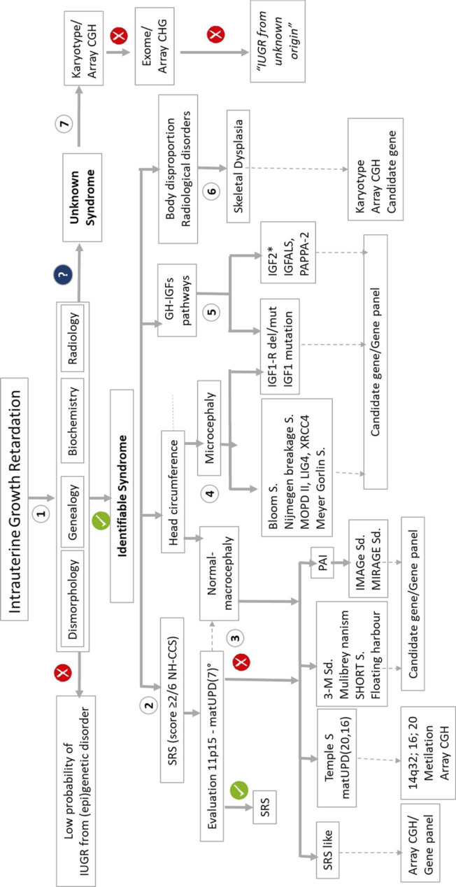
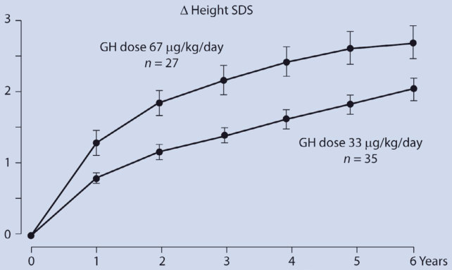
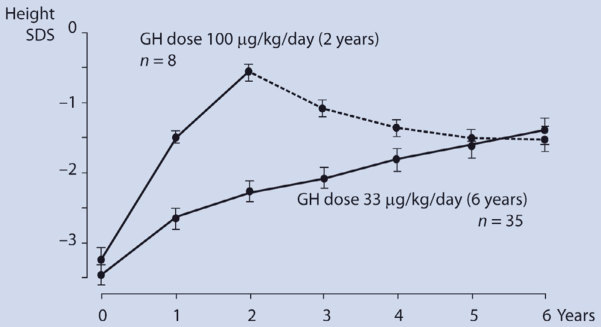
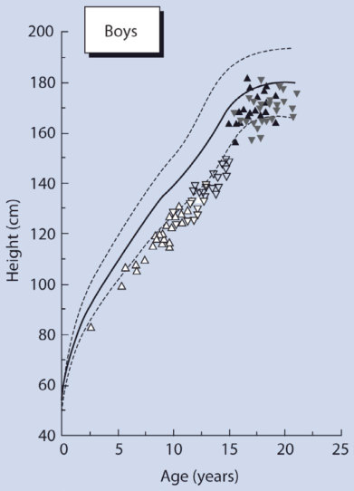
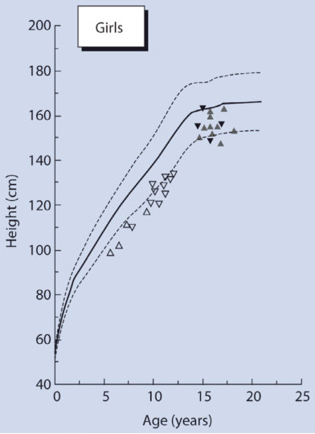
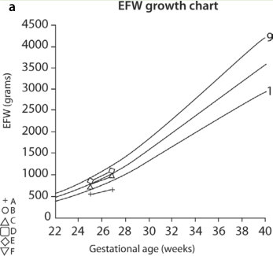
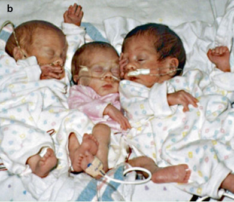
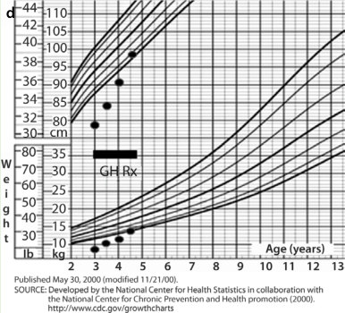

# 4. Growth Hormone Treatment of the Short Child Born Small for Gestational Age
> Source attribution: [Source credits](../../SOURCE_CREDITS.md).

## PDF page 112 | printed page 95

### Growth Hormone Treatment of the Short Child Born Small for Gestational Age

Debora Braslavsky and Steven D. Chernausek

Contents

4.1 Introduction – 96

4.1.1 Normal Fetal Growth – 96

4.2 Etiology – 98

4.3 Clinical Presentation – 100

4.4 Diagnostic Evaluation – 100

4.5 Treatment – 104

4.5.1 Effects on Skeletal Growth – 104 4.5.2 Criteria for Initiating rhGH Therapy – 105 4.5.3 rhGH Dosing and Monitoring – 106

4.6 Outcomes – 108

4.7 Safety – 109

4.8 Summary – 111

References – 112

© The Author(s), under exclusive license to Springer Nature Switzerland AG 2024 S. Radovick, M. Misra (eds.), Pediatric Endocrinology, https://doi.org/10.1007/978-3-031-66296-6_4

## PDF page 113 | printed page 96

Key Points

5 Intrauterine growth retardation is caused by a variety of conditions that affect the offspring in multiple ways. 5 Most individuals born small for gesta

tional age (SGA) show catch-up growth by age 2 years for those born at term and by 3 years for the preterm and reach a normal adult height. 5 For those who do not show catch-up

### 4

growth, growth hormone treatment accelerates growth and increases stat ure, but the responses are variable. 5 The dose of growth hormone used to

treat the short children born SGA is more than that used for growth hor mone deficiency. 5 Treatment at relatively young ages

yields an improved response.

### 4.1 Introduction

Intrauterine growth retardation (IUGR) is a pathologic condition where fetal growth is restrained by either extrinsic (maternal) fac tors or a disorder intrinsic to the fetus itself. Each year upwards of 30 million infants are born following IUGR worldwide [1]; rates are especially high in developing countries because of poor nutrition and limited prena tal care. This is a significant problem because of the morbidity that accompanies IUGR. Complications in the immediate post partum period include hypoglycemia, necro tizing enterocolitis, and persistence of the fetal circulation, to name a few [2]. Moreover, the first-year survival rate is substantially reduced in infants who have experienced IUGR [3, 4].

There are long-term sequelae of IUGR as well [5]. Affected children may have poor school performance and attenuated intellec tual development [6, 7]. There is evidence that intrauterine nutrient deprivation leads to obe sity, insulin resistance, and hyperlipidemia

later in life, an effect thought to be due to in utero “programming” of metabolic status [8, 9]. Postnatal growth is also affected adversely [10, 11]. Somewhere between 10% and 40% of children born following IUGR remain growth-retarded in childhood [12, 13]. Many never reach normal adult size [14]. The effect of IUGR on subsequent growth and its ame lioration by growth hormone (GH) therapy are the focus of this chapter.

The percentage of newborns said to have had IUGR depends on the definition applied but generally is around 3% in the United States and 10% in developing countries. It is important to consider definitions used to define IUGR as they have some bearing on the interpretation of published reports [15]. Intrauterine growth retardation (or intrauter ine growth restriction) is a failure to grow at a normal rate in the in utero environment. Sequential measurements of fetal size in utero are becoming increasingly common and now allow IUGR to be documented with greater precision and the phase of pregnancy during which the growth aberration occurred defined [16]. The more commonly used term is small for gestational age (SGA), which is simply a statistical threshold defining low birth weight at the calculated gestational age. Typical lines of demarcation are −2 SDs or <3rd percen tile. Though newborns who fall below this are assumed to have had a period of IUGR, in some cases they simply represent the end of the normal spectrum of birth size. Similarly, infants may have experienced IUGR, espe cially in the last trimester, but have a birth weight that surpasses the minimal standards. These newborns may have other features of IUGR such as decreased subcutaneous tissue and hypoglycemia.

### 4.1.1 Normal Fetal Growth

The growth rate of a human is greatest during the prenatal period with a linear growth veloc ity of up to 60 cm/year, making this period

## PDF page 114 | printed page 97

especially vulnerable to factors that affect the regulation of growth [17, 18]. Fetal growth is determined by a complex interaction of maternal, placental, and fetal factors involv ing genetic, epigenetic, and hormonal path ways. Epigenetic mechanisms are of particular interest as they control the function of the genome by regulating gene expression without altering the DNA nucleotide sequence. Epigenetic modifications are heritable at the cell level and influenced by the environment, thus providing a mechanism by which the pre natal environment may “program” the off spring to develop altered metabolic states such as obesity or diabetes [19]. Given the essential role of (epi)genetics and nutrition in

21

fetal growth and development, it is not sur prising that pathogenic variants in genes involved in cell division or differentiation can negatively affect fetal growth and may explain the absence of postnatal catch-up growth in some cases [20, 21]. Gene clusters involved in growth and regulated by epigenetic mecha nisms are found in chromosomal regions 11p.15.5, 7p11.2, 15q11-q13, 14q32, and 20q13.32 [22].

4.1

23

## PDF page 115 | printed page 98

insulin secretion increases in response to fetal glycemia, acting mainly in the third trimester when fetal weight velocity peaks. The placenta produces both IGF1 and IGF2, which are secreted into the fetal circulation. The pla centa also expresses multiple IGFBPs, influ encing the bioavailability of IGFs in the fetus [21]. IGF1 and IGF2 can compensate, at least partially, for deficiency of each other [24–27]. The growth-promoting effects of the IGFs are principally mediated by the type I or IGF1 receptor, a homolog of the insulin receptor [26]. The IGF2 “receptor,” in contrast, serves as a clearance mechanism of IGF2 and thereby modulates tissue IGF2 abundance [28, 29]. During fetal life, the IGF system operates largely independently of GH, which has little influence on body size before birth in humans. Thereafter the influence of IGF2 declines, and IGF1, under the control of GH, becomes the dominant growth regulator of postnatal life. However, at midgestation a GH variant (GHV) secreted by the placenta appears in the maternal circulation. GHV stimulates lipolysis and gluconeogenesis, increases maternal blood glucose, which passes through the placenta to the fetus. GHV also stimulates the synthesis of maternal IGF- 1, which is able to cross the placental barrier.

### 4

### 4.2 Etiology

The etiologies of IUGR are as varied as those for postnatal short stature but typically fall into one of three classes. Maternal factors that lead to IUGR include deprivation of oxy gen or nutrients (severe maternal malnutri tion, multiple gestation, cigarette smoking, and high-altitude living), infection (CMV, toxoplasmosis, and AIDS), and toxins (alco hol). Placental deficiency due to suboptimal

implantation site, placental undergrowth, infarction, or vascular anomalies such as vela mentous cord insertion and placental heman giomas can also lead to IUGR. Factors intrinsic to the fetus constitute the final clas sification and are exemplified by chromosome aneuploidy (Turner syndrome, trisomy 13 and 18) and specific genetic defects (for a review see Finken et al. [21]).

A deficiency of insulin secretion (such as that which occurs in pancreatic agenesis) or action (e.g., insulin receptor deficiency/lepre chaunism) severely impairs fetal growth and is a rare cause of IUGR [30]. More common fetal insults that produce IUGR are hypoxia and nutrient deprivation. Restriction of oxy gen or nutrients results in adaptive responses by the fetus which tend to preserve organ dif ferentiation and maturation at the expense of physical growth and energy stores (i.e., fat and glycogen). The insulin-like growth factor (IGF) axis is intimately involved in these adaptive responses.

31

4.1

52

32 53 38 53

54 56

## PDF page 116 | printed page 99

Gene(s) Disorder Major clinical features Comments References

IGF1 [38, 39]

Very rare [32–34]

IGF2 Silver-Russell syndrome Severe pre- and postnatal growth failure Epigenetic variation at imprinted locus [35–37]

[41–43]

INS Congenital diabetes Fetal growth retardation, diabetes mellitus 10% of permanent neonatal DM [40]

[44]

Paternal isodisomy or DNA methylation

variable CNS abnormalities Variable increases in circulating levels of

CNS disease in some KCNJ11 mutations

transient or permanent 40% of permanent neonatal DM

mellitus 70% of transient neonatal DM

Activating mutations

defect

abnormality Congenital diabetes Fetal growth retardation, transient diabetes

(KATP channel) Congenital diabetes Fetal growth retardation, diabetes mellitus,

IGF1 Short stature Severe pre- and postnatal growth failure,

receptor) Short stature Severe pre- and postnatal growth failure,

microcephaly, deafness, carbohydrate

Table 4.1 Important genetic anomalies causing intrauterine growth retardation in humans

intolerance

Chromosome 6 ICR

KCNJ11, ABCC8

IGF1R (IGF1

moderate to severe insulin resistance Treatment with rhIGF1 may be beneficial [45, 46]

roidism, hypogonadism, and malignancy [48, 49]

PTF1A, IPF1 Pancreatic agenesis Fetal growth retardation, diabetes mellitus Cerebellar involvement with PTF1A [47]

BLM Bloom syndrome Severe pre- and postnatal growth failure Increased risk for neoplasms [50]

bone age and midface hypoplasia Early-onset osteoarthritis [51]

absent thumb/radius Associated with GH deficiency, hypothy

Fetal growth retardation, diabetes mellitus,

ACAN Short stature Variable growth phenotype with advanced

FANC A-M Fanconi syndrome Severe pre- and postnatal growth failure,

syndrome, Rabson-Mendenhall

receptor) Donohue (leprechaun)

syndrome

INSR (insulin

### Automatic table extraction — verify rendered original

|Gene(s)|Disorder|Major clinical features|Comments|References|
|---|---|---|---|---|
|_IGF1_|Short stature|Severe pre- and postnatal growth failure, microcephaly, deafness, carbohydrate intolerance|Very rare|[32–34]|
|_IGF2_|Silver-Russell syndrome|Severe pre- and postnatal growth failure|Epigenetic variation at imprinted locus|[35–37]|
|_IGF1R_ (IGF1 receptor)|Short stature|Severe pre- and postnatal growth failure, variable CNS abnormalities|Variable increases in circulating levels of IGF1|[38, 39]|
|_INS_|Congenital diabetes|Fetal growth retardation, diabetes mellitus|10% of permanent neonatal DM|[40]|
|_KCNJ11_, _ABCC8_ (KATP channel)|Congenital diabetes|Fetal growth retardation, diabetes mellitus, transient or permanent|40% of permanent neonatal DM CNS disease in some_KCNJ11_ mutations Activating mutations|[41–43]|
|Chromosome 6 ICR abnormality|Congenital diabetes|Fetal growth retardation, transient diabetes mellitus|70% of transient neonatal DM Paternal isodisomy or DNA methylation defect|[44]|
|_INSR_ (insulin receptor)|Donohue (leprechaun) syndrome, Rabson-Mendenhall syndrome|Fetal growth retardation, diabetes mellitus, moderate to severe insulin resistance|Treatment with rhIGF1 may be benefcial|[45, 46]|
|_PTF1A_, _IPF1_|Pancreatic agenesis|Fetal growth retardation, diabetes mellitus|Cerebellar involvement with_PTF1A_|[47]|
|_FANC A-M_|Fanconi syndrome|Severe pre- and postnatal growth failure, absent thumb/radius|Associated with GH defciency, hypothy- roidism, hypogonadism, and malignancy|[48, 49]|
|_BLM_|Bloom syndrome|Severe pre- and postnatal growth failure|Increased risk for neoplasms|[50]|
|_ACAN_|Short stature|Variable growth phenotype with advanced bone age and midface hypoplasia|Early-onset osteoarthritis|[51]|

[Original table](../../tables/ch004_p0116_1.jpg)

## PDF page 117 | printed page 100

### 4.3 Clinical Presentation

ably expected to be helpful [60]. There are important reasons for establishing a diagno sis; however, it should be emphasized that in many cases it is impossible to ascertain the precise cause of prenatal growth failure [21]. Since this chapter deals primarily with the use of rhGH in augmenting growth in such chil dren, the diagnostic discussion is directed toward determining whether rhGH therapy is warranted. The diagnostic approach is framed under several relevant questions. 1. Does the patient have a disorder that limits

After birth, most SGA newborns increase their growth velocity substantially and approx imately 85% eventually catch up in height [12, 57, 58]. However, there is a relationship between birth weight and stature that is main tained for several years during childhood, with patients being born especially small and remaining short on the average [14, 59].

### 4

Patients generally present to the endocri nologist in one of two ways. The first is imme diately following birth when categorized as SGA. The questions that arise at this time relate to potential causes of IUGR and whether the patient will have normal growth thereafter. The extent of the evaluation will depend on the severity of growth retardation, the existence of concurrent medical condi tions or dysmorphic features, and whether the cause of IUGR is evident.

A more common presentation is that of the short child between the ages of 3 and 8 years. The child was born with a low birth weight and was expected to “catch up.” However, catch-up never occurred, and the child has had the same relative degree of short stature for many years. That is, when plotted on the growth chart, the trajectory seems to parallel the norm, just three to five SDS below average. The child has been otherwise healthy, and parents are concerned that the short stat ure will become increasingly problematic as the patient ages. They wonder whether any thing can be done to improve stature. It is not always evident that the persistent small size is related to a growth disorder that began prior to birth. Only by reviewing the birth weight and history of pregnancy and delivery does this information come to light.

2. Is the cause of IUGR obvious?

### 4.4 Diagnostic Evaluation

The causes of growth failure are many, as are the tests that can be applied to such patients. One should consider the likely possibilities and apply the diagnostic tests that are reason

both pre- and postnatal growth?

Certain common endocrine disorders, such as hypothyroidism and GH defi ciency, have the most pronounced effects on postnatal growth. Even when the con dition is congenital, most are born within the normal range for length and weight. Thus, these diagnoses are usually elimi nated when prenatal growth restriction is prominent. The same applies to common, acquired causes of growth failure such as celiac disease. Patients who are born SGA without dysmorphic features and show catch-up growth during the first year do not require further evaluation. Patients being evaluated for IUGR who are still in the first few months of life should simply be tracked in terms of growth if they have no dysmorphic features, malformations, or suspicious symptoms. Most patients des tined to catch up will demonstrate increased growth velocity during the first 6 months of life and will have caught up by the end of the first year [12, 61, 62]. Patients who have shown no evidence of improved growth following birth need fur ther evaluation.

A careful history and physical exami nation can be very helpful in explaining IUGR. Maternal hypertension and poor weight gain during pregnancy suggest a maternal factor. Dysmorphic features in the baby imply that a syndrome associated with IUGR is present. Useful diagnostic tests for evaluating patients with IUGR

## PDF page 118 | printed page 101

are listed in Box 4.1. A karyotype is par ticularly important for females because Turner syndrome is typically accompanied by mild prenatal growth restriction some times without the characteristic pheno type. Patients with dysmorphic features should have karyotyping as well or be con sidered for other specialized genetic tests with further evaluation by a geneticist/dys morphologist. It is particularly important to recognize Bloom and Fanconi syn dromes, recessive disorders associated with severe IUGR, and poor postnatal growth. These patients have increased chromo somal breakage and usually develop malignancies later in childhood. For these reasons, rhGH therapy may be contraindi cated. The diagnosis of Bloom syndrome is often suspected with routine chromo some studies in which there is increased chromosome breakage and formation of triradial chromosomes. Confirmation requires direct gene analysis.

Assessment of renal function is required because mild forms of renal dys plasia can produce IUGR and moderate postnatal growth failure that is otherwise not evident. These patients may manifest oligohydramnios as a clue to the diagnosis. 3. Why has the patient not shown catch-up

growth?

If more were known about the mecha nisms involved in catch-up growth, it would be easier to explain why, in certain cases, it does not occur. In some situations, the fetal growth retardation may have been so severe and the cellular mass at birth is so low that the overall somatic size is ulti mately restricted. Even with the normal ization of nutritional and hormonal factors, simply restoring normal growth (body size doubling at normal intervals) still leaves a person small relative to the peers. In other cases, patients do not reach normal size following birth because of the persistence of a defect in growth regula tion or cellular growth and replication. From a practical point of view, it is impor

tant to consider that catch-up growth may be impaired in patients whose nutritional status is compromised. A careful dietary history and review by a nutritionist can be helpful and is especially indicated in a patient with low weight for height.

Abnormalities in the GH/IGF axis clearly explain the lack of catch-up in patients with molecular defects in IGF1, IGF2, and IGF1R. However, changes in the secretion and action of GH and the IGFs are also involved in the broader pop ulation of affected patients. Circulating concentrations of IGF-I tend to be rela tively low at birth in children born SGA and remain suppressed in those with poor catch-up [63]. Though the absence of GH clearly cannot explain their prenatal growth retardation, studies by Boguszewski et al. [64] and de Waal et al. [65] have sug gested that there is an increased incidence of low GH secretion in patients with short stature following IUGR. These data imply that reduced pituitary GH secretion con tributes to relatively poor postnatal growth in some cases. However, the ability of indi ces of GH secretion to predict response to GH therapy for this group of patients is not clear. Earlier reports suggested that low overnight GH concentrations or low IGF1 concentrations were associated with an improved response [66, 67], whereas later reports, examining greater numbers, found no predictive value in these mea sures [68–70]. However, such studies fre quently differ in the patient selection (e.g., severity of IUGR and short stature), the dosing of rhGH, and the tests of GH release. Studies that examine larger num bers of patients only slightly SGA likely include a significant proportion that does not necessarily have disorders of prenatal growth and/or have differing etiologies from those patients who are −4 to −5 SD below average for birth size. In addition, large doses of rhGH administered could obscure underlying differences in sensitiv ity to GH.

## PDF page 119 | printed page 102

There is also evidence that short SGA children may have relative resistance to IGF1 [71]. Cutfield et al. [72] showed that circulating concentrations of IGF1, while lower than normal in short SGA children, were higher than those with idiopathic short stature of the same age. Chatelain et al. [73] demonstrated that short SGA children required higher circulating con centrations of IGF1 during GH treatment to achieve growth rates equal to children with GH deficiency or familial short stat ure treated with GH.

### 4

Most patients do not meet the bio chemical criteria for classic GH deficiency or other known endocrine disorders. Thus, the most likely explanation for their poor postnatal growth is the persistence of a problem intrinsic to the fetus. There may be a specific genetic defect that continues to limit growth, or the early growth restric tion has, in some way, reprogrammed the growth regulating system so that the child remains small. The evidence above sug gests that the reprogramming involves alterations in the GH/IGF axis that result in a situation analogous to that seen with type 2 diabetes mellitus. Type 2 diabetes is characterized by insulin resistance cou pled with reduced insulin secretion. Thus, the short child born SGA could be thought of as having “type 2 growth deficiency,” where there are inadequate circulating lev els of IGF1 in the face of relative IGF resistance.

4.2

51

75

74 76

77

Box 4.1 Useful Tests for IUGR-Associ ated Short Stature General

5 Complete blood count

5 BUN/creatinine

5 Blood glucose

5 Serum electrolytes

5 IGF1/IGFBP-3

5 Radiological skeletal survey

5 Bone age

Specialized

5 Karyotype in girls (Turner syndrome)

5

4.2 5 Cytogenetic studies to assess chromo

some stability (Bloom syndrome, Fan coni syndrome)

## PDF page 120 | printed page 103

21 37

21 51 74

20 74 76

65

32 34 38 39 50

74

20 21 74

37

Unmatched source image; PDF page 120. Consult the original caption.

## PDF page 121 | printed page 104

### 4.5 Treatment

### 4

4.2

The main goals of rhGH treatment of the short children born SGA are to improve height during childhood and to achieve a final height adequate for the appropriate popula tion. As previously described, primary distur bances of GH/IGF are uncommon explanations for the lack of catch-up growth

Table 4.2 Indications for rhGH use in short children born small for gestational age

### FDA

(2001)

### EMEA (2003)

Consensus statement (2023)

SGA defined Not defined

Birth weight or length <−2 SD

Birth weight or length <−2 SD

Earliest age at start (years)

2 4 3–4 years

≤−2.0 ≤−2.5

Height at start SDS

Growth velocity No catch-up

<0 SDS No catch-up

<−1.0 SDS

Reference to midparental height

Not defined

Doses 70 μg/kg/ day

35 μg/kg/day (1 mg/m2/day)

33–67 μg/kg/day

Data are from somatropin package insert for the United States, from report 3478/03 by the Committee for Proprietary Medicinal Products of the EMEA from Hokken-Koelega et al. [74], Boguszewski et al. [78], and Tanaka et al. [79] SGA small for gestational age, SDS standard deviation score, Pc percentile

in children born IUGR. Why then would one expect rhGH treatment to benefit patients with short stature associated with IUGR? The most straightforward answer is that rhGH administered at pharmacological dosages stimulates the GH/IGFs system sufficiently to overcome whatever cellular condition has not allowed the expected catch-up growth to restore age-appropriate size.

### 4.5.1 Effects on Skeletal Growth

80 82

83

84

Japan (2007)

Consensus Latin- America (2011)

Birth weight or length <−2 SD

3 2

≤−2.5 ≤−2.0

<0 SDS <25 Pc

Not defined

Not defined

### Automatic table extraction — verify rendered original

|Col1|FDA (2001)|EMEA (2003)|Consensus statement (2023)|Japan (2007)|Consensus Latin-­ America (2011)|
|---|---|---|---|---|---|
|SGA defned|Not defned|Birth weight or length<−2 SD|Birth weight or length<−2 SD||Birth weight or length<−2SD|
|Earliest age at start (years)|2|4|3–4years|3|2|
|Height at start SDS|≤−2.0|≤−2.5||≤−2.5|≤−2.0|
|Growth velocity|No catch-up|<0 SDS|No catch-up|<0 SDS|<25 Pc|
|Reference to midparental height|Not defned|<−1.0 SDS||Not defned|Not defned|
|Doses|70μg/kg/ day|35μg/kg/day (1mg/m2/day)|33–67μg/kg/day|||

[Original table](../../tables/ch004_p0121_1.jpg)

## PDF page 122 | printed page 105

However, the doses employed were modest by today’s standards, being similar to those given to patients with GH deficiency at the time. Subsequent studies showed clearly that rhGH stimulates growth in short children born SGA and that such growth can be sustained for sev eral years [85] increasing adult height ( Fig. 4.3). Meaningful gains require a dose higher than typical for GH deficiency over several years of treatment. Overall, an increase of about 2 SDS in height over the height SDS at treatment initiation can be expected when rhGH is given for 5 years or more [70]. However, the outcome is significantly influ enced by the timing of puberty. Catch-up growth that yields a normal height for age and sex before starting puberty is required to achieve the expected final height. Only modest gains in SDS occur in the absence of treat ment or when treatment starts close to puber tal onset [87, 88].

### 4.5.2 Criteria for Initiating rhGH

### Therapy

Treatment should be limited to those patients in whom short stature is at least moderately severe (<2.0 SDS) and where there is little

expectation of meaningful catch-up growth over the next several years. If significant catch-up is going to occur, it is usually evident during the first year of life. Since growth pat terns can be variable, careful measures over at least 6 months (preferably 12) should be per formed to assess underlying growth velocity in all patients prior to treatment. Patients born at term that present after age 2 with persistent short stature typically have a growth rate in the low-normal range and are unlikely to show substantial improvement in height SDS over the next several years. For preterm SGA, the expected age for catch-up growth is 3 years of age.

Assessment of final height prognosis with a bone age measurement is not generally use ful in selecting those most likely to benefit from rhGH treatment. As most patients are quite young and may have underlying patho logical conditions, the prediction is usually inaccurate and overestimates final height [89].

Since younger patients respond better, treatment can be initiated once it is clear that the growth velocity is insufficient to normalize height. Patients in mid-childhood would likely benefit as well, but those well into puberty are at a disadvantage because of the limited time before epiphyseal fusion [87].

86

Unmatched source image; PDF page 122. Consult the original caption.

## PDF page 123 | printed page 106

Few studies evaluate the growth response of patients with specific genetic syndromes in numbers sufficient to assess efficacy, with the exception is SRS. These patients, although typically shorter than the average SGA patient, show a growth response to rhGH equivalent to the nonsyndromic [90]. For other syndromic patients, in the absence of data to the contrary, it is reasonable to con sider that rhGH may also be effective and evaluate the response in each case.

### 4

Measures of GH secretion, though fre quently performed, do not appear to predict growth response and are not recommended unless the growth velocity is persistently reduced and signs of GH deficiency or hypo pituitarism are present [74]. The authors’ approach is to measure circulating IGF1 and IGFBP-3 and only perform tests of GH release if these parameters are subnormal or there are other reasons to suspect pituitary involvement. If the IGFs and measures of GH release are all low, this suggests a lack of GH is limiting the skeletal growth and the need for supplementation clear. Aboveaverage concentrations of IGF1 may signify IGF insensitivity in a child with both pre- and postnatal growth failure [33, 38, 39]. The diag nosis of GH deficiency should not alter the decision to treat, but IGF1 insensitivity will blunt the response. The purpose of studying GH/IGF1 axis is to individualize the clinical management of the patients.

### 4.5.3 rhGH Dosing and Monitoring

1

1 Clinical trials with long-acting GH preparations are currently underway in an attempt to improve adher ence by reducing the daily administrations to weekly or monthly. There are still areas of uncertainty including methods of dose adjustment, timing of monitoring of IGF-I, cost-effectiveness, and longterm efficacy and safety [91].

74

92

93 94

86

4.4

Periodic assessment of circulating IGF1 during rhGH therapy is recommended for patients receiving rhGH to evaluate adher ence to treatment and as a safety approach. Doses of rhGH that produce supranormal circulating levels of IGF1 raise concerns regarding increased risk of severe adverse events, in particular risk of malignancies. The theory is reasonable, but unproven by the best-quality information available [95, 96]. In

## PDF page 124 | printed page 107

addition, the measurement of IGF1 in the cir culation is affected by multiple factors that may complicate the interpretation [97].

For short children born SGA, IGF1 levels may appear to be in the hazardous range while receiving rhGH, but it is possible that a degree of IGF1 resistance plays a role in growth limi tation. In that circumstance, raising IGF1 concentrations above normal might be needed, especially if the growth response is less than that desired [98]. Furthermore, the range of IGF1 blood levels is very wide among normal children suggesting varied sensitivity of individuals to IGF1 or that circulating IGF1 is a poor reflection of signal strength at the cellular level. In fact, titrating GH dose by circulating IGF1 in hopes of optimizing treat ment appears less effective than the standard dosing strategy [99, 100]. Clearly, more work needs to be done to define how biomarkers of GH action can be used in the selection of therapeutic regimens for patients [101]. In the meantime, a reasonable approach is to use rhGH in the dose ranges as outlined above, with adjustments to achieve growth rates yielding catch-up growth when the patient is below the 5th percentile for height and pre scribe rhGH at doses that will maintain nor mal growth when the patient is solidly in the normal range for height. With this approach circulating IGF1 levels are often within the

86

upper normal range during the growth main tenance phase [102].

Short children born SGA may have reduced insulin sensitivity before the start of rhGH treatment [103]. Moreover, rhGH treat ment typically results in a further decrease in insulin sensitivity with a compensatory increase in insulin secretion due to the insulinantagonistic effects of GH [104–106]. However, rhGH therapy in short children born SGA rarely causes glucose intolerance or diabetes and metabolic parameters return to baseline or even improve following rhGH withdrawal [107]. Thus, there is no specific recommendation for monitoring glucose metabolism routinely except for patients with familial predisposition or obesity.

Monitoring adherence to the treatment regimen is essential. Poor adherence is one of the most common factors underlying subopti mal growth during rhGH therapy and should be actively evaluated and managed before considering other illnesses that can affect growth, unresponsiveness, or an increment of dose. Improving families’ adherence to rhGH treatment is required to achieve the expected efficacy and promote pharmacoeconomy [108, 109].

Patients should have re-evaluation at a minimum of 6 months intervals with careful history and physical examination, seeking

Unmatched source image; PDF page 124. Consult the original caption.

## PDF page 125 | printed page 108

signs and symptoms of scoliosis, other ortho pedic abnormalities, intracranial hyperten sion, and assessment of growth response to therapy. It is worth performing a bone age around the age of 8 years and regularly from the onset of puberty onwards [80]. This method is inaccurate in predicting adult height in children born SGA [74].

### 4

As pubertal development has a great impact on final height, pubertal onset and progress need to be carefully monitored in SGA patients. The pattern of puberty in chil dren born SGA is heterogenous, with a sub group characterized by either early onset, shorter or earlier peak height velocity, and/or accelerated bone maturation [110, 111]. The combination of rhGH and gonadotropinreleasing hormone analog treatment in SGA children whose final height may be compro mised because of a significant growth deficit at the pubertal onset can be considered [112].

### 4.6 Outcomes

85

4.5

Despite the known individual response to treatment, there are recognizable factors asso ciated with an improved outcome such as younger age and greater height at the start of treatment, height gain during the first year of treatment, longer duration of treatment, length at birth, higher parental height, and delayed bone age for chronological age. Moreover, the underlying etiology of SGA also impacts the response to the treatment [74].

After two decades of follow up of SGA patients treated with rhGH, benefits of rhGH

113

Unmatched source image; PDF page 125. Consult the original caption.

Unmatched source image; PDF page 125. Consult the original caption.

## PDF page 126 | printed page 109

treatment beyond stature have been observed. There is an improvement in body composition (i.e., a decrease in fat mass and an increase in lean body mass) due to the lipolytic and ana bolic effects of GH [104, 114, 115]. Positive effects on bone are reported as well with incre ments in bone mineral density [116] reflecting the significant role of the GH–IGF1 axis in the accrual of bone mass. Additionally, longterm GH treatment improves psychosocial development and health-related quality of life in children and adolescents born SGA [117, 118].

In summary, the efficacy of rhGH therapy is dependent upon making the correct diagno sis, starting treatment at an opportune time, administering the appropriate dose of rhGH, and maintaining patient adherence.

### 4.7 Safety

An important issue facing a physician pre scribing any drug is the possibility of adverse effects. Safety issues during rhGH replace ment may be related to the substance itself, to the formulation of the drug (impurities and additives), or the result of the genuine (nor mal) effects (growth of bones or other tissues, and metabolic actions). They may be also due to inappropriate doses or a true incompatibil ity with the patient being treated [119]. After many years of rhGH treatment in a large number of children, it is evident that rhGH rarely causes serious morbidity [120]. However, the short children born SGA deserves special consideration. First, the dose of rhGH prescribed is higher than that used for GH deficiency, and second, this patient population may have unique susceptibilities to certain pharmacological properties of GH.

Epidemiological and experimental data indicate that humans born SGA have an increased incidence of obesity and type 2 dia betes as adults, with the implication that a period of fetal undernutrition results in a resetting of intrinsic insulin sensitivity [121, 122]. Individuals who had IUGR show evi dence of decreased insulin sensitivity already as children [123]. Could increased levels of

GH, which diminish insulin sensitivity, add to the risk of developing obesity, hyperlipidemia, and insulin resistance later in life? Thus far data from patients treated show only modest effects on basal insulin levels [124] and no clinically significant impact on glucose or lipid metabolism [114]. Moreover, measures of carbohydrate metabolism after the comple tion of rhGH treatment are no different in those treated compared to untreated adults born SGA. If anything, lipid profiles and blood pressure indices are better in those treated [125]. Nonetheless, the number of patients treated with the highest doses remains too few to detect uncommon, but significant, long-term sequelae.

The known pro-proliferative, angiogenic, and anti-apoptotic properties of GH and IGF1 have raised concerns regarding a possi ble increased risk of malignancy [126, 127] though this has been difficult to quantify. Analyses of the risk of rhGH treatment in patients who developed GH deficiency as a consequence of tumor treatment do not sug gest a role for GH in the development of a relapse [127–129]. However, large epidemio logical studies find that the risks for prostate cancer [130] and breast cancer [131] are increased for people with serum IGF1 con centrations in the upper ranges of normal. The studies do not prove cause and effect, but tumor cells in culture frequently express IGF1 receptors and replicate in response to IGF1 [132]. This raises the question as to whether the high IGF1 levels that generally accom pany high-dose rhGH therapy might increase the risk for neoplasia over the long term. Thus, rhGH treatment is usually contraindi cated in children with cancer predisposition syndromes (e.g., Bloom syndrome, Li Fraumeni syndrome, Lynch syndrome, and Fanconi anemia). However, it may be cau tiously considered in those with proven GH deficiency and only after informed discussion with the patient and parents/guardians [127]. Despite the above concerns, review by interna tional pediatric endocrinology societies con clude that rhGH can be safely administered to children without known risk factors for malig nancy [74, 133].

## PDF page 127 | printed page 110

Most published studies of rhGH safety in children focused on short- or intermediateterm events. Only recently has it been possible to begin to assess late effects in adults who were treated with rhGH during childhood for nongrowth hormone-deficient conditions such as the short children born SGA. SAGhE (Safety and Appropriateness of Growth Hormone Treatments in Europe) is an ongo ing large, epidemiologic study (n = approx. 24,000, with more than 400,000 patient-years of follow-up) that examines long-term outcomes of treatment [134, 135]. Initial reports suggested that all-cause mortality and stroke were increased in adults treated with rhGH in childhood and that the risk may increase with higher doses, at least for mortal ity [136, 137]. However, the number of adverse events detected was very low, the appropriate ness of reference populations challenged, and results not yet confirmed. Thus, a recent, society-sponsored, position paper concluded “the aggregate evidence from available data sets does not support an association between ongoing or previous rhGH therapy and allcause mortality” [98].

### 4

Savendahl et al. classified pediatric patients treated with rhGH into three risk groups based on diagnosis and considered the short children born SGA as a low-risk group. They analyzed individuals born SGA separately, showing that the risk of serious adverse effects is very low in individuals without predisposing risk factors, and there was no indication that rhGH therapy caused new malignancies or

Case Study

4.6

diabetes. On the contrary, short children born SGA with obesity, accelerated catch-up growth and/or familial diabetes are considered a subgroup with a higher risk of metabolic disorder in the long-term follow-up [134].

Finally, additional complications described for rhGH therapy, include orthope dic problems such as scoliosis (inci dence—148/100,000) and slipped capital femoral epiphysis (15–19/100,000), especially in obese children and secondary intracranial hypertension (81/100,000) [138].

Most patients without GH deficiency should cease rhGH treatment when near adult height is achieved, defined as growth velocity below 2 cm/year and/or bone maturation above 14 years in girls and 16 years in boys. The rationale for timely suspension lies in avoiding unnecessary exposure to rhGH when it no longer stimulates growth, preventing the occurrence of acromegaloid changes, and reducing cost. Treatment should be discontin ued or interrupted before adult height attain ment when the growth response is poor (height velocity <−1 SDS/age and sex), there is a severe adverse event, or a diagnosis is uncov ered with a high risk of malignancy [74].

Presently there is no indication for con tinuing rhGH after epiphyseal closure. However, recent guidelines recommend that previously rhGH-treated young adults born SGA should maintain or adopt a healthy diet and lifestyle with regular exercise to avoid excessive weight gain in order to prevent met abolic and/or cardiovascular disease [74].

4.6

## PDF page 128 | printed page 111

### 4.8 Summary

There are many reasons why a child is born SGA; at least half the time, the cause is not evident. Nevertheless, 80–90% of the children will show improved growth after birth and reach heights in the normal range by age 2 years. For those that remain short, stature below the 3rd percentile is likely to persist. Growth hormone treatment is effective at stimulating growth and improving adult height and is generally safe. Tests of growth hormone

secretion and action are typically not helpful in making specific diagnoses or predicting the response to treatment in this population. Careful monitoring during treatment and attention to appropriate dosing are important because responses are variable. Some patients will not respond sufficiently, and treatment is unlikely to benefit them. Advances in our abil ity to make specific diagnoses using molecular genetic techniques will likely improve our abil ity to establish causes of IUGR and determine appropriate treatment regimens.

Unmatched source image; PDF page 128. Consult the original caption.

Unmatched source image; PDF page 128. Consult the original caption.

Unmatched source image; PDF page 128. Consult the original caption.

Unmatched source image; PDF page 128. Consult the original caption.

## PDF page 129 | printed page 112

Review Questions

Consider the case study for the following questions. 1. Immediately following the birth of her

2. C. According to the guidelines [74],

child, the mother asks what are the chances that her small baby will grow and be “on the growth chart” by age 2 years. Which of the following best approximates the percentage of chil dren born SGA who show such catchup growth? A. 80% B. 40% C. 20% D. 10%

### 4

2. At age 3 years, growth hormone ther

apy is being considered. Which of the following tests should be performed at this time if not done previously? A. Sweat chloride B. Test of growth hormone release C. Karyotype D. Oral glucose tolerance test

3. D. The idea that the short child or an

3. GH treatment is initiated at age 3 years

at a weight-based dose of 33 μg/kg/day. Substantial catch-up growth occurred and at age 4 and 1⁄2, she is now at the 10th percentile for height. Which of the following represents the best approach to continued management?

A. Discontinue GH as she has now

### References

reached a height in the normal range. B. Double the dose of GH to account

1. Lee AC, Katz J, Blencowe H, Cousens S, Kozuki

N, Vogel JP, et al. National and regional estimates of term and preterm babies born small for gesta tional age in 138 low-income and middle-income countries 2013;1(1):e26–36. 2. Malhotra A, Allison BJ, Castillo-Melendez M,

for the declining response expected after 2 years of therapy. C. Adjust GH dose to achieve a circu

lating IGF1 concentration that is within 1 standard deviation of the average for age and sex. D. Maintain the current regimen of

Jenkin G, Polglase GR, Miller SL. Neonatal mor bidities of fetal growth restriction: pathophysiol ogy and impact. Front Endocrinol (Lausanne). 2019;10:55. 3. Katz J, Lee AC, Kozuki N, Lawn JE, Cousens S,

weight-based dosing with continu ing monitoring of growth response.

Blencowe H, et al. Mortality risk in preterm and small-for-gestational-age infants in low-income and middle-income countries: a pooled country analysis. Lancet. 2013;382(9890):417–25. 4. Mendez-Figueroa H, Truong VT, Pedroza C,

v Answers

1. A. Although results vary by study, all

find that the majority of straightfor ward cases of IUGR show catch-up growth in the first 2 years of life. The

Chauhan SP. Morbidity and mortality in smallfor-gestational-age infants: a secondary analysis

largest study [12] indicated that 84% catch up by age 2.

Turner syndrome needs to be excluded in short SGA girls. Patients with growth failure due to cystic fibrosis (tested by sweat chloride) do not show prenatal growth retardation. Tests of growth hormone release are only indi cated when there is suspicion. In this case, it would appear that the fetal growth retardation was a result of pla cental compromise/competition. Although one might be concerned about changes in insulin sensitivity that occur in conjunction with being born SGA and which might be aggra vated by growth hormone treatment, specific diagnostic measures such as an OGTT are not recommended.

SGA would maintain a relative stature once in the normal range was dis proven scientifically [86]. The patient has responded well so there is no rea son to increase the dose which would exceed the label dose. IGF1-based dos ing has not proven advantageous in this condition.

in 2010. Lancet Glob Health.

## PDF page 130 | printed page 113

of nine MFMU network studies. Am J Perinatol. 2017;34(4):323–32. 5. Chernausek SD. Update: consequences of abnor

19. Gantenbein 20. Dauber 21. Finken MJJ, van der Steen M, Smeets CCJ,

mal fetal growth. J Clin Endocrinol Metab. 2012;97(3):689–95. 6. Lindstrom L, Wikstrom AK, Bergman E,

Lundgren M. Born small for gestational age and poor school performance—how small is too small? Horm Res Paediatr. 2017;88(3–4):215–23. 7. Sacchi C, Marino C, Nosarti C, Vieno A, Visentin

S, Simonelli A. Association of intrauterine growth restriction and small for gestational age status with childhood cognitive outcomes: a sys tematic review and meta-analysis. JAMA Pediatr. 2020;174(8):772–81. 8. Netchine I, van der Steen M, Lopez-Bermejo A,

22. Wit JM, Oostdijk W, Losekoot M, van

Koledova E, Maghnie M. New horizons in short children born small for gestational age. Front Pediatr. 2021;9:655931. 9. Gatford KL, Simmons RA. Prenatal program

23. Netchine I, Azzi S, Le Bouc Y, Savage MO. IGF1

ming of insulin secretion in intrauterine growth restriction. Clin Obstet Gynecol. 2013;56(3):520–8. 10. Prendergast AJ, Humphrey JH. The stunting syn

24. Baker J, Liu JP, Robertson EJ, Efstratiadis

drome in developing countries. Paediatr Int Child Health. 2014;34(4):250–65. 11. Christian P, Lee SE, Donahue Angel M, Adair

25. DeChiara TM, Efstratiadis A, Robertson EJ. A

LS, Arifeen SE, Ashorn P, et al. Risk of child hood undernutrition related to small-forgestational age and preterm birth in low- and middle-income countries. Int J Epidemiol. 2013;42(5):1340–55. 12. Albertsson-Wikland K, Karlberg J. Natural

26. Liu JP, Baker J, Perkins AS, Robertson EJ,

growth in children born small for gestational age with and without catch-up growth. Acta Paediatr Suppl. 1994;399:64–70; discussion 1. 13. Fitzhardinge PM, Steven EM. The small-for-date

27. Powell-Braxton L, Hollingshead P, Warburton C,

infant. I. Later growth patterns. Pediatrics. 1972;49(5):671–81. 14. Leger J, Levy-Marchal C, Bloch J, Pinet A,

28. Lau MM, Stewart CE, Liu Z, Bhatt H, Rotwein P,

Chevenne D, Porquet D, et al. Reduced final height and indications for insulin resistance in 20 year olds born small for gestational age: regional cohort study. BMJ. 1997;315(7104):341–7. 15. Beune IM, Bloomfield FH, Ganzevoort W,

29. Wang ZQ, Fung MR, Barlow DP, Wagner

Embleton ND, Rozance PJ, van Wassenaer- Leemhuis AG, et al. Consensus based definition of growth restriction in the newborn. J Pediatr. 2018;196:71–6.e1. 16. Sovio U, White IR, Dacey A, Pasupathy D, Smith

30. Fowden AL. Insulin deficiency: effects on fetal

GCS. Screening for fetal growth restriction with universal third trimester ultrasonography in nul liparous women in the Pregnancy Outcome Prediction (POP) study: a prospective cohort study. Lancet. 2015;386(10008):2089–97. 17. Jee YH, Baron J. The biology of stature. J Pediatr.

31. Lupu F, Terwilliger JD, Lee K, Segre GV,

32. Woods KA, Camacho-Hubner C, Savage MO,

2016;173:32–8. 18. Karlberg J. On the construction of the infancy-

childhood-puberty growth standard. Acta Paediatr Scand Suppl. 1989;356:26–37.

KV, Kanaka-Gantenbein C. Highlighting the trajectory from intrauterine growth restriction to future obesity. Front Endocrinol (Lausanne). 2022;13:1041718. A, Rosenfeld RG, Hirschhorn JN. Genetic evaluation of short stature. J Clin Endocrinol Metab. 2014;99(9):3080–92.

Walenkamp MJE, de Bruin C, Hokken-Koelega ACS, et al. Children born small for gestational age: differential diagnosis, molecular genetic eval uation, and implications. Endocr Rev. 2018;39(6):851–94.

Duyvenvoorde HA, Ruivenkamp CA, Kant SG. Mechanisms in endocrinology: novel genetic causes of short stature. Eur J Endocrinol. 2016;174(4):R145–73.

molecular anomalies demonstrate its critical role in fetal, postnatal growth and brain development. Best Pract Res Clin Endocrinol Metab. 2011;25(1):181–90.

A. Role of insulin-like growth factors in embry onic and postnatal growth. Cell. 1993;75(1):73–82.

growth-deficiency phenotype in heterozygous mice carrying an insulin-like growth factor II gene disrupted by targeting. Nature. 1990;345(6270):78–80.

Efstratiadis A. Mice carrying null mutations of the genes encoding insulin-like growth factor I (Igf-1) and type 1 IGF receptor (Igf1r). Cell. 1993;75(1):59–72.

Dowd M, Pitts-Meek S, Dalton D, et al. IGF-I is required for normal embryonic growth in mice. Genes Dev. 1993;7(12B):2609–17.

Stewart CL. Loss of the imprinted IGF2/cationindependent mannose 6-phosphate receptor results in fetal overgrowth and perinatal lethality. Genes Dev. 1994;8(24):2953–63.

EF. Regulation of embryonic growth and lyso somal targeting by the imprinted Igf2/Mpr gene. Nature. 1994;372(6505):464–7.

growth and development. J Paediatr Child Health. 1993;29(1):6–11.

Efstratiadis A. Roles of growth hormone and insulin-like growth factor 1 in mouse postnatal growth. Dev Biol. 2001;229(1):141–62.

Clark AJ. Intrauterine growth retardation and postnatal growth failure associated with deletion of the insulin-like growth factor I gene. N Engl J Med. 1996;335(18):1363–7.

## PDF page 131 | printed page 114

33. Walenkamp MJ, Losekoot M, Wit JM. Molecular

IGF-1 and IGF-1 receptor defects: from genetics to clinical management. Endocr Dev. 2013;24:128–37. 34. Bonapace G, Concolino D, Formicola S,

46. Taylor SI, Cama A, Accili D, Barbetti F, Quon

Strisciuglio P. A novel mutation in a patient with insulin-like growth factor 1 (IGF1) deficiency. J Med Genet. 2003;40(12):913–7. 35. Abu-Amero S, Monk D, Frost J, Preece M,

47. Polak M, Cave H. Neonatal diabetes mellitus: a

Stanier P, Moore GE. The genetic aetiology of Silver-Russell syndrome. J Med Genet. 2008;45(4):193–9. 36. Gicquel C, Rossignol S, Cabrol S, Houang M,

### 4

48. Bagby GC, Alter BP. Fanconi anemia. Semin

Steunou V, Barbu V, et al. Epimutation of the telomeric imprinting center region on chromo some 11p15 in Silver-Russell syndrome. Nat Genet. 2005;37(9):1003–7. 37. Netchine I, Rossignol S, Dufourg MN, Azzi S,

49. Wang W. Emergence of a DNA-damage response

50. Kaneko H, Kondo N. Clinical features of Bloom

Rousseau A, Perin L, et al. 11p15 imprinting cen ter region 1 loss of methylation is a common and specific cause of typical Russell-Silver syndrome: clinical scoring system and epigenetic-phenotypic correlations. J Clin Endocrinol Metab. 2007;92(8):3148–54. 38. Abuzzahab MJ, Schneider A, Goddard A,

51. van der Steen M, Pfundt R, Maas S, Bakker-van

Grigorescu F, Lautier C, Keller E, et al. IGF-I receptor mutations resulting in intrauterine and postnatal growth retardation. N Engl J Med. 2003;349(23):2211–22. 39. Kawashima Y, Takahashi S, Kanzaki S. Familial

52. Rosenfeld RG, Rosenbloom AL, Guevara-

short stature with IGF-I receptor gene anomaly. Endocr J. 2012;59(3):179–85. 40. Edghill EL, Flanagan SE, Patch AM, Boustred

53. Hwa V, Fujimoto M, Zhu G, Gao W, Foley C,

C, Parrish A, Shields B, et al. Insulin mutation screening in 1,044 patients with diabetes: muta tions in the INS gene are a common cause of neo natal diabetes but a rare cause of diabetes diagnosed in childhood or adulthood. Diabetes. 2008;57(4):1034–42. 41. Babenko AP, Polak M, Cave H, Busiah K,

54. Hawkes CP, Murray DM, Kenny LC, Kiely M,

Czernichow P, Scharfmann R, et al. Activating mutations in the ABCC8 gene in neonatal diabe tes mellitus. N Engl J Med. 2006;355(5):456–66. 42. Gloyn AL, Pearson ER, Antcliff JF, Proks P,

55. Lassarre C, Hardouin S, Daffos F, Forestier F,

Bruining GJ, Slingerland AS, et al. Activating mutations in the gene encoding the ATP-sensitive potassium-channel subunit Kir6.2 and perma nent neonatal diabetes. N Engl J Med. 2004;350(18):1838–49. 43. Gloyn AL, Siddiqui J, Ellard S. Mutations in the

56. Reece EA, Wiznitzer A, Le E, Homko CJ,

genes encoding the pancreatic beta-cell KATP channel subunits Kir6.2 (KCNJ11) and SUR1 (ABCC8) in diabetes mellitus and hyperinsulin ism. Hum Mutat. 2006;27(3):220–31. 44. Arima T, Drewell RA, Arney KL, Inoue J, Makita

57. Karlberg JP, Albertsson-Wikland K, Kwan EY,

Y, Hata A, et al. A conserved imprinting control region at the HYMAI/ZAC domain is implicated in transient neonatal diabetes mellitus. Hum Mol Genet. 2001;10(14):1475–83. 45. Accili D, Barbetti F, Cama A, Kadowaki H,

58. Campisi SC, Carbone SE, Zlotkin S. Catch-up

Kadowaki T, Imano E, et al. Mutations in the

insulin receptor gene in patients with genetic syn dromes of insulin resistance and acanthosis nigri cans. J Invest Dermatol. 1992;98(6 Suppl):77S–81S.

MJ, de la Luz SM, et al. Mutations in the insu lin receptor gene. Endocr Rev. 1992;13(3):566–95.

disease linked to multiple mechanisms. Orphanet J Rare Dis. 2007;2:12.

Hematol. 2006;43(3):147–56.

network consisting of Fanconi anaemia and BRCA proteins. Nat Rev Genet. 2007;8(10):735–48.

syndrome and function of the causative gene, BLM helicase. Expert Rev Mol Diagn. 2004;4(3):393–401.

Waarde WM, Odink RJ, Hokken-Koelega ACS. ACAN gene mutations in short children born SGA and response to growth hormone treatment. J Clin Endocrinol Metab. 2017;102(5):1458–67.

Aguirre J. Growth hormone (GH) insensitivity due to primary GH receptor deficiency. Endocr Rev. 1994;15(3):369–90.

Kumbaji M, et al. Genetic causes of growth hor mone insensitivity beyond GHR. Rev Endocr Metab Disord. 2021;22(1):43–58.

O’B Hourihane J, Irvine AD, et al. Correlation of insulin-like growth factor-I and -II concentra tions at birth measured by mass spectrometry and growth from birth to two months. Horm Res Paediatr. 2018;89(2):122–31.

Frankenne F, Binoux M. Serum insulin-like growth factors and insulin-like growth factor binding proteins in the human fetus. Relationships with growth in normal subjects and in subjects with intrauterine growth retardation. Pediatr Res. 1991;29(3):219–25.

Behrman H, Spencer EM. The relation between human fetal growth and fetal blood levels of insulin-like growth factors I and II, their binding proteins, and receptors. Obstet Gynecol. 1994;84(1):88–95.

Lam BC, Low LC. The timing of early postnatal catch-up growth in normal, full-term infants born short for gestational age. Horm Res. 1997;48(Suppl 1):17–24.

growth in full-term small for gestational age

## PDF page 132 | printed page 115

infants: a systematic review. Adv Nutr. 2019;10(1):104–11. 59. Binkin NJ, Yip R, Fleshood L, Trowbridge

71. Ranke MB. Sensitivity to IGF-I in short children

FL. Birth weight and childhood growth. Pediatrics. 1988;82(6):828–34. 60. Sisley S, Trujillo MV, Khoury J, Backeljauw

72. Cutfield WS, Hofman PL, Vickers M, Breier B,

P. Low incidence of pathology detection and high cost of screening in the evaluation of asymptom atic short children. J Pediatr. 2013;163(4):1045–51. 61. Fitzhardinge PM, Inwood S. Long-term growth

in small-for-date children. Acta Paediatr Scand Suppl. 1989;349:27–33; discussion 4. 62. Hokken-Koelega AC, De Ridder MA, Lemmen

73. Chatelain PG, Nicolino M, Claris O, Salle B,

RJ, Den Hartog H, De Muinck Keizer-Schrama SM, Drop SL. Children born small for gesta tional age: do they catch up? Pediatr Res. 1995;38(2):267–71. 63. Renes JS, van Doorn J, Hokken-Koelega

74. Hokken-Koelega ACS, van der Steen M,

ACS. Current insights into the role of the growth hormone-insulin-like growth factor system in short children born small for gestational age. Horm Res Paediatr. 2019;92(1):15–27. 64. Boguszewski M, Rosberg S, Albertsson-Wikland

75. Canton AP, Costa SS, Rodrigues TC, Bertola

K. Spontaneous 24-hour growth hormone pro files in prepubertal small for gestational age chil dren. J Clin Endocrinol Metab. 1995;80(9):2599–606. 65. de Waal WJ, Hokken-Koelega AC, Stijnen T, de

76. Collett-Solberg PF, Ambler G, Backeljauw PF,

Muinck Keizer-Schrama SM, Drop SL. Endogenous and stimulated GH secretion, urinary GH excretion, and plasma IGF-I and IGF-II levels in prepubertal children with short stature after intrauterine growth retardation. The Dutch Working Group on Growth Hormone. Clin Endocrinol (Oxf). 1994;41(5):621–30. 66. Frank GR, Cheung PT, Horn JA, Alfaro MP,

77. Yengo L, Vedantam S, Marouli E, Sidorenko J,

Smith EP, Chernausek SD. Predicting the growth response to growth hormone in patients with intrauterine growth retardation. Clin Endocrinol (Oxf). 1996;44(6):679–85. 67. Hindmarsh PC, Smith PJ, Pringle PJ, Brook

78. Boguszewski MC, Mericq V, Bergada I, Damiani

79. Tanaka T, Yokoya S, Nishi Y, Hasegawa Y,

CG. The relationship between the response to growth hormone therapy and pre-treatment growth hormone secretory status. Clin Endocrinol (Oxf). 1988;28(5):559–63. 68. Azcona C, Albanese A, Bareille P, Stanhope

80. Foley 81. Grunt JA, Enriquez AR, Daughaday WH. Acute

R. Growth hormone treatment in growth hormone-sufficient and -insufficient children with intrauterine growth retardation/Russell-Silver syndrome. Horm Res. 1998;50(1):22–7. 69. Boguszewski M, Albertsson-Wikland K, Aronsson S, Gustafsson J, Hagenas L, Westgren U, et al. Growth hormone treatment of short chil dren born small-for-gestational-age: the Nordic Multicentre Trial. Acta Paediatr. 1998;87(3):257–63. 70. Sas T, de Waal W, Mulder P, Houdijk M, Jansen

82. Lanes R, Plotnick LP, Lee PA. Sustained effect of

M, Reeser M, et al. Growth hormone treatment in children with short stature born small for ges tational age: 5-year results of a randomized,

83. Tanner JM, Lejarraga H, Cameron N. The natu

double-blind, dose-response trial. J Clin Endocrinol Metab. 1999;84(9):3064–70.

born small for gestational age. J Endocrinol Investig. 2006;29(1 Suppl):21–6.

Blum WF, Robinson EM. IGFs and binding pro teins in short children with intrauterine growth retardation. J Clin Endocrinol Metab. 2002;87(1):235–9.

Chaussain J. Multiple hormone resistance in short children born with intrauterine growth retardation? Horm Res. 1998;49(Suppl 2):20–2.

Boguszewski MCS, Cianfarani S, Dahlgren J, Horikawa R, et al. International consensus guide line on small for gestational age (SGA): etiology and management from infancy to early adult hood. Endocr Rev. 2023;44:539.

DR, Malaquias AC, Correa FA, et al. Genomewide screening of copy number variants in chil dren born small for gestational age reveals several candidate genes involved in growth pathways. Eur J Endocrinol. 2014;171(2):253–62.

Bidlingmaier M, Biller BMK, Boguszewski MCS, et al. Diagnosis, genetics, and therapy of short stature in children: a Growth Hormone Research Society international perspective. Horm Res Paediatr. 2019;92(1):1–14.

Bartell E, Sakaue S, et al. A saturated map of common genetic variants associated with human height. Nature. 2022;610(7933):704–12.

D, Belgorosky A, Gunczler P, et al. Latin American consensus: children born small for ges tational age. BMC Pediatr. 2011;11:66.

Yorifuji T, Fujieda K, et al. Guideline for growth hormone therapy in children with small-for-gestational-age short stature. J Jpn Pediatr Soc. 2007;111:641–6. TP Jr, Thompson RG, Shaw M, Baghdassarian A, Nissley SP, Blizzard RM. Growth responses to human growth hor mone in patients with intrauterine growth retar dation. J Pediatr. 1974;84(5):635–41.

and long term responses to hGH in children with idiopathic small-for-dates dwarfism. J Clin Endocrinol Metab. 1972;35(1):157–68.

human growth hormone therapy on children with intrauterine growth retardation. Pediatrics. 1979;63(5):731–5.

ral history of the Silver-Russell syndrome: a lon

## PDF page 133 | printed page 116

gitudinal study of thirty-nine cases. Pediatr Res. 1975;9(8):611–23. 84. Stanhope R, Preece MA, Hamill G. Does growth

96. van Dijk M, Mulder P, Houdijk M, Mulder J,

hormone treatment improve final height attain ment of children with intrauterine growth retar dation? Arch Dis Child. 1991;66(10):1180–3. 85. Maiorana A, Cianfarani S. Impact of growth

hormone therapy on adult height of children born small for gestational age. Pediatrics. 2009;124(3):e519–31. 86. de Zegher F, Albertsson-Wikland K, Wollmann

97. Wit JM, Deeb A, Bin-Abbas B, Al Mutair A,

### 4

HA, Chatelain P, Chaussain JL, Lofstrom A, et al. Growth hormone treatment of short chil dren born small for gestational age: growth responses with continuous and discontinuous regimens over 6 years. J Clin Endocrinol Metab. 2000;85(8):2816–21. 87. Lem AJ, van der Kaay DC, de Ridder MA,

98. Allen DB, Backeljauw P, Bidlingmaier M, Biller

Bakker-van Waarde WM, van der Hulst FJ, Mulder JC, et al. Adult height in short children born SGA treated with growth hormone and gonadotropin releasing hormone analog: results of a randomized, dose-response GH trial. J Clin Endocrinol Metab. 2012;97(11):4096–105. 88. Nilsson O, Baron J. Fundamental limits on longi

99. Cohen P, Weng W, Rogol AD, Rosenfeld RG,

tudinal bone growth: growth plate senescence and epiphyseal fusion. Trends Endocrinol Metab. 2004;15(8):370–4. 89. Cavallo F, Mohn A, Chiarelli F, Giannini

100. Jensen RB, Thankamony A, O’Connell SM, Kirk

C. Evaluation of bone age in children: a minireview. Front Pediatr. 2021;9:580314. 90. Wakeling EL, Brioude F, Lokulo-Sodipe O,

O’Connell SM, Salem J, Bliek J, et al. Diagnosis and management of Silver-Russell syndrome: first international consensus statement. Nat Rev Endocrinol. 2017;13(2):105–24. 91. Miller BS, Velazquez E, Yuen KCJ. Long-acting

101. Johannsson G, Bidlingmaier M, Biller BMK,

growth hormone preparations—current status and future considerations. J Clin Endocrinol Metab. 2020;105(6):e2121–33. 92. Van Pareren Y, Mulder P, Houdijk M, Jansen M,

102. Ballerini MG, Braslavsky D, Scaglia PA,

Reeser M, Hokken-Koelega A. Adult height after long-term, continuous growth hormone (GH) treatment in short children born small for gesta tional age: results of a randomized, double-blind, dose-response GH trial. J Clin Endocrinol Metab. 2003;88(8):3584–90. 93. Ranke MB, Lindberg A, Board KI. Prediction

103. Arends NJ, Boonstra VH, Duivenvoorden HJ,

models for short children born small for gesta tional age (SGA) covering the total growth phase. Analyses based on data from KIGS (Pfizer International Growth Database). BMC Med Inform Decis Mak. 2011;11:38. 94. Wit JM, Ranke MB, Albertsson-Wikland K,

104. Lebl J, Lebenthal Y, Kolouskova S, Steensberg A,

Carrascosa A, Rosenfeld RG, Van Buuren S, et al. Personalized approach to growth hormone treat ment: clinical use of growth prediction models. Horm Res Paediatr. 2013;79(5):257–70. 95. Savendahl L, Pournara E, Pedersen BT, Blankenstein O. Is safety of childhood growth hormone therapy related to dose? Data from a

105. Kappelgaard AM, Kiyomi F, Horikawa R,

large observational study. Eur J Endocrinol. 2016;174(5):681–91.

Noordam K, Odink RJ, et al. High serum levels of growth hormone (GH) and insulin-like growth factor-I (IGF-I) during high-dose GH treatment in short children born small for gestational age. J Clin Endocrinol Metab. 2006;91(4):1390–6.

Koledova E, Savage MO. Achieving optimal short- and long-term responses to paediatric growth hormone therapy. J Clin Res Pediatr Endocrinol. 2019;11(4):329–40.

BM, Boguszewski M, Burman P, et al. GH safety workshop position paper: a critical appraisal of recombinant human GH therapy in children and adults. Eur J Endocrinol. 2016;174(2):P1–9.

Kappelgaard AM, Germak J. Dose-sparing and safety-enhancing effects of an IGF-I-based dos ing regimen in short children treated with growth hormone in a 2-year randomized controlled trial: therapeutic and pharmacoeconomic consider ations. Clin Endocrinol (Oxf). 2014;81(1):71–6.

J, Donaldson M, Ivarsson SA, et al. A ran domised controlled trial evaluating IGF1 titra tion in contrast to current GH dosing strategies in children born small for gestational age: the North European Small-for-Gestational-Age Study. Eur J Endocrinol. 2014;171(4):509–18.

Boguszewski M, Casanueva FF, Chanson P, et al. Growth Hormone Research Society perspective on biomarkers of GH action in children and adults. Endocr Connect. 2018;7(3):R126–R34.

Keselman A, Rodriguez ME, Martinez A, et al. Circulating IGF-I, IGFBP-3 and the IGF-I/ IGFBP-3 molar ratio concentration and height outcome in prepubertal short children on rhGH treatment over two years of therapy. Horm Res Paediatr. 2017;88(5):354–63.

Hofman PL, Cutfield WS, Hokken-Koelega AC. Reduced insulin sensitivity and the presence of cardiovascular risk factors in short prepuber tal children born small for gestational age (SGA). Clin Endocrinol (Oxf). 2005;62(1):44–50.

Jons K, Kappelgaard AM, et al. Metabolic impact of growth hormone treatment in short children born small for gestational age. Horm Res Paediatr. 2011;76(4):254–61.

Yokoya S, Tanaka T. The impact of long-term growth hormone treatment on metabolic param eters in Japanese patients with short stature born small for gestational age. Horm Res Paediatr. 2014;81(4):272–9.

## PDF page 134 | printed page 117

106. de Kort SW, Willemsen RH, van der Kaay DC,

117. Bannink E, Djurhuus CB, Christensen T, Jons K,

Hokken-Koelega AC. The effect of growth hor mone treatment on metabolic and cardiovascular risk factors is similar in preterm and term short, small for gestational age children. Clin Endocrinol (Oxf). 2009;71(1):65–73. 107. van der Steen M, Hokken-Koelega AC. Growth

118. Bannink EM, van Pareren YK, Theunissen NC,

and metabolism in children born small for gesta tional age. Endocrinol Metab Clin N Am. 2016;45(2):283–94. 108. Koledova E, Tornincasa V, van Dommelen

119. Ranke MB. Short and long-term effects of growth

P. Analysis of real-world data on growth hor mone therapy adherence using a connected injec tion device. BMC Med Inform Decis Mak. 2020;20(1):176. 109. Cutfield WS, Derraik JG, Gunn AJ, Reid K,

120. Maneatis T, Baptista J, Connelly K, Blethen

Delany T, Robinson E, et al. Non-compliance with growth hormone treatment in children is common and impairs linear growth. PLoS One. 2011;6(1):e16223. 110. Lazar L, Pollak U, Kalter-Leibovici O, Pertzelan

121. Barker DJ. The fetal origins of type 2 diabetes

122. Saenger P, Czernichow P, Hughes I, Reiter

A, Phillip M. Pubertal course of persistently short children born small for gestational age (SGA) compared with idiopathic short children born appropriate for gestational age (AGA). Eur J Endocrinol. 2003;149(5):425–32. 111. Upners EN, Raket LL, Petersen JH, Thankamony

123. Hofman PL, Cutfield WS, Robinson EM,

A, Roche E, Shaikh G, et al. Timing of puberty, pubertal growth, and adult height in short chil dren born small for gestational age treated with growth hormone. J Clin Endocrinol Metab. 2022;107(8):2286–95. 112. Bangalore Krishna K, Fuqua JS, Rogol AD,

124. Sas T, Mulder P, Aanstoot HJ, Houdijk M, Jansen

Klein KO, Popovic J, Houk CP, et al. Use of gonadotropin-releasing hormone analogs in chil dren: update by an international consortium. Horm Res Paediatr. 2019;91(6):357–72. 113. Dahlgren J, Wikland KA, Swedish Study Group

125. van Dijk M, Bannink EM, van Pareren YK,

for Growth Hormone Treatment. Final height in short children born small for gestational age treated with growth hormone. Pediatr Res. 2005;57(2):216–22. 114. Sas T, Mulder P, Hokken-Koelega A. Body com

126. GH Research Society. Consensus guidelines for

position, blood pressure, and lipid metabolism before and during long-term growth hormone (GH) treatment in children with short stature born small for gestational age either with or with out GH deficiency. J Clin Endocrinol Metab. 2000;85(10):3786–92. 115. Horikawa R, Tanaka T, Nishinaga H, Ogawa Y,

127. Boguszewski MCS, Boguszewski CL, Chemaitilly

Yokoya S. The influence of a long-term growth hormone treatment on lipid and glucose metabo lism: a randomized trial in short Japanese chil dren born small for gestational age. Int J Pediatr Endocrinol. 2016;2016:19. 116. Smeets CCJ, van der Steen M, Renes JS, Hokken-

128. Shalet SM, Brennan BM, Reddingius RE. Growth

129. Swerdlow AJ, Reddingius RE, Higgins CD,

Koelega ACS. Bone mineral density after cessa tion of GH treatment in young adults born SGA: a 5-year longitudinal study. J Clin Endocrinol Metab. 2017;102(9):3508–16.

Hokken-Koelega A. Adult height and healthrelated quality of life after growth hormone ther apy in small for gestational age subjects. J Med Econ. 2010;13(2):221–7.

Raat H, Mulder PG, Hokken-Koelega AC. Quality of life in adolescents born small for gestational age: does growth hormone make a dif ference? Horm Res. 2005;64(4):166–74.

hormone in children and adolescents with GH deficiency. Front Endocrinol (Lausanne). 2021;12:720419.

S. Growth hormone safety update from the National Cooperative Growth Study. J Pediatr Endocrinol Metab. 2000;13(Suppl 2):1035–44.

mellitus. Ann Intern Med. 1999;130(4 Pt 1):322–4.

EO. Small for gestational age: short stature and beyond. Endocr Rev. 2007;28(2):219–51.

Bergman RN, Menon RK, Sperling MA, et al. Insulin resistance in short children with intrauter ine growth retardation. J Clin Endocrinol Metab. 1997;82(2):402–6.

M, Reeser M, et al. Carbohydrate metabolism during long-term growth hormone treatment in children with short stature born small for gesta tional age. Clin Endocrinol (Oxf). 2001;54(2):243–51.

Mulder PG, Hokken-Koelega AC. Risk factors for diabetes mellitus type 2 and metabolic syn drome are comparable for previously growth hormone-treated young adults born small for ges tational age (SGA) and untreated short SGA con trols. J Clin Endocrinol Metab. 2007;92(1):160–5.

the diagnosis and treatment of growth hormone (GH) deficiency in childhood and adolescence: summary statement of the GH Research Society. J Clin Endocrinol Metab. 2000;85(11):3990–3.

W, Cohen LE, Gebauer J, Higham C, et al. Safety of growth hormone replacement in survivors of cancer and intracranial and pituitary tumours: a consensus statement. Eur J Endocrinol. 2022;186(6):P35–52.

hormone therapy and malignancy. Horm Res. 1997;48(Suppl 4):29–32.

Spoudeas HA, Phipps K, Qiao Z, et al. Growth hormone treatment of children with brain tumors and risk of tumor recurrence. J Clin Endocrinol Metab. 2000;85(12):4444–9.

## PDF page 135 | printed page 118

130. Chan JM, Stampfer MJ, Giovannucci E, Gann

PH, Ma J, Wilkinson P, et al. Plasma insulin-like growth factor-I and prostate cancer risk: a pro spective study. Science. 1998;279(5350):563–6. 131. Hankinson SE, Willett WC, Colditz GA, Hunter

135. Swerdlow AJ, Cooke R, Albertsson-Wikland K,

DJ, Michaud DS, Deroo B, et al. Circulating con centrations of insulin-like growth factor-I and risk of breast cancer. Lancet. 1998;351(9113):1393–6. 132. Khandwala HM, McCutcheon IE, Flyvbjerg A,

136. Carel JC, Ecosse E, Landier F, Meguellati-

### 4

Friend KE. The effects of insulin-like growth fac tors on tumorigenesis and neoplastic growth. Endocr Rev. 2000;21(3):215–44. 133. Raman S, Grimberg A, Waguespack SG, Miller

BS, Sklar CA, Meacham LR, et al. Risk of neo plasia in pediatric patients receiving growth hor mone therapy—a report from the Pediatric Endocrine Society Drug and Therapeutics Committee. J Clin Endocrinol Metab. 2015;100(6):2192–203. 134. Savendahl L, Cooke R, Tidblad A, Beckers D,

137. Poidvin A, Touze E, Ecosse E, Landier F, Bejot Y,

138. Ranke

Butler G, Cianfarani S, et al. Long-term mortal ity after childhood growth hormone treatment:

the SAGhE cohort study. Lancet Diabetes Endocrinol. 2020;8(8):683–92.

Borgstrom B, Butler G, Cianfarani S, et al. Description of the SAGhE cohort: a large European study of mortality and cancer inci dence risks after childhood treatment with recom binant growth hormone. Horm Res Paediatr. 2015;84(3):172–83.

Hakkas D, Kaguelidou F, Rey G, et al. Longterm mortality after recombinant growth hormone treatment for isolated growth hormone deficiency or childhood short stature: preliminary report of the French SAGhE study. J Clin Endocrinol Metab. 2012;97(2):416–25.

Giroud M, et al. Growth hormone treatment for childhood short stature and risk of stroke in early adulthood. Neurology. 2014;83(9):780–6. M. KIGS: 20 years. Horm Res. 2007;68(Suppl 5):40.
