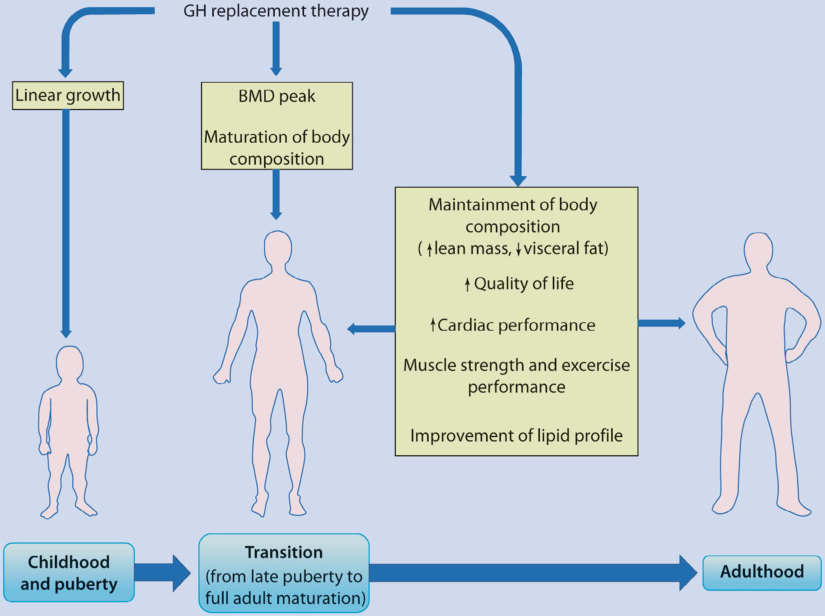
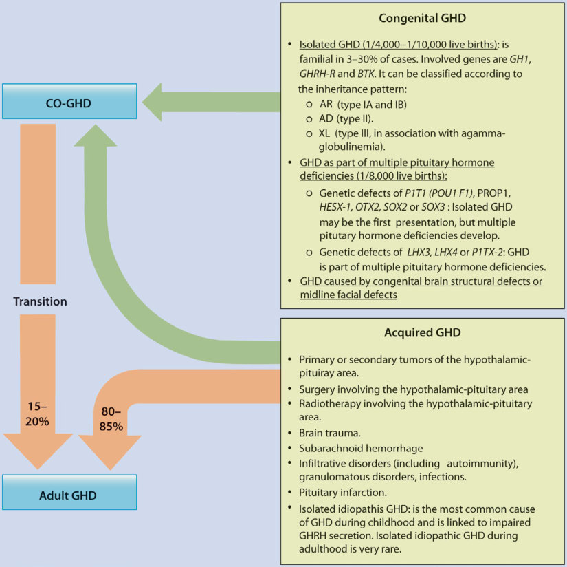
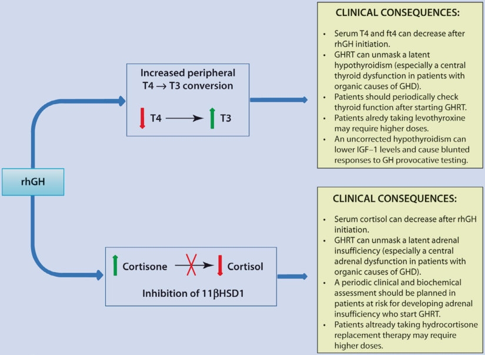
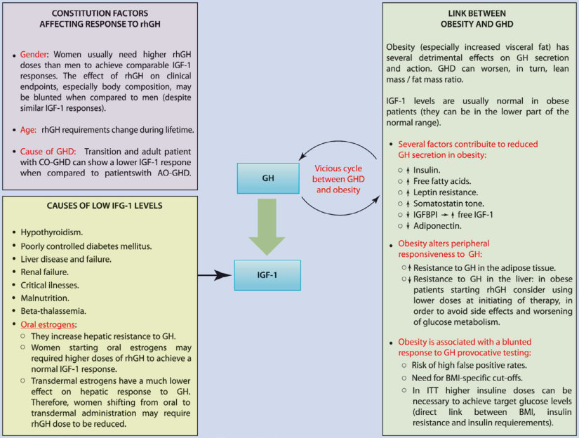
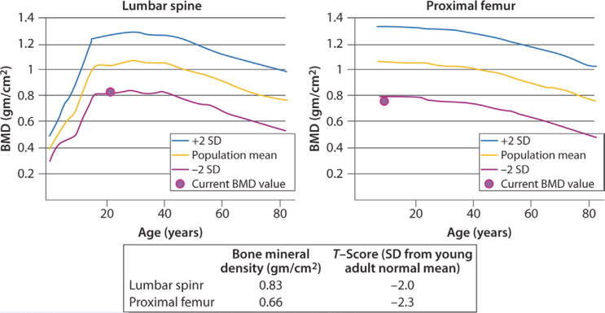

# 7. Management of Adults with Childhood-Onset Growth Hormone Deficiency
> Source attribution: [Source credits](../../SOURCE_CREDITS.md).

## PDF page 189 | printed page 173

### Management of Adults with Childhood-Onset Growth Hormone Deficiency

Rosa Maria Paragliola and Roberto Salvatori

### Contents

### 7.1 Introduction and Background Information – 175

7.1.1 What Is the Frequency of CO-GHD? – 175 7.1.2 What Is the “Transition Period”? – 176 7.1.3 What Are the Aims of GH Replacement Therapy Throughout Life? – 176 7.1.4 What Are the Differences Between CO-GHD and AO-GHD? – 176 7.1.5 Is Counseling Important for Caregivers and Patients During the Transition Period? – 176

### 7.2 Aetiology – 179

### 7.3 Clinical Presentation: Which Patients Remain Persistently GHD After Childhood? – 180

### 7.4 Diagnostic Evaluation – 182

7.4.1 When Should Testing for Persistent GHD After Childhood Be Performed? – 182 7.4.2 How to Test for Persistent GHD After Childhood? – 185

### 7.5 Outcomes and Possible Complications – 189

7.5.1 Why Should We Replace Young Adults with GH? – 189 7.5.2 Is It Possible to Predict the Clinical Response to GHRT in Adults? – 193

© The Author(s), under exclusive license to Springer Nature Switzerland AG 2024 S. Radovick, M. Misra (eds.), Pediatric Endocrinology, https://doi.org/10.1007/978-3-031-66296-6_7

## PDF page 190 | printed page 174

7.5.3 Are There Complications and Side Effects Possibly Related to GHRT in Adults? – 193 7.5.4 Are There Contraindications for Continuing GHRT? – 196

### 7.6 Treatment – 197

7.6.1 How to Treat Patients with Persistent CO-GHD During Transition and Adulthood? – 197 7.6.2 How to Monitor GHRT During Transition and Adulthood? – 198

### 7.7 Summary – 204

### References – 205

## PDF page 191 | printed page 175

Key Points

5 GH plays important physiological roles,

both directly and mediated by circulat ing and locally produced insulin-like growth factor 1 (IGF-1), including lin ear growth during childhood and matu ration and maintenance of body composition and bone density during the transition period and adulthood. Untreated GHD can therefore have a negative impact on individuals through out their life span. Issues related to lin ear growth are obviously more important in the pediatric population, whereas body composition, bone metab olism, and quality of life (QoL) gradu ally become more important in adults. 5 GHD can occur in pediatric patients

(childhood-onset GHD, CO-GHD) or in adults (adult-onset GHD, AO- GHD). Isolated idiopathic GHD is the most common cause of CO-GHD, and most patients revert to a normal GH secretion during transition and young adulthood. AO-GHD is mostly due to secondary damage of the hypothalamicpituitary area and is commonly associ ated with an additional deficit: multiple pituitary hormone deficiencies (MPHD). About 15–20% of AO-GHD cases derive from a CO-GHD persisting during transition and adulthood. 5 After children on GH replacement ther

apy (GHRT) achieve adult height, GH should be stopped, and they should be retested to confirm a persistent GHD. Serum IGF-1 measurement can be sufficient to confirm GHD in the minority of patients who are highly likely to remain deficient. All other patients require GH provocative testing. 5 Patients with persistent CO-GHD during

transition and adulthood should be treated to attain full body and bone matu ration and to improve their QoL and some cardiovascular risk factors (chiefly the lipid profile). GHRT is generally safe, but GH dosing has to be individualized according to the patient’s characteristics.

### 7.1 Introduction and Background

### Information

Childhood-onset growth hormone deficiency (CO-GHD) is an endocrine condition associ ated with a broad range of clinical conse quences, with the most important being failure of linear growth. However, CO-GHD can result in health issues in adulthood, and for this reason, clinical management requires par ticular attention during the transition period, which is the physiological passage from ado lescence to young adulthood. This phase is generally thought to occur from the mid-late teens until approximately 6 or 7 years after final height achievement [1]. The increased survival of children with critical clinical con ditions associated with GHD and treated with GHRT has led to particular attention con cerning the importance of a careful evaluation during the transition period.

A number of diagnostic and therapeutic challenges exist once the pediatric indication for GHRT ends. Not all children entering transition have persistent GHD, especially in the “idio pathic” CO-GHD category. On the contrary, patients with anatomic pituitary damage repre sent those who more commonly remain defi cient. Diagnosis, treatment, and follow-up of patients with persistent GHD during transition and adulthood are the subject of this chapter.

### 7.1.1 What Is the Frequency

### of CO-GHD?

GHD—isolated or associated with other defi cits—may present during childhood (CO-GHD) or adulthood (AO-GHD). Isolated CO-GHD has an estimated prevalence of 1 patient per 4000–10,000 live births and can be due to mul tiple causes [2]. Based on recently published data, the estimated incidence of combined pitu itary hormone deficiency (CPHD) is 1/16,000 [3]. Approximately 6000 new cases of adults with GHD are diagnosed each year in the United States, with an incidence rate of about 2 per 100,000 people/year [4, 5], and with 15–20% of those cases representing pediatric cases tran sitioning to the adult indication.

## PDF page 192 | printed page 176

### 7.1.2 What Is the “Transition

### Period”?

The “transition period” has been arbitrarily defined as the life phase starting in puberty and ending with full adult maturation, 6–7 years after achieving final height (early to mid-twenties) [1, 6]. For other authors, the end of the transition period can be deter mined from sleep chronotype (switch in time of going to bed), which occurs at a mean of 20.9 years for males or 19.5 years for females [7] or from reaching the total body mineral density (BMD) peak (occurring at a mean age of 26.86 years in males and 22.31 in females) [8]. Up to transition, the role of GHRT in GHD patients is primarily to promote linear growth. After the near-adult height is attained, the GHRT is aimed to prevent abnormal body composition, decreased bone mineral density (which in cases of MPHD can be exacerbated by sex steroid deficiency and/or over-treatment with glucocorticoids or levothyroxine), abnor mal serum lipids, and cardiovascular risk and impaired quality of life [6].

### 7

### 7.1.3 What Are the Aims of GH

### Replacement Therapy Throughout Life?

In the past, GHRT in patients with CO-GHD was stopped after achieving final height, defined as a growth velocity <2 cm/ year [9]. During the past two decades, a growing body of evidence concerning the beneficial effects of continuing GHRT in transition and adult patients with persistent GHD (and of starting GHRT in those with AO-GHD) has led to the increasing usage of recombinant human GH (rhGH) in these patients. GHRT has been proven to posi tively affect the attainment and mainte nance of adult body composition, BMD, metabolic profile (including several bio chemical parameters, such as the lipid pro file), and QoL. These nongrowth promoting effects of GH are very important for body homeostasis and require lifelong GH administration in subjects with permanent

GHD. As many subjects with GO-GHD are no longer GH-deficient when retested at the end of linear growth, the correct reassess ment of CO-GHD is crucial for selecting patients who need lifelong GH therapy [10]. Therefore, the re-evaluation of the GH-IGF-1 axis should be performed in adolescents reaching the transition period who had been previously diagnosed with GHD with few exceptions (see below).

7.1

### 7.1.4 What Are the Differences

### Between CO-GHD and AO-GHD?

7.2

7.1

11 13

### 7.1.5 Is Counseling Important

### for Caregivers and Patients During the Transition Period?

The time for informing the patient and his or her family about the possibility of continuing GHRT through adulthood must remain with the pediatrician or pediatric endocrinologist. “Transitioning” the patient to the adult indi cation requires consultation even before the pediatric indication is completed, so that patient and family can come to an informed decision on whether to continue or discon tinue GHRT, referring them—if necessary— to an adult endocrinologist with an expertise on hypopituitarism and GHD. There is no consensus about the ideal time for shifting the

## PDF page 193 | printed page 177

patient from pediatric to adult services. Some authors suggest transitioning the patient around the age of 19, concurrently to other changes in the patient’s life (e.g., the end of high school) [14–16]. This shift is a very cru cial period, and the counseling must be carefully done. Many factors can increase the risk of dropout during transition, including the differences between pediatric and adult treatment modalities. Young children are less able to understand diseases and therapies and they need caregivers, while adults are more involved in decision-making. Therefore, there are differences in interactions between the patients and their guardians that can influence clinical management and eventually affect patients’ compliance [17].

The identification of CO-GHD patients with persistent GHD is mandatory because the majority of these alterations can be prevented or reduced by GHRT in adult age. In most cases, CO-GHD must be confirmed during the transi tion. However, an analysis of the Hypopituitary Control and Complications Study (HypoCCS) showed that many patients did not continue GHRT during transition, and did not undergo retesting, missing an important window of treat ment [18]. Another retrospective study on 112 patients with CO-GHD indicated that 83% of patients stopped GHRT before transitioning from pediatric to adult care (median age at dis continuation was 16.3 years), but the first reevaluation by an adult endocrinologist occurred much later in life (median age at first visit:

Unmatched source image; PDF page 193. Consult the original caption.

## PDF page 194 | printed page 178

### 7

19.4 years), despite a very high rate of persistent GHD [14]. Finally, another study on patients with chronic conditions transitioning to adult services highlighted that approximately 25% of

patients are lost to follow-up [16]. In the latter cohort, the longer the period between the last pediatric visit and the first appointment at the adult clinic, the higher the dropout rate.

Unmatched source image; PDF page 194. Consult the original caption.

## PDF page 195 | printed page 179

Table 7.1 Differences between CO-GHD and AO-GHD

### CO-GHD AO-GHD

Isolated GHD is more frequent GHD is more frequently associated with MPHD

Final adult height is normal but is approximately <1 SDS in comparison to mean normal popula tion (subjects are usually <2–4% shorter than normal)

Normal final adult height

If GH replacement therapy is stopped after the final adult is reached but GHD persists later in life, GHD adults usually have <16–20% height-nor malized lean body mass, fat mass, and BMD

If GHD occurs acutely, adults have normal lean body mass, fat mass, and BMD

Adults with a history of CO-GHD usually present with lower BMI and WHR

Adults with AO-GHD usually present with higher BMI and WHR

Adults with a history of CO-GHD usually have lower levels of IGF-1 and IGFBP3 (after withholding GH replacement therapy). IGF-1 response to rhGH may be blunted

Adults with AO-GHD usually have higher levels of IGF-1 and IGFBP3 (before starting GH replacement therapy). IGF-1 response to rhGH is generally acceptable

Adults with a history of CO-GHD usually have higher HDL levels

Adults with AO-GHD usually have lower HDL levels at initial diagnosis

Adults with a history of CO-GHD usually have higher QoL scores

Adults with AO-GHD usually have lower QoL scores at initial diagnosis

Abbreviations: AO-GHD adult-onset GH deficiency, BMD bone mineral density, BMI body mass index, CO- GHD childhood-onset GH deficiency, GHD GH deficiency, HDL high-density lipoprotein, IGFBP3 insulinlike growth factor-binding protein 3, MPHD multiple pituitary hormone deficiencies, rhGH recombinant human GH, QoL quality of life, WHR waist-hip ratio

Retesting requires withholding GHRT for 4 weeks: the diagnosis of persistent GHD should be posed rapidly and treatment (if nec essary) restarted as expeditiously as possible in order to avoid a long gap without GH in a phase that is essential to attain full body mat uration. Moreover, the longer the period with out GH, the higher the risk of losing the patient to follow-up, with likely detrimental long-term effects [19].

### 7.2 Aetiology

7.2

1 In the pediatric population, idiopathic iso lated GHD is the most common form of GHD [20]. Between 3% and 30% of isolated GHD is

familial, suggesting the presence of underlying genetic disorders. Idiopathic GHD can be inherited in an autosomal recessive, autosomal dominant, or X-linked recessive manner, usu ally due to mutations in the genes encoding GH (GH1) and the GHRH receptor (GHRHR) [2]. Most cases are sporadic and could be related to a combination of environmental and/or developmental risk factors, including viral infections, vascular or degenerative changes, drug exposure, young maternal age, as is the case for septo-optic dysplasia [20].

In adults, pituitary tumors, craniopharyn gioma, and other nonpituitary tumors in the sellar area (and related treatments) account for most cases of AO-GHD, although in the past 10 years, an increased rate of idiopathic GHD and other noncommon causes of GHD have been reported [21]. TBI and aneurysmal subarachnoid hemorrhage may account for a subset of GHD cases higher than previously suspected [22]. Data show that the proportion

### Automatic table extraction — verify rendered original

|CO-GHD|AO-GHD|
|---|---|
|Isolated GHD is more frequent|GHD is more frequently associated with MPHD|
|Final adult height is normal but is approximately <1 SDS in comparison to mean normal popula­ tion (subjects are usually <2–4% shorter than normal)|Normal fnal adult height|
|If GH replacement therapy is stopped after the fnal adult is reached but GHD persists later in life, GHD adults usually have <16–20% height-nor­ malized lean body mass, fat mass, and BMD|If GHD occurs acutely, adults have normal lean body mass, fat mass, and BMD|
|Adults with a history of CO-GHD usually present with lower BMI and WHR|Adults with AO-GHD usually present with higher BMI and WHR|
|Adults with a history of CO-GHD usually have lower levels of IGF-1 and IGFBP3 (after withholding GH replacement therapy). IGF-1 response to rhGH may be blunted|Adults with AO-GHD usually have higher levels of IGF-1 and IGFBP3 (before starting GH replacement therapy). IGF-1 response to rhGH is generally acceptable|
|Adults with a history of CO-GHD usually have higher HDL levels|Adults with AO-GHD usually have lower HDL levels at initial diagnosis|
|Adults with a history of CO-GHD usually have higher QoL scores|Adults with AO-GHD usually have lower QoL scores at initial diagnosis|

[Original table](../../tables/ch007_p0195_1.jpg)

## PDF page 196 | printed page 180

of patients with pituitary dysfunction after TBI is as high as 27.5–32.0% as GH is the axes most susceptible to TBI-mediated pituitary damage (12.4–22.1% of cases) [23]. The prev alence of GHD after subarachnoid hemor rhage is about 14% [24].

### 7.3 Clinical Presentation: Which

### Patients Remain Persistently GHD After Childhood?

25

### 7

7.2

Table 7.2 Causes of CO-GHD and behavior of GH secretion during transition and adulthood

Isolated CO-GHD >2/3 of patients can have a normal response if retested for GHD during transition and adulthood. Subjects with idiopathic CO-GHD and no structural pituitary abnormalities are more likely to be GH-sufficient at retesting. Several causes have been advocated in patients with a diagnosis of CO-GHD and normal GH responses at provocative tests during transition and adulthood:

Partial GHD: It is sufficient to cause short stature during childhood but

might not meet the criteria for AO-GHD diagnosis

Transient GHD (?)

Lack of reproducibility of provocative tests: Inter- and intra-individual

variability; changes of diagnostic criteria over time

GH neurosecretory dysfunction: Some patients can show a normal

response to provocative tests, but they can have an impaired spontaneous GH secretion

No sexual priming in peripubertal children: False-positive results to GH

provocative tests can occur in patients with pubertal delay if no sexual priming is performed before testinga

Patients presenting with a low GH peak during provocative tests at initial

diagnosis are more likely to remain GHD. Likewise, children with a partial GHD have a higher chance of becoming GH-sufficient later in life

Patients diagnosed with CO-GHD earlier in life are more likely to remain

GHD

CO-GHD patients reaching the final adult height at an earlier age are more

likely to remain GHD

26 42

35

43

25

44

(continued)

### Automatic table extraction — verify rendered original

|Isolated CO-GHD|>2/3 of patients can have a normal response if retested for GHD during transition and adulthood. Subjects with idiopathic CO-GHD and no structural pituitary abnormalities are more likely to be GH-sufficient at retesting. Several causes have been advocated in patients with a diagnosis of CO-GHD and normal GH responses at provocative tests during transition and adulthood:|
|---|---|
|Isolated CO-GHD|Partial GHD: It is suffcient to cause short stature during childhood but might not meet the criteria for AO-GHD diagnosis|
|Isolated CO-GHD|Transient GHD (?)|
|Isolated CO-GHD|Lack of reproducibility of provocative tests: Inter- and intra-individual variability; changes of diagnostic criteria over time|
|Isolated CO-GHD|GH neurosecretory dysfunction: Some patients can show a normal response to provocative tests, but they can have an impaired spontaneous GH secretion|
|Isolated CO-GHD|No sexual priming in peripubertal children: False-positive results to GH provocative tests can occur in patients with pubertal delay if no sexual priming is performed before testinga|
|Isolated CO-GHD|Patients presenting with a low GH peak during provocative tests at initial diagnosis are more likely to remain GHD.Likewise, children with a partial GHD have a higher chance of becoming GH-suffcient later in life|
|Isolated CO-GHD|Patients diagnosed with CO-GHD earlier in life are more likely to remain GHD|
|Isolated CO-GHD|CO-GHD patients reaching the fnal adult height at an earlier age are more likely to remain GHD|

[Original table](../../tables/ch007_p0196_1.jpg)

## PDF page 197 | printed page 181

Table 7.2 (continued)

Genetic causes of CO-GHD They can cause isolated GHD or, more frequently, MPHD

GHD is permanent

GH-E32A and GH-R183H mutations causing type II, autosomal dominant, isolated GHD: Cases of normal response to GH provocative testing have been reported in patients treated with rhGH during childhood and retested at transition. This effect was transient and patients became GH-deficient later in lifeb

Structural causes of CO-GHD (congenital anomalies with abnormal pituitary at MRI)

More than 95% of patients have persistent GHD

Those with isolated GHD may reverse to normal

Organic causes of CO-GHD (e.g., surgery) and MPHD (≥3 axes affected)

More than 95% of patients have persistent GHD

Brain trauma 10–60% of children and adults develop hypopituitarism after brain trauma

GH, FSH, and LH are the most frequently affected hormones. There is apparently no relationship between trauma entity and the risk of GHD

GHD may be transient (especially in children)

Irradiation Risk of GHD is higher:

For a lower age at the time of irradiation

For higher radiation doses (risk usually starts for doses >18 Gy; >50% of

patients develop GHD for a total amount of radiation >40 Gy)

GHD can occur years after irradiation exposure: Patients with normal GH

response need a long-term follow-up and should be retested for 5–10 years after completion of radiotherapy

When GHD develops, it is generally permanent, although cases of transient

GHD have been reported

Radiation therapy may cause precocious puberty (particularly in females)

and concurrent GHD. In this case, growth velocity may appear normal, despite impairment of GH secretion

Ectopic posterior pituitary If the ectopic posterior pituitary is located at the median eminence, GHD is very likely to be permanent

If the ectopic posterior pituitary is located along the pituitary stalk, a spontaneous resolution of GHD is possible

Patients with an ectopic posterior pituitary can have nonconcordant laboratory results (normal stimulated GH peak but low IGF-1), requiring long-term monitoring

(continued)

### Automatic table extraction — verify rendered original

|Genetic causes of CO-GHD|They can cause isolated GHD or, more frequently, MPHD|
|---|---|
|Genetic causes of CO-GHD|GHD is permanent|
|Genetic causes of CO-GHD|GH-E32A and GH-R183H mutations causing type II, autosomal dominant, isolated GHD: Cases of normal response to GH provocative testing have been reported in patients treated with rhGH during childhood and retested at transition. This effect was transient and patients became GH-defcient later in lifeb|
|Structural causes of CO-GHD (congenital anomalies with abnormal pituitary at MRI)|More than 95% of patients have persistent GHD|
|Structural causes of CO-GHD (congenital anomalies with abnormal pituitary at MRI)|Those with isolated GHD may reverse to normal|
|Organic causes of CO-GHD (e.g., surgery) and MPHD (≥3 axes affected)|More than 95% of patients have persistent GHD|
|Brain trauma|10–60% of children and adults develop hypopituitarism after brain trauma|
|Brain trauma|GH, FSH, and LH are the most frequently affected hormones. There is apparently no relationship between trauma entity and the risk of GHD|
|Brain trauma|GHD may be transient (especially in children)|
|Irradiation|Risk of GHD is higher:|
|Irradiation|For a lower age at the time of irradiation|
|Irradiation|For higher radiation doses (risk usually starts for doses >18Gy; >50% of patients develop GHD for a total amount of radiation >40Gy)|
|Irradiation|GHD can occur years after irradiation exposure: Patients with normal GH response need a long-term follow-up and should be retested for 5–10years after completion of radiotherapy|
|Irradiation|When GHD develops, it is generally permanent, although cases of transient GHD have been reported|
|Irradiation|Radiation therapy may cause precocious puberty (particularly in females) and concurrent GHD.In this case, growth velocity may appear normal, despite impairment of GH secretion|
|Ectopic posterior pituitary|If the ectopic posterior pituitary is located at the median eminence, GHD is very likely to be permanent|
|Ectopic posterior pituitary|If the ectopic posterior pituitary is located along the pituitary stalk, a spontaneous resolution of GHD is possible|
|Ectopic posterior pituitary|Patients with an ectopic posterior pituitary can have nonconcordant laboratory results (normal stimulated GH peak but low IGF-1), requiring long-term monitoring|

[Original table](../../tables/ch007_p0197_1.jpg)

## PDF page 198 | printed page 182

Table 7.2 (continued)

Autoimmune GHD The presence of PA may be associated with hypopituitarism (autoimmune etiology). Isolated GHD can develop in this setting

Children with GHD and a high PA title are more likely to remain GHD during transition and adulthood

Patients with GHD and a middle PA title may resolve GHD throughout life, but they can develop isolated hypogonadotropic hypogonadism

Abbreviations: AO-GHD adult-onset GH deficiency, CO-GHD childhood-onset GH deficiency, FSH folliclestimulating hormone, GHD GH deficiency, GHRH GH-releasing hormone, Gy gray, kDa kilodalton, LH luteinizing hormone, MPHD multiple pituitary hormone deficiencies, MRI magnetic resonance imaging, PA pituitary antibodies, rhGH recombinant human GH a Sex hormones (particularly estrogens) stimulate endogenous GH secretion, and children with pathological responses to GH testing before puberty may become GH-sufficient as puberty progresses. Hence, some pedi atric endocrinologists give oral estrogens (both in females and males) or intramuscular testosterone (only in males) a few days before GH testing in order to discriminate between patients with pubertal delay and those with true GHD. This could be particularly useful in patients with an intermediate GH response during pro vocative tests, as sex steroid priming might reduce the rate of false-positive results. There is currently no consensus regarding the use of (and the way to use) sex steroid priming in peripubertal children before per forming a GH stimulation test b GH-E32A and GH-R183H mutations cause type II, autosomal dominant, isolated GHD. Patients with het erozygous mutation will produce both wild-type GH (22-kDa isoform) and a mutant GH: a truncated, non functioning 17.5-kDa isoform for the GH-E32A mutation and an isoform causing prolonged retention into secretory granules of somatotropes for the GH-R183H mutation. Mutated GH exerts a dominant-negative effect on normal GH production, presumably because of constant endogenous GHRH stimulation with det rimental effects on wild-type GH secretion. Giving exogenous rhGH can remove the GHRH stimulus and restore normal somatotropic function, which can lead to a normal response of GH at retesting

### 7

### 7.4 Diagnostic Evaluation

7.3

1 34 45 47

### 7.4.1 When Should Testing

### for Persistent GHD After Childhood Be Performed?

The ideal timing to retest patients with CO- GHD is controversial. A re-evaluation could be performed during mid-puberty, especially in those patients having a low risk of persis tent GHD [48]. The hypothesis is that puber tal sexual hormones can enhance endogenous GH secretion [49]: early retesting would reduce the duration of unnecessary GHRT, but we believe that this approach is less useful in patients highly likely to remain GHD. Delayed retesting at the end of transition (early to mid-twenties) is not advisable because patients with transient GHD will receive years of unnecessary treatment. Most

### Automatic table extraction — verify rendered original

|Autoimmune GHD|The presence of PA may be associated with hypopituitarism (autoimmune etiology). Isolated GHD can develop in this setting|
|---|---|
|Autoimmune GHD|Children with GHD and a high PA title are more likely to remain GHD during transition and adulthood|
|Autoimmune GHD|Patients with GHD and a middle PA title may resolve GHD throughout life, but they can develop isolated hypogonadotropic hypogonadism|

[Original table](../../tables/ch007_p0198_1.jpg)

## PDF page 199 | printed page 183

### Table 7.3 Consensus guidelines: if, when, and how to retest patients with CO-GHD during transition

and adulthood

American Association of Clinical Endocrinologists and American College of Endocrinology (2019)

GH-stimulation test should only be performed based on the appropriate clinical context of each patient with reasonable clinical suspicion of GHD, and with the intent to initiate rhGH replacement if the diagnosis is confirmed The diagnosis of adult GHD can be made without performing GH-stimulation testing in certain patient subtypes: – Patients with organic hypothalamic-pituitary disease (e.g., suprasellar mass with previous

surgery and cranial irradiation) and biochemical evidence of MPHD (≥3 pituitary hormone deficiencies) together with low-serum IGF-1 levels (<−2.0 standard deviation score [SDS]). – Genetic defects affecting the hypothalamic-pituitary axes. – Hypothalamic-pituitary structural brain defects. In patients with less than two pituitary hormone deficiencies, low-serum IGF-1 levels alone are not sufficient to make a diagnosis of adult GHD; and one 1 GH-stimulation test must be performed to confirm the diagnosis After longitudinal growth is completed in transition patients with idiopathic isolated GHD, those with low-normal or low IGF-1 levels should be retested for GHD with GH-stimulation tests after at least 1 month of wash-out from rhGH therapy The number of GH-stimulation tests needed in transition patients with childhood isolated GHD or suspected hypothalamic GHD is dependent on the level of the clinician’s suspicion. If the suspicion is high, clinicians should perform one GH-stimulation test. If the suspicion is low and the serum IGF-1 level is low-normal (<0 SDS), then clinicians should perform two different GH-stimulation ITT is considered the “gold standard,” but this test can cause severe hypoglycemia and adverse effects Glucagon stimulation test and macimorelin test could be considered as alternative tests if the ITT is contraindicated or not feasible to be conducted in some patients Patients with CO-GHD who are candidates for GH therapy should be retested for GHD after adult height achievement (transition from pediatric to adult care)

Endocrine Society (2011)

A low IGF-1 after stopping GH replacement therapy for at least 1 month is sufficient to prove persistent GHD in patients with CO-GHD and multiple pituitary hormone deficiencies (three or more axes) if they have:

– A radiologically confirmed congenital anomaly in the sellar or suprasellar region

– Acquired hypothalamic-pituitary disease (e.g., craniopharyngioma)

– Previous surgery for lesions affecting the hypothalamic-pituitary area

– Previous high-dose irradiation of the hypothalamic-pituitary area

– Known mutations causing GHD

– Irreversible lesions/damage of the pituitary gland causing three or more pituitary hormone

deficits

Provocative testing is required for all other causes of CO-GHD. GH replacement therapy should be stopped for at least 1 month before retesting:

The ITT and the GHRH-arginine test show enough sensitivity and specificity to establish the

diagnosis of GHD. If the ITT and the GHRH-arginine test cannot be performed, the glucagon stimulation test is a feasible option

GHRH-arginine test may be misleading in patients with recent (<10 years), hypothalamic causes

of suspected GHD (e.g., irradiation)

Multiple sampling of GH levels would be useful to assess the diagnosis of GHD, but it is not a

feasible option in routine clinical practice

If deficiencies of other pituitary hormones are present, they should be corrected before testing

for GHD

(continued)

### Automatic table extraction — verify rendered original

|American Association of Clinical Endocrinologists and American College of Endocrinology (2019)|GH-stimulation test should only be performed based on the appropriate clinical context of each patient with reasonable clinical suspicion of GHD, and with the intent to initiate rhGH replacement if the diagnosis is confirmed The diagnosis of adult GHD can be made without performing GH-stimulation testing in certain patient subtypes: – Patients with organic hypothalamic-pituitary disease (e.g., suprasellar mass with previous surgery and cranial irradiation) and biochemical evidence of MPHD (≥3 pituitary hormone deficiencies) together with low-serum IGF-1 levels (<−2.0 standard deviation score [SDS]). – Genetic defects affecting the hypothalamic-pituitary axes. – Hypothalamic-pituitary structural brain defects. In patients with less than two pituitary hormone deficiencies, low-serum IGF-1 levels alone are not sufficient to make a diagnosis of adult GHD; and one 1 GH-stimulation test must be performed to confirm the diagnosis After longitudinal growth is completed in transition patients with idiopathic isolated GHD, those with low-normal or low IGF-1 levels should be retested for GHD with GH-stimulation tests after at least 1 month of wash-out from rhGH therapy The number of GH-­stimulation tests needed in transition patients with childhood isolated GHD or suspected hypothalamic GHD is dependent on the level of the clinician’s suspicion. If the suspicion is high, clinicians should perform one GH-­stimulation test. If the suspicion is low and the serum IGF-1 level is low-normal (<0 SDS), then clinicians should perform two different GH-stimulation ITT is considered the “gold standard,” but this test can cause severe hypoglycemia and adverse effects Glucagon stimulation test and macimorelin test could be considered as alternative tests if the ITT is contraindicated or not feasible to be conducted in some patients Patients with CO-GHD who are candidates for GH therapy should be retested for GHD after adult height achievement (transition from pediatric to adult care)|
|---|---|
|Endocrine Society (2011)|A low IGF-1 after stopping GH replacement therapy for at least 1month is suffcient to prove persistent GHD in patients with CO-GHD and multiple pituitary hormone defciencies (three or more axes) if they have:|
|Endocrine Society (2011)|– A radiologically confrmed congenital anomaly in the sellar or suprasellar region|
|Endocrine Society (2011)|– Acquired hypothalamic-pituitary disease (e.g., craniopharyngioma)|
|Endocrine Society (2011)|– Previous surgery for lesions affecting the hypothalamic-pituitary area|
|Endocrine Society (2011)|– Previous high-dose irradiation of the hypothalamic-pituitary area|
|Endocrine Society (2011)|– Known mutations causing GHD|
|Endocrine Society (2011)|– Irreversible lesions/damage of the pituitary gland causing three or more pituitary hormone defcits|
|Endocrine Society (2011)|Provocative testing is required for all other causes of CO-GHD.GH replacement therapy should be stopped for at least 1month before retesting:|
|Endocrine Society (2011)|The ITT and the GHRH-arginine test show enough sensitivity and specifcity to establish the diagnosis of GHD.If the ITT and the GHRH-arginine test cannot be performed, the glucagon stimulation test is a feasible option|
|Endocrine Society (2011)|GHRH-arginine test may be misleading in patients with recent (<10years), hypothalamic causes of suspected GHD (e.g., irradiation)|
|Endocrine Society (2011)|Multiple sampling of GH levels would be useful to assess the diagnosis of GHD, but it is not a feasible option in routine clinical practice|
|Endocrine Society (2011)|If defciencies of other pituitary hormones are present, they should be corrected before testing for GHD|

[Original table](../../tables/ch007_p0199_1.jpg)

## PDF page 200 | printed page 184

### Table 7.3

(continued)

GH Research Society (2007)

Patients with CO-GHD should be retested for GHD after final height achievement

For children receiving GH treatment for conditions other than GHD (e.g., Turner’s syndrome and small for gestational age), there is no proven benefit to continuing GH treatment during adulthood. These patients should not be tested for GHD when adult height is achieved

A GH-stimulation test is not required in:

Patients with three or more pituitary hormone deficiencies and IGF-1 below the reference range

(after at least 1 month off GH treatment)

Patients with genetic mutations associated with GHD (e.g., POU1F1, PROP-1, HESX-1,

LHX-3, LHX-4, GH-1, and GHRH-R genes)

A GH-stimulation test is required in all other patients with CO-GHD (after withholding GH replacement therapy for at least 1 month). ITT should be the preferred option (if feasible): The GHRH-arginine test and the glucagon test are reliable alternatives. The use of a recombinant 22-kDa GH calibrator (IRP 98/574) is recommended in all GH assays

### 7

Consider a second reinvestigation at the completion of the somatic growth (around age 25 years):

Patients with idiopathic CO-GHD. This may affect the decision to continue long-term GH

replacement therapy during adulthood

Patients with discordant results of provocative GH testing during transition (e.g., normal GH

on stimulation but low IGF-1), who did not receive GH therapy

In patients who received pituitary irradiation and with a normal response to the GHRH-arginine test, ITT should also be performed

Plan long-term follow-up of patients who received pituitary irradiation or with infiltrative/ inflammatory lesions of the hypothalamic-pituitary area, as GHD may develop many years after the initial insult

European Society for Paediatric Endocrinol ogy (2005)

In patients with severe congenital or acquired panhypopituitarism (four or five hormone deficiencies), GH replacement therapy can be continued without interruption during transition

All other patients need re-evaluation during transition to confirm GHD. After withholding GH replacement therapy for at least 1 month, patients should be divided as follows:

High likelihood of severe GHD (severe CO-GHD with or without two or three additional

pituitary hormone deficits, severe GHD due to structural hypothalamic-pituitary abnormalities, patients treated for brain tumors or who received high-dose cranial irradiation): Measure IGF-1. If it is ≤−2 SDS, no provocative test is needed. If IGF-1 is >−2 SDS, a GH-stimulation test should be performed

Low likelihood of severe GHD (all other patients, including idiopathic CO-GHD, either isolated

or with one additional hormone deficit): Measure IGF-1 and perform a GH-stimulation test

ITT should be the test of choice. Arginine or glucagon tests are viable alternatives. The GHRHarginine test may be unreliable in patients with hypothalamic GHD

If deficiencies of other pituitary hormones are present, they should be corrected before testing for GHD

Plan follow-up for:

Patients with discordant results of provocative GH testing during transition (e.g., normal GH

on stimulation but low IGF-1)

Patients at risk for late-onset GHD (e.g., history of cranial irradiation)

Abbreviations: AO-GHD adult-onset GH deficiency, CO-GHD childhood-onset GH deficiency, GHD GH deficiency, GHRH GH-releasing hormone, GHRH-R growth-hormone-releasing hormone receptor, HESX-1 homeobox expressed in ES cells 1 (also known as homeobox protein ANF), IGF-1 insulin-like growth factor 1, IRP International Reference Preparation, LHX LIM/homeobox protein, POU1F1 POU domain class 1 transcription factor 1 (also known as GH factor 1 or pituitary-specific positive transcription factor 1, Pit1), PROP1 PROP paired-like homeobox 1 (also known as prophet of Pit1), SDS standard deviation score

### Automatic table extraction — verify rendered original

|GH Research Society (2007)|Patients with CO-GHD should be retested for GHD after final height achievement|
|---|---|
|GH Research Society (2007)|For children receiving GH treatment for conditions other than GHD (e.g., Turner’s syndrome and small for gestational age), there is no proven beneft to continuing GH treatment during adulthood. These patients should not be tested for GHD when adult height is achieved|
|GH Research Society (2007)|A GH-stimulation test is not required in:|
|GH Research Society (2007)|Patients with three or more pituitary hormone defciencies and IGF-1 below the reference range (after at least 1month off GH treatment)|
|GH Research Society (2007)|Patients with genetic mutations associated with GHD (e.g.,_POU1F1_, _PROP-1_, _HESX-1_,  _LHX-3_, _LHX-4_, _GH-1_, and_GHRH-R_ genes)|
|GH Research Society (2007)|A GH-stimulation test is required in all other patients with CO-GHD (after withholding GH replacement therapy for at least 1month). ITT should be the preferred option (if feasible): The GHRH-arginine test and the glucagon test are reliable alternatives. The use of a recombinant 22-kDa GH calibrator (IRP 98/574) is recommended in all GH assays|
|GH Research Society (2007)|Consider a second reinvestigation at the completion of the somatic growth (around age 25years):|
|GH Research Society (2007)|Patients with idiopathic CO-GHD.This may affect the decision to continue long-term GH replacement therapy during adulthood|
|GH Research Society (2007)|Patients with discordant results of provocative GH testing during transition (e.g., normal GH on stimulation but low IGF-1), who did not receive GH therapy|
|GH Research Society (2007)|In patients who received pituitary irradiation and with a normal response to the GHRH-arginine test, ITT should also be performed|
|GH Research Society (2007)|Plan long-term follow-up of patients who received pituitary irradiation or with infltrative/ infammatory lesions of the hypothalamic-pituitary area, as GHD may develop many years after the initial insult|
|European Society for Paediatric Endocrinol­ ogy (2005)|In patients with severe congenital or acquired panhypopituitarism (four or fve hormone defciencies), GH replacement therapy can be continued without interruption during transition|
|European Society for Paediatric Endocrinol­ ogy (2005)|All other patients need re-evaluation during transition to confrm GHD.After withholding GH replacement therapy for at least 1month, patients should be divided as follows:|
|European Society for Paediatric Endocrinol­ ogy (2005)|High likelihood of severe GHD (severe CO-GHD with or without two or three additional pituitary hormone defcits, severe GHD due to structural hypothalamic-pituitary abnormalities, patients treated for brain tumors or who received high-dose cranial irradiation): Measure IGF-1. If it is≤−2 SDS, no provocative test is needed. If IGF-1 is >−2 SDS, a GH-stimulation test should be performed|
|European Society for Paediatric Endocrinol­ ogy (2005)|Low likelihood of severe GHD (all other patients, including idiopathic CO-GHD, either isolated or with one additional hormone defcit): Measure IGF-1 and perform a GH-stimulation test|
|European Society for Paediatric Endocrinol­ ogy (2005)|ITT should be the test of choice. Arginine or glucagon tests are viable alternatives. The GHRH- arginine test may be unreliable in patients with hypothalamic GHD|
|European Society for Paediatric Endocrinol­ ogy (2005)|If defciencies of other pituitary hormones are present, they should be corrected before testing for GHD|
|European Society for Paediatric Endocrinol­ ogy (2005)|Plan follow-up for:|
|European Society for Paediatric Endocrinol­ ogy (2005)|Patients with discordant results of provocative GH testing during transition (e.g., normal GH on stimulation but low IGF-1)|
|European Society for Paediatric Endocrinol­ ogy (2005)|Patients at risk for late-onset GHD (e.g., history of cranial irradiation)|

[Original table](../../tables/ch007_p0200_1.jpg)

## PDF page 201 | printed page 185

authors agree that biochemical re-evaluation should be performed when near-adult height is achieved (defined by growth velocity less than 1–<2 cm/year) [50] and bone age is of 16–17 years in males and 14–15 years in females [9, 31, 51]. This is presumably the best compromise in order not to miss an important window of treatment in those with persistent GHD, and to avoid unnecessary treatment in those who restore normal endogenous GH secretion.

### 7.4.2 How to Test for Persistent

### GHD After Childhood?

GHRT has to be stopped before retesting to remove the negative feedback of exogenous GH on endogenous secretion. The recom mended “wash-out” time before retesting is a minimum of 1 month [1] and should not exceed 3–6 months [31].

It is important to remember that other replacement therapies must be optimized in patients with MPHD before retesting: underreplaced hypothyroidism, in particular, can lower IGF-1 levels and cause blunted GH responses at dynamic testing [52]. The altered gonadal function can have effects on GH and IGF1 levels. Hypoadrenalism must be appro priately replaced to avoid the risk related to hypoglycemic stress during testing [53].

### 7.4.2.1 Basal Evaluation

The evaluation should start with the measure ment of serum IGF-1 concentration. If IGF-1 is ≥50th percentile for age and gender, it effec tively rules out persistent GHD which is the expected outcome in those with idiopathic, isolated GHD. If the IGF-1 level is ≤50th per centile in individuals with a high likelihood of persistent GHD, formal GH testing may not be needed [6].

Hartman et al. have suggested that—with appropriate clinical history of pituitary dis ease—if the IGF-1 serum concentration is <84 ng/mL (utilizing the Esoterix IGF-1 assay) or the pituitary damage causes the loss of three or more pituitary hormones, there is a 98% chance the patient is GHD, making

provocative GH testing optional [43]. The value of 84 ng/mL corresponds to an IGF-1 approximately 3 standard deviations (SD) below sex- and age-matched controls for patients older than 28 years. The authors highlighted, however, that even lower SD IGF-1 values are required to obtain such a high positive predictive value in younger patients. Finally, they observed that IGF-1 below 2 SD in comparison to sex- and agematched controls predicted GHD in only 83% of cases, which is inadequate to avoid dynamic testing [43]. Maghnie et al. have confirmed these observations, reporting that a sex- and aged-corrected IGF-1 below 2 SD has a sensi tivity of only 62%, with a consistent overlap between controls, transition patients with iso lated GHD, and those with MPHD [54].

Therefore, we can conclude that a low (2–3 SD below normal) IGF-1 can have a diagnos tic value per se in cases of very likely persis tent GHD (three or more pituitary hormone deficiencies plus congenital anomalies, organic causes, iatrogenic damage, or genetic muta tions associated with GHD). A very low IGF-1 (3 SD below sex- and age-matched controls) can have a diagnostic significance, as long as other causes of low IGF-1 are excluded, such as hypothyroidism, liver dis ease, renal failure, malnutrition, and therapy with oral estrogens. All other conditions require provocative testing to confirm a per sistent CO-GHD.

### 7.4.2.2 Provocative Testing

7.4

1 34 45 46

55 56 The insulin tolerance test (ITT) is still con sidered the gold standard. Insulin is given intravenously (usually 0.1–0.15 units/kg of body weight), and sampling of blood for glu cose and GH is done before and 15, 30, 60, 90, and 120 min after the injection. Glucose should be nadir below 40 mg/dL [47] and

## PDF page 202 | printed page 186

peak GH cut points for this test are needed

It is not yet known whether BMI-adjusted

for overweight and obese patients

Not given GH <2.8 μg/L

### ITT

GHRH-arginine test Glucagon test Arginine test Macimorelina

mended Not given

### 7

GH <2.5–3 μg/L Not recom

BMI 25–30 kg/m2 with high pretest

BMI 25–30 kg/m2 with low pretest

BMI <25 kg/m2: GH <3.0 μg/L

GH <5 μg/L Not given Consider using different cutoffs

BMI >30 kg/m2: GH <1 μg/L

probability: GH <3.0 μg/L

probability: GH <1.0 μg/L

according to BMI:

Table 7.4 Consensus guidelines: GH cutoffs during provocative testing

BMI 25–30 kg/m2:

BMI <25 kg/m2:

BMI >30 kg/m2:

according to BMI:

GH <11.5 μg/L

different cutoffs

GH <8.0 μg/L

GH <4.2 μg/L

Consider using

GH <5.1 μg/L.

may be higher in

adolescents and

stimulated GH

Society (2011) GH <4.1 μg/L

young adults

Cutoff for

(6.1 μg/L)

Endocrinologists

Endocrinology

Association of

and American

College of

Endocrine

American

Clinical

(2019)

Not given

adults. May be

mended for

GH <3.0 μg/L Not recom

adolescents

nonobese

used in

Cutoffs for stimulated

GH may be higher in

19.0 μg/L, according

Use different cutoffs

BMI 25–30 kg/m2:

young adults (5.6 or

to different studies)

BMI <25 kg/m2:

BMI >30 kg/m2:

according to BMI:

GH <11.0 μg/L

adolescents and

GH <8.0 μg/L

GH <4.0 μg/L

Society (2007) In adults: GH

During transi

<3.0 μg/L

<6.0 μg/L

tion: GH

GH Research

### Automatic table extraction — verify rendered original

|Col1|ITT|GHRH-arginine test|Glucagon test|Arginine test|Macimorelina|
|---|---|---|---|---|---|
|American Association of Clinical Endocrinologists and American College of Endocrinology (2019)|GH<5μg/L|Not given|Consider using different cutoffs according to BMI:  BMI <25kg/m2: GH <3.0μg/L  BMI 25–30kg/m2 with high pretest probability: GH <3.0μg/L  BMI 25–30kg/m2 with low pretest probability: GH <1.0μg/L  BMI >30kg/m2: GH <1μg/L|Not given|GH<2.8μg/L It is not yet known whether BMI-adjusted peak GH cut points for this test are needed for overweight and obese patients|
|Endocrine Society (2011)|GH <4.1μg/L Cutoff for stimulated GH may be higher in adolescents and young adults (6.1μg/L)|GH <5.1μg/L. Consider using different cutoffs according to BMI:  BMI <25kg/m2:  GH <11.5μg/L  BMI 25–30kg/m2:  GH <8.0μg/L  BMI >30kg/m2:  GH <4.2μg/L Cutoffs for stimulated GH may be higher in adolescents and young adults (5.6 or 19.0μg/L, according to different studies)|GH <2.5–3μg/L|Not recom- mended|Not given|
|GH Research Society (2007)|In adults: GH <3.0μg/L During transi- tion: GH <6.0μg/L|Use different cutoffs according to BMI:  BMI <25kg/m2:  GH <11.0μg/L  BMI 25–30kg/m2:  GH <8.0μg/L  BMI >30kg/m2:  GH <4.0μg/L|GH <3.0μg/L|Not recom- mended for adults. May be used in nonobese adolescents|Not given|

[Original table](../../tables/ch007_p0202_1.jpg)

## PDF page 203 | printed page 187

### ITT

GHRH-arginine test Glucagon test Arginine test Macimorelina

Not given Not given Not given Not given

Abbreviations: BMI body mass index, GHRH GH-releasing hormone, ITT insulin tolerance test

patients with GH

<5.0 μg/L due to

endocrinopathy

In adults: GH

During transi

the risk of an

follow-up in

long-term

transition

<3.0 μg/L

<5.0 μg/L

tion: GH

Evaluate

≥5.0 but

evolving

European Society

Endocrinology

for Paediatric

(2005)

a Macimorelin was approved for use as a diagnostic test for adult GHD in December 2017 by U.S. FDA

### Automatic table extraction — verify rendered original

|Col1|ITT|GHRH-arginine test|Glucagon test|Arginine test|Macimorelina|
|---|---|---|---|---|---|
|European Society for Paediatric Endocrinology (2005)|In adults: GH <3.0μg/L During transi- tion: GH <5.0μg/L Evaluate long-term follow-up in transition patients with GH ≥5.0 but <5.0μg/L due to the risk of an evolving endocrinopathy|Not given|Not given|Not given|Not given|

[Original table](../../tables/ch007_p0203_1.jpg)

## PDF page 204 | printed page 188

patients should have symptoms of hypoglyce mia. The test should be stopped (and glucose given intravenously) if severe neuroglycopenic symptoms develop or glycemia falls to <35 mg/dL. The ITT requires close medical supervision and it is uncomfortable for patients. It can be associated with potential adverse effects (seizures, altered consciousness resulting from neuroglycopenia). ITT is con traindicated in patients with a history of car diovascular and cerebrovascular disease and seizures or in untreated adrenal insufficiency. In obese normoglycemic and/or hyperglyce mic with insulin resistance, the test could require higher insulin doses (0.15–0.2 IU/kg), increasing the risk of delayed hypoglycemia after test completion [47].

### 7

Where GHRH is available, the combined arginine + GHRH test is a viable option to evaluate patients during transition. About 1 μg/kg of GHRH is given intravenously at the beginning of the test, and 0.5 g/kg (maximum 30 g) of arginine is infused over 30 min: blood samples for GH should be taken 30, 60, 90, and 120 min after the start of arginine infusion. This test has very high sensitivity and specific ity both in children and adults [57], but it is deeply influenced by body mass index (BMI): the higher the BMI, the lower the GH peak, and therefore BMI-related cutoffs should be used [58]. Moreover, arginine + GHRH test poses some problems in patients with idio pathic CO-GHD and those with neurosecre tory GHD due to hypothalamic disease, which might be observed after cranial irradiation that was performed within 10 years. In these two diagnoses, the pituitary fails much later than the hypothalamus causing a deficiency in hypo thalamic GHRH with an intact or functioning somatotroph cell pool. Supplying GHRH in the test can result in a false-negative response, as it stimulates only the pituitary secretory capacity: the results of arginine + GHRH test ing may be misleading within 10 years of pitu itary irradiation [38, 59]. A cutoff of GH <9 μg/L after arginine + GHRH has been pro posed for adults with childhood cancer and brain irradiation [60, 61].

The current unavailability of GHRH to use in the arginine + GHRH test in some countries (e.g., the United States) makes an

alternative test necessary. A possible alterna tive is the glucagon stimulation test, although the mechanisms of the GH-stimulatory effect of glucagon remain unclear. Glucagon (1 mg) is given intramuscularly (1.5 mg if the patient is 90 kg in weight or heavier). The sampling for GH during the glucagon test is every 30 min for 4 h [62]: the test may cause discom fort (nausea, vomiting, headache, and sweat ing) and late-onset hypoglycemia. The body of literature about glucagon stimulation test is smaller than for ITT and the argi nine + GHRH test: further refinement of this test has uncovered some categories (over weight patients) where different cutoffs are necessary, as has been confirmed with the arginine + GHRH test [58, 63].

Macimorelin is an orally active ghrelinmimetic that binds to the ghrelin GHS-R1a receptor with a similar affinity to ghrelin. It is rapidly absorbed in the gastrointestinal tract and effectively stimulates endogenous GH secretion [64]. Macimorelin (0.5 mg/kg) is administered as a single oral dose and blood samples for GH should be taken after 30, 45, 60, and 90 min. The main advantage of maci morelin is that the drug is orally administered, without the risk of causing hypoglycemia. The most commonly reported side effect was mild dysgeusia which resolved spontaneously. One drug-related serious adverse event was reported in a subject with an asymptomatic QT interval prolongation on the electrocar diogram. Therefore, careful assessment of the patient’s concurrent medications is recom mended, as well as discontinuation of strong CYP3A4 inducers and drugs associated with the risk of prolonged QT [65]. Macimorelin test results are not influenced by BMI values up to 36 kg/m2 [66].

In summary, ITT, glucagon test, arginine + GHRH (where available), and macimorelin are suggested to provide convincing evidence of persistent GHD. The usage of more than one test may be considered in case of border line or nonconcordant results (e.g., discrep ancy between basal IGF-1 and stimulated GH) or when clinical history poses some chal lenges (e.g., recent brain irradiation). Less stringent tests such as levodopa, clonidine, or arginine alone are currently not suggested,

## PDF page 205 | printed page 189

since they have low sensitivity and specificity for GHD diagnosis [67].

### 7.4.2.3 Cancer Survivors

The Endocrine Society Clinical Practice Guide line underlined the problem of abnormalities of hypothalamic-pituitary functioning and GH deficiency often observed in childhood cancer survivors [68]. GHD is the most com mon endocrine late effect in childhood cancer survivors treated with cranial radiotherapy, with a different prevalence depending on the type of tumor and treatment. It is most fre quent in survivors of suprasellar tumors and after high-dose hypothalamus-pituitary axis radiotherapy. GHD in the cancer population has similar symptoms as in the general popula tion, and in adults, it may be associated with reduced lean body mass and increased fat mass, an adverse lipid profile, increased cardiovascu lar morbidity, impaired bone mineral density, impaired quality of life, and psychosocial problems [69].

Testing with ITT and glucagon has been recommended for the diagnosis of GHD in adult survivors of childhood cancer. A sys tematic review on the diagnosis of GHD as a late effect of radiotherapy in survivors of childhood cancer raises the question of how to interpret the GH response after arginine + GHRH in patients with primary hypotha lamic dysfunction [70].

Endocrine Society Guidelines recommend against the use of GHRH alone or in combina tion with arginine in childhood cancer survivors to diagnose GHD after hypothalamus-pituitary axis radiation. In fact, when the damage is pri marily hypothalamic, as after radiation therapy, it may give false-negative results [68]. In conclu sion, the ITT is the most accepted reference test to establish the diagnosis of GHD using a cutoff of GH <5–6 μg/L [53]. When the ITT is contra indicated, the glucagon test seems to be the most preferred alternative, using a cutoff of GH <1 or 3 μg/L, depending on BMI [53].

### 7.5 Outcomes and Possible

### Complications

Adult-dose GHRT is recommended if GHD is confirmed during the transition period, in order to complete somatic development, obtain full skeletal maturation, and promote increase of lean mass. Retesting for GHD and—if con firmed—starting GHRT should be done as quickly as possible [34, 46]. In adolescents who decline the offer to continue GHRT, monitor ing of GH-dependent endpoints is required. Evidence of subsequent deterioration consti tutes the basis for reassessment of the decision to reinstate GHRT [1].

### 7.5.1 Why Should We Replace

### Young Adults with GH?

71 73

7.5

74 101

102

## PDF page 206 | printed page 190

The beneficial effect of GHRT on bone appears to be influenced by gender, age, and treatment duration, being more pronounced in younger patients and

formation and resorption, which can cause BMD to decline during the first months after initiation of GHRT; however, after 12–18 months of treatment,

protective factors for the development of osteoporosis. However, some studies did not reveal any benefit of GHRT on BMD during transition, question

Adult women with CO-GHD who did not receive GHRT during childhood are more likely to have lower BMD in the femoral neck, especially when the

BMD In normal subjects, BMD continues to increase during transition and young adulthood after the final adult height has been achieved (BMD peak, defined

Most authors have shown that GHRT in CO-GHD patients is useful during transition to obtain a normal BMD peak and bone maturation, which are

CO-GHD, who do not show an increased risk of fragility fractures. This latter risk seems to be increased only in adult patients with organic causes of

The duration of the interval between rhGH discontinuation and re-initiation in patients with CO-GHD and persistent GHD directly predicts lower

BMD. This highlights the importance to carefully plan retesting during transition and to restart GHRT as expeditiously as possible when GHD is

in men, especially after 1 year of treatment and in those with lower baseline BMD and more severe GHD at diagnosis. GH stimulates both bone

Some authors have reported that, by using appropriate size corrections, bone density is normal in children and adults with isolated or idiopathic

as a T-score >−1 when compared to the average adult bone mass, is usually attained by age 25–30 years in men and age 20–25 years in women)

Table 7.5 Effects of GHRT on several clinical, biochemical, and radiological outcomes during transition and adulthood

### 7

ing the protective role of rhGH against osteoporosis and fragility fractures during adulthood

temporal gap between hypothalamic-pituitary insult and the start of GHRT is extended

GH is required to achieve and maintain full adult body composition

the anabolic effects of GH on bone become evident

hypopituitarism

confirmed

Maturation

and mainte

Stopping GHRT when near-adult height is reached but GHD persists, causes total body fat (especially visceral fat) to increase and lean mass to decrease

during transition and adulthood. On the contrary, continuing GHRT during transition and adulthood improves lean mass/fat mass body ratio, and this

Untreated GHD during transition is associated with lower muscle cross-sectional area and decreased muscle strength. However, this latter observation

When comparing patients with CO-GHD, either isolated or associated with MPHD, it has been reported that associated pituitary deficiencies predict

beneficial effect seems to be more pronounced in males. Some authors, however, did not report significant changes in fat and lean mass in untreated

In a cohort of GHD patients on long-term GHRT (at least 10 years), waist circumference and BMI increased in comparison to baselinea

higher BMI and waist circumference, but GHRT improves these parameters to the same extent in isolated and associated GHD

was not confirmed by other authors in transition patients

transition patients with persistent CO-GHD

nance of body

composition

### Automatic table extraction — verify rendered original

|BMD|In normal subjects, BMD continues to increase during transition and young adulthood after the final adult height has been achieved (BMD peak, defined as a T-score >−1 when compared to the average adult bone mass, is usually attained by age 25–30 years in men and age 20–25 years in women)|
|---|---|
|BMD|Most authors have shown that GHRT in CO-GHD patients is useful during transition to obtain a normal BMD peak and bone maturation, which are protective factors for the development of osteoporosis. However, some studies did not reveal any beneft of GHRT on BMD during transition, question- ing the protective role of rhGH against osteoporosis and fragility fractures during adulthood|
|BMD|The benefcial effect of GHRT on bone appears to be infuenced by gender, age, and treatment duration, being more pronounced in younger patients and in men, especially after 1year of treatment and in those with lower baseline BMD and more severe GHD at diagnosis. GH stimulates both bone formation and resorption, which can cause BMD to decline during the frst months after initiation of GHRT; however, after 12–18months of treatment, the anabolic effects of GH on bone become evident|
|BMD|The duration of the interval between rhGH discontinuation and re-initiation in patients with CO-GHD and persistent GHD directly predicts lower BMD.This highlights the importance to carefully plan retesting during transition and to restart GHRT as expeditiously as possible when GHD is confrmed|
|BMD|Adult women with CO-GHD who did not receive GHRT during childhood are more likely to have lower BMD in the femoral neck, especially when the temporal gap between hypothalamic-pituitary insult and the start of GHRT is extended|
|BMD|Some authors have reported that, by using appropriate size corrections, bone density is normal in children and adults with isolated or idiopathic CO-GHD, who do not show an increased risk of fragility fractures. This latter risk seems to be increased only in adult patients with organic causes of hypopituitarism|
|Maturation and mainte- nance of body composition|GH is required to achieve and maintain full adult body composition|
|Maturation and mainte- nance of body composition|Stopping GHRT when near-adult height is reached but GHD persists, causes total body fat (especially visceral fat) to increase and lean mass to decrease during transition and adulthood. On the contrary, continuing GHRT during transition and adulthood improves lean mass/fat mass body ratio, and this benefcial effect seems to be more pronounced in males. Some authors, however, did not report signifcant changes in fat and lean mass in untreated transition patients with persistent CO-GHD|
|Maturation and mainte- nance of body composition|When comparing patients with CO-GHD, either isolated or associated with MPHD, it has been reported that associated pituitary defciencies predict higher BMI and waist circumference, but GHRT improves these parameters to the same extent in isolated and associated GHD|
|Maturation and mainte- nance of body composition|In a cohort of GHD patients on long-term GHRT (at least 10years), waist circumference and BMI increased in comparison to baselinea|
|Maturation and mainte- nance of body composition|Untreated GHD during transition is associated with lower muscle cross-sectional area and decreased muscle strength. However, this latter observation was not confrmed by other authors in transition patients|

[Original table](../../tables/ch007_p0206_1.jpg)

## PDF page 207 | printed page 191

In a cohort of GHD patients on long-term GHRT (at least 10 years), total cholesterol and LDL were reduced, and HDL was increased in comparison to

rhGH withholding at final height in young adults with CO-GHD can correlate with worse psychosocial outcomes, especially in those with MPHD, those

Current evidence does not provide enough data to establish whether restarting GHRT during transition in patients with persistent CO-GHD might have

An abnormal lipid profile has been observed in transition and adult patients with persistent, untreated CO-GHD. Reported alterations include ↓HDL and

MPHD predicts worse QoL in comparison to isolated GHD, but GHRT improves these parameters to the same extent in isolated and associated GHD

A longer discontinuation of GHRT during transition and young adulthood in patients with persistent, nonidiopathic CO-GHD leads to poorer QoL

↓TG; ↑LDL and ↑lipoprotein(a); ↑TG, ↑LDL, and ↑total/HDL cholesterol ratio; ↑total cholesterol and ↑LDL/HDL ratio; and ↓HDL and ↑LDL/HDL

QoL Untreated GHD during transition and adulthood is associated with decreased QoL, mainly issues related to cognitive function, fatigue, well-being, and

who started GHRT after 12 years of age, and those who were shorter at first evaluation

mood. However, data regarding transition are conflicting

significant and favorable effects on QoL

baselinea

scores

ratio

cardiovascular

Lipid profile

risk factors

and other

(continued)

Conflicting results have been reported regarding the potential effect of GHRT on IMT. Higher IMT has been described in Japanese adults with a history

of CO-GHD and after at least 3 years of rhGH discontinuation, whereas other authors did not find any alteration of IMT in adolescents with CO-GH

Some authors reported no differences in lipid profile between treated and untreated transition patients, especially those with isolated or idiopathic

Increased diastolic blood pressure has been reported in transition patients with persistent CO-GHD who stopped GHRT

↑Fibrinogen has been observed in adolescents with untreated GHD

during and after discontinuation of GHRT

CO-GHD

### Automatic table extraction — verify rendered original

|QoL|Untreated GHD during transition and adulthood is associated with decreased QoL, mainly issues related to cognitive function, fatigue, well-being, and mood. However, data regarding transition are conflicting|
|---|---|
|QoL|rhGH withholding at fnal height in young adults with CO-GHD can correlate with worse psychosocial outcomes, especially in those with MPHD, those who started GHRT after 12years of age, and those who were shorter at frst evaluation|
|QoL|A longer discontinuation of GHRT during transition and young adulthood in patients with persistent, nonidiopathic CO-GHD leads to poorer QoL scores|
|QoL|MPHD predicts worse QoL in comparison to isolated GHD, but GHRT improves these parameters to the same extent in isolated and associated GHD|
|QoL|Current evidence does not provide enough data to establish whether restarting GHRT during transition in patients with persistent CO-GHD might have signifcant and favorable effects on QoL|
|Lipid profle and other cardiovascular risk factors|An abnormal lipid profle has been observed in transition and adult patients with persistent, untreated CO-GHD.Reported alterations include↓HDL and ↓TG;↑LDL and↑lipoprotein(a);↑TG,↑LDL, and↑total/HDL cholesterol ratio;↑total cholesterol and↑LDL/HDL ratio; and↓HDL and↑LDL/HDL ratio|
|Lipid profle and other cardiovascular risk factors|In a cohort of GHD patients on long-term GHRT (at least 10years), total cholesterol and LDL were reduced, and HDL was increased in comparison to baselinea|
|Lipid profle and other cardiovascular risk factors|Some authors reported no differences in lipid profle between treated and untreated transition patients, especially those with isolated or idiopathic CO-GHD|
|Lipid profle and other cardiovascular risk factors|↑Fibrinogen has been observed in adolescents with untreated GHD|
|Lipid profle and other cardiovascular risk factors|Increased diastolic blood pressure has been reported in transition patients with persistent CO-GHD who stopped GHRT|
|Lipid profle and other cardiovascular risk factors|Conficting results have been reported regarding the potential effect of GHRT on IMT.Higher IMT has been described in Japanese adults with a history of CO-GHD and after at least 3years of rhGH discontinuation, whereas other authors did not fnd any alteration of IMT in adolescents with CO-GH during and after discontinuation of GHRT|

[Original table](../../tables/ch007_p0207_1.jpg)

## PDF page 208 | printed page 192

Current evidence does not provide enough data to establish a relationship between rhGH and the risk of type 2 diabetes. However, it should be noted that

↓Insulin sensitivity has been reported in transition and adult patients with persistent CO-GHD after restarting GHRT, although contrasting results were

follow-up. The authors conclude that the prevalence of metabolic syndrome increases during long-term GHRT (mainly due to the development of abdominal obesity,

Abbreviations: BMD bone mineral density, BMI body mass index, CO-GHD childhood-onset GH deficiency, GHD GH deficiency, GHRT GH replacement therapy, HbA1c

hemoglobin A1c (glycosylated hemoglobin), HDL high-density lipoprotein, IMT intima-media thickness, LDL low-density lipoprotein, LVM left ventricular mass, MPHD

metabolism ↑Insulin sensitivity has been described after rhGH withholding at the final height. This was evident both in patients with persistent GHD during transition

a The study by Claessen et al. [90] provides interesting insights regarding the long-term effects of GHRT, as included patients were evaluated along at least 10 years of

hypertriglyceridemia, and hyperglycemia), despite an improvement of cholesterol profile (total cholesterol, HDL, and LDL): the effects of these changes on overall cardio

In a cohort of GHD patients on long-term GHRT (at least 10 years), fasting glucose levels were increased in comparison to baseline. The prevalence of

↓LVM has been reported in adolescents with persistent CO-GHD after 6 months of rhGH discontinuation, which can improve after GHRT re-initiation

Several studies suggest that restarting GHRT does not significantly affect insulin resistance, insulin sensitivity, and HbA1c levels in the long term,

multiple pituitary hormone deficiencies, QoL quality of life, rhGH recombinant human GH, TG triglycerides, ↑ increased, ↓ decreased

### 7

Some studies did not report substantial modifications of cardiac structure and function despite GHRT

untreated GHD can predispose to diabetes per se (increased BMI and visceral fat)

although an increase in insulin circulating levels has been reported

metabolic syndrome was increased as well (especially in males)a

and adulthood and in those who restored a normal GH secretion

reported by other authors

Table 7.5 (continued)

structure and

performance

Glucose

Cardiac

vascular risk and mortality are currently unknown. However, it must be noted that most of the enrolled patients in this study had MPHD; therefore, it is difficult to assess

to which extent GHRT plays a role in these observations in comparison to other replacement therapies. Finally, 38% of subjects in this cohort received cranial radiotherapy;

irradiation is a risk factor for metabolic syndrome per se, perhaps because of the long-term effects of hypothalamic radiation-induced damage

### Automatic table extraction — verify rendered original

|Glucose metabolism|↑Insulin sensitivity has been described after rhGH withholding at the final height. This was evident both in patients with persistent GHD during transition and adulthood and in those who restored a normal GH secretion|
|---|---|
|Glucose metabolism|↓Insulin sensitivity has been reported in transition and adult patients with persistent CO-GHD after restarting GHRT, although contrasting results were reported by other authors|
|Glucose metabolism|Several studies suggest that restarting GHRT does not signifcantly affect insulin resistance, insulin sensitivity, and HbA1c levels in the long term, although an increase in insulin circulating levels has been reported|
|Glucose metabolism|In a cohort of GHD patients on long-term GHRT (at least 10years), fasting glucose levels were increased in comparison to baseline. The prevalence of metabolic syndrome was increased as well (especially in males)a|
|Glucose metabolism|Current evidence does not provide enough data to establish a relationship between rhGH and the risk of type 2 diabetes. However, it should be noted that untreated GHD can predispose to diabetes per se (increased BMI and visceral fat)|
|Cardiac structure and performance|↓LVM has been reported in adolescents with persistent CO-GHD after 6months of rhGH discontinuation, which can improve after GHRT re-initiation|
|Cardiac structure and performance|Some studies did not report substantial modifcations of cardiac structure and function despite GHRT|

[Original table](../../tables/ch007_p0208_1.jpg)

## PDF page 209 | printed page 193

### 7.5.2 Is It Possible to Predict

### the Clinical Response to GHRT in Adults?

During childhood, linear growth is the pri mary outcome of GHRT. It is an objective parameter easily assessed by pediatric endo crinologists. During transition and adult hood, other parameters become important: body composition (including BMI and waist circumference), BMD, lipid profile, and QoL. However, if we consider them sepa rately, none of these measurements shows enough sensitivity and specificity to properly assess the clinical response to GHRT, and physicians mainly use IGF-1 as a biochemical marker of response. Nonetheless, whether an increase in IGF-1 levels reflects a positive clin ical response is still a matter of debate.

An analysis of the KIMS International Metabolic Database [103] showed that the worse the initial values of some endpoints (QoL, low-density lipoprotein-cholesterol, and waist-hip ratio), the better the response of the same variable. Additionally, a later analysis of the same database highlighted a sexual dimorphism in the clinical response, with greater responses of BMI in males and of QoL in females [104]. In the wake of these observations, Schneider et al. [105] identified lower IGF-1 values, higher total cholesterol levels, higher waist circumference, and worse QoL (using the QoL-AGHDA questionnaire) at baseline evaluation as the best predictors of the clinical response to 2 years of GHRT. These authors suggest that, given a biochemically proven GHD during adulthood, the basal and 6-month evaluation of the aforementioned parameters may aid the clinician in the deci sion of starting or continuing GHRT. Radovick et al. [31] suggest individu alized indications to treat patients with persis tent CO-GHD during transition on the basis of the diagnosis (isolated GHD vs. MPHD) and of the risk of metabolic complications (considering BMD and body composition). These authors suggest confirming treatment in transitioning patients with MPHD if the risk/benefit ratio is favorable, and the patients agree to continue daily injections. On the con

trary, in persistent isolated GHD, GHRT is encouraged in those with an abnormal meta bolic profile (low BMD, high fat mass, low lean body mass). Low-risk patients, however, should be followed up carefully to detect early alterations of these parameters or a worsen ing of the QoL and discuss once again the possibility to restart GHRT.

### 7.5.3 Are There Complications

### and Side Effects Possibly Related to GHRT in Adults?

GHRT is usually considered safe in adults. However, several potential adverse effects must be taken into consideration before start ing GHRT and during follow-up. A compre hensive review of the possible complications and side effects in pediatric patients on GHRT can be found in Chap. 1.

### 7.5.3.1 Mortality

GHD patients may be a category with an intrinsic higher mortality risk. First of all, patients with hypopituitarism, including an assumed GHD but substituted for all other deficiencies except GHD, have an excess mor tality [72]. However, hypopituitarism is often due to complex causes and the reason for the excess mortality can be multifactorial includ ing the etiology of hypopituitarism, nonphysi ological glucocorticoid replacement therapies, and tumor treatment and its side effects. For the same reason, the underlying condition causing GHD (many individuals having a his tory of treated brain neoplasms, previous cra nial irradiation, or subarachnoid hemorrhage) can cause an excess of mortality. Hence, it is very difficult to assess whether GHRT can play a role in affecting all-cause or causespecific mortality. The “Safety and Appropriateness of Growth Hormone Treatments in Europe (SAGhE)” is a study involving approximately 25,000 European patients who received GHRT in childhood during the 1980s and 1990s. The aim of the consortium is to assess the long-term safety of GHRT in these patients, comparing their mortality and cancer risk to the general popu

## PDF page 210 | printed page 194

lation. A preliminary report of the French SAGhE study raised concerns regarding the safety of GHRT in about 6000 patients who received GH for idiopathic isolated GHD, neurosecretory dysfunction, and idiopathic short stature or born short for gestational age [106]. Despite these categories being regarded as “low risk” for mortality when compared to the general population, the French SAGhE study found an increase of 33% in all-cause mortality in this cohort of patients, especially in those who received >50 μg/kg of daily GH. Bone tumors and cerebral hemorrhage were the main causes of mortality, while the overall risk of cancer-related deaths was not increased. However, a report of the SAGhE study from the Netherlands, Belgium, and Sweden and an analysis of the Hypopituitary Control and Complications Study (HypoCCS) did not confirm these findings [18, 107]. Other retrospective observational studies showed that mortality in GHRT is not different from the general population and that in some cases GHRT has improved the detrimental effects of hypopituitarism attributed to GHD [108]. Consequently, the existing evidence does not support an association between GHRT and mortality risk [109].

### 7

### 7.5.3.2 Cancer Risk and Tumor

### Regrowth

GH and IGF-1 exert anabolic and antiapoptotic effects promoting cellular growth and proliferation. Concerns have conse quently been raised regarding the possible role of GHRT in increasing cancer risk and tumor regrowth [110].

The Pediatric Endocrine Society has per formed a review of existing literature on this topic, focusing on children treated with GH and on cancer risk during treatment or throughout long-term surveillance after GHRT withholding [111]. The authors con cluded that GHRT is safe in children without intrinsic risk factors for malignancy (chiefly those with idiopathic CO-GHD), and it is not associated with the development of new pri mary cancer. On the other hand, the existing body of evidence cannot exclude a relation ship between increased cancer risk (second

neoplasms) in childhood cancer survivors receiving GHRT [109]. These conclusions underline the necessity to discuss this aspect with patients and their caregivers, assess the risk/benefit ratio in each case, plan a longterm follow-up in patients with a history of pediatric malignancy. On the other hand, the risk of primary tumor regrowth in childhood cancer survivors receiving GHRT should not be a concern if the neoplasm has been suc cessfully treated and there are no signs of active malignancy. A recent meta-analysis showed that GHRT during childhood is not related to all-cause mortality and cancer mor tality, but in contrast, GHRT seems to repre sent a trigger for the development of a second neoplasm [112]. Some studies have reported an increased incidence of bone cancer and bladder cancer in patients treated with rhGH and in patients with Hodgkin lymphoma [113, 114].

Sklar reported an increased risk of sec ondary neoplasms in childhood cancer survi vors treated with GHRT, especially osteogenic sarcomas in leukaemia and lymphoma survi vors. An increased risk of central nervous sys tem tumors, mostly meningiomas, has also been reported [115].

The association could be explained by the evidence that both meningiomas and osteo genic sarcomas express receptors for GH and IGF-1, and modulation of the GH/IGF-1 axis can affect the growth of these tumors in vitro and in vivo [116].

A separate report from the SAGhE study on meningiomas showed that this association is probably due to cranial radiotherapy in childhood cancer survivors and that the role of GH treatment is more uncertain [117].

In conclusion, based on the currently available evidence, GHRT seems safe for can cer survivors and it is not associated with an increased risk of primary tumor recurrence. However, this group of patients needs careful monitoring due to the possible increased risk of other tumors [53].

There is no consensus regarding the opti mal timing between anti-cancer treatment completion and the start of GHRT, and this should be decided on an individual basis.

## PDF page 211 | printed page 195

Evidence regarding cancer risk in adults receiving GHRT is less robust, but publica tions suggest that there is no effect of GHRT on the risk of new primary neoplasms [109]. Data about recurrence of primary cancers and the development of second neoplasms in adult cancer survivors are inconclusive. A recent joint meeting of the European Society of Paediatric Endocrinology, the GH Research Society, and the Pediatric Endocrine Society “did not support cancer surveillance beyond local standard practice in patients (children and adults) currently treated with GH nor in those previously treated with GH (including those with a previous malig nancy)” [109].

### 7.5.3.3 Glucose Metabolism

### and Diabetes Mellitus

GHRT can exert complex influences on insu lin sensitivity. On one hand, GH is an insulin counter-regulatory hormone promoting glu coneogenesis in the liver and reducing glucose uptake by hepatocytes. On the other hand, GHD is associated with altered body compo sition (unfavorable lean mass/fat mass ratio) that can lead to insulin resistance and predis pose to impairment of glucose metabolism. A study performed in more than 23,000 children treated with GHRT reported a six-fold increase in the incidence of type 2 diabetes compared to two other age-matched cohorts of untreated children [118]. In addition, data from the Pfizer International Growth Database (KIGS) indicate that GH therapy in children may be associated with an increased incidence of type 2 diabetes mellitus. Diabetes mellitus is not an absolute contraindication to GHRT. However, if the patient has diabetes and GH therapy is started, glycemic control may worsen before it becomes better because of the positive effect on body composition [14]. Likewise, adults predisposed to diabetes (e.g., positive family history, personal history of gestational diabetes, metabolic syndrome) may experience a worsening of blood glucose control [89]. This suggests the importance of enhancing surveillance of individuals at risk for developing diabetes mellitus after the start of GHD. Finally, it is advisable to start GHRT

with lower doses in these categories of patients.

### 7.5.3.4 Adrenal and Thyroid Function

7.3

119 120

121

122 Patients who received brain radiotherapy are chiefly at risk, as pituitary insufficiency may occur several years after the insult and GHRT might unmask central hypothyroidism and adrenal insufficiency during long-term follow-up.

### 7.5.3.5 Other Possible Side Effects

Adverse events reported in adults on GHRT include arthralgia, fluid retention (peripheral edema), paresthesias (especially carpal tunnel syndrome), and reduced concentration [123]. These side effects are dose-dependent and are generally transient. Starting treatment with low doses of GH, gradually titrated upwards, reduces the incidence of these side effects. Benign intracranial hypertension (pseudotu mor cerebri) has been reported as a side effect of GHRT in children [124]. Lower doses of rhGH are recommended in obese patients because they are more susceptible to GHRT side effects.

## PDF page 212 | printed page 196

### 7

### 7.5.4 Are There Contraindications

### for Continuing GHRT?

Before reinstating GHRT during transition and adulthood, it may be important to con sider the contraindications to GHRT that might exist or have developed since stopping GH therapy. The first and most important would be the development of an active malig nancy. This should be obvious by the history, but the clinician should be aware of this pos sibility. Some patients may have had a central nervous system tumor that was irradiated in childhood. This should be re-examined by an appropriate MRI image of the brain. The tumor may have recurred, or more likely, a new tumor may have developed because of irradiation to the area. Developing a second

central nervous system tumor is a known risk after cranial irradiation.

Another contraindication to GHRT is the presence of active proliferative or severe no proliferative diabetic retinopathy, given the proven effects of the GH/IGF-1 axis on the retina in patients with diabetes [125].

Pregnancy is not an absolute contraindica tion to GH therapy [126]. The placenta pro duces chorionic somatomammotropin during the third trimester (or even earlier) and, there fore, GH is not necessary during the last 3 months of pregnancy [109]. A feasible treat ment for pregnant GHD patient is to give two-thirds the dose in the first trimester, onethird in the second, and none in the third tri mester. This usually keeps IGF-1 within the normal range.

Unmatched source image; PDF page 212. Consult the original caption.

## PDF page 213 | printed page 197

### 7.6 Treatment

### 7.6.1 How to Treat Patients

### with Persistent CO-GHD During Transition and Adulthood?

rhGH is given by subcutaneous daily injec tions (typically at nighttime). Long-acting GH preparations in adults are currently under investigation and will likely become a thera peutic advance in the near future [127]. These new formulations can increase adherence to the GHRT because they are more comfortable than the daily subcutaneous injection and avoid the inconvenience of traveling with a syringe and refrigerated drug [128]. Longacting GH formulations, characterized by increased half-life, are represented by depot formulations, PEGylated formulations, non covalent albumin binding GH, GH fusion proteins, and pro-drug formulations [129].

Table 7.6 Consensus guidelines: how to treat patients during transition and adulthood

American Association of Clinical Endocri nologists and American College of Endocrinology (2019)

Start treating with low doses of GH:

Patients <30 years: 400–500 μg/day (may be higher for patients transitioning from

pediatric treatment)

Patients 30–60 years: 200–300 μg/day

Patients >60 years: 100–200 μg/day In transition patients, it is recommended to resume rhGH at 50% of the dose used in childhood In patients with concurrent DM, obesity, older age, and previous gestational DM, it is recommended to start at lower rhGH doses (100–200 μg/day) Titrate GH dosing according to clinical response, side effects, IGF-1 levels, and individual considerations (glucose intolerance, oral estrogens). If necessary, increase daily dosing by 100–200 μg/day

Endocrine Society (2011)

Start treating with low doses of GH:

Patients <30 years: 400–500 μg/day (patients during transition may require higher doses)

Patients 30–60 years: 200–300 μg/day

Titrate GH dosing according to clinical response, side effects, and IGF-1 levels. Weight-based regimens are discouraged. If necessary, increase daily dosing by 100–200 μg/day every 1–2 months. Take gender, estrogen status, and age into consider ation when deciding the GH dosing:

GH requirements are higher in some transition and young adult patients

GH requirements are lower in older patients

Women usually require higher GH doses to achieve the same IGF-1 response as men,

especially if they are on concomitant oral estrogen. GH dosage may need to be lowered if women stop oral estrogens or are switched to transdermal formulations

Currently, their efficacy and safety remain to be elucidated and at present, none is commer cially available for adults.

130

131

7.6

(continued)

### Automatic table extraction — verify rendered original

|American Association of Clinical Endocri­ nologists and American College of Endocrinology (2019)|Start treating with low doses of GH: Patients <30 years: 400–500 μg/day (may be higher for patients transitioning from pediatric treatment) Patients 30–60 years: 200–300 μg/day Patients >60 years: 100–200 μg/day In transition patients, it is recommended to resume rhGH at 50% of the dose used in childhood In patients with concurrent DM, obesity, older age, and previous gestational DM, it is recommended to start at lower rhGH doses (100–200 μg/day) Titrate GH dosing according to clinical response, side effects, IGF-1 levels, and individual considerations (glucose intolerance, oral estrogens). If necessary, increase daily dosing by 100–200 μg/day|
|---|---|
|Endocrine Society (2011)|Start treating with low doses of GH:|
|Endocrine Society (2011)|Patients <30years: 400–500μg/day (patients during transition may require higher doses)|
|Endocrine Society (2011)|Patients 30–60years: 200–300μg/day|
|Endocrine Society (2011)|Titrate GH dosing according to clinical response, side effects, and IGF-1 levels. Weight-based regimens are discouraged. If necessary, increase daily dosing by 100–200μg/day every 1–2months. Take gender, estrogen status, and age into consider­ ation when deciding the GH dosing:|
|Endocrine Society (2011)|GH requirements are higher in some transition and young adult patients|
|Endocrine Society (2011)|GH requirements are lower in older patients|
|Endocrine Society (2011)|Women usually require higher GH doses to achieve the same IGF-1 response as men, especially if they are on concomitant oral estrogen. GH dosage may need to be lowered if women stop oral estrogens or are switched to transdermal formulations|

[Original table](../../tables/ch007_p0213_1.jpg)

## PDF page 214 | printed page 198

Table 7.6 (continued)

American Association of Clinical Endocri nologists (2009)

Start treating with low doses of GH:

Patients <30 years: 400–500 μg/day. Patients during the transition may require higher

doses. When restarting GH replacement therapy during transition, the initial dose should be approximately 50% of the dose between the pediatric and the adult ones

Patients 30–60 years: 200–300 μg/day

Patients >60 years: 100–200 μg/day

Patients with diabetes or prone to glucose intolerance (obese subjects or those with

personal history of gestational diabetes or family history of diabetes): 100–200 μg/ day

GH dosing should be individualized in all patients and should not be weight-based. Titrate the dose upward until reaching the minimal dose that normalizes IGF-1 without causing unacceptable side effects. Increase daily dosing by 100–200 μg/day every 1–2 months based on clinical response, IGF-1, adverse effects, and individual considerations:

### 7

Women on oral estrogens or with an intact hypothalamic-pituitary-gonadal axis

require higher GH doses to achieve the same clinical and biochemical response as men

Consider using longer time intervals and smaller dose increments in older subjects

If patients are not compliant with daily injections, consider providing the weekly GH

dose in three to four administrations per week

Start treating with low doses of GH:

GH Research Society (2007)

Transition period: Intermediate doses between the pediatric doses and the adult ones

Young women: 300 μg/day

Young men: 200 μg/day

Older individuals: 100 μg/day

GH dosing should be individualized in all patients and should not be weight-based. Dose escalation should be gradual, individualized, and guided by clinical and biochemical response

Start treating with low doses of GH:

European Society for Paediatric Endocrinology (2005)

Transition period: 200–500 μg/day

Women usually require higher doses of GH, especially if receiving oral estrogens

Abbreviations: AO-GHD adult-onset GH deficiency, CO-GHD childhood-onset GH deficiency, GHD GH deficiency, IGF-1 insulin-like growth factor 1

tions of consensus guidelines regarding rhGH dosing [1, 45, 50], and Fig. 7.4 highlights the factors potentially affecting the GH/IGF-1 axis and the response to rhGH in treated patients with GHD, focusing on the role of obesity in normal patients and those with GHD. The appropriate GHRT dose in cancers survivors during the transition age remains controversial. It is reasonable to use the lowest effective dose, although data from important registries (KIGS, Genesis and HypoCCS) did

not report dosage differences between these populations and other GHD patients [53].

### 7.6.2 How to Monitor GHRT During

### Transition and Adulthood?

7.7 24 35 37

### Automatic table extraction — verify rendered original

|American Association of Clinical Endocri­ nologists (2009)|Start treating with low doses of GH:|
|---|---|
|American Association of Clinical Endocri­ nologists (2009)|Patients <30years: 400–500μg/day. Patients during the transition may require higher doses. When restarting GH replacement therapy during transition, the initial dose should be approximately 50% of the dose between the pediatric and the adult ones|
|American Association of Clinical Endocri­ nologists (2009)|Patients 30–60years: 200–300μg/day|
|American Association of Clinical Endocri­ nologists (2009)|Patients >60years: 100–200μg/day|
|American Association of Clinical Endocri­ nologists (2009)|Patients with diabetes or prone to glucose intolerance (obese subjects or those with personal history of gestational diabetes or family history of diabetes): 100–200μg/ day|
|American Association of Clinical Endocri­ nologists (2009)|GH dosing should be individualized in all patients and should not be weight-based. Titrate the dose upward until reaching the minimal dose that normalizes IGF-1 without causing unacceptable side effects. Increase daily dosing by 100–200μg/day every 1–2months based on clinical response, IGF-1, adverse effects, and individual considerations:|
|American Association of Clinical Endocri­ nologists (2009)|Women on oral estrogens or with an intact hypothalamic-pituitary-gonadal axis require higher GH doses to achieve the same clinical and biochemical response as men|
|American Association of Clinical Endocri­ nologists (2009)|Consider using longer time intervals and smaller dose increments in older subjects|
|American Association of Clinical Endocri­ nologists (2009)|If patients are not compliant with daily injections, consider providing the weekly GH dose in three to four administrations per week|
|GH Research Society (2007)|Start treating with low doses of GH:|
|GH Research Society (2007)|Transition period: Intermediate doses between the pediatric doses and the adult ones|
|GH Research Society (2007)|Young women: 300μg/day|
|GH Research Society (2007)|Young men: 200μg/day|
|GH Research Society (2007)|Older individuals: 100μg/day|
|GH Research Society (2007)|GH dosing should be individualized in all patients and should not be weight-based. Dose escalation should be gradual, individualized, and guided by clinical and biochemical response|
|European Society for Paediatric Endocrinology (2005)|Start treating with low doses of GH:|
|European Society for Paediatric Endocrinology (2005)|Transition period: 200–500μg/day|
|European Society for Paediatric Endocrinology (2005)|Women usually require higher doses of GH, especially if receiving oral estrogens|

[Original table](../../tables/ch007_p0214_1.jpg)

## PDF page 215 | printed page 199

of the patient receiving GH therapy requires an awareness of side effects, not only of GH excess but also of symptoms associated with starting rhGH and/or raising a dose. Patients can fre quently have transient adverse symptoms (usu ally days 10–14) after starting or raising a dose. These consist of muscle or joint pain and disap pear by days 21–28 after initiating or raising the dose. If symptoms persist after this period of time, the dose is considered excessive and should be reduced to the next lower tolerated dose.

Serum IGF-1 concentrations should be fol lowed at 4–6-week intervals after dose adjust ments until the plateau or maintenance dose is reached and then every 6–12 months. Serum IGF-1 is more of a safety guide than an absolute target that defines the optimal dose. If IGF-1

exceeds the normal age- and sex-specific range, the dose should be reduced. An IGF-1 in the mid-normal range is the target, but it should be recognized that there is no “magic level.” If the patient has a good clinical response but IGF-1 levels are in the low-normal range, the GHRT dosage should be maintained and not increased.

Lipid concentrations may be obtained yearly. However, if there are no lipid abnormal ities at baseline, there is no need to repeat these since they will only improve and not deterio rate. Fasting blood glucose (and/or HbA1C) should be obtained and followed at 6-month intervals to make sure that the patient does not develop hyperglycemia. The index of suspicion should be greatest in obese patients with a fam ily history of type 2 diabetes.

Unmatched source image; PDF page 215. Consult the original caption.

## PDF page 216 | printed page 200

Table 7.7 Consensus guidelines: dose titration and follow-up of patients on GHRT

American Association of Clinical Endocrinologists and American College of Endocrinology (2019)

Patients should be monitored 6- to 12-month intervals once maintenance doses are achieved. Monitoring should include:

Assessment of adverse effects

Overall clinical evaluation:

Serum IGF-1 levels: avoid exceeding the upper limit of the normal range

Check fasting glucose, hemoglobin A1c, fasting lipids, BMI, waist circumference,

waist-to-hip ratio, serum-free T4, and the hypothalamic-pituitary-adrenal axis via early morning cortisol or cosyntropin-stimulation test (in patients not on glucocorticoid replacement), if clinically indicated, at approximately 6- to 12-month intervals

QoL measurements annually.

DXA scanning to assess BMD before starting treatment. If BMD is abnormal at

baseline, repeat DXA every 2–3 year intervals

Endocrine Society (2011)

Patients should be monitored at 1–2 month intervals during dose titration and at 6-month intervals thereafter. Monitoring should include:

### 7

Assessment of adverse effects

Overall clinical evaluation: Clinical benefits of GH replacement therapy may not be

evident for more than 6 months after starting treatment. Clinical examination should include the measurement of waist circumference and QoL questionnaires

Serum IGF-1 levels: The commonly used target for IGF-1 is the upper half of the

age-adjusted range. IGF-1 responses may be lower in patients with CO-GHD when compared to AO-GHD

Annual check of fasting glucose and the lipid profile. Patients with diabetes mellitus

may require adjustments in antidiabetic therapy

Periodic control of thyroid and adrenal function. In hypopituitary patients, adjust

ments of thyroid hormone replacement therapy may be necessary after starting GH

DXA scanning to assess BMD before starting treatment. If BMD is abnormal at

baseline, repeat DXA every 1.5–2 years

GH Research Society (2007)

Titrate GH dosing according to serum IGF-1 levels:

IGF-1 should be kept below the age- and sex-adjusted upper limit of normal range

(including those patients with proven GHD, who have normal IGF-I levels at baseline)

After GH dose titration, monitor IGF-1 no sooner than 6 weeks

After achieving maintenance GH dose, monitor IGF-1 at least yearly

In hypopituitary patients, adjustments of thyroid hormone and glucocorticoid replacement therapy may be necessary after starting GH

QoL assessment is important but does not necessarily require a questionnaire

Perform pituitary imaging before GH initiation in patients who successfully underwent treatment for tumors of the hypothalamic-pituitary area. In those with residual tumors, regular imaging should be planned during treatment. GH replacement therapy does not impose a need for intensifying follow-up

(continued)

### Automatic table extraction — verify rendered original

|American Association of Clinical Endocrinologists and American College of Endocrinology (2019)|Patients should be monitored 6- to 12-month intervals once maintenance doses are achieved. Monitoring should include: Assessment of adverse effects Overall clinical evaluation: Serum IGF-1 levels: avoid exceeding the upper limit of the normal range Check fasting glucose, hemoglobin A1c, fasting lipids, BMI, waist circumference, waist-to-hip ratio, serum-free T4, and the hypothalamic-pituitary-adrenal axis via early morning cortisol or cosyntropin-stimulation test (in patients not on glucocorticoid replacement), if clinically indicated, at approximately 6- to 12-month intervals QoL measurements annually. DXA scanning to assess BMD before starting treatment. If BMD is abnormal at baseline, repeat DXA every 2–3 year intervals|
|---|---|
|Endocrine Society (2011)|Patients should be monitored at 1–2month intervals during dose titration and at 6-month intervals thereafter. Monitoring should include:|
|Endocrine Society (2011)|Assessment of adverse effects|
|Endocrine Society (2011)|Overall clinical evaluation: Clinical benefts of GH replacement therapy may not be evident for more than 6months after starting treatment. Clinical examination should include the measurement of waist circumference and QoL questionnaires|
|Endocrine Society (2011)|Serum IGF-1 levels: The commonly used target for IGF-1 is the upper half of the age-adjusted range. IGF-1 responses may be lower in patients with CO-GHD when compared to AO-GHD|
|Endocrine Society (2011)|Annual check of fasting glucose and the lipid profle. Patients with diabetes mellitus may require adjustments in antidiabetic therapy|
|Endocrine Society (2011)|Periodic control of thyroid and adrenal function. In hypopituitary patients, adjust­ ments of thyroid hormone replacement therapy may be necessary after starting GH|
|Endocrine Society (2011)|DXA scanning to assess BMD before starting treatment. If BMD is abnormal at baseline, repeat DXA every 1.5–2years|
|GH Research Society (2007)|Titrate GH dosing according to serum IGF-1 levels:|
|GH Research Society (2007)|IGF-1 should be kept below the age- and sex-adjusted upper limit of normal range (including those patients with proven GHD, who have normal IGF-I levels at baseline)|
|GH Research Society (2007)|After GH dose titration, monitor IGF-1 no sooner than 6weeks|
|GH Research Society (2007)|After achieving maintenance GH dose, monitor IGF-1 at least yearly|
|GH Research Society (2007)|In hypopituitary patients, adjustments of thyroid hormone and glucocorticoid replacement therapy may be necessary after starting GH|
|GH Research Society (2007)|QoL assessment is important but does not necessarily require a questionnaire|
|GH Research Society (2007)|Perform pituitary imaging before GH initiation in patients who successfully underwent treatment for tumors of the hypothalamic-pituitary area. In those with residual tumors, regular imaging should be planned during treatment. GH replacement therapy does not impose a need for intensifying follow-up|

[Original table](../../tables/ch007_p0216_1.jpg)

## PDF page 217 | printed page 201

Table 7.7 (continued)

European Society for Paediatric Endocrinology (2005)

Titrate GH dosing according to serum IGF-1 levels:

IGF-1 should be kept within the age- and sex-adjusted upper normal range

IGF-1 should be monitored every 6 months

Patients should be monitored at least yearly. Monitoring should include:

Height, weight, BMI, and waist and hip circumference

Fasting plasma glucose, insulin, and glycated hemoglobin. Consider glucose tolerance

testing in obese subjects and those with a family history of diabetes

Annual magnetic resonance imaging for at least 3 years should be planned after

treatment for intracranial malignancy. Patients with treated craniopharyngioma or pituitary adenoma should be reimaged at a frequency determined by the perceived risk of regrowth of the tumor

Bone densitometry and lipid profile at 2–5-year intervals

Abbreviations: BMD bone mineral density, BMI body mass index, DXA dual-energy X-ray absorptiometry, GHD GH deficiency, IGF-1 insulin-like growth factor 1, QoL quality of life

Case Study

### 21-Year-Old Woman with Idiopathic CO-GHD

7.8

2

2

Table 7.8 GHRH + arginine stimulation test for a 21-year-old CO-GHD patient with a BMI of 28 kg/m2

Time after starting arginine + GHRH (min)

GH (ng/ mL)

0 0.1

30 0.4

60 9.0

90 8.0

120 4.0

2

7.5

7.9

7.10

### Automatic table extraction — verify rendered original

|European Society for Paediatric Endocrinology (2005)|Titrate GH dosing according to serum IGF-1 levels:|
|---|---|
|European Society for Paediatric Endocrinology (2005)|IGF-1 should be kept within the age- and sex-adjusted upper normal range|
|European Society for Paediatric Endocrinology (2005)|IGF-1 should be monitored every 6months|
|European Society for Paediatric Endocrinology (2005)|Patients should be monitored at least yearly. Monitoring should include:|
|European Society for Paediatric Endocrinology (2005)|Height, weight, BMI, and waist and hip circumference|
|European Society for Paediatric Endocrinology (2005)|Fasting plasma glucose, insulin, and glycated hemoglobin. Consider glucose tolerance testing in obese subjects and those with a family history of diabetes|
|European Society for Paediatric Endocrinology (2005)|Annual magnetic resonance imaging for at least 3years should be planned after treatment for intracranial malignancy. Patients with treated craniopharyngioma or pituitary adenoma should be reimaged at a frequency determined by the perceived risk of regrowth of the tumor|
|European Society for Paediatric Endocrinology (2005)|Bone densitometry and lipid profle at 2–5-year intervals|

[Original table](../../tables/ch007_p0217_1.jpg)

### Automatic table extraction — verify rendered original

|Time after starting arginine + GHRH (min)|GH (ng/ mL)|
|---|---|
|0|0.1|
|30|0.4|
|60|9.0|
|90|8.0|
|120|4.0|

[Original table](../../tables/ch007_p0217_2.jpg)

## PDF page 218 | printed page 202

### 7

Table 7.9 ITT for a 21-year-old CO-GHD patient who had a normal response to arginine + GHRH

Time (min)

### ACTH

(pg/ mL)

Glu cose (mg/ dL)

### GH

(ng/ mL)

Cortisol (μg/dL)

0 28 88 0.1 19.5

20 22 23 0.4 18.7

22 – 23 – 18.7

35 – 36 – –

40 – 55 1.2 42.2

60 42 90 1.2 23.7

90 22 87 0.3 21.6

face of the normal responses to arginine + GHRH. As can be seen, she has a normal response to arginine/GHRH based on her BMI but fails the insulin test (cut point <4.1 ng/mL) and has a borderline glucagon test (cut point for BMI between 1 and 3 ng/mL). It is decided to restart the GH replacement. The dose selected is 50% of her pediatric dose of 2 mg a day. Over

Table 7.10 Glucagon stimulation test for a 21-year-old CO-GHD patient who had a normal response to arginine + GHRH

Time (min)

Glucose (mg/dL)

GH (ng/ mL)

Cortisol (μg/dL)

0 96 0.6 7.1

30 163 0.5 6

60 176 0.5 10.1

90 143 2.3 14

120 116 2.9 18.1

150 90 2 20.5

180 70 1.4 15.4

210 58 1.3 16.7

240 68 1.2 25.7

the next 12 months, her dose is titrated to her maintenance dose of 2 mg/day (see Table 7.11). She has a return of her energy and concentration power and does well in school. She also loses 9 kg and her waist cir cumference drops 10 cm. This case illustrates that some patients with idiopathic CO-GHD

Unmatched source image; PDF page 218. Consult the original caption.

### Automatic table extraction — verify rendered original

|Time (min)|ACTH (pg/ mL)|Glu­ cose (mg/ dL)|GH (ng/ mL)|Cortisol (μg/dL)|
|---|---|---|---|---|
|0|28|88|0.1|19.5|
|20|22|23|0.4|18.7|
|22|–|23|–|18.7|
|35|–|36|–|–|
|40|–|55|1.2|42.2|
|60|42|90|1.2|23.7|
|90|22|87|0.3|21.6|

[Original table](../../tables/ch007_p0218_1.jpg)

### Automatic table extraction — verify rendered original

|Time (min)|Glucose (mg/dL)|GH (ng/ mL)|Cortisol (μg/dL)|
|---|---|---|---|
|0|96|0.6|7.1|
|30|163|0.5|6|
|60|176|0.5|10.1|
|90|143|2.3|14|
|120|116|2.9|18.1|
|150|90|2|20.5|
|180|70|1.4|15.4|
|210|58|1.3|16.7|
|240|68|1.2|25.7|

[Original table](../../tables/ch007_p0218_2.jpg)

## PDF page 219 | printed page 203

Table 7.11 Dose titration for a 21-year-old CO-GHD patient transitioning to the adult indication

Date mcg/day

### IGF-1 (NL

180–780 mg/mL)

August 2008

800 60

October 2009

1200 130

January 2010

1600 204

March 2010

2000 300

May 2010 2400 480

will remain GH-deficient but that testing with arginine + GHRH might result in false-negative results. If the patient was to test positive with arginine + GHRH, it would be accepted that she was GHD, but if she passed and looked normal, it could be that she was only missing the hypothalamic hormone GHRH, and testing using the hypothalamic hormone GHRH or supplying the “missing link” might give a nor mal response. This case also points out the con sequences of GHD in this age group which is predominantly to impact bones and cognition.

A 20-Year-Old Young Man with a Craniopharyngioma

A 20-year-old man is sent to you by a neurosur geon for evaluation of his endocrine status. He had normal growth and development but has recently been found to have a craniopharyngi oma identified because of the development of visual field abnormalities. He underwent surgery to remove the tumor. Subsequent to the surgery, he was found to have hypopituitarism. After a year of replacement therapy with testosterone, thyroid hormone, and hydrocortisone, and a stable MRI image of the sellar area, he returns for follow-up care. On physical exam, he weighed 148 kg and was 170 cm tall. His IGF-1 concen tration was undetectable, and he has no GH

response to arginine stimulation testing (all GH concentrations <0.1 ng/mL). His fasting insulin was 48 IU/mL and simultaneous glucose was 115 mg/dL. Because of concerns about his glu cose status, GH therapy was started cautiously. He was started on 0.3 mg s.c. daily. Immediately, he began to have polyuria and polydipsia. This progressed to moderate ketoacidosis over a 1-week period. Because of this rather dramatic and sudden appearance of type 2 diabetes, he did not want to restart GH therapy for fear of going into ketoacidosis again. Very shortly thereafter, he required oral hypoglycemic agents to control his blood glucose. This case repre sents the extreme aggravation of diabetes after beginning GH therapy or exposing latent diabe tes after starting GH therapy. Physicians should be aware of this category of patient when begin ning GH therapy, and in this category, we begin with a small dose of 0.1 mg/day to avoid aggra vation of his insulin resistance.

19-Year-Old Woman with Autoimmune Hypophysitis

This 19-year-old woman was referred for evalua tion of persistent fatigue despite normalization of free T4 and TSH for primary hypothyroid ism. Because of the known association of auto immune thyroid disease and pituitary autoimmunity, an IGF-1 concentration was obtained which was low at 60 ng/mL (NL: 182–780 ng/mL). Her periods were regular. She was proven to have GH deficiency on the basis of a poor response of GH to insulin-induced hypoglycemia (peak GH 3.3 ng/mL) but had a normal cortisol response to hypoglycemia. Her hrGH dose was titrated to a mid-range IGF-1 concentration to a total dose of 2.4 mg/day, which she tolerated without side effects. This young lady represents dosing experience with patients in their late teens and early 20 s. She has required and tolerated rather large doses of GH to normalize her IGF-1 concentration and to achieve sufficient lipolysis. She did not have side effects of GH therapy, and her maintenance dose was established by titrating to mid- to highnormal IGF-1 concentrations.

### Automatic table extraction — verify rendered original

|Date|mcg/day|IGF-1 (NL 180–780 mg/mL)|
|---|---|---|
|August 2008|800|60|
|October 2009|1200|130|
|January 2010|1600|204|
|March 2010|2000|300|
|May 2010|2400|480|

[Original table](../../tables/ch007_p0219_1.jpg)

## PDF page 220 | printed page 204

### 7.7 Summary

B. A lower body mass index is associ

The treatment of adults who have been GHD as children is an emerging clinical science. Until quite recently, the main target of GHRT in patients with CO-GHD was the attainment of full linear growth, and the treatment was stopped as soon as near-adult height was achieved. However, during the last 20 years, the literature has questioned this practice, as the discontinuation of the replacement therapy during adulthood in those with a persistent GHD can cause detrimental effects on body composition, bone health, cardiovascular sys tem, and QoL. As for other chronic conditions, the correct management of persistent GHD during the delicate phase of transition is cru cial. Patients and their families should receive adequate support and information when trans ferred from pediatric to adult endocrine ser vices. The first and foremost important rule is to confirm that the patient is persistently defi cient, especially in patients who carry the diag nosis of idiopathic isolated GHD. A number of issues surround therapy including dosing and monitoring. As time passes, there will be more young adult patients seeking therapy for their GH deficiency. These situations include the trend for pediatricians to suggest continu ing GH after the pediatric indication and adult endocrinologists who are familiar with the care of this group of patients and the patients them selves seeking a solution to their symptoms.

C. Body mass index does not affect

D. Body mass index alters the response

3. Can IGF-1 be used in all patients to

confirm a persistent GH deficiency during the transition period? A. Yes, a low IGF-1 (<2 standard

### 7

B. No, a low IGF-1 (<2 standard

C. No, a low IGF-1 (<3 standard

D. No, a low IGF-1 (<3 standard

4. Do transdermal estrogens affect exog

enous GH administration? A. Yes, they enhance hepatic respon

Review Questions

1. Which is the most frequent cause of

GH deficiency in adults? A. Persistent idiopathic childhood-

B. Yes, they reduce hepatic respon

onset GH deficiency. B. Acquired hypothalamic-pituitary

C. Yes, D. No, they do not influence GH

damage. C. Craniopharyngioma. D. Adult idiopathic GH deficiency.

v Answers

2. Does body mass index affect the

1. B 2. A 3. C 4. D

GHRH + arginine stimulation test for GH in normal individuals? A. A higher body mass index is associ

ated with a lower peak of stimu lated GH.

ated with a lower peak of stimu lated GH.

the GHRH + arginine stimulation test.

to the GHRH + arginine stimula tion test only in those with morbid obesity (>40 kg/m2).

deviations in comparison to ageand sex-matched controls) predicts a deficit in almost all patients.

deviations in comparison to ageand sex-matched controls) shows high sensitivity and specificity only in patients older than 28 years.

deviations in comparison to ageand sex-matched controls) shows high sensitivity and specificity only in patients older than 28 years.

deviations in comparison to ageand sex-matched controls) shows high sensitivity and specificity only in patients younger than 28 years.

siveness to GH.

siveness to GH. they promote peripheral IGF-1 degradation.

metabolism.

## PDF page 221 | printed page 205

### References

14. Courtillot C, Baudoin R, Du Souich T, et al.

1. Clayton PE, Cuneo RC, Juul A, et al. Consensus

statement on the management of the GH-treated adolescent in the transition to adult care. Eur J Endocrinol. 2005;152(2):165–70. 2. Hage C, Gan HW, Ibba A, et al. Advances in dif

15. Godbout A, Tejedor I, Malivoir S, Polak M,

ferential diagnosis and management of growth hormone deficiency in children. Nat Rev Endocrinol. 2021;17(10):608–24. 3. Hietamaki J, Karkinen J, Iivonen AP, et al.

16. Downing J, Gleeson HK, Clayton PE, Davis JR,

Presentation and diagnosis of childhood-onset combined pituitary hormone deficiency: a single center experience from over 30 years. EClinicalMedicine. 2022;51:101556. 4. Cummings DE, Merriam GR. Growth hormone

17. Hauffa BP, Touraine P, Urquhart-Kelly T,

therapy in adults. Annu Rev Med. 2003;54:513–33. 5. Stochholm K, Gravholt CH, Laursen T, et al.

18. Mo D, Hardin DS, Erfurth EM, Melmed S. Adult

Incidence of GH deficiency—a nationwide study. Eur J Endocrinol. 2006;155(1):61–71. 6. Geffner ME. Growth hormone replacement ther

apy: transition from adolescence to adulthood. J Clin Res Pediatr Endocrinol. 2009;1(5):205–8. 7. Roenneberg T, Merrow M. The circadian clock

19. Prodam F, Savastio S, Genoni G, et al. Effects of

and human health. Curr Biol. 2016;26(10):R432–43. 8. Lu J, Shin Y, Yen MS, Sun SS. Peak bone mass

and patterns of change in total bone mineral den sity and bone mineral contents from childhood into young adulthood. J Clin Densitom. 2016;19(2):180–91. 9. Attanasio AF, Shalet SM. Growth hormone and

20. Di Iorgi N, Morana G, Allegri AE, et al. Classical

the transition from puberty into adulthood. Endocrinol Metab Clin N Am. 2007;36(1):187–201. 10. Inzaghi E, Cianfarani S. The challenge of growth

21. Webb SM, Strasburger CJ, Mo D, et al. Changing

hormone deficiency diagnosis and treatment dur ing the transition from puberty into adulthood. Front Endocrinol (Lausanne). 2013;4:34. 11. Attanasio AF, Howell S, Bates PC, et al. Body

22. Schneider 23. Emelifeonwu JA, Flower H, Loan JJ, McGivern

composition, IGF-I and IGFBP-3 concentrations as outcome measures in severely GH-deficient (GHD) patients after childhood GH treatment: a comparison with adult onset GHD patients. J Clin Endocrinol Metab. 2002;87(7):3368–72. 12. Attanasio AF, Lamberts SW, Matranga AM,

et al. Adult growth hormone (GH)-deficient patients demonstrate heterogeneity between childhood onset and adult onset before and dur ing human GH treatment. Adult Growth Hormone Deficiency Study Group. J Clin Endocrinol Metab. 1997;82(1):82–8. 13. Ranke MB, Price DA, Albertsson-Wikland K,

24. Giritharan S, Cox J, Heal CJ, Hughes D,

Maes M, Lindberg A. Factors determining puber tal growth and final height in growth hormone treatment of idiopathic growth hormone defi ciency. Analysis of 195 patients of the Kabi Pharmacia International Growth Study. Horm Res. 1997;48(2):62–71.

25. Maghnie M, Strigazzi C, Tinelli C, et al. Growth

Monocentric study of 112 consecutive patients with childhood onset GH deficiency around and after transition. Eur J Endocrinol. 2013;169(5):587–96.

Touraine P. Transition from pediatric to adult healthcare: assessment of specific needs of patients with chronic endocrine conditions. Horm Res Paediatr. 2012;78(4):247–55.

Wales JK, Callery P. Transition in endocrinology: the challenge of maintaining continuity. Clin Endocrinol (Oxf). 2013;78(1):29–35.

Koledova E. Managing transition in patients treated with growth hormone. Front Endocrinol (Lausanne). 2017;8:346.

mortality or morbidity is not increased in childhood-onset growth hormone deficient patients who received pediatric GH treatment: an analysis of the Hypopituitary Control and Complications Study (HypoCCS). Pituitary. 2014;17(5):477–85.

growth hormone (GH) therapy withdrawal on glucose metabolism in not confirmed GH defi cient adolescents at final height. PLoS One. 2014;9(1):e87157.

and non-classical causes of GH deficiency in the paediatric age. Best Pract Res Clin Endocrinol Metab. 2016;30(6):705–36.

patterns of the adult growth hormone deficiency diagnosis documented in a decade-long global surveillance database. J Clin Endocrinol Metab. 2009;94(2):392–9. HJ, Kreitschmann-Andermahr I, Ghigo E, Stalla GK, Agha A. Hypothalamopituitary dysfunction following traumatic brain injury and aneurysmal subarach noid hemorrhage: a systematic review. JAMA. 2007;298(12):1429–38.

K, Andrews PJD. Prevalence of anterior pituitary dysfunction twelve months or more following traumatic brain injury in adults: a systematic review and meta-analysis. J Neurotrauma. 2020;37(2):217–26.

Gnanalingham K, Kearney T. The prevalence of growth hormone deficiency in survivors of sub arachnoid haemorrhage: results from a large sin gle centre study. Pituitary. 2017;20(6):624–34.

hormone (GH) deficiency (GHD) of childhood onset: reassessment of GH status and evaluation of the predictive criteria for permanent GHD in

## PDF page 222 | printed page 206

young adults. J Clin Endocrinol Metab. 1999;84(4):1324–8. 26. Alatzoglou KS, Webb EA, Le Tissier P, Dattani

38. Darzy KH. Radiation-induced hypopituitarism

MT. Isolated growth hormone deficiency (GHD) in childhood and adolescence: recent advances. Endocr Rev. 2014;35(3):376–432. 27. Einaudi S, Matarazzo P, Peretta P, et al.

39. Léger J, Danner S, Simon D, Garel C, Czernichow

Hypothalamo-hypophysial dysfunction after traumatic brain injury in children and adoles cents: a preliminary retrospective and prospective study. J Pediatr Endocrinol Metab. 2006;19(5):691–703. 28. Tauber M, Moulin P, Pienkowski C, Jouret B,

40. di Iorgi N, Secco A, Napoli F, et al. Deterioration

Rochiccioli P. Growth hormone (GH) retesting and auxological data in 131 GH-deficient patients after completion of treatment. J Clin Endocrinol Metab. 1997;82(2):352–6. 29. Secco A, di Iorgi N, Napoli F, et al. Reassessment

41. De Bellis A, Bellastella G, Maiorino MI, et al.

### 7

of the growth hormone status in young adults with childhood-onset growth hormone deficiency: reappraisal of insulin tolerance testing. J Clin Endocrinol Metab. 2009;94(11):4195–204. 30. Attanasio AF, Bates PC, Ho KK, et al. Human

42. Caturegli P, Newschaffer C, Olivi A, Pomper MG,

growth hormone replacement in adult hypopitu itary patients: long-term effects on body compo sition and lipid status—3-year results from the HypoCCS database. J Clin Endocrinol Metab. 2002;87(4):1600–6. 31. Radovick S, DiVall S. Approach to the growth

43. Hartman ML, Crowe BJ, Biller BM, Ho KK,

hormone-deficient child during transition to adulthood. J Clin Endocrinol Metab. 2007;92(4):1195–200. 32. Petkovic V, Lochmatter D, Turton J, et al. Exon

44. Penta L, Cofini M, Lucchetti L, et al. Growth

splice enhancer mutation (GH-E32A) causes autosomal dominant growth hormone deficiency. J Clin Endocrinol Metab. 2007;92(11):4427–35. 33. Zhu YL, Conway-Campbell B, Waters MJ,

45. Ho KK, GH Deficiency Consensus Workshop

Dannies PS. Prolonged retention after aggrega tion into secretory granules of human R183Hgrowth hormone (GH), a mutant that causes autosomal dominant GH deficiency type II. Endocrinology. 2002;143(11):4243–8. 34. Molitch ME, Clemmons DR, Malozowski S,

Merriam GR, Vance ML. Evaluation and treat ment of adult growth hormone deficiency: an Endocrine Society clinical practice guideline. J Clin Endocrinol Metab. 2011;96(6):1587–609. 35. Ahmid M, Fisher V, Graveling AJ, et al. An audit

46. Cook DM, Yuen KC, Biller BM, Kemp SF, Vance

of the management of childhood-onset growth hormone deficiency during young adulthood in Scotland. Int J Pediatr Endocrinol. 2016;2016:6. 36. Mulder RL, Kremer LC, van Santen HM, et al.

47. Yuen KCJ, Biller BMK, Radovick S, et al.

Prevalence and risk factors of radiation-induced growth hormone deficiency in childhood cancer survivors: a systematic review. Cancer Treat Rev. 2009;35(7):616–32. 37. Gleeson HK, Gattamaneni HR, Smethurst L,

Brennan BM, Shalet SM. Reassessment of growth hormone status is required at final height in children treated with growth hormone replace

48. Zucchini S, Pirazzoli P, Baronio F, et al. Effect on

ment after radiation therapy. J Clin Endocrinol Metab. 2004;89(2):662–6.

after cancer therapy: who, how and when to test. Nat Clin Pract Endocrinol Metab. 2009;5(2):88–99.

P. Do all patients with childhood-onset growth hormone deficiency (GHD) and ectopic neurohy pophysis have persistent GHD in adulthood? J Clin Endocrinol Metab. 2005;90(2):650–6.

of growth hormone (GH) response and anterior pituitary function in young adults with childhoodonset GH deficiency and ectopic posterior pitu itary: a two-year prospective follow-up study. J Clin Endocrinol Metab. 2007;92(10):3875–84.

Longitudinal behavior of autoimmune GH defi ciency: from childhood to transition age. Eur J Endocrinol. 2016;174(3):381–7.

Burger PC, Rose NR. Autoimmune hypophysitis. Endocr Rev. 2005;26(5):599–614.

Clemmons DR, Chipman JJ. Which patients do not require a GH stimulation test for the diagno sis of adult GH deficiency? J Clin Endocrinol Metab. 2002;87(2):477–85.

hormone (GH) therapy during the transition period: should we think about early retesting in patients with idiopathic and isolated GH defi ciency? Int J Environ Res Public Health. 2019;16(3):307.

Participants. Consensus guidelines for the diag nosis and treatment of adults with GH deficiency II: a statement of the GH Research Society in association with the European Society for Pediatric Endocrinology, Lawson Wilkins Society, European Society of Endocrinology, Japan Endocrine Society, and Endocrine Society of Australia. Eur J Endocrinol. 2007;157(6):695–700.

ML. American Association of Clinical Endocrinologists medical guidelines for clinical practice for growth hormone use in growth hormone-deficient adults and transition patients—2009 update. Endocr Pract. 2009;15(Suppl 2):1–29.

American Association of Clinical Endocrinologists and American College of Endocrinology guidelines for management of growth hormone deficiency in adults and patients transitioning from pediatric to adult care. Endocr Pract. 2019;25(11):1191–232.

adult height of pubertal growth hormone retest

## PDF page 223 | printed page 207

ing and withdrawal of therapy in patients with previously diagnosed growth hormone deficiency. J Clin Endocrinol Metab. 2006;91(11):4271–6. 49. Meinhardt UJ, Ho KK. Modulation of growth

62. Yuen KC, Biller BM, Katznelson L, et al. Clinical

hormone action by sex steroids. Clin Endocrinol (Oxf). 2006;65(4):413–22. 50. Cook DM, Rose SR. A review of guidelines for

63. Dichtel LE, Yuen KC, Bredella MA, et al.

use of growth hormone in pediatric and transi tion patients. Pituitary. 2012;15(3):301–10. 51. Stein MT, Frasier SD, Stabler B, Shapiro HL,

Cupoli M, Johnson D. Parent requests growth hormone for child with idiopathic short stature. J Dev Behav Pediatr. 2004;25(2):105–9. 52. Filipsson H, Johannsson G. GH replacement in

64. Piccoli F, Degen L, MacLean C, et al.

adults: interactions with other pituitary hormone deficiencies and replacement therapies. Eur J Endocrinol. 2009;161(Suppl 1):S85–95. 53. Sbardella E, Crocco M, Feola T, et al. GH defi

65. Yuen KCJ. Growth hormone stimulation tests in

ciency in cancer survivors in the transition age: diagnosis and therapy. Pituitary. 2020;23(4):432–56. 54. Maghnie M, Aimaretti G, Bellone S, et al.

66. Garcia JM, Biller BMK, Korbonits M, et al.

Diagnosis of GH deficiency in the transition period: accuracy of insulin tolerance test and insulin-like growth factor-I measurement. Eur J Endocrinol. 2005;152(4):589–96. 55. Schilbach K, Bidlingmaier M. Laboratory inves

67. Biller BM, Samuels MH, Zagar A, et al.

tigations in the diagnosis and follow-up of GHrelated disorders. Arch Endocrinol Metab. 2019;63(6):618–29. 56. Paragliola RM, Carrozza C, Corsello SM,

68. Sklar CA, Antal Z, Chemaitilly W, et al.

Salvatori R. The biochemical diagnosis of acro megaly: revising the role of measurement of IGF-I and GH after glucose load in 5 questions. Expert Rev Endocrinol Metab. 2022;17(3):205–24. 57. Giacomozzi C, Spadoni GL, Pedicelli S, et al.

69. Mukherjee A, Tolhurst-Cleaver S, Ryder WD,

Responses to GHRH plus arginine test are more concordant with IGF-I circulating levels than responses to arginine and clonidine provocative tests. J Endocrinol Investig. 2012;35(8):742–7. 58. Colao A, Di Somma C, Savastano S, et al. A reap

70. Sfeir JG, Kittah NEN, Tamhane SU, et al.

praisal of diagnosing GH deficiency in adults: role of gender, age, waist circumference, and body mass index. J Clin Endocrinol Metab. 2009;94(11):4414–22. 59. Borson-Chazot F, Brue T. Pituitary deficiency

71. Beshyah SA, Johnston DG. Cardiovascular dis

after brain radiation therapy. Ann Endocrinol. 2006;67(4):303–9. 60. Lissett CA, Saleem S, Rahim A, Brennan BM,

72. Rosén T, Bengtsson BA. Premature mortality due

Shalet SM. The impact of irradiation on growth hormone responsiveness to provocative agents is stimulus dependent: results in 161 individuals with radiation damage to the somatotropic axis. J Clin Endocrinol Metab. 2001;86(2):663–8. 61. Björk J, Link K, Erfurth EM. The utility of the

73. Bates AS, Van’t Hoff W, Jones PJ, Clayton

growth hormone (GH) releasing hormonearginine test for diagnosing GH deficiency in adults with childhood acute lymphoblastic leuke mia treated with cranial irradiation. J Clin Endocrinol Metab. 2005;90(11):6048–54.

74. Attanasio AF, Shavrikova E, Blum WF, et al.

characteristics, timing of peak responses and safety aspects of two dosing regimens of the glu cagon stimulation test in evaluating growth hor mone and cortisol secretion in adults. Pituitary. 2013;16(2):220–30.

Overweight/obese adults with pituitary disorders require lower peak growth hormone cutoff values on glucagon stimulation testing to avoid overdi agnosis of growth hormone deficiency. J Clin Endocrinol Metab. 2014;99(12):4712–9.

Pharmacokinetics and pharmacodynamic effects of an oral ghrelin agonist in healthy subjects. J Clin Endocrinol Metab. 2007;92(5):1814–20.

assessing adult growth hormone deficiency. In: Feingold KR, Anawalt B, Blackman MR, et al., editors. Endotext. South Dartmouth, MA: MDText.com, Inc.; 2000.

Sensitivity and specificity of the macimorelin test for diagnosis of AGHD. Endocr Connect. 2021;10(1):76–83.

Sensitivity and specificity of six tests for the diag nosis of adult GH deficiency. J Clin Endocrinol Metab. 2002;87(5):2067–79.

Hypothalamic-pituitary and growth disorders in survivors of childhood cancer: an Endocrine Society clinical practice guideline. J Clin Endocrinol Metab. 2018;103(8):2761–84.

Smethurst L, Shalet SM. The characteristics of quality of life impairment in adult growth hor mone (GH)-deficient survivors of cancer and their response to GH replacement therapy. J Clin Endocrinol Metab. 2005;90(3):1542–9.

Diagnosis of GH deficiency as a late effect of radiotherapy in survivors of childhood cancers. J Clin Endocrinol Metab. 2018;103(8):2785–93.

ease and risk factors in adults with hypopituita rism. Clin Endocrinol. 1999;50(1):1–15.

to cardiovascular disease in hypopituitarism. Lancet (London, England). 1990;336(8710):285–8.

RN. The effect of hypopituitarism on life expec tancy. J Clin Endocrinol Metab. 1996;81(3):1169–72.

Continued growth hormone (GH) treatment after final height is necessary to complete somatic devel opment in childhood-onset GH-deficient patients. J Clin Endocrinol Metab. 2004;89(10):4857–62.

## PDF page 224 | printed page 208

75. Ahmid M, Perry CG, Ahmed SF, Shaikh

MG. Growth hormone deficiency during young adulthood and the benefits of growth hormone replacement. Endocr Connect. 2016;5(3):R1–11. 76. Drake WM, Carroll PV, Maher KT, et al. The

88. Carroll PV, Drake WM, Maher KT, et al.

effect of cessation of growth hormone (GH) ther apy on bone mineral accretion in GH-deficient adolescents at the completion of linear growth. J Clin Endocrinol Metab. 2003;88(4):1658–63. 77. Shalet SM, Shavrikova E, Cromer M, et al. Effect

of growth hormone (GH) treatment on bone in postpubertal GH-deficient patients: a 2-year ran domized, controlled, dose-ranging study. J Clin Endocrinol Metab. 2003;88(9):4124–9. 78. Golden NH, Abrams SA. Optimizing bone health

89. Abs R, Mattsson AF, Bengtsson BA, et al.

in children and adolescents. Pediatrics. 2014;134(4):e1229–43. 79. Barake M, Klibanski A, Tritos NA. Effects of

90. Claessen KM, Appelman-Dijkstra NM, Adoptie

### 7

recombinant human growth hormone therapy on bone mineral density in adults with growth hor mone deficiency: a meta-analysis. J Clin Endocrinol Metab. 2014;99(3):852–60. 80. Davidson P, Milne R, Chase D, Cooper C. Growth

91. Hulthén L, Bengtsson BA, Sunnerhagen KS,

hormone replacement in adults and bone mineral density: a systematic review and meta-analysis. Clin Endocrinol. 2004;60(1):92–8. 81. Ortolani S. Bone densitometry: assessing the

effects of growth hormone treatment in adults. Horm Res. 2000;54(Suppl 1):19–23. 82. Högler W, Shaw N. Childhood growth hormone

92. Rutherford OM, Jones DA, Round JM, Buchanan

deficiency, bone density, structures and fractures: scrutinizing the evidence. Clin Endocrinol. 2010;72(3):281–9. 83. Mauras N, Pescovitz OH, Allada V, Messig M,

93. Bechtold S, Bachmann S, Putzker S, Dalla Pozza

Wajnrajch MP, Lippe B. Limited efficacy of growth hormone (GH) during transition of GHdeficient patients from adolescence to adulthood: a phase III multicenter, double-blind, random ized two-year trial. J Clin Endocrinol Metab. 2005;90(7):3946–55. 84. Nørrelund H, Vahl N, Juul A, et al. Continuation

94. Lagrou K, Xhrouet-Heinrichs D, Massa G, et al.

of growth hormone (GH) therapy in GH-deficient patients during transition from childhood to adulthood: impact on insulin sensitivity and sub strate metabolism. J Clin Endocrinol Metab. 2000;85(5):1912–7. 85. Vahl N, Juul A, Jørgensen JO, Orskov H,

95. Kołtowska-Häggström M, Geffner ME, Jönsson

Skakkebaek NE, Christiansen JS. Continuation of growth hormone (GH) replacement in GHdeficient patients during transition from child hood to adulthood: a two-year placebo-controlled study. J Clin Endocrinol Metab. 2000;85(5):1874–81. 86. Underwood LE, Attie KM, Baptista J. Growth

96. Johannsson G, Albertsson-Wikland K, Bengtsson

hormone (GH) dose-response in young adults with childhood-onset GH deficiency: a two-year, multicenter, multiple-dose, placebo-controlled study. J Clin Endocrinol Metab. 2003;88(11):5273–80. 87. Bazarra-Castro M, Sievers C, Schwarz HP, Pozza

97. Lanes R, Gunczler P, Lopez E, Esaa S, Villaroel

SB, Stalla GK. Changes in BMI and management

of patients with childhood onset growth hormone deficiency in the transition phase. Exp Clin Endocrinol Diab. 2012;120(9):507–10.

Comparison of continuation or cessation of growth hormone (GH) therapy on body composi tion and metabolic status in adolescents with severe GH deficiency at completion of linear growth. J Clin Endocrinol Metab. 2004;89(8):3890–5.

Isolated growth hormone (GH) deficiency in adult patients: baseline clinical characteristics and responses to GH replacement in comparison with hypopituitary patients. A sub-analysis of the KIMS database. Growth Horm IGF Res. 2005;15(5):349–59.

DM, et al. Metabolic profile in growth hormonedeficient (GHD) adults after long-term recombi nant human growth hormone (rhGH) therapy. J Clin Endocrinol Metab. 2013;98(1):352–61.

Hallberg L, Grimby G, Johannsson G. GH is needed for the maturation of muscle mass and strength in adolescents. J Clin Endocrinol Metab. 2001;86(10):4765–70.

CR, Preece MA. Changes in skeletal muscle and body composition after discontinuation of growth hormone treatment in growth hormone deficient young adults. Clin Endocrinol. 1991;34(6):469–75.

R, Schwarz HP. Early changes in body composi tion after cessation of growth hormone therapy in childhood-onset growth hormone deficiency. J Clin Densitom. 2011;14(4):471–7.

Quality of life and retrospective perception of the effect of growth hormone treatment in adult patients with childhood growth hormone defi ciency. J Pediatr Endocrinol Metab. 2001;14(Suppl 5):1249–60; discussion 1261–2.

P, et al. Discontinuation of growth hormone (GH) treatment during the transition phase is an important factor determining the phenotype of young adults with nonidiopathic childhood-onset GH deficiency. J Clin Endocrinol Metab. 2010;95(6):2646–54.

BA. Discontinuation of growth hormone (GH) treatment: metabolic effects in GH-deficient and GH-sufficient adolescent patients compared with control subjects. Swedish Study Group for Growth Hormone Treatment in Children. J Clin Endocrinol Metab. 1999;84(12):4516–24.

O, Revel-Chion R. Cardiac mass and function, carotid artery intima-media thickness, and lipo

## PDF page 225 | printed page 209

protein levels in growth hormone-deficient ado lescents. J Clin Endocrinol Metab. 2001;86(3):1061–5. 98. Colao A, Di Somma C, Salerno M, Spinelli L,

110. Tidblad A. The history, physiology and treatment

Orio F, Lombardi G. The cardiovascular risk of GH-deficient adolescents. J Clin Endocrinol Metab. 2002;87(8):3650–5. 99. Murata M, Kaji H, Mizuno I, et al. A study of

111. Raman S, Grimberg A, Waguespack SG, et al.

carotid intima-media thickness in GH-deficient Japanese adults during onset among adults and children. Eur J Endocrinol. 2003;148(3):333–8. 100. Colao A, Di Somma C, Rota F, et al. Common

112. He M, Deng X, Wang X, et al. Association

carotid intima-media thickness in growth hor mone (GH)-deficient adolescents: a prospective study after GH withdrawal and restarting GH replacement. J Clin Endocrinol Metab. 2005;90(5):2659–65. 101. Feinberg MS, Scheinowitz M, Laron Z. Cardiac

113. Child CJ, Zimmermann AG, Chrousos GP, et al.

dimension and function in patients with child hood onset growth hormone deficiency, before and after growth hormone retreatment in adult age. Am Heart J. 2003;145(3):549–53. 102. Sherlock M, Stewart PM. Updates in growth hor

114. Swerdlow AJ, Cooke R, Beckers D, et al. Cancer

mone treatment and mortality. Curr Opin Endocrinol Diabetes Obes. 2013;20(4):314–20. 103. Svensson J, Finer N, Bouloux P, et al. Growth

115. Sklar CA, Mertens AC, Mitby P, et al. Risk of

hormone (GH) replacement therapy in GH defi cient adults: predictors of one-year metabolic and clinical response. Growth Horm IGF Res. 2007;17(1):67–76. 104. Feldt-Rasmussen U, Brabant G, Maiter D, et al.

Response to GH treatment in adult GH defi ciency is predicted by gender, age, and IGF1 SDS but not by stimulated GH-peak. Eur J Endocrinol. 2013;168(5):733–43. 105. Schneider HJ, Buchfelder M, Wallaschofski H,

116. Kappel CC, Velez-Yanguas MC, Hirschfeld S,

117. Swerdlow AJ, Cooke R, Beckers D, et al. Risk of

et al. Proposal of a clinical response score and predictors of clinical response to 2 years of GH replacement therapy in adult GH deficiency. Eur J Endocrinol. 2015;173(6):843–51. 106. Carel JC, Ecosse E, Landier F, et al. Long-term

118. Cutfield WS, Wilton P, Bennmarker H, et al.

mortality after recombinant growth hormone treatment for isolated growth hormone deficiency or childhood short stature: preliminary report of the French SAGhE study. J Clin Endocrinol Metab. 2012;97(2):416–25. 107. Sävendahl L, Maes M, Albertsson-Wikland K,

119. Agha A, Walker D, Perry L, et al. Unmasking of

et al. Long-term mortality and causes of death in isolated GHD, ISS, and SGA patients treated with recombinant growth hormone during child hood in Belgium, The Netherlands, and Sweden: preliminary report of 3 countries participating in the EU SAGhE study. J Clin Endocrinol Metab. 2012;97(2):E213–7. 108. van Bunderen CC, Olsson DS. Growth hormone

120. Toogood AA, Taylor NF, Shalet SM, Monson

121. Kucharska AM, Witkowska-Sędek E, Rumińska

deficiency and replacement therapy in adults: impact on survival. Rev Endocr Metab Disord. 2021;22(1):125–33. 109. Allen DB, Backeljauw P, Bidlingmaier M, et al.

122. Profka E, Rodari G, Giacchetti F, Giavoli C. GH

GH safety workshop position paper: a critical appraisal of recombinant human GH therapy in

children and adults. Eur J Endocrinol. 2016;174(2):P1–9.

safety of growth hormone. Acta Paediatr (Oslo, Norway: 1992). 2022;111(2):215–24.

Risk of neoplasia in pediatric patients receiving growth hormone therapy—a report from the Pediatric Endocrine Society Drug and Therapeutics Committee. J Clin Endocrinol Metab. 2015;100(6):2192–203.

between recombinant growth hormone therapy and all-cause mortality and cancer risk in child hood: systematic review and meta-analysis. Front Pediatr. 2022;10:866295.

Safety outcomes during pediatric GH therapy: final results from the prospective GeNeSIS obser vational program. J Clin Endocrinol Metab. 2019;104(2):379–89.

risks in patients treated with growth hormone in childhood: the SAGhE European cohort study. J Clin Endocrinol Metab. 2017;102(5):1661–72.

disease recurrence and second neoplasms in sur vivors of childhood cancer treated with growth hormone: a report from the Childhood Cancer Survivor Study. J Clin Endocrinol Metab. 2002;87(7):3136–41.

Helman LJ. Human osteosarcoma cell lines are dependent on insulin-like growth factor I for in vitro growth. Cancer Res. 1994;54(10):2803–7.

meningioma in European patients treated with growth hormone in childhood: results from the SAGhE cohort. J Clin Endocrinol Metab. 2019;104(3):658–64.

Incidence of diabetes mellitus and impaired glu cose tolerance in children and adolescents receiv ing growth-hormone treatment. Lancet (London, England). 2000;355(9204):610–3.

central hypothyroidism following growth hor mone replacement in adult hypopituitary patients. Clin Endocrinol. 2007;66(1):72–7.

JP. Modulation of cortisol metabolism by lowdose growth hormone replacement in elderly hypopituitary patients. J Clin Endocrinol Metab. 2000;85(4):1727–30.

M, Pyrżak B. Thyroid hormone changes related to growth hormone therapy in growth hormone deficient patients. J Clin Med. 2021;10(22):5354.

deficiency and replacement therapy in hypopitu itarism: insight into the relationships with other

## PDF page 226 | printed page 210

hypothalamic-pituitary axes. Front Endocrinol (Lausanne). 2021;12:678778. 123. Birzniece V, Nelson AE, Ho KK. Growth hor

128. Mancini A, Vergani E, Bruno C, Palladino A,

mone and physical performance. Trends Endocrinol Metab. 2011;22(5):171–8. 124. Malozowski S, Tanner LA, Wysowski DK,

Fleming GA, Stadel BV. Benign intracranial hypertension in children with growth hormone deficiency treated with growth hormone. J Pediatr. 1995;126(6):996–9. 125. Wilkinson-Berka JL, Wraight C, Werther G. The

129. Miller BS, Velazquez E, Yuen KCJ. Long-acting

role of growth hormone, insulin-like growth fac tor and somatostatin in diabetic retinopathy. Curr Med Chem. 2006;13(27):3307–17. 126. Vila G, Akerblad AC, Mattsson AF, et al.

130. Ho KKY, Gibney J, Johannsson G, Wolthers

Pregnancy outcomes in women with growth hor mone deficiency. Fertil Steril. 2015;104(5):1210–1217.e1211. 127. Corrigendum to: Long-acting growth hormone

131. Gasco V, Prodam F, Grottoli S, et al. GH therapy

### 7

preparations—current status and future consider

ations. J Clin Endocrinol Metab 2021;106(11):e4793.

Brunetti A. Relevance of adherence monitoring in adult patients with growth hormone deficiency under replacement therapy: preliminary mono centric data with Easypod(TM) connect. Front Endocrinol (Lausanne). 2019;10:416.

growth hormone preparations—current status and future considerations. J Clin Endocrinol Metab. 2020;105(6):e2121–33.

T. Regulating of growth hormone sensitivity by sex steroids: implications for therapy. Front Horm Res. 2006;35:115–28.

in adult GH deficiency: a review of treatment schedules and the evidence for low starting doses. Eur J Endocrinol. 2013;168(3):R55–66.
