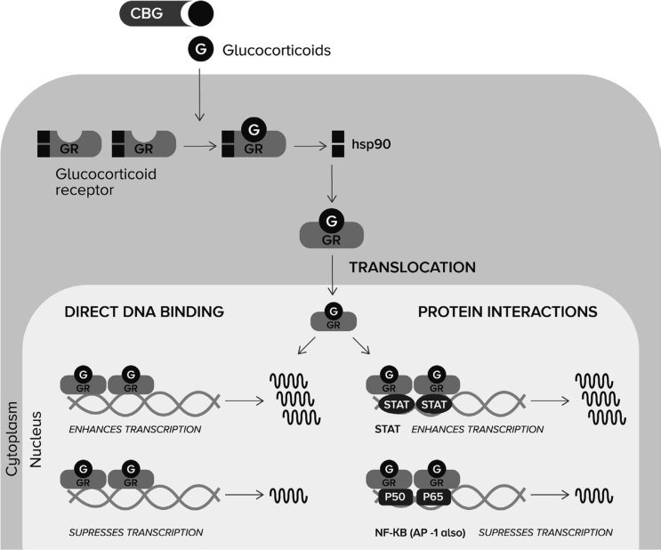
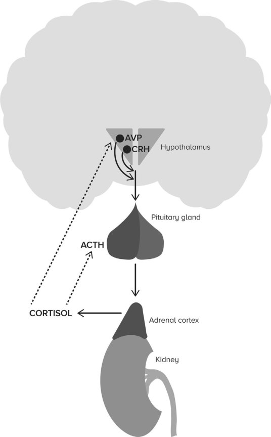
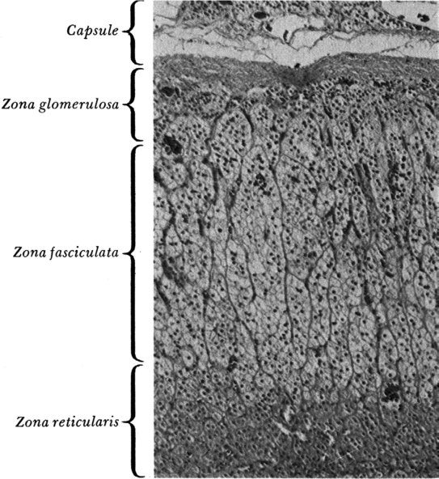
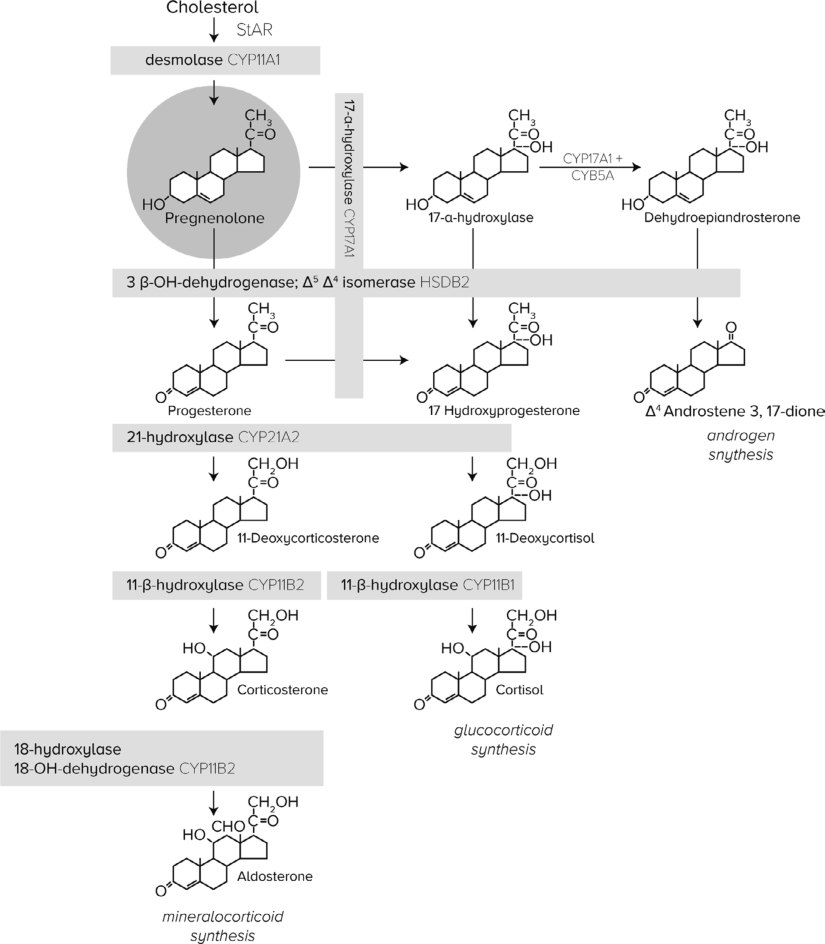

# 10. Adrenal Insufficiency
> Source attribution: [Source credits](../../SOURCE_CREDITS.md).

## PDF page 276 | printed page 263

### Adrenal Insufficiency

Kathleen E. Bethin, Indrajit Majumdar, and Louis J. Muglia

### Contents

### 10.1 Introduction and Background Information – 265

### 10.2 Etiology – 269

10.2.1 Primary Adrenal Insufficiency – 269 10.2.2 Secondary and Tertiary Adrenal Insufficiency – 273

### 10.3 Clinical Presentation – 274

10.3.1 Primary Adrenal Failure – 274 10.3.2 Secondary Adrenal Failure – 274

### 10.4 Diagnostic Evaluation – 275

10.4.1 Baseline Hormone Measurements – 275 10.4.2 Cosyntropin Stimulation Test – 275 10.4.3 Insulin-Induced Hypoglycemia – 276 10.4.4 Corticotropin-Releasing Hormone Stimulation Test – 276 10.4.5 Glucagon Stimulation Test – 277 10.4.6 Metyrapone Test – 277 10.4.7 Radiological Tests – 277 10.4.8 Diagnosing Adrenal Insufficiency in Critical Illness – 277 10.4.9 Diagnosing Adrenal Insufficiency in Neonates – 278

### 10.5 Outcomes and Possible Complications – 279

10.5.1 Polyglandular Autoimmune Syndromes – 279 10.5.2 Central Adrenal Insufficiency – 279 10.5.3 Congenital Adrenal Hyperplasia – 279 10.5.4 Adrenoleukodystrophy – 280 10.5.5 Triple A Syndrome – 280

### 10.6 Treatment – 280

© The Author(s), under exclusive license to Springer Nature Switzerland AG 2024 S. Radovick, M. Misra (eds.), Pediatric Endocrinology, https://doi.org/10.1007/978-3-031-66296-6_10

## PDF page 277 | printed page 264

10.6.1 Primary Adrenal Failure – 280 10.6.2 Central Adrenal Failure – 282 10.6.3 Special Considerations for Virilizing Forms of CAH – 282 10.6.4 Newer Therapies – 283

### 10.7 Summary – 286

### References – 287

## PDF page 278 | printed page 265

Key Points

5 The adrenal cortex, which surrounds

the medulla, produces glucocorticoids, mineralocorticoids, and androgens. 5 The adrenal medulla produces catechol

amines. 5 Adrenal insufficiency may result in salt

wasting, reduced ability to excrete free water, decreased vascular tone, hypogly cemia, inability to respond to stress, and/or sudden death. 5 The most common cause of adrenal

insufficiency is the iatrogenic use of large doses of steroids to treat other dis ease processes. 5 Treatment of adrenal insufficiency in

children involves supplementation with synthetic steroids and mineralocorti coids at doses that must balance ade quate treatment for a normal life with overtreatment that suppresses growth.

### 10.1 Introduction and Background

### Information

Disorders of adrenal function have long been known to cause clinically significant, often fatal, human disease. The initial description of anatomical abnormality of the adrenals in patients succumbing to a process manifested by progressive weakness, pallor, and overall physical decline was provided in 1849 by Thomas Addison [1]. While these initial cases may not have discerned the coincident sequelae of pernicious anemia and primary adrenal failure [2], Addison’s continued efforts clarified the association between abnormal adrenals and systemic pathology [3]. The first experimental verification of the importance of the adrenals in animal systems was pro vided shortly thereafter by Brown-Sequard [4]. Despite the recognition of the importance of the adrenal gland and adrenal hormones in human health and disease during the nine teenth century, the prognosis for patients diagnosed with primary adrenal insufficiency remained very poor until scientists and physi cians developed the capacity to chemically

synthesize and replace these hormones in the 1940s. The experience of Dunlop, who detailed the outcome of 86 individuals diag nosed with adrenal insufficiency over the period 1929–1958, is particularly instructive [5]. He found that the average life expectancy following diagnosis in 1929–1938, a time dur ing which only salt supplementation and crude adrenal extracts were available, was approximately 1 year. With the ability to administer deoxycorticosterone, a mineralo corticoid, during the interval 1939–1948, the life expectancy for patients with primary adre nal insufficiency improved marginally to approximately 3 years following diagnosis. Not until the ability to specifically replace glu cocorticoids in the 1950s did the prognosis for those individuals with primary adrenal failure considerably improve, such that the average life expectancy exceeded 10 years.

Primary adrenal insufficiency often com bines defects in mineralocorticoid and gluco corticoid production. Glucocorticoid deficiency alone, however, can produce seri ous health risks as well. Patients treated with prolonged supraphysiological glucocorticoid doses for the management of rheumatological disease were found to be at risk for sudden death during surgical stress if glucocorticoids had been recently terminated [6, 7]. Functions such as the regulation of carbohydrate metab olism [8, 9], free water excretion [10–13], vas cular tone [14], and the inflammatory response [15] have been ascribed to glucocorticoids. The truly essential aspect(s) of glucocorticoid action, however, remains uncertain.

10.1

16 17

## PDF page 279 | printed page 266

### 10

ing the modulation of gene transcription by preventing access of GR to glucocorticoid response elements (GREs) or heterodimer partners. When the ligand is bound, GR undergoes a conformational change such that the heat shock proteins dissociate, the nuclear translocation sequence is exposed, and GR dimers enter the nucleus where specific genes are either activated or repressed. GR-mediated changes in gene transcription occur by many mechanisms, some are only beginning to be elucidated. One mechanism, for example, is that upon GR binding of GREs in nucleosome-packaged chromatin, coactiva tors (such as SRC-1/NcoA-1, TIF2/GRIP1, or p300/CBP) are recruited [18]. These GR– coactivator complexes are histone acetylases,

serving to “open” DNA–histone complexes for more efficient transcription by the basal transcription machinery, in addition to expos ing sites for other transcription activators to bind. Conversely, while not yet demonstrated for GR, other members of the nuclear hor mone receptor superfamily can also recruit corepressors (such as SMRT and TIF1) with histone deacetylase activity which serve to “close” chromatin conformation and impede access to the basal transcription machinery [19, 20]. Alternatively, GR actions at com posite GREs, consisting of a low-affinity GRE and a binding site for another type of transcription factor, can differentially modu late transcription depending upon the rela tive abundance of each monomeric

Unmatched source image; PDF page 279. Consult the original caption.

## PDF page 280 | printed page 267

component [21]. Finally, GR can modulate the transcription of genes that do not con tain GREs. For instance, GR has the capac ity to directly interact with the p65 subunit of the transcription factor nuclear factor κB (NFκB) to block NFκB-mediated gene induc tion [22, 23]. GR also induces transcription of a functional inhibitor of NFκB, IκBα,

which then may serve to block NFκBmediated gene activation [24, 25].

10.2

Unmatched source image; PDF page 280. Consult the original caption.

## PDF page 281 | printed page 268

lamic neuropeptides, the most important of which are corticotropin-releasing hormone (CRH) and arginine vasopressin, into the hypophyseal portal circulation [26–29]. These neuropeptides then stimulate the release of adrenocorticotropin (ACTH) from anterior pituitary corticotrophs.

10.3 30 31

### 10

32 33

Adrenal insufficiency can result from impaired function at each level of the HPA axis. Direct involvement of the pathologic process at the level of the adrenal, or primary adrenal insufficiency, often causes both min eralocorticoid and glucocorticoid insuffi ciency by the destruction of both glomerulosa

34

Unmatched source image; PDF page 281. Consult the original caption.

## PDF page 282 | printed page 269

and fasciculata/reticularis cells, respectively. Pituitary or hypothalamic defects result in secondary or tertiary adrenal insufficiency, respectively, manifest as isolated glucocorti coid insufficiency.

### 10.2 Etiology

### 10.2.1 Primary Adrenal

### Insufficiency

In industrialized nations, the most common cause of primary adrenal insufficiency, or Addison disease, is autoimmune adrenalitis ( Box 10.1). Antibodies that react to all three zones of the adrenal cortex can be found in 60–75% of patients with autoimmune adre nal insufficiency [35–38]. After the onset of adrenal insufficiency, the titers decrease and sometimes completely disappear. Autoimmune adrenal insufficiency may occur as an isolated endocrinopathy or in association with other endocrinopathies [35, 37]. Addison disease in association with other endocrinopathies can be subdivided into two groups: polyglandular autoimmune disease types 1 and 2 [39]. Polyglandular autoimmune disease 3 is diag nosed when autoimmune thyroid disease is present with another autoimmune endocri nopathy without adrenal disease. The pres ence of adrenal antibodies in patients with other autoimmune diseases may precede the development of adrenal insufficiency by sev eral years [40, 41].

Polyglandular autoimmune disease type 1 or APECED (autoimmune polyendocrinopa thy candidiasis ectodermal dystrophy) is a rare autosomal recessive syndrome that usu ally presents in early childhood [42]. APECED is diagnosed when two of the following three diseases are present for at least 3 months: hypoparathyroidism, chronic mucocutaneous candidiasis, and Addison disease. Gonadal failure, enamel hypoplasia, and nail dystrophy are other common manifestations of this syn drome. Associated conditions include malab sorption syndromes, alopecia totalis or areata, pernicious anemia, autoimmune thyroid dis

ease, chronic active hepatitis, vitiligo, type 1 diabetes mellitus, anterior hypophysitis, and diabetes insipidus [42–44]. The gene responsi ble for APECED [45] encodes the autoim mune regulator protein (AIRE), a zinc finger protein transcription factor involved in selfantigen presentation in the thymus [46]. Sequencing of the protein coding region of the AIRE gene is commercially available and detects more than 95% of mutations [47].

Polyglandular autoimmune disease type 2 is much more common than type 1 and usu ally presents in adulthood or late childhood. Polyglandular autoimmune disease 2 is diag nosed when adrenal failure and autoimmune thyroid disease or type 1 diabetes mellitus are present without hypoparathyroidism or can didiasis. Other diseases associated with this disorder include gonadal failure, celiac dis ease, autoimmune gastritis with vitamin B12 deficiency, vitiligo, diabetes insipidus, alope cia, pernicious anemia, myasthenia gravis, immune thrombocytopenia purpura, Sjogren’s syndrome, and rheumatoid arthritis [35, 43, 44]. Much less is known about the etiology of polyglandular autoimmune type 2 other than an association with high-risk class II HLA alleles [46].

10.4

48

## PDF page 283 | printed page 270

### 10

imal at 8–9 weeks gestation, in the fetal adre nal gland. This activity disappears by 14 weeks and reappears at 23 weeks gestation. Nearer to term, placental aromatases convert fetal androgens to estrogens [49]. Males with 21-hydroxylase or 11β-hydroxylase deficiency do not manifest genital ambiguity, while those with 3β hydroxysteroid dehydrogenase defi

34

ciency demonstrate undervirilization since testosterone production is diminished.

Congenital lipoid adrenal hyperplasia (StAR or steroidogenic acute regulatory pro tein deficiency) is a rare autosomal recessive condition that results in a deficiency of all adrenal and gonadal steroid hormones [50]. Males with this condition usually have female

Unmatched source image; PDF page 283. Consult the original caption.

## PDF page 284 | printed page 271

external genitalia. The defective gene is on chromosome 8 and encodes the StAR protein. The StAR protein mediates cholesterol trans port from the outer to inner mitochondrial membrane [51].

Smith–Lemli–Opitz syndrome results from a deficiency of 7-dehydrocholesterol C-7 reductase. Individuals with this syndrome have low cholesterol and high 7-dehydrocholesterol [52] which may result in adrenal insufficiency and 46, XY gonadal dys genesis [53]. Associated symptoms of this dis order include moderate-to-severe mental retardation, failure to thrive, altered muscle tone, microcephaly, dysmorphic facies, geni tourinary anomalies, and limb anomalies [54].

X-linked adrenoleukodystrophy (X-ALD) is a sex-linked, recessively inherited defect in a peroxisomal membrane protein, the adreno leukodystrophy protein (ALDP), which belongs to the ATP-binding cassette super family of transmembrane transporters [55, 56]. Defective ALDP function results in the accumulation of very long-chain fatty acids (VLCFA), demyelination in cerebral white matter, and the destruction of the adrenal cor tex [57]. Approximately 25% of patients with X-ALD develop adrenal insufficiency. Any male who presents with primary adrenal insufficiency should be screened for X-ALD by measuring serum VLCFA levels.

Genes affecting adrenal development in addition to those encoding steroid metabolic enzymes have also been found to cause con genital adrenal failure. X-linked adrenal hypoplasia congenita (AHC) with hypogo nadotropic hypogonadism is a rare X-linked recessive disorder due to a deletion or muta tion of the AHC or DAX-1 (dosage-sensitive sex reversal-adrenal hypoplasia congenita gene on the X-chromosome-1) gene. Patients with this disorder have severe glucocorticoid, mineralocorticoid, and androgen deficiency [58–60]. In this disorder, the adrenal cortex resembles the fetal adrenal with large vacuo lated cells. The miniature form of adrenal hypoplasia is a sporadic form associated with pituitary hypoplasia. More recently, heterozy gous mutation of the autosomal steroido genic factor-1 (SF-1) gene has been found to result in adrenal failure and 46, XY sex rever

sal in humans [61]. Homozygous SF-1 defi ciency has not been found in humans, though completely SF-1-deficient mice demonstrate agenesis of the adrenal cortex, testes, and ovaries [62].

Familial glucocorticoid deficiency is a rare autosomal recessive disorder. Patients with this disorder present in childhood with hyper pigmentation, muscle weakness, hypoglyce mia, and seizures because of low cortisol and elevated ACTH levels. Initial families had been shown to have a defect in the ACTH receptor, but other families were thought to have a post-receptor defect [63–65]. Patients who also have achalasia and alacrima are clas sified as having Allgrove or Triple-A syn drome, a rare autosomal recessive disease. It usually manifests during the first decade of life with achalasia, alacrima, and adrenal insufficiency due to ACTH resistance but many other manifestations have been described, especially involving the autonomic nervous system. Neurological manifestations of Triple A syndrome may include heart rate variability, temperature, and blood pressure instabilities. It is caused by mutations in the AAAS gene on chromosome 12q13 and encodes the aladin protein [66].

More recent genetic analyses have found that in addition to mutations in MC2R which encodes the ACTH receptor, familial gluco corticoid deficiency can result from mutations in the gene encoding the melanocortin 2 receptor accessory protein (MRAP) [67] or steroidogenic acute regulatory protein (STAR) [68].

Wolman disease, a rare autosomal reces sive disease that results from complete defi ciency of lysosomal esterase, is usually fatal in the first year of life [69]. Features of this dis ease include mild mental retardation, hepato splenomegaly, vomiting, diarrhea, growth failure, and adrenal calcifications. Calcifications that delineate the outline of both adrenals are pathognomonic for this dis ease as well as the less severe form of this dis ease, cholesterol ester storage disease [70].

Birth trauma may cause adrenal hemor rhage and should be considered in a newborn presenting with signs and symptoms of adre nal insufficiency. Adrenal hemorrhage has

## PDF page 285 | printed page 272

also been reported as sequelae of sepsis, trau matic shock, coagulopathies, or ischemic dis orders. Adrenal hemorrhage in association with fulminant septicemia caused by Neisseria meningitidis is known as the Waterhouse– Friderichsen syndrome.

Infiltrative disease of the adrenal due to tuberculosis had been a frequent cause of adrenal failure when Addison first described adrenal insufficiency. Today, tuberculosis is a rare cause of adrenal insufficiency in devel oped countries, especially in children. Tuberculosis is still a significant cause of adrenal insufficiency in developing countries. Amyloidosis, hemochromatosis, and sarcoid osis have all been reported to cause primary adrenal insufficiency by the invasion of the adrenal gland.

Patients with acquired immunodeficiency syndrome (AIDS) or who are human immu nodeficiency virus (HIV) positive may acquire adrenal insufficiency. In patients with HIV, cytomegalovirus infection can cause necrotiz ing adrenalitis. Infection with Mycobacterium avium-intracellulare or cryptococcus or involvement of the adrenal gland by Kaposi sarcoma also is a significant cause of primary adrenal insufficiency in HIV-positive patients [71]. In addition, most patients with AIDS have decreased adrenal reserves as measured by prolonged ACTH stimulation [72].

### 10

Fungal disease has also been shown to cause primary adrenal insufficiency. Disseminated infection with histoplasmosis or blastomycosis may invade and destroy the adrenal glands [73, 74]. Cryptococcus and coccidioidomycosis are rarer causes of adre nal insufficiency [75, 76]. Several drugs have been associated with the induction of adrenal insufficiency. Aminoglutethimide [77], etomi date [78], ketoconazole [79], metyrapone [80], suramin [81], and osilodrostat [82] are drugs that may cause adrenal insufficiency by inhib iting cortisol synthesis. In most patients, an increase in ACTH will override the enzyme block, but in patients with limited reserve, adrenal insufficiency may ensue. Drugs that accelerate the metabolism of cortisol and syn thetic steroids such as phenytoin [83, 84], bar biturates, and rifampicin [83] also may cause adrenal insufficiency in patients with limited

reserve. Mitotane accelerates the metabolism of halogenated synthetic steroids (dexametha sone and fludrocortisone) and may precipitate an adrenal crisis in patients taking both drugs [85]. Immune checkpoint inhibitors, especially when multiple drugs are used, have been shown to rarely cause adrenal insufficiency [86, 87].

Box 10.1 Causes of Adrenal Insufficiency

5 Primary adrenal insufficiency

–– Autoimmune

–– Isolated adrenal insufficiency –– Polyglandular autoimmune diseases I and II –– Inborn errors of metabolism

–– Congenital adrenal hyperplasia –– StAR deficiency –– Smith–Lemli–Opitz syndrome –– X-linked adrenoleukodystro phy –– DAX-1 mutation (adrenal hypoplasia) –– Familial glucocorticoid defi ciency –– Wolman’s disease –– SF-1 mutation –– Drugs

–– Aminoglutethimide –– Etomidate –– Ketoconazole –– Metyrapone –– Suramin –– Osilodrostat –– Phenytoin –– Barbiturates –– Rifampicin –– Mitotane –– Immune Checkpoint Inhibitors –– Adrenal hemorrhage

–– Birth trauma –– Sepsis (Waterhouse–Friderich sen syndrome) –– Shock –– Coagulopathy –– Ischemia –– Infection

–– Tuberculosis –– Amyloidosis

## PDF page 286 | printed page 273

–– Hemochromatosis –– Sarcoid –– HIV/AIDS –– Histoplasmosis –– Blastomycosis –– Cryptococcus –– Coccidioidiomycosis 5 Secondary adrenal insufficiency

–– CNS lesions

–– Hypothalamic/pituitary/supra sellar tumors/trauma/hemor rhage –– Hemochromatosis –– Sarcoidosis, tuberculosis, fun gal infection –– Empty sella syndrome –– Cushing syndrome (following treatment) –– Abnormalities in neuropeptides

–– POMC –– CRH –– Abnormalities in pituitary devel opment

–– Septo-optic dysplasia –– Hydrancephaly/anencephaly –– Pituitary aplasia/hypoplasia –– Iatrogenic (Supraphysiologic glu cocorticoids)

### 10.2.2 Secondary and Tertiary

### Adrenal Insufficiency

With the widespread use of supraphysiologi cal doses of glucocorticoids for the treatment of atopic, autoimmune, inflammatory, and neoplastic diseases, iatrogenic suppression of corticotroph ACTH release with secondary adrenocortical atrophy is a frequent, often unrecognized precipitant of adrenal insuffi ciency. Prolonged (greater than 7–10 days) supraphysiological glucocorticoid replace ment places children and adults at risk for consequences of secondary/tertiary adrenal insufficiency [88]. Similarly, sustained, exces sive glucocorticoid production in Cushing syndrome suppresses normal corticotroph responses. The duration of recovery of corti cotroph function from iatrogenic adrenal sup

pression once pharmacological administration of glucocorticoids is discontinued, or Cushing syndrome after tumor resection, is quite vari able, with evidence of suppression of the HPA axis in some patients for more than 1 year [89].

Several acquired and congenital lesions of the hypothalamus and pituitary are also causes of secondary/tertiary adrenal insuffi ciency ( Box 10.1). Disruption of cortico troph function commonly occurs by hypothalamic and pituitary tumors or as a result of treatment of these tumors. In chil dren, the most common tumors include cra niopharyngiomas, dysgerminomas, and pituitary adenomas. Trauma to the hypothal amus, pituitary, or hypophysial portal circula tion from a significant head injury, cerebrovascular accident, Sheehan syndrome, or hydrocephalus/increased intracranial pres sure provides additional etiologies of central adrenal insufficiency. Infiltrative diseases of the hypothalamus and pituitary such as auto immune hypophysitis, sarcoidosis, tuberculo sis, leukemia, and fungal infections also may result in adrenal insufficiency, often in the context of panhypopituitarism. Abnormalities in the development of the hypothalamus and pituitary associated with adrenal insufficiency include septo-optic dysplasia (de Morsier syn drome) [90, 91], hydrancephaly/anencephaly, and pituitary hypoplasia/aplasia. Secondary adrenal insufficiency together with diabetes insipidus is particularly ominous in these patients, as sudden death during childhood can occur [92].

Several groups have evaluated the fre quency of central adrenal insufficiency in chil dren and adults with Prader–Willi syndrome (PWS), a genetic disorder characterized by early hypotonia, failure to thrive, develop mental delay, and hypogonadism, that later progresses to obesity due to hyperphagia and other behavioral problems. It has been widely appreciated that individuals with PWS are at increased risk for sudden and often unex plained death. Stevenson et al. [93] reported small adrenal size in three children subject to postmortem analysis of the ten individuals in the series, and a later study demonstrated evi dence of central hypoadrenalism in 60% of

## PDF page 287 | printed page 274

PWS subjects undergoing a single-dose metyr apone test [94]. This high frequency of central adrenal insufficiency, though, has not been found in larger, more recent studies of chil dren and adults with PWS that employed lowdose cosyntropin, high-dose cosyntropin, metyrapone, or insulin tolerance testing [87, 95, 96]. Clinically significant central adrenal insufficiency is likely rare in individuals with PWS.

Most commonly, inherited abnormalities of neuropeptides involved in the HPA axis regulation have been reported. Deficiency of proopiomelanocortin results in adrenal insuf ficiency, pigmentary abnormalities, and obe sity [97, 98]. One kindred with suspected CRH deficiency and Arnold-Chiari type 1 malfor mation has been described [99]. While the mutation in this kindred is linked to the CRH locus, a specific mutation in the CRH gene has not yet been defined.

### 10

### 10.3 Clinical Presentation

### 10.3.1 Primary Adrenal Failure

Primary adrenal failure may present as acute, rapidly progressive deterioration or an insidi ous, chronic process. In infants with congeni tal adrenal hyperplasia, the first suspicion of adrenal insufficiency may be imparted by the observation of ambiguous genitalia in the delivery room. In Caucasian infants, physical examination may additionally reveal hyper pigmentation of the labioscrotal folds, areola, and buccal mucosa due to excessive proopi omelanocortin synthesis and processing to ACTH and MSH. If of a salt-wasting variety, untreated CAH commonly causes hyponatre mia, hyperkalemia, acidosis, and shock at 7–14 days of age. Infants with the rarer adre nal hypoplasia congenita do not manifest genital ambiguity, but may present with a similar adrenal crisis [100].

Children and adults with primary adrenal insufficiency demonstrate a similar spectrum of signs and symptoms, whether of a gradual or sudden onset. The most common symp toms such as weakness, fatigability, anorexia,

vomiting, constipation or diarrhea, and depression are nonspecific and do not imme diately implicate adrenal insufficiency [38]. While salt craving is highly suggestive of adre nal insufficiency, this symptom may not be elicited at presentation. Weight loss is another very common finding with adrenal insuffi ciency, though again does not strongly indi cate the diagnosis. More specific signs such as hyperpigmentation of skin folds, gingiva, and non-sun-exposed areas, hyponatremia with hyperkalemia, hypoglycemia, and hypoten sion often point toward the correct diagnosis. Hypercalcemia is sometimes found at presen tation due to volume depletion and associated increased intravascular protein concentration [101]. In children with polyglandular autoimmune syndrome type 1, mucocutane ous candidiasis and hypoparathyroidism usu ally precede the appearance of adrenal insufficiency [42]. In X-linked adrenoleuko dystrophy, neurological manifestations may either precede or follow the evolution of adre nal insufficiency [102, 103].

### 10.3.2 Secondary Adrenal Failure

The findings of secondary adrenal failure in large part recapitulate the consequences of isolated glucocorticoid deficiency in primary adrenal insufficiency, such as weakness, fati gability, and an increased tendency toward hypoglycemia. Of note, salt wasting does not occur because the renin–angiotensin–aldoste rone system remains intact. Because glucocor ticoids are required for appropriate renal free water clearance [11], secondary adrenal insuf ficiency is associated with hyponatremia with out hyperkalemia or volume depletion. Additionally, since ACTH production and secretion are the primary defects in secondary disease, skin hyperpigmentation does not occur unless as a manifestation of recently treated Cushing disease. Signs and symptoms of a central nervous system tumor, such as headaches, vomiting, or visual disturbances, should be sought. Infants with congenital central nervous system malformations, and physical evidence for possible hypopituitarism such as midline facial defects or microphallus,

## PDF page 288 | printed page 275

or optic nerve atrophy should be evaluated for adrenal deficiency. Individuals at risk for iat rogenic adrenal insufficiency will often appear Cushingoid on examination, with round facies, thinned skin, striae, and a dorsal cervi cal fat pad due to prior glucocorticoid ther apy.

### 10.4 Diagnostic Evaluation

### 10.4.1 Baseline Hormone

### Measurements

To verify suspected primary adrenal insuffi ciency in the patient presenting with classic signs and symptoms of Addison disease, often little more is necessary than the measurement of plasma ACTH, cortisol, renin activity, and aldosterone. Elevated ACTH (>2-fold above the upper limit of the reference range) and plasma renin activity together with low plasma cortisol and/or aldosterone confirms primary adrenal failure [104]. In patients more than 6 months of age, the age at which the cir cadian pattern of glucocorticoid production has been established [105], not presenting in fulminant adrenal crisis, morning (approxi mately 8 AM) ACTH, and cortisol levels, along with electrolytes, plasma renin activity, and aldosterone, may establish the diagnosis. A fasting morning cortisol of less than 5 mcg/ dL is indicative of adrenal insufficiency, while concentrations exceeding 20 mcg/dL make adrenal failure quite unlikely [104, 106]. Those with early adrenal failure, or secondary dis ease, will often require additional provocative testing as described below. Adrenal autoanti bodies can be used to further establish the eti ology of adrenal insufficiency as an autoimmune [36, 37]. All males diagnosed with primary adrenal failure without evidence of other autoimmune pathology should have plasma very long-chain fatty acids measured to exclude X-linked adrenoleukodystrophy.

Screening for CAH caused by 21-hydroxylase deficiency on the newborn screen is universally required by law in all 50 of the United States [107]. In newborns with

ambiguous genitalia or a salt-wasting crisis where CAH is being considered, random mea surement of cortisol precursors and precursor by-products usually confirms or excludes the diagnosis. For a virilized female, where 21-hydroxylase, 11β-hydroxylase, or 3β-hydroxysteroid dehydrogenase deficiencies are possible, a typical hormone profile con sists of measuring 17-hydroxypregnenolone, 17-hydroxyprogesterone, dehydroepiandros terone, androstenedione, testosterone, corti sol, plasma renin activity, and aldosterone. Males with undervirilization should be evalu ated for 3β-hydroxysteroid dehydrogenase, 17-hydroxylase, or StAR deficiency, as well as nonadrenal etiologies of genital ambiguity, while normally virilized males with salt wast ing should be evaluated for 21-hydroxylase deficiency and aldosterone biosynthetic defects. In 11β-hydroxylase deficiency, hyper tension, hypokalemia, and a suppressed plasma renin are found in normally virilized males or virilized females. Since salt wasting due to CAH does not typically occur within the first 3 days after birth, and adrenal hor mone levels change dramatically in normal infants within this period [108–110], random adrenal hormone measurements should be obtained on the day of life 2–3. Additionally, the normal range of adrenal hormones differs for term and preterm infants and should be accounted for in the interpretation of results [111–113]. Late-onset forms of CAH and proximal lesions in the cortisol biosynthetic pathway such as StAR deficiency or adrenal hypoplasia often require cosyntropin stimula tion testing, as described below, with cortisol precursors measured in addition to cortisol.

### 10.4.2 Cosyntropin Stimulation

### Test

Direct stimulation of adrenal cortisol release by the administration of cosyntropin (1–24 ACTH; Cortrosyn) is the most commonly used diagnostic tool in the evaluation of adre nal function [106, 114]. In the standard cosyn tropin test (250 mcg cosyntropin in adults and children ≥2 years of age, 125 mcg for children

## PDF page 289 | printed page 276

<2 years, and 15 mcg/kg for infants), baseline ACTH and cortisol samples are obtained, and then cosyntropin is administered intrave nously [104]. If mineralocorticoid deficiency is also suspected, plasma renin activity, aldo sterone, and electrolytes should be obtained with the baseline laboratories. Thirty and/or 60 min following cosyntropin administration, a second plasma sample is obtained for corti sol determination. Data from the 1990s sup port a plasma cortisol concentration greater than or equal to 18 mcg/dL, along with a nor mal baseline ACTH level, as a normal response and rules out primary adrenal insuf ficiency [115]. However, more recent data using more specific cortisol antibodies sup port a cutoff of 13.5–20.8 mcg/dL, depending on the assay used, as a normal response to the cosyntropin test [116–118]. In addition, a nor mal response to this standard stimulation test also rules out long-standing, severe secondary adrenal insufficiency. To evaluate recent-onset secondary adrenal insufficiency or milder forms of secondary adrenal insufficiency, a more sensitive stimulation test employing a lower dose of cosyntropin has been devised [115, 119–121]. In this case, 1 mcg, or 0.5 mcg/ M2 of body surface area, of cosyntropin is administered intravenously, with cortisol measured at baseline and 20–60 min after administration. Plasma cortisol concentration above 13.5–20.8 mcg/dL, depending on the assay used, is considered a normal response. False-positive tests employing these criteria may be relatively frequent, however, and should be considered to prevent overdiagnosis of adrenal insufficiency [122]. The 1 mcg cosyntropin test is not recommended for diag nosis of suspected primary adrenal insuffi ciency [104].

### 10

### 10.4.3 Insulin-Induced

### Hypoglycemia

The response to hypoglycemia (blood glucose <40 mg/dL) requires the integrity of the entire HPA axis. After an overnight fast, 0.10–0.15 U/

kg of regular insulin is administered intrave nously. Blood glucose and cortisol are mea sured prior to and then 15, 30, 45, 60, 75, 90, and 120 min following insulin injection. Patients will experience some degree of dis comfort during the hypoglycemic phase of this test due to neuroglycopenia and the con sequences of catecholamine release, such as tachycardia, diaphoresis, anxiety, and tremu lousness. A plasma cortisol of above 20 mcg/ dL is considered a normal response [106, 123]. This test should be avoided in patients with a history of seizures or significant cardiovascular disease, and dextrose for intravenous rescue should be immediately accessible in the event of sustained severe hypoglycemia or a seizure.

### 10.4.4 Corticotropin-Releasing

### Hormone Stimulation Test

To directly assess corticotroph function, ovine corticotropin-releasing hormone can be administered intravenously at a dose of 1 mcg/kg or 100 mcg followed by the measure ment of plasma ACTH and cortisol levels over the next 2 h [124–126]. Flushing occurs in some patients after administration. Peripheral CRH administration provides a less robust stimulus for ACTH release than hypoglyce mia, and the normal range has been less well established. However, studies directly com paring the responses to CRH and insulininduced hypoglycemia have demonstrated good concordance in defining adrenal status. In normal subjects, plasma ACTH peaks rap idly (15–30 min) following administration and remains at an elevated level. Cortisol peaks slightly later, at 30–60 min following injection, and also persists at an elevated level for 2 h. In patients with hypothalamic lesions, an exag gerated ACTH response is often obtained with an even longer prolongation in the dura tion of elevation. In contrast, patients with pituitary lesions do not respond to CRH administration with increases in either ACTH or cortisol. CRH is no longer available for use in humans.

## PDF page 290 | printed page 277

### 10.4.5 Glucagon Stimulation Test

The glucagon stimulation test provides an alternative to insulin-induced hypoglycemia in evaluating central adrenal insufficiency as it requires endogenous ACTH secretion to cause cortisol release [127, 128]. While gluca gon doses of 0.03 mg/kg have been routinely used as a provocative test for growth hormone assessment, studies evaluating adrenal func tion have employed somewhat higher doses (0.1 mg/kg IM; maximum 1.0 mg in children; in adult studies 1.0 mg if <90 kg and 1.5 mg if >90 kg) [129–131]. After an overnight fast, plasma is obtained at baseline, then 30, 60, 90, 120, 150, and 180 min following injection. A normal response is achieved if peak cortisol exceeds 20 mcg/dL.

### 10.4.6 Metyrapone Test

Metyrapone inhibits the activity of the enzyme 11-beta-hydroxylase, blocking the conversion of 11-deoxycortisol to cortisol. Thus, cortisol is unable to provide negative feedback at the central nervous system and pituitary sites increasing ACTH secretion. The increased plasma ACTH concentration stimulates increased production of 11-deoxycortisol and its urinary metabolites. Two general forms of the metyrapone test have been standardized: an overnight, singledose test [132] and a multiple-dose form [80]. Because of convenience, the single-dose test is more commonly performed. For the singledose test, 30 mg/kg to a maximum of 3.0 g is given at midnight with a snack to decrease the nausea associated with metyrapone ingestion. Cortisol, 11-deoxycortisol, and ACTH are measured at 8 am following the dose. A nor mal response is the increase in plasma 11-deoxycortisol to more the 7 mcg/dL [133]. Cortisol levels above 5 mcg/dL imply inade quate suppression of enzyme activity such that low 11-deoxycortisol levels cannot be taken as an index of inadequate hypothalamic or pituitary function.

### 10.4.7 Radiological Tests

In general, imaging studies should be utilized after the diagnosis of adrenal insufficiency is established by biochemical methods. The obvious exception to this rule is the patient presenting with symptoms suggesting an intracranial mass lesion. The resolution of magnetic resonance imaging of the hypothal amus and pituitary in general exceeds that of computed tomography [134] and is the initial imaging study of choice for the evaluation of documented central adrenal insufficiency. If a mass is found, computed tomography may be performed to establish whether the tumor has calcifications characteristic of a craniopha ryngioma.

In patients with primary adrenal insuffi ciency with positive adrenal autoantibodies or elevated VLCFA, establishing autoimmune adrenalitis or X-ALD as the etiology, respec tively, adrenal imaging is not required. If these entities are not established as the diagnosis, CT or MRI of the adrenal should be per formed [135–138]. Observation of calcifica tions in an older child is suggestive of tuberculosis or other granulomatous disease, while in an infant, the diagnosis of Wolman disease should also be entertained. In a lim ited number of cases, CT-assisted needle biopsy for pathological diagnosis may be required.

### 10.4.8 Diagnosing Adrenal

### Insufficiency in Critical Illness

During critical illness, activation of the HPA axis is essential for survival. Individuals with known primary or central adrenal insuffi ciency require additional steroids during criti cal illness. Since the early 2000s, there have been many studies published on adrenal func tion in the intensive care setting in patients not previously diagnosed with adrenal insuf ficiency. Patients in the ICU with unrecog nized adrenal insufficiency may experience

## PDF page 291 | printed page 278

treatment-resistant hypotension, prolonged ventilation, and increased mortality [139]. However, how to diagnose patients in the ICU with adrenal insufficiency remains highly con troversial. Intensivists in the early 2000s often diagnosed relative adrenal insufficiency if the rise in cortisol 30 or 60 min after administer ing 0.5–250 mcg of cosyntropin intravenously was less than 9 mcg/dL [140–144]. Still others use a baseline cortisol of less than 7 mcg/dL [142, 145, 146] or a stimulated cortisol of <18 mcg/dL [142, 147] in response to low-dose cosyntropin as evidence of adrenal insuffi ciency [144]. However, there are many factors that affect our ability to diagnose adrenal insufficiency in the setting of critical illness, and more recently, these are not considered appropriate diagnostic tests in the setting of critical illness [148]. During critical illness inflammatory cytokines such as IL-1, IL-6, and TNF-α, the autonomic nervous system, and factors in the innate immunity response such as Toll-like receptors and macrophage inhibitory factor (MIF) have either been shown or postulated to play a significant role in the HPA axis response to stress [149]. Alterations in these confounding factors as well as polymorphisms in individual genes likely contribute to variations in the normal HPA axis response to each stressor. Second, it has recently been recognized that the HPA axis response to acute critical illness differs from its response to prolonged critical illness. Third, in critical illness, transcortin and albu min levels may decrease depending on the exact illness. Since more than 90% of cortisol is bound to transcortin and albumin, this change may affect the validity of measuring total cortisol, especially when albumin levels are also low. Ideally, free cortisol levels would be measured to determine the HPA axis sta tus, but these assays are not easily available. Fourth, the most readily available cortisol assay used is the immunoassay, which exhibits nonuniformity that may increase in the setting of critical illness. Lastly, in critical illness, cor tisol metabolism is reduced by suppressed expression and activation of renal 1-beta

### 10

hydrosteroid dehydrogenase 2 [148]. Thus, adrenal insufficiency in the setting of a critical illness is difficult to diagnose, but should be considered and the patient treated appropri ately when warranted by the clinical scenario.

### 10.4.9 Diagnosing Adrenal

### Insufficiency in Neonates

It has been increasingly recognized that criti cally ill neonates may have relative adrenal insufficiency [147]. Steroidogenic activity has been detected in fetal adrenal glands by 50–52 days postconception with a peak in cor tisol production at 8–9 weeks gestation and undetectable levels by 14 weeks gestation. Due to lack of 3β-hydroxysteroid dehydroge nase activity between 14 and 23 weeks and suppression from maternal cortisol in early gestation, very little fetal cortisol is produced between 14 and 30 weeks gestation [49]. Later in gestation, the placenta begins to express 11β-hydroxysteroid dehydrogenase 2, which inactivates maternal cortisol, allowing the fetal adrenal to take over cortisol production. In the infant born preterm, this immaturity of the HPA axis may lead to relative adrenal insufficiency during stress. Several studies have demonstrated that preterm infants with hypotension have lower baseline and stimu lated cortisol [150–153]. Critically ill term neonates may also be at risk for relative adre nal insufficiency for the same reasons. However, they may also be at risk because of hormonal shifts during the transition from fetal to extrauterine life. As the placenta matures, it produces more and more CRH that drives the fetal adrenal. Unlike hypotha lamic CRH, placental CRH is stimulated by cortisol. At birth, the placental CRH is sud denly withdrawn. During the transition, the hypothalamus and pituitary may be tran siently suppressed, leading to relative adrenal insufficiency during critical illness. Further studies in neonates are necessary before glu cocorticoid treatment of critically ill neonates can be recommended as a standard of care.

## PDF page 292 | printed page 279

However, glucocorticoid therapy should be considered in neonates both preterm and term who are hemodynamically unstable. If gluco corticoids are used, a cortisol level should be drawn prior to initiating therapy. If treatment is initiated, the length of treatment should be minimized as much as possible.

### 10.5 Outcomes and Possible

### Complications

Children with adrenal insufficiency in general lead normal lives. However, glucocorticoid deficiency places them at increased risk for usual illnesses becoming life-threatening. If appropriate stress steroid coverage is not given during an illness, these children have the potential of dying. Therefore, for both the child and the entire family, reinforcement of stress steroid administration during illness is essential. If oral intake of medications and salt is not possible due to gastrointestinal dis ease or mental status changes, further instruc tion for emergency assistance is important. All children with adrenal insufficiency should be provided with a medical alert bracelet stat ing their diagnosis to facilitate urgent therapy if required. Other factors affecting quality of life are determined by the etiology of adrenal failure.

### 10.5.1 Polyglandular Autoimmune

### Syndromes

Children with adrenal insufficiency in the con text of one of the polyglandular autoimmune syndromes must contend with other endocri nopathies, or the anticipation of developing other endocrinopathies. Often, complicated, multidrug therapeutic regimens develop with significant financial and emotional costs to the families. The development of type 1 diabe tes mellitus, especially, places added demands on daily life. Additionally, enamel hypoplasia, nail dystrophy, vitiligo, and alopecia may be considered disfiguring by the patients with these disorders.

### 10.5.2 Central Adrenal Insufficiency

Secondary or tertiary adrenal insufficiency may be associated with insufficiency of other pituitary hormones. Similar to patients with polyglandular autoimmune syndromes, multihormone deficiency states are common and require frequent medication administration and dosage adjustment. Long-term issues with decreased fertility and excessive weight gain due to hypothalamic damage pose the most challenging concerns.

### 10.5.3 Congenital Adrenal

### Hyperplasia

Determining the etiology of ambiguous geni talia is an endocrine emergency. Sex assign ment of a newborn has obvious long-term implications, with optimization of adult sexual and emotional function being the primary goal. The timing for sex assignment and recon structive surgery remains controversial [107]. Members of the Accord Alliance propose that no reconstructive genital surgery should be performed on children before they are old enough to consent. In general though, 46, XX patients with CAH, if treated adequately, may be as fertile as adult females. Therefore, the recommendation that 46, XX patients with CAH be raised as females, with prompt recon structive surgery if needed, had been the stan dard of care. If a female infant is severely virilized (Prader score >3), it is suggested in Endocrine Society Clinical Practice Guidelines that clitoral and perineal surgery during infancy by an experienced team be considered [107]. Further, for infants with a low vaginal confluence, it is recommended that a complete repair be done during infancy. However, more long-term outcome studies are necessary to make firm recommendations for surgical repair. Management of all forms of genital ambiguity benefits from a multidisciplinary approach with input from experienced endo crinologists, surgeons, geneticists, and psychol ogists, allowing the formulation of a consistent long-term plan for the child and family.

## PDF page 293 | printed page 280

### 10.5.4 Adrenoleukodystrophy

The phenotype of X-ALD is variable with at least seven clinical subtypes: childhood cere bral ALD, adolescent ALD, adult cerebral ALD, adrenomyeloneuropathy, Addison dis ease only, and asymptomatic and heterozy gote women. All of these subtypes can be present within the same family [102]. In 6–8% of cases, Addison’s disease is the only mani festation of ALD. Any male sibling of an affected patient has a 50% chance of also being affected. Therefore, all male siblings should be screened and, if positive, evaluated for adrenal insufficiency. Any female sibling of a patient has a 50% chance of being a car rier. Screening should be offered to any female siblings to evaluate the risk of disease to their children as well as the risk of adult-onset myelopathy in the female carriers [154]. The major psychosocial consideration in this dis ease is the anticipation of progressive neuro logical deterioration, with limited interventions of proven efficacy.

### 10

### 10.5.5 Triple A Syndrome

Triple A Syndrome (TAS) was first identified by Dr. Allgrove in 1978. It is a rare genetic disease caused by mutations in the AAAS gene, which encodes the WD-repeatcontaining protein, ALADIN. It is one of the nucleoporins forming the nuclear pore com plex, but its exact function is unclear. Presentation is heterogenous but the most common symptoms seen include alacrimia, esophageal achalasia, adrenal insufficiency, and neurological disease. Alacrimia, which is present in more than 90% of people with TAS, is usually the first sign, but the diagnosis is not usually made until the patient has symptoms of adrenal insufficiency. TAS is thought to be progressive and neurological symptoms may develop over time. Alacramia is likely due to autonomic dysfunction of the lacrimal glands. Achalasia is found in 75–93% of people with TAS and usually presents in childhood. Achalasia may present with vomiting, weight loss, difficulty swallowing, and chronic cough.

Anyone presenting with alacrimia and/or achalasia should have adrenal function evalu ated. Adrenal insufficiency also usually pres ents within the first decade of life. Neurological symptoms are much more variable and although it has been reported in individuals as young as 2 years of age, it usually presents after the other signs. The autonomic system is most commonly affected with such signs as postural hypotension, heart rate instability, sweating, impotence, neurogenic bladder, ataxia, dysarthria, distal motor and sensory neuropathy, disorders of movement, and intellectual disability. Dysfunction of the pupillary muscles and hyperreflexia may also be present [66, 155].

### 10.6 Treatment

### 10.6.1 Primary Adrenal Failure

### 10.6.1.1 Chronic Replacement

Since the bioavailability of oral steroids is poor and varies from individual to individual, the recommended dose for replacement hydrocortisone therapy is a starting guide [156, 157]. For adults, consensus guidelines suggest 15–25 mg of hydrocortisone in 2–3 divided doses per day, with the highest dose given in the morning upon awakening and a lower dose later in the day. For children, the consensus guidelines recommend a total daily dose of 8 mg/M2 body surface area of hydro cortisone in 3–4 divided doses ( Box 10.2) [104]. It has been shown that twice-daily hydrocortisone produces a nonphysiological low cortisol level 2–4 h prior to the next dose [158, 159]. Therefore, younger children, who are more prone to hypoglycemia when cortisol levels are low, or children with CAH, where efficient suppression of adrenal androgens is required, should receive hydrocortisone divided three to four times per day. Although steroids other than hydrocortisone may be used, hydrocortisone is preferred in children since it has less growth suppressive effects than synthetic steroids [107, 160–162]. Hydrocortisone tablets and liquid suspension

## PDF page 294 | printed page 281

are not equivalent. Hydrocortisone drug is unevenly distributed in the suspension and is not recommended for use in children [107, 163].

Patients with primary adrenal insufficiency often do not produce adequate aldosterone. Although hydrocortisone has some mineralo corticoid activity, physiologic doses do not usually provide enough mineralocorticoid activity to prevent salt wasting in children with primary adrenal insufficiency. Thus, chil dren with mineralocorticoid deficiency are also treated with 0.05–0.2 mg/day of fludro cortisone. Since the aldosterone secretion rate after the first week of life does not increase from infancy to adulthood, mineralocorticoid doses do not vary significantly with body size [164]. Because infant formulas are low in salt, infants up to 1 year of age should be treated with 1–4 g/day of NaCl supplementation [165]. Older children and adults usually have enough salt in their diet without additional salt supplementation to maintain normal elec trolytes with the use of fludrocortisone.

It is important that treatment adequacy be monitored on a regular basis. Growth veloc ity, weight gain, blood pressure, serum elec trolytes, and plasma renin activity are the most useful tests every 3–6 months. Hyperpigmentation in non-sun-exposed areas is also an important sign that indicates inade quate therapy. Some physicians also like to monitor ACTH levels and to maintain these in the high normal to mildly elevated range. Special considerations for children with CAH are discussed below.

Box 10.2 Management of Adrenal Insufficiency

5 Management of adrenal crisis

5 Obtain blood for:

–– Electrolytes –– Cortisol –– ACTH 5 Intravenous fluid administration

### 10.6.1.2 Stress Replacement

In normal individuals, plasma ACTH and cortisol levels increase in response to surgery, trauma, and critical illness. Many researchers have measured plasma or urinary-free cortisol

5 500 cc/M2 of D5NS over first 30–60 min to restore cardiovascular stability

5 Correct sodium at a maximal rate of

0.5 mEq/L/h to prevent central pontine myelinolysis 5 Stress dose steroid

5 Intravenous 50 mg/M2 hydrocortisone,

or if a new presentation, use 1 mg/M2 of dexamethasone until the ACTH stimulation test is done 5 Continue 50–100 mg/M2/day hydro

cortisone divided q 6 h (or 1–2.5 mg/ M2/day dexamethasone) until stable for 24 h 5 If a new presentation, perform the

ACTH stimulation test 5 Frequent assessment of electrolytes,

blood glucose, and vital signs 5 Chronic replacement

5 Glucocorticoid replacement

5 8 mg/M2/day of hydrocortisone divided TID-QID 5 Monitor clinical symptoms and morning plasma ACTH (Addison dis ease) or adrenal androgens/cortisol precursors (congenital adrenal hyper plasia) 5 Mineralocorticoid replacement

5 Florinef 0.5–2.0 mg QD

5 Infants need 1–4 g NaCl added to their

formula divided QID 5 Monitor blood pressure, plasma renin

activity, and electrolytes 5 Treatment of minor febrile illness or

stress 5 Increase steroid dose to 30–100 mg/

M2/day until 24 h after symptoms resolve 5 Do not alter Florinef dose

5 If unable to tolerate oral intake,

administer 30–100 mg/M2 of hydro cortisone acetate or 1–2.5 mg/M2 of dexamethasone IM 5 Obtain a medical alert bracelet

## PDF page 295 | printed page 282

in healthy adults undergoing surgery or in acutely ill individuals and have found that the daily secretion rate of cortisol is proportional to the degree of stress [166–171]. Estimates of the daily cortisol secretory rate in adults after surgery range from 60 to 167 mg/24 h. Based on repeated cortisol measurements, it has been estimated that adults undergoing minor surgery secrete 50 mg/day of cortisol [172, 173] and 75–150 mg/day after major surgery [170]. One comprehensive review of the litera ture [174] recommends that adults receive 25 mg for minor stress, 50–75 mg for minor surgery, and 100–150 mg hydrocortisone/day for major surgery for 1–3 days.

Based on data from adults, children should receive double or triple their usual dose of hydrocortisone with the onset of fever, gastro intestinal, or other significant illness and con tinued for 24 h after symptoms resolve [48, 104, 175, 176] ( Box 10.2). If the child has emesis within 1 h of the dose, it should be repeated, and if emesis occurs again, an intra muscular injection of 50 mg/M2/day hydro cortisone or its equivalent should be given. The night prior to surgery, children should be given triple their normal dose of hydrocorti sone. On the day of surgery, on-call to the operating room prior to anesthesia adminis tration, they should be given an intravenous dose of 50 mg/M2 of hydrocortisone and then continued on 50–100 mg/M2/day divided every 6 h for the next 24–48 h postoperatively [104]. There is no need to give extra fludrocor tisone when the dose of hydrocortisone is at least 50 mg/M2; however, salt intake must be maintained to prevent electrolyte imbalance.

### 10

During a suspected adrenal crisis, electro lytes, cortisol, and ACTH levels should be drawn and treatment begun before lab values are available. Normal saline with 5% dextrose at a volume of 500 cc/M2 or 20 mL/kg should be infused over the first hour. Initially 50–100 mg/M2 of hydrocortisone can be given intravenously and then 50–100 mg/M2/day divided every 6 h. In order to confirm a sus pected diagnosis of adrenal insufficiency, equivalent doses of dexamethasone (1–2.5 mg/ M2/day) should be given instead of hydrocor tisone [104]. Dexamethasone does not crossreact in standard cortisol assays and allows

cosyntropin stimulation testing to be per formed shortly after the initiation of therapy. Once a cosyntropin stimulation test has been performed, children should be changed to the less growth suppressive hydrocortisone. After re-expansion of vascular volume with normal saline to restore cardiovascular stability, hyponatremia should be corrected at a maxi mal rate of 0.5 mEq/L/h to minimize the risk for central pontine myelinolysis. Additionally, a glucose infusion should be continued during rehydration to avoid hypoglycemia.

### 10.6.2 Central Adrenal Failure

ACTH or CRH deficiency is treated in much the same as primary adrenal insufficiency. The major difference is that while these patients do not require mineralocorticoid replacement, they do require evaluation for deficiency of other pituitary hormones. In addition, when first diagnosed, a head MRI, with special attention to views of the pituitary and hypothalamus, should be performed to look for a tumor or other anomalies.

### 10.6.3 Special Considerations

### for Virilizing Forms of CAH

### 10.6.3.1 Standard Therapy

Treatment of all forms of classical CAH con sists of replacement and, when indicated, stress doses of cortisol. Treatment of viriliz ing forms of CAH requires more than replace ment doses of hydrocortisone to prevent further virilization and rapid fusion of the growth plates. The dose required varies from individual to individual but averages 10–20 mg/M2/day divided three times per day [48, 107, 177, 178]. When the dose exceeds 20 mg/M2/day in infants and 15–17 mg/M2/ day in pubertal patients, there is evidence that final adult height is compromised [107, 179–182]. There has been controversy as to whether it is better to give a larger dose of hydrocortisone in the morning to mimic the normal diurnal rise in cortisol, or to give a larger dose in the evening to suppress the diur

## PDF page 296 | printed page 283

nal rise of ACTH. Recent data demonstrate that there is no difference in disease control or well-being of the patient [183]. Stress dosing (triple usual dose) is recommended for febrile illness (>38.5 °C), gastroenteritis with dehy dration, surgery with general anesthesia, or major trauma. However, it is not recom mended for mental and emotional stress, minor trauma, or exercise [107, 184].

Patients with CAH, with or without salt wasting, may benefit from mineralocorticoid therapy. In the salt-losing forms of CAH with elevation in plasma renin activity, the addition of fludrocortisone at 0.05–0.2 mg/day is required. In patients with mildly elevated plasma renin activity without overt salt wast ing, the addition of fludrocortisone often helps to suppress excess adrenal androgen production. Depending on the degree of enzyme deficiency, children with CAH may also have aldosterone deficiency or increased levels of antagonists of aldosterone action [185, 186]. Aldosterone deficiency causes hyperkalemia, hyponatremia, and volume depletion. Hyponatremia and volume deple tion lead to increased renin and angiotensin II. Angiotensin II not only stimulates aldoste rone secretion directly at the level of the adre nal cortex; it also stimulates ACTH secretion [187–189]. Therefore, by suppressing plasma renin activity with the use of fludrocortisone, patients may require a lower dose of glucocor ticoid. It is recommended that all neonates and infants with classical CAH regardless of salt-wasting status should be given fludrocor tisone and salt supplementation [107]. Infants with CAH require approximately 1–4 g/day of salt added to their formula or as supplementa tion to breastfeeding [165].

Follow-up evaluation should occur every 2–4 months to monitor electrolytes, plasma renin activity, growth velocity, blood pressure, 17-hydroxyprogesterone, and androstenedi one. Suppression of 17-hydroxyprogesterone and androstenedione into the normal range may compromise growth [190, 191]. In any patient where normal levels of these precur sors suppress growth, steroid doses should be reduced to maintain levels in the slightly ele vated range [107]. In patients with elevated blood pressure and/or suppressed plasma

renin activity, a reduction in the fludrocorti sone dose should be considered. Bone age should be monitored yearly to ensure that skeletal maturation is not advancing faster than the chronological age.

### 10.6.4 Newer Therapies

### 10.6.4.1 CAH

A major shortcoming in the therapy of CAH is compromised final adult height [192–194]. Inadequate suppression of 17-hydroxyprogesterone leads to relative advancement of bone age and ultimately short stature. Too much glucocorticoid also results in the suppression of growth. Bilateral adre nalectomy reduces the risk of virilization and allows the use of lower doses of steroids. However, this treatment is controversial because of the added risk of surgery, possible increased risk of adrenal crisis, and possible loss of other adrenal hormones (epinephrine, DHEA). Ideal therapy for CAH would be more physiological replacement of cortisol.

Current approved therapies for the treat ment of adrenal insufficiency do not mimic the normal circadian rhythm of endogenous cortisol. In addition, giving hydrocortisone three times per day is inconvenient and may result in missed doses. Researchers and phar maceutical companies have been trying to improve treatment of patients with adrenal insufficiency. There are currently several orphan drugs that are approved by the FDA and/or EMA for use to treat adrenal insuffi ciency in adults and one to use in children [195–197].

Plenadren or Duocort is a once-daily hydrocortisone modified-release tablet (OD) approved for use in the European Union but not in the United States. It is designed to be taken once a day in the morning. It has an outer coating that supplies a high concentra tion of hydrocortisone in the morning and an extended-release core for continuous release throughout the day. It comes in 5 mg and 20 mg doses. The immediate-release form of the drug gives physiological cortisol levels within 20 min of ingestion. The extended-

## PDF page 297 | printed page 284

release form of the drug decreases the expo sure to steroids over a 24-h period compared to thrice-daily hydrocortisone. The safety pro file is similar to thrice-daily hydrocortisone. During times of mild-to-moderate stress, the drug should be given every 8 h. In a study of 64 patients, the patients on OD hydrocorti sone demonstrated lower body weight and blood pressure compared to the subjects on three times daily immediate-release hydrocor tisone. In patients with concomitant diabetes mellitus, there was an improvement in HbA1c after 12 weeks of treatment with OD hydro cortisone. In addition, QoL improved in sub jects at 12 weeks of therapy on the OD hydrocortisone [195].

Chronocort or Efmody is another hydro cortisone modified-release tablet (MR-HC) approved for use in the European Union but not in the United States. The MR-HC is a bilayer tablet consisting of an insoluble coat ing that covers all but one face of the pill. The unprotected face has a layer which slowly erodes to release the sustained release hydro cortisone resulting in a delayed and extended release of hydrocortisone. When given at 10 PM once daily, the peak cortisol level occurs at 6 AM the next day. In a small study of adults with congenital adrenal hyperplasia, twice-daily MR-HC, given at 7 AM and 11 PM, resulted in a peak cortisol at 7 AM and reduced androgens [196, 197].

### 10

Infacort or Alkindi hydrocortisone gran ules is a hydrocortisone preparation com posed of granules with taste masking for infants and neonates. The inert core is sur rounded by the hydrocortisone preparation which is coated with a binding layer and cov ered with a taste-masking layer. The granules are placed in a capsule, with the dose of hydrocortisone modified by altering the fill weight of the capsules. Infacort is adminis tered by emptying the capsule onto a tea spoon, placing the granules on the back of the infant’s tongue followed by the administration of water. A study in adults demonstrated that Infacort was well tolerated, with a neutral taste, and easy to administer and produced serum cortisol levels equivalent to conven tional hydrocortisone [198]. The granules

come in capsules that contain 0.5, 1, 2, and 5 mg of hydrocortisone and were approved in 2018 in Europe and in 2020 in the United States [199, 200].

Verucerfont is a corticotropin-releasing factor 1 receptor antagonist. Theoretically, this drug would decrease ACTH release, allowing patients with CAH to be treated with lower doses of hydrocortisone. Verucerfont was granted orphan drug status by the FDA in early 2015. However, clinical trials of this drug for use to treat CAH were put on hold due to new preclinical findings [201]. Crinecerfont and Tildacerfont are also corticotropin-releasing factor 1 receptor antagonists that are being evaluated in clinical trials [200].

Other potential treatment for virilizing CAH is to use a drug that inhibits a key andro genic enzyme, thereby allowing one to use physiological (rather than supraphysiological) doses of steroids to treat a patient with viril izing CAH. Abiraterone acetate is an oral pro drug for abiraterone, which inhibits the 17 alpha-hydroxylase/17, 20 lyase (P450c17, CYP17A1) enzyme. This drug has been used to successfully reduce androgens in men with prostate cancer and was recently shown to reduce androgens in women with 21-hydroxylase deficiency CAH in a Phase 1 dose escalation trial. However, since this drug also inhibits gonadal steroids, it cannot be used during pregnancy or during puberty [202].

### 10.6.4.2 X-Linked

### Adrenoleukodystrophy

Conventional therapy consists of replacement and stress doses of cortisol if indicated. Restriction of VLCFA intake and supplemen tation with glycerol trioleate and glycerol tri erucate (Lorenzo’s oil) have very little benefit [203]. In animal studies, 4-phenylbutyrate promotes the expression of a peroxisomal protein that corrects the metabolism of VLCFA and prevents the accumulation in the brain and adrenal glands [57]. Bone marrow transplantation has shown some success when performed before significant cognitive changes have occurred [204, 205]. However, bone mar

## PDF page 298 | printed page 285

row transplantation does not reverse the dam age that has already occurred. An alternative to allogeneic stem cell transplantation is gene therapy with autologous hematopoietic stem cells. In an autologous transplant, the patient’s CD34+ cell stem cells are transduced ex vivo with a lentivirus containing a mutation-free copy of the ABCD1 cDNA. The FDA approved this therapy for boys ages 4–17 years with the cerebral form of ALD. The treatment

Case Study

A 16-year-old male was referred to the emer gency department (ED) by his primary care provider for hyponatremia, weight loss, weak ness, and recurrent vomiting.

The patient reported progressive weakness, fatigue, weight loss, and nausea over the past 6–8 weeks. He was previously a star track ath lete but resigned due to fatigue and weakness. He was unable to carry his book bag or climb the stairs at school. He reported daily nausea and periumbilical abdominal pain with emesis for 2 weeks prior to presentation. He endorsed intense cravings for salt, sought pickles, and potato chips. During the prior 2 months, he had been evaluated at the ED twice for similar symptoms. He reported that his sodium was low both times, but was not addressed. During one visit he was given antibiotics for a “muscle infection” because there were signs of “muscle breakdown” in his blood. At the other ED visit, he was diagnosed with asthma because he found it exhausting to breathe. He endorsed that he felt much better during his 5-day course of prednisone and worsened again after the completion of treatment.

At the third ED visit, his exam was notable for tachycardia, postural hypotension, delayed capillary refill, diffuse hyperpigmentation, and significantly increased pigmentation on hand creases and scrotum. He had mild, diffuse abdominal pain and decreased muscle strength. BMI was at the 40th percentile. Laboratory tests showed hyponatremia (127 mEq/L) and mildly elevated blood urea nitrogen with nor mal serum potassium, creatinine, TSH, and

is still being studied closely as there is an increased late risk of myelodysplastic syn drome or leukemia. Neither allogeneic or autologous hematopoietic stem cell trans plants reverse central neurological damage that has already occurred, and treat adrenal insufficiency or peripheral neuropathy. In addition, both therapies take 12–18 months to stop the progression of central neurological disease [206, 207].

free thyroxine, along with very low random cortisol concentration (less than 0.8 mcg/dL). He was diagnosed with primary adrenal insuf ficiency, and was given an intravenous (IV) fluid bolus and IV hydrocortisone. He was con tinued on 50 mg/m2/day of hydrocortisone for 1 week and then changed to 9 mg/m2/day of hydrocortisone divided three times per day along with fludrocortisone, 0.1 mg/day. Laboratory values that came back later were consistent with autoimmune adrenal insuffi ciency. Specifically, he had an elevated ACTH (1380 pg/mL; (normal: 7.2–63.3)) and plasma renin activity (43.36 ng/mL/h; (normal: 0.25–5.82)), normal very long-chain fatty acids (VLCFA), and positive 21-hydroxylase anti bodies. He had normal liver enzymes, negative celiac antibodies, and negative thyroid antibod ies but did have elevated glutamic acid decar boxylase-65 antibodies.

The patient and his family members were educated on the pathophysiology of adrenal insufficiency, the importance of adherence to medications, indications for the use of stress dose of hydrocortisone, and the use of intra muscular emergency hydrocortisone injection. They were also educated about the symptoms of diabetes. The patient has since been gaining weight, has rejoined his track team, and no lon ger craves salt.

This case illustrates the fact that since pri mary adrenal insufficiency is rare, with a preva lence of 100–140 per million in developed countries, it is often overlooked. The most common cause of primary adrenal insuffi

## PDF page 299 | printed page 286

ciency is adrenal autoimmunity. However, in males, details of VLCFA levels should be sent to ensure that the patient does not have X-linked adrenoleukodystrophy as the cause of adrenal failure. Since autoimmune adrenal dis

ease may be part of a polyglandular autoim mune syndrome, these patients should be regularly screened for other autoimmune dis eases such as thyroid disease, celiac disease, type 1 diabetes, and vitamin B12 deficiency.

### 10.7 Summary

3. Symptoms of primary adrenal insuffi

In summary, adrenal insufficiency is a rare disorder. It is vital, however, to consider it in the diagnostic differential of an appropriate patient, as left untreated it is often a fatal dis ease. Symptoms of adrenal insufficiency may include hypotension, hyponatremia, hypogly cemia, abdominal pain/vomiting, and/or hyperpigmentation. Treatment includes replacement steroids plus or minus mineralo corticoids and salt supplements in infants. During times of stress, patients with adrenal insufficiency need extra steroids. In males with primary adrenal insufficiency, it is critical to screen for X-linked adrenoleukodystrophy. Any patient with primary adrenal insuffi ciency of autoimmune etiology should be screened for other autoimmune diseases. Growth and development need to be closely monitored in these patients to ensure proper dosing of medication.

v Answers

1. A. True. In the standard corticotropin

### 10

2. B. False. Dexamethasone is not the

Review Questions

1. The Endocrine Society recommends

the use of the standard dose (250 mcg in adults) intravenous corticotropin stimulation test as the preferred diag nostic test for primary adrenal insuffi ciency. A. True B. False

3. E. All of the above. Since patients with

2. Dexamethasone is the preferred gluco

corticoid for the treatment of primary adrenal insufficiency since it only needs to be taken once a day thus improving adherence. A. True B. False

ciency may include any of the follow ing: A. Hyponatremia B. Hypoglycemia C. Hyperpigmentation D. Salt craving E. All of the above

test, baseline ACTH and cortisol sam ples are obtained, and then corticotro pin (250 mcg in adults and children ≥2 years, 15 mcg/kg in infants, and 125 mcg for children <2 years) is adminis tered intravenously. Thirty and/or 60 min following corticotropin admin istration, plasma samples are obtained for cortisol determination. Peak plasma cortisol concentration less than 18 mcg/dL (500 nm/L) at all times indi cates adrenal insufficiency.

preferred drug for the treatment of adrenal insufficiency due to difficulties in dose adjustment leading to iatro genic Cushing disease. Hydrocortisone at a total daily dose of 8 mg/M2 body surface area in 3–4 divided doses for children and 15–25 mg/day divided two to three times per day in adults is the preferred medication.

untreated primary adrenal insuffi ciency lack adequate negative feedback to the pituitary, ACTH levels are ele vated. Since ACTH is cleaved from the precursor polypeptide, POMC, which also contains the melanocortin-stimu

## PDF page 300 | printed page 287

lating hormone, these patients will develop hyperpigmentation in nonsun-exposed areas. The degree of hyperpigmentation may be subtle, so should not be the only criteria used to consider this diagnosis. Other symp toms may include hyponatremia (due to decreased free water clearance), hypoglycemia, fatigue, weight loss, muscle weakness, and abdominal pain. If there is mineralocorticoid deficiency, these patients will also crave salt.

12. Iwasaki Y, Kondo K, Hasegawa H, Oiso

13. Kleeman 14. Munck A, Guyre PM. Glucocorticoid physiol

15. Chrousos 16. Barnes PJ. Anti-inflammatory actions of gluco

### References

1. Addison T. Anemia— disease of the supra-renal

capsules. London Med Gazette. 1849;43:517–8. 2. Graner JL. Disease discovery as process: the

17. Truss M, Beato M. Steroid hormone receptors:

example of Addison’s disease. Pharos. 1987;50:13–6. 3. Addison T. On the constitutional and local effects

18. Collingwood TN, Urnov FD, Wolffe AP. Nuclear

of disease of the supra-renal capsules. London: Samuel Highley; 1855. 4. Brown-Sequard CE. Recherches experimentales

sur la physiologie et al pathologie des capsules surrenales. CR Seances Acad Sci. 1856;43(422–5):542–6. 5. Dunlop D. Eighty-six cases of Addison’s disease.

19. Chen JD, Evans RM. A transcriptional co-

20. Le Douarin B, Nielsen AL, Garnier JM, Ichinose

Br Med J. 1963;2:887–91. 6. Fraser CG, Preuss FS, Bigford WD. Adrenal atro

phy and irreversible shock associated with corti sone therapy. JAMA. 1952;149:1542–3. 7. Lewis L, Robinson RF, Yee J, Hacker LA, Eisen

21. Miner JN, Yamamoto KR. Regulatory crosstalk

G. Fatal adrenal cortical insufficiency precipi tated by surgery during prolonged continuous cortisone treatment. Ann Intern Med. 1953;39:116–25. 8. Orth DN, Kovacs WJ, Debold CR. The adrenal

22. McKay LI, Cidlowski JA. Cross-talk between

cortex. In: Wilson JD, Foster DW, editors. Williams textbook of endocrinology. 8th ed. Philadelphia: W.B. Saunders Co.; 1992. p. 489–619. 9. Van Cauter E, Shapiro ET, Tillil H, Polonsky

23. McKay LI, Cidlowski JA. Molecular control of

KS. Circadian modulation of glucose and insulin responses to meals: relationship to cortisol rhythm. Am J Phys. 1992;262:E467–75. 10. Ahmed AB, George BC, Gonzalez-Auvert C,

24. Auphan N, DiDonato JA, Rosette C, Helmberg

Dingman JF. Increased plasma arginine vasopres sin in clinical adrenocortical insufficiency and its inhibition by glucosteroids. J Clin Invest. 1967;46:111–23. 11. Green HH, Harrington AR, Valtin H. On the role

25. Scheinman RI, Cogswell PC, Lofquist AK,

of antidiuretic hormone in the inhibition of acute water diuresis in adrenal insufficiency and the

effects of gluco- and mineralocorticoids in revers ing inhibition. J Clin Invest. 1970;49:1724–36.

Y. Osmoregulation of plasma vasopressin in three cases with adrenal insufficiency of diverse etiolo gies. Horm Res. 1997;47:38–44. CR, Czaczkes JW, Cutler R. Mechanisms of impaired water excretion in adrenal and pituitary insufficiency. IV. Antidiuretic hormone in primary and second ary adrenal insufficiency. J Clin Invest. 1964;43:1641–8.

ogy, pharmacology, stress. Adv Exp Med Biol. 1984;196:81–96. GP. The hypothalamic-pituitaryadrenal axis and immune-mediated inflammation [see comments]. N Engl J Med. 1995;332(20):1351–62.

corticoids: molecular mechanisms [editorial]. Clin Sci. 1998;94(6):557–72.

interaction with deoxyribonucleic acid and tran scription factors. Endocr Rev. 1993;14:459.

receptors: coactivators, corepressors and chroma tin remodeling in the control of transcription. J Mol Endocrinol. 1999;23:255–75.

repressor that interacts with nuclear hormone receptor. Nature. 1995;377:454–7.

H, Jeanmougin F, Losson R, et al. The involve ment of TIF1 alpha and TIF1 beta in the epigen etic control of transcription by nuclear receptors. EMBO J. 1996;14:2020–33.

at composite response elements. Trends Biochem Sci. 1991;16:423–6.

nuclear factor-kappa B and the steroid hormone receptors: mechanisms of mutual antagonism. Mol Endocrinol. 1998;12(1):45–56.

immune/inflammatory responses: interactions between nuclear factor-kappa B and steroid receptor-signaling pathways. Endocr Rev. 1999;20(4):435–59.

A, Karin M. Immunosuppression by glucocorti coids: inhibition of NF-kB activity through induction of IkB synthesis. Science. 1995;270:286–90.

Baldwin ASJ. Role of transcriptional activation of IκBα in mediation of immunosuppression by glucocorticoids. Science. 1995;270:283–6.

## PDF page 301 | printed page 288

26. Aguilera G. Regulation of pituitary ACTH secre

42. Ahonen P, Myllarniemi S, Sipila I, Perheentupa

tion during chronic stress. Front Neuroendocrinol. 1994;15:312–50. 27. Dallman MF, Akana SF, Cascio CS, Darlington

DN, Jacobson L, Levin N. Regulation of ACTH secretion: variations on a theme of B. Recent Prog Horm Res. 1987;43:113–73. 28. Dallman MF, Strack AM, Akana SF, Bradbury

43. Leshin M. Polyglandular autoimmune syn

44. Neufeld M, Maclaren NK, Blizzard RM. Two

MJ, Hanson ES, Scribner KA, et al. Feast and famine: critical role of glucocorticoids with insu lin in daily energy flow. Front Neuroendocrinol. 1993;14:303–47. 29. Plotsky P, Bruhn T, Vale W. Hypophysiotropic

45. Nagamine K, Peterson P, Scott HS, Kudoh J,

response of adrenocorticotropin in response to insulin induced hypoglycemia. Endocrinology. 1985;117:323–9. 30. Allolio B, Reincke M. Adrenocorticotropin

46. Michels AW, Eisenbarth GS. Autoimmune poly

receptor and adrenal disorders. Horm Res. 1997;47(4–6):273–8. 31. Clark AJ, Cammas FM. The ACTH receptor.

Baillieres Clin Endocrinol Metab. 1996;10(1):29–47. 32. Dzau VJ. Molecular and physiological aspects of

47. Husebye ES, Perheentupa J, Rautemaa R, Kämpe

tissue renin-angiotensin system: emphasis on car diovascular control. J Hypertens Suppl. 1988;6(3):S7–12. 33. Gibbons GH, Dzau VJ, Farhi ER, Barger

48. New MI. Congenital adrenal hyperplasia. In:

### 10

AC. Interaction of signals influencing renin release. Annu Rev Physiol. 1984;46:291–308. 34. Bethune JE. The adrenal cortex. 2nd ed.

49. Watterberg KL, Muglia LJ. Fetal and neonatal

Kalamazoo: The Upjohn Company; 1975. 35. Irvine WJ, Barnes EW. Adrenocortical insuffi

ciency. Clin Endocrinol Metab. 1972;1:549–94. 36. Blizzard RM, Chee D, Davis W. The incidence of

50. Hauffa BP, Miller WL, Grumbach MM, Conte

adrenal and other antibodies in the sera of patients with idiopathic adrenal insufficiency (Addison’s disease). Clin Exp Immunol. 1967;2:19–30. 37. Falorni A, Nikoshkov A, Laureti S, Grenback E,

51. Lin D, Sugawara T, Strauss JF 3rd, Clark BJ,

Hulting AL, Casucci G, et al. High diagnostic accuracy for idiopathic Addison’s disease with a sensitive radiobinding assay for autoantibodies against recombinant human 21-hydroxylase. J Clin Endocrinol Metab. 1995;80(9):2752–5. 38. Nerup J. Addison’s disease—clinical studies. A

52. Tint GS, Salen G, Batta AK, Shefer S, Irons M,

report fo 108 cases. Acta Endocrinol. 1974;76(1):127–41. 39. Brosnan P, Riley WJ. Autoimmune polyglandular

53. Bialer MG, Penchaszadeh VB, Kahn E, Libes R,

syndrome. In: Sperling MA, editor. Pediatric endocrinology. Philadelphia: W.B. Saunders; 1996. p. 509–22. 40. Ahonen P, Miettinen A, Perheentupa J. Adrenal

and steroidal cell antibodies in patients with autoimmune polyglandular disease type I and risk of adrenocortical and ovarian failure. J Clin Endocrinol Metab. 1987;64(3):494–500. 41. Boscaro M, Betterle C, Sonino N, Volpato M,

54. Jones KL. Smith-Lemli-Opitz syndrome. Smith’s

55. Mosser J, Douar AM, Sarde CO, Kioschis P, Feil

Paoletta A, Fallo F. Early adrenal hypofunction in patients with organ-specific autoantibodies and no clinical adrenal insufficiency. J Clin Endocrinol Metab. 1994;79(2):452–5.

J. Clinical variation of autoimmune polyendocrinopathy-candidiasis-ectodermal dys trophy (APECED) in a series of 68 patients. N Engl J Med. 1990;322(26):1829–36.

dromes. Am J Med Sci. 1985;290(2):77–88.

types of autoimmune Addison’s disease associ ated with different polyglandular autoimmune (PGA) syndromes. Medicine. 1981;60(5):355–62.

Minoshima S, Heino M, et al. Positional cloning of the APECED gene. Nat Genet. 1997;17(4):393–8.

endocrine syndrome type 1 (APS-1) as a model for understanding autoimmune polyendocrine syndrome type 2 (APS-2). J Intern Med. 2009;265(5):530–40.

O. Clinical manifestations and management of patients with autoimmune polyendocrine syn drome type I. J Intern Med. 2009;265(5):514–29.

DeGroot LJ, editor. Endocrinology. 3rd ed. Philadelphia: W.B. Saunders; 1995. p. 1813–35.

adrenocortical physiology. In: Polin RA, Abman SH, Rowitch D, Benitz WE, editors. Fetal and neonatal physiology, 2 vol. set. 5th ed. Elsevier Health Sciences; 2016. p. 1492–500.

FA, Kaplan SL. Congenital adrenal hyperplasia due to deficient cholesterol side-chain cleavage activity (20, 22-desmolase) in a patient treated for 18 years. Clin Endocrinol. 1985;23(5):481–93.

Stocco DM, Saenger P, et al. Role of steroido genic acute regulatory protein in adrenal and gonadal steroidogenesis [see comments]. Science. 1995;267(5205):1828–31.

Elias ER, et al. Correlation of severity and outcome with plasma sterol levels in variants of the Smith-Lemli-Opitz syndrome. J Pediatr. 1995;127(1):82–7.

Krigsman G, Lesser ML. Female external genita lia and mullerian duct derivatives in a 46,XY infant with the Smith-Lemli-Opitz syndrome. Am J Med Genet. 1987;28(3):723–31.

recognizable patterns of human malformation. 5th ed. Philadelphia: W.B. Saunders; 1997. p. 112–5.

R, Moser H, et al. Putative X-linked adrenoleu kodystrophy gene shares unexpected homology with ABC transporters [see comments]. Nature. 1993;361(6414):726–30.

## PDF page 302 | printed page 289

56. Mosser J, Lutz Y, Stoeckel ME, Sarde CO, Kretz

C, Douar AM, et al. The gene responsible for adrenoleukodystrophy encodes a peroxisomal membrane protein. Hum Mol Genet. 1994;3(2):265–71. 57. Kemp S, Wei HM, Lu JF, Braiterman LT,

69. Anderson RA, Byrum RS, Coates PM, Sando

McGuinness MC, Moser AB, et al. Gene redun dancy and pharmacological gene therapy: impli cations for X-linked adrenoleukodystrophy [see comments]. Nat Med. 1998;4(11):1261–8. 58. Hillman JC, Hammond J, Noe O, Reiss

70. Wolman M. Wolman disease and its treatment.

71. Glasgow BJ, Steinsapir KD, Anders K, Layfield

M. Endocrine investigations in De Lange’s and Seckel’s syndromes. Am J Ment Defic. 1968;73(1):30–3. 59. Muscatelli F, Strom TM, Walker AP, Zanaria E,

72. Membreno L, Irony I, Dere W, Klein R, Biglieri

Recan D, Meindl A, et al. Mutations in the DAX-1 gene give rise to both X-linked adrenal hypoplasia congenita and hypogonadotropic hypogonadism. Nature. 1994;372(6507):672–6. 60. Zanaria E, Muscatelli F, Bardoni B, Strom TM,

73. Moreira AC, Martinez R, Castro M, Elias

Guioli S, Guo W, et al. An unusual member of the nuclear hormone receptor superfamily responsi ble for X-linked adrenal hypoplasia congenita. Nature. 1994;372(6507):635–41. 61. Achermann JC, Ito M, Ito M, Hindmarsh PC,

74. Sarosi GA, Voth DW, Dahl BA, Doto IL, Tosh

Jameson JL. A mutation in the gene encoding ste roidogenic factor-1 causes XY sex reversal and adrenal failure in humans. Nat Genet. 1999;22:125–6. 62. Luo X, Ikeda Y, Parker KL. A cell-specific

75. Maloney P. Addison’s disease due to chronic dis

nuclear receptor is essential for adrenal and gonadal development and sexual differentiation. Cell. 1994;77:481–90. 63. Weber A, Clark AJ. Mutations of the ACTH

76. Walker BF, Gunthel CJ, Bryan JA, Watts NB,

receptor gene are only one cause of familial glu cocorticoid deficiency. Hum Mol Genet. 1994;3(4):585–8. 64. Weber A, Toppari J, Harvey RD, Klann RC,

77. Fishman LM, Liddle GW, Island DP, Fleischer

Shaw NJ, Ricker AT, et al. Adrenocorticotropin receptor gene mutations in familial glucocorti coid deficiency: relationships with clinical fea tures in four families. J Clin Endocrinol Metab. 1995;80(1):65–71. 65. Yamaoka T, Kudo T, Takuwa Y, Kawakami Y,

78. Wagner RL, White PF, Kan PB, Rosenthal MH,

Itakura M, Yamashita K. Hereditary adrenocor tical unresponsiveness to adrenocorticotropin with a postreceptor defect. J Clin Endocrinol Metab. 1992;75(1):270–4. 66. Pogliaghi G, Cangiano B, Duminuco P, Vezzoli V,

79. Sonino N. The use of ketoconazole as an inhibi

80. Liddle GW, Estep HL, Kendall JW, Williams WC,

Bonomi M. Triple-A Syndrome (TAS): an indepth overview on genetic and phenotype hetero geneity. Protein Pept Lett. 2020;27(12):1192–203. 67. Metherell LA, Chapple JP, Cooray S, David A,

81. Ashby H, DiMattina M, Linehan WM, Robertson

Becker C, Ruschendorf F, et al. Mutations in MRAP, encoding a new interacting partner of the ACTH receptor, cause familial glucocorti coid deficiency type 2. Nat Genet. 2005;37(2):166–70. 68. Metherell LA, Naville D, Halaby G, Begeot M,

82. Perosevic M, Tritos NA. Clinical utility of osilo

Huebner A, Nurnberg G, et al. Nonclassic lipoid

congenital adrenal hyperplasia masquerading as familial glucocorticoid deficiency. J Clin Endocrinol Metab. 2009;94(10):3865–71.

GN. Mutations at the lysosomal acid cholesteryl ester hydrolase gene locus in Wolman disease. Proc Natl Acad Sci USA. 1994;91(7):2718–22.

Clin Pediatr. 1995;34(4):207–12.

LJ. Adrenal pathology in the acquired immune deficiency syndrome. Am J Clin Pathol. 1985;84(5):594–7.

EG, Cobb E. Adrenocortical function in acquired immunodeficiency syndrome. J Clin Endocrinol Metab. 1987;65(3):482–7.

LL. Adrenocortical dysfunction in paracoccidioi domycosis: comparison between plasma betalipotrophin/adrenocorticotrophin levels and adrenocortical tests. Clin Endocrinol. 1992;36(6):545–51.

FE. Disseminated histoplasmosis: results of longterm follow-up. A center for disease control coop erative mycoses study. Ann Intern Med. 1971;75(4):511–6.

seminated coccidiomycosis. Arch Intern Med. 1952;90:869–78.

Clark RV. Disseminated cryptococcosis in an apparently normal host presenting as primary adrenal insufficiency: diagnosis by fine needle aspiration. Am J Med. 1989;86(6 Pt 1):715–7.

N, Kuchel O. Effects of amino-glutethimide on adrenal function in man. J Clin Endocrinol Metab. 1967;27(4):481–90.

Feldman D. Inhibition of adrenal steroidogenesis by the anesthetic etomidate. N Engl J Med. 1984;310(22):1415–21.

tor of steroid production. N Engl J Med. 1987;317(13):812–8.

Townes AW. Clinical application of a new test of pituitary reserve. J Clin Endocrinol Metab. 1959;19:875–94.

CN, Queenan JT, Albertson BD. The inhibition of human adrenal steroidogenic enzyme activities by suramin. J Clin Endocrinol Metab. 1989;68(2):505–8.

drostat in Cushing’s disease: review of currently available literature. Drug Des Devel Ther. 2023;17:1303–12.

## PDF page 303 | printed page 290

83. Elias AN, Gwinup G. Effects of some clinically

97. Krude H, Biebermann H, Luck W, Horn R,

encountered drugs on steroid synthesis and deg radation. Metab Clin Exp. 1980;29(6):582–95. 84. Keilholz U, Guthrie GP Jr. Adverse effect of phe

nytoin on mineralocorticoid replacement with fludrocortisone in adrenal insufficiency. Am J Med Sci. 1986;291(4):280–3. 85. Robinson BG, Hales IB, Henniker AJ, Ho K,

98. Pernasetti F, Toledo SP, Vasilyev VV, Hayashida

Luttrell BM, Smee IR, et al. The effect of o,p’- DDD on adrenal steroid replacement therapy requirements. Clin Endocrinol. 1987;27(4):437–44. 86. Barnabei A, Senes P, Scoppola A, Chiefari A,

99. Kyllo JH, Collins MM, Vetter KL, Cuttler L,

Iannantuono GM, Appetecchia M, et al. Endocrine toxicities of antineoplastic therapy: the adrenal topic. Cancers (Basel). 2022;14(3):593. 87. Rosenberg AGW, Pellikaan K, Poitou C,

Goldstone AP, Høybye C, Markovic T, et al. Central adrenal insufficiency is rare in adults with Prader–Willi syndrome. J Clin Endocrinol Metabol. 2020;105(7):e2563–71. 88. Axelrod L. Glucocorticoid therapy. Medicine.

100. Guo W, Mason JS, Stone CG, Morgan SA, Madu

1976;55:39–65. 89. Livanou T, Ferriman D, James VHT. Recovery of

101. Walser M, Robinson BHB, Duckett JWJ. The

hypothalamo-pituitary-adrenal function after corticosteroid therapy. Lancet. 1967;2:856–9. 90. de Morsier G. Etudes sur les dysraphies cranioen

102. Laureti S, Casucci G, Santeusanio F, Angeletti G,

### 10

cephaliques. III. Agenesie du septum lucidum avec malformation du tractus optique. La dys plasie septo-optique. Schweiz Arch Neurol Neurochir Psychiatr. 1956;77:267–92. 91. Willnow S, Kiess W, Butenandt O, Dorr HG,

103. Moser HW, Moser AE, Singh I, O’Neill

Enders A, Strasser-Vogel B, et al. Endocrine dis orders in septo-optic dysplasia (De Morsier syn drome)—evaluation and follow up of 18 patients. Eur J Pediatr. 1996;155(3):179–84. 92. Brodsky MC, Conte FA, Taylor D, Hoyt CS,

104. Bornstein SR, Allolio B, Arlt W, Barthel A, Don-

Mrak RE. Sudden death in septo-optic dysplasia. Report of 5 cases. Arch Ophthalmol. 1997;115(1):66–70. 93. Stevenson DA, Anaya TM, Clayton-Smith J, Hall

105. Onishi S, Miyazawa G, Nishimura Y, Sugiyama S,

BD, Van Allen MI, Zori RT, et al. Unexpected death and critical illness in Prader-Willi syn drome: report of ten individuals. Am J Med Genet A. 2004;124A(2):158–64. 94. de Lind van Wijngaarden RF, Otten BJ, Festen

106. Grinspoon SK, Biller BMK. Laboratory assess

DA, Joosten KF, de Jong FH, Sweep FC, et al. High prevalence of central adrenal insufficiency in patients with Prader-Willi syndrome. J Clin Endocrinol Metab. 2008;93(5):1649–54. 95. Farholt S, Sode-Carlsen R, Christiansen JS,

107. Speiser PW, Azziz R, Baskin LS, Ghizzoni L,

Ostergaard JR, Hoybye C. Normal cortisol response to high-dose synacthen and insulin tol erance test in children and adults with Prader- Willi syndrome. J Clin Endocrinol Metab. 2011;96:E173. 96. Nyunt O, Cotterill AM, Archbold SM, Wu JY,

108. de Peretti E, Forest MG. Unconjugated dehydro

Leong GM, Verge CF, et al. Normal cortisol response on low-dose synacthen (1 μg) test in chil dren with Prader Willi syndrome. J Clin Endocrinol Metab. 2010;95(12):E464–7.

109. Doerr

Brabant G, Gruters A. Severe early-onset obesity, adrenal insufficiency and red hair pigmentation caused by POMC mutations in humans. Nat Genet. 1998;19(2):155–7.

CY, Cogan JD, Ferrari C, et al. Impaired adrenocorticotropin-adrenal axis in combined pituitary hormone deficiency caused by a twobase pair deletion (301-302delAG) in the prophet of Pit-1 gene. J Clin Endocrinol Metab. 2000;85(1):390–7.

Rosenfield RL, Donohoue PA. Linkage of congenital isolated adrenocorticotropic hor mone deficiency to the corticotropin releasing hormone locus using simple sequence repeat polymorphisms. Am J Med Genet. 1996;62(3):262–7.

SI, Baldini A, et al. Diagnosis of X-linked adre nal hypoplasia congenita by mutation analysis of the DAX1 gene. JAMA. 1995;274:324–30.

hypercalcemia of adrenal insufficiency. J Clin Invest. 1963;42:456–65.

Aubourg P, Brunetti P. X-linked adrenoleukodys trophy is a frequent cause of idiopathic Addison’s disease in young adult male patients. J Clin Endocrinol Metab. 1996;81(2):470–4.

BP. Adrenoleukodystrophy: survey of 303 cases: biochemistry, diagnosis, and therapy. Ann Neurol. 1984;16(6):628–41.

Wauchope A, Hammer GD, et al. Diagnosis and treatment of primary adrenal insufficiency: an Endocrine Society clinical practice guideline. J Clin Endocrinol Metab. 2016;101(2):364–89.

Yamakawa T, Inagaki H, et al. Postnatal develop ment of circadian rhythm in serum cortisol levels in children. Pediatrics. 1983;72(3):399–404.

ment of adrenal insufficiency. J Clin Endocrinol Metab. 1994;79:923–31.

Hensle TW, Merke DP, et al. Congenital adrenal hyperplasia due to steroid 21-hydroxylase defi ciency: an Endocrine Society clinical practice guideline. J Clin Endocrinol Metab. 2010;95(9):4133–60.

epiandrosterone plasma levels in normal subjects from birth to adolesence in human: the use of a sensitive radioimmunoassay. J Clin Endocrinol Metab. 1976;43:982–91. HG, Sippell WG, Versmold HT, Bidlingmaier F, Knorr D. Plasma aldosterone and 11-deoxycortisol in newborn infants: a

## PDF page 304 | printed page 291

reevaluation. J Clin Endocrinol Metab. 1987;65:208–10. 110. Sippel WG, Becker H, Versmold HT, Bidlingmaier

122. Mushtaq T, Shakur F, Wales JK, Wright

F, Knorr D. Longitudinal studies of plasma aldo sterone, corticosterone, deoxycorticosterone, pro gesterone, 17-hydroxyprogesterone, cortisol, and cortisone determined simultaneously in mother and child at birth and during the early neonatal period. I. Spontaneous delivery. J Clin Endocrinol Metab. 1978;46:971–85. 111. Doerr HG, Sippell WG, Versmold HT, Bidlingmaier F, Knorr D. Plasma mineralocorti coids, glucocorticoids, and progestins in prema ture infants: longitudinal study during the first week of life. Pediatr Res. 1988;23:525–9. 112. Lee MM, Rajagopalan L, Berg GJ, Moshang

123. Pavord SR, Girach A, Price DE, Absalom SR,

124. Schlaghecke 125. Schulte HM, Chrousos GP, Avgerinos P, Oldfield

TJ. Serum adrenal steroid concentrations in pre mature infants. J Clin Endocrinol Metab. 1989;69:1133–6. 113. Thomas S, Murphy JF, Dyas J, Ryallis M, Hughes

IA. Response to ACTH in the newborn. Arch Dis Child. 1986;61:57–60. 114. Oelkers W, Diederich S, Bahr V. Diagnosis and

126. Schulte HM, Chrousos GP, Oldfield EH, Gold

therapy surveillance in Addison’s disease: rapid adrenocorticotropin (ACTH) test and measure ment of plasma ACTH, renin activity, and aldo sterone. J Clin Endocrinol Metab. 1992;75(1):259–64. 115. Tordjman K, Jaffe A, Trostanetsky Y, Greenman

127. Littley MD, Gibson S, White A, Shalet

Y, Limor R, Stern N. Low-dose (1 microgram) adrenocorticotrophin (ACTH) stimulation as a screening test for impaired hypothalamopituitary-adrenal axis function: sensitivity, speci ficity and accuracy in comparison with the high-dose (250 microgram) test. Clin Endocrinol. 2000;52(5):633–40. 116. El-Farhan N, Rees DA, Evans C. Measuring cor

128. Spathis GS, Bloom SR, Jeffcoate WJ, Millar JGB,

tisol in serum, urine and saliva—are our assays good enough? Ann Clin Biochem. 2017;54(3):308–22. 117. Kline GA, Buse J, Krause RD. Clinical implica

129. Chanoine JP, Rebuffat E, Kahn A, Bergmann P,

tions for biochemical diagnostic thresholds of adrenal sufficiency using a highly specific cortisol immunoassay. Clin Biochem. 2017;50(9):475–80. 118. Kumar R, Wassif WS. Adrenal insufficiency. J

130. Orme SM, Peacey SR, Barth JH, Belchetz

Clin Pathol. 2022;75(7):435–42. 119. Dickstein G, Shechner C, Nicholson WE, Rosner

131. Vanderschueren-Lodeweyckx 132. Spiger M, Jubiz W, Meikle W, West CD, Tylor

I, Shen-Orr Z, Adawi F, et al. Adrenocortropin stimulation test: effects of basal cortisol level, time of day, suggested new sensitive low dose test. J Clin Endocrinol Metab. 1991;72:773–8. 120. Merry WH, Caplan RH, Wickus GG, Reynertson

RH, Kisken WA, Cogbill TH, et al. Postoperative acute adrenal failure caused by transient cortico tropin deficiency. Surgery. 1994;116:1095–100. 121. Tordjman K, Jaffe A, Grazas N, Apter C, Stern

133. Fiad TM, Kirby JM, Cunningham SK, McKenna

N. The role of the low dose (1 microgram) adre nocorticotropin test in the evaluation of patients with pituitary diseases [see comments]. J Clin Endocrinol Metab. 1995;80(4):1301–5.

NP. Reliability of the low dose synacthen test in children undergoing pituitary function testing. J Pediatr Endocrinol Metab. 2008;21(12):1129–32.

Falconer-Smith J, Howlett TA. A retrospective audit of the combined pituitary function test, using the insulin stress test, TRH and GnRH in a district laboratory. Clin Endocrinol. 1992;36:135–9. R, Kornely E, Santen RT, Ridderskamp P. The effect of long-term gluco corticoid therapy on pituitary-adrenal responses to exogenous corticotropin-releasing hormone [see comments]. N Engl J Med. 1992;326(4):226–30.

EH, Gold PW, Cutler GB Jr, et al. The corticotropin-releasing hormone stimulation test: a possible aid in the evaluation of patients with adrenal insufficiency. J Clin Endocrinol Metab. 1984;58(6):1064–7.

PW, Cutler GB, Loriaux DL. Ovine corticotropinreleasing factor administration in normal men. Pituitary and adrenal responses in the morning and evening. Horm Res. 1985;21(2):69–74.

SM. Comparison of the ACTH and cortisol responses to provocative testing with glucagon and insulin hypoglycaemia in normal subjects. Clin Endocrinol. 1989;31:527–33.

Kurtz A, Pyasena MRD, et al. Subcutaneous glu cagon as a test of the ability fo the pituitary to secrete GH and ACTH. Clin Endocrinol. 1974;3:175–86.

Van Vliet G. Glucose, growth hormone, cortisol, and insulin responses to glucagon injection in normal infants, aged 0.5-12 months. J Clin Endocrinol Metab. 1995;80:3032–5.

PE. Comparison of test of stress-related cortisol secretion in pituitary disease. Clin Endocrinol. 1996;45:135–40. M, Wolter R, Malvaux P, Eggermont E, Eeckels R. The gluca gon stimulation test: effect on plasma growth hormone and on immunoreactive insulin, corti sol, and glucose in children. J Pediatr. 1974;85:182–7.

FH. Single dose metyrapone test. Arch Intern Med. 1975;135:698–700.

TJ. The overnight single-dose metyrapone test is a simple and reliable index of the hypothalamicpituitary-adrenal axis. Clin Endocrinol. 1994;40:603–9.

## PDF page 305 | printed page 292

134. Kulkarni MV, Lee KF, McArdle CB, Yeakley JW,

149. Arafah BM. Hypothalamic pituitary adrenal

Haar FL. 1.5-T MR imaging of pituitary micro adenomas: technical considerations and CT cor relation. AJNR Am J Neuroradiol. 1988;9:5–11. 135. Krebs TL, Wagner BJ. The adrenal gland:

150. Huysman MW, Hokken-Koelega AC, De Ridder

radiologic-pathologic correlation. Magn Reson Imaging Clin N Am. 1997;5(1):127–46. 136. Lee MJ, Mayo-Smith WW, Hahn PF, Goldberg

151. Karlsson R, Kallio J, Irjala K, Ekblad S, Toppari

MA, Boland GW, Saini S, et al. State-of-the-art MR imaging of the adrenal gland. Radiographics. 1994;14(5):1015–29; discussion 29–32. 137. Sosa JA, Udelsman R. Imaging of the adrenal

152. Masumoto K, Kusoda S, Aoyagi H, Tamura Y,

gland. Surg Oncol Clin N Am. 1999;8(1):109–27. 138. Weishaupt D, Debatin JF. Magnetic resonance:

evaluation of adrenal lesions. Curr Opin Urol. 1999;9(2):153–63. 139. Menon K, Ward RE, Lawson ML, Gaboury I,

Hutchison JS, Hebert PC, et al. A prospective multicenter study of adrenal function in critically ill children. Am J Respir Crit Care Med. 2010;182(2):246–51. 140. Bone M, Diver M, Selby A, Sharples A, Addison

153. Ng PC, Lam CWK, Lee CH, Ma KC, Fok TF,

M, Clayton P. Assessment of adrenal function in the initial phase of meningococcal disease. Pediatrics. 2002;110(3):563–9. 141. Marik PE, Pastores SM, Annane D, Meduri GU,

154. Zhu J, Eichler F, Biffi A, Duncan CN, Williams

Sprung CL, Arlt W, et al. Recommendations for the diagnosis and management of corticosteroid insufficiency in critically ill adult patients: con sensus statements from an international task force by the American College of Critical Care Medicine. Crit Care Med. 2008;36(6):1937–49. https://doi.org/10.1097/CCM.0b013e31817603ba. 142. Menon K, Clarson C. Adrenal function in pediat

### 10

155. Bitetto G, Lopez G, Ronchi D, Pittaro A, Melzi

156. Heazelwood VJ, Galligan JP, Cannell GR,

ric critical illness. Pediatr Crit Care Med. 2002;3(2):112–6. 143. Rose SR, Lustig RH, Burstein S, Pitukcheewanont

157. Keenan BS, Eberle AE, Lin TH, Clayton

P, Broome DC, Burghen GA. Diagnosis of ACTH deficiency. Horm Res. 1999;52(2):73–9. 144. Sarthi M, Lodha R, Vivekanandhan S, Arora

NK. Adrenal status in children with septic shock using low-dose stimulation test. Pediatr Crit Care Med. 2007;8(1):23–8. 145. Pittinger TP, Sawin RS. Adrenocortical insuffi

158. DeVile CJ, Stanhope R. Hydrocortisone replace

ciency in infants with congenital diaphragmatic hernia: a pilot study. J Pediatr Surg. 2000;35(2):223–6. 146. Quiney NF, Durkin MA. Lesson of the week:

159. Groves RW, Toms GC, Houghton BJ, Monson

adrenocortical failure in intensive care. BMJ. 1995;310(6989):1253–4. 147. Soni A, Pepper GM, Wyrwinski PM, Ramirez

160. Laron Z, Pertzelan A. The comparative effect of

NE, Simon R, Pina T, et al. Adrenal insufficiency occurring during septic shock: incidence, out come, and relationship to peripheral cytokine lev els. Am J Med. 1995;98(3):266–71. 148. Téblick A, Gunst J, Van den Berghe G. Critical

161. Stempfel RS Jr, Sheikholislam BM, Lebovitz

illness-induced corticosteroid insufficiency: what it is not and what it could be. J Clin Endocrinol Metab. 2022;107(7):2057–64.

function during critical illness: limitations of cur rent assessment methods. J Clin Endocrinol Metab. 2006;91(10):3725–45.

MA, Sauer PJ. Adrenal function in sick very pre term infants. Pediatr Res. 2000;48(5):629–33.

J, Kero P. Adrenocorticotropin and corticotropinreleasing hormone tests in preterm infants. J Clin Endocrinol Metab. 2000;85(12):4592–5.

Obonai T, Yamasaki C, et al. Comparison of serum cortisol concentrations in preterm infants with or without late-onset circulatory collapse due to adrenal insufficiency of prematurity. Pediatr Res. 2008;63(6):686–90. https://doi. org/10.1203/PDR.0b013e31816c8fcc.

Chan IHS, et al. Reference ranges and factors affecting the human corticotropin-releasing hor mone test in preterm, very low birth weight infants. J Clin Endocrinol Metab. 2002;87(10):4621–8.

DA, Majzoub JA. The changing face of adreno leukodystrophy. Endocr Rev. 2020;41(4):577–93.

V, Peverelli E, et al. SCARB1 downregulation in adrenal insufficiency with Allgrove syndrome. Orphanet J Rare Dis. 2023;18(1):152.

Bochner F, Mortimer RH. Plasma cortisol deliv ery from oral cortisol and cortisone acetate: rela tive bioavailability. Br J Clin Pharmacol. 1984;17(1):55–9.

GW. Inappropriate adrenal androgen secretion with once-a-day corticosteroid therapy for con genital adrenal hyperplasia. J Pediatr. 1990;116(1):133–6.

ment therapy in children and adolescents with hypopituitarism [see comments]. Clin Endocrinol. 1997;47(1):37–41.

JP. Corticosteroid replacement therapy: twice or thrice daily? J R Soc Med. 1988;81(9):514–6.

6 alpha-fluoroprednisolone, 6 alphamethylprednisolone, and hydrocortisone on lin ear growth of children with congenital adrenal virilism and Addison’s disease. J Pediatr. 1968;73(5):774–82.

HE, Allen E, Franks RC. Pituitary growth hor mone suppression with low-dosage, long-acting corticoid administration. J Pediatr. 1968;73(5):767–73.

## PDF page 306 | printed page 293

162. Van Metre TEJ, Niemann WA, Rosen LJ. A com

parison of the growth suppressive effect of corti sone, prednisone and other adrenal cortical hormones. J Allergy. 1960;31:531. 163. Merke DP, Cho D, Anton Calis K, Keil MF,

178. Winter JS, Couch RM. Modern medical ther

Chrousos GP. Hydrocortisone suspension and hydrocortisone tablets are not bioequivalent in the treatment of children with congenital adrenal hyperplasia. J Clin Endocrinol Metab. 2001;86(1):441–5. 164. Weldon VV, Kowarski A, Migeon CJ. Aldosterone

179. Bonfig W, Dalla Pozza SB, Schmidt H, Pagel P,

secretion rates in normal subjects from infancy to adulthood. Pediatrics. 1967;39(5):713–23. 165. Mullis PE, Hindmarsh PC, Brook CG. Sodium

180. Grigorescu-Sido A, Bettendorf M, Schulze E,

chloride supplement at diagnosis and during infancy in children with salt-losing 21-hydroxylase deficiency. Eur J Pediatr. 1990;150(1):22–5. 166. Chernow B, Alexander HR, Smallridge RC,

Thompson WR, Cook D, Beardsley D, et al. Hormonal responses to graded surgical stress. Arch Intern Med. 1987;147(7):1273–8. 167. Espiner E. Urinary cortisol excretion in stress

181. Manoli I, Kanaka-Gantenbein C, Voutetakis A,

situations and in patients with Cushing’s syn drome. J Endocrinol. 1966;35:29–44. 168. Hume DM, Bell CC, Bartter F. Direct measure

182. Van der Kamp HJ, Otten BJ, Buitenweg N, De

ment of adrenal secretion during operative trauma and convalescence. Surgery. 1962;52:174–87. 169. Ichikawa Y. Metabolism of cortisol-4-C14 in

patients with infections and collagen diseases. Metabolism. 1966;15:613–25. 170. Kehlet H, Binder C. Value of an ACTH test in

183. German A, Suraiya S, Tenenbaum-Rakover Y,

assessing hypothalamic-pituitary-adrenocortical function in glucocorticoid-treated patients. Br Med J. 1973;2(859):147–9. 171. Wise L, Margraf HW, Ballinger WF. A new con

184. Weise M, Drinkard B, Mehlinger SL, Holzer SM,

cept on the pre- and postoperative regulation of cortisol secretion. Surgery. 1972;72(2):290–9. 172. Kehlet H. A rational approach to dosage and

preparation of parenteral glucocorticoid substi tution therapy during surgical procedures. A short review. Acta Anaesthesiol Scand. 1975;19(4):260–4. 173. Kehlet H, Binder C. Adrenocortical function and

185. Horner JM, Hintz RL, Luetscher JA. The role of

clinical course during and after surgery in unsup plemented glucocorticoid-treated patients. Br J Anaesth. 1973;45(10):1043–8. 174. Salem M, Tainsh RE Jr, Bromberg J, Loriaux DL,

186. Ulick S, Eberlein WR, Bliffeld AR, Chu MD,

Chernow B. Perioperative glucocorticoid cover age. A reassessment 42 years after emergence of a problem. Ann Surg. 1994;219(4):416–25. 175. Miller WL. Congenital adrenal hyperplasias.

187. Ames RP, Borkowski AJ, Sicinski AM, Laragh

Endocrinol Metab Clin N Am. 1991;20(4):721–49. 176. Nickels DA, Moore DC. Serum cortisol responses

in febrile children. Pediatr Infect Dis J. 1989;8(1):16–20. 177. Girgis R, Winter JS. The effects of glucocorticoid

replacement therapy on growth, bone mineral density, and bone turnover markers in children with congenital adrenal hyperplasia [see com

188. Rayyis SS, Horton R. Effect of angiotensisn II on

ments]. J Clin Endocrinol Metab. 1997;82(12):3926–9.

apy of congenital adrenal hyperplasia. A decade of experience. Ann N Y Acad Sci. 1985;458:165–73.

Knorr D, Schwarz HP. Hydrocortisone dosing during puberty in patients with classical congeni tal adrenal hyperplasia: an evidence-based recom mendation. J Clin Endocrinol Metab. 2009;94(10):3882–8.

Duncea I, Heinrich U. Growth analysis in patients with 21-hydroxylase deficiency influence of gluco corticoid dosage, age at diagnosis, phenotype and genotype on growth and height outcome. Horm Res. 2003;60(2):84–90.

Maniati-Christidi M, Dacou-Voutetakis C. Early growth, pubertal development, body mass index and final height of patients with congenital adre nal hyperplasia: factors influencing the outcome. Clin Endocrinol. 2002;57(5):669–76.

Muinck Keizer-Schrama SMPF, Oostdijk W, Jansen M, et al. Longitudinal analysis of growth and puberty in 21-hydroxylase deficiency patients. Arch Dis Child. 2002;87(2):139–44.

Koren I, Pillar G, Hochberg Z. Control of child hood congenital adrenal hyperplasia and sleep activity and quality with morning or evening glu cocorticoid therapy. J Clin Endocrinol Metab. 2008;93(12):4707–10.

Eisenhofer G, Charmandari E, et al. Stress dose of hydrocortisone is not beneficial in patients with classic congenital adrenal hyperplasia under going short-term, high-intensity exercise. J Clin Endocrinol Metab. 2004;89(8):3679–84.

renin and angiotensin in salt-losing, 21-hydroxylase-deficient congenital adrenal hyperplasia. J Clin Endocrinol Metab. 1979;48(5):776–83.

Bongiovanni AM. Evidence for an aldosterone biosynthetic defect in congenital adrenal hyper plasia. J Clin Endocrinol Metab. 1980;51(6):1346–53.

JH. Prolonged infusions of angiotensin II and norepinephrine and blood pressure, electrolyte balance, and aldosterone and cortisol secretion in normal man and in cirrhosis with ascites. J Clin Invest. 1965;44:1171–86.

adrenal and pituitary function in man. J Clin Endocrinol Metab. 1971;32:539.

## PDF page 307 | printed page 294

189. Rosler A, Levine LS, Schneider B, Novogroder

M, New MI. The interrelationship of sodium bal ance, plasma renin activity, and ACTH in con genital adrenal hyperplasi. J Clin Endocrinol Metab. 1977;45:500. 190. Brook CG, Zachmann M, Prader A, Murset

199. Neumann U, Whitaker MJ, Wiegand S, Krude H,

G. Experience with long-term therapy in congeni tal adrenal hyperplasia. J Pediatr. 1974;85(1):12–9. 191. Silva IN, Kater CE, Cunha CF, Viana MB. Randomised controlled trial of growth effect of hydrocortisone in congenital adrenal hyperpla sia. Arch Dis Child. 1997;77(3):214–8. 192. DiMartino-Nardi J, Stoner E, O’Connell A, New

200. Prete A, Auchus RJ, Ross RJ. Clinical advances in

201. Zorrilla EP, Heilig M, de Wit H, Shaham

MI. The effect of treatment of final height in clas sical congenital adrenal hyperplasia (CAH). Acta Endocrinol Suppl (Copenh). 1986;279:305–14. 193. Jaaskelainen J, Voutilainen R. Growth of patients

with 21-hydroxylase deficiency: an analysis of the factors influencing adult height. Pediatr Res. 1997;41(1):30–3. 194. New MI, Gertner JM, Speiser PW, Del Balzo

202. Auchus RJ, Buschur EO, Chang AY, Hammer

P. Growth and final height in classical and non classical 21-hydroxylase deficiency. J Endocrinol Investig. 1989;12(8 Suppl 3):91–5. 195. Giordano R, Guaraldi F, Marinazzo E, Fumarola

203. Zinkham WH, Kickler T, Borel J, Moser

F, Rampino A, Berardelli R, et al. Improvement of anthropometric and metabolic parameters, and quality of life following treatment with dualrelease hydrocortisone in patients with Addison’s disease. Endocrine. 2016;51(2):360–8. 196. Mallappa A, Sinaii N, Kumar P, Whitaker MJ,

204. Aubourg P, Blanche S, Jambaque I, Rocchiccioli

### 10

Daley LA, Digweed D, et al. A phase 2 study of Chronocort, a modified-release formulation of hydrocortisone, in the treatment of adults with classic congenital adrenal hyperplasia. J Clin Endocrinol Metab. 2015;100(3):1137–45. 197. Verma S, VanRyzin C, Sinaii N, Kim MS, Nieman

205. Krivit W, Lockman LA, Watkins PA, Hirsch J,

LK, Ravindran S, et al. A pharmacokinetic and pharmacodynamic study of delayedand extended-release hydrocortisone (ChronocortTM) vs. conventional hydrocortisone (CortefTM) in the treatment of congenital adrenal hyperplasia. Clin Endocrinol. 2010;72(4):441–7. 198. Whitaker MJ, Spielmann S, Digweed D, Huatan

206. Eichler F, Duncan C, Musolino PL, Orchard PJ,

207. Gupta AO, Raymond G, Pierpont EI, Kemp S,

H, Eckland D, Johnson TN, et al. Development and testing in healthy adults of oral hydrocorti sone granules with taste masking for the treat ment of neonates and infants with adrenal

insufficiency. J Clin Endocrinol Metab. 2015;100(4):1681–8.

Porter J, Davies M, et al. Absorption and tolera bility of taste-masked hydrocortisone granules in neonates, infants and children under 6 years of age with adrenal insufficiency. Clin Endocrinol (Oxf). 2018;88(1):21–9.

the pharmacotherapy of congenital adrenal hyperplasia. Eur J Endocrinol. 2021;186(1):R1– r14.

Y. Behavioral, biological, and chemical perspec tives on targeting CRF(1) receptor antagonists to treat alcoholism. Drug Alcohol Depend. 2013;128(3):175–86.

GD, Ramm C, Madrigal D, et al. Abiraterone acetate to lower androgens in women with classic 21-hydroxylase deficiency. J Clin Endocrinol Metab. 2014;99(8):2763–70.

HW. Lorenzo’s oil and thrombocytopenia in patients with adrenoleukodystrophy [letter]. N Engl J Med. 1993;328(15):1126–7.

F, Kalifa G, Naud-Saudreau C, et al. Reversal of early neurologic and neuroradiologic manifesta tions of X-linked adrenoleukodystrophy by bone marrow transplantation. N Engl J Med. 1990;322(26):1860–6.

Shapiro EG. The future for treatment by bone marrow transplantation for adrenoleukodystro phy, metachromatic leukodystrophy, globoid cell leukodystrophy and Hurler syndrome. J Inherit Metab Dis. 1995;18(4):398–412.

De Oliveira S, Thrasher AJ, et al. Hematopoietic stem-cell gene therapy for cerebral adrenoleuko dystrophy. N Engl J Med. 2017;377(17):1630–8.

McIvor RS, Rayannavar A, et al. Treatment of cerebral adrenoleukodystrophy: allogeneic trans plantation and lentiviral gene therapy. Expert Opin Biol Ther. 2022;22(9):1151–62.
