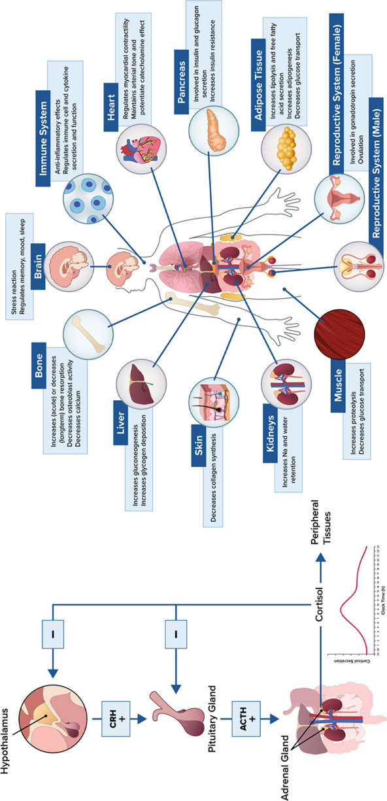
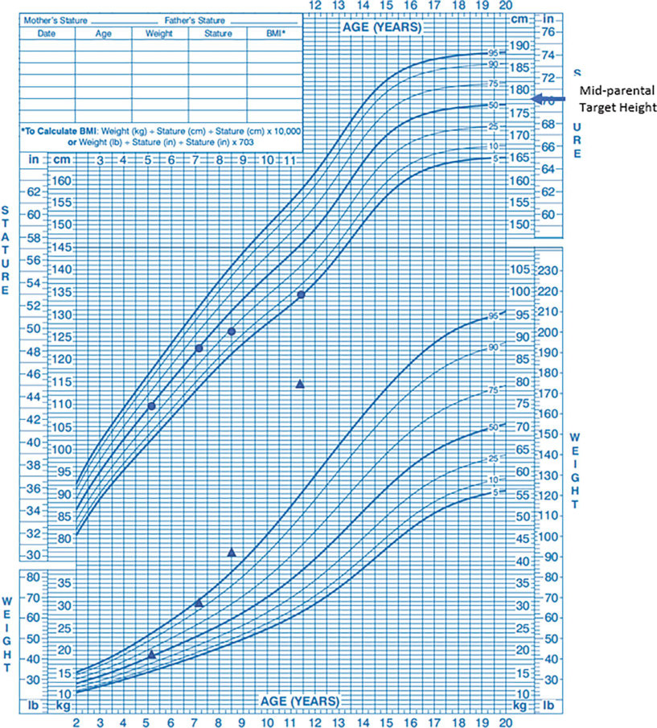
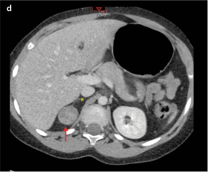
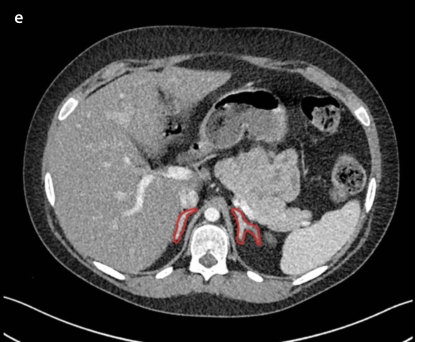
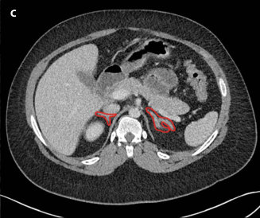
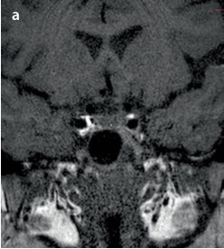
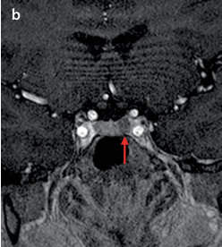
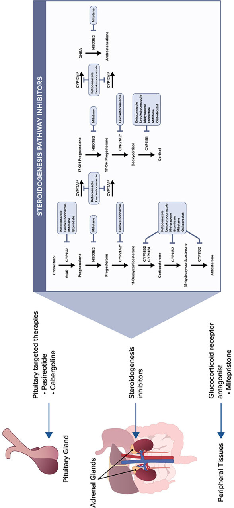

# 12. Cushing Syndrome in Childhood
> Source attribution: [Source credits](../../SOURCE_CREDITS.md).

## PDF page 337 | printed page 325

### Cushing Syndrome in Childhood

Christina Tatsi, Meg Keil, and Constantine A. Stratakis

### Contents

### 12.1 Introduction – 327

### 12.2 The Hypothalamic-Pituitary-Adrenal Axis – 327

### 12.3 Etiology – 329

### 12.4 ACTH-Dependent CS – 330

12.4.1 ACTH-Secreting Pituitary Adenomas and Carcinomas – 330 12.4.2 Pituitary Blastomas – 330 12.4.3 Ectopic CRH/ACTH Secretion – 330

### 12.5 ACTH-Independent CS – 330

12.5.1 Isolated Adrenocortical Tumors – 330 12.5.2 Bilateral Adrenal Hyperplasia – 331

### 12.6 Genetics of CS – 331

### 12.7 Presentation – 333

12.7.1 Clinical and Laboratory Findings – 333

### 12.8 Diagnosis – 335

12.8.1 Screening Labs – 337 12.8.2 Evaluating the Source of Hypercortisolemia – 338 12.8.3 ACTH-Dependent CS – 338 12.8.4 ACTH-Independent CS – 340

### 12.9 Differential Diagnosis – 340

### 12.10 Management – 341

12.10.1 Medical Therapy – 341

© The Author(s), under exclusive license to Springer Nature Switzerland AG 2024 S. Radovick, M. Misra (eds.), Pediatric Endocrinology, https://doi.org/10.1007/978-3-031-66296-6_12

## PDF page 338 | printed page 326

12.10.2 Radiotherapy – 341 12.10.3 Postremission Follow-Up – 343

### 12.11 Conclusions – 343

### References – 345

## PDF page 339 | printed page 327

### 12.1 Introduction

Cushing syndrome (CS) refers to the constel lation of signs and symptoms resulting from exposure of the body to supraphysiologic lev els of glucocorticoids (GCs). CS was first described in “Minnie G,” a patient evaluated and reported by Dr Harvey Cushing, who presented with the “syndrome of painful obe sity, hypertrichosis, and amenorrhea...” amongst other findings [1]. Since then, CS became more prevalent when exogenous use of supraphysiologic doses of GCs was found to offer therapeutic effects in several disorders and their widespread use continues until today [2–5].

### 12.2 The Hypothalamic-Pituitary-

### Adrenal Axis

12.1

6

6

7

8

9

12.1 A circadian rhythm of ACTH and cortisol secretion are necessary to maintain body homeostasis. ACTH usually peaks between 6:00 and 8:00 am while cortisol follows ACTH secretion closely with peak levels between 7:30 and 8:00 am. A nadir level for both hormones is detected around midnight [10, 11]. These time points are taken advantage of in diag nostic testing. An ultradian-like rhythm is also recorded throughout the day for these hormones with pulsatile secretion under the effect of stress and several other factors, which may also be considered upon diagnostic test ing, especially during CRH stimulation [10].

## PDF page 340 | printed page 328

### 12

Unmatched source image; PDF page 340. Consult the original caption.

## PDF page 341 | printed page 329

### 12.3 Etiology

12.1

12 15

12 14

Table 12.1 Causes of Cushing syndrome in children and adolescents

Type Cause

Exogenous

Iatrogenic Exogenous administration of supraphysiologic doses of glucocorti coids

Endogenous

ACTH-dependent Pituitary related ACTH-secreting pituitary adenoma ACTH-secreting pituitary carcinoma

ACTH-secreting pituitary blastoma

Ectopic ACTH and/or CRH secretion

Neuroendocrine tumors with ACTH and/or CRH secretion

ACTH-independent Isolated adrenal tumors

Adrenocortical tumors (adenomas and carcinomas)

Primary bilateral adrenal hyperplasia

Micronodular – Primary pigmented nodular

adrenocortical disease (PPNAD), isolated or in the context of Carney complex – Isolated micronodular adrenocorti

cal disease (iMAD)

Macronodular – Primary bilateral macronodular

adrenocortical hyperplasia (PBMAH), macroadenomas with or without internodular atrophy – Primary bimorphic adrenocortical

disease in the context of MAS

Endogenous CS is usually classified based on the level of ACTH, which further suggests different origins of hypercortisolemia. ACTHdependent CS resulting from pituitary ACTHsecreting adenomas is the most common cause of endogenous CS in older children and adolescents, while ectopic ACTH/CRH secre tion or other ACTH-secreting pituitary tumors (such as pituitary blastomas or carci nomas) are much rarer but may present with similar features. In younger children, less than 5–10 years old, endogenous CS is more likely to be ACTH-independent related to autono mous adrenal secretion of cortisol [16–18].

Biochemical findings

High/low cortisol (depending on the glucocorticoid used and the assay for cortisol measurement), low ACTH

High cortisol, non-suppressed ACTH

High cortisol, low ACTH

### Automatic table extraction — verify rendered original

|Endogenous|Col2|Col3|Col4|
|---|---|---|---|
|ACTH-dependent|Pituitary related|ACTH-secreting pituitary adenoma|High cortisol, non-suppressed ACTH|
|ACTH-dependent|Pituitary related|ACTH-secreting pituitary carcinoma|ACTH-secreting pituitary carcinoma|
|ACTH-dependent|Pituitary related|ACTH-secreting pituitary blastoma|ACTH-secreting pituitary blastoma|
|ACTH-dependent|Ectopic ACTH and/or CRH secretion|Neuroendocrine tumors with ACTH and/or CRH secretion|Neuroendocrine tumors with ACTH and/or CRH secretion|
|ACTH-independent|Isolated adrenal tumors|Adrenocortical tumors (adenomas and carcinomas)|High cortisol, low ACTH|
|ACTH-independent|Primary bilateral adrenal hyperplasia|Micronodular – Primary pigmented nodular adrenocortical disease (PPNAD), isolated or in the context of Carney complex – Isolated micronodular adrenocorti­ cal disease (iMAD)|Micronodular – Primary pigmented nodular adrenocortical disease (PPNAD), isolated or in the context of Carney complex – Isolated micronodular adrenocorti­ cal disease (iMAD)|
|ACTH-independent|Primary bilateral adrenal hyperplasia|Macronodular – Primary bilateral macronodular adrenocortical hyperplasia (PBMAH), macroadenomas with or without internodular atrophy – Primary bimorphic adrenocortical disease in the context of MAS|Macronodular – Primary bilateral macronodular adrenocortical hyperplasia (PBMAH), macroadenomas with or without internodular atrophy – Primary bimorphic adrenocortical disease in the context of MAS|

[Original table](../../tables/ch012_p0341_3.jpg)

## PDF page 342 | printed page 330

### 12.4 ACTH-Dependent CS

### 12.4.1 ACTH-Secreting Pituitary

### Adenomas and Carcinomas

CS caused by an ACTH-secreting pituitary adenoma (corticotropinoma), also referred to as Cushing disease (CD), is the most common cause of endogenous CS in children and ado lescents. Patients present at a mean age of 10.6–14.9 years, but younger patients with CD (as early as 5 years of age) have been described, especially in the setting of genetic predisposi tion [19]. Gender distribution depends on the pubertal stage, with reports of a higher inci dence in prepubertal males compared to females, which reverses after puberty [20, 21].

Corticotropinomas are monoclonal in nature, most often benign, and commonly small in size with a median diameter of 5 mm [22, 23]. Aggressive pituitary adenomas are rare in the pediatric population, but specific genetic defects and histologic subtypes, such as Crooke’s cell adenomas, may bear a higher risk for more aggressive behavior and resis tance to treatment [24, 25]. Pituitary carcino mas (PCs), defined as pituitary tumors with noncontiguous distal central nervous system (CNS) or other metastases, have only been described in limited case reports in the pediat ric population, with a mean interval of 10 years from first diagnosis to identification of metastatic lesions [25–31].

### 12

### 12.4.2 Pituitary Blastomas

Pituitary blastomas constitute a separate his tologic type of pituitary tumor—these embry onal tumors are composed of mixed Rathke-type epithelial cells, small folliculostel late cells, and differentiated ACTH-secreting cells [32]. In 2014, de Kock et al. identified that many of the previously reported cases of neo natal “Cushing disease” were pituitary blasto mas, on review of histologic images and shared genetic defects in the DICER1 gene [33]. DICER1 or pleuropulmonary syndrome is an autosomal dominant disorder presenting with pleuropulmonary blastomas, cystic nephro

mas, Sertoli-Leydig cell tumors, multinodular goiter, and other findings. Pituitary blastomas, although rare even in patients with DICER1 syndrome, are a pathognomonic finding of the disease [33]. This diagnosis should always be considered in young patients (<2 years old) with ACTH-dependent CS and a pituitary tumor, and further screening of patients for other clinical features of DICER1 syndrome and genetic testing should be ordered.

### 12.4.3 Ectopic CRH/ACTH Secretion

Ectopic CS (ECS) results from ACTH and/or CRH secretion from neuroendocrine tumors located outside the HPA axis. Although these tumors are very rare in the pediatric population, case reports and small case series have shown that tumors with the potential of leading to ECS in older children/adolescents may be found in the lungs (bronchial carcinoids), pancreas (pancreatic neuroendocrine tumors), and thy mus (thymic carcinoids) [34, 35]. In younger children (infants and early toddlerhood), ECS has been reported in association with tumors more prevalent in this age group, such as neuro blastomas, Wilm’s tumors, and others [36, 37].

### 12.5 ACTH-Independent CS

### 12.5.1 Isolated Adrenocortical

### Tumors

ACTH-independent CS is the main cause of endogenous CS in children <5–10 years of age [16]. In young children, adrenocortical adeno mas (ACAs) and carcinomas (ACCs), com monly referred to as adrenocortical tumors (ACTs) due to the complex distinction of the two entities, are common sources of autono mous cortisol secretion [38]. ACTs are rare, representing 0.2% of all pediatric tumors, though incidence in Southern Brazil is signifi cantly higher [39]. The median age of presen tation of ACTs is 3–4 years old, and most of them exhibit autonomous hormone secretion, commonly involving adrenal androgen excess with or without cortisol excess [38].

## PDF page 343 | printed page 331

### 12.5.2 Bilateral Adrenal

### Hyperplasia

Bilateral adrenal hyperplasia (BAH) may present as adrenocortical dysfunction and autonomous cortisol secretion. In some cases of BAH, ACTH secretion by the adrenals with paracrine effects has been reported, sug gesting that the term “ACTH-independent” may not accurately describe them and instead the term “adrenal CS” should be used [40].

BAH-related disorders are commonly divided based on the size of the nodules reported, such as macronodular (most nod ules >1 cm) or micronodular (most nodules <1 cm). Primary bilateral macronodular adre nal hyperplasia (PBMAH) can be further classified based on the histologic presence or absence of internodular hyperplasia, as well as the expression pattern of surface receptors [41, 42]. Primary bimorphic adrenocortical disease where histologic evaluation reveals characteristic macronodules surrounded by a distinctive form of cortical atrophy is a term used to describe adrenal disease in neonatal CS seen in McCune Albright syndrome [43].

Table 12.2 Selected genetic causes of Cushing syndrome

Type Gene/locus Histologic type

Adrenal source of CS

Germline ARMC5 PBMAH

PRKAR1A PPNAD

TP53 ACA/ACC

MEN1 ACA/ACC, PBMAH, iMAD

APC ACA, PBMAH

PDE8B, PDE11A ACA, PBMAH, PPNAD, iMAD

PRKACA ACA, PBMAH, PPNAD, iMAD

MC2R PBMAH

FH PBMAH

11p15 (IGF2, H9, KCNQ1OT1, CDKN1C)

ACA/ACC, PBMAH

Micronodular adrenocortical hyperplasia can be further classified as pigmented, such as pri mary pigmented nodular adrenocortical dis ease (PPNAD, commonly in the context of Carney complex, or isolated) or nonpig mented isolated micronodular adrenocortical disease (iMAD) [41]. Of note, secondary BAH is found in the setting of high ACTH secretion (such as in CD), which acts as a tro phic factor for bilateral adrenals and can even present as macronodular hyperplasia.

### 12.6 Genetics of CS

12.2

44

45 Germline genetic defects in CD are rare, but in familiar cases, one should consider genetic syndromes such as multiple endocrine neoplasia (MEN) type 1 (MEN1) and 4 (MEN4, associ ated with CDKN1B), familial isolated pituitary adenoma (FIPA) syndrome often associated with AIP gene defects, CABLES1 gene, and 3P

Related manifestations

Carney complex

Li-Fraumeni syndrome

Multiple endocrine neoplasia type 1

Familiar adenomatous polyposis

Hereditary leiomyomatosis and renal cell carcinoma (HLRCC)

Beckwith-Wiedemann syndrome

(continued)

### Automatic table extraction — verify rendered original

|Germline|ARMC5|PBMAH|Col4|
|---|---|---|---|
|Germline|_PRKAR1A_|PPNAD|Carney complex|
|Germline|_TP53_|ACA/ACC|Li-Fraumeni syndrome|
|Germline|_MEN1_|ACA/ACC, PBMAH, iMAD|Multiple endocrine neoplasia type 1|
|Germline|_APC_|ACA, PBMAH|Familiar adenomatous polyposis|
|Germline|_PDE8B_, _PDE11A_|ACA, PBMAH, PPNAD, iMAD||
|Germline|_PRKACA_|ACA, PBMAH, PPNAD, iMAD||
|Germline|_MC2R_|PBMAH||
|Germline|_FH_|PBMAH|Hereditary leiomyomatosis and renal cell carcinoma (HLRCC)|
|Germline|11p15 (_IGF2_, _H9_,  _KCNQ1OT1_,  _CDKN1C)_|ACA/ACC, PBMAH|Beckwith-Wiedemann syndrome|

[Original table](../../tables/ch012_p0343_2.jpg)

## PDF page 344 | printed page 332

Table 12.2 (continued)

Type Gene/locus Histologic type

Somatic PRKACA ACA, PBMAH, PPNAD, iMAD

CTNNB1 ACA, ACC, PPNAD

GIPR PBMAH

GNAS PBMAH

TP53 ACA/ACC

Other GNAS (postzygotic mosaicism)

Primary bimorphic adrenocortical disease

Pituitary source of CS

Germline AIP Pituitary adenoma

MEN1 Pituitary adenoma

CDKN1B Pituitary adenoma

DICER1 Pituitary blastoma or pituitary adenoma

SDHx, VHL, MEN1, RET and MAX

Pituitary adenoma

CABLES1 Pituitary adenoma

TSC1, TSC2 Pituitary adenoma

### 12

RET Pituitary adenomas

PRKAR1A Pituitary adenoma

Somatic USP8 Pituitary adenoma

USP48 Pituitary adenoma

GNAS Pituitary adenoma

TP53 Pituitary adenoma

Other GNAS (postzygotic mosaicism)

Pituitary adenoma

Ectopic source of CS

Germline RET Medullary thyroid carcinoma

MEN1 Neuroendocrine tumors (bronchial, pancreatic)

Somatic TP53, BRAF Neuroendocrine tumors

association (associated with genes such as SDHx, VHL, etc.) [46–51]. More rare cases of germline genetic defects associated with cortico tropinomas have been identified in tuberous sclerosis (associated with TSC1 and TSC2 gene defects), Carney complex (PRKAR1A gene

defects), and germline RET gene defects [46, 52, 53]. As mentioned above, DICER1 genetic defects are commonly associated with pituitary blastomas, but rare cases of isolated corticotro pinomas and prolactin-secreting pituitary ade nomas have been reported [33, 54].

Related manifestations

Food-dependent CS

McCune Albright syndrome

Familial isolated pituitary adenomas (FIPA)

Multiple endocrine neoplasia type 1

Multiple endocrine neoplasia type 4

DICER1 or pleuropulmonary syndrome

3P association (Pheochromocytoma, paragan glioma and pituitary adenoma syndrome)

Tuberous sclerosis

Multiple endocrine neoplasia type 2

Carney complex

McCune-Albright syndrome

Multiple endocrine neoplasia type 2

Multiple endocrine neoplasia type 1

### Automatic table extraction — verify rendered original

|Type|Gene/locus|Histologic type|Related manifestations|
|---|---|---|---|
|Somatic|_PRKACA_|ACA, PBMAH, PPNAD, iMAD||
|Somatic|_CTNNB1_|ACA, ACC, PPNAD||
|Somatic|_GIPR_|PBMAH|Food-dependent CS|
|Somatic|_GNAS_|PBMAH||
|Somatic|_TP53_|ACA/ACC||
|Other|_GNAS_ (post- zygotic mosaicism)|Primary bimorphic adrenocortical disease|McCune Albright syndrome|

[Original table](../../tables/ch012_p0344_1.jpg)

### Automatic table extraction — verify rendered original

|Germline|AIP|Pituitary adenoma|Familial isolated pituitary adenomas (FIPA)|
|---|---|---|---|
|Germline|_MEN1_|Pituitary adenoma|Multiple endocrine neoplasia type 1|
|Germline|_CDKN1B_|Pituitary adenoma|Multiple endocrine neoplasia type 4|
|Germline|_DICER1_|Pituitary blastoma or pituitary adenoma|DICER1 or pleuropulmonary syndrome|
|Germline|_SDHx_, _VHL_,  _MEN1_, _RET and_ _MAX_|Pituitary adenoma|3P association (Pheochromocytoma, paragan­ glioma and pituitary adenoma syndrome)|
|Germline|_CABLES1_|Pituitary adenoma||
|Germline|_TSC1_, _TSC2_|Pituitary adenoma|Tuberous sclerosis|
|Germline|_RET_|Pituitary adenomas|Multiple endocrine neoplasia type 2|
|Germline|_PRKAR1A_|Pituitary adenoma|Carney complex|
|Somatic|_USP8_|Pituitary adenoma||
|Somatic|_USP48_|Pituitary adenoma||
|Somatic|_GNAS_|Pituitary adenoma||
|Somatic|_TP53_|Pituitary adenoma||
|Other|_GNAS_ (post- zygotic mosaicism)|Pituitary adenoma|McCune-Albright syndrome|

[Original table](../../tables/ch012_p0344_2.jpg)

### Automatic table extraction — verify rendered original

|Germline|RET|Medullary thyroid carcinoma|Multiple endocrine neoplasia type 2|
|---|---|---|---|
|Germline|_MEN1_|Neuroendocrine tumors (bronchial, pancreatic)|Multiple endocrine neoplasia type 1|
|Somatic|_TP53_, _BRAF_|Neuroendocrine tumors||

[Original table](../../tables/ch012_p0344_3.jpg)

## PDF page 345 | printed page 333

Somatic genetic defects in pituitary corti cotropinomas are reported more commonly. Pathogenic gene variants in the hot-spot region of the USP8 gene were described origi nally in 2015 [55, 56]. Investigation of the fre quency of USP8 hotspot mutations in the pediatric population suggested that almost 30% of pediatric corticotropinomas bear this defect and may present with more aggressive behavior [57]. Somatic variants in USP48, BRAF, TP53, and other genes, are also reported in the literature [58, 59]. Finally, a subset of these tumors harbors large chromosomal aberrations that may contribute to more aggressive behavior [60].

ECS has a more variable and unclear genetic background mainly associated with the underlying source/tissue of ectopic ACTH/CRH secretion. Genetic defects in MEN1 and RET may be associated with neu roendocrine tumors and ECS. Somatic vari ants in genes such as TP53 and BRAF have also been reported.

ACTs are commonly associated with germline or somatic TP53 gene defects [61]. A founder effect is identified in the South Brazilian population, where the germline vari ant Arg337His is identified in more than 75% of all ACTs [62, 63]. Germline TP53 genetic defects are also linked with Li-Fraumeni syn drome (LFS), an autosomal dominant condi tion presenting with soft tissue sarcomas, osteosarcomas, adrenocortical carcinomas, and other tumors [62].

PPNAD is commonly associated with the Carney complex caused in most cases by PRKAR1A gene defects [64]. Patients with Carney complex also present with skin and cardiac myxomas, pituitary adenomas, thy roid heterogeneity, testicular tumors, and characteristic skin findings. PRKAR1A codes for the regulatory subunit 1-alpha of protein kinase A (PKA) and inactivating mutations of the gene lead to constitute activation of downstream signaling. In the same pathway, BAH and cortisol-producing ACTs have also been associated with genes coding phospho diesterases (PDE8B and PDE11A gene defects), enzymes that catalyze the hydrolysis of cyclic AMP (cAMP) and regulate PKA activation, and PRKACA, which codes for

the catalytic subunit of PKA [65–67]. In 2015, macronodular adrenocortical disease was linked to a new genetic locus, ARMC5, a tumor suppressor gene which explains half of the cases of PBMAH in the adult population [68]. Finally, neonatal adrenal hyperplasia may rarely be associated with McCune- Albright syndrome or Beckwith-Wiedemann syndrome [43, 69].

### 12.7 Presentation

### 12.7.1 Clinical and Laboratory

### Findings

12.3

70

12.2

71

72 74

75 76

18

## PDF page 346 | printed page 334

Table 12.3 Clinical and laboratory findings of patients with CS

Clinical findings

Anthropometric Height deceleration

Weight gain

Cardiovascular Hypertension

Cardiopathy

Musculoskeletal Decreased bone mineral density with or without fractures

Proximal muscle weakness

Skin Striae

Facial plethora

Easy bruising

Acanthosis nigricans

Hirsutism

Abnormal fat deposition

Neuropsychiatric Behavioral changes (compulsive behavior, overachievement tendency, irritability)

Psychiatric disorders (depression, anxiety)

Changes in cognitive function

Sleep disturbance (difficulty falling asleep)

Memory problems

### 12

Reproductive system Delayed puberty

Irregular menses

Immunologic Increased risk for infections

Laboratory findings

Anthropometric Hyperglycemia

Hyperlipidemia

Cardiovascular Hypokalemia

Hypercalciuria

Musculoskeletal Elevated liver enzymes

Skin Abnormal WBC findings: – Elevated WBC, neutrophil and monocyte counts – Decreased lymphocyte and eosinophil count – Elevated neutrophil-to-lymphocyte ratio

Abnormal coagulation factors – Increased von Willebrand and factor VIII – Decreased aPTT

Laboratory findings may include hypoka lemia (most common in patients with ECS), dyslipidemia, and glucose intolerance/diabe tes mellitus [70, 77]. The complete blood

count of patients with CS commonly shows elevated WBC, neutrophil and monocyte counts, and decreased lymphocyte and eosinophil counts [78]. Recently we described

### Automatic table extraction — verify rendered original

|Col1|Clinical findings|
|---|---|
|Anthropometric|Height deceleration|
|Anthropometric|Weight gain|
|Cardiovascular|Hypertension|
|Cardiovascular|Cardiopathy|
|Musculoskeletal|Decreased bone mineral density with or without fractures|
|Musculoskeletal|Proximal muscle weakness|
|Skin|Striae|
|Skin|Facial plethora|
|Skin|Easy bruising|
|Skin|Acanthosis nigricans|
|Skin|Hirsutism|
|Skin|Abnormal fat deposition|
|Neuropsychiatric|Behavioral changes (compulsive behavior, overachievement tendency, irritability)|
|Neuropsychiatric|Psychiatric disorders (depression, anxiety)|
|Neuropsychiatric|Changes in cognitive function|
|Neuropsychiatric|Sleep disturbance (diffculty falling asleep)|
|Neuropsychiatric|Memory problems|
|Reproductive system|Delayed puberty|
|Reproductive system|Irregular menses|
|Immunologic|Increased risk for infections|

[Original table](../../tables/ch012_p0346_1.jpg)

### Automatic table extraction — verify rendered original

|Col1|Laboratory findings|
|---|---|
|Anthropometric|Hyperglycemia|
|Anthropometric|Hyperlipidemia|
|Cardiovascular|Hypokalemia|
|Cardiovascular|Hypercalciuria|
|Musculoskeletal|Elevated liver enzymes|
|Skin|Abnormal WBC fndings: – Elevated WBC, neutrophil and monocyte counts – Decreased lymphocyte and eosinophil count – Elevated neutrophil-to-lymphocyte ratio|
|Skin|Abnormal coagulation factors – Increased von Willebrand and factor VIII – Decreased aPTT|

[Original table](../../tables/ch012_p0346_2.jpg)

## PDF page 347 | printed page 335

neutrophil-to-lymphocyte ratio (NLR) as a biomarker of cortisol effects on the immune system and an indirect marker of CS diagno sis [79]. Hypercoagulability, noted in adults, marked by increased von Willebrand factor and factor VIII and decreased aPTT, is also reported in the pediatric population, sug gesting that risk for venous thromboembolic events should be considered for every patient, though much more rare in children [80, 81].

### 12.8 Diagnosis

82 83

12.3

Unmatched source image; PDF page 347. Consult the original caption.

## PDF page 348 | printed page 336

### 12

## PDF page 349 | printed page 337

### 12.8.1 Screening Labs

82

12.4

Table 12.4 Factors affecting the interpretation of screening tests for hypercortisolemia

Late night cortisol measurement (salivary or serum)

24-h Urinary free cortisol collection

Night shift workers Abnormal renal function

Travel from different time zone Total fluid intake/urine output

Interference with salivary cortisol measurements (bleeding)

Sodium intake

Inhibition of 11-β-HSD2 (tobacco, smoking, licorice) affecting salivary cortisol measurements

Assay used and crossreactivity with medications or synthetic glucocorticoids

Medications/factors affecting CBG levels interfering with total cortisol levels (serum)

Severe obesity

Strenuous exercise

Elevated midnight salivary cortisol repre sents the loss of the normal circadian rhythm of ACTH/cortisol secretion and is one of the earliest biochemical findings in (and evidence of) CS. Measurement of midnight or bedtime (late night) salivary cortisol should be per formed on two or more days and the cutoff for abnormal levels depends on the specific laboratory assay [84]. Midnight serum corti sol measurements are also very accurate in diagnosing CS, especially when performed under appropriate conditions, but require inpatient admission and are not convenient as a first-line screening test. When performed, a midnight serum cortisol concentration of >4.4 mcg/dL is highly sensitive and specific for the diagnosis of CS in children [85, 86].

Elevated urinary-free cortisol (UFC) mea surement in a 24-h urine collection represents increased overall production of cortisol. UFC has high sensitivity (88–89%) and specificity (90–100%) for the detection of hypercorti solemia, but at least two or more, preferably consecutive, 24-h urine collections should be performed due to high variation and often inaccurate collection procedures [85].

Dexamethasone tests

Genetic factors associated with dexamethasone metabolism

Co-administration of medication resulting in rapid/slower dexamethasone metabolism (such as CYP3A4 inducers)

Medications/factors affecting CBG levels interfering with total cortisol levels

GI or hepatic disease affecting absorption or clearance of dexametha sone

### Automatic table extraction — verify rendered original

|Late night cortisol measurement (salivary or serum)|24-h Urinary free cortisol collection|Dexamethasone tests|
|---|---|---|
|Night shift workers|Abnormal renal function|Genetic factors associated with dexamethasone metabolism|
|Travel from different time zone|Total fuid intake/urine output|Co-administration of medication resulting in rapid/slower dexamethasone metabolism (such as CYP3A4 inducers)|
|Interference with salivary cortisol measurements (bleeding)|Sodium intake|Medications/factors affecting CBG levels interfering with total cortisol levels|
|Inhibition of 11-β-HSD2 (tobacco, smoking, licorice) affecting salivary cortisol measurements|Assay used and cross- reactivity with medications or synthetic glucocorticoids|GI or hepatic disease affecting absorption or clearance of dexametha­ sone|
|Medications/factors affecting CBG levels interfering with total cortisol levels (serum)|Severe obesity||
||Strenuous exercise||

[Original table](../../tables/ch012_p0349_1.jpg)

## PDF page 350 | printed page 338

Additionally, measurement of serum and urine creatinine should be added and patients with renal disorders should be excluded due to possible falsely low urinary cortisol excre tion [87].

DST is based on the negative feedback effects of GC at the hypothalamic and pitu itary level and can be completed in the outpa tient setting. The overnight 1 mg (or weight-based equivalent dose of 15 mcg/kg, max 1 mg) DST is not validated in children but the cutoff of 1.8 mcg/dL is widely adopted for the interpretation of the test in this patient population [83]. Dexamethasone is adminis tered orally at 11:00 pm, and serum cortisol is assessed at 8–9 am the following morning. DST is the preferred screening lab when an adrenal lesion is suspected. The low-dose 48-h dexamethasone test (LDDT) can also be used in specific conditions, such as in nonneoplas tic hypercortisolism [83]. During LDDT, 0.5 mg (or weight-based equivalent dose of 7.5 mcg/kg, max 0.5 mg) of dexamethasone is administered every 6 h for 8 doses. Although different versions of this test have been pub lished, a commonly performed protocol is administering the first dose at 9:00 am on day 1 of the test. Serum cortisol is measured at 9:00 am on day 3 and a level of >1.8 mcg/dL is considered abnormal [88]. In any DST, the dexamethasone level should be measured at the time of the cortisol assessment to ensure the serum dexamethasone concentration is within the expected reference range for each test.

### 12

### 12.8.2 Evaluating the Source

### of Hypercortisolemia

Once the diagnosis of CS is confirmed, an investigation of the source of hypercorti solemia should be pursued. In most cases, an ACTH level can direct further evaluation toward adrenal or nonadrenal-related condi tions. An ACTH level >20–29 pg/mL is usu ally suggestive of ACTH-dependent CS while a low or suppressed ACTH of <5 pg/mL sug

gests ACTH-independent CS [89, 90]. However, one should be aware of assay per formance, requirements for specimen collec tion, and the possibility of atypical causes of CS (episodic/cyclic) when interpreting the results.

### 12.8.3 ACTH-Dependent CS

Biochemical and imaging tests can be used to investigate the source of ACTH-dependent hypercortisolemia. The CRH stimulation test has typically been used in these cases. During this test, ovine CRH (oCRH, 1 mcg/kg, max 100 mcg) is administered through IV, and cor tisol and ACTH concentrations are measured every 15 min for 45 min. Increased concentra tions of ACTH (>35%) and cortisol (>20%) following administration of oCRH suggest a pituitary source of hypercortisolemia, whereas in ectopic tumors low or no response is reported [91]. If CRH is not available, a DDAVP stimulation test can be used. Corticotropinomas express ectopic vasopres sin V1b receptors, and thus stimulation of ACTH and cortisol with DDAVP is reported, with a similar pattern as observed with CRH [92]. Specifically, during the DDAVP stimula tion test, 10 mcg of DDAVP is administered intravenously, and cortisol and ACTH con centrations are measured every 15 min for 2 h. Increased concentration of ACTH (>35–50%) and/or cortisol (>20%) suggests a pituitary source of hypercortisolemia [92, 93].

High-dose DST (HDDST) has also been used to differentiate pituitary adenomas ver sus ectopic tumors [94]. Dexamethasone (120 mcg/kg, max 8 mg) is administered orally at 11:00 pm and serum cortisol is mea sured at baseline (8:00 am on the day of dexa methasone administration) and the following day (8–9 am). Suppression of cortisol by >69% is considered consistent with a pitu itary source. Caution should be used when interpreting the test in patients with hemor rhagic/necrotic adenomas, where suppression to dexamethasone may be lower than the cut off of 69% [95].

## PDF page 351 | printed page 339

96

83 97

12.4

83

98

23 When biochemical results are inconclusive or the pituitary MRI does not identify a con vincing adenoma, bilateral inferior petrosal sinus sampling (BIPSS) is considered the gold standard for the localization of the source of hypercortisolemia. BIPSS should be per formed in centers with experience in the pro cedure because several technical and anatomical factors can lead to inaccurate

Unmatched source image; PDF page 351. Consult the original caption.

Unmatched source image; PDF page 351. Consult the original caption.

Unmatched source image; PDF page 351. Consult the original caption.

Unmatched source image; PDF page 351. Consult the original caption.

Unmatched source image; PDF page 351. Consult the original caption.

## PDF page 352 | printed page 340

results. BIPSS is based on ACTH measure ment before and after stimulation with CRH or DDAVP, and a gradient of central to peripheral ACTH of >2 at baseline and/or >3 after stimulation is considered suggestive of a pituitary source [83]. Although initial reports of BIPSS, suggested that an interpetrosal sinus gradient >1.4 suggested the side of the tumor, later studies reported that BIPSS results are not as accurate in predicting later alization [99, 100].

Recently a noninvasive algorithm avoiding BIPSS has been suggested in the adult popu lation [92]. Based on this approach, if the CRH/DDAVP stimulation test is suggestive of a pituitary source but the pituitary MRI does not clearly identify a pituitary tumor, whole-body CT could be performed and if negative, a presumed diagnosis of CD could be made without the need for BIPSS [92]. This is an option in centers where BIPSS is not available, considering potential risks from radiation exposure and a delay of the final diagnosis due to incidental findings on CT assessment.

When ectopic CS is suspected, neck-topelvis imaging with thin-slices CT (or in cer tain cases MRI) and nuclear imaging preferably with 68Ga-DOTATATE scan should be considered [83].

### 12

### 12.8.4 ACTH-Independent CS

12.4

12.4

101 In the case of ACTH-independent CS with reportedly normal adrenal CT, Liddle’s test should be performed to identify whether par adoxical stimulation of cortisol secretion by dexamethasone is present. This is a pathogno monic finding of PPNAD and could help with further treatment decisions [102].

### 12.9 Differential Diagnosis

Nonneoplastic CS (previously reported as pseudo-Cushing syndrome) is the main differ ential diagnosis in patients where screening biochemical testing suggests hypercorti solemia but additional factors in the patient’s history increase the suspicion of a nonneo plastic source [103]. Causes of nonneoplastic CS include severe depression and other neuro psychiatric disorders, morbid obesity, uncon trolled diabetes, and alcohol dependence or withdrawal [104]. Screening labs in these cases may be abnormal, although in most cases do not significantly exceed the upper limit of normal, for example, UFC is usually less than 3–4 times the upper limit of the normal range. Additional testing should be considered in these patients. The DST combined with CRH stimulation has been used to evaluate patients. During the DST-CRH test, dexamethasone 0.5 mg (or weight-based equivalent dose of 7.5 mcg/kg, max 0.5 mg) is administered every 6 h for 8 doses starting at 12 pm of day 1. On the morning of day 3, oCRH (1 mcg/kg, max 100 mcg) is administered IV, and cortisol and ACTH concentrations are measured 15 min after administration. A cortisol concentration >1.4 mcg/dL is considered suggestive of endogenous CS. Modification of the cutoff for severe obesity may be appropriate [104, 105]. DDAVP stimulation test has also been studied as an alternative to the DST-CRH test for differentiation of nonneoplastic CS, where an increase of ACTH by >27 pg/mL is consid ered suggestive of endogenous CS [106, 107].

## PDF page 353 | printed page 341

If none of these tests are informative, then close monitoring with repeat labs in 3–6 months is reasonable before further thera peutic decisions are made [83].

### 12.10 Management

Surgical resection of an identified tumor (pituitary, adrenal, or ectopic) is the first line of treatment whenever possible.

Transsphenoidal microscopic or endo scopic approach of the pituitary is the pre ferred route for resection of pituitary adenomas [108]. A postoperative serum corti sol level <2 mcg/dL is currently accepted as the cutoff criterion for remission, but the tim ing of nadir cortisol is also important with earlier detection (<24 h) being a good prog nostic factor for durable remission [83, 109]. Remission rates depend on neurosurgical experience with rates up to 98% reported in high-volume centers [110, 111].

Unilateral ACTs should be treated with uni lateral adrenalectomy. ACCs may require addi tional treatment with medical therapy, such as mitotane. BAH is often managed with bilateral adrenalectomy, however unilateral adrenalec tomy has also been studied in selected cases, especially in patients with macronodular disor ders [112, 113]. Bilateral adrenalectomy should also be considered in patients with CD or ECS if the primary tumor cannot be resected, or the patient has failed pituitary surgery and/or radi ation therapy, or when critical clinical deterio ration due to CS without improvement on medical therapy is present [111].

After successful resection of unilateral ACTs, pituitary adenomas, or ectopic tumors, patients undergo an expected period of adre nal insufficiency. The period may differ based on the diagnosis and ranges from 6 months to more than 2 years [114]. Patients are thus dis charged after surgery on GC replacement, usually hydrocortisone given 2–3 times a day, on slightly supraphysiologic doses (10–12 mg/ m2/day) to manage GC withdrawal (GW) symptoms. We recommend adjusting the GC dose later to more physiologic replacement doses based on weight loss and tolerance of

GW symptoms, though different tapering schedules may be used. Regular assessment of the HPA axis every 3–6 months with morning cortisol and/or the ACTH stimulation test should be ordered until full recovery of corti sol secretion.

### 12.10.1 Medical Therapy

For patients where complete surgical resection is not possible or not successful, medical treat ment should be considered. Of note, although there are several medical options available, none of them is approved for children with hypercortisolemia at this time and caution should be taken when prescribing these medi cations.

12.5

### 12.10.2 Radiotherapy

If the patient does not achieve remission after surgery or is not a candidate for surgery or presents with recurrent CD, or mass effect from unresectable tumor is a concern, radio therapy should be discussed as an option.

## PDF page 354 | printed page 342

### 12

Unmatched source image; PDF page 354. Consult the original caption.

## PDF page 355 | printed page 343

Medical treatment in these cases should also be used as a bridge until the effects of radio therapy are evident. Conventional radiother apy (usually delivered in multiple fractions) or stereotactic radiosurgery (usually delivered as a single or few fractions) have been success fully used and up to 80% of patients will even tually achieve remission [115]. Delivery of stereotactic radiosurgery has been reported with various technologies, most commonly linear accelerator or gamma knife [116, 117]. There are fewer reports on the use of proton radiosurgery in CD, but a recent review of the literature and comparison of the various tech niques suggested similar efficacy and side effect profiles [118]. Elaborate follow-up inter vals for patients with CD after radiation have been recently recommended based on the clinical and biochemical control of hypercor tisolemia [119].

### 12.10.3 Postremission Follow-Up

Recurrence rates are variable, and although lower in the pediatric population compared to adults, they range from 6% to 11% up to

Case Study

12.2

10 years after remission [114, 120]. After recovery of the HPA axis, annual screening for recurrence should be considered in all patients, preferably with late-night salivary cortisol measurements [111]. In cases or recur rence, repeat TSS, radiation or medical ther apy, or a combination of these options could be considered based on imaging findings.

### 12.11 Conclusions

Endogenous CS is a rare diagnosis in children and adolescents. ACTH-secreting pituitary adenomas are the most common cause of CS in older children and adolescents, while adre nal disorders are the main cause of CS in infants and younger children. When suspect ing CS, two or more of the screening labs should be evaluated. Several additional bio chemical tests and imaging studies can help in identifying the source of hypercortisolemia once CS is confirmed. Surgery is usually the first line of therapy for all types of CS, but medical therapy or radiation therapy may be considered in recurrent or persistent disease, or when surgery is not an option.

## PDF page 356 | printed page 344

Time (min) Right petrosal (RP) Left petrosal (LP)

−5 66.7 455

0 62.3 326

3 251 646

5 106 855

10 168 779

After consulting with the pituitary neurosur geon, a decision was made to proceed with transsphenoidal pituitary exploration where the neurosurgeon identified a microadenoma with the characteristic pseudocapsule. Histologic evaluation confirms diffuse ACTH staining with a breakdown of reticulin. The patient is discharged home on hydrocortisone replacement at a total daily dose of 11 mg/m2/ day. The case illustrates that a growth chart showing weight gain and height deceleration should urge physicians to proceed with bio chemical testing for hypercortisolemia.

### 12

Review Questions

1. Which of the following is a concerning

finding in a patient’s history that would make you order screening testing to evaluate for hypercortisolemia? A. Daily morning headaches B. Height deceleration with concur

rent weight gain C. Pink striae on the abdomen and

back D. High BP on physical examination

2. Which screening test is most appropri

ate to evaluate for possible hypercorti solemia? A. Morning cortisol and ACTH level B. High-dose dexamethasone sup

pression test C. CRH stimulation test D. Two late-night salivary cortisol

levels

Periphery (P)

### RP/P LP/P

42.7 1.6 10.7

42.9 1.5 7.6

82.2 3.1 7.9

74.9 1.4 11.4

76 2.2 10.3

Children with CS may not present with cen tripetal obesity nor have the characteristic thick dark purple striae described in adults. Most cases of CS in adolescents are due to a pituitary microadenoma, but the pituitary MRI may be negative in 20–30% of patients. Further biochemical testing and discussion in a multidisciplinary team with endocrine, neu rosurgery, and interventional radiology are often needed to decide the best next steps in patients’ management. A neurosurgeon with expertise in pituitary adenomas is recom mended in most cases.

3. A 3-month-old infant presents with

severe hypertension, hyperglycemia, obesity, and facial acne. On physical exam, two café-au-lait macules are noted on the abdomen not crossing the midline. What is the most likely etiology of this patient’s presenta tion? A. Cushing disease B. Pituitary blastoma C. Adrenocortical tumor D. Bilateral macronodular adrenal

hyperplasia in the context of McCune-Albright syndrome

v Answers

1. B 2. D 3. D

## PDF page 357 | printed page 345

### References

1. Lanzino G, Maartens NF, Laws ER Jr. Cushing’s

case XLV: Minnie G. J Neurosurg. 2002;97(1):231–4. 2. Laugesen K, Jorgensen JOL, Petersen I, Sorensen

16. Storr HL, Chan LF, Grossman AB, Savage

HT. Fifteen-year nationwide trends in systemic glucocorticoid drug use in Denmark. Eur J Endocrinol. 2019;181(3):267–73. 3. Benard-Laribiere A, Pariente A, Pambrun E,

17. Holst JM, Horvath-Puho E, Jensen RB, Rix M,

Begaud B, Fardet L, Noize P. Prevalence and pre scription patterns of oral glucocorticoids in adults: a retrospective cross-sectional and cohort analysis in France. BMJ Open. 2017;7(7):e015905. 4. Vandewalle J, Luypaert A, De Bosscher K, Libert

C. Therapeutic mechanisms of glucocorticoids. Trends Endocrinol Metab. 2018;29(1):42–54. 5. Hench P. Effects of cortisone in the rheumatic

18. Magiakou MA, Mastorakos G, Oldfield EH,

diseases. Lancet. 1950;2(6634):483–4. 6. Sawchenko PE, Swanson LW. Localization, colo

calization, and plasticity of corticotropinreleasing factor immunoreactivity in rat brain. Fed Proc. 1985;44(1 Pt 2):221–7. 7. Chretien M, Seidah NG. Chemistry and biosyn

19. Makri A, Bonella MB, Keil MF, Hernandez-

thesis of pro-opiomelanocortin. ACTH, MSH’s, endorphins and their related peptides. Mol Cell Biochem. 1981;34(2):101–27. 8. Lundblad JR, Roberts JL. Regulation of proopi

20. Libuit LG, Karageorgiadis AS, Sinaii N, Nguyen

omelanocortin gene expression in pituitary. Endocr Rev. 1988;9(1):135–58. 9. Gallo-Payet N, Battista MC. Steroidogenesis—

adrenal cell signal transduction. Compr Physiol. 2014;4(3):889–964. 10. Lim CT, Khoo B. Normal physiology of ACTH

21. Ferrigno R, Hasenmajer V, Caiulo S, Minnetti M,

and GH release in the hypothalamus and anterior pituitary in man. Endotext [Internet]. 2017. 11. Buckley TM, Schatzberg AF. On the interactions

of the hypothalamic-pituitary-adrenal (HPA) axis and sleep: normal HPA axis activity and cir cadian rhythm, exemplary sleep disorders. J Clin Endocrinol Metab. 2005;90(5):3106–14. 12. Lindholm J, Juul S, Jorgensen JO, Astrup J, Bjerre

22. Herman V, Fagin J, Gonsky R, Kovacs K,

23. Tatsi C, Bompou ME, Flippo C, Keil M,

P, Feldt-Rasmussen U, Hagen C, Jorgensen J, Kosteljanetz M, Kristensen L, Laurberg P, Schmidt K, Weeke J. Incidence and late prognosis of Cushing’s syndrome: a population-based study. J Clin Endocrinol Metab. 2001;86(1):117–23. 13. Wengander S, Trimpou P, Papakokkinou E,

24. George DH, Scheithauer BW, Kovacs K, Horvath

Ragnarsson O. The incidence of endogenous Cushing’s syndrome in the modern era. Clin Endocrinol. 2019;91(2):263–70. 14. Broder MS, Neary MP, Chang E, Cherepanov D,

25. Tatsi C, Stratakis CA. Aggressive pituitary

Ludlam WH. Incidence of Cushing’s syndrome and Cushing’s disease in commercially-insured patients <65 years old in the United States. Pituitary. 2015;18(3):283–9. 15. Ragnarsson O, Olsson DS, Chantzichristos D,

26. Kovacs GL, Goth M, Rotondo F, Scheithauer

Papakokkinou E, Dahlqvist P, Segerstedt E, Olsson T, Petersson M, Berinder K, Bensing S,

Hoybye C, Eden Engstrom B, Burman P, Bonelli L, Follin C, Petranek D, Erfurth EM, Wahlberg J, Ekman B, Akerman AK, Schwarcz E, Bryngelsson IL, Johannsson G. The incidence of Cushing’s disease: a nationwide Swedish study. Pituitary. 2019;22(2):179–86.

MO. Paediatric Cushing’s syndrome: epidemiol ogy, investigation and therapeutic advances. Trends Endocrinol Metab. 2007;18(4):167–74.

Kristensen K, Hertel NT, Dekkers OM, Sorensen HT, Juul A, Jorgensen JOL. Cushing’s syndrome in children and adolescents: a Danish nationwide population-based cohort study. Eur J Endocrinol. 2017;176(5):567–74.

Gomez MT, Doppman JL, Cutler GB Jr, Nieman LK, Chrousos GP. Cushing’s syndrome in chil dren and adolescents. Presentation, diagnosis, and therapy. N Engl J Med. 1994;331(10):629–36.

Ramirez L, Paluch G, Tirosh A, Saldarriaga C, Chittiboina P, Marx SJ, Stratakis CA, Lodish M. Children with MEN1 gene mutations may present first (and at a young age) with Cushing disease. Clin Endocrinol. 2018;89(4):437–43.

May NM, Keil MF, Lodish MB, Stratakis CA. A gender-dependent analysis of Cushing’s disease in childhood: pre- and postoperative follow-up. Clin Endocrinol. 2015;83(1):72–7.

Mazzotta P, Storr HL, Isidori AM, Grossman AB, De Martino MC, Savage MO. Paediatric Cushing’s disease: epidemiology, pathogenesis, clinical management and outcome. Rev Endocr Metab Disord. 2021;22(4):817–35.

Melmed S. Clonal origin of pituitary adenomas. J Clin Endocrinol Metab. 1990;71(6):1427–33.

Chittiboina P, Stratakis CA. Paediatric patients with Cushing disease and negative pituitary MRI have a higher risk of nonremission after transs phenoidal surgery. Clin Endocrinol. 2021;95(6):856–62.

E, Young WF Jr, Lloyd RV, Meyer FB. Crooke’s cell adenoma of the pituitary: an aggressive vari ant of corticotroph adenoma. Am J Surg Pathol. 2003;27(10):1330–6.

tumors in the young and elderly. Rev Endocr Metab Disord. 2020;21(2):213–23.

BW, Carlsen E, Saadia A, Hubina E, Kovacs L, Szabolcs I, Nagy P, Czirjak S, Hanzely Z, Kovacs K, Horvath E, Korbonits M. ACTH-secreting Crooke cell carcinoma of the pituitary. Eur J Clin Investig. 2013;43(1):20–6.

## PDF page 358 | printed page 346

27. Tysome J, Gnanalingham KK, Chopra I,

Mendoza N. Intradural metastatic spinal cord compression from ACTH-secreting pituitary car cinoma. Acta Neurochir. 2004;146(11):1251–4. 28. AbdelBaki MS, Waguespack SG, Salceda V,

38. Pinto EM, Zambetti GP, Rodriguez-Galindo

Jones J, Stapleton SL, Baskin DS, Okcu MF. Significant response of pituitary carcinoma to carboplatin, leucovorin and fluorouracil che motherapy: a pediatric case report and review of the literature. J Neurooncol. 2017;135(1):213–5. 29. Holthouse DJ, Robbins PD, Kahler R, Knuckey

39. Pinto EM, Billerbeck AE, Villares MC, Domenice

N, Pullan P. Corticotroph pituitary carcinoma: case report and literature review. Endocr Pathol. 2001;12(3):329–41. 30. Kaiser FE, Orth DN, Mukai K, Oppenheimer

40. Louiset E, Duparc C, Young J, Renouf S, Tetsi

JH. A pituitary parasellar tumor with extracra nial metastases and high, partially suppressible levels of adrenocorticotropin and related pep tides. J Clin Endocrinol Metab. 1983;57(3):649–53. 31. Lormeau B, Miossec P, Sibony M, Valensi P,

41. Kamilaris CDC, Hannah-Shmouni F, Stratakis

Attali JR. Adrenocorticotropin-producing pitu itary carcinoma with liver metastasis. J Endocrinol Investig. 1997;20(4):230–6. 32. Scheithauer BW, Horvath E, Abel TW, Robital Y,

42. Lacroix A, Ndiaye N, Tremblay J, Hamet

Park SH, Osamura RY, Deal C, Lloyd RV, Kovacs K. Pituitary blastoma: a unique embryonal tumor. Pituitary. 2012;15(3):365–73. 33. de Kock L, Sabbaghian N, Plourde F, Srivastava

43. Carney JA, Young WF, Stratakis CA. Primary

A, Weber E, Bouron-Dal Soglio D, Hamel N, Choi JH, Park SH, Deal CL, Kelsey MM, Dishop MK, Esbenshade A, Kuttesch JF, Jacques TS, Perry A, Leichter H, Maeder P, Brundler MA, Warner J, Neal J, Zacharin M, Korbonits M, Cole T, Traunecker H, McLean TW, Rotondo F, Lepage P, Albrecht S, Horvath E, Kovacs K, Priest JR, Foulkes WD. Pituitary blastoma: a pathognomonic feature of germ-line DICER1 mutations. Acta Neuropathol. 2014;128(1):111–22. 34. Karageorgiadis AS, Papadakis GZ, Biro J, Keil

44. Tatsi C, Flippo C, Stratakis CA. Cushing syn

### 12

45. Marques P, Korbonits M. Genetic aspects of

46. Tatsi C, Stratakis CA. The genetics of pituitary

47. Vierimaa O, Georgitsi M, Lehtonen R, Vahteristo

MF, Lyssikatos C, Quezado MM, Merino M, Schrump DS, Kebebew E, Patronas NJ, Hunter MK, Alwazeer MR, Karaviti LP, Balazs AE, Lodish MB, Stratakis CA. Ectopic adrenocorti cotropic hormone and corticotropin-releasing hormone co-secreting tumors in children and adolescents causing Cushing syndrome: a diag nostic dilemma and how to solve it. J Clin Endocrinol Metab. 2015;100(1):141–8. 35. More J, Young J, Reznik Y, Raverot G, Borson-

48. Verges B, Boureille F, Goudet P, Murat A,

Chazot F, Rohmer V, Baudin E, Coutant R, Tabarin A, Groupe Francais des Tumeurs Endocrines. Ectopic ACTH syndrome in children and adolescents. J Clin Endocrinol Metab. 2011;96(5):1213–22. 36. Tatsi C, Stratakis CA. Neonatal Cushing syn

49. Frederiksen A, Rossing M, Hermann P, Ejersted

drome: a rare but potentially devastating disease. Clin Perinatol. 2018;45(1):103–18. 37. Segers H, van der Heyden JC, van den Akker EL,

50. Xekouki P, Szarek E, Bullova P, Giubellino A,

de Krijger RR, Zwaan CM, van den Heuvel- Eibrink MM. Cushing syndrome as a presenting

symptom of renal tumors in children. Pediatr Blood Cancer. 2009;53(2):211–3.

C. Pediatric adrenocortical tumours. Best Pract Res Clin Endocrinol Metab. 2020;34(3):101448.

S, Mendonca BB, Latronico AC. Founder effect for the highly prevalent R337H mutation of tumor suppressor p53 in Brazilian patients with adrenocortical tumors. Arq Bras Endocrinol Metabol. 2004;48(5):647–50.

Nomigni M, Boutelet I, Libe R, Bram Z, Groussin L, Caron P, Tabarin A, Grunenberger F, Christin- Maitre S, Bertagna X, Kuhn JM, Anouar Y, Bertherat J, Lefebvre H. Intraadrenal corticotro pin in bilateral macronodular adrenal hyperpla sia. N Engl J Med. 2013;369(22):2115–25.

CA. Adrenocortical tumorigenesis: lessons from genetics. Best Pract Res Clin Endocrinol Metab. 2020;34(3):101428.

P. Ectopic and abnormal hormone receptors in adrenal Cushing’s syndrome. Endocr Rev. 2001;22(1):75–110.

bimorphic adrenocortical disease: cause of hyper cortisolism in McCune-Albright syndrome. Am J Surg Pathol. 2011;35(9):1311–26.

drome: old and new genes. Best Pract Res Clin Endocrinol Metab. 2020;34(2):101418.

pituitary adenomas. Endocrinol Metab Clin N Am. 2017;46(2):335–74.

adenomas. J Clin Med. 2019;9(1):30.

P, Kokko A, Raitila A, Tuppurainen K, Ebeling TM, Salmela PI, Paschke R, Gundogdu S, De Menis E, Makinen MJ, Launonen V, Karhu A, Aaltonen LA. Pituitary adenoma predisposition caused by germline mutations in the AIP gene. Science. 2006;312(5777):1228–30.

Beckers A, Sassolas G, Cougard P, Chambe B, Montvernay C, Calender A. Pituitary disease in MEN type 1 (MEN1): data from the France- Belgium MEN1 multicenter study. J Clin Endocrinol Metab. 2002;87(2):457–65.

C, Thakker RV, Frost M. Clinical features of mul tiple endocrine neoplasia type 4: novel pathogenic variant and review of published cases. J Clin Endocrinol Metab. 2019;104(9):3637–46.

Quezado M, Mastroyannis SA, Mastorakos P, Wassif CA, Raygada M, Rentia N, Dye L, Cougnoux A, Koziol D, Sierra Mde L, Lyssikatos C, Belyavskaya E, Malchoff C, Moline J, Eng C,

## PDF page 359 | printed page 347

Maher LJ III, Pacak K, Lodish M, Stratakis CA. Pituitary adenoma with paraganglioma/ pheochromocytoma (3PAs) and succinate dehy drogenase defects in humans and mice. J Clin Endocrinol Metab. 2015;100(5):E710–9. 51. Hernandez-Ramirez LC, Gam R, Valdes N,

58. Chen J, Jian X, Deng S, Ma Z, Shou X, Shen Y,

Lodish MB, Pankratz N, Balsalobre A, Gauthier Y, Faucz FR, Trivellin G, Chittiboina P, Lane J, Kay DM, Dimopoulos A, Gaillard S, Neou M, Bertherat J, Assie G, Villa C, Mills JL, Drouin J, Stratakis CA. Loss-of-function mutations in the CABLES1 gene are a novel cause of Cushing’s disease. Endocr Relat Cancer. 2017;24(8):379–92. 52. Tigas S, Carroll PV, Jones R, Bingham E, Russell-

59. Kawashima ST, Usui T, Sano T, Iogawa H,

Jones D, Powell M, Scobie IN. Simultaneous Cushing’s disease and tuberous sclerosis; a poten tial role for TSC in pituitary ontogeny. Clin Endocrinol. 2005;63(6):694–5. 53. Kiefer FW, Winhofer Y, Iacovazzo D, Korbonits

60. Tatsi C, Pankratz N, Lane J, Faucz FR,

M, Wolfsberger S, Knosp E, Trautinger F, Hoftberger R, Krebs M, Luger A, Gessl A. PRKAR1A mutation causing pituitary-depen dent Cushing disease in a patient with Carney complex. Eur J Endocrinol. 2017;177(2):K7– K12. 54. Martinez de LaPiscina I, Hernandez-Ramirez

61. Zheng S, Cherniack AD, Dewal N, Moffitt RA,

LC, Portillo N, Gomez-Gila AL, Urrutia I, Martinez-Salazar R, Garcia-Castano A, Aguayo A, Rica I, Gaztambide S, Faucz FR, Keil MF, Lodish MB, Quezado M, Pankratz N, Chittiboina P, Lane J, Kay DM, Mills JL, Castano L, Stratakis CA. Rare germline DICER1 variants in pediatric patients with Cushing’s disease: what is their role? Front Endocrinol (Lausanne). 2020;11:433. 55. Reincke M, Sbiera S, Hayakawa A, Theodoropoulou M, Osswald A, Beuschlein F, Meitinger T, Mizuno-Yamasaki E, Kawaguchi K, Saeki Y, Tanaka K, Wieland T, Graf E, Saeger W, Ronchi CL, Allolio B, Buchfelder M, Strom TM, Fassnacht M, Komada M. Mutations in the deu biquitinase gene USP8 cause Cushing’s disease. Nat Genet. 2015;47(1):31–8. 56. Ma ZY, Song ZJ, Chen JH, Wang YF, Li SQ,

62. Latronico AC, Pinto EM, Domenice S, Fragoso

Zhou LF, Mao Y, Li YM, Hu RG, Zhang ZY, Ye HY, Shen M, Shou XF, Li ZQ, Peng H, Wang QZ, Zhou DZ, Qin XL, Ji J, Zheng J, Chen H, Wang Y, Geng DY, Tang WJ, Fu CW, Shi ZF, Zhang YC, Ye Z, He WQ, Zhang QL, Tang QS, Xie R, Shen JW, Wen ZJ, Zhou J, Wang T, Huang S, Qiu HJ, Qiao ND, Zhang Y, Pan L, Bao WM, Liu YC, Huang CX, Shi YY, Zhao Y. Recurrent gain-offunction USP8 mutations in Cushing’s disease. Cell Res. 2015;25(3):306–17. 57. Faucz FR, Tirosh A, Tatsi C, Berthon A,

63. Ribeiro RC, Sandrini F, Figueiredo B, Zambetti

64. Bertherat J, Horvath A, Groussin L, Grabar S,

Hernandez-Ramirez LC, Settas N, Angelousi A, Correa R, Papadakis GZ, Chittiboina P, Quezado M, Pankratz N, Lane J, Dimopoulos A, Mills JL, Lodish M, Stratakis CA. Somatic USP8 gene mutations are a common cause of pediatric Cushing disease. J Clin Endocrinol Metab. 2017;102(8):2836–43.

Zhang Q, Song Z, Li Z, Peng H, Peng C, Chen M, Luo C, Zhao D, Ye Z, Shen M, Zhang Y, Zhou J, Fahira A, Wang Y, Li S, Zhang Z, Ye H, Li Y, Shen J, Chen H, Tang F, Yao Z, Shi Z, Chen C, Xie L, Wang Y, Fu C, Mao Y, Zhou L, Gao D, Yan H, Zhao Y, Huang C, Shi Y. Identification of recurrent USP48 and BRAF mutations in Cushing’s disease. Nat Commun. 2018;9(1):3171.

Hagiwara H, Tamanaha T, Tagami T, Naruse M, Hojo M, Takahashi JA, Shimatsu A. P53 gene mutation in an atypical corticotroph adenoma with Cushing’s disease. Clin Endocrinol. 2009;70(4):656–7.

Hernandez-Ramirez LC, Keil M, Trivellin G, Chittiboina P, Mills JL, Stratakis CA, Lodish MB. Large genomic aberrations in corticotropi nomas are associated with greater aggressive ness. J Clin Endocrinol Metab. 2019;104(5):1792–801.

Danilova L, Murray BA, Lerario AM, Else T, Knijnenburg TA, Ciriello G, Kim S, Assie G, Morozova O, Akbani R, Shih J, Hoadley KA, Choueiri TK, Waldmann J, Mete O, Robertson AG, Wu HT, Raphael BJ, Shao L, Meyerson M, Demeure MJ, Beuschlein F, Gill AJ, Sidhu SB, Almeida MQ, Fragoso M, Cope LM, Kebebew E, Habra MA, Whitsett TG, Bussey KJ, Rainey WE, Asa SL, Bertherat J, Fassnacht M, Wheeler DA, Cancer Genome Atlas Research Network, Hammer GD, Giordano TJ, Verhaak RGW. Comprehensive pan-genomic characteriza tion of adrenocortical carcinoma. Cancer Cell. 2016;29(5):723–36.

MC, Martin RM, Zerbini MC, Lucon AM, Mendonca BB. An inherited mutation outside the highly conserved DNA-binding domain of the p53 tumor suppressor protein in children and adults with sporadic adrenocortical tumors. J Clin Endocrinol Metab. 2001;86(10):4970–3.

GP, Michalkiewicz E, Lafferty AR, DeLacerda L, Rabin M, Cadwell C, Sampaio G, Cat I, Stratakis CA, Sandrini R. An inherited p53 mutation that contributes in a tissue-specific manner to pediat ric adrenal cortical carcinoma. Proc Natl Acad Sci USA. 2001;98(16):9330–5.

Boikos S, Cazabat L, Libe R, Rene-Corail F, Stergiopoulos S, Bourdeau I, Bei T, Clauser E, Calender A, Kirschner LS, Bertagna X, Carney JA, Stratakis CA. Mutations in regulatory sub unit type 1A of cyclic adenosine 5′-monophosphate-dependent protein kinase (PRKAR1A): phenotype analysis in 353 patients and 80 different genotypes. J Clin Endocrinol Metab. 2009;94(6):2085–91.

## PDF page 360 | printed page 348

65. Horvath A, Boikos S, Giatzakis C, Robinson-

White A, Groussin L, Griffin KJ, Stein E, Levine E, Delimpasi G, Hsiao HP, Keil M, Heyerdahl S, Matyakhina L, Libe R, Fratticci A, Kirschner LS, Cramer K, Gaillard RC, Bertagna X, Carney JA, Bertherat J, Bossis I, Stratakis CA. A genomewide scan identifies mutations in the gene encod ing phosphodiesterase 11A4 (PDE11A) in individuals with adrenocortical hyperplasia. Nat Genet. 2006;38(7):794–800. 66. Horvath A, Mericq V, Stratakis CA. Mutation in

76. Merke DP, Giedd JN, Keil MF, Mehlinger SL,

77. Makri A, Cheung A, Sinaii N, Remaley AT,

PDE8B, a cyclic AMP-specific phosphodiesterase in adrenal hyperplasia. N Engl J Med. 2008;358(7):750–2. 67. Cao Y, He M, Gao Z, Peng Y, Li Y, Li L, Zhou W,

78. Tatsi C, Boden R, Sinaii N, Keil M, Lyssikatos C,

Li X, Zhong X, Lei Y, Su T, Wang H, Jiang Y, Yang L, Wei W, Yang X, Jiang X, Liu L, He J, Ye J, Wei Q, Li Y, Wang W, Wang J, Ning G. Activating hotspot L205R mutation in PRKACA and adrenal Cushing’s syndrome. Science. 2014;344(6186):913–7. 68. Assie G, Libe R, Espiard S, Rizk-Rabin M,

79. Wurth R, Rescigno M, Flippo C, Stratakis CA,

Guimier A, Luscap W, Barreau O, Lefevre L, Sibony M, Guignat L, Rodriguez S, Perlemoine K, Rene-Corail F, Letourneur F, Trabulsi B, Poussier A, Chabbert-Buffet N, Borson-Chazot F, Groussin L, Bertagna X, Stratakis CA, Ragazzon B, Bertherat J. ARMC5 mutations in macronodular adrenal hyperplasia with Cushing’s syndrome. N Engl J Med. 2013;369(22):2105–14. 69. Brown RJ, Kelly MH, Collins MT. Cushing syn

80. Wagner J, Langlois F, Lim DST, McCartney S,

81. Birdwell L, Lodish M, Tirosh A, Chittiboina P,

### 12

drome in the McCune-Albright syndrome. J Clin Endocrinol Metab. 2010;95(4):1508–15. 70. Keil MF, Graf J, Gokarn N, Stratakis CA. Anthropometric measures and fasting insu lin levels in children before and after cure of Cushing syndrome. Clin Nutr. 2012;31(3):359–63. 71. Stratakis CA, Mastorakos G, Mitsiades NS,

82. Nieman LK, Biller BM, Findling JW, Newell-

Mitsiades CS, Chrousos GP. Skin manifestations of Cushing disease in children and adolescents before and after the resolution of hypercorti solemia. Pediatr Dermatol. 1998;15(4):253–8. 72. Lodish MB, Sinaii N, Patronas N, Batista DL,

83. Fleseriu M, Auchus R, Bancos I, Ben-Shlomo A,

Keil M, Samuel J, Moran J, Verma S, Popovic J, Stratakis CA. Blood pressure in pediatric patients with Cushing syndrome. J Clin Endocrinol Metab. 2009;94(6):2002–8. 73. Unuane D, Tournaye H, Velkeniers B, Poppe

K. Endocrine disorders & female infertility. Best Pract Res Clin Endocrinol Metab. 2011;25(6):861–73. 74. Lodish MB, Hsiao HP, Serbis A, Sinaii N,

Rothenbuhler A, Keil MF, Boikos SA, Reynolds JC, Stratakis CA. Effects of Cushing disease on bone mineral density in a pediatric population. J Pediatr. 2010;156(6):1001–5. 75. Maheu FS, Mazzone L, Merke DP, Keil MF,

84. Carroll T, Raff H, Findling JW. Late-night sali

Stratakis CA, Pine DS, Ernst M. Altered amyg dala and hippocampus function in adolescents with hypercortisolemia: a functional magnetic

resonance imaging study of Cushing syndrome. Dev Psychopathol. 2008;20(4):1177–89.

Wiggs EA, Holzer S, Rawson E, Vaituzis AC, Stratakis CA, Chrousos GP. Children experience cognitive decline despite reversal of brain atrophy one year after resolution of Cushing syndrome. J Clin Endocrinol Metab. 2005;90(5):2531–6.

Sampson M, Keil M, Belyavskaya E, Lyssikatos C, De La Luz Sierra M, Stratakis CA, Lodish M. Lipoprotein particles in patients with pediat ric Cushing disease and possible cardiovascular risks. Pediatr Res. 2019;86(3):375–81.

Belyavskaya E, Rosenzweig SD, Stratakis CA, Lodish MB. Decreased lymphocytes and increased risk for infection are common in endog enous pediatric Cushing syndrome. Pediatr Res. 2018;83(2):431–7.

Tatsi C. Inflammatory biomarkers in the evalua tion of pediatric endogenous Cushing syndrome. Eur J Endocrinol. 2022;186(4):503–10.

Fleseriu M. Hypercoagulability and risk of venous thromboembolic events in endogenous Cushing’s syndrome: a systematic meta-analysis. Front Endocrinol (Lausanne). 2018;9:805.

Keil M, Lyssikatos C, Belyavskaya E, Feelders RA, Stratakis CA. Coagulation profile dynamics in pediatric patients with Cushing syndrome: a prospective, observational comparative study. J Pediatr. 2016;177:227–31.

Price J, Savage MO, Stewart PM, Montori VM. The diagnosis of Cushing’s syndrome: an Endocrine Society Clinical Practice Guideline. J Clin Endocrinol Metab. 2008;93(5):1526–40.

Bertherat J, Biermasz NR, Boguszewski CL, Bronstein MD, Buchfelder M, Carmichael JD, Casanueva FF, Castinetti F, Chanson P, Findling J, Gadelha M, Geer EB, Giustina A, Grossman A, Gurnell M, Ho K, Ioachimescu AG, Kaiser UB, Karavitaki N, Katznelson L, Kelly DF, Lacroix A, McCormack A, Melmed S, Molitch M, Mortini P, Newell-Price J, Nieman L, Pereira AM, Petersenn S, Pivonello R, Raff H, Reincke M, Salvatori R, Scaroni C, Shimon I, Stratakis CA, Swearingen B, Tabarin A, Takahashi Y, Theodoropoulou M, Tsagarakis S, Valassi E, Varlamov EV, Vila G, Wass J, Webb SM, Zatelli MC, Biller BMK. Consensus on diagnosis and management of Cushing’s disease: a guideline update. Lancet Diabetes Endocrinol. 2021;9:847.

vary cortisol for the diagnosis of Cushing syn drome: a meta-analysis. Endocr Pract. 2009;15(4):335–42.

## PDF page 361 | printed page 349

85. Batista DL, Riar J, Keil M, Stratakis CA. Diagnostic tests for children who are referred for the investigation of Cushing syndrome. Pediatrics. 2007;120(3):e575–86. 86. Newell-Price J, Trainer P, Perry L, Wass J,

96. Batista D, Courkoutsakis NA, Oldfield EH,

Grossman A, Besser M. A single sleeping mid night cortisol has 100% sensitivity for the diagno sis of Cushing’s syndrome. Clin Endocrinol. 1995;43(5):545–50. 87. Raff H, Cohen EP, Findling JW. A commentary

97. Patel V, Liu CJ, Shiroishi MS, Hurth K,

on diagnosing Cushing’s disease in the context of renal failure. Eur J Endocrinol. 2019;181(4):C9– C11. 88. Isidori AM, Kaltsas GA, Mohammed S, Morris

DG, Jenkins P, Chew SL, Monson JP, Besser GM, Grossman AB. Discriminatory value of the low-dose dexamethasone suppression test in establishing the diagnosis and differential diagno sis of Cushing’s syndrome. J Clin Endocrinol Metab. 2003;88(11):5299–306. 89. Lacroix A, Feelders RA, Stratakis CA, Nieman

98. Souteiro P, Maia R, Santos-Silva R, Figueiredo

99. Oldfield EH, Chrousos GP, Schulte HM, Schaaf

LK. Cushing’s syndrome. Lancet. 2015;386(9996):913–27. 90. Lacroix A, Bolte E, Tremblay J, Dupre J, Poitras

P, Fournier H, Garon J, Garrel D, Bayard F, Taillefer R, et al. Gastric inhibitory polypeptidedependent cortisol hypersecretion—a new cause of Cushing’s syndrome. N Engl J Med. 1992;327(14):974–80. 91. Nieman LK, Oldfield EH, Wesley R, Chrousos

100. Batista D, Gennari M, Riar J, Chang R, Keil MF,

GP, Loriaux DL, Cutler GB Jr. A simplified morning ovine corticotropin-releasing hormone stimulation test for the differential diagnosis of adrenocorticotropin-dependent Cushing’s syn drome. J Clin Endocrinol Metab. 1993;77(5):1308–12. 92. Frete C, Corcuff JB, Kuhn E, Salenave S, Gaye D,

101. Courcoutsakis NA, Tatsi C, Patronas NJ, Lee

Young J, Chanson P, Tabarin A. Non-invasive diagnostic strategy in ACTH-dependent Cushing’s syndrome. J Clin Endocrinol Metab. 2020;105(10):3273. 93. Tsagarakis S, Vassiliadi D, Kaskarelis IS,

102. Stratakis CA, Sarlis N, Kirschner LS, Carney JA,

Komninos J, Souvatzoglou E, Thalassinos N. The application of the combined corticotropin-releas ing hormone plus desmopressin stimulation dur ing petrosal sinus sampling is both sensitive and specific in differentiating patients with Cushing’s disease from patients with the occult ectopic adre nocorticotropin syndrome. J Clin Endocrinol Metab. 2007;92(6):2080–6. 94. Dichek HL, Nieman LK, Oldfield EH, Pass HI,

103. Findling JW, Raff H. Diagnosis of endocrine dis

104. Yanovski JA, Cutler GB Jr, Chrousos GP,

Malley JD, Cutler GB Jr. A comparison of the standard high dose dexamethasone suppression test and the overnight 8-mg dexamethasone sup pression test for the differential diagnosis of adrenocorticotropin-dependent Cushing’s syn drome. J Clin Endocrinol Metab. 1994;78(2):418–22. 95. Tatsi C, Saidkhodjaeva L, Flippo C, Stratakis

105. Batista DL, Courcoutsakis N, Riar J, Keil MF,

CA. Subclinical hemorrhage of ACTH-secreting pituitary adenomas in children and adolescents

changes their biochemical profile. J Endocr Soc. 2022;6(7):bvac080.

Griffin KJ, Keil M, Patronas NJ, Stratakis CA. Detection of adrenocorticotropin-secreting pituitary adenomas by magnetic resonance imag ing in children and adolescents with Cushing dis ease. J Clin Endocrinol Metab. 2005;90(9):5134–40.

Carmichael JD, Zada G, Toga AW. Ultra-high field magnetic resonance imaging for localization of corticotropin-secreting pituitary adenomas. Neuroradiology. 2020;62(8):1051–4.

R, Costa C, Belo S, Castro-Correia C, Carvalho D, Fontoura M. Pituitary incidentalomas in pae diatric age are different from those described in adulthood. Pituitary. 2019;22(2):124–8.

M, McKeever PE, Krudy AG, Cutler GB Jr, Loriaux DL, Doppman JL. Preoperative lateral ization of ACTH-secreting pituitary microadeno mas by bilateral and simultaneous inferior petrosal venous sinus sampling. N Engl J Med. 1985;312(2):100–3.

Oldfield EH, Stratakis CA. An assessment of petrosal sinus sampling for localization of pitu itary microadenomas in children with Cushing disease. J Clin Endocrinol Metab. 2006;91(1):221–4.

CC, Prassopoulos PK, Stratakis CA. The com plex of myxomas, spotty skin pigmentation and endocrine overactivity (Carney complex): imag ing findings with clinical and pathological corre lation. Insights Imaging. 2013;4(1):119–33.

Doppman JL, Nieman LK, Chrousos GP, Papanicolaou DA. Paradoxical response to dexa methasone in the diagnosis of primary pigmented nodular adrenocortical disease. Ann Intern Med. 1999;131(8):585–91.

ease: differentiation of pathologic/neoplastic hypercortisolism (Cushing’s syndrome) from physiologic/non-neoplastic hypercortisolism (for merly known as pseudo-Cushing’s syndrome). Eur J Endocrinol. 2017;176(5):R205–16.

Nieman LK. The dexamethasone-suppressed corticotropin-releasing hormone stimulation test differentiates mild Cushing’s disease from normal physiology. J Clin Endocrinol Metab. 1998;83(2):348–52.

Stratakis CA. Severe obesity confounds the inter pretation of low-dose dexamethasone test com bined with the administration of ovine corticotrophin-releasing hormone in childhood

## PDF page 362 | printed page 350

Cushing syndrome. J Clin Endocrinol Metab. 2008;93(11):4323–30. 106. Tirabassi G, Faloia E, Papa R, Furlani G,

114. Tatsi C, Neely M, Flippo C, Bompou ME, Keil

Boscaro M, Arnaldi G. Use of the desmopressin test in the differential diagnosis of pseudo-Cush ing state from Cushing’s disease. J Clin Endocrinol Metab. 2010;95(3):1115–22. 107. Moro M, Putignano P, Losa M, Invitti C,

115. Castinetti F, Brue T, Ragnarsson O. Radiotherapy

Maraschini C, Cavagnini F. The desmopressin test in the differential diagnosis between Cushing’s disease and pseudo-Cushing states. J Clin Endocrinol Metab. 2000;85(10):3569–74. 108. Moller MW, Andersen MS, Glintborg D,

116. Heringer LC, Machado de Lima M, Rotta JM,

Pedersen CB, Halle B, Kristensen BW, Poulsen FR. Endoscopic vs. microscopic transsphenoidal pituitary surgery: a single centre study. Sci Rep. 2020;10(1):21942. 109. Ironside N, Chatain G, Asuzu D, Benzo S, Lodish

117. Albano L, Losa M, Barzaghi LR, Niranjan A,

M, Sharma S, Nieman L, Stratakis CA, Lonser RR, Chittiboina P. Earlier post-operative hypo cortisolemia may predict durable remission from Cushing’s disease. Eur J Endocrinol. 2018;178(3):255–63. 110. Lonser RR, Wind JJ, Nieman LK, Weil RJ,

118. Ironside N, Chen CJ, Lee CC, Trifiletti DM,

119. Geer EB, Ayala A, Bonert V, Carmichael JD,

DeVroom HL, Oldfield EH. Outcome of surgical treatment of 200 children with Cushing’s disease. J Clin Endocrinol Metab. 2013;98(3):892–901. 111. Nieman LK, Biller BM, Findling JW, Murad

MH, Newell-Price J, Savage MO, Tabarin A. Treatment of Cushing’s syndrome: an Endocrine Society Clinical Practice Guideline. J Clin Endocrinol Metab. 2015;100(8):2807–31. 112. Chevalier B, Vantyghem MC, Espiard S. Bilateral

120. Batista DL, Oldfield EH, Keil MF, Stratakis

### 12

adrenal hyperplasia: pathogenesis and treatment. Biomedicines. 2021;9(10):1397. 113. Meloche-Dumas L, Mercier F, Lacroix A. Role of

unilateral adrenalectomy in bilateral adrenal

hyperplasias with Cushing’s syndrome. Best Pract Res Clin Endocrinol Metab. 2021;35(2):101486.

M, Stratakis CA. Recovery of hypothalamicpituitary-adrenal axis in paediatric Cushing dis ease. Clin Endocrinol. 2021;94(1):40–7.

as a tool for the treatment of Cushing’s disease. Eur J Endocrinol. 2019;180(5):D9–D18.

Botelho RV. Effect of stereotactic radiosurgery on residual or relapsed pituitary adenoma: a sys tematic review and meta-analysis. World Neurosurg. 2020;136:374–381.e374.

Siddiqui Z, Flickinger JC, Lunsford LD, Mortini P. Gamma knife radiosurgery for pituitary tumors: a systematic review and meta-analysis. Cancers (Basel). 2021;13(19):4998.

Vance ML, Sheehan JP. Outcomes of pituitary radiation for Cushing’s disease. Endocrinol Metab Clin N Am. 2018;47(2):349–65.

Gordon MB, Katznelson L, Manuylova E, Shafiq I, Surampudi V, Swerdloff RS, Broder MS, Cherepanov D, Eagan M, Lee J, Said Q, Neary MP, Biller BMK. Follow-up intervals in patients with Cushing’s disease: recommendations from a panel of experienced pituitary clinicians. Pituitary. 2017;20(4):422–9.

CA. Postoperative testing to predict recurrent Cushing disease in children. J Clin Endocrinol Metab. 2009;94(8):2757–65.
