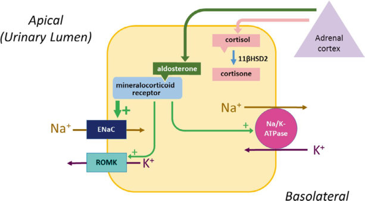
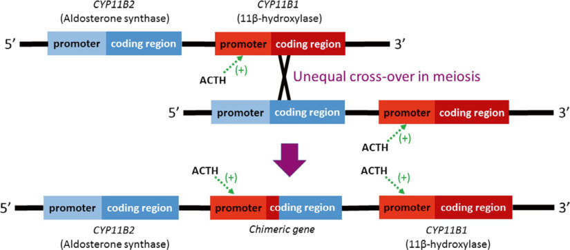

# 13. Mineralocorticoid Disorders and Endocrine Hypertension
> Source attribution: [Source credits](../../SOURCE_CREDITS.md).

## PDF page 363 | printed page 351

### Mineralocorticoid Disorders and Endocrine Hypertension

Joseph Heinemann and David W. Cooke

### Contents

### 13.1 Introduction – 353

### 13.2 Aldosterone Synthase Deficiency – 356

13.2.1 Clinical Presentation – 356 13.2.2 Diagnostic Evaluation – 356 13.2.3 Treatment and Outcomes – 356

### 13.3 Pseudohypoaldosteronism (PHA) – 357

13.3.1 Pseudohypoaldosteronism Type 1 (PHA1) – 357 13.3.2 Renal PHA1 – 357 13.3.3 Systemic PHA1 – 358 13.3.4 Secondary Pseudohypoaldosteronism (PHA3) – 359

### 13.4 Excess Mineralocorticoid Action – 359

13.4.1 Increased Aldosterone Production – 359

### 13.5 Primary Aldosteronism – 359

13.5.1 Clinical Presentation – 360 13.5.2 Diagnostic Evaluation – 360 13.5.3 Treatment and Outcomes – 361

### 13.6 Renal Artery Stenosis – 361

13.6.1 Diagnostic Evaluation – 361

### 13.7 Glucocorticoid Remediable Aldosteronism (GRA) – 361

13.7.1 Clinical Presentation – 362 13.7.2 Diagnostic Evaluation – 362 13.7.3 Treatment and Outcomes – 363

© The Author(s), under exclusive license to Springer Nature Switzerland AG 2024 S. Radovick, M. Misra (eds.), Pediatric Endocrinology, https://doi.org/10.1007/978-3-031-66296-6_13

## PDF page 364 | printed page 352

13.8 Apparent Mineralocorticoid Excess (AME) – 363

13.8.1 Clinical Presentation – 363 13.8.2 Diagnostic Evaluation – 363 13.8.3 Treatment and Outcomes – 363

13.9 Glycyrrhetinic Acid-Mediated – 364

13.10 Congenital Adrenal Hyperplasia – 364

13.11 Summary – 364

References – 366

## PDF page 365 | printed page 353

Key Points

5 Disorders of mineralocorticoid action

should be considered in patients with abnormal serum levels of sodium and potassium. 5 Mineralocorticoid deficiency or resis

tance to aldosterone should be consid ered in a patient with hyponatremia or hyperkalemia. 5 Disorders of excess mineralocorticoid

action should be considered in children suspected of having secondary hyper tension. The absence of hypokalemia should not be used as evidence to exclude such disorders.

### 13.1 Introduction

Mineralocorticoid production in the adrenal cortex functions within the renin-angiotensinaldosterone (RAA) system. The RAA system acts in concert with antidiuretic hormone (ADH) secretion from the posterior pituitary to maintain normal intravascular volume and normal plasma osmolality, sodium, and potassium concentrations. This control of intravascular volume is necessary to maintain normal blood pressure, while the regulation of plasma sodium and potassium concentra tions is vital for the electrochemical gradients necessary for cell signaling. As discussed in Chap. 35, ADH is predominantly respon sible for controlling plasma osmolality through the regulation of free water excretion in the kidney, although, with significant vol ume loss, the body sacrifices osmolality to maintain extracellular volume. ADH defi ciency, as in diabetes insipidus, can result in hypernatremic/hyperosmolar dehydration, while overaction of ADH, as in the syndrome of inappropriate antidiuretic hormone (SIADH), causes hyponatremia/hyposmolal ity. The RAA system, through the regulation of sodium and potassium handling in the kid ney, regulates intravascular volume and the serum potassium level. Derangements of this system can lead to hypertension and hypoka lemia when overactive or to dehydration,

hyponatremia, hyperkalemia, and metabolic acidosis when underactive. The most common abnormality of the RAA system in children is mineralocorticoid deficiency in the setting of primary adrenal insufficiency. This is dis cussed in Chap. 10. This chapter will dis cuss more specific disorders leading to an underactive RAA system, as well as the disor ders within this system that lead to hyperten sion from an overactive RAA system.

+ +

13.1

+ +

+ +

In the kidney, the mineralocorticoid recep tor (MR, systematic name NR3C2) is expressed in the cells of the DCT, mediating this regula tion of sodium, potassium, and water handling of the DCT by the RAA system. Aldosterone is the primary ligand activating MR signaling in the DCT. It is produced exclusively in the zona glomerulosa of the adrenal cortex due to the specific expression of aldosterone synthase (CYP11B2) in these cells [1]. Aldosterone syn thase contains enzymatic activity for 11β-hydroxylation, 18-hydroxylation, and 18-methyloxidation and thus metabolizes 11-deoxycorticosterone through corticosterone and 18-OH-corticosterone to produce aldoste

## PDF page 366 | printed page 354

rone. (Note that 11β-hydroxylase, the gene product of the CYP11B1 gene, is responsible for the conversion of 11-deoxycortisol to corti sol in the zona fasciculata; 11β-hydroxylase conversion of deoxycorticosterone (DOC) to corticosterone in the zona glomerulosa is medi ated by aldosterone synthase.) The aldosterone precursors 11-deoxycorticosterone and corti costerone can also bind to the MR, albeit with low affinity. Therefore, at the usual physiologic circulating concentrations, these compounds do not activate MR signaling.

### 13

2

13.1 3

+ +

4

+ +

13.1 5

5

6

Unmatched source image; PDF page 366. Consult the original caption.

## PDF page 367 | printed page 355

SGK1, while the genomic actions of the MR increase SGK1 expression (before increasing ENaC expression). In addition to increasing the expression of ENaC, the SGK1 kinase increases the activity of ENaC [7]. The final effect of aldosterone action on the cells of the DCT is an increase in sodium and water reab sorption from urine and an increase in potas sium secretion into urine. Aldosterone also stimulates hydrogen ion secretion into urine through both direct and indirect mechanisms.

Aldosterone production is stimulated by the renin-angiotensin system and by hyperka lemia. The juxtaglomerular cells (JG cells) in the afferent arteriole in the kidney secrete renin into the systemic circulation in response to a fall in renal perfusion pressure. This occurs with a decrease in the systemic blood pressure, with a change to an upright posture, and with a decrease in the serum sodium con centration. Renin is also secreted in response to an increase in the sympathetic nervous sys tem input to the kidney. Renin catalyzes the cleavage of angiotensinogen (produced con stitutively in the liver) into angiotensin I. Angiotensin-converting enzyme (ACE), pro duced constitutively in the lung, then cleaves angiotensin I into angiotensin II. Angiotensin II binds to the AT1 receptor in the adrenal cortex, stimulating aldosterone production. An elevated serum potassium level directly stimulates aldosterone production in the adre nal cortex, independent of the RAA system. ACTH also can stimulate aldosterone produc tion. However, since the RAA system is the primary regulator of aldosterone production, ACTH deficiency does not result in mineralo corticoid deficiency.

Newborns have relative insensitivity to aldosterone, thought to be due to either a decreased expression of mineralocorticoid receptors [8] or a decrease in postreceptor sig naling [9]. This, as well as lower sodium intake, leads to higher renin and aldosterone levels in neonates and infants than in older children [10]. Disorders of mineralocorticoid action include disorders of insufficient action and disorders of excess action. These are listed below. The consequences of impaired or excess mineralocorticoid action can be pre

dicted from the known actions of aldosterone. Disorders of impaired mineralocorticoid action typically result in hyponatremia, dehy dration, and hyperkalemia. These patients also typically have metabolic acidosis from impaired acid secretion. Primary adrenal insufficiency, with impaired production of all adrenal steroid hormones, is discussed in Chap. 10. Certain forms of congenital adrenal hyperplasia (CAH) result in miner alocorticoid deficiency, as discussed in Chap. 11. Disorders of excess mineralocor ticoid action typically result in hypertension with hypokalemia and can have a metabolic alkalosis. The hypertensive forms of CAH are discussed in Chap. 11.

Disorders of Mineralocorticoid Action

5 Impaired Mineralocorticoid Action

–– Decreased aldosterone production

–– Primary adrenal insufficiency –– Aldosterone synthase deficiency –– Congenital adrenal hyperplasia

(CAH)

-- 21α-Hydroxylase deficiency -- 3β-Hydroxysteroid dehydrogenase deficiency -- StAR deficiency –– Decreased aldosterone action

–– Pseudohypoaldosteronism (PHA)

-- Renal PHA1 -- Generalized PHA1 -- Secondary PHA 5 Excess Mineralocorticoid Action

–– Increased aldosterone production

–– Primary aldosteronism

-- Conn syndrome -- Bilateral idiopathic hyperplasia –– Renal artery stenosis –– Glucocorticoid remediable aldoste

ronism (GRA) –– Nonaldosterone-mediated

–– Apparent mineralocorticoid excess

(AME) –– Glycyrrhetinic acid-mediated –– Congenital adrenal hyperplasia

(CAH)

-- 11β-Hydroxylase deficiency -- 17-Hydroxylase deficiency

## PDF page 368 | printed page 356

### 13.2 Aldosterone Synthase

### Deficiency

Mutations of the CYP11B2 gene, the gene for the aldosterone synthase enzyme, result in iso lated aldosterone deficiency with normal glu cocorticoid production. This is a rare, autosomal recessive disorder [11]. Two variants of aldosterone synthase deficiency have been described, referred to as aldosterone synthase deficiency type I and type II. These were previ ously referred to as type I and II corticosterone methyl oxidase deficiency (CMO I and CMO II deficiency). Type I and type II aldosterone syn thase deficiencies are differentiated by differ ences in the levels of aldosterone and 18-hydroxycorticosterone. Type I aldosterone synthase deficiency is typically caused by muta tions that completely abolish all enzymatic activity of aldosterone synthase, while muta tions resulting in type II aldosterone synthase deficiency often retain some minimal enzy matic activity [11]. It is worth noting that deoxycorticosterone (DOC) and corticoste rone, both weak mineralocorticoids, can be produced in patients with aldosterone synthase deficiency. DOC is produced because it is prox imate in the steroid pathway to aldosterone synthase; corticosterone may be produced either through the retained 11β-hydroxylation activity of the mutant aldosterone synthase gene or through the action of the 11β-hydroxylase enzyme (CYP11B1). However, unlike in the 11β-hydroxylase deficiency form of CAH where DOC levels are markedly ele vated (driven by the high ACTH levels), DOC and corticosterone levels in aldosterone syn thase deficiency are insufficient to prevent salt loss in infants and young children.

### 13

### 13.2.1 Clinical Presentation

Individuals often present with a salt-wasting crisis in the first days to weeks of life. They will typically have a history of vomiting and will present with evidence of dehydration on physical examination. Electrolytes typically demonstrate hyponatremia, hyperkalemia, and metabolic acidosis. This presentation is

very similar to infants with salt-wasting forms of CAH. However, in aldosterone synthase deficiency, there is no ambiguity of the genita lia, as there can be with CAH. Less severe forms may present later in childhood with failure to thrive or growth retardation, and asymptomatic (or very mildly symptomatic) adults with orthostatic hypotension as their only symptom have been identified. This range of presentations from salt-wasting adrenal crises in infancy to failure to thrive to nearly asymptomatic adults has been demon strated in patients with type II aldosterone synthase deficiency caused by the same muta tions [12, 13], suggesting mechanisms beyond those mediated by the CYP11B2 mutation [11] can impact the presentation.

### 13.2.2 Diagnostic Evaluation

The diagnosis of mineralocorticoid deficiency is based on a low or inappropriately normal serum aldosterone level [14] with a highplasma renin level. As with other steroid hor mones, cross-reactivity can result in falsely elevated aldosterone levels measured by immunoassay, potentially resulting in falsely elevated measures of aldosterone in neonates with aldosterone deficiency [15]. Primary adrenal insufficiency is excluded by normal serum cortisol levels, and CAH is excluded by normal levels of the relevant cortisol precur sors. In type I aldosterone synthase deficiency, the aldosterone level will be undetectable or low, while in type II aldosterone synthase defi ciency, the level is low or inappropriately nor mal [11]. The characteristic difference between type I and type II aldosterone synthase defi ciency is the level of 18-hydroxycorticosterone: low in the type I form and markedly elevated in the type II form.

### 13.2.3 Treatment and Outcomes

Treatment with 9α-fludrocortisone corrects the mineralocorticoid deficiency in these infants. Some infants may also require salt supplementation. In most patients, the disor

## PDF page 369 | printed page 357

der becomes less severe over time so by 3–4 years of age, they often remain asymp tomatic even without treatment with 9α-fludrocortisone. However, at least some of these patients continue to have orthostatic hypotension and remain at risk of electrolyte abnormalities at times of stress from dehydra tion or sodium depletion.

### 13.3 Pseudohypoaldosteronism

### (PHA)

Pseudohypoaldosteronism (PHA) refers to a clinical presentation that suggests hypoaldo steronism (dehydration, hyponatremia, hyper kalemia, and metabolic acidosis) but with an elevated aldosterone level that indicates that the cause is aldosterone resistance, rather than aldosterone deficiency.

Pseudohypoaldosteronism type 1 (PHA1) is discussed below. Pseudohypoaldosteronism type 2 (PHA2) is also known as Gordon syn drome, and it is not a true aldosterone resis tance disorder. Patients with this disorder do present with hyperkalemia and metabolic aci dosis from impaired renal excretion (similar to aldosterone resistance). However, in con trast to true aldosterone resistance, patients with PHA2/Gordon syndrome have hypertension, rather than salt loss and hypo natremia. PHA3 refers to transient, second ary forms of aldosterone resistance as described below. Note that there have been reports of infants with CAH who were misdi agnosed as having PHA due to very highserum aldosterone levels, likely due to a lab artifact where the markedly elevated steroid precursors that are present in a newborn with CAH were measured as aldosterone in immu noassays [16].

### 13.3.1 Pseudohypoaldosteronism

### Type 1 (PHA1)

There are two distinct forms of PHA1 that differ in clinical features as well as inheritance patterns and are caused by mutations in unique genes [5]. The renal form of PHA1 has

an autosomal dominant inheritance and is caused by inactivating mutations in the NR3C2 gene that encodes the MR. The gener alized or systemic form of PHA1 has autoso mal recessive inheritance due to inactivating mutations in one of the genes encoding sub units of the ENaC channel.

### 13.3.2 Renal PHA1

### 13.3.2.1 Clinical Presentation

Renal PHA1 is caused by heterozygous muta tions in the NR3C2 gene that result in impaired MR function [17]. As for other forms of deficient mineralocorticoid action, infants with renal PHA1 classically present with vomiting, failure to thrive, and dehydra tion, most often presenting between 2 weeks and 6 months of age. However, there is a wide spectrum of clinical findings in patients with NR3C2 mutations, including in patients with the same mutation within a given family [5, 18]. Thus, patients can present with the classi cal salt-wasting disease in infancy; some indi viduals can be asymptomatic with normal electrolytes but with laboratory evidence of mineralocorticoid resistance (elevated renin and aldosterone levels); and some individuals can be completely unaffected.

### 13.3.2.2 Diagnostic Evaluation

Laboratory findings in patients with renal PHA1 are those expected in mineralocorti coid resistance: a high-plasma renin level and an elevated aldosterone level. The infants present with hyponatremia and hyperkalemia, although the hyperkalemia is generally mild. While metabolic acidosis may be seen, it is often not present. Genetic testing will demon strate a heterozygous mutation in the NR3C2 gene.

### 13.3.2.3 Treatment and Outcomes

Treatment of renal PHA1 is with sodium sup plementation. The usual doses of sodium required are between 3 and 20 mEq/kg/day. The amount of sodium supplement required is determined by adjusting the dose to achieve normal serum potassium and plasma renin

## PDF page 370 | printed page 358

levels. Interestingly, in spite of this disease being caused by a germline mutation, there is the amelioration of the disease with age, such that sodium supplements can be discontinued by around 18–24 months of age. This likely is due to a combination of things, including the increase in renal MR expression with increas ing age during infancy, maturation of the abil ity of the kidney to reabsorb sodium with replacement of distal sodium reabsorption through absorption at the proximal tubules [19], as well as the increase in sodium intake with the introduction of solid food in the diet. With this clinical resolution, the plasma renin level is normal without sodium supplementa tion. The aldosterone level may continue to be elevated, evidence of ongoing mineralocorti coid resistance, but in other individuals the aldosterone level will normalize.

### 13.3.3 Systemic PHA1

### 13.3.3.1 Clinical Presentation

Systemic PHA1 is caused by defective func tion of ENaC [20]. The ENAC channel is composed of three subunits, ENaCα, ENACβ, and ENaCγ, produced by the SCNN1A, SCNN1B, and SCNN1G genes. ENaC has important functions beyond the kidney, and patients with systemic PHA1 have evidence of salt loss from the distal colon and from sali vary and sweat glands, in addition to the salt loss from the kidney [5]. In addition, the ENaC mutations impair the reabsorption of pulmonary interstitial fluid. Infants with sys temic PHA1 typically present as neonates with vomiting, failure to thrive, and severe dehydration, just as do infants with renal PHA1. However, the salt wasting in systemic PHA1 is more severe, and these infants typi cally present earlier than those with renal PHA1, often in the first days of life. In addi tion, because of the extrarenal effects of ENaC mutations, these patients also have sig nificant respiratory symptoms. They can have persistent clear rhinorrhea and congestion, chronic cough, tachypnea, and wheezing. They often have recurrent lower respiratory tract infections. The impairment in ENaC

### 13

function in the skin can result in cutaneous lesions that resemble miliaria rubra. Almost all mutations that result in systemic PHA1 are due to mutations that result in truncation of the ENaC proteins: nonsense mutations, sin gle base insertions that lead to a frameshift, or splice site mutations. Missense mutations are exceedingly rare, and when they occur, they often cause a milder phenotype that improves over time [21].

### 13.3.3.2 Diagnostic Evaluation

Laboratory testing demonstrates hyponatre mia, hyperkalemia, metabolic acidosis, and high renin and aldosterone levels. The hyper kalemia can be severe and can present a sig nificant mortality risk. The sodium (and chloride) concentration in sweat is high [21], which can distinguish this form of PHA1 from the renal form, where the sweat sodium (and chloride) concentration is normal. Genetic testing will demonstrate a biallelic mutation in one of the three genes encoding the ENaC channel subunits.

### 13.3.3.3 Treatment and Outcomes

As with the renal form of PHA1, the primary treatment of the systemic form of PHA1 is with sodium supplements. The sodium sup plementation required in the systemic form is higher than that required in the renal form, consistent with the generally more severe salt wasting in the systemic form. Doses of sodium are typically between 20 and 50 mEq/kg/day. Enteral tube feedings are sometimes needed to achieve this high degree of salt intake. At presentation, treatment with ion exchange res ins such as sodium polystyrene sulfonate may be necessary to correct the hyperkalemia, and some infants may require ongoing treatment with these resins. Occasionally, even more aggressive treatment is necessary for lifethreatening hyperkalemia present at diagno sis, such as treatment with beta-agonists or glucose and insulin infusions.

Unlike renal PHA1 patients, systemic PHA1 patients cannot stop their salt supple mentation as they get older. While there may be some amelioration with increasing age, sys temic PHA1 requires ongoing, lifelong treat

## PDF page 371 | printed page 359

ment with sodium supplementation. The lung disease of PHA1 can be clinically very similar to that of cystic fibrosis (CF). However, despite frequent respiratory exacerbations, as well as colonization with Pseudomonas aerugi nosa, PHA1 patients do not have the destruc tive lung disease that occurs in CF patients. Nonetheless, these patients do require appro priate symptomatic treatment for pulmonary exacerbations.

### 13.3.4 Secondary

### Pseudohypoaldosteronism (PHA3)

A transient form of pseudohypoaldosteron ism can develop from either infection or obstruction of the urinary tract [22]; most often this occurs in patients with a urinary tract malformation in the setting of a concur rent urinary tract infection [23]. This second ary form of PHA is referred to as either secondary PHA1 or as PHA3, and it resolves with correction of the underlying abnormal ity. It has also been described in children treated with calcineurin inhibitors such as tacrolimus and cyclosporine [24].

### 13.3.4.1 Clinical Presentation

The typical presentation for PHA3 is similar to that of infants with other forms of PHA: an infant with vomiting, dehydration, and failure to thrive. Fever may be present when the PHA3 is secondary to pyelonephritis. In infants where there is no underlying renal abnormality and the cause is from an acute urinary tract infection, there will not be a fail ure to thrive. Most commonly these infants are less than 3–6 months of age [22, 23].

### 13.3.4.2 Diagnostic Evaluation

As with genetic forms of PHA, laboratory testing will demonstrate hyponatremia, hyper kalemia, metabolic acidosis, and high renin and aldosterone levels. In older children, the PHA due to a urinary tract infection may cause hyponatremia with normokalemia. Because urinary tract obstruction or infection can cause PHA, all infants presenting with

laboratory results that suggest PHA should be investigated for a urinary tract infection and get ultrasound imaging for evidence of uri nary tract abnormalities.

### 13.3.4.3 Treatment and Outcomes

Acutely, these infants are treated with fluid replacement, which typically results in nor malization of electrolytes within 24–48 h. With obstructive uropathy, the salt loss may transiently worsen in the immediate postop erative period. However, with treatment of the underlying cause, there will be resolution of the salt loss unless there has been permanent renal damage. In most cases, the resolution occurs within a few days, although in some cases the salt loss may last a few weeks.

### 13.4 Excess Mineralocorticoid

### Action

### 13.4.1 Increased Aldosterone

### Production

As expected from the actions of aldosterone, mineralocorticoid excess causes an excess reten tion of sodium and excretion of potassium. Thus, these patients develop hypertension and hypokalemia. They also typically develop meta bolic alkalosis. In adults, mineralocorticoid excess is the underlying cause in up to about 10% of patients with hypertension [25]. While hypertension is more often caused by an under lying disorder in children compared to adults, endocrine causes are uncommon, with primary renal or renovascular diseases much more likely. However, along with pheochromocytoma, Cushing syndrome, hypertensive forms of CAH, and hyperthyroidism, primary aldosteronism is a cause of hypertension in children, albeit an exceedingly rare cause.

### 13.5 Primary Aldosteronism

Primary aldosteronism is caused by either Conn syndrome, an aldosterone-secreting tumor of the adrenal cortex, or by idiopathic,

## PDF page 372 | printed page 360

bilateral hyperplasia of the adrenal glomeru losa. Rare, familial forms of bilateral hyper plasia can be the result of a heterozygous germline mutation of the KCNJ5, CACNA1D, CACNA1H, or CLCN2 genes, and children within these pedigrees present at a young age with the hypertension and hypokalemia expected of aldosteronism [26, 27]. Children with CACNA1D gene mutations have also had neuromuscular disorders [28]. CACNA1D mutations have been associated with congeni tal hyperinsulinemic hypoglycemia, with one case report describing an infant with both congenital primary aldosteronism and con genital hyperinsulinemic hypoglycemia [29]. Somatic mutations are often found within Conn syndrome tumors, most often of KCNJ5 and less commonly of CACNA1D, ATP1A1, or ATP2B3 [14]. Rarely, patients with MEN1 can develop Conn syndrome [30].

Secondary hypertension, including that associated with aldosteronism, should be investigated as a possible cause of hyperten sion in prepubertal children with any degree of hypertension and in a pubertal child with severe hypertension (stage 2 hypertension: blood pressure more than 12 mmHg above the 95th percentile [31]). In addition, aldosteronism should be suspected in the hypertensive child with hypokalemia or one with a family history of early onset hypertension or cerebrovascular hemorrhage at a young age, which suggests the possibility of glucocorticoid remediable aldo steronism (GRA). Finally, secondary hyper tension, including aldosteronism, may be considered in the thin adolescent with any degree of hypertension. The evaluation for aldosteronism begins with measuring plasma aldosterone level and plasma renin activity.

### 13

### 13.5.1 Clinical Presentation

Disorders of aldosterone excess are most often identified in the evaluation of a child with asymptomatic hypertension. It might also be expected in a younger child with more severe hypertension. If hypertension is severe, the child may have a history of headaches. Symptoms of hypokalemia can include mus cle weakness and cramping, as well as poly

dipsia and polyuria from the renal concentrating defect caused by hypokalemia.

### 13.5.2 Diagnostic Evaluation

Laboratory findings that suggest aldosteron ism in a child with hypertension include hypo kalemia and metabolic alkalosis. However, in adults, many patients will present with a nor mal serum potassium level, particularly those with low salt intake in their diet. While there are insufficient data to determine the fre quency of hypokalemia in children with aldo steronism, it may be more common than in adults. In adults, normokalemia is more com mon with bilateral hyperplasia (~80%), while only 50% of adults with Conn syndrome are normokalemic [32]. In children, aldosteron ism with bilateral hyperplasia is more likely to be caused by a germline mutation (such as in KCNJ5) than in adults (in whom an idiopathic cause is most common), and patients with these genetic causes may be less likely to be normokalemic. Nonetheless, a substantial proportion of children with aldosteronism will not have hypokalemia.

The diagnosis of aldosteronism is sup ported by an elevated aldosterone level in the presence of a suppressed plasma renin activity (PRA), resulting in a high-plasma aldosterone concentration (PA) to PRA ratio. Note that in a hypertensive patient, a normal PA concen tration should be considered to be inappropri ately elevated for the level of blood pressure. In adults, most patients with aldosteronism will have a PA/PRA ratio (measured in ng/dL and ng/mL per hour, respectively) of over 20–40 [25]. In general, confirmation of the diagnosis of aldosteronism should be made using one of four testing procedures: oral sodium loading, saline infusion, fludrocortisone suppression, or captopril challenge [25], although in some situations (spontaneous hypokalemia, PRA below the limit of detection, and PA concen tration above 20 ng/dL (550 pmol/L)), such confirmatory testing may not be necessary [25]. Because of the rarity of aldosteronism in children, the utility of the confirmation testing and specific cutoffs for the PA/PRA ratio have not been determined for children.

## PDF page 373 | printed page 361

Once aldosteronism is identified, testing should be done to identify those children with GRA (see below). If GRA is not the cause, imaging is utilized to determine if the cause is a unilateral adrenal tumor (Conn syndrome) or bilateral hyperplasia. If Conn syndrome is not identified on imaging, genetic testing for mutations of KNCJ5, CACNA1D, CACNA1H, and CLCN2 is indicated.

### 13.5.3 Treatment and Outcomes

The treatment of aldosteronism from Conn syndrome is surgical excision of the tumor, which is curative. For patients with aldoste ronism from bilateral adrenal hyperplasia, treatment with mineralocorticoid antagonists, either spironolactone or eplerenone, is the ini tial therapy, although some may require treat ment with additional antihypertensive medications. For pubertal patients, eplere none may be preferable to avoid the antian drogenic effects of spironolactone. Patients with germline KNCJ5 or CACNA1H muta tions causing massive adrenal hyperplasia have required bilateral adrenalectomies to control the hypertension [33], although milder forms have also been described [34].

Patients with hypertension due to aldoste ronism of any cause have a higher risk of renal and cardiac damage than those with equivalent degrees of hypertension from other causes [35, 36]. While MR expression in the cells of the DCT of the kidney is the primary mechanism for sodium, potassium, and extra cellular volume regulation by the RAA sys tem, MR is also expressed in cells outside the kidney. This extrarenal MR expression likely contributes to some of the complications aris ing from chronic mineralocorticoid excess, including cardiac fibrosis.

### 13.6 Renal Artery Stenosis

In a child with hypertension, a high PA con centration in the absence of a suppressed PRA, with a PA/PRA that is not elevated, suggests a diagnosis of renal artery stenosis (RAS). RAS leads to a decrease in the renal

perfusion pressure sensed by that kidney, resulting in an increase in renin secreted by the JG cells of that kidney. This renal artery stenosis can be unilateral or bilateral. Once the patient’s blood pressure is elevated, the renin level returns to normal. Initially renin secretion from the contralateral (nonaffected) kidney is suppressed, but ultimately renin secretion from the affected kidney also declines as the hypertension overcomes the stenosis. Therefore, an elevated renin level, which is preferably measured as a plasma renin activity (PRA), may not be found in patients with renal artery stenosis.

### 13.6.1 Diagnostic Evaluation

The normal response to hypertension is sup pression of renin secretion. Thus, a PRA that is not suppressed suggests inappropriate pro duction of renin as the cause of hypertension. As noted above, PRA is typically in the nor mal range in patients with RAS. An elevated PRA in a hypertensive child would suggest the very rare situation of a renin-secreting juxta glomerular cell tumor [37]. As in aldosteron ism, PA levels are not suppressed in RAS, but in contrast to the elevated PA/PRA ratio in aldosteronism, this ratio is normal in RAS. Hypokalemia may be found in patients with RAS, but the degree of hypokalemia tends to be mild or absent. In about 50% of patients, an abdominal bruit is present.

### 13.7 Glucocorticoid Remediable

### Aldosteronism (GRA)

Secretion of steroid hormones is coupled to production. The main rate-limiting step in ste roid synthesis is at the level of transport of cholesterol from the outer to the inner mito chondrial membrane through the action of the steroidogenic acute regulatory protein (StAR). However, the subsequent determination of which steroid is produced is controlled by the level of expression of enzymes specific to the separate steroid synthesis pathways. Production of cortisol is dependent on the level of expres sion of 11β-hydroxylase. The 11β-hydroxylase

## PDF page 374 | printed page 362

gene is expressed at high levels in the zona fas ciculata, and this expression is driven in part by the action of upstream regulatory elements, including those that are responsive to ACTH stimulatory pathways. Aldosterone production in the zona glomerulosa is dependent on the high level of expression of the gene for aldoste rone synthase. Its expression is increased through potassiumand angiotensin II-responsive elements upstream of the gene.

13.2 38

### 13

### 13.7.1 Clinical Presentation

GRA is inherited in an autosomal dominant manner. It typically presents with hyperten sion in the first two decades of life, with one report finding that 80% of children with the chimeric gene were hypertensive by 13 years of age [39]. As with other forms of aldoste ronism, the patients may or may not have hypokalemia. GRA is associated with an increased risk of early cerebral hemorrhage, although these events typically occur in young adulthood [40].

### 13.7.2 Diagnostic Evaluation

Investigation for GRA starts with determin ing if there is biochemical evidence for aldo steronism as discussed above. Any child who is found to have aldosteronism should undergo genetic testing for GRA. While dexametha sone suppression of aldosterone and very high serum and urine levels of 18-hydroxycortisol and 18-oxocortisol levels are characteristic of GRA, these tests lack specificity, and assays for 18-hydroxycortisol and 18-oxocortisol are typically not available at commercial laboratories. Therefore, testing for the chimeric gene should be performed to

Unmatched source image; PDF page 374. Consult the original caption.

## PDF page 375 | printed page 363

evaluate for GRA. Because of the autosomal dominant inheritance, first-degree relatives of individuals with GRA should also undergo genetic testing.

### 13.7.3 Treatment and Outcomes

Aldosterone production in GRA is ACTHdependent. Therefore, aldosterone levels can be lowered by treating the patient with a glu cocorticoid. Longer-acting synthetic gluco corticoids such as dexamethasone and prednisone are preferred and should be given at bedtime. The lowest dose that normalizes blood pressure and serum potassium concen tration is used. The starting dose for adults is 0.125–0.25 mg of dexamethasone or 2.5–5 mg of prednisone [25]. These translate to surface area-adjusted doses for children of approxi mately 0.1 mg/m2 of dexamethasone and 1.5 mg/m2 of prednisone. If low doses of glu cocorticoid are not fully effective in control ling hypertension, a mineralocorticoid antagonist (spironolactone or eplerenone) can be added. Eplerenone may be preferable to avoid the antiandrogenic effects of spirono lactone in pubertal children. The use of min eralocorticoid antagonists to minimize the glucocorticoid dose may be particularly important to avoid any growth-suppressing effects from excessive glucocorticoid doses. As with other forms of aldosteronism, potassiumwasting diuretics should only be used with caution (and are probably best avoided) as they are likely to induce hypokalemia.

Because of the high rate of cerebrovascu lar events in patients with GRA, screening with appropriate imaging is recommended, starting at puberty.

### 13.8 Apparent Mineralocorticoid

### Excess (AME)

Apparent mineralocorticoid excess (AME) is caused by biallelic inactivating mutations of the 11β-HSD2 gene [4]. It is inherited in an autosomal recessive manner. As expected, the loss of 11β-HSD2 function in the kidney results in continuous activation of the MR in

these cells by cortisol, resulting in hyperten sion and potassium loss.

### 13.8.1 Clinical Presentation

There can be a range of presentations from mild to severe [41]. In the severe phenotype, the infant is born with low birth weight and demonstrates failure to thrive and hyperten sion in early childhood. These children typi cally present with hypercalciuria and nephrocalcinosis [42]. They may also have polyuria due to the nephrogenic diabetes insipidus that is a consequence of hypokale mia. Milder phenotypes can present without electrolyte changes, with the only manifesta tion being hypertension that develops later in childhood or even in adulthood.

### 13.8.2 Diagnostic Evaluation

As for other forms of aldosteronism, hypoka lemia and metabolic alkalosis suggest the diagnosis but may not be present in all patients. However, in contrast to patients with aldosteronism, the aldosterone level in this disorder is low. The diagnosis is made by dem onstrating an increase in the ratio of 11-hydroxysteroids to 11-ketosteroids in urine: in a 24-h urine sample, there is an increase in cortisol/cortisone and an increase in the ratio of (tetrahydrocortisol + allotetra hydrocortisol)/tetrahydrocortisone. The nor mal ratio of urinary cortisone/cortisol is less than 0.5. The normal ratio of (tetrahydrocor tisol + allotetrahydrocortisol)/tetrahydrocor tisone is approximately 1; in AME, this is increased to approximately 6–60 [43].

### 13.8.3 Treatment and Outcomes

Treatment for AME can include some combi nation of mineralocorticoid receptor antago nism, ENaC inhibition, potassium supplementation, and sodium restriction. In mild forms, a high potassium diet or potas sium supplementation along with a low dose of either spironolactone or eplerenone may be

## PDF page 376 | printed page 364

sufficient. In more severe forms, more aggres sive therapy is needed, adding sodium restric tion along with amiloride or triamterene to block ENaC. Thiazide diuretics may be bene ficial in decreasing urinary calcium excretion, as these patients typically have hypercalciuria and may develop nephrocalcinosis. In some patients, there may be a role of a long-acting glucocorticoid such as dexamethasone to sup press cortisol levels.

### 13.9 Glycyrrhetinic Acid-Mediated

Chronic ingestion of licorice can result in hypertension and laboratory findings similar to those of AME: hypokalemia and metabolic alkalosis with a low-plasma aldosterone level [44]. This occurs because licorice contains glycyrrhetinic acid, which is an effective inhib itor of 11β-HSD. Resolution of the hyperten sion and metabolic abnormalities occurs with cessation of licorice ingestion.

### 13.10 Congenital Adrenal

### Hyperplasia

Two forms of congenital adrenal hyperplasia (CAH) result in hypertension: 11β-hydroxylase deficiency and 17-hydroxylase deficiency. In the case of 11β-hydroxylase deficiency, the 46,XX baby will present with ambiguous genitalia, while the 46,XY baby will present with early signs of virilization before puberty. Overpro duction of deoxycorticosterone causes hyper tension, hypokalemia, and metabolic alkalosis, although these may not be present at birth. While deoxycorticosterone has a relatively low affinity for the MR, it is produced in markedly high quantities in this form of CAH, sufficient to cause MR activation. CAH due to 17-hydroxylase deficiency may present with ambiguous genitalia in the 46,XY infant due to

### 13

impaired testosterone production. In 46,XX infants, or in forms with complete loss of enzyme action, both the 46,XX child and the 46,XY child will present as girls with a lack of development of secondary sexual characteris tics at puberty. These children also develop hypertension, hypokalemia, and metabolic alkalosis, due to overproduction of both deoxycorticosterone and corticosterone. Like deoxycorticosterone, corticosterone has weak mineralocorticoid activity. In 17-hydroxylase deficiency, deoxycorticosterone and corticoste rone are produced at quantities high enough to activate the MR. See Chap. 11 for more details about these and other forms of CAH.

### 13.11 Summary

Isolated disorders of mineralocorticoid action are rare in children. However, when present, they can cause significant morbidity and in severe cases can be life-threatening. Disorders that result in deficient mineralo corticoid action are typically congenital and present within the first months of life. The exception would be milder forms of congeni tal disorders or secondary pseudohypoaldo steronism that can be acquired due to renal disease. These mineralocorticoid-deficient states typically present with vomiting and dehydration or with failure to thrive if more indolent. The classical electrolyte distur bances found are hyponatremia and hyper kalemia. Overactivity of mineralocorticoid action leads to hypertension and should be considered in the workup of secondary causes of hypertension in children. Hypokalemia in a patient with hypertension is an important clue to excess mineralocorti coid activity, but hypokalemia is not always present in these disorders, and therefore aldosteronism should not be excluded based on normal serum potassium.

## PDF page 377 | printed page 365

Case Study

A critically ill female presented at 7 days of age with abnormal electrolytes. This infant was born full term, had an unremarkable prenatal course and delivery, and weighed 2990 g. Family history was positive for consanguinity (parents were first cousins.) At the time of delivery, the mother was G7P4023, with two prior spontaneous miscar riages and one neonatal death at 10 days of age of unknown cause. Apgar scores were 8 and 9 at 1 and 5 min after birth. She had been doing well in the well-baby nursery while her mother remained inpatient for bleeding precautions. On day 6 of life, she became hypotonic and bradycardic and had a seizure necessitating intubation and trans fer to the NICU. Initial blood work showed glu cose 86 mg/dL, sodium 121 mEq/L, potassium 7.2 mEq/L, bicarbonate of 12 mEq/L, and lactate of 6.3 mmol/L. Given the severe hyponatremia and hyperkalemia, empiric treatment for adrenal insufficiency was started with stress dose gluco corticoids (hydrocortisone 100 mg/m2/24 h divided every 6 h). She received acute treatment for hyponatremia with intravenous normal saline boluses and intravenous hypertonic saline. Hyperkalemia peaked at 10 mEq/L and was treated with albuterol, calcium gluconate, and an insulin drip. She received intravenous sodium bicarbonate for acidosis. Physical exam was nota ble for normal external female genitalia.

Gene Disease Mode of inheritance

Variant

SCNN1A SCNN1Arelated pseudohy poaldoste ronism

Autosomal recessive

c.1244_1267 del p.(V415_ Q422del)

With these results, the diagnosis of sys temic PHA1 was made. Treatment with high-dose glucocorticoids and fludrocorti sone was stopped. She was continued on very-high sodium supplementation via

Urinalysis was negative for evidence of a urinary tract infection. Laboratory studies were sent to evaluate for congenital adrenal hyperplasia as well as aldosterone deficiency and aldosterone resistance. While awaiting labs, there was no clear improvement in hyponatre mia and hyperkalemia with high-dose hydro cortisone treatment, so high sodium supplementation and fludrocortisone treatment were started with normalization of the serum sodium and potassium. Results returned with reassuring cortisol of 16.6 mcg/dL and 17-hydroxyprogesterone <17 ng/dL. Plasma Renin Activity was elevated at 134.38 ng/mL/h. Aldosterone (LC/MS) was not low, at 29 ng/ dL. The renin and aldosterone levels suggested a diagnosis of pseudohypoaldosteronism, although the aldosterone level was not as high as previously reported in cases of pseudohy poaldosteronism. This lack of more significant elevation of the aldosterone level may have been because of improvement of the electro lytes with treatment: at the time these levels were measured, the serum potassium concen tration was normal and the serum sodium con centration corrected for mild hyperglycemia that was present was nearly normal at 131 mEq/L. A definitive diagnosis was made with the results of whole-exome sequencing.

Zygosity Inherited from

Classification

Homozy gous

Mother + father

Likely patho genic variant

total parenteral nutrition of around 25 mEq/kg/day which was then transi tioned to enteral sodium supplementation and feeding with potassium-depleted for mula.

## PDF page 378 | printed page 366

Review Questions

1. Why does cortisol generally not acti

vate the mineralocorticoid receptor? A. Cortisol has a low affinity for the

mineralocorticoid receptor. B. Cortisol circulates at a much lower

level than aldosterone, and there fore the mineralocorticoid recep tor is generally occupied by aldosterone binding. C. Cortisol binding to the mineralo

corticoid receptor does not recruit the appropriate coactivators to allow active signaling. D. Cortisol is inactivated by 11β-

HSD2 in the cells of the distal nephron.

v Answers

1. D 2. A 3. A

2. A female infant presents at 4 days of age

with a history of vomiting and lethargy. On exam, she is severely dehydrated. Laboratory studies reveal serum sodium of 120 mEq/L, potassium of 9 mEq/L, and bicarbonate 8 mEq/L. The infant is resuscitated and discharged on sodium chloride supplements. Over the first year, she had multiple hospital admissions for respiratory distress with fever, cough, and tachypnea, with wheezing and crackles on the exam. What is the most likely inheritance pattern for this disor der, and what is expected for the natural history of this disease?

### References

1. Rainey W. Adrenal zonation: clues from 11beta-

2. Krozowski ZS, Funder JW. Renal mineralocorti

### 13

3. Funder 4. Funder JW. Apparent mineralocorticoid excess. J

Inheritance pattern

Natural history

5. Riepe FG. Pseudohypoaldosteronism. Endocr

A Autosomal recessive

Persistent symptoms throughout life

6. Dooley R, Harvey BJ, Thomas W. Non-genomic

B Autosomal dominant

Persistent symptoms throughout life

7. Valinsky WC, Touyz RM, Shrier A. Aldosterone,

C Autosomal recessive

Resolution in the first years of life

8. Martinerie L, Viengchareun S, Delezoide AL,

D Autosomal dominant

Resolution in the first years of life

3. An 18-month-old child presents with

9. Alvarado C, Balestracci A, Toledo I, Martin SM,

fever and vomiting for the past 2 days. The past history is unremarkable with

normal growth and development. On exam, the child has evidence of dehy dration with tachycardia, decreased skin turgor, and decreased capillary refill time. Serum electrolytes show a sodium level of 126 mEq/L and a serum potassium of 5.6 mEq/L. Which of the following is the most likely diagnosis? A. Secondary pseudohypoaldosteron

ism B. Homozygous mutation of ENaC C. Congenital adrenal hyperplasia D. Homozygous mutation of the min

eralocorticoid receptor E. Glucocorticoid remediable aldo

steronism

hydroxylase and aldosterone synthase. Mol Cell Endocrinol. 1999;151:151–60.

coid receptors and hippocampal corticosteronebinding species have identical intrinsic steroid specificity. Proc Natl Acad Sci USA. 1983;80(19):6056–60. JW, Pearce PT, Smith R, Smith AIAN. Mineralocorticoid action: target tissue specificity is enzyme, not receptor, mediated. Science. 1988;242(4878):583–5.

Steroid Biochem Mol Biol. 2017;165:151–3.

Dev. 2013;24:86–95.

actions of aldosterone: from receptors and signals to membrane targets. Mol Cell Endocrinol. 2012;350(2):223–34.

SGK1, and ion channels in the kidney. Clin Sci (Lond). 2018;132(2):173–83.

Jaubert F, Sinico M, Prevot S, Boileau P, Meduri G, Lombès M. Low renal mineralocorticoid recep tor expression at birth contributes to partial aldo sterone resistance in neonates. Endocrinology. 2009;150(9):4414–24.

Beaudoin L, Voyer LE. Transient early-childhood hyperkalemia without salt wasting, physiopatho

## PDF page 379 | printed page 367

logical approach of three cases. Nefrologia (Engl Ed). 2021;42(2):203–8. 10. Bae YJ, Zeidler R, Baber R, Vogel M, Wirkner K,

22. Bogdanović R, Stajić N, Putnik J, Paripović

Loeffler M, Ceglarek U, Kiess W, Körner A, Thiery J, Kratzsch J. Reference intervals of nine steroid hormones over the life-span analyzed by LC-MS/ MS: effect of age, gender, puberty, and oral contra ceptives. J Steroid Biochem Mol Biol. 2019;193:105409. 11. White PC. Aldosterone synthase deficiency and

23. Kaninde A, Grace ML, Joyce C, Taylor NF,

related disorders. Mol Cell Endocrinol. 2004;217(1–2):81–7. 12. Rösler A, Rabinowitz D, Theodor R, Ramirez LC,

24. Deppe CE, Heering PJ, Viengchareun SAY,

Ulick S. The nature of the defect in a salt-wasting disorder in Jews of Iran. J Clin Endocrinol Metab. 1977;44(2):279–91. 13. Pascoe L, Curnow KM, Slutsker L, Rösler A,

White PC. Mutations in the human CYP11B2 (aldosterone synthase) gene causing corticosterone methyloxidase II deficiency. Proc Natl Acad Sci USA. 1992;89(11):4996–5000. 14. Wijaya M, Ma H, Zhang J, Du M, Li Y, Chen Q,

25. Funder JW, Carey RM, Mantero F, Murad MH,

Guo S. Aldosterone signaling defect in young infants: single-center report and review. BMC Endocr Disord. 2021;21(1):149. 15. Martín-Rivada Á, Argente J, Martos-Moreno GÁ.

26. Korah HE, Scholl UI. An update on familial

Aldosterone deficiency with a hormone profile mimicking pseudohypoaldosteronism. J Pediatr Endocrinol Metab. 2020;33(11):1501–5. 16. Boddu SK, Madhavan S. High aldosterone and

27. Scholl UI, Stölting G, Schewe J, Thiel A, Tan H,

cortisol levels in salt wasting congenital adrenal hyperplasia: a clinical conundrum. J Pediatr Endocrinol Metab. 2017;30(12):1327–31. 17. Geller DS, Rodriguez-Soriano J, Vallo Boado A,

Schifter S, Bayer M, Chang SS, et al. Mutations in the mineralocorticoid receptor gene cause autoso mal dominant pseudohypoaldosteronism type I. Nat Genet. 1998;19(3):279–81. 18. Riepe FG, Finkeldei J, De Sanctis L, Einaudi S,

28. Scholl UI, Healy JM, Thiel A, Fonseca AL, Brown

Testa A, Karges B, et al. Elucidating the underly ing molecular pathogenesis of NR3C2 mutants causing autosomal dominant pseudohypoaldoste ronism type 1. J Clin Endocrinol Metab. 2006;91(11):4552–61. 19. Gopal-Kothandapani JS, Doshi AB, Smith K,

29. De Mingo Alemany MC, Mifsud Grau L, Moreno

Christian M, Mushtaq T, Banerjee I, Padidela R, Ramakrishnan R, Owen C, Cheetham T, Dimitri P. Phenotypic diversity and correlation with the genotypes of pseudohypoaldosteron ism type 1. J Pediatr Endocrinol Metab. 2019;32(9):959–67. 20. Chang SS, Grunder S, Hanukoglu A, Rösler A,

30. Gatta-Cherifi B, Chabre O, Murat A, Niccoli P,

Mathew PM, Hanukoglu I, et al. Mutations in sub units of the epithelial sodium channel cause salt wasting with hyperkalaemic acidosis, pseudohy poaldosteronism type 1. Nat Genet. 1996;12(3):248–53. 21. Cayir A, Demirelli Y, Yildiz D, Kahveci H, Yarali

31. Flynn JT, Kaelber DC, Baker-Smith CM, Blowey

O, Kurnaz E, Vuralli D, Demirbilek H. Systemic pseudohypoaldosteronism type 1 due to 3 novel

mutations in SCNN1A and SCNN1B genes. Horm Res Paediatr. 2019;91(3):175–85.

A. Transient type 1 pseudo-hypoaldosteronism: report on an eight-patient series and literature review. Pediatr Nephrol. 2009;24(11):2167–75.

Ghataore L, Riordan MF, O’Grady MJ, O’Connell SM. The incidence of transient infantile pseudohy poaldosteronism in Ireland: a prospective study. Acta Paediatr. 2021;110(4):1257–63.

Grabensee B, Farman N, Lombes M. Cyclosporine A and FK506 inhibit transcriptional activity of the human mineralocorticoid receptor: a cell-based model to investigate partial aldosterone resistance in kidney transplantation. Endocrinology. 2002;143(5):1932–41.

Reincke M, Shibata H, et al. The management of primary aldosteronism: case detection, diagnosis, and treatment: an endocrine society clinical prac tice guideline. J Clin Endocrinol Metab. 2016;101:1889–916.

hyperaldosteronism. Horm Metab Res. 2015;47(13):941–6.

Nelson-Williams C, Vichot AA, Jin SC, Loring E, Untiet V, Yoo T, Choi J, Xu S, Wu A, Kirchner M, Mertins P, Rump LC, Onder AM, Gamble C, McKenney D, Lash RW, Jones DP, Chune G, Gagliardi P, Choi M, Gordon R, Stowasser M, Fahlke C, Lifton RP. CLCN2 chloride channel mutations in familial hyperaldosteronism type II. Nat Genet. 2018;50(3):349–54.

TC, Kunstman JW, et al. Novel somatic mutations in primary hyperaldosteronism are related to the clinical, radiological and pathological phenotype. Clin Endocrinol. 2015;83(6):779–89.

Macián F, Ferrer Lorente B, León Cariñena S. A de novo CACNA1D missense mutation in a patient with congenital hyperinsulinism, primary hyperal dosteronism and hypotonia. Channels (Austin). 2020;14(1):175–80.

Cardot-Bauters C, Rohmer V, et al. Adrenal involvement in MEN1. Analysis of 715 cases from the Groupe d’étude des Tumeurs Endocrines data base. Eur J Endocrinol. 2012;166(2):269–79.

D, Carroll AE, Daniels SR, de Ferranti SD, Dionne JM, Falkner B, Flinn SK, Gidding SS, Goodwin C, Leu MG, Powers ME, Rea C, Samuels J, Simasek M, Thaker VV, Urbina EM, Subcommittee on Screening and Management of High Blood Pressure in Children. Clinical practice guideline for screening and management of high

## PDF page 380 | printed page 368

blood pressure in children and adolescents. Pediatrics. 2017;140(3):e20171904. 32. Rossi GP, Bernini G, Caliumi C, Desideri G, Fabris

38. Lifton RP, Dluhy RG, Powers M, Rich GM, Cook

B, Ferri C, et al. A prospective study of the preva lence of primary aldosteronism in 1,125 hypertensive patients. J Am Coll Cardiol. 2006;48(11):2293–300. 33. Geller DS, Zhang J, Wisgerhof MV, Shackleton C,

Kashgarian M, Lifton RP. A novel form of human mendelian hypertension featuring nonglucocorticoid-remediable aldosteronism. J Clin Endocrinol Metab. 2008;93(8):3117–23. 34. Mussa A, Camilla R, Monticone S, Porta F,

39. Dluhy RG, Anderson B, Harlin B, Ingelfinger J,

40. Litchfield WR, Anderson BF, Weiss RJ, Lifton

Tessaris D, Verna F, et al. Polyuric-polydipsic syn drome in a pediatric case of non-glucocorticoid remediable familial hyperaldosteronism. Endocr J. 2012;59(6):497–502. 35. Stowasser M, Sharman J, Leano R, Gordon RD,

41. New MI, Geller DS, Fallo F, Wilson RC, Quinkler

Ward G, Cowley D, et al. Evidence for abnormal left ventricular structure and function in normo tensive individuals with familial hyperaldosteron ism type I. J Clin Endocrinol Metab. 2005;90(9):5070–6. 36. Milliez P, Girerd X, Plouin P-F, Blacher J, Safar

42. Moudgil A, Rodich G, Jordan SC, Kamil

43. Ferrari P. The role of 11β-hydroxysteroid dehydro

ME, Mourad J-J. Evidence for an increased rate of cardiovascular events in patients with primary aldosteronism. J Am Coll Cardiol. 2005;45(8):1243–8. 37. Shera AH, Baba AA, Bakshi IH, Lone IA. Recurrent malignant juxtaglomerular cell tumor: a rare cause of malignant hypertension in a

44. Sontia

### 13

child. J Indian Assoc Pediatr Surg. 2011;16(4):152–4.

S, Ulick S, et al. A chimaeric 11 beta-hydroxylase/ aldosterone synthase gene causes glucocorticoidremediable aldosteronism and human hyperten sion. Nature. 1992;355(6357):262–5.

Lifton R. Glucocorticoid-remediable aldosteron ism is associated with severe hypertension in early childhood. J Pediatr. 2001;138(5):715–20.

RP, Dluhy RG. Intracranial aneurysm and hem orrhagic stroke in glucocorticoid-remediable aldosteronism. Hypertension. 1998;31(1 Pt 2):445–50.

M, et al. Monogenic low renin hypertension. Trends Endocrinol Metab. 2005;16(3):92–7.

ES. Nephrocalcinosis and renal cysts associated with apparent mineralocorticoid excess syndrome. Pediatr Nephrol. 2000;15(1–2):60–2.

genase type 2 in human hypertension. Biochim Biophys Acta. 2010;1802(12):1178–87. B, Mooney J, Gaudet L, Touyz RM. Pseudohyperaldosteronism, liquorice, and hypertension. J Clin Hypertens (Greenwich). 2008;10(2):153–7.
