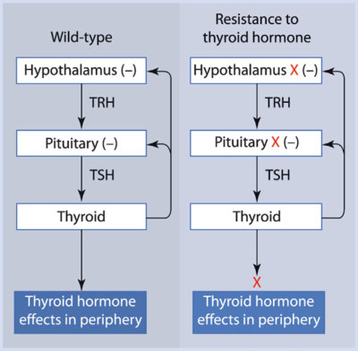
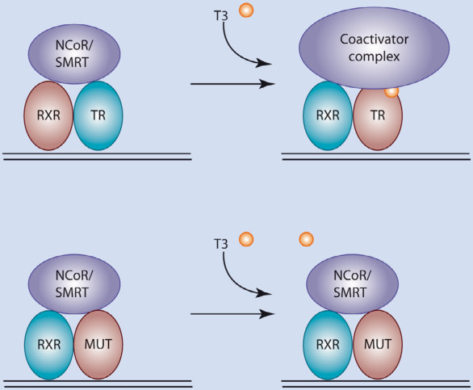
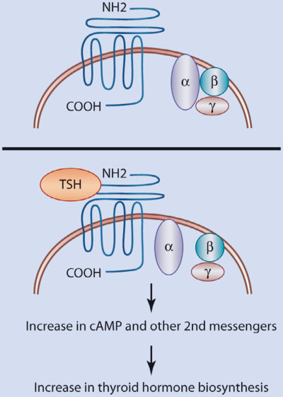

# 17. Resistance to Thyroid Hormone (RTH) and Resistance to TSH (RTSH)
> Source attribution: [Source credits](../../SOURCE_CREDITS.md).

## PDF page 431 | printed page 421

### Resistance to Thyroid Hormone (RTH) and Resistance to TSH (RTSH)

Michelle B. Lemelman and Alexandra M. Dumitrescu

### Contents

### 17.1 Resistance to Thyroid Hormone (RTH) – 422

17.1.1 Introduction and Background – 422 17.1.2 Etiology – 423 17.1.3 Clinical Presentation – 426 17.1.4 Diagnostic Considerations – 428 17.1.5 Outcomes and Possible Complications – 430 17.1.6 Treatment – 430 17.1.7 Summary – 432

### 17.2 Additional Thyroid Hormone Insensitivity Syndromes – 432

### 17.3 TSH Receptor Mutations – 433

17.3.1 Introduction and Background Information – 433 17.3.2 Etiology – 434 17.3.3 Clinical Presentation – 434 17.3.4 Diagnostic Considerations – 435 17.3.5 Outcome and Possible Complications – 435 17.3.6 Treatment – 436 17.3.7 Summary – 436

### 17.4 Conclusions – 436

### References – 437

© The Author(s), under exclusive license to Springer Nature Switzerland AG 2024 S. Radovick, M. Misra (eds.), Pediatric Endocrinology, https://doi.org/10.1007/978-3-031-66296-6_17

## PDF page 432 | printed page 422

Key Points

5 Resistance to TH (RTH) refers to a

group of disorders manifesting as impaired sensitivity to TH.

–– The classical form of RTH is caused

in most cases by mutations in the TH receptor β (THRB) gene and is classified as RTH-β. Fifteen percent of patients with this phenotype do not have a detectable mutation in the THRB gene, and this entity is known as non-TR-RTH. –– Mutations in the THRA gene have

been recently reported to cause RTH-α. Patients with this defect are phenotypically different from the RTH patients with THRB gene mutations in terms of thyroid func tion tests and clinical features. –– Other disease entities reported are

the TH cell membrane transport defect caused by MCT8 gene muta tions and TH metabolism defect caused by SBP2 and DIO1 gene mutations. These disorders can be distinguished by their characteristic abnormalities of thyroid function. 5 Resistance to TSH (RTSH) manifests

with high serum TSH of normal bio logical activity in the absence of goiter. Several genetic defects have been reported to present the phenotype of RTSH, including inactivating muta tions in the TSH receptor TSHR gene, mutations in the PAX 8 gene, and a dominantly inherited form without TSHR and PAX8 mutations that is linked to a region on chromosome 15.

### 17

### 17.1 Resistance to Thyroid

### Hormone (RTH)

### 17.1.1 Introduction

### and Background

1

2

3

17.1

Unmatched source image; PDF page 432. Consult the original caption.

## PDF page 433 | printed page 423

dation, sensorineural deafness, and nystag mus. Clinical features of hyperthyroidism may include tachycardia, hyperactivity, and increased basal metabolic rate. Most patients with the RTH-β phenotype have autosomal dominant mutations of the THRB gene. Patients have been identified from a wide range of races and ethnic groups; the exact geographic distribution of the disorder is unknown but it has been estimated that RTH-β occurs in about 1 case per 50,000 live births [4]. Individuals without an identifiable THRB mutation but with thyroid function tests consistent with RTH-β, may have non- TR-RTH and dynamic testing is required to confirm or exclude the diagnosis. Therapeutic strategies for RTH-β are not well-defined and treatment (if any) must be individualized. Most studies of patients with RTH-β have been performed in adults, and approaches for the pediatric population may need to be deduced in the absence of firm data. In the past several years, additional syndromes of reduced sensitivity to TH, distinct from the classic RTH-β, have been described, and these will be discussed below ( Fig. 17.1).

Until recently, mutations in the THRA have remained elusive. In fact, because THRA mutations were not previously identified, they were believed to be extremely rare, potentially lethal, or sub-clinically expressed [5]. Mouse models of Trα defects (knock outs [6, 7] and knock ins [8]), were investigated in an attempt to infer the phenotype of human THRA mutations. The first patients with THRA mutation were reported in 2012 [9, 10] and their phenotype is now classified as RTH-α. Because TRα is not involved in the feedback regulation of the hypothalamic-pituitarythyroid axis, their TFTs are distinct from RTH-β, namely, they have low serum T4, bor derline high T3, and very low rT3, with nor mal to elevated TSH levels. Some THRA gene mutations affect only the TRα1 subunit and tend to be more severe, while some mutations affect both TRα1 and α2 subunits [11]. Deiodinase 3 (D3) is an inactivating enzyme which degrades active T3 and converts T4 to inactive rT3 and was shown to be controlled by TRα [12]. Thus, patients with impaired

TRα1 have dysregulation of D3, which con tributes to the higher levels of serum T3 and lower levels of rT3 [13]. The clinical manifes tations in this syndrome are variable but con sistent with the manifestations of untreated congenital hypothyroidism in peripheral tis sues expressing predominantly TRα such as bone, gastrointestinal (GI), and central ner vous system (CNS) tissues [5].

### 17.1.2 Etiology

The TH receptor (TR) is a member of the nuclear hormone receptor (NHR) family of transcription factors. These proteins directly bind DNA to modulate gene transcription [14, 15]. NHRs contain several important domains: an N-terminal transactivation or AF-1 domain (A/B domain); a central DNAbinding domain (DBD); and a C-terminal ligand-binding domain (LBD) with liganddependent activation (AF-2) function. In addition to ligand binding, the LBD is involved in the recruitment of key nuclear cofactors such as corepressors and coactiva tors.

16 17

18 20

21 26

27 29

30

## PDF page 434 | printed page 424

of histone acetylation, modulating interac tions with general transcription factors, and other mechanisms [31–39]. More recently, rapid non-genomic actions of TH have been identified (independent of transcription) [14], although it is currently unclear how these effects relate to syndromes of RTH ( Fig. 17.2).

There are two major isoforms of the TR, termed TRα and TRβ, which are encoded by genes on different chromosomes: THRA on chromosome 17 and THRB on chromosome 3 [40, 41]. Additional isoforms of TRα and TRβ are generated by alternative splicing or differential promoter usage. Although TRα1 is a true TH receptor, TRα2 is an alternatively spliced isoform that does not bind TH [42]. In contrast, TRβ1, TRβ2, and the more recently described TRβ3 isoform [43] all bind TH and differ only in their N terminus. The function of TRβ3 in vivo remains unknown.

Mutations in the THRB gene have been identified in many patients with RTH and are now classified as RTH-β. In most cases, this

### 17

syndrome is inherited in an autosomal domi nant fashion. A subset of classical RTH patients, however, does not exhibit THRB mutations [44], and this entity is known as non-TR-RTH. These patients may have defects in other proteins involved in TH action [45], but such mutations have not yet been identified [46]. This is an ongoing area of research, and novel mutations are being sought. A recent search for mutations in the retinoid X receptor gamma (RXRγ) gene was not successful [47]. It has been hypothesized that some non-TR-RTH patients may exhibit mosaicism for de novo THRB mutations [48].

49 50

17.2

Unmatched source image; PDF page 434. Consult the original caption.

## PDF page 435 | printed page 425

tor recruitment [51, 52]. Interestingly, it has been shown that the mutant TRs interfere with wild-type TR function, an effect has been termed “dominant-negative effect” [53, 54]. Mouse models have clarified the role of the mutant TRs in the pathogenesis of RTH- β. Although complete knockout of TRβ pro duces mice with thyroid function tests consistent with RTH-β [55], modeling “knock-in” of Thrb mutations found in patients with RTH-β yields mice with more severe resistance [56, 57].

RTH-β can be subdivided into (1) general ized resistance to TH (GRTH) and (2) pitu itary resistance to TH (PRTH). In GRTH, the elevated TH levels generated by resistance at the level of the hypothalamus and pituitary have diminished activity in the periphery; thus, there is a variable degree of generalized resistance. In contrast, in PRTH (also called central resistance to TH, or CRTH), there is resistance solely (or at least primarily) at the level of the hypothalamus and pituitary. This resistance leads to elevated levels of TH, but in contrast to GRTH, sensitivity to TH is maintained in peripheral tissues, causing thy rotoxicosis. Patients with GRTH frequently exhibit tachycardia due to the high levels of TH stimulating intact TRα1 receptors in the heart; thus, tachycardia should not be used to differentiate GRTH and PRTH. Some investi gators do not recognize the existence of PRTH as a distinct clinical entity [58], arguing that the same mutations have been reported to cause both GRTH and PRTH [59]. However, a careful evaluation of clinical and biochemi cal indices in a patient with RTH suggested that PRTH may very well exist [60]. In addi tion, experiments have revealed that mutant TRβs of patients with PRTH behave differ ently than TRβs of patients with GRTH, par ticularly with respect to the TRβ2 isoform [61, 62]. A mouse model of the R429Q mutation (which has been reported to cause PRTH) showed that the mutant TRβ selectively inter feres with negative regulation by TH [63]. Another study identified differential recruit ment of nuclear cofactors by a different TRβ defect associated with PRTH [64].

In contrast, knockout of Thra in mice causes a syndrome of hypothyroidism with growth arrest [6, 7]. Mice with heterozygous knock-in Thra1 mutations are viable and have a heterogeneous phenotype, depending on the severity and the location of the mutation [8]. Most adult Thra1 mutant mice have a mildly elevated TSH. Various knock-in mouse mod els manifest other features, such as delayed endochondral ossification resulting in dwarf ism, disturbed behavior, memory impairment, locomotor dysfunction, mild bradycardia, and insulin resistance [8]. Thus, a patient with a dominant-negative THRA mutation was expected to have a different phenotype from the classical RTH-β phenotype. In fact, because THRA mutations were not identified until recently, they were considered to be extremely rare, lethal, or sub-clinically expressed [5].

In 2012, the first patients with THRA mutations were reported [9, 10] and their phe notype was classified as RTH-α. Currently, 38 patients belonging to 24 families and harbor ing 24 different THRA mutations, have been reported in the literature [11]. The cases included de novo and familial mutations which are caused by missense or frameshift mutations affecting the ligand binding domain of the receptor. Eight mutations are frame shifts with early termination located in the part of the gene specific only to the TRα1 iso form. Four are point mutations of TRα1 and 12 are located in the part of the protein com mon between the TRα1 and TRα2 isoforms. As in the case of THRB mutations, this results in three different mechanisms causing func tional impairment: (1) reduced affinity for T3, (2) interference of the normal TRα allele by the mutant TRα, resulting in a dominant neg ative effect; and (3) defective coactivator recruitment to the ligand bound receptor. Interestingly, some of the mutations identified in the THRA gene in cases of RTH-α were also identified in the THRB gene in cases of RTH-β. Comparison of the α and β forms of RTH for equivalent mutations enables the study of the distinctive roles of the different receptors [5].

## PDF page 436 | printed page 426

### 17.1.3 Clinical Presentation

### 17.1.3.1 RTH-β Phenotype

The clinical presentation of RTH-β is variable ( Box 17.1). The initial family described by Refetoff et al. [1] included an 81⁄2-year-old girl and a 121⁄2-year-old boy, both of whom were overall clinically euthyroid but exhibited goi ter, deaf-mutism, stippled epiphyses on radio logical skeletal survey, and elevated protein-bound iodine (PBI) levels. In contrast to most cases of RTH-β, this family was shown to have an autosomal recessive pattern of inheritance, and affected family members were later found to have a complete deletion of the THRB gene [65]. The heterozygous parents were phenotypically normal, suggest ing that a single wild-type TRβ (in the absence of a mutant TR) may be sufficient for TH action. In contrast, most cases of RTH-β are inherited in an autosomal dominant fashion because mutant TRβs exhibit dominantnegative inhibition over wild-type alleles ( Box 17.1).

Patients with RTH-β come to medical attention for a variety of reasons. Goiter is the presenting sign in about 38% of cases; less common reasons include learning disabilities, developmental delay, tachycardia, suspected thyrotoxicosis, and elevated thyroxine levels at birth [4]. Thyroid function tests reveal elevated TH levels in the setting of a non-suppressed TSH (see “Diagnostic Guidelines” below). Infants with RTH-β may have congenital deafness, congenital nystagmus, neonatal jaundice, and hypotonia [2]. Patients with RTH-β may have an increased risk of develop ing autoimmune thyroid disease [66]. Individuals with RTH-β who inappropriately undergo thyroidectomy or radioactive iodine treatment will exhibit signs and symptoms of hypothyroidism despite TH levels in the nor mal range following replacement therapy. Therefore, higher doses of L-T4 and L-T3 are usually needed to normalize TSH in these patients when endogenous TH production is not available.

### 17

A National Institute of Health study [67] evaluated prospectively a cohort of 42 kin

dreds manifesting the RTH-β phenotype. There was autosomal dominant transmission in 22 kindreds, sporadic transmission in 14, and an unknown transmission in 6. This last group was characterized as non-TR-RTH, as they manifested the classical RTH-β like phe notype without a detectable THRB mutation. A palpable goiter was identified in 74% of females and 53% of males. Attention-deficit hyperactivity disorder (ADHD) was present in 72% of the males and 43% of females. IQ was about 13 points lower in patients with the RTH-β phenotype compared to controls, and one-third of patients had an IQ < 85. In con trast, only a few patients had actual mental retardation. Patients with the RTH-β pheno type had a higher incidence of speech delay (24%), stuttering (18%), and hearing loss than controls. Although resting pulse was higher in patients with RTH-β, in this partic ular study, the correlation did not persist after adjustment for age (though it has been noted by other groups). Children with the RTH-β phenotype exhibited delayed bone matura tion. Bone age was delayed in 29% of patients, and 18% had short stature, though another study suggested that the RTH-β phenotype is not associated with decreased final adult height [68].

Investigation of mutations within families have elucidated new findings about the RTH- β. A novel THRB heterozygous missense mutation (c.1033G>T, p.G345C) was discov ered in a nonconsanguineous family. The pro band was clinically and biochemically more affected than her sibling and father harboring the same mutation. The proband was symp tomatic (tachycardia, exercise, and heat intol erant) with significantly higher iodothyronine levels, and a larger thyroid gland suggesting more significant resistance to TH despite an identical mutant genotype [69]. In another case report, an RTH-β missense mutation was found in a “cold region,” a codon region not previously thought to harbor disease causing mutations. This patient’s mutation was only confirmed to be causal after investigation of other family members through phenotypegenotype correlation [70].

## PDF page 437 | printed page 427

Patients have been reported to have RTH-β and thyroid gland dysgenesis. Five cases have been reported with only three cases being studied including one report of a patient with athyreosis complicated by a heterozygous paternally inherited RTH-β mutation [71].

As noted previously, certain tissues dem onstrate increased TH-mediated effects in patients with RTH-β. This is presumably caused by TH stimulation of TRα1 in these (TRα1-predominant) tissues. The classic example of this phenomenon is tachycardia, which has been reported in many patients with GRTH. More recently, Mitchell et al. reported that patients with RTH also exhibit increased energy expenditure, muscle mito chondrial uncoupling, and hyperphagia [72].

Findings of abnormal IQ and ADHD in patients with RTH-β suggest the importance of TH in CNS development and function. Matochik et al. used positron emission tomog raphy (PET) scans to study CNS activity in patients with RTH [73]. This study showed that RTH-β patients have higher cerebral metabolism in certain key areas of the central nervous system (CNS) during a continuous auditory discrimination task, including the anterior cingulate gyrus and the parietal lobe. While PET scanning techniques remain a research tool for RTH-β, these results suggest an important role for TH in these CNS regions. A study of children with ADHD with and without coexisting RTH-β examined the role of TH therapy (in this case, L-T3) in ADHD [74]. Most patients with RTH-β and ADHD improved when placed on T3 therapy, whereas patients with ADHD (in the absence of RTH-β) deteriorated or remained stable. Thus, ADHD in patients with RTH-β appears to be distinct from ADHD in patients without RTH-β [75].

While several unusual coexisting condi tions in patients with RTH-β have been reported, some of these may have occurred by chance. These include a birdlike appearance of the face, various vertebral and other skele tal anomalies, short fourth metacarpals, pat ent ductus arteriosus, and noncommunicating hydrocephalus [2].

Box 17.1 Clinical Characteristics of RTH-β

A. Physical exam

1. Goiter

2. Tachycardia

3. Short stature

4. Low body weight

B. Associated symptoms

1. Neurological

(a) Developmental delay

(b) Attention deficit hyperactivity

disorder (ADHD)

(c) Low IQ

2. ENT

(a) Deafness

(b) Speech impediment

(c) Recurrent ear, nose, and throat

infections

C. Radiological findings

1. Delayed bone age

2. Increased thyroid 123I uptake

Derived from data in refs. [2, 67] Clinical findings found in patients with RTH-β

### 17.1.3.2 RTH-α Phenotype

The first patient identified with RTH-α pre sented with delayed linear growth, delayed tooth eruption, severe constipation, decreased muscle tone, and impaired gross and fine motor skills [9]. Neurocognitive deficits in patients with RTH-α include reduced nonverbal IQ, motor incoordination, impaired visual motor integration consistent with find ings in untreated congenital hypothyroidism. Structural brain abnormalities include decreased cerebellar volume and decreased white matter tract density [76]. Additional defects in the cardiovascular system, includ ing decreased heart rate and blood pressure, were also reported [9].

## PDF page 438 | printed page 428

The absence of goiter, which is among the typical manifestations of RTH-β, is particu larly notable. Diagnosis prior to 1 year of age was not reported until recently [11, 13]. A 10-month-old presented with an umbilical hernia, pointed ears, and large fetal size. This young patient was also found to have a nevus of the right cheek at 6 months of age. It has been recently reported that patients with TRα1 and/or TRα2 are more likely to have skin tags and benign melanocytic nevi [13].

### 17.1.4 Diagnostic Considerations

### 17.1.4.1 RTH-β

The initial testing of a patient suspected to have RTH-β phenotype should include rou tine thyroid function tests. Patients with RTH-β phenotype have elevated free TH lev els in the setting of non-suppressed (normal or elevated) TSH levels. Other causes of “euthyroid hyperthyroxinemia” should be excluded ( Box 17.2), including method ological laboratory artifacts due to the pres ence of heterophile antibodies [77]. Such patients may in fact be hyperthyroid, with elevated TH levels and (appropriately) sup pressed TSH levels when measured accurately. This problem has decreased, but not elimi nated, with improvements in the TSH assay. Reevaluation of TSH levels after serial dilu tions may be useful. Similarly, patients with autoimmune hypothyroidism occasionally exhibit falsely elevated TH levels due to the presence of antibodies interfering with the measurement of T4 and/or T3 ( Box 17.2).

Patients with defects in TH-binding pro teins, such as TBG, transthyretin, and albu min, can also exhibit abnormal levels of total T4 and T3. Euthyroid patients with TBG excess, which can be congenital or acquired (e.g., in pregnancy [78] and liver disease [79]), have elevated total T4 levels in the setting of a non-suppressed TSH. These patients have normal free T4 levels, when measured directly or estimated based on T3 resin uptake, T3RU. Familial dysalbuminemic hyperthyroxinemia (FDH) is a syndrome caused by the produc tion of albumin variants with Arg-His or Arg-

### 17

Pro mutations at codon 218 [80, 81]. These albumin variants have increased affinity for T4. Therefore, measurement of total serum T4 is elevated; correction of T4 based on T3RU may also yield abnormally high results. Free T4 levels are falsely elevated when mea sured by certain analog measurements, but a free T4 level measured by dialysis will be nor mal. Serum T3 levels are normal in FDH and exclude the diagnosis of RTH.

Certain medications such as amiodarone [82] and propranolol (at high doses) inhibit T4 to T3 conversion. Euthyroid patients with T4 to T3 conversion defects may have elevated T4 levels and inappropriately normal TSH levels; however, these patients have low-normal or low T3 levels, excluding the diagnosis of RTH. Finally, a few other conditions such as acute psychiatric illness [83] can also cause abnormal thyroid function tests that can occa sionally be confused with RTH ( Box 17.2).

Once these various conditions are excluded, the diagnosis is generally one of RTH-β vs thyrotroph adenoma [84]. Differentiation between these two disorders can be difficult. In general, TSH adenomas are associated with hyperthyroidism, whereas patients with RTH-β have variable degrees of compensated TH hyporesponsiveness. In addition, patients with thyrotroph adenomas generally have higher serum levels of the gly coprotein α subunit than patients with RTH-β [84], though there is significant overlap.

In terms of radiology studies, patients with TSH adenomas generally have pituitary findings on MRI scans, but it should be noted that patients with RTH-β may have incidental pituitary adenomas, mimicking a thyrotroph adenoma [85]. In addition, a study used Doppler ultrasonography to determine whether thyroid blood flow distinguishes between RTH-β and thyrotroph adenomas [86]. These investigators showed that parame ters of thyroid blood flow normalized in T3-treated RTH-β patients, but not in those with TSH-secreting adenomas.

An effective method to confirm a diagno sis of RTH-β (at least GRTH) is to administer graded doses of T3 and measure a battery of TH-responsive tests. Although patients with

## PDF page 439 | printed page 429

thyrotroph adenomas have impaired TSH responses to T3, they retain intact peripheral responses to T3. In contrast, patients with GRTH have impaired TSH and peripheral responses to exogenous T3. Patients are gen erally admitted to a clinical research center for the duration of the protocol. A few protocols have been described, during which time exog enous T3 is given in an escalating regimen, and various TH-responsive measurements are taken [2].

Most cases of RTH-β are associated with mutations in the TRβ gene. Ultimately, the most secure way to make a diagnosis of RTH-β is to demonstrate (a) elevated TH lev els in the setting of a non-suppressed TSH, (b) TH hyporesponsiveness, and (c) a THRB gene mutation.

Box 17.2 Causes of Euthyroid Hyperthyroxinemia

1. Methodological artifacts

(a) Antibodies to thyrotropin (TSH)

(b) Antibodies to thyroid hormones (T4,

T3)

2. Binding protein abnormalities

(a) Acquired forms of increased TBG

– Estrogen use/pregnancy

– Liver disease

– Acute intermittent porphyria

– Other drugs (methadone,

perphenazine, 5-FU)

(b) Inherited

– TBG excess

– Familial dysalbuminemic

hyperthyroxinemia (FDH)

– Mutant transthyretin variants

3. T4 to T3 conversion defects

(a) Acquired

– Amiodarone

– Propranolol (high doses)

– Oral cholecystographic contrast

agents

(b) Inherited (SBP2 mutations, DIO1

mutations)

4. Miscellaneous causes

(a) Acute psychiatric illness

(b) High altitude

(c) Amphetamine use

(d) Thyroxine therapy

(e) Non-steady state conditions of

thyroid hormone testing

5. Resistance to thyroid hormone (RTH-β)

Thyrotropin-secreting pituitary adenomas are not included in this differential diagnosis of resistance to thyroid hormone beta, as they are generally associated with hyperthyroidism

### 17.1.4.2 Neonatal Considerations

If a child is born to a parent with RTH-β with a known THRB mutation, the most straight forward way to confirm or exclude the diagno sis in the infant is to sequence the known mutation. There are two other ways infants with RTH-β frequently come to medical atten tion: (a) symptoms consistent with RTH-β and (b) abnormal thyroid screening tests. Infants with RTH-β may have congenital deafness, congenital nystagmus, neonatal jaundice, and hypotonia. In addition, screen ing programs that are in place to identify infants with congenital hypothyroidism occa sionally identify RTH-β instead. A fetus with suspected RTH-β can be tested for THRB mutations by chorionic villus sampling or amniocentesis and gDNA analysis [87], though the benefits of making the diagnosis at this stage of development have not been clearly established.

### 17.1.4.3 RTH-α

As RTH-α patients present primarily with dys morphic features and GI symptoms in the con text of only mild thyroid test abnormalities, they might not present early to the attention of the Endocrinologist. There is no standard test ing recommended for these patients at this point. Astute clinicians who identify the syn dromic features of this defect and review the

## PDF page 440 | printed page 430

literature will be able to consider THRA muta tions as a possible diagnosis. The typical pat tern of TFTs includes low or normal T4, high normal T3, and normal or slightly elevated TSH. Identification of more patients will allow further insight into this novel defect.

### 17.1.5 Outcomes and Possible

### Complications

### 17.1.5.1 RTH-β

There is no reason to treat patients with RTH- β who have elevated levels of TH that are appropriate for the degree of both thyrotroph and peripheral tissue resistance. In fact, the mainstay of the management of asymptom atic RTH-β patients is to recognize the correct diagnosis and avoid antithyroid treatment. Attempts aimed at decreasing the circulating TH levels, either with antithyroid drugs, or with ablative treatment by surgery or radioio dide, will result in objective findings of TH deprivation and need for supraphysiological doses of TH. In such patients, the dose of TH needs to be uptitrated to normalize the serum TSH levels and high doses of L-T4 will be nec essary, sometimes as high as 500–1000 μg/day.

### 17.1.5.2 RTH-α

Mutations in THRA gene have been only recently recognized and limited data are cur rently available to accurately assess long term outcomes and possible complications. Based on the few patients known to date, it seems that L-T4 treatment during childhood has some benefits; however, there is the risk of making the TR-β predominant tissues hyper thyroid. Lack of intervention has an overall poor outcome in patients with severe THRA mutations.

### 17

### 17.1.6 Treatment

### 17.1.6.1 RTH-β

No specific therapy is available to correct the underlying defect in RTH-β. Frequently, patients with RTH-β are in a clinical state of

compensated TH hyporesponsiveness. In these patients, no specific therapy is indicated. In those few patients who have greater peripheral hyporesponsiveness and thus clinical hypothy roidism, treatment with TH (e.g., levothyrox ine) may be considered. If used, the specific dosage must be individualized based on mark ers of TH action (such as sex hormone binding globulin (SHBG), cholesterol, ferritin, basic metabolic rate, and bone density) [59]. The use of TRIAC (3,5,3′-triiodothyroacetic acid), a TH analog with relative specificity toward the TRβ receptor [88, 89], has been advocated for use in patients with RTH. A study reported the use of up to 3.0 mg TRIAC per day, in an RTH-β patient, resulting in reduction in the thyroid volume, resolution of supraventricular arrhythmia, and decrease in TSH and free T4 levels. In addition, attention-deficit hyperactiv ity disorder (ADHD) symptoms improved, with a concomitant decline in the ADHD Rating Scale score [90]. d-Thyroxine has also been used [91], though one study suggested it was less effective than TRIAC [92]. Novel TR analogs hopefully will be developed that acti vate mutant receptors [93]. In sum, therapy (or lack thereof) must be individualized for each patient. Of course, for patients who have had their thyroid glands inappropriately ablated for misdiagnosed hyperthyroidism, treatment with TH will be necessary.

In patients with PRTH, beta blockers have been used to control symptoms; the use of anti-thyroid drugs in this situation is contro versial, and these medications are not indi cated in patients with GRTH. Agents that have been used to decrease TSH levels include somatostatin analogs and bromocriptine, but these have had only limited success.

The care of RTH-β patients during preg nancy needs to be individualized as well and depends on the genotype of both the fetus and mother [94]. High miscarriage rates, low birth weight, and suppressed TSH of wildtype fetuses of pregnant RTH-β mothers have been suggested to be due to high circulating levels of TH [95].

A retrospective review discovered improve ment in neonatal birth weight and TSH sup pression when affected mothers were given

## PDF page 441 | printed page 431

anti-thyroid medications. Conclusions from the study support a goal for maternal fT4 lev els to not exceed 50% of the upper limit of normal in RTH-β mothers carrying wild type fetuses [96].

A prenatal diagnosis of RTH-β was made [87] in a 29-year-old pregnant woman at 17 weeks gestation. The fetus and mother were both found to harbor the TRβ mutation (T337A), and the pregnant woman was treated with TRIAC with beneficial effects on mater nal symptoms and fetal goiter size. Cordocentesis was performed to evaluate effects of the medication on the fetal thyroid function tests. However, an accompanying editorial to the report [59] points out some potential dangers of this approach, since cor docentesis may lead to the need for emergency C-section.

Epigenetic studies have demonstrated how maternal hyperthyroxinemia in utero subse quently decreases thyrotroph sensitivity in adulthood. A transgenerational epigenetic study assessed TH sensitivity in subsequent generations of an Azorean population who harbored a heterozygous THRB mutation. Twenty-six individuals among 17 nuclear fam ilies were studied. Subjects were second or third generation wild type born to wild type mothers (first generation) exposed to elevated intrauterine TH. Subsequent wild type gener ations (second and third) had reduced sensi tivity to TH when born to males but not when born to females with reduced sensitivity to TH [97].

In children with RTH-β, special care should be directed toward issues of growth and mental development. Patients with delayed bone age may be candidates for ther apy. One approach is to consider treatment in children with the following signs and symp toms: (a) elevated serum TSH levels, (b) unex plained failure to thrive, (c) unexplained seizures, (d) developmental delay, and (e) his tory of growth or mental retardation in other affected members of the family [59]. As noted above, patients with RTH-β and coexisting ADHD may improve when treated with TH [74]. In any case, patients who require treat ment should be followed closely, with careful

evaluation of growth, bone age, and thyroidresponsive biochemical indices.

### 17.1.6.2 RTH-α

L-T4 therapy has been shown to have benefi cial effects on certain components of the phe notype; however, cognitive and fine motor skill defects do not improve [5]. During L-T4 treat ment, serum T4 increased, rT3 levels normal ized while serum T3 remained elevated, and this resulted in suppressed TSH. However, some peripheral markers of TH action have been reported to respond to L-T4 therapy, and markers of bone turnover rose progressively upon L-T4 treatment, with certain markers, including procollagen type 1 N-propeptide, and C-telopeptide cross-linked collagen type I, becoming frankly elevated. Some patients reported feeling more energetic and showed greater alertness after the initiation of L-T4 therapy, which induced an initial catch-up growth in one patient. Of note, in all patients, L-T4 treatment had a beneficial effect on con stipation. However, L-T4 therapy may be of limited benefit in RTH-α, as the resulting hyperthyroidism in TRβ-expressing tissues may preclude the use of higher doses of L-T4. L-T3 treatment was tried in only one case, and led to a reduction in TSH and consequently T4 levels, with an increase in heart rate, thus L-T3 treatment might be difficult to implement [5]. It is possible that different treatment regimens could be used in children vs adults, considering the important role of TH in growth and devel opment. Thus, judicious supplementation may be necessary in young patients, while the L-T4 doses used in adults could be lower.

As only a few patients with RTH-α are known, there is limited information about treatment of this condition. Severe RTH-α is due to silencing of gene transcription at sev eral levels—interactions with corepressors, failure of corepressor release, and failure of coactivator recruitment by ligand binding. Many THRA mutants, however, retain ability to bind T3. Use of synthetic thyroid mimetic ligands in zebrafish models of RTH-α show promise of treatment by releasing the tran scriptional repression by the TRα corepressor complex [98].

## PDF page 442 | printed page 432

Case Study

A 1-year-old baby presents for genetic evalua tion of his thyroid condition. He is the first child born to unrelated parents. He was born premature as the mother developed pre-eclamp sia and C-section was performed at 32 weeks. Apgar score was 9/9, birth weight 1320 g, birth length 46 cm, and he was diagnosed as being of small for gestational age. Heart rate was 130/ min. Due to initial hypoglycemia, growth hor mone, insulin, cortisol, TSH, and fT4 levels were tested. TSH and fT4 were found to be ele vated at 7.1 mIU/L and 51 pmol/L, respectively. Thyroid ultrasound showed a mildly enlarged gland (right lobe 0.76 × 1.05 cm, and left lobe 0.84 × 0.71 cm) with normal structure. He had no signs of hypo- or hyperthyroidism, and heart rate was 134/min even when asleep. He was initially treated with propylthiouracil (PTU) and propranolol; however, a pediatric endocrine consult recommended stopping this regimen. He was seen later in Pediatric

### 17.1.7 Summary

RTH is an inherited syndrome characterized by reduced responsiveness of target tissues to TH caused by mutations in the TH receptor genes.

Mutations in the THRB cause the classical form of RTH known as RTH-β and patients present with elevated TH levels with unsup pressed TSH. The reduced sensitivity to TH at the level of the hypothalamus and pituitary leads to elevated TSH levels, which stimulate the thyroid gland to increase production of TH. Both hyperthyroid and hypothyroid signs or symptoms may be present depending on the relative expression of TRβ and TRα in dif ferent tissues.

### 17

Identification of THRA mutations has led to the characterization of RTH-α. These patients are phenotypically different from the RTH-β patients in both TFTs and clinical fea tures. Typical TFTs include low serum T4, borderline high T3, very low rT3, and with normal to elevated TSH. The resistance to TH

Endocrine Division at 4.5 months and at that time, his weight was 5.380 kg, length 59.7 cm, head circumference 41 cm, HR 160/min, rang ing from 130 to 160/min, even during sleep. Thyroid gland was easily palpable and TSH was 5.53 mIU/L (0.62–8.05), and fT4 60.10 pmol/L. A complete panel of thyroid function tests showed markedly elevated TH levels TT4 of 18.8 mcg/dL (5–11.6), TT3 of 418 ng/dL (90–195), while TSH of 2.9 mU/L (0.4–3.6). This phenotype was indicative of RTH-β and sequencing of the THRB identified a de-novo mutation in the patient, predicted to be a pathogenic variant. This case illustrates a case of early diagnosis of RTH-β prompted by abnormal blood tests in perinatal period. It also illustrates an initial incorrect approach attempt ing to decrease TH levels although TSH was not suppressed. Symptomatic evaluation of these patients over time will dictate what inter vention is needed if at all.

is limited to tissues in which TH action is pre dominately mediated by TRα such as bone, the GI tract, and the CNS.

### 17.2 Additional Thyroid Hormone

### Insensitivity Syndromes

In recent years, additional genetic syndromes have been identified that are associated with decreased TH sensitivity in one form or another (but distinct from RTH). Such syn dromes generally involve defects in TH metab olism or transport.

For many years, it was thought that TH diffused passively through cell membranes. We now know that TH is transported into cells by a variety of transporter proteins [99]. One of these transporters is MCT8 and its gene is located on the X chromosome. Multiple patients with MCT8 mutations have now been identified that exhibit X-linked cognitive delay, dysarthria, athe toid movements, muscle hypoplasia, spastic

## PDF page 443 | printed page 433

paraplegia and hypotonia presenting in infancy or childhood [100, 101], also called the Allan-Herndon-Dudley syndrome. In these patients, serum T3 levels are elevated, free T4 levels are low, and TSH is normal or mildly increased. The severe CNS symptoms are due at least in part to impaired transport of TH in the brain. Although brain T3 levels have been documented to be low, liver T3 levels are high [102], so that patients have a complex mix of hypothyroid and hyperthy roid symptoms.

MCT8 mutations may go without detec tion until late childhood. Studies aimed at early detection note that diagnosis might be missed by standard newborn screening pro grams measuring only TSH and/or T4. However, rT3 and T3/rT3 ratios are signifi cantly lower in newborns with MCT8 defi ciency and can be a useful marker for early detection on blood spot cards at birth using mass spectrometry analysis [103].

While current therapeutic options are limited to supportive measures, a recent study identified a TH analog (3,5-diiodothyropropionic acid (DITPA)) that did not require MCT8 for transport and may represent a novel modality for patients suffer ing from this syndrome [104]. A mouse model of Mct8 deficiency has been developed and used to demonstrate that gene therapy with normal human MTC8 protein delivered by an adeno-associated virus (AAV9) vector given intravenously. Long term CNS benefits with improved locomotor and cognitive function were demonstrated. Gene therapy has the potential for important neurologic benefits in children with MTC8 deficiency [105] and more research is being done in this field.

A recently described syndrome identified mutations in selenocysteine insertion sequence-binding protein 2 (SECISBP2 or SBP2). SBP is involved in the incorporation of the unusual amino acid selenocysteine to generate selenoproteins. Since deiodinase enzymes are selenoproteins, these recessive mutations result in abnormalities in TH metabolism. To date, eight families with reces sive SBP2 gene mutations have been reported with an addition of two families with four novel compound heterozygous mutations of

SBP2 [106]. Affected patients exhibit low T3 levels, high T4 levels, and normal or slightly elevated TSH levels [107, 108]. Kindreds with SBP2 mutations were found to have coexisting azoospermia, axial muscular dystrophy, pho tosensitivity, abnormal immune function, and increased insulin sensitivity [109], suggesting that SBP2 mutations produce a complex, sys temic selenoprotein deficiency syndrome. Some selenoproteins play a role in antioxidant defense and there have been studies showing increase reactive oxygen species in subjects with SBP2 mutations. The use of antioxidant supplementation, like Vitamin E, has been considered but not yet proven effective in large scale studies [110].

Recently, heterozygous missense DIO1 pathogenic variants were found in three unre lated families representing the first cases with congenital D1 deficiency [11, 111]. Kinetic studies of mutant D1 proteins demonstrated abnormal TH metabolism [111].

### 17.3 TSH Receptor Mutations

### 17.3.1 Introduction

### and Background Information

Thyrotropin (TSH) is a member of the glyco protein family of hormone secreted by the anterior pituitary, along with luteinizing hor mone (LH) and follicle-stimulating hormone (FSH) [112]. These hormones along with cho rionic gonadotropin consist of noncovalently linked α and β subunits, with linked carbohy drate chains. While the β subunit of each hor mone is unique, all share a common α subunit. TSH stimulates the growth and function of thyroid follicular cells, leading to the produc tion of TH. Thus, resistance to TSH ranges from a compensated state of euthyroid hyper thyrotropinemia to frank hypothyroidism. The first report of a patient with resistance to the biological properties of TSH was in 1968 [113], but it was not until 1995 that the first patient with a TSH receptor (TSHR) muta tion was firmly documented [114].

## PDF page 444 | printed page 434

### 17.3.2 Etiology

In 1995, Sunthornthepvarakul et al. docu mented the first case of a TSHR mutation leading to TSH resistance, RTSH [114]. There are now at least 68 distinct TSHR loss of function mutations, most of which are point mutations causing missense or truncation of the predicted protein [115]. The index case was an infant born to unrelated parents found to have an elevated TSH level on routine neo natal screening. Two siblings were also found to have high TSH levels and normal TH levels. All were clinically euthyroid and found to be compound heterozygotes for mutations in exon 6 of the TSHR gene corresponding to a region in the TSH extracellular domain [114]. In vitro data confirmed the mutant receptors exhibited decreased biological activity. Since that time, a number of other patients have been identified with TSHR mutations and clinical phenotype of RTSH, though addi tional patients have been identified without identifiable mutations. Most patients with TSHR mutations are either homozygotes or compound heterozygotes.

17.3

116

117

117

### 17

118 119

### 17.3.3 Clinical Presentation

There are two general modes of presentation for patients with loss-of-function germline TSHR mutations. The first is similar to the family identified by Sunthornthepvarakul et al. [114]. In these patients, high TSH levels are necessary to overcome partial RTSH, and

patients remain euthyroid (compensated euthyroid hyperthyrotropinemia). Four addi tional families with these clinical characteris tics were identified by de Roux et al. [120]. One patient had a homozygous mutation in codon 162 of the TSHR; the other three were compound heterozygotes. Interestingly, one of the mutations (C390W) caused loss of TSH binding, whereas another (D410N) resulted in normal TSH binding but an inabil ity to activate the second messenger adenylate cyclase. Mutations affecting signal transduc tion were also found in extracellular (D410N) and intracellular (F525L) domains [120]. Additional mutations have been identified from patients with euthyroid hyperthyrotro pinemia [121, 122].

In contrast, other TSHR mutations cause more extreme hormone resistance. Patients with these mutations present with hypothy

Unmatched source image; PDF page 444. Consult the original caption.

## PDF page 445 | printed page 435

roidism and may be identified by neonatal screening. Abramowicz et al. reported two such patients, a brother and sister, who were diagnosed with congenital hypothyroidism [123]. Ultrasound evaluation revealed hypo plastic thyroid glands. A homozygous muta tion of the TSHR in the fourth transmembrane domain (A553T) was identified; the parents and unaffected siblings were heterozygous for the same mutation. In vitro analysis suggested that there was decreased expression of the mutant receptor at the cell surface [123]. Severely affected patients have been identified by other groups as well [124–126].

Not all patients with RTSH have muta tions in the TSHR [127]. Patients with pseu dohypoparathyroidism caused by mutations in adenylate cyclase-stimulating G alpha pro tein (GNAS) may exhibit resistance to a vari ety of hormones including TSH [128]. Mutations in transcription factors involved in thyroid gland development such as PAX8 [129] and TTF1 (Nkx2.1) [130] have been reported to cause resistance to TSH. Heterozygous PAX8 loss of function mutations are a cause of RTSH that cannot be clinically distinguished from TSHR muta tions. Inheritance of PAX8 linked RTSH fol lows an autosomal dominant segregation pattern but expression is very variable. Inheritance can also be affected by incomplete penetrance, mosaicism, and late onset resis tance phenotype due to poor thyroid growth after birth. There is a brain-thyroid-lung syn drome caused by NKX2-1 haploinsufficiency. The syndrome is variable in severity but includes RTSH, chorea, and respiratory dis tress related to lung hypoplasia [115]. Finally, Grasberger et al. identified multiple kindreds with RTSH phenotype inherited in an autoso mal dominant fashion without identifiable mutations [131]. However, the phenotype in these patients was linked to a locus on chro mosome 15 [132].

Partial defects in iodine organification have been recognized to manifest a phenotype of TSH resistance. DUOX2 mutations have been shown to cause elevated TSH at neonatal screening in Korean and Chinese patients that were found to be either euthyroid, or have

subclinical hypothyroidism, transient or per manent congenital hypothyroidism [133, 134] SLC26A4 (Pendrin) mutations also affect organification due to defective iodine efflux to the follicular lumen where organification takes place. Reports by Grasberger et al. in 2017 include two patients with SLC26A4 mutations who had a hypoplastic gland and RTSH phenotype [115]. Additional SLC26A4 gene mutations have been implicated in sec ondary thyroid atrophy [135, 136].

### 17.3.4 Diagnostic Considerations

Mild TSH resistance (euthyroid hyperthyro tropinemia) is easily confused with subclinical hypothyroidism, since both present with ele vated TSH levels in the setting of normal free TH levels. Most cases of subclinical hypothy roidism are due to underlying autoimmune thyroid disease, which is generally absent in RTSH. Patients with more severe RTSH pres ent with thyroid function tests consistent with primary hypothyroidism. Patients with RTSH, however, do not have goiter and the disorder is usually (but not always) inherited in an autosomal recessive pattern.

RTSH may be detected by neonatal screen ing programs. Since congenital hypothyroid ism is not generally inherited, a significant family history of congenital hypothyroidism is suggestive for RTSH. A recent study in Japan of congenital hypothyroid infants found that 4.3% had biallelic TSHR muta tions; the authors estimated that the frequency of TSHR heterozygous carriers to be 1 in 172 in that population [137]. Thus, the preva lence of RTSH may be higher than previously appreciated.

### 17.3.5 Outcome and Possible

### Complications

Outcome is generally good for these patients as they compensate for the RTSH with increased TSH levels. Only in rare instances of severe RTSH that go undetected at neona

## PDF page 446 | printed page 436

tal screening does one see the natural history of congenital hypothyroidism. However, this occurrence is rare as detection at the neonatal screen prompts treatment with L-T4.

The opposite situation can occur when a patient with mildly elevated TSH and normal TH levels gets treated with L-T4 in an attempt to normalize TSH. In this case, the identifica tion of the genetic defect in the TSHR can prevent further unnecessary treatment.

Case Study

A 7-year-old boy presents for genetic evalua tion of his thyroid condition. He had elevated TSH at newborn screening, and without initial thyroid imaging he was started on L-T4. Reportedly his TSH was increased at every trial made to discontinue L-T4, while TT4 and free T4 were normal. At 2 years of age, thyroid uptake and scan I-123 showed activity bilater ally, with mildly asymmetric increased activity on the right, no nodules, uptake of 12.2% 2 h (5–10%), and 6.8% at 24 h (6–33%). Thyroid ultrasound showed normal size and echo genicity with the right lobe measuring 1.6 × 0.8 × 0.6 cm, left lobe 0.6 × 1.3 × 0.4 cm and isthmus 1 mm. A complete panel of thy

### 17.3.7 Summary

RTSH is characterized by high serum TSH and normal or low serum T4 and T3 in the setting of normal or hypoplastic thyroid glands.

The phenotype of RTSH can be caused by inactivating autosomal recessive or rarely autosomal dominant mutations in the TSHR gene and autosomal dominant mutations in the PAX8 gene. Most recently also DUOX2 and SLC26A4 gene mutations have been rec ognized as a possible genetic defect resulting in this phenotype, and the resulting manifes tations are considered phenocopies of RTSH. These genes are all candidate genes to be sequenced in RTSH cases. Other cases with autosomal dominant inheritance have been linked to a locus on the chromosome 15.

### 17

### 17.3.6 Treatment

Patients with mild RTSH and mild hyperthy rotropinemia are clinically euthyroid and do not require treatment, although they should receive genetic counseling. Patients with more severe RTSH and frank hypothyroidism are treated with levothyroxine to normalize TSH concentration as these patients have normal responsiveness to TH.

roid function tests performed in the patient and his family showed mild elevation of TSH in the patient, his sister, and father ranging from 5.3 to 11.6 mU/L (normal values 0.4–3.6). T4, T3, and rT3 levels were in the normal range and anti-TG and anti-TPO antibodies were nega tive. Sequencing of the TSHR gene identified a missense mutation in exon 10 inherited from the father and present in the heterozygous state in all three individuals. This case illustrates that occasionally even heterozygous TSHR muta tion can manifest a typical phenotype of RTSH, mostly depending on the consequence of the mutation on the function of the TSHR protein.

RTSH should be suspected in patients who have high serum TSH concentrations, normal or low serum free T4 and T3 concentrations and a normally located thyroid gland.

For RTSH patients in whom the impaired response to TSH is fully compensated by the increased TSH and who are euthyroid, no TH treatment is needed.

If the elevated serum TSH cannot fully compensate for the defect, the patient should be treated with TH, similar to treatment of hypothyroid patients.

### 17.4 Conclusions

Hormone resistance leading to thyroid dys function can occur at multiple levels of the hypothalamic–pituitary–thyroid axis. Care of

## PDF page 447 | printed page 437

patients with RTH must be individualized, and the endocrine status of the patient must be determined. In children, special attention must be paid to growth, bone development, and mental development. Further studies in children should be performed so that medical care can be optimized in these patients. RTH-β is usually caused by autosomal dominant mutations of the THRB gene and those with RTH-α are caused by mutations in the THRA gene. In contrast, RTSH is usually caused by autosomal recessive or dominant mutations in the TSHR gene. However, patients with both disorders have been identified without identi fiable mutations. Cases with RTH-β pheno type but without identifiable mutations in the THRB gene are classified as non-TR RTH-β. Phenocopies of RTSH have been also identi fied to be caused by some mutations in PAX8, NXK2.1, DUOX2, and SLC26A4 which are now all candidate genes in this phenotype. The dominantly inherited form of RTSH linked to chromosome 15 remains to be eluci dated. Patients with these yet unexplained forms of RTH and RTSH probably harbor mutations in other important genes or regula tory elements with relevance for the function of the thyroid axis. Further evaluation of these patients will be important not only to optimize their medical care but also to gain fundamental insights into the mechanisms of action of TH, TSH, and other regulatory pathways required for thyroid homeostasis.

2. A

### v Answers

1. C 2. C

### References

1. Refetoff S, DeWind LT, DeGroot LJ. Familial

2. Refetoff S, Weiss RE, Usala SJ. The syndromes

3. Flamant F, Samarut J. Thyroid hormone recep

4. Refetoff S. Resistance to thyroid hormone. In:

### Review Questions

1. A 10-year-old boy presents for evalua

tion of goiter and growth delay. Previously he was diagnosed with ADHD. His thyroid function tests were checked and free T4 was found elevated at 4.6 ng/dL (0.9–1.7) and TSH was 5 mU/L (0.4–3.6). Thyroid antibodies and TSI were negative. Thyroid ultrasound showed an enlarged gland. What is the most likely diagnosis? A. TSH secreting pituitary adenoma B. Activating TSHR mutation C. RTH caused by mutations in the

5. Vlaeminck-Guillem V, et al. TRalpha receptor

6. Fraichard A, et al. The T3R alpha gene encoding

7. Wikstrom L, et al. Abnormal heart rate and body

8. Vennstrom B, Mittag J, Wallis K. Severe psycho

THRB gene

D. RTH caused by mutations in the

THRA gene

baby boy born to nonconsanguineous parents living in the US presents with an elevated TSH of 30 mU/L at neonatal screening. On day 7, T4 and T3 levels are in the normal range, thyroid gland is normal on ultrasound, and he does not have hypothyroid symptoms. What is the diagnosis? A. Iodine deficiency B. TSH secreting pituitary adenoma C. TSH receptor mutations D. Resistance to thyroid hormone

syndrome combining deaf-mutism, stippled epiphyses, goiter and abnormally high PBI: pos sible target organ refractoriness to thyroid hor mone. J Clin Endocr. 1967;27:279–94.

of resistance to thyroid hormone. Endocr Rev. 1993;14:348–99.

tors: lessons from knockout and knock-in mutant mice. Trends Endocrinol Metab. 2003;14(2):85–90.

Braverman LE, Utiger RD, editors. Werner and Ingbar’s the thyroid: a fundamental and clinical text. Philadelphia: Lippincott, Williams, and Wilkins; 2000. p. 1028–43.

mutations extend the spectrum of syndromes of reduced sensitivity to thyroid hormone. Presse Med. 2015;44(11):1103–12.

a thyroid hormone receptor is essential for postnatal development and thyroid hormone produc tion. EMBO J. 1997;16(14):4412–20.

temperature in mice lacking thyroid hormone receptor alpha 1. EMBO J. 1998;17(2):455–61.

motor and metabolic damages caused by a mutant thyroid hormone receptor alpha 1 in mice: can patients with a similar mutation be found and treated? Acta Paediatr. 2008;97(12):1605–10.

## PDF page 448 | printed page 438

9. Bochukova E, et al. A mutation in the thyroid

hormone receptor alpha gene. N Engl J Med. 2012;366(3):243–9. 10. van Mullem A, et al. Clinical phenotype and

26. Seol W, Choi HS, Moore DD. Isolation of pro

mutant TRalpha1. N Engl J Med. 2012;366(15):1451–3. 11. Furman AE, et al. Early diagnosis and treatment

27. Alland L, et al. Role for N-CoR and histone

of an infant with a novel thyroid hormone recep tor alpha gene (pC380SfsX9) mutation. Thyroid. 2021;31(6):1003–5. 12. Barca-Mayo O, et al. Thyroid hormone receptor

28. Heinzel T, et al. A complex containing N-CoR,

alpha and regulation of type 3 deiodinase. Mol Endocrinol. 2011;25(4):575–83. 13. Di Cicco E, et al. Germ line mutations in the thy

29. Nagy L, et al. Nuclear receptor repression medi

roid hormone receptor alpha gene predispose to cutaneous tags and melanocytic nevi. Thyroid. 2021;31(7):1114–26. 14. Cheng SY, Leonard JL, Davis PJ. Molecular

30. Feng W, et al. Hormone-dependent coactivator

aspects of thyroid hormone actions. Endocr Rev. 2010;31(2):139–70. 15. Mangelsdorf DJ, et al. Overview: the nuclear

31. Anzick SL, et al. AIB1, a steroid receptor coacti

receptor superfamily: the second decade. Cell. 1995;83:835–40. 16. Katz RW, Subauste JS, Koenig RJ. The interplay

32. Cavailles V, et al. Nuclear factor RIP140 modu

of half-site sequence and spacing on the activity of direct repeat thyroid hormone response ele ments. J Biol Chem. 1995;270(10):5238–42. 17. Umesono K, et al. Direct repeats as selective

33. Chen H, et al. Nuclear receptor coactivator

response elements for the thyroid hormone, reti noic acid and vitamin D3 receptors. Cell. 1991;65:1255–66. 18. Bodenner DL, et al. A detailed functional and

34. Kamei Y, et al. A CBP integrator complex medi

structural analysis of a major thyroid inhibitory element in the human thyrotropin β-subunit gene. J Biol Chem. 1991;266:21666–73. 19. Hollenberg AN, et al. The human thyrotropin-

35. Monden 36. Onate SA, et al. Sequence and characterization of

releasing hormone gene is regulated by thyroid hormone through two distinct classes of negative thyroid hormone response elements. Mol Endocrinol. 1995;10:540–50. 20. Tomie-Canie M, et al. Novel regulation of keratin

gene expression by thyroid hormone and retinoid receptors. J Biol Chem. 1996;271(3):1416–23. 21. Chen JD, Evans RM. A transcriptional co-

37. Takeshita A, et al. Molecular cloning and proper

repressor that interacts with nuclear hormone receptors. Nature. 1995;377(6548):454–7. 22. Horlein AJ, et al. Ligand-independent repression

38. Torchia J, et al. The transcriptional co-activator

### 17

by the thyroid hormone receptor mediated by a nuclear receptor co-repressor. Nature. 1995;377(6548):397–404. 23. Ordentlich P, et al. Unique forms of human and

39. Voegel JJ, et al. TIF2, a 160 KD transcriptional

mouse nuclear receptor corepressor SMRT. Proc Natl Acad Sci USA. 1999;96(6):2639–44. 24. Park EJ, et al. SMRTe, a silencing mediator for

40. Sap J, et al. The c-erb-A gene protein is a high-

retinoid and thyroid hormone receptors-extended isoform that is more related to the nuclear recep tor corepressor. Proc Natl Acad Sci USA. 1999;96(7):3519–24. 25. Sande S, Privalsky ML. Identification of TRACs

41. Weinberger C, et al. The c-erb-A gene encodes a

42. Plateroti M, et al. Functional interference

(T3 receptor-associating cofactors), a family of cofactors that associate with and modulate the

activity of, nuclear hormone receptors. Mol Endocrinol. 1996;10:813–25.

teins that interact specifically with the retinoid X receptor: two novel orphan nuclear receptors. Mol Endocrinol. 1995;9:72–85.

deacetylase in Sin3-mediated transcriptional repression. Nature. 1997;387:49–55.

mSin3 and histone deacetylase mediates tran scriptional repression. Nature. 1997;387(6628):43–8.

ated by a complex containing SMRT, mSin3A, and histone deacetylase. Cell. 1997;89:373–80.

binding to a hydrophobic cleft on nuclear recep tors. Science. 1998;280:1747–9.

vator amplified in breast and ovarian cancer. Nature. 1997;277:965–8.

lates transcriptional activation by the estrogen receptor. EMBO J. 1995;14:3741–51.

ACTR is a novel histone acetyltransferase and forms a multimeric activation complex with P/ CAF and CBP/p300. Cell. 1997;90:569–80.

ates transcriptional activation and AP-1 inhibi tion by nuclear receptors. Cell. 1996;85(3):403–14. T, Wondisford FE, Hollenberg AN. Isolation and characterization of a novel ligand-dependent thyroid hormone receptorcoactivating protein. J Biol Chem. 1997;272(47):29834–41.

a coactivator for the steroid hormone receptor superfamily. Science. 1995;270:1354–7.

ties of a full-length putative thyroid hormone receptor coactivator. Endocrinology. 1996;137:3594–7.

p/CIP binds CBP and mediates nuclear receptor function. Nature. 1997;387:677–84.

mediator for the ligand-dependent activation function AF-2 of nuclear receptors. EMBO J. 1996;15:3667–75.

affinity receptor for thyroid hormone. Nature. 1986;324:635–40.

thyroid hormone receptor. Nature. 1986;324:641–6.

between thyroid hormone receptor alpha (TRalpha) and natural truncated TRDeltaalpha

## PDF page 449 | printed page 439

isoforms in the control of intestine development. Mol Cell Biol. 2001;21(14):4761–72. 43. Williams GR. Cloning and characterization of

56. Hashimoto K, et al. An unliganded thyroid hor

two novel thyroid hormone receptor beta iso forms. Mol Cell Biol. 2000;20:8329–42. 44. Weiss RE. “They have ears but do not hear”

(Psalms 135:17): non-thyroid hormone receptor beta (non-TRbeta) resistance to thyroid hor mone. Thyroid. 2008;18(1):3–5. 45. Weiss RE, et al. Dominant inheritance of resis

57. Kaneshige M, et al. Mice with a targeted muta

tance to thyroid hormone not linked to defects in the thyroid hormone receptor α or β genes may be due to a defective cofactor. J Clin Endocrinol Metab. 1996;81:4196–203. 46. Reutrakal S, et al. Search for abnormalities of

58. Refetoff S, Dumitrescu AM. Syndromes of

nuclear corepressors, coactivators, and a coregu lator in families with resistance to thyroid hor mone without mutations in thyroid hormone receptor β or α genes. J Clin Endocrinol Metab. 2000;85:3609–17. 47. Romeo S, et al. Search for genetic variants in the

59. Weiss RE, Refetoff S. Editorial: Treatment of

60. Safer JD, et al. The thyroid hormone receptor-β

retinoid X receptor-gamma-gene by polymerase chain reaction-single-strand conformation poly morphism in patients with resistance to thyroid hormone without mutations in thyroid hormone receptor beta gene. Thyroid. 2004;14(5):355–8. 48. Mamanasiri S, et al. Mosaicism of a thyroid hor

61. Safer JD, et al. Isoform variable action among

mone receptor-beta gene mutation in resistance to thyroid hormone. J Clin Endocrinol Metab. 2006;91(9):3471–7. 49. Collingwood TN, et al. A role for helix 3 of the

62. Wan W, Farboud B, Privalsky ML. Pituitary

TRb ligand-binding domain in coactivator recruitment identified by characterization of a third cluster of mutations in resistance to thyroid hormone. EMBO J. 1998;17:4760–70. 50. Safer JD, et al. Defective release of corepressor

63. Machado DS, et al. A thyroid hormone receptor

by hinge mutants of the thyroid hormone recep tor found in patients with resistance to thyroid hormone. J Biol Chem. 1998;273(46):30175–82. 51. Collingwood TN, et al. A natural transactivation

64. Wu SY, et al. A novel thyroid hormone receptor-

mutation in the thyroid hormone beta receptor: impaired interaction with putative transcriptional mediators. Proc Natl Acad Sci USA. 1997;94(1):248–53. 52. Yoh SM, Chatterjee VK, Privalsky ML. Thyroid

65. Takeda T, et al. Recessive inheritance of thyroid

hormone resistance syndrome manifests as an aberrant interaction between mutant T3 receptors and transcriptional corepressors. Mol Endocrinol. 1997;11(4):470–80. 53. Nagaya T, Jameson JL. Thyroid hormone recep

66. Barkoff MS, et al. Autoimmunity in patients with

tor dimerization is required for dominant nega tive inhibition by mutations that cause thyroid hormone resistance. J Biol Chem. 1993;268:15766–71. 54. Nagaya T, Madison LD, Jameson JL. Thyroid

67. Brucker-Davis F, et al. Genetic and clinical fea

hormone receptor mutants that cause resistance to thyroid hormone. J Biol Chem. 1992;267:13014–9. 55. Forrest D, et al. Recessive resistance to thyroid

68. Weiss RE, Refetoff SE. Effect of thyroid hor

hormone in mice lacking thyroid hormone recep tor beta: evidence for tissue-specific modulation

69. Fujisawa H, et al. Very severe resistance to thy

of receptor function. EMBO J. 1996;15(12):3006–15.

mone receptor causes severe neurological dys function. Proc Natl Acad Sci USA. 2001;98:3998–4003.

tion in the thyroid hormone beta receptor gene exhibit impaired growth and resistance to thyroid hormone. Proc Natl Acad Sci USA. 2000;97:13209–14.

reduced sensitivity to thyroid hormone: genetic defects in hormone receptors, cell transporters and deiodination. Best Pract Res Clin Endocrinol Metab. 2007;21(2):277–305.

resistance to thyroid hormone—primum non nocere. J Clin Endocrinol Metab. 1999;84:401–3.

mutation R383H is associated with isolated cen tral resistance to thyroid hormone. J Clin Endocrinol Metab. 1999;84:3099–109.

thyroid hormone receptor mutants provides insight into pituitary resistance to thyroid hor mone. Mol Endocrinol. 1997;11:16–26.

resistance to thyroid hormone syndrome is asso ciated with T3 receptor mutants that selectively impair beta2 isoform function. Mol Endocrinol. 2005;19(6):1529–42.

mutation that dissociates thyroid hormone regu lation of gene expression in vivo. Proc Natl Acad Sci USA. 2009;106(23):9441–6.

beta mutation that fails to bind nuclear receptor corepressor in a patient as an apparent cause of severe, predominantly pituitary resistance to thy roid hormone. J Clin Endocrinol Metab. 2006;91(5):1887–95.

hormone resistance caused by complete deletion of the protein-coding region of the thyroid hor mone receptor-β gene. J Clin Endocrinol Metab. 1992;74:49–55.

resistance to thyroid hormone. J Clin Endocrinol Metab. 2010;95(7):3189–93.

tures of 42 kindreds with resistance to thyroid hormone: the National Institutes of Health pro spective study. Ann Intern Med. 1995;123:572–83.

mone on growth: lessons from the syndrome of resistance to thyroid hormone. Endocrinol Metab Clin N Am. 1996;25:719–30.

roid hormone beta in one of three affected mem

## PDF page 450 | printed page 440

bers of a family with a novel mutation in the THRB gene. Thyroid. 2019;29(10):1518–20. 70. Korwutthikulrangsri M, et al. A novel G385E

84. Beck-Peccoz P, et al. Thyrotropin-secreting pitu

85. Safer JD, et al. A pituitary tumor in a patient with

variant in the cold region of the T3-binding domain of thyroid hormone receptor beta gene and investigations to assess its clinical signifi cance. Eur Thyroid J. 2019;8(6):293–7. 71. Salas-Lucia F, et al. Severe resistance to thyroid

86. Bogazzi F, et al. Thyroid color flow Doppler

hormone beta in a patient with athyreosis. Thyroid. 2022;32(3):336–9. 72. Mitchell CS, et al. Resistance to thyroid hormone

is associated with raised energy expenditure, muscle mitochondrial uncoupling, and hyperpha gia. J Clin Invest. 2010;120(4):1345–54. 73. Matochik JA, et al. Abnormalities in sustained

87. Asteria C, et al. Prenatal diagnosis of thyroid

88. Takeda T, et al. Triiodothyroacetic acid has

attention and anterior cingulate gyrus metabo lism in subjects with resistance to thyroid hor mone. Brain Res. 1996;723:23–8. 74. Weiss RE, Stein MA, Refetoff S. Behavioral

89. Torre P, et al. Endocrine and neuropsychological

effects of Liothyronine (L-T3) in children with attention deficit hyperactivity disorder in the presence and absence of resistance to thyroid hor mone. Thyroid. 1997;7:389–93. 75. Stein MA, Weiss RE, Refetoff S. Neurocognitive

90. Anzai R, et al. Long-term 3,5,3′-triiodothyroace

characteristics of individuals with resistance to thyroid hormone: comparisons with individuals with attention-deficit hyperactivity disorder. J Dev Behav Pediatr. 1995;16:406–11. 76. Krieger TG, et al. Mutations in thyroid hormone

91. Hamon B, et al. A child with resistance to thyroid

receptor alpha1 cause premature neurogenesis and progenitor cell depletion in human cortical development. Proc Natl Acad Sci USA. 2019;116(45):22754–63. 77. Kahn BB, et al. Facticious elevation of thyrotro

92. Guran T, et al. 9 Years follow-up of a patient with

pin in a new ultrasensitive assay: implications for the use of monoclonal antibodies in “sandwich” immunoassay. J Clin Endocrinol Metab. 1988;66:526–33. 78. Burrow GN, Fisher DA, Larsen PR. Maternal

93. Hashimoto A, et al. Design and synthesis of com

and fetal thyroid function. N Engl J Med. 1994;331:1072–8. 79. Huang MJ, Liaw YF. Clinical associations

between thyroid and liver diseases. J Gastroenterol Hepatol. 1995;10:344–50. 80. Pannain S, et al. Familial dysalbuminemic hyper

94. Weiss RE, Dumitrescu A, Refetoff S. Approach

thyroxinemia in a Swiss family caused by a mutant albumin (R218P) shows an apparent dis crepancy between serum concentration and affin ity for thyroxine. J Clin Endocrinol Metab. 2000;85:2786–92. 81. Petersen CE, et al. Mutations in a specific human

### 17

95. Anselmo J, et al. Fetal loss associated with excess

serum albumin thyroxine binding site define the structural basis of familial dysalbuminemic hyperthyroxinemia. J Biol Chem. 1996;271:19110–7. 82. Martino E, et al. The effects of amiodarone on

96. Pappa T, et al. Prenatal diagnosis of resistance

97. Anselmo J, et al. Reduced sensitivity to thyroid

the thyroid. Endocr Rev. 2001;22:240–54. 83. Roca RP, et al. Thyroid hormone elevations dur

ing acute psychiatric illness: relationship to sever ity and distinction from hyperthyroidism. Endocr Res. 1990;16:415–47.

98. Romartinez-Alonso B, et al. Structure-guided

itary tumors. Endocr Rev. 1996;17:610–38.

thyroid hormone resistance: a diagnostic dilemma. Thyroid. 2001;11:281–91.

sonography: an adjunctive tool for differentiating patients with inappropriate thyrotropin (TSH) secretion due to TSH-secreting pituitary ade noma or resistance to thyroid hormone. Thyroid. 2006;16(10):989–95.

hormone resistance. J Clin Endocrinol Metab. 1999;84:405–10.

unique potential for therapy of resistance to thy roid hormone. J Clin Endocrinol Metab. 1995;80:2033–40.

assessment in a child with a novel mutation of thyroid hormone receptor: response to 12-month triiodothyroacetic acid (TRIAC) therapy. J Endocrinol Investig. 2005;28(7):657–62.

tic acid therapy in a child with hyperthyroidism caused by thyroid hormone resistance: pharma cological study and therapeutic recommenda tions. Thyroid. 2012;22(10):1069–75.

hormone without thyroid hormone receptor gene mutation: a 20-year follow-up. Thyroid. 2008;18(1):35–44.

pituitary form of resistance to thyroid hormones (PRTH): comparison of two treatment periods of D-thyroxine and triiodothyroacetic acid (TRIAC). J Pediatr Endocrinol Metab. 2009;22(10):971–8.

plementing ligands for mutant thyroid hormone receptor TRbeta(R320H): a tailor-made approach toward the treatment of resistance to thyroid hormone. Bioorg Med Chem. 2005;13(11):3627–39.

to the patient with resistance to thyroid hormone and pregnancy. J Clin Endocrinol Metab. 2010;95(7):3094–102.

thyroid hormone exposure. JAMA. 2004;292(6):691–5.

to thyroid hormone and its clinical implica tions. J Clin Endocrinol Metab. 2017;102(10):3775–82.

hormone as a transgenerational epigenetic marker transmitted along the human male line. Thyroid. 2019;29(6):778–82.

approach to relieving transcriptional repression

## PDF page 451 | printed page 441

in resistance to thyroid hormone alpha. Mol Cell Biol. 2022;42(2):e0036321. 99. Jansen J, et al. Thyroid hormone transporters in

113. Stanbury JB, et al. Congenital hypothyroidism

health and disease. Thyroid. 2005;15(8):757–68. 100. Dumitrescu AM, et al. A novel syndrome com

bining thyroid and neurological abnormalities is associated with mutations in a monocarboxylate transporter gene. Am J Hum Genet. 2004;74(1):168–75. 101. Friesema EC, et al. Association between muta

114. Sunthornthepvarakul T, et al. Brief report:

115. Grasberger H, Refetoff S. Resistance to thyrotro

tions in a thyroid hormone transporter and severe X-linked psychomotor retardation. Lancet. 2004;364(9443):1435–7. 102. Dumitrescu AM, et al. Tissue-specific thyroid

116. Rapoport B, et al. The thyrotropin (TSH) recep

hormone deprivation and excess in monocarbox ylate transporter (mct) 8-deficient mice. Endocrinology. 2006;147(9):4036–43. 103. Iwayama H, et al. Measurement of reverse triio

117. Zhang M, et al. The extracellular domain sup

dothyronine level and the triiodothyronine to reverse triiodothyronine ratio in dried blood spot samples at birth may facilitate early detection of monocarboxylate transporter 8 deficiency. Thyroid. 2021;31(9):1316–21. 104. Di Cosmo C, et al. A thyroid hormone analog

118. Libert F, et al. Localization of human thyrotro

with reduced dependence on the monocarboxyl ate transporter 8 for tissue transport. Endocrinology. 2009;150(9):4450–8. 105. Liao XH, et al. AAV9-MCT8 delivery at juvenile

119. Rousseau-Merck MF, et al. Assignment of the

stage ameliorates neurological and behavioral deficits in a mouse model of MCT8-deficiency. Thyroid. 2022;32(7):849–59. 106. Fu J, et al. Clinical and molecular analysis in 2

120. de Roux N, et al. Four families with loss of func

families with novel compound heterozygous SBP2 (SECISBP2) mutations. J Clin Endocrinol Metab. 2020;105(3):e6–e11. 107. Dumitrescu AM, et al. Mutations in SECISBP2

121. Clifton-Bligh RJ, et al. Two novel mutations in

result in abnormal thyroid hormone metabolism. Nat Genet. 2005;37(11):1247–52. 108. Di Cosmo C, et al. Clinical and molecular charac

122. Russo D, et al. A novel mutation in the thyrotro

terization of a novel selenocysteine insertion sequence-binding protein 2 (SBP2) gene mutation (R128X). J Clin Endocrinol Metab. 2009;94(10):4003–9. 109. Schoenmakers E, et al. Mutations in the seleno

123. Abramowicz MJ, et al. Familial congenital hypo

cysteine insertion sequence-binding protein 2 gene lead to a multisystem selenoprotein defi ciency disorder in humans. J Clin Invest. 2010;120(12):4220–35. 110. Saito Y, et al. Enhancement of lipid peroxidation

124. Biberman H, et al. Mutations of the human thy

and its amelioration by vitamin E in a subject with mutations in the SBP2 gene. J Lipid Res. 2015;56(11):2172–82. 111. Franca MM, et al. Human type 1 iodothyronine

125. Gagne N, et al. Apparent congenital athyreosis

deiodinase (DIO1) mutations cause abnormal thyroid hormone metabolism. Thyroid. 2021;31(2):202–7. 112. Cohen RN, Weintraub BD, Wondisford FE. Chemistry and biosynthesis of thyrotropin. In: Braverman LE, Utiger RD, editors. Werner and Ingbar’s the thyroid. Philadelphia, PA:

126. Tonacchera M, et al. Congenital hypothyroidism

Lippincott, Williams, and Wilkins; 2005. p. 159–75.

with impaired thyroid response to thyrotropin. N Engl J Med. 1968;279:1132–6.

Resistance to thyrotropin caused by mutations in the thyrotropin-receptor gene. N Engl J Med. 1995;332:155–60.

pin. Best Pract Res Clin Endocrinol Metab. 2017;31(2):183–94.

tor: interaction with TSH and autoantibodies. Endocr Rev. 1998;19:673–716.

presses constitutive activity of the transmem brane domain of the human TSH receptor: implications for hormone-receptor interaction and antagonist design. Endocrinology. 2000;141:3514–7.

pin receptor gene to chromosome region 14q31 by in situ hybridization. Cytogenet Cell Genet. 1990;54:82–3.

human thyroid stimulating hormone receptor (TSHR) gene to chromosome 14q31. Genomics. 1990;8:233–6.

tion mutations of the thyrotropin receptor. J Clin Endocrinol Metab. 1996;81:4229–35.

the thyrotropin (TSH) receptor gene in a child with resistance to TSH. J Clin Endocrinol Metab. 1997;82:1094–100.

pin (TSH) receptor gene causing loss of TSH binding but constitutive receptor activation in a family with resistance to TSH. J Clin Endocrinol Metab. 2000;85:4238–42.

thyroidism due to inactivating mutation of the thyrotropin receptor causing profound hypopla sia of the thyroid gland. J Clin Invest. 1997;99:3018–24.

rotropin receptor gene causing thyroid hypoplasia and persistent congenital hypothyroidism. J Clin Endocrinol. 1997;82:3471–80.

contrasting with normal plasma thyroglobulin levels and associated with inactivating mutations in the thyrotropin receptor gene: are athyreosis and ectopic thyroid distinct entities? J Clin Endocrinol Metab. 1998;83:1771–5.

with impaired thyroid response to thyrotropin (TSH) and absent circulating thyroglobulin: evi dence for a new inactivating mutation of the TSH

## PDF page 452 | printed page 442

Receptor Gene. J Clin Endocrinol Metab. 2000;85:1001–8. 127. Xie J, et al. Resistance to thyrotropin (TSH) in

133. Park KJ, et al. DUOX2 mutations are frequently

three families is not associated with mutations in the TSH receptor or TSH. J Clin Endocrinol. 1997;82:3933–40. 128. Weinstein LS, et al. Minireview: GNAS: normal

134. Fu CY, et al. Next-generation sequencing analysis

and abnormal functions. Endocrinology. 2004;145(12):5459–64. 129. Grasberger H, et al. Thyroid transcription factor

1 rescues PAX8/p300 synergism impaired by a natural PAX8 paired domain mutation with dominant negative activity. Mol Endocrinol. 2005;19(7):1779–91. 130. Nagasaki K, et al. Mutation of a gene for thyroid

135. Srichomkwun P, et al. Fetal exposure to high

transcription factor-1 (TITF1) in a patient with clinical features of resistance to thyrotropin. Endocr J. 2008;55(5):875–8. 131. Grasberger H, et al. Autosomal dominant resis

136. Kuhnen P, et al. Identification of PENDRIN

tance to thyrotropin as a distinct entity in five multigenerational kindreds: clinical characteriza tion and exclusion of candidate loci. J Clin Endocrinol Metab. 2005;90(7):4025–34. 132. Grasberger H, et al. Identification of a locus for

137. Narumi S, et al. TSHR mutations as a cause of

nongoitrous congenital hypothyroidism on chro

### 17

mosome 15q25.3-26.1. Hum Genet. 2005;118(3–4):348–55.

associated with congenital hypothyroidism in the Korean population. Ann Lab Med. 2016;36(2):145–53.

of DUOX2 in 192 Chinese subclinical congenital hypothyroidism (SCH) and CH patients. Clin Chim Acta. 2016;458:30–4.

maternal thyroid hormone levels causes central resistance to thyroid hormone in adult humans and mice. J Clin Endocrinol Metab. 2017;102(9):3234–40.

(SLC26A4) mutations in patients with congenital hypothyroidism and “apparent” thyroid dysgene sis. J Clin Endocrinol Metab. 2014;99(1):E169–76.

congenital hypothyroidism in Japan: a population-based genetic epidemiology study. J Clin Endocrinol Metab. 2009;94(4):1317–23.
