# 18. Thyroid Neoplasia
> Source attribution: [Source credits](../../SOURCE_CREDITS.md).

## PDF page 453 | printed page 443

### Thyroid Neoplasia

Lama Alzoebie, Julia Baran, and Andrew J. Bauer

### Contents

### 18.1 Background – 444

### 18.2 Thyroid Nodules – 444

18.2.1 Evaluation of Thyroid Nodules – 445

### 18.3 Differentiated Thyroid Cancers – 449

18.3.1 Papillary Thyroid Carcinoma (PTC) – 450 18.3.2 Follicular Thyroid Carcinoma (FTC) – 460 18.3.3 Medullary Thyroid Carcinoma (MTC) – 461

### 18.4 Summary – 467

### References – 468

© The Author(s), under exclusive license to Springer Nature Switzerland AG 2024 S. Radovick, M. Misra (eds.), Pediatric Endocrinology, https://doi.org/10.1007/978-3-031-66296-6_18

## PDF page 454 | printed page 444

Key Points

5 Thyroid nodules are less common in

children but more likely to be malignant when compared to adults. 5 Ultrasound is used to stratify which

nodules should undergo fine needle aspiration and cytology, along with somatic oncogenic driver, is used to help stratify the extent of surgery. All patients with a nodule undergoing FNA must have sonographic evaluation of the central and lateral neck compart ments to screen for lymphadenopathy. For patients with lymphadenopathy, at least one suspicious lymph node per cervical neck compartment should undergo FNA at the same time as the thyroid to aid in surgical planning. 5 Overall survival of children with DTC

is excellent, but therapy must be indi vidualized in order to reduce the risk of complications from treatment. 5 In pediatrics, MTC is most often associ

ated with MEN2 with the timing of thy roidectomy based on the specific codon mutation in the RET-protooncogene as well as the calcitonin level and trend. Patients with MEN2B should have thy roidectomy by 1 year of age.

### 18.1 Background

The World Health Organization divides thy roid neoplasms into thyroid carcinomas, thyroid adenomas, and other thyroid tumors [1]. In this chapter, we will review thyroid nodules (TN), differentiated thyroid cancers (DTC; papillary thyroid cancer, PTC; follic ular thyroid cancer, FTC), and medullary thyroid cancer (MTC). The latter is usually associated with multiple endocrine neopla sia (MEN) type 2 in children [2]. Much has been learned about pediatric thyroid tumors since this material was last published, includ ing publication of the inaugural guidelines

### 18

for the management of thyroid nodules and cancers in children [3]. This chapter will focus on recent updates in the field and includes a case study that demonstrates application of the 2015 Guidelines to patient care.

### 18.2 Thyroid Nodules

Thyroid nodules (TN) are discrete lesions that are distinct from the surrounding thyroid. Non-palpable TN may be found during imag ing for other reasons (“incidentalomas”) but have the same risk for differentiated thyroid cancer (DTC) as do palpable TN of similar size [3]. Estimates from ultrasound (US) and postmortem examination suggest that 0.2–5% of children and 13% of adolescents have thy roid nodules [4], and thyroid cysts occur in 57% of children screened using US [5]. However, it remains unclear how many of these lesions would ever grow to reach a threshold for clinical detection or require treatment. Factors that increase the risk for TN to develop in children include family his tory of TN or thyroid cancer, iodine defi ciency, radiation exposure, autoimmune thyroid disease (AITD), and several genetic syndromes.

The management of children with TN has changed over the past few decades. Prior to the 1980s, virtually all TN in children were removed. By the 1990s, high-resolution US and fine needle aspiration (FNA) were per formed to identify DTC preoperatively so that an appropriate “cancer surgery” could be per formed. Now, US and FNA are used to iden tify DTC and to diagnose benign TN. Similar to adults, up to 35% of TN will have indeter minate cytology [6]. Comprehensive nextgeneration sequencing panels analyzing for somatic oncogenic alterations can further inform the management of pediatric thyroid nodules [7, 8]; however, even with these advances there is a higher surgical resection rate for TN with benign and indeterminate cytology compared to adults [9].

## PDF page 455 | printed page 445

### 18.2.1 Evaluation of Thyroid

### Nodules

In adults, 7–15% of TN are malignant, but the risk for DTC in children is higher (range 3–70%, average between 22% and 26%) [10]. The 2015 American Thyroid Association (ATA) Guidelines for Managing Thyroid Nodules and Cancer in Children suggest that palpation of the thyroid by experienced exam iners is sufficient screening to identify TN that require evaluation and treatment [3]. For patients at increased risk for developing TN and thyroid cancer, controversy continues to exist whether US screening should be used rather than palpation in an effort to detect PTC prior to LN metastasis [11, 12].

### 18.2.1.1 Family and Individual

### Medical History

A detailed history of familial thyroid disor ders, iodine intake, radiation exposure, and antecedent thyroid disease should be obtained. The risk for DTC is 2.5-fold higher for chil dren with a family history of benign thyroid disease and fourfold higher for children with a family history of DTC [13]. US surveillance of at-risk children detects DTC of smaller size and with a lower incidence of lymph node metastasis (23.2% vs. 65.6%) and extrathyroi dal extension (20.9% vs. 56.2%), suggesting that US screening of children with a family history of thyroid cancer may offer benefit [14].

In addition, there are several specific genetic syndromes that are associated with TN and DTC. Benign and malignant thyroid tumors can occur in patients with PTEN [phosphatase and tensin homolog] Hamartoma Tumor Syndrome [PHTS; Cowden syndrome; Bannayan-Riley- Ruvalcaba Syndrome] [15, 16], DICER1 syn drome [17–19], familial adenomatous polyposis [FAP] [20, 21], and Carney complex [22]. With uncommon exception, the majority of DTC-associated tumor syndromes, includ ing PHTS, DICER1, and FAP, have lowinvasive behavior with a low risk for regional and distant metastasis. The exception is for

DICER1 where poorly differentiated thyroid carcinoma and thyroblastoma have been reported, both associated with an increased risk for metastasis [23–25].

For pediatric patients diagnosed with MTC, MEN2 is the associated tumor predis position syndrome, diagnosed in 75% or more patients [2]. All of the thyroid tumor predis position syndromes followed an autosomal dominant pattern of inheritance, with varying penetrance and expressivity for TN and thy roid cancer.

### 18.2.1.2 Iodine Intake

Chronic iodine deficiency and excess are asso ciated with an increased risk of thyroid dys function, thyroid nodules, and DTC [26, 27]. Up to one in three children worldwide are at risk for iodine deficiency [28]. In the United States, iodine deficiency in children is not well reported, but mild to moderate iodine defi ciency is common secondary to changes in dietary practices (increase in vegetarianism, decreased intake of dairy, use of sea salt and other) and changes in agricultural and manu facturing processes [29].

### 18.2.1.3 Radiation Exposure

TN develop in childhood cancer survivors who received radiation therapy (RT) with exposure to the thyroid at a rate of about 2% annually and reach a peak incidence after 15–25 years [30–32]. The risk is greatest fol lowing RT at younger age and with doses up to 20–29 Gy [33–35]. Previous studies have demonstrated a linear dose–response relation ship between dosage of radiation and inci dence of secondary thyroid cancer [36]. Up to 20% of long-term cancer survivors have a TN > 1 cm detected by US that may not be apparent on physical exam [37]. The risk for DTC is increased in survivors who had Hodgkin lymphoma, leukemia, or central ner vous system tumors [38]. There is also a five fold greater risk following treatment for neuroblastoma, suggesting the possibility of shared genetic risk factors [39]. The optimal screening method for secondary DTC in childhood cancer survivors continues to be

## PDF page 456 | printed page 446

debated, with some favoring thyroid US for earlier detection of radiation-induced PTC while others recommending palpation to miti gate unnecesary procedures and survivor anx iety [12]. At medical centers with experience in performing and interpreting pediatric thyroid ultrasound, annual US surveillance should be initiated within 3 years of RT in patients <10 years at the time of exposure in an effort to identify PTC prior to widespread regional and distant metastasis.

### 18.2.1.4 Autoimmune Thyroid

### Disease

AIT, Graves’ disease, and goiter are associated with an increased risk for TN and DTC in children [40]. In one prospective study, US identified TN in 31.5% of children with AIT. Only one-third of the nodules could be palpated and of the 11 patients diagnosed with PTC only 4 nodules could be palpated [41]. In a retrospective review of patients referred for thyroidectomy, Kovatch et al. identified TN in 41% and DTC in 22% of chil dren and adolescents with Graves’ disease [42]. Lee et al. evaluated 113 Korean children with goiter and found nodules in 63.7% [43]. The prevalence of nodules in this cohort was much greater than that of a previous US cohort (17%), suggesting there may be regional, genetic, or environmental confound ers [44]. The 2015 ATA Guidelines recom mend an US should be performed whenever the gland feels suspicious or if abnormal lymphadenopathy is found on physical exami nation [3]. With the increased risk for DTC in patients with AIT and thyroid nodules, US should be performed to optimize the decision between radioiodine ablation versus thyroid ectomy for patients pursuing definitive treat ment of GD.

### 18

### 18.2.1.5 A Serum Thyrotropin (TSH)

### Level Should Be Obtained

Children with suppressed TSH are more likely to have a hyperfunctioning (hot) TN with a lower risk of malignancy [45, 46]. Based on this data, if the sonographic appearance of the nodule is low risk (such as mixed solid cys

tic lesions with smooth margins and no evi dence of regional lymph node metastasis), definitive treatment with radioiodine ablation or lobectomy can be considered without FNA. For nodules with indeterminate sono graphic features (such as solid lesions), FNA should be performed prior to definitive treat ment [47].

### 18.2.1.6 A Dedicated Thyroid

### and Neck US Should Be Performed on All Children with a Suspected or Incidental TN

The US should describe the TN composition (solid, cystic, or spongiform), echogenicity, shape margins, presence or absence of echo genic foci (microcalcifications), and presence or absence of suspicious cervical lymphade nopathy [48–50]. Widely invasive forms of PTC, both diffuse sclerosing variant PTC (dsvPTC) [51] and widely invasive or infiltra tive follicular variant PTC (inf-fvPTC) [52] are more common in pediatrics and young adults than in older adults. DsvPTC and inffvPTC do not present as a discrete TN but do have abundant punctate echogenic foci (PEF) associated with microcalcifications that are readily visualized on US. Both dsvPTC and inf-fvPTC present as diffuse enlargement of a thyroid lobe or the entire gland and, in con trast to autoimmune thyroiditis, both are associated with bulky cervical metastatic lymphadenopathy [53].

### 18.2.1.7

### 18.1 18.2

18.1

## PDF page 457 | printed page 447

## PDF page 458 | printed page 448

nancy. FNA should also be performed on suspicious lymph nodes in the lateral neck compartments to determine whether a lateral neck dissection is indicated and which cervical levels should undergo compartmental dissec tion ( Fig. 18.2) [49, 50, 54]. Thyroglobulin [Tg] measured from the FNA needle washout may add to diagnostic accuracy if the cytol ogy from the lymph node is indeterminate for metastatic disease [55]. This is required to confirm the presence of DTC and to have an accurate preoperative plan for whether a lateral neck lymph node dissection should be performed.

### 18

All FNA results are categorized according to The Bethesda System for Reporting Thyroid Cytopathology (TBSRTC), with the most recent edition having a pediatric specific table similarly divided into six tiers but with a higher risk of malignancy in category four compared to adults [56]: 1. Nondiagnostic or unsatisfactory

2. Benign 3. Atypia of undetermined significance (AUS) 4. Follicular neoplasm (FN) 5. Suspicious for malignancy (SFM) 6. Malignant

57

6 56 58

18.1 The recommendation for and extent of surgery are based on the individual DTC risk, the sonographic appearance of the nodule and regional lymph nodes, the somatic onco genic driver (if available), the risks of surgery, and the tolerance for uncertainty in the patient and family.

For children with a TN showing nondiagnostic cytopathology (TBSRTC I), repeat FNA or surgical removal (lobectomy) is an option. With the use of thinner FNA needles (27 gauge), there is no need to wait 3–6 months between FNA procedures as a shorter biopsy interval, typically 6–8 weeks, is not associated with skewing the results to indeterminate or suspicious cytology [59]. For children with benign cytopathology (TBSRTC II), followup is warranted. Surgery or non-surgical abla tive techniques, including radiofrequency or thermal ablation, may be considered for growth, compressive symptoms, or patient/ parent choice [60, 61].

In children with AUS (TBSRTC III), repeat FNA or review by a high-volume cyto pathologist may yield a definitive diagnosis, but up to 45% of AUS remain during repeat examination [58]. Molecular testing using comprehensive next-generation sequencing panels may aid in the diagnosis of AUS cytol ogy. Identification of a pathogenic variant in a gene associated with PTC (BRAF V600E, RET fusion, or NTRK fusion) is virtually diagnostic of PTC, which may avoid repeat FNA procedures and indicate total thyroidec tomy rather than diagnostic lobectomy [62,

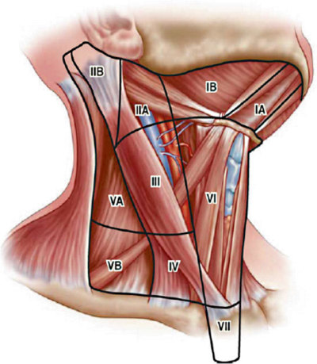

Unmatched source image; PDF page 458. Consult the original caption.

## PDF page 459 | printed page 449

Table 18.1 Risk of malignancy in Bethesda cytopathology of FNA categories

Pediatric FNA cytopathology Cancer risk mean% (range)

Nondiagnostic 14% (0–33)

Benign 6% (0–27)

Atypia of undetermined significance (AUS)

28% (11–54)

Follicular neoplasm (FN) 50% (28–100)

Suspicious for malignancy (SFM)

81% (40–100)

Malignant 98% (86–100)

Adopted from 2023 TBSRTC review [56]

63]. Identification of oncogenic variants asso ciated with either malignant or benign neo plasia (RAS, PTEN, or DICER1) [64] may not alter management; however, in the pres ence of reassuring sonographic features (com plex or solid composition with smooth margins, and no evidence of regional lymph node metastasis), the majority of DTC with these oncogenic driver alterations are associ ated with a low-risk for extrathyroidal disease [8] where lobectomy would be appropriate with further management based on the histo logic features of the nodule. Minimal and incomplete data exist to determine the reli ability of negative molecular testing results for excluding malignancy in children and ado lescents [65].

In children with FN cytology (TBSRTC IV), there appears to be approximately a 40–71% risk for DTC [57, 58]. Lobectomy has been the standard of care; however, similar to nodules with AUS cytology, somatic onco gene testing is being utilized to further inform DTC risk and management. TN lacking known mutations still carry a substantial DTC risk, and therefore, diagnostic lobec tomy continues to be recommended for all children with FN cytology. Total thyroidec tomy should be considered if the US is highly suspicious or if there are bilateral TN.

For children with FNA showing either SFM (TBSRTC V) or malignant (TBSRTC

Adult

FNA cytopathology Cancer risk mean% (range)

Nondiagnostic 13% (5–20)

Benign 4% (2–7)

Atypia of undetermined significance

22% (13–30)

Follicular neoplasm 30% (23–34)

Suspicious for malig nancy

74% (67–83)

Malignant 97% (97–100)

VI) cytopathology, the risk for DTC is near 100% [56, 57]. For this reason, total thyroidec tomy ± central neck dissection is recom mended [3]. The goal of performing a prophylactic central neck dissection is to define the invasive behavior of the cancer in order to stratify the use of radioactive iodine based on the ATA pediatric risk levels [3]. The surgical risks of total thyroidectomy are greater than those for lobectomy but are reduced if the surgery is performed by a highvolume thyroid surgeon (who performs at least 25 or more thyroid surgeries annually) [66, 67]. Total thyroidectomy requires lifelong thyroid hormone replacement with levothy roxine (LT4), while thyroid lobectomy usually does not require LT4 replacement [68].

### 18.3 Differentiated Thyroid

### Cancers

Only 1.8% of thyroid cancers develop in chil dren and adolescents, but the incidence has increased 2.3-fold over the last 40 years [69]. This increase cannot be entirely explained by detection of small, incidental lesions during unrelated imaging as the incidence of both intrathyroidal as well as thyroid cancer with regional and distant metastasis has increased over the same time frame [70]. Within pediat rics, DTC is the second most common cancer

### Automatic table extraction — verify rendered original

|Pediatric|Col2|Adult|Col4|
|---|---|---|---|
|**FNA cytopathology**|**Cancer risk mean%** **(range)**|**FNA cytopathology**|**Cancer risk mean%** **(range)**|
|Nondiagnostic|14% (0–33)|Nondiagnostic|13% (5–20)|
|Benign|6% (0–27)|Benign|4% (2–7)|
|Atypia of undetermined signifcance (AUS)|28% (11–54)|Atypia of undetermined signifcance|22% (13–30)|
|Follicular neoplasm (FN)|50% (28–100)|Follicular neoplasm|30% (23–34)|
|Suspicious for malignancy (SFM)|81% (40–100)|Suspicious for malig­ nancy|74% (67–83)|
|Malignant|98% (86–100)|Malignant|97% (97–100)|

[Original table](../../tables/ch018_p0459_1.jpg)

## PDF page 460 | printed page 450

of adolescent girls [71]. Adolescents have a tenfold greater incidence of DTC with a female/male preponderance (5:1) within this age group. Estimates from the SEER database report 5-year survival of 99.8% for children and adolescents with DTC confined to the thyroid and 97.1% for those with metastasis to regional lymph nodes [72]. For patients with intrathyroidal cancer and metastases limited to the cervical neck, overall remission rates are relatively high [73]. However, for patients with distant metastases, most often to the lungs, remission rates are low [74–77].

The treatment of children with DTC has evolved over time. In 1934, Schreiner and Murphy described DTC in children as a “fatal disease with few exceptions” [78]. Radioactive iodine (RAI) first came into use to treat DTC in 1946 [79]. In the 1980s, chil dren with DTC were sent for total thyroidec tomy but without preoperative staging, and lymph node dissection generally consisted of palpation to identify suspicious nodes that were removed by “berry picking,” leaving many with persistent disease. Essentially all children received RAI ablation, and the end point for treatment was to achieve no evi dence of disease (NED) based upon a nega tive RAI scan. Such treatment was effective, but was associated with a high risk for com plications and a risk of second malignancies. This high rate of complications and second malignancies along with other important dif ferences between DTC in children and adults prompted the creation of pediatric-specific treatment guidelines [3].

The major clinical differences between pediatric and adult DTC are: 1. TN are more likely to be malignant in chil

dren than in adults. 2. Children with PTC are more likely to have

### 18

regional lymph node involvement, extra thyroidal extension, and pulmonary metastases. 3. Children are less likely to die from disease

(2% long-term cause-specific mortality). 4. Many children with pulmonary metastases

(up to 93%) do not achieve remission; however, the majority develop stable, per sistent disease.

Long-term follow-up studies indicate that children with DTC have an increase in mor tality attributed to second malignancies that appear to be possibly related to the use of radiation and/or RAI [80]. For these reasons, the ATA Pediatric Guidelines suggest that the use of RAI should be stratified, limited to patients at risk for persistent, postsurgical dis ease and that the end point of therapy may not require NED in select patients, most nota bly patients categorized as ATA low-risk [3].

### 18.3.1 Papillary Thyroid Carcinoma

### (PTC)

18.3

13

32 81 There are increased data on somatic onco genic drivers to include relationship to age as well as invasive behavior. Fusion oncogenes (RET, NTRK, ALK, and BRAF) are more common in pubertal children and associated with an increased risk for regional LN and distant metastasis and BRAF V600E muta tions are more common in pubertal patients and associated with an increased risk for regional LN metastasis. Oncogenic altera tions associated with a lower risk for metasta sis (PTEN, DICER1, and RAS) are found across all pediatric age groups [8, 82].

There are six or more different forms of PTC with different variants correlating with somatic oncogenic alterations and invasive behavior. Classic (cPTC), solid (sPTC), dsvPTC, and inf-fvPTC are associated with a 50% or higher risk for LN metastases and most commonly associated with BRAF V600E

## PDF page 461 | printed page 451

(cPTC and sPTC) as well as fusion oncogenes (dsvPTC and inf-fvPTC) [1]. For patients with lateral neck LN metastases, there is a 15–20% risk for distant metastases, most commonly to the lungs [77]. In contrast, follicular variant PTC (fvPTC), in particular the invasiveencapsulated type (Ienc-fvPTC), have a lower risk for LN and distant metastases with RAS and DICER1 mutations and PAX8-PPARgamma fusions more common in Ienc-fvPTC and the BRAF V600E mutation being more common in inv-fvPTC [52, 83, 84].

2. Total thyroidectomy and central compart

### 18.3.1.1 Initial Therapy for PTC

### in Children

1. Preoperative staging is required to direct

initial management. Comprehensive neck US interrogating the contralateral thyroid lobe and the lymph nodes in the central and lateral neck compartments is the mainstay of preoperative radiologic imaging. Neck and Chest computerized tomography (CT) scan may be considered for patients found to have extensive lymph node metastases.

Because many children with PTC have cervical node involvement, preoperative US of the central and lateral neck is neces

sary to identify the lymph node compart ments that require dissection [54]. Contrast-enhanced neck CT or MRI should be considered for locally extensive disease. The use of iodinated contrast agents does not delay postoperative thera peutic RAI but one may consider obtain ing a urine iodine level, which should be <75 μg/L at the time of administration of radioiodine [85, 86].

ment lymph node dissection are generally recommended for PTC in children with the possible exception of invasive-encapsulatedfvPTC (Ienc-fvPTC) and PTC ≤ 2 cm in size without preoperative evidence of regional metastases (AJCC TNM N0b).

Total or near-total thyroidectomy (TT) is recommended for the majority of chil dren with TBSRTC category V or VI. Recurrence risks are tenfold greater if less extensive surgery is performed and three fold greater if inadequate lymph node dis section is performed [87, 88]. In both procedures, the left and right thyroid lobes, the pyramidal lobe (when present), and the isthmus are resected. However, in near-TT,

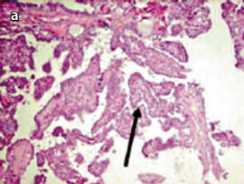

Unmatched source image; PDF page 461. Consult the original caption.

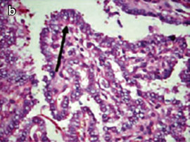

Unmatched source image; PDF page 461. Consult the original caption.

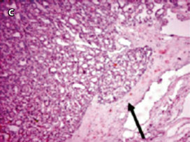

Unmatched source image; PDF page 461. Consult the original caption.

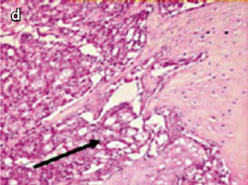

Unmatched source image; PDF page 461. Consult the original caption.

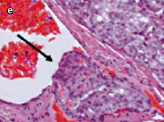

Unmatched source image; PDF page 461. Consult the original caption.

## PDF page 462 | printed page 452

a small amount of thyroid tissue (<1–2%) is frequently left at the entry of the recur rent laryngeal nerve (RLN) and/or supe rior parathyroids in an effort to decrease the risk of complications. TT is recom mended because children frequently have bilateral (38%) disease [89, 90] with an increased risk for recurrence when less extensive surgery is performed [91].

92

52

93

### 18

18.2

84 94 95

96

18.1 18.4 All lymph node dissections should be compartment-based because recurrence rates are higher when “berry picking” is performed [97]. Although TT and central neck dissection (CND) are associated with greater risks of hypoparathyroidism and recurrent laryngeal nerve injury [98], the risks are minimized when surgery is per formed by a high-volume thyroid surgeon [66, 67, 99].

18.2

3

1

91

3

18.4 The two most common surgical com plications are recurrent laryngeal nerve

## PDF page 463 | printed page 453

Table 18.2 AJCC TNM classification of DTC

Primary tumor (T)

TX Size not assessed, limited to the thyroid

T1 T1a ≤1 cm, limited to the thyroid

T1b >1 cm but ≤2 cm, limited to the thyroid

T2 >2 cm but ≤4 cm, limited to the thyroid

T3 >4 cm, limited to the thyroid, or any tumor with minimal extrathyroid extension

T4 T4a Tumor extends beyond the thyroid capsule to invade subcutaneous soft tissues, larynx, trachea, esophagus, or recurrent laryngeal nerve

T4b Tumor invades prevertebral fascia or encases carotid artery or mediastinal vessels

Lymph nodes (N)

NX Regional lymph nodes not assessed

N0 N0a ≥1 cytologically or histologically confirmed benign lymph nodes

N0b No radiologic or clinical evidence of locoregional lymph node metastasis

N1 N1a Metastasis to level VI (pretracheal, paratracheal, and prelaryngeal/Delphian lymph nodes)

N1b Metastasis to unilateral, bilateral, or contralateral cervical (levels I, II, III, IV, or V) or retropharyngeal or superior mediastinal lymph nodes (level VII)

Distant metastasis (M)

MX Distant metastasis not assessed

M0 No distant metastasis

M1 Distant metastasis

Reproduced with permission from Mary Ann Liebert Inc., New Rochelle, NY, USA

(RLN) damage and hypoparathyroidism. Damage to the RLN is associated with voice change secondary to injury to any of the external branches of the superior laryngeal nerves and/or the recurrent laryngeal nerves and can affect the strength, projection, and quality of the voice. Bilateral nerve injury may compro mise the airway with need for a tracheos tomy. With the availability and efficacy of RAI, as well as novel tyrosine kinase inhibitors, purposeful sacrifice of a RLN in an attempt to achieve surgical remission should be avoided. Careful visualization of all nerve branches and the use of elec trodes to identify and monitor nerve func tion during the procedure may help reduce

the risk of nerve injury [100, 101]. The risk of injury to the recurrent laryngeal nerve should be less than 3% with total thyroid ectomy [102].

Due to their small size and delicate blood supply, ischemic injury to the para thyroid glands may also occur. The risk of permanent hypocalcemia is rare with lobectomy and up 7% with total thyroidec tomy in children in pediatric thyroid cen ters [102]. Using an intracapsular approach for TT reduces the risk of damaging the blood supply to the superior parathyroid glands [103]. If the parathyroid glands appear threatened during surgery, auto transplantation into a sternocleidomas toid muscle should be performed. Intra- or

### Automatic table extraction — verify rendered original

|TX|Col2|Size not assessed, limited to the thyroid|
|---|---|---|
|T1|T1a|≤1cm, limited to the thyroid|
|T1|T1b|>1cm but≤2cm, limited to the thyroid|
|T2||>2cm but≤4cm, limited to the thyroid|
|T3||>4cm, limited to the thyroid, or any tumor with minimal extrathyroid extension|
|T4|T4a|Tumor extends beyond the thyroid capsule to invade subcutaneous soft tissues, larynx, trachea, esophagus, or recurrent laryngeal nerve|
|T4|T4b|Tumor invades prevertebral fascia or encases carotid artery or mediastinal vessels|

[Original table](../../tables/ch018_p0463_1.jpg)

### Automatic table extraction — verify rendered original

|NX|Col2|Regional lymph nodes not assessed|
|---|---|---|
|N0|N0a|≥1 cytologically or histologically confrmed benign lymph nodes|
|N0|N0b|No radiologic or clinical evidence of locoregional lymph node metastasis|
|N1|N1a|Metastasis to level VI (pretracheal, paratracheal, and prelaryngeal/Delphian lymph nodes)|
|N1|N1b|Metastasis to unilateral, bilateral, or contralateral cervical (levels I, II, III, IV, or V) or retropharyngeal or superior mediastinal lymph nodes (level VII)|

[Original table](../../tables/ch018_p0463_2.jpg)

### Automatic table extraction — verify rendered original

|MX|Col2|Distant metastasis not assessed|
|---|---|---|
|M0||No distant metastasis|
|M1||Distant metastasis|

[Original table](../../tables/ch018_p0463_3.jpg)

## PDF page 464 | printed page 454

perioperative parathyroid hormone (PTH) levels may help to identify those at greatest risk for postsurgical hypoparathyroidism [104, 105]. Postoperative hypocalcemia (occurring in up to 50% of patients) is treated with oral calcium and calcitriol. A low postoperative PTH predicts the need for treatment but does not predict the like lihood of permanent hypoparathyroidism [105]. 3. Stratification of RAI after initial surgery

1. ATA Pediatric Low Risk

### 18

18.5

3

18.2

Pediatric low-risk category includes disease grossly confined to the thyroid with no cervical lymph node disease (N0) or patients with <5 lymph nodes with metastatic disease from the central (level VI/VII) compartment (N1a) [94, 95, 106]. In patients that undergo lobectomy, uni lateral, multifocal disease does not appear to be a predictor of bilateral dis ease, especially in T1 tumors [95, 96]. A recent prospective study in adults [107] and a retrospective study in pediatrics confirm similarly excellent outcomes in

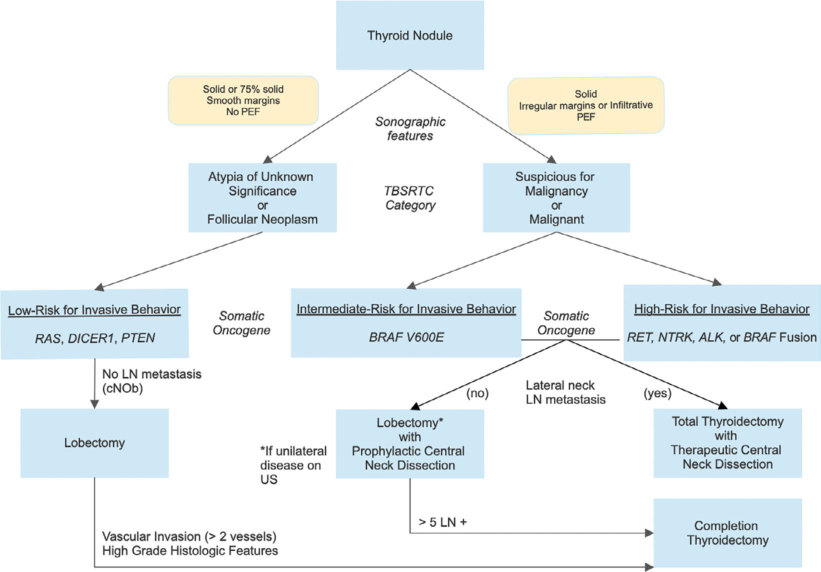

Unmatched source image; PDF page 464. Consult the original caption.

## PDF page 465 | printed page 455

low-risk patients that do not receive RAI therapy [108]. 2. ATA Pediatric Intermediate Risk

Pediatric intermediate-risk category includes N1a disease with between 6 and 10 metastatic lymph nodes or unilateral, lateral neck metastasis (N1b). The pres ence of extrathyroidal extension (micro scopic or gross) is also considered an intermediate risk for persistent postsurgi cal disease, especially if the initial surgery did not include a central neck lymph node dissection (CND) [106, 109]. 3. ATA Pediatric High Risk

Pediatric high-risk category includes >10 metastatic lymph nodes, bilateral lat eral neck metastasis (N1b), or distant

131

123

metastasis (M1) [106]. Patients in this group are at the highest risk for persistent postsurgical disease, including distant metastasis. For ATA pediatric intermedi ate- and high-risk patients, a TSHstimulated Tg and diagnostic RAI whole body scan (DxWBS) are recommended to determine if treatment with 131Iodine is warranted.

In patients without TgAb, the TSH-stimulated Tg (TSH > 30 mIU/L) is a reliable marker for evaluating persistent, residual disease with a TSH-stimulated Tg < 2 ng/mL having a 94.9% predictive value for the absence of persistent disease [110]. In TgAb-positive patients, the presence of TgAb alone cannot be interpreted

## PDF page 466 | printed page 456

as a sign of persistent disease with a greater need for reliance on radiologic and RAI-WBS imaging. RAI therapy may be avoided in TgAb-negative patients if the TSH-stimulated Tg is undetectable and there is no evidence of RAI activity on the DxWBS. There is an increased likelihood for distant metastasis in pediatric patients with a TSH-stimulated Tg of >156 ng/mL [111].

For patients where RAI is deemed to be beneficial, the TSH must be above 30 mIU/L to facilitate uptake. This can be induced by ~14 days of thyroid hormone withdrawal [112]. Alternately, recombinant human TSH (rhTSH) can be used for remnant ablation with RAI in low-risk patients; however, there are no studies confirming the effectiveness of this strategy for the treatment of persistent regional and distant metastasis in children [113]. A low-iodine diet is prescribed for 2 weeks prior to therapy (see www.thyca. org and www.lidlifecommunity.org). For children who received intravenous contrast during CT during the preoperative evalua tion, it is not necessary to delay RAI-WBS as long as it is 6–8 weeks after exposure to the iodinated contrast and the patient completes a low-iodine diet for 2 weeks prior to the WBS and potential 131I therapy. A 24-h urine iodine prior to administering RAI therapy can be considered if there is any concern with the goal <50 mg/24 h.

Selection of the administered activity (dose) of RAI is based on a number of fac tors, most importantly the Tg level as well as the location and amount of RAI avid disease on DxWBS. The initial extent of disease inva siveness should also be considered. In select ing the delivered 131I activity, some adjust 131I dose according to weight or body surface area (BSA) and give a fraction (e.g., child’s weight in kg/70 kg) based on the typical adult dose used to treat similar disease extent. Others suggest that 131I doses should be based entirely on body weight, with a general approach for typical 131I dosing for patients with persistent disease being 0.5–1.0 mCi/kg (max dose of 30–50 mCi) for thyroid bed/central neck activ ity, 1.0–1.5 mCi/kg (max dose 100 mCi) for lateral neck activity, and 1.5–2.5 mCi/kg (max dose 150 mCi) for pulmonary activity [3].

### 18

Dosimetry may be used to limit lung reten tion to <80 mCi at 48 h and blood/bone mar row exposure to <200 cGy and is useful in small children, children with diffuse lung uptake or significant distant metastases, chil dren who received chemotherapy or radiation therapy for other malignancies, and those undergoing multiple treatments. Lesional dosimetry can be performed in children with substantial lung involvement or large tumor burden at other sites, such as bone [114]. For patients that receive RAI therapy, a posttreat ment scan should be obtained 5–8 days after all RAI treatments [3]. For both the Dx and the post-RAI treatment WBS, the addition of SPECT/CT should be considered to clarify the anatomic location of metastatic disease if the information from the WBS is inadequate.

For patients that receive RAI therapy, a post-RAI treatment WBS (RxWBS) should be performed approximately 5–7 days after RAI therapy with up to 15% of scans showing a new area of uptake compared to the DxWBS secondary to increased sensitivity associated with a higher delivered RAI dose. Singlephoton emission computed tomography with integrated CT (SPECT-CT) should be com bined with the DxWBS or the post-RAI treat ment (RxWBS) to confirm RAI uptake in an unexpected location [115]. For patients with persistent lateral neck lymph node disease noted on the DxWBS, surgical dissection should be completed prior to RAI therapy, especially if there are multiple LNs > 1 cm in size [116].

### 18.3.1.2 Postoperative Dynamic Risk

### Stratification and Management

18.6 Response to the initial treatment is divided into the following categories; (1) excellent response, (2) biochemical incomplete response, (3) structural incomplete response, or (4) indeterminate response, collectively called dynamic risk stratification (DRS) [108].

## PDF page 467 | printed page 457

### Automatic table extraction — verify rendered original

|Increasing Tg or Tg > 10 ng/mL or TgAb > ULN and rising|Col2|Col3|
|---|---|---|
|Increasing Tg or Tg > 10 ng/mL _or_ TgAb > ULN and rising|||

[Original table](../../tables/ch018_p0467_1.jpg)

### Automatic table extraction — verify rendered original

|Col1|Negative|Col3|
|---|---|---|
|Positive|123I-Diagnostic Whole Body Scan w/TSH stimulated Tg _or_ Nuclear Medicine Radioisotope Imaging|Negative|
||||

[Original table](../../tables/ch018_p0467_2.jpg)

### Automatic table extraction — verify rendered original

|Category Total Thyroidectomy with RAI Total Thyroidectomy without RAI uTg < 0.2 ng/mL Tg < 2.5 ng/mL Excellent Response TgAb below ULN TgAb below ULN Negative neck US Negative neck US uTg < 0.9 ng/mL Tg < 2.5 ng/mL sTg < 10 ng/mL Indeterminate Response TgAb stable or declining TgAb stable or declining Negative imaging Negative imaging uTg ≥1 ng/mL Tg > 2.5 ng/mL sTg ≥10 ng/mL Biochemical Incomplete Response TgAb rising TgAb rising Negative imaging Negative imaging Structural Incomplete Response Positive imaging Positive imaging|Col2|Col3|
|---|---|---|
|Category|Total Thyroidectomy with RAI|Total Thyroidectomy without RAI|
|Excellent Response|uTg < 0.2 ng/mL TgAb below ULN Negative neck US|Tg < 2.5 ng/mL TgAb below ULN Negative neck US|
|Indeterminate Response|uTg < 0.9 ng/mL sTg < 10 ng/mL TgAb stable or declining Negative imaging|Tg < 2.5 ng/mL TgAb stable or declining Negative imaging|
|Biochemical Incomplete Response|uTg ≥1 ng/mL sTg ≥10 ng/mL TgAb rising Negative imaging|Tg > 2.5 ng/mL TgAb rising Negative imaging|
|Structural Incomplete Response|Positive imaging|Positive imaging|

[Original table](../../tables/ch018_p0467_3.jpg)

## PDF page 468 | printed page 458

The goal of DRS is to define remission and to determine if and when additional therapy is warranted based on biochemical (Tg and TgAb) and radiological data. In general, bio chemical data (TSH, Tg and TgAb) are fol lowed every 3–6 months and radiological imaging every 6 months, both with decreasing frequency if the data are reassuring for remis sion. Neck US is the first line for radiologic surveillance of the neck and non-contrast chest CT is the optimal radiological modality to follow patients with pulmonary metastasis. For a disease with slow growth, patience is an important path to pursue. This is highlighted by data showing that structural and biochemi cal response to initial RAI therapy may not be reached for up to 15–24 months, or longer, after treatment [117, 118].

large numbers of children or in lengthy stud ies. Potential risks of TSH suppression includ ing growth acceleration, advanced bone age, early onset puberty, reduced bone mineral content, poor academic performance, tac chyarrythmia, and others have been poorly studied, but are presumed to be minimal in otherwise healthy children, adolescents, and young adults [121]. 1. ATA Pediatric Low-Risk

Thyroglobulin may be measured using immunometric assays (IMA), radioimmuno assay (RIA), or by liquid chromatography dual-mass spectrometry (LC-MS/MS). Ultrasensitive assays have a lower detection limit of <0.1 ng/mL and are preferred to fol low disease status in patients with DTC [119]. Approximately 20–25% of patients will have an elevated TgAb titer that may interfere with accurate assessment of Tg levels. TgAb inter ference with IMA assays is the most signifi cant and almost always results in underestimation of Tg (i.e., a potentially false-negative test). In the majority of com mercial laboratories, if a Tg/TgAb panel is ordered, the lab will screen for TgAb and if elevated will run Tg by radioimmunoassay (RIA) or LC-MS/MS secondary to more accurate and reliable performance compared to IMA [119]. As a general rule, all specimens sent for Tg measurement in DTC patients require concomitant TgAb testing because TgAb status can change over time and even very low TgAb concentrations can interfere with assessment of disease status.

### 18

Postoperative TSH suppression is almost always prescribed for DTC in children, but optimal suppression is debated [120]. Some recommend initial TSH suppression to <0.1 μIU/mL and relaxation to 0.5 μIU/mL following remission [3]. However, none of these recommendations has been validated in

Radioactive iodine therapy does not appear to provide any benefit in regard to outcome for ATA pediatric low-risk patients and its use should be limited. Initial postoperative staging includes a TSH-suppressed serum thyroglobulin (Tg) with the interpretation of serum Tg based not only on the magnitude of serum Tg but its trend over time. Children who have undergone total thyroidectomy by an experienced thyroid surgeon may have an undetectable TSH-suppressed Tg within 6–12 months from surgery [108]. For this group of patients, neck US is adequate to surveil for anatomic disease, initially every 6 months extending to annually once remission is achieved. Remission is defined by an undetectable Tg and no evidence of anatomic disease on neck ultrasound.

108

122

## PDF page 469 | printed page 459

In these patients, if the TgAb is rising over time, radiological investigation with neck US and chest CT, followed by DxWBS if negative, should be pursued in an effort to find an explanation [123] ( Fig. 18.6). For patients that have undergone lobec tomy, US is the best modality to surveil for persistent or recurrent disease as the remaining health thyroid tissue continues to produce Tg. 2. ATA Pediatric Intermediate and High

Risk

Radiological Surveillance

Similar to ATA low-risk patients, cervical neck US is the mainstay for surveillance with assess ment of all levels of the neck critical to assess for persistent or recurrent disease. Excellent response in these risk categories is defined as an undetectable unstimulated Tg (obtained during TSH suppression) as well as neck US and, if applicable, distant anatomic imaging, most commonly chest CT without IV con trast. A TSH-stimulated Tg with a DxWBS may be considered in high-risk patients, but with broad availability of ultrasensitive Tg assays, this may not be a necessary procedure to define excellent response [119].

For patients found to have with persistent, cervical neck structural disease, repeat surgery should be considered rather than repeat RAI therapy. This is especially true if there are lymph nodes larger than 1 cm in size where RAI is less effective in achieving [116, 124]. In select patients, non-surgical chemical, ther mal, or radio-frequency ablation may be con sidered depending on local expertise [125–127]. If repeat surgery is considered, US-guided methylene-blue labeling prior to skin incision may aid the surgeon in finding the persistent disease.

In patients with pulmonary metastasis (M1), a limited number will achieve remission with RAI therapy. The exception where one RAI treatment may be adequate is in patients with pulmonary metastasis only noted on the initial WBS without anatomic correlation on dedicated chest CT [75]. For patients with anatomically detectable disease by dedicated

chest CT, a portion may achieve remission with repeated RAI dosing, however, some of these patients may demonstrate stable, persis tent disease with low disease-specific mortal ity and repeat RAI therapy is associated with an increased risk for RAI-induced pulmonary fibrosis [128, 129]. For patients with persistent pulmonary metastasis, some may progress decades after initial treatment with one large study reporting progression-free survival of 76% at 5 years, decreasing to 66% at 10 years from diagnosis [130]. A decision to give repeat dosing must be individualized based on ana tomic response after a typical observation period of 12 months or longer between dosing to fully assess the previous RAI treatment. More recent, contemporary data from multi ple institutes reports a low-likelihood of pedi atric patients with pulmonary metastasis achieving an excellent response even after multiple courses of RAI with an associated increased risk for pulmonary fibrosis as well as disease-specific mortality [74–76, 131].

A small percent of patients will develop anatomic progression, termed RAI-refractory disease, defined as [132, 133]: 1. Absence of RAI uptake in metastases 2. 131I uptake is present in some but not other

tumor foci 3. DTC metastasis progress despite 131I uptake 4. Progressive disease despite receiving a

cumulative dose of 131I > 600 mCi (adult data)

These patients should be considered for tyro sine-kinase inhibitory or oncogene-specific inhibitory therapy in consultation with a pedi atric oncologist with experience in treating pediatric patients with advanced, progressive thyroid cancer [134, 135]. Several of the drugs are associated with resensitization or enhanced sensitization to RAI with on-going research exploring if repeat RAI, post-systemic ther apy, is associated with increased efficacy and remission [136, 137].

As previously mentioned, children with diffuse pulmonary metastases and high RAI uptake in the lung are at risk for treatmentinduced pulmonary fibrosis. In these cases,

## PDF page 470 | printed page 460

lower single and cumulative 131Iodine activi ties may help limit radiation exposure to the adjacent normal lung parenchyma [114]. Serial chest CT every 6 months should be uti lized to determine the effect of RAI therapy on the lung metastasis as well as the surveil for potential development of pulmonary fibrosis. In general, pulmonary function testing (PFT) in children with lung metastases is not an effective tool to surveil for pulmonary metas tasis; however, PFTs should be considered for patients with pulmonary metastasis that develop non-exertional tachypnea with or without hypoxia.

Biochemical Surveillance

In conjunction with radiological imaging, the serum Tg is a critical component in the man agement of DTC, both at the initial postop erative staging and during long-term surveillance. At the same degree of TSH suppression, the Tg level obtained while the patient is on levothyroxine is thought to be the best predictor of changes in tumor mass [3, 119]. Therefore, monitoring of the TSHsuppressed Tg along with radiological moni toring is the ideal approach to detect recurrence or disease progression.

In ATA pediatric low risk patients, an unstimulated Tg defines biochemical remis sion. In ATA pediatric intermediate and high risk patients, a stimulated Tg may be consid ered to confirm remission based on studies reporting that an undetectable Tg on levothy roxine therapy may not always predict an undetectable TSH-stimulated Tg [138–140]. A minimally elevated Tg (<10 ng/mL) in chil dren should not automatically result in addi tional therapy unless there is other evidence for active disease, either anatomic localization of disease on radiological imaging or an increasing trend in serum Tg over at least 1 year of surveillance. Patients with DTC can have a continual decline in Tg over many years without additional therapy [118].

### 18

An increase in serum Tg assessed with sim ilar TSH levels indicates that progressive dis ease is likely. Restaging and appropriate treatment, whether medical (RAI or systemic therapy) and/or surgery, is based on the degree

of Tg elevation, the trend in Tg over time, and the results of radiological studies. When imag ing fails to confirm disease, the clinical impor tance of a low-level disease burden identified only by Tg in children is not clear, and there is no absolute serum Tg value above which empiric treatment is indicated.

### 18.3.2 Follicular Thyroid Carcinoma

### (FTC)

18.3 93 141

7 18 142 144

93

145

18.4

18.6

18

## PDF page 471 | printed page 461

informative in children with PTC, it should be considered in patients with angioinvasive FTC and oncocytic thyroid carcinoma if the Tg is elevated and the RAI-WBS is not infor mative [146].

### 18.3.3 Medullary Thyroid

### Carcinoma (MTC)

Medullary thyroid carcinoma (MTC) is a rare neuroendocrine malignancy that arises from the calcitonin-secreting, parafollicular C cells of the thyroid and comprises 5% or less of pediatric thyroid cancers per year [2]. Since it does not derive from the thyroid follicular epi thelium, MTC does not produce Tg or con centrate iodine and does not respond to TSH suppression or stimulation. However, MTC secretes calcitonin and carcinoembryonic antigen (CEA), both of which serve as excel lent tumor markers that are utilized in screening of disease onset, assessment of dis ease burden, and monitoring for recurrence/ progression in patients with treated disease.

2

18.3 MTC is characterized by a predictable, stepwise progression from C-cell hyperplasia to noninvasive, microscopic MTC and ulti mately to invasive, metastatic disease to regional lymph nodes and distant sites, most commonly the lungs, liver, and bone [147]. Genetic testing for RET mutations has been incorporated into routine clinical care and has ushered in an era wherein children and young adults with MEN2 rarely present with clinical MTC, unless they are members of a newly

identified MEN2A kindred or if they have MTC associated with MEN2B. Thus, most children with MEN2 (with the notable excep tion of MEN2B; see below) will be diagnosed via identification of a pathogenic RET muta tion prior to development of CCH or MTC. In adults, most MTC cases are sporadic, associ ated with somatic mutations in RET and RAS [2].

2 148

18.3

### 18.3.3.1 Multiple Endocrine

### Neoplasia 2A

MEN2A represents 95% or more of MEN2 cases, with de novo cases representing 10% or less of MEN2A. The triad of tumors associ ated with MEN2A includes MTC coupled with mutation specific risk to develop pheo chromocytoma (PHEO) and/or primary hyperparathyroidism (PHPT) [2, 148]. Several variants of MEN2A are also associated with a risk to develop cutaneous lichen amyloidosis (CLA) and/or Hirschsprung disease (HSCR) [2, 148]. Primarily diagnosed in adults, CLA is a skin disorder usually located in the inter scapular region of the upper back that is asso ciated with intense pruritus and, as a result of scratching, secondary skin changes and der mal amyloid deposition. HSCR is caused by the complete absence of neuronal ganglion cells (aganglionosis) from the myenteric (Auerbach) and submucosal (Meissner) plex

## PDF page 472 | printed page 462

Table 18.3 RET mutations and associated phenotype, ATA risk levels, timing of thyroidectomy, and surveillance

Exon Codon Associated syndromea

ATA risk level

8 533 MEN2A MOD

10 609 MEN2A MOD

611 MEN2A MOD

618 MEN2A MOD

620 MEN2A MOD

11 630 MEN2A MOD

631 MEN2A MOD

634 MEN2A H

666 MEN2A MOD

13 768 MEN2A MOD

790 MEN2A MOD

14 804 MEN2A MOD

15 883 MEN2B H

891 MOD

16 912 MEN2A MOD

918 MEN2B HST

Adapted from the 2015 ATA guidelines [2] ATA American Thyroid Association, Ctn/pref calcitonin/preference (denoting that timing of thyroidectomy can be determined by Ctn level and parent/patient preference), H high risk, HST highest risk, MTC medul lary thyroid carcinoma, MOD moderate risk, PHEO pheochromocytoma, PHPT primary hyperparathyroid ism a Classical MEN2A is associated with Exon 10, 11, and 14 mutations; MEN2A + chronic lichen amylodosis

is seen with Codon 634 and 804 mutations, MEN + Hirschsprung’s disease is seen with codon 609, 611, 618 and 620 mutations b Fractionated plasma or 24-h urine metanephrines c Albumin-adjusted calcium or ionized calcium

uses in variable lengths of the distal gastroin testinal tract.

### 18

### 18.3.3.2 Multiple Endocrine

147

18.3

MEN2B represents 5% or less of MEN2 cases and is characterized by the uniform early onset of MTC associated with pathogno

Age for thyroidectomy Age for PHEOb and PHPTc screening

Calcitonin/preference By 16 years

Calcitonin/preference By 16 years

Calcitonin/preference By 16 years

Calcitonin/preference By 16 years

Calcitonin/preference By 16 years

Calcitonin/preference By 16 years

Calcitonin/preference By 16 years

Age 5 years By 11 years

Calcitonin/preference By 16 years

Calcitonin/preference By 16 years

Calcitonin/preference By 16 years

Calcitonin/preference By 16 years

Age 5 years By 11 years

Calcitonin/preference By 16 years

Calcitonin/preference By 16 years

<1 year By 11 years

2 148

### Neoplasia 2B

### Automatic table extraction — verify rendered original

|Exon|Codon|Associated syndromea|ATA risk level|Age for thyroidectomy|Age for PHEOb and PHPTc screening|
|---|---|---|---|---|---|
|8|533|MEN2A|MOD|Calcitonin/preference|By 16years|
|10|609|MEN2A|MOD|Calcitonin/preference|By 16years|
|10|611|MEN2A|MOD|Calcitonin/preference|By 16years|
|10|618|MEN2A|MOD|Calcitonin/preference|By 16years|
|10|620|MEN2A|MOD|Calcitonin/preference|By 16years|
|11|630|MEN2A|MOD|Calcitonin/preference|By 16years|
|11|631|MEN2A|MOD|Calcitonin/preference|By 16years|
|11|634|MEN2A|H|Age 5years|By 11years|
|11|666|MEN2A|MOD|Calcitonin/preference|By 16years|
|13|768|MEN2A|MOD|Calcitonin/preference|By 16years|
|13|790|MEN2A|MOD|Calcitonin/preference|By 16years|
|14|804|MEN2A|MOD|Calcitonin/preference|By 16years|
|15|883|MEN2B|H|Age 5years|By 11years|
|15|891||MOD|Calcitonin/preference|By 16years|
|16|912|MEN2A|MOD|Calcitonin/preference|By 16years|
|16|918|MEN2B|HST|<1year|By 11years|

[Original table](../../tables/ch018_p0472_1.jpg)

## PDF page 473 | printed page 463

monic physical phenotype that includes alac rima (inability or decreased ability to produce tears), oral and conjunctival mucosal neuro mas, thickened lips, intestinal ganglioneuro matosis (constipation; pseudo-hirschsprung’s disease) with an increased risk for secondary megacolon, musculoskeletal abnormalities (Marfanoid body habitus, high-narrow long facies, arched palate, pectus excavatum, scoli osis, pes cavus, joint laxity, hypotonia, or proximal muscle weakness), and ophthalmo logic issues (mild ptosis, thickened and everted eyelids, and medullated corneal nerve fibers) [149, 150]. Patients with MEN2B may also experience failure to thrive, pubertal delay, and slipped capital femoral epiphysis. The earliest signs present in infancy, including, constipation, feeding problems, and an inabil ity to make tears (alacrima) with the facial features and oral mucosa typically noticeable near school age (5 years or later) [151]. PHPT is not a component of MEN2B.

MEN2B is due to a de novo RET mutation in >90% of cases, and >95% of MEN2B patients will have the pathognomonic M918 T RET mutation. MEN2B mutations may also include double RET mutations involving codon 804 and the A883F mutation, which may be associated with less aggressive MTC [2, 150].

### 18.3.3.3 Early Thyroidectomy

### in MEN2

After MTC metastasizes beyond the thyroid, it most often becomes an incurable disease that may ultimately shorten survival. Given our ability to diagnose MEN2 via predictive genetic testing, hereditary metastatic MTC is one of the malignancies that can be prevented via early thyroidectomy. When total thyroid ectomy is performed by an experienced sur geon prior to the onset of metastatic disease, children with MEN2 can achieve remission and have an excellent long-term outcome [152].

18.3

2 148 152

153 155

2 148

At the time of total thyroidectomy, a cen tral neck dissection is recommended for patients whose basal calcitonin is >40 pg/mL or for those in whom there is a clinical suspi cion for lymph node metastases. Contralateral neck dissection is considered if the basal serum calcitonin is >200 pg/mL and FNA of an ipsilateral lateral neck lymph node is posi tive [2, 148]. A preoperative serum calcitonin level >2000 pg/mL is associated with an increased risk for metastasis to the medias tum/lungs and >10,000 pg/mL to liver and bone [156].

### 18.3.3.4 Management of MTC

### in MEN2

As discussed above, total thyroidec tomy ± central neck dissection remains the mainstay of treatment for MTC. The exact surgical approach depends on the specific RET mutation as well as the primary tumor size, the calcitonin level, and the extent of neck disease identified on preoperative neck ultrasound [2, 148, 150]. The goal of early sur gery is to remove the thyroid when the disease is at the c-cell hyperplasia or microscopic MTC state as this is associated with a high likelihood of remission. Remission in MEN2B

## PDF page 474 | printed page 464

is often unattainable due to the fact that most surgeries in this population are therapeutic (instead of prophylactic or early), an unfortu nate reality resulting from the delayed diagno sis of MEN2B in most cases [149, 151, 152].

18

18

157 158

Case Study

An 11-year-old female is noted to have an enlarged posterior cervical lymph node follow ing a viral upper respiratory illness. She was treated with two courses of antibiotics and a short course of oral glucocorticoids. Despite resolution of the illness, the lymphadenopathy persisted for the following year. At that time she was referred for evaluation and physical examination revealed a right-sided 2 cm mobile, non-matted level III lymph node along with a few other “appropriate feeling” level II cervical lymph nodes. Thyroid palpation is normal as is the serum TSH (1.16 μIU/mL; reference range = 0.35–4.94 μIU/mL) and total T4 (6.7 μg/dL; reference range = 4.9–11.7 μg/dL).

### 18

18.7

3

3

2 152

18.3 When not diagnosed, and treated before the onset of metastatic disease, hereditary MTC is generally incurable yet may demon strate an indolent clinical course with stable disease over decades. A more aggressive clini cal course and poorer outcome can be pre dicted by a rapidly rising CEA out of proportion to calcitonin and a fast tumor marker doubling time [2]. For patients with a significant MTC burden and symptomatic or progressive metastatic disease, molecular tar geted therapies that inhibit RET or other receptor tyrosine kinases involved in angio genesis should be considered [159, 160]. These agents should also be considered for neoadju vant use (prior to surgery) in patients that present with widely invasive cervical neck dis ease where there is concern over an increased risk for surgical complications secondary to airway compromise, engulfment of the carotid sheath, or spread into the retrosternal com partment [134, 161].

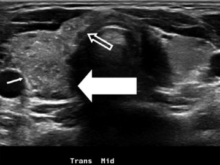

Unmatched source image; PDF page 474. Consult the original caption.

## PDF page 475 | printed page 465

increased. The findings are concerning for dif fusely infiltrative PTC.

18.8

18.8

FNA of the thyroid and one lymph node from right levels III and IV are positive for PTC with The Bethesda System for Reporting Thyroid Cytopathology category VI [141].

This case was selected as it represents a common presentation for PTC in children where a distinct thyroid nodule is not always seen, but instead, one encounters diffuse infil tration of the entire lobe or gland. This form of PTC can be distinguished from autoimmune thyroiditis secondary to the presence of too numerous to count punctate echogenic foci (microcalcifications) as well as a history of per sistent lymphadenopathy, especially in levels III and/or IV. The lymph nodes demonstrated typ ical findings for metastatic disease including rounded shape, increased echogenicity with

similar appearance to the primary, intrathyroi dal tumor, and peripheral blood flow on Doppler imaging.

18.9

Total thyroidectomy with bilateral central neck (level VI and VII) as well as right level III and IV lymph node dissection is performed. A total of 47/123 lymph nodes are positive for PTC metastasis. The tumor histology is classi fied as widely invasive follicular variant of PTC with the American Joint Commission on Cancer classification of T3N1b, clinical M1. This placed the patient in the ATA pediatric high risk for persistent disease and recurrence category for which RAI therapy is warranted.

123

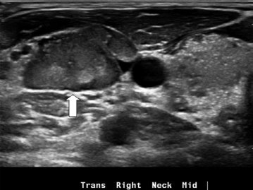

Unmatched source image; PDF page 475. Consult the original caption.

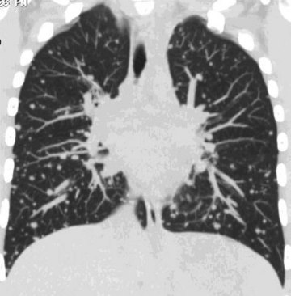

Unmatched source image; PDF page 475. Consult the original caption.

## PDF page 476 | printed page 466

diet × 2 weeks. A 24 h urine iodine level is per formed secondary to exposure to iodinated contrast for the neck CT and returns at 40 μg/24 h consistent with iodine insufficiency (100–460 μg/24 h reference range). Stimulated Tg (serum TSH of 61.26 μIU/mL) returns at 356 ng/mL by radioimmunoassay (RIA). The WBS scan reveals diffuse, bilateral lung activity ( Figs. 18.10 and 18.11). An empiric thera peutic dose of 131Iodine 105.0 mCi is adminis tered (2.5 mCi/kg, weight of 41 kg). Seven days later the post-therapy scan reveals the same activity as the diagnostic WBS with no new foci of activity.

The patient is placed on levothyroxine suppressive therapy with a plan to follow serum Tg levels every 3–6 months with repeat neck ultrasound and non-contrast chest CT

### 18

123

every 6 months with a plan to decrease the fre quency of surveillance if the data supports a trend toward remission. The family is coun seled that additional therapy may be neces sary as the current data suggests a very-low likelihood of remission for pediatric patients with pulmonary metastasis. For patients with stable, persistent disease, additional therapy may not be beneficial; however, for patients with progressive disease additional therapy, including incorporation of oncogene-specific inhibitory therapy, may be considered within the care of a high-volume pediatric thyroid center with expertise in using oncologic ther apy. The timing and type of additional ther apy will be determined based on the follow-up biochemical and anatomic radiological imag ing data.

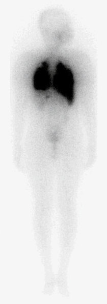

Unmatched source image; PDF page 476. Consult the original caption.

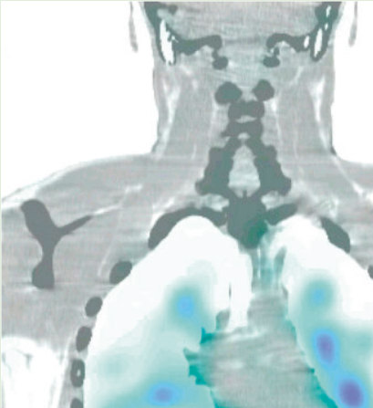

Unmatched source image; PDF page 476. Consult the original caption.

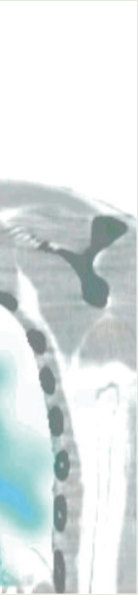

Unmatched source image; PDF page 476. Consult the original caption.

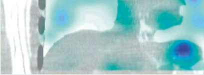

Unmatched source image; PDF page 476. Consult the original caption.

## PDF page 477 | printed page 467

### 18.4 Summary

There is an increased rate of malignancy for pediatric patients diagnosed with a thyroid nodule compared to an adult; however, the use of fine needle aspiration biopsy should be limited to nodules with indeterminate to higher risk sonographic features. For patients with differentiated thyroid cancer, the out come is excellent, but therapy must be indi vidualized in order to reduce the risk of treatment-associated complications. The approach to surgery should be stratified based on the ultrasound features, the cytology as well as the oncogenic driver (when available). For patients with unifocal nodules with inde terminate cytology, lobectomy should be con sidered. For patients with malignant cytology, total thyroidectomy is often pursued; how ever, lobectomy may be considered for patients with unifocal PTC without evidence of cervi cal neck lymph node metastasis. Data from the prophylactic, central neck lymph node dis section helps determine the invasive behavior of PTC and may be used to stratify comple tion thyroidectomy as well as radioiodine therapy, the later based on the ATA pediatric risk levels. Follow-up staging with Tg and TgAb levels, as well as radiological imaging, is used to assess response to therapy and iden tify children who may benefit from additional treatment. FTC in pediatrics is most com monly minimally invasive where lobectomy is adequate to achieve remission. In patients with angioinvasive FTC, long-term surveil lance is required as metastatic disease may not present for 5–10 years after initial surgery. MTC in pediatrics is most commonly associ ated with MEN2 with the timing of surgery and surveillance for associated pheochromo cytoma and hyperparathyroidism based on the specific germline codon mutation in the RET-protooncogene.

2. A 10-year-old male was diagnosed

3. A 12-year-old female has just under

Review Questions

1. A 10-year-old female was involved in a

motor vehicle collision and underwent head and neck CT. Incidental finding was a 1.5 cm lesion in the left lobe of the thyroid. Based on this information, you would do which of the following:

A. Hemi-thyroidectomy to remove

suspected PTC. B. Serum thyroglobulin level to deter

mine if this is PTC. C. An 123Iodine whole body scan to

look for PTC. D. A serum TSH and a thyroid/neck

ultrasound.

with PTC and underwent total thy roidectomy and central compartment lymph node dissection (classic PTC, T3N1aMx) with 7 of 15 LN positive for metastatic disease. Postoperative serum thyroglobulin was 2.3 ng/mL, and Tg antibody was 400 IU/mL (ref erence range < 0.9 IU/mL). Based on these data, you would do which of the following: A. Repeat the serum Tg level in

3 months to determine if this increases or decreases. B. Perform an FDG-PET scan to

look for persistent disease. C. Perform an 123Iodine whole body

scan to look for iodine-avid metas tases and serum Tg using radioim munoassay or liquid chromatography-tandem mass spectrometry. D. Place on TSH-suppressive therapy

and follow the Tg antibody trend.

gone total thyroidectomy and central compartment lymph node dissection for PTC and is found to have PTC in the right lobe of the thyroid and in 15/35 lymph nodes in the central (level VI and VII) and right lateral neck (lev els III and IV). Her postoperative stag ing includes a neck ultrasound that shows no evidence for persistent lymph node disease in her right lateral neck but several rounded, hypoechoic lymph nodes in her left lateral neck. Her serum thyroglobulin obtained while the TSH is suppressed is elevated (Tg, 324 ng/mL; TSH, 0.06 μIU/mL). Based on these data, you would do which of the following:

## PDF page 478 | printed page 468

### References

A. Repeat the serum Tg level in

3 months to determine if this increases or decreases. B. Perform an FDG-PET scan to

1. Faquin WC, Bauer AJ, Nga ME, Rossi

look for RAI-resistant disease. C. Perform an 123Iodine whole body

scan to look for iodine-avid pul monary metastases. D. Ask the surgeons to perform a lat

2. Wells SA Jr, et al. Revised American Thyroid

eral neck dissection on the left to remove suspected lateral neck metastases.

3. Francis GL, et al. Management guidelines for

### v Answers

1. D. The serum TSH will help to deter

mine if this is a hyperfunctioning lesion. The US will help define the sonographic features of the nodule that will aid in determining if FNA is warranted as well as assess for any sus picious cervical lymph nodes in the central (levels VI and VII) and lateral (levels II, III, IV, and V) neck. 2. C. A serum Tg level may be falsely low

4. Mussa A, et al. Predictors of malignancy in chil

5. Hayashida N, et al. Thyroid ultrasound findings

6. Bauer AJ. Thyroid nodules in children and ado

in the presence of anti-Tg antibodies even if one uses a radioimmunoassay or tandem mass spectrometry rather than immunochemiluminometric assay. Thus, the low Tg is less informative in the presence of elevated TgAb. With the pathology revealing seven lymph nodes positive for PTC metastasis (N1a), a whole body radioactive iodine scan should be considered. The WBS is not affected by the presence of anti-Tg anti bodies and may be informative to deter mine if the patient would benefit from radioiodine therapy. 3. C. Perform an 123Iodine whole body

7. Baran JA, et al. Indeterminate thyroid fine-needle

8. Franco AT, et al. Fusion oncogenes are associ

9. Vuong HG, et al. The use of the Bethesda System

10. Gupta A, et al. A standardized assessment of thy

11. Heinzel A, et al. The effect of surveillance for dif

scan to look for iodine-avid pulmonary metastases. This patient has a marked elevation in Tg while the TSH is sup pressed that is highly suggestive of residual disease. Lymph nodes after total thyroidectomy may be enlarged as a reaction to the surgery. Repeat neck surgery should not be performed unless the FNA confirms persistent disease with the extent of lateral neck LN dissection limited based on the FNA data.

### 18

12. Clement SC, et al. Balancing the benefits and

13. Bauer AJ. Clinical behavior and genetics of non

ED. Papillary thyroid carcinoma: endocrine tumors, thyroid epithelial tumors. In: WHO Classification of Tumours Editorial Board, Jarzembowski JA, editors. Pediatric tumors. Lyon, France: World Health Organization; International Agency for Research on Cancer; 2022.

Association guidelines for the management of medullary thyroid carcinoma. Thyroid. 2015;25(6):567–610.

children with thyroid nodules and differenti ated thyroid cancer. Thyroid. 2015;25(7):716–59.

dren with thyroid nodules. J Pediatr. 2015;167(4):886–892 e1.

in children from three Japanese prefectures: Aomori, Yamanashi and Nagasaki. PLoS One. 2013;8(12):e83220.

lescents. Curr Opin Endocrinol Diabetes Obes. 2019;26(5):266–74.

aspirations in pediatrics: exploring the clinico pathologic features and utility of molecular pro filing. Horm Res Paediatr. 2022;95:430.

ated with increased metastatic capacity and per sistent disease in pediatric thyroid cancers. J Clin Oncol. 2022;40(10):1081–90.

for reporting thyroid cytopathology in pediatric thyroid nodules: a meta-analysis. Thyroid. 2021;31(8):1203–11.

roid nodules in children confirms higher cancer prevalence than in adults. J Clin Endocrinol Metab. 2013;98(8):3238–45.

ferentiated thyroid carcinoma in childhood can cer survivors on survival rates: a decision-tree-based analysis. Endocr Connect. 2022;11:e220092.

harms of thyroid cancer surveillance in survivors of childhood, adolescent and young adult cancer: recommendations from the International Late Effects of Childhood Cancer Guideline Harmonization Group in collaboration with the PanCareSurFup Consortium. Cancer Treat Rev. 2018;63:28–39.

syndromic, familial nonmedullary thyroid cancer. Front Horm Res. 2013;41:141–8.

## PDF page 479 | printed page 469

14. Rosario PW, et al. Ultrasonographic screening for

thyroid cancer in siblings of patients with appar ently sporadic papillary carcinoma. Thyroid. 2012;22(8):805–8. 15. Baran JA, et al. The clinical spectrum of PTEN

31. van Iersel L, et al. Hypothalamic-pituitary and

hamartoma tumor syndrome: exploring the value of thyroid surveillance. Horm Res Paediatr. 2020;93(11–12):634–42. 16. Plitt G, et al. Development and progression of

32. Chemaitilly W, et al. Endocrine late effects in

33. Ron E, et al. Thyroid cancer after exposure to

thyroid disease in PTEN hamartoma tumor syn drome: refined surveillance recommendations. Thyroid. 2022;32(9):1094–100. 17. Schultz KAP, et al. DICER1 tumor predisposi

34. Ronckers CM, et al. Thyroid cancer in childhood

tion. In: Adam MP, et al., editors. GeneReviews®. Seattle, WA: University of Washigton; 1993. 18. Lee YA, et al. Predominant DICER1 pathogenic

35. Meadows AT, et al. Second neoplasms in survi

variants in pediatric follicular thyroid carcino mas. Thyroid. 2020;30(8):1120–31. 19. Khan NE, et al. Quantification of thyroid cancer

and multinodular goiter risk in the DICER1 syn drome: a family-based cohort study. J Clin Endocrinol Metab. 2017;102(5):1614–22. 20. Yen T, et al. APC-associated polyposis condi

36. Veiga LH, et al. Thyroid cancer after childhood

tions. In: Adam MP, et al., editors. GeneReviews®. Seattle, WA: University of Washington; 1993. 21. Smith JR, et al. Thyroid nodules in children with

37. Li Z, et al. Ultrasound surveillance for thyroid

familial adenomatous polyposis. Am J Gastroenterol. 2022;117(7):1166–8. 22. Pitsava G, Stratakis CA, Faucz FR. PRKAR1A

38. Sklar C, et al. Abnormalities of the thyroid in

and thyroid tumors. Cancers (Basel). 2021;13(15):3834. 23. Chernock RD, et al. Poorly differentiated thyroid

39. Clement SC, et al. A common genomic denomi

carcinoma of childhood and adolescence: a dis tinct entity characterized by DICER1 mutations. Mod Pathol. 2020;33(7):1264–74. 24. Jitpasutham T, et al. Thyroblastoma: a DICER1-

40. Keefe G, et al. Autoimmune thyroiditis and risk

associated embryonal neoplasm and fine needle aspiration diagnostic criteria. Diagn Cytopathol. 2023;51(5):E142–8. 25. Rooper LM. From malignant thyroid teratoma to

41. Corrias A, et al. Thyroid nodules and cancer in

thyroblastoma: evolution of a newly-recognized DICER1-associated malignancy. Adv Anat Pathol. 2023;30(2):136–45. 26. Niedziela M, et al. A prospective study of thyroid

42. Kovatch KJ, et al. Pediatric thyroid carcinoma in

nodular disease in children and adolescents in western Poland from 1996 to 2000 and the inci dence of thyroid carcinoma relative to iodine defi ciency and the Chernobyl disaster. Pediatr Blood Cancer. 2004;42(1):84–92. 27. Zhang X, et al. The relationship between urinary

43. Lee SJ, et al. Diagnostic performance of thyroid

iodine concentration and papillary thyroid can cer: a systematic review and meta-analysis. Front Endocrinol (Lausanne). 2022;13:1049423. 28. Pearce EN. Iodine deficiency in children. Endocr

44. Kambalapalli M, et al. Ultrasound characteris

Dev. 2014;26:130–8. 29. Hatch-McChesney A, Lieberman HR. Iodine and

45. Ly S, et al. Features and outcome of autonomous

iodine deficiency: a comprehensive review of a reemerging issue. Nutrients. 2022;14(17):3474. 30. Schneider AB, et al. Thyroid nodules in the fol

46. Hodax

low-up of irradiated individuals: comparison of

thyroid ultrasound with scanning and palpation. J Clin Endocrinol Metab. 1997;82(12):4020–7.

other endocrine surveillance among childhood cancer survivors. Endocr Rev. 2022;43(5):794–823.

childhood cancer survivors. J Clin Oncol. 2018;36(21):2153–9.

external radiation: a pooled analysis of seven studies. Radiat Res. 1995;141(3):259–77.

cancer survivors: a detailed evaluation of radia tion dose response and its modifiers. Radiat Res. 2006;166(4):618–28.

vors of childhood cancer: findings from the Childhood Cancer Survivor Study cohort. J Clin Oncol. 2009;27(14):2356–62.

exposure to external radiation: an updated pooled analysis of 12 studies. Radiat Res. 2016;185(5):473–84.

malignancies in survivors of childhood cancer following radiotherapy: a single institutional experience. Thyroid. 2014;24(12):1796–805.

survivors of Hodgkin’s disease: data from the Childhood Cancer Survivor Study. J Clin Endocrinol Metab. 2000;85(9):3227–32.

nator for neuroblastoma and differentiated thy roid carcinoma? A case series in children. Clin Oncol (R Coll Radiol). 2022;34(7):e318–9.

of malignancy in children with thyroid nodules. Thyroid. 2022;32(9):1109–17.

children and adolescents affected by autoimmune thyroiditis. Arch Pediatr Adolesc Med. 2008;162(6):526–31.

patients with Graves’ disease: the role of ultra sound in selecting patients for definitive therapy. Horm Res Paediatr. 2015;83(6):408–13.

ultrasonography screening in pediatric patients with a hypothyroid, hyperthyroid or euthyroid goiter. Pediatr Radiol. 2016;46(1):104–11.

tics of the thyroid in children and adolescents with goiter: a single center experience. Thyroid. 2015;25(2):176–82.

thyroid nodules in children: 31 consecutive patients seen at a single center. J Clin Endocrinol Metab. 2016;101(10):3856–62. JK, Reinert SE, Quintos JB. Autonomously functioning thyroid nodules

## PDF page 480 | printed page 470

in patients <21 years of age: the Rhode Island Hospital experience from 2003–2013. Endocr Pract. 2016;22(3):328–37. 47. Rosario PW, de Castro Nicolau T. Report of one

61. Pace-Asciak P, Tufano RP. Future directions in

62. Buryk MA, et al. Preoperative cytology with

case of malignancy among 17 autonomous thy roid nodules in children and adolescents. J Paediatr Child Health. 2021;57(6):810–2. 48. Kim PH, et al. Diagnostic performance of adult-

63. Mostoufi-Moab S, et al. Molecular testing for

based ATA and ACR-TIRADS ultrasound risk stratification systems in pediatric thyroid nodules: a systematic review and meta-analysis. Eur Radiol. 2021;31(10):7450–63. 49. Leboulleux S, et al. Ultrasound criteria of malig

64. Goldner WS, et al. Molecular variants and their

nancy for cervical lymph nodes in patients fol lowed up for differentiated thyroid cancer. J Clin Endocrinol Metab. 2007;92(9):3590–4. 50. Navallas M, et al. Utility of sonography for iden

65. Gallant JN, et al. Evaluation of the molecular

tifying metastatic cervical adenopathy in children with differentiated thyroid carcinoma at presenta tion. Pediatr Radiol. 2021;51(2):273–81. 51. Wang X, et al. Differential diagnosis of diffuse

66. Adam MA, et al. Is there a minimum number of

sclerotic thyroid papillary carcinoma and Hashimoto’s thyroiditis using fine-needle aspira tion cytology, BRAF(V600E), and ultrasound elastography. J Clin Ultrasound. 2022;50(7):942–50. 52. Halada S, et al. Clinicopathologic characteristics

67. Baumgarten HD, et al. Surgical management of

of pediatric follicular variant of papillary thyroid carcinoma subtypes: a retrospective cohort study. Thyroid. 2022;32(11):1353–61. 53. Pillai S, et al. Diffuse sclerosing variant of papil

68. Baran JA, et al. Clinical course of early postop

69. Vaccarella S, et al. Global patterns and trends in

lary thyroid carcinoma—an update of its clinico pathological features and molecular biology. Crit Rev Oncol Hematol. 2015;94(1):64–73. 54. Yeh MW, et al. American Thyroid Association

70. Bernier MO, Kitahara CM, Shiels MS. Reply to

statement on preoperative imaging for thyroid cancer surgery. Thyroid. 2015;25(1):3–14. 55. Boi F, et al. The diagnostic value for differenti

ated thyroid carcinoma metastases of thyroglobu lin (Tg) measurement in washout fluid from fine-needle aspiration biopsy of neck lymph nodes is maintained in the presence of circulating anti-Tg antibodies. J Clin Endocrinol Metab. 2006;91(4):1364–9. 56. Ali SZ, et al. The 2023 Bethesda System for

71. Wu XC, et al. Cancer incidence in adolescents

72. Siegel RL, Miller KD, Jemal A. Cancer statistics,

reporting thyroid cytopathology. Thyroid. 2023;33(9):1039–44. 57. Jia MR, et al. Utility of fine-needle aspirations to

73. Sugino K, et al. Papillary thyroid carcinoma in

diagnose pediatric thyroid nodules. Horm Res Paediatr. 2021;94(7–8):263–74. 58. Cherella CE, et al. Differences in thyroid nodule

### 18

74. Alzahrani AS, et al. Lung metastasis in pediatric

cytology and malignancy risk between children and adults. Thyroid. 2019;29(8):1097–104. 59. Deniwar A, et al. Optimal timing for a repeat

fine-needle aspiration biopsy of thyroid nodule following an initial nondiagnostic fine-needle aspiration. Am J Surg. 2017;213(2):433–7. 60. Stan MN, et al. Nonsurgical management of thy

75. Chesover AD, et al. Lung metastasis in children

roid nodules: the role of ablative therapies. J Clin Endocrinol Metabol. 2021;107(5):1417–30.

76. Sugino K, et al. Distant metastasis in pediatric

the treatment of thyroid and parathyroid disease. Otolaryngol Clin N Am. 2024;57(1):155–70.

molecular analysis to help guide surgery for pediatric thyroid nodules. Int J Pediatr Otorhinolaryngol. 2013;77(10):1697–700.

oncogenic gene alterations in pediatric thyroid lesions. Thyroid. 2018;28(1):60–7.

risks for malignancy in cytologically indetermi nate thyroid nodules. Thyroid. 2019;29(11):1594–605.

landscape of pediatric thyroid nodules and use of a multigene genomic classifier in children. JAMA Oncol. 2022;8(9):1323–7.

thyroidectomies a surgeon should perform to optimize patient outcomes? Ann Surg. 2017;265(2):402–7.

pediatric thyroid disease: complication rates after thyroidectomy at the Children’s Hospital of Philadelphia high-volume Pediatric Thyroid Center. J Pediatr Surg. 2019;54(10):1969–75.

erative hypothyroidism following thyroid lobec tomy in pediatrics. Thyroid. 2021;31(12):1786–93.

incidence and mortality of thyroid cancer in chil dren and adolescents: a population-based study. Lancet Diabetes Endocrinol. 2021;9(3):144–52.

Natural history of thyroid cancer suggests begin ning of the overdiagnosis of juvenile thyroid can cer in the United States and harm of overdiagnosis or extremely early diagnosis behind trends in pediatric thyroid cancer. Cancer. 2019;125(22):4109–10.

and young adults in the United States, 1992–1997. J Adolesc Health. 2003;32(6):405–15.

2020. CA Cancer J Clin. 2020;70(1):7–30.

children and adolescents: long-term follow-up and clinical characteristics. World J Surg. 2015;39(9):2259–65.

thyroid cancer: radiological pattern, molecular genetics, response to therapy, and outcome. J Clin Endocrinol Metab. 2019;104(1):103–10.

with differentiated thyroid cancer: factors associ ated with diagnosis and outcomes of therapy. Thyroid. 2021;31(1):50–60.

and adolescent differentiated thyroid cancer: clin

## PDF page 481 | printed page 471

ical outcomes and risk factor analyses. J Clin Endocrinol Metab. 2020;105(11):e3981. 77. Nies M, et al. Distant metastases from childhood

91. Jarzab B, et al. Multivariate analysis of prognos

differentiated thyroid carcinoma: clinical course and mutational landscape. J Clin Endocrinol Metab. 2021;106(4):e1683–97. 78. Schreiner BF, Murphy WT. Malignant neoplasms

92. Stein E, et al. The 2015 American Thyroid

of the thyroid gland. Ann Surg. 1934;99(1):116–25. 79. Seidlin SM, Marinelli LD, Oshry E. Radioactive

93. Christofer Juhlin C, Mete O, Baloch ZW. The

iodine therapy; effect on functioning metastases of adenocarcinoma of the thyroid. JAMA J Am Med Assoc. 1946;132(14):838–47. 80. Pasqual E, et al. Association between radioactive

94. Sugino K, et al. Risk stratification of pediatric

iodine treatment for pediatric and young adult hood differentiated thyroid cancer and risk of second primary malignancies. J Clin Oncol. 2022;40(13):1439–49. 81. Tucker MA, et al. Therapeutic radiation at a

95. Sudoko CK, et al. Thyroid lobectomy for T1 pap

young age is linked to secondary thyroid cancer. The Late Effects Study Group. Cancer Res. 1991;51(11):2885–8. 82. Pekova B, et al. RET, NTRK, ALK, BRAF, and

96. Scholfield DW, et al. Is multifocality a predictor

MET fusions in a large cohort of pediatric papil lary thyroid carcinomas. Thyroid. 2020;30(12):1771–80. 83. Kluijfhout WP, et al. Is it time to reconsider

97. Musacchio MJ, et al. Greater local recurrence

lobectomy in low-risk paediatric thyroid cancer? Clin Endocrinol. 2017;86(4):591–6. 84. Samuels SL, et al. Characteristics of follicular

98. Machens A, et al. Impact of central node dissec

variant papillary thyroid carcinoma in a pediatric cohort. J Clin Endocrinol Metab. 2018;103(4):1639–48. 85. Sohn SY, et al. The impact of iodinated contrast

99. Wu SY, et al. Risks of hypoparathyroidism after

agent administered during preoperative com puted tomography scan on body iodine pool in patients with differentiated thyroid cancer pre paring for radioactive iodine treatment. Thyroid. 2014;24(5):872–7. 86. Mishra A, et al. Preoperative contrast-enhanced

100. Zhang D, et al. Optimal monitoring technology

101. Diercks GR, et al. Pediatric intraoperative nerve

computerized tomography should not delay radioiodine ablation in differentiated thyroid car cinoma patients. J Surg Res. 2015;193(2):731–7. 87. Hay ID, et al. Long-term outcome in 215 children

and adolescents with papillary thyroid cancer treated during 1940 through 2008. World J Surg. 2010;34(6):1192–202. 88. Hay ID, et al. Papillary thyroid carcinoma (PTC)

102. Maksimoski M, et al. Outcomes in pediatric thy

in children and adults: comparison of initial pre sentation and long-term postoperative outcome in 4432 patients consecutively treated at the Mayo Clinic during eight decades (1936–2015). World J Surg. 2018;42(2):329–42. 89. Banik GL, et al. Prevalence and risk factors for

103. Nobori M, et al. Blood supply of the parathyroid

104. Patel NA, et al. A clinical pathway for the postop

multifocality in pediatric thyroid cancer. JAMA Otolaryngol Head Neck Surg. 2021;147:1100. 90. Baumgarten H, et al. Bilateral papillary thyroid

105. Tsai SD, et al. Clinical utility of intraoperative

cancer in children: risk factors and frequency of postoperative diagnosis. J Pediatr Surg. 2020;55(6):1117–22.

tic factors for differentiated thyroid carcinoma in children. Eur J Nucl Med. 2000;27(7):833–41.

Association guidelines and trends in hemithyroid ectomy utilization for pediatric thyroid cancer. Head Neck. 2022;44:1833.

2022 WHO classification of thyroid tumors: novel concepts in nomenclature and grading. Endocr Relat Cancer. 2023;30(2):e220293.

patients with differentiated thyroid cancer: is total thyroidectomy necessary for patients at any risk? Thyroid. 2020;30(4):548–56.

illary thyroid carcinoma in pediatric patients. JAMA Otolaryngol Head Neck Surg. 2021;147:943.

of poor outcome in childhood and adolescent papillary thyroid carcinoma? J Clin Endocrinol Metab. 2023;108:3135.

occurs with “berry picking” than neck dissection in thyroid cancer. Am Surg. 2003;69(3):191–6; discussion 196–7.

tion on postoperative morbidity in pediatric patients with suspected or proven thyroid cancer. Surgery. 2016;160(2):484–92.

total thyroidectomy in children: a 21-year experi ence in a high-volume cancer center. World J Surg. 2020;44(2):442–51.

for pediatric thyroidectomy. Cancers (Basel). 2022;14(11):2586.

monitoring during thyroid surgery: a review from the American Head and Neck Society Endocrine Surgery Section and the International Neural Monitoring Study Group. Head Neck. 2022;44:1468.

roidectomy: results from a multinational, multiinstitutional database. Otolaryngol Head Neck Surg. 2022;167(5):869–76.

gland from the superior thyroid artery. Surgery. 1994;115(4):417–23.

erative management of hypocalcemia after pedi atric thyroidectomy reduces blood draws. Int J Pediatr Otorhinolaryngol. 2018;105:132–7.

parathyroid hormone measurement in children and adolescents undergoing total thyroidectomy. Front Endocrinol (Lausanne). 2019;10:760.

## PDF page 482 | printed page 472

106. Jeon MJ, et al. Practical initial risk stratification

119. Spencer CA. Laboratory thyroid tests: a histori

based on lymph node metastases in pediatric and adolescent differentiated thyroid cancer. Thyroid. 2018;28(2):193–200. 107. Leboulleux S, et al. Thyroidectomy without

120. Biondi B, Cooper DS. Thyroid hormone suppres

radioiodine in patients with low-risk thyroid can cer. N Engl J Med. 2022;386(10):923–32. 108. Bojarsky M, et al. Outcomes of ATA low-risk

121. Zanella AB, et al. Effect of suppressive levothy

pediatric thyroid cancer patients not treated with radioactive iodine therapy. J Clin Endocrinol Metab. 2023;108:3338. 109. Jain NK, et al. Extrathyroidal extension is an

122. Spencer C, Fatemi S. Thyroglobulin antibody

important predictor of regional lymph node metastasis in pediatric differentiated thyroid can cer. Thyroid. 2020;30(7):1037–43. 110. Lee JI, et al. Postoperative-stimulated serum thy

123. Lee ZJO, Eslick GD, Edirimanne S. Investigating

roglobulin measured at the time of 131I ablation is useful for the prediction of disease status in patients with differentiated thyroid carcinoma. Surgery. 2013;153(6):828–35. 111. Liu L, et al. Detection of distant metastasis at the

124. Hirsch D, et al. Second radioiodine treatment:

time of ablation in children with differentiated thyroid cancer: the value of pre-ablation stimu lated thyroglobulin. J Pediatr Endocrinol Metab. 2018;31(7):751–6. 112. Kuijt WJ, Huang SA. Children with differentiated

125. Kandil E, Issa PP, Randolph GW. Can thyroid

thyroid cancer achieve adequate hyperthyrotro pinemia within 14 days of levothyroxine with drawal. J Clin Endocrinol Metab. 2005;90(11):6123–5. 113. Luster M, et al. Recombinant thyrotropin use in

126. Zhu Y, et al. Thermal ablation for cervical lymph

127. Frich PS, et al. Long-term efficacy of ethanol

children and adolescents with differentiated thy roid cancer: a multicenter retrospective study. J Clin Endocrinol Metab. 2009;94(10):3948–53. 114. Verburg FA, Hanscheid H, Luster M. Radioactive

128. Chen L, et al. Pulmonary fibrosis following radio

iodine (RAI) therapy for metastatic differentiated thyroid cancer. Best Pract Res Clin Endocrinol Metab. 2017;31(3):279–90. 115. Xue YL, et al. Value of 131I SPECT/CT for the

129. Hebestreit H, et al. Pulmonary fibrosis in youth

evaluation of differentiated thyroid cancer: a sys tematic review of the literature. Eur J Nucl Med Mol Imaging. 2013;40(5):768–78. 116. Haugen BR, et al. 2015 American Thyroid

130. La Quaglia MP, et al. Differentiated thyroid can

Association Management Guidelines for adult patients with thyroid nodules and differentiated thyroid cancer: the American Thyroid Association Guidelines Task Force on Thyroid Nodules and Differentiated Thyroid Cancer. Thyroid. 2016;26(1):1–133. 117. Biko J, et al. Favourable course of disease after

### 18

131. Nies M, et al. Distant metastases from childhood

incomplete remission on (131)I therapy in chil dren with pulmonary metastases of papillary thy roid carcinoma: 10 years follow-up. Eur J Nucl Med Mol Imaging. 2011;38(4):651–5. 118. Padovani RP, et al. Even without additional ther

132. Van Nostrand D. Radioiodine refractory differ

apy, serum thyroglobulin concentrations often decline for years after total thyroidectomy and radioactive remnant ablation in patients with dif ferentiated thyroid cancer. Thyroid. 2012;22(8):778–83.

133. Shonka DC Jr, et al. American Head and Neck

cal perspective. Thyroid. 2023;33(4):407–19.

sion therapy. Endocrinol Metab Clin N Am. 2019;48(1):227–37.

roxine therapy on bone mineral density in young patients with differentiated thyroid carcinoma. Metabolites. 2022;12(9):842.

(TgAb) methods—strengths, pitfalls and clinical utility for monitoring TgAb-positive patients with differentiated thyroid cancer. Best Pract Res Clin Endocrinol Metab. 2013;27(5):701–12.

antithyroglobulin antibody as a prognostic marker for differentiated thyroid cancer: a metaanalysis and systematic review. Thyroid. 2020;30(11):1601–12.

limited benefit for differentiated thyroid cancer with locoregional persistent disease. J Clin Endocrinol Metab. 2018;103(2):469–76.

nodules be managed with radiofrequency abla tion? Adv Surg. 2023;57(1):87–101.

node metastasis from papillary thyroid carci noma: a meta-analysis. Medicine (Baltimore). 2022;101(51):e32193.

ablation as treatment of metastatic lymph nodes from papillary thyroid carcinoma. J Clin Endocrinol Metab. 2022;107(5):e2141–7.

iodine therapy of pulmonary metastases from dif ferentiated thyroid carcinoma. Thyroid. 2010;20(3):337–40.

treated with radioiodine for juvenile thyroid can cer and lung metastases after Chernobyl. Eur J Nucl Med Mol Imaging. 2011;38(9):1683–90.

cer: clinical characteristics, treatment, and out come in patients under 21 years of age who present with distant metastases. A report from the Surgical Discipline Committee of the Children’s Cancer Group. J Pediatr Surg. 2000;35(6):955–9; discussion 960.

DTC—Supplemental Material. In: Figshare. Online resource; 2020.

entiated thyroid cancer: time to update the classi fications. Thyroid. 2018;28(9):1083–93.

Society Endocrine Surgery Section and International Thyroid Oncology Group consen sus statement on mutational testing in thyroid cancer: defining advanced thyroid cancer and its

## PDF page 483 | printed page 473

targeted treatment. Head Neck. 2022;44(6):1277–300. 134. Kazahaya K, et al. Targeted oncogene therapy

148. van Treijen MJC, et al. Multiple endocrine neo

before surgery in pediatric patients with advanced invasive thyroid cancer at initial presentation: is it time for a paradigm shift? JAMA Otolaryngol Head Neck Surg. 2020;146(8):748–53. 135. Waguespack SG, et al. Larotrectinib before initial

149. Wray CJ, et al. Failure to recognize multiple

radioactive iodine therapy in pediatric TRK fusion-positive papillary thyroid carcinoma: time to reconsider the treatment paradigm for dis tantly metastatic disease? JCO Precis Oncol. 2022;6:e2100467. 136. Lee YA, et al. NTRK and RET fusion-directed

150. Castinetti F, et al. A comprehensive review on

151. Brauckhoff M, et al. Premonitory symptoms pre

therapy in pediatric thyroid cancer yields a tumor response and radioiodine uptake. J Clin Invest. 2021;131(18):e144847. 137. Franco AT, et al. Oncogene-specific inhibition in

152. Castinetti F, et al. Natural history, treatment, and

the treatment of advanced pediatric thyroid can cer. J Clin Invest. 2021;131(18):e152696. 138. Zanella AB, et al. Dynamic risk stratification in

the follow-up of children and adolescents with differentiated thyroid cancer. Thyroid. 2018;28(10):1285–92. 139. Klain M, et al. Risk of structural persistent dis

153. Verga U, et al. Normal range of calcitonin in chil

ease in pediatric patients with low or intermediate risk differentiated thyroid cancer. Endocrine. 2021;71(2):378–84. 140. Cistaro A, et al. Prognostic factors in children

154. Castagna MG, et al. Reference range of serum

155. Eckelt F, et al. Calcitonin measurement in pediat

and adolescents with differentiated thyroid carci noma treated with total thyroidectomy and RAI: a real-life multicentric study. Eur J Nucl Med Mol Imaging. 2022;49(4):1374–85. 141. Baloch ZW, et al. Overview of the 2022 WHO

156. Machens A, Dralle H. Biomarker-based risk

classification of thyroid neoplasms. Endocr Pathol. 2022;33(1):27–63. 142. Laury AR, et al. Thyroid pathology in PTEN-

hamartoma tumor syndrome: characteristic find ings of a distinct entity. Thyroid. 2011;21(2):135–44. 143. Yoo SK, et al. Comprehensive analysis of the

157. Califano I, et al. Prospective study on the clinical

transcriptional and mutational landscape of fol licular and papillary thyroid cancers. PLoS Genet. 2016;12(8):e1006239. 144. Wasserman JD, et al. DICER1 mutations are fre

158. Araz M, et al. The role of (18)F-FDOPA

quent in adolescent-onset papillary thyroid carci noma. J Clin Endocrinol Metab. 2018;103(5):2009–15. 145. Yamazaki H, et al. Encapsulated angioinvasive

159. Vodopivec DM, Hu MI. RET kinase inhibitors

follicular thyroid carcinoma: prognostic impact of the extent of vascular invasion. Ann Surg Oncol. 2022;29:4236. 146. Marcus C, et al. PET/CT in the management of

160. Contrera KJ, et al. Neoadjuvant selective RET

thyroid cancers. AJR Am J Roentgenol. 2014;202(6):1316–29. 147. Waguespack SG, et al. Management of medullary

161. Hillier K, et al. A novel ALK fusion in pediatric

thyroid carcinoma and MEN2 syndromes in

childhood. Nat Rev Endocrinol. 2011;7(10):596–607.

plasia type 2. In: Feingold KR, et al., editors. Endotext. South Dartmouth, MA: MDText.com, Inc; 2000.

endocrine neoplasia 2B: more common than we think? Ann Surg Oncol. 2008;15(1):293–301.

MEN2B. Endocr Relat Cancer. 2018;25(2):T29–39.

ceding metastatic medullary thyroid cancer in MEN 2B: an exploratory analysis. Surgery. 2008;144(6):1044–50; discussion 1050–3.

long-term follow up of patients with multiple endocrine neoplasia type 2B: an international, multicentre, retrospective study. Lancet Diabetes Endocrinol. 2019;7(3):213–20.

dren measured by a chemiluminescent two-site immunometric assay. Horm Res. 2006;66(1):17–20.

calcitonin in pediatric population. J Clin Endocrinol Metab. 2015;100(5):1780–4.

rics: reference ranges are gender-dependent, vali dation in medullary thyroid cancer and thyroid diseases. Clin Chem Lab Med. 2019;57(8):1242–50.

stratification for previously untreated medullary thyroid cancer. J Clin Endocrinol Metab. 2010;95(6):2655–63.

relevance of (18)F-DOPA positron emission tomography/computed tomography in patients with medullary thyroid carcinoma. Endocrine. 2022;77(1):143–50.

PET/CT in recurrent medullary thyroid can cer patients with elevated serum calcitonin levels. Mol Imaging Radionucl Ther. 2023;32(1):1–7.

for RET-altered thyroid cancers. Ther Adv Med Oncol. 2022;14:17588359221101691.

inhibitor for medullary thyroid cancer: a case series. Thyroid. 2023;33(1):129–32.

medullary thyroid carcinoma. Thyroid. 2019;29(11):1704–7.
