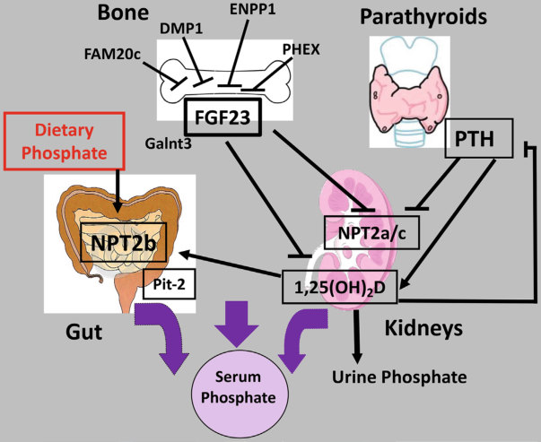
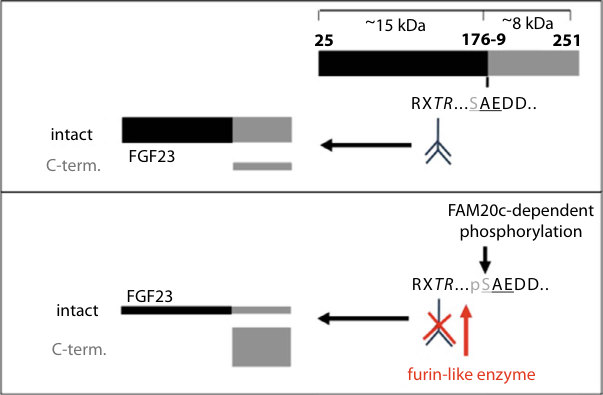
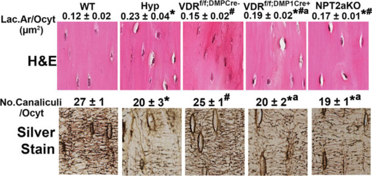
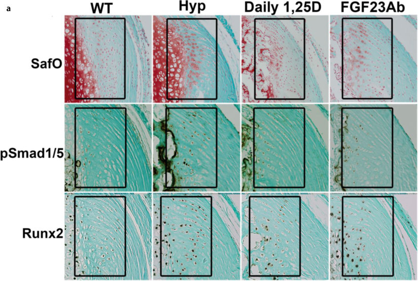
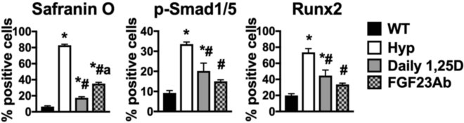
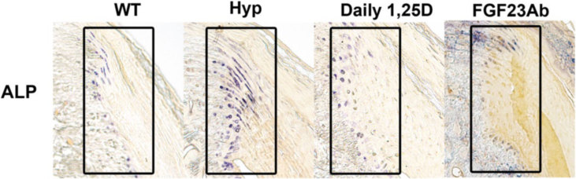
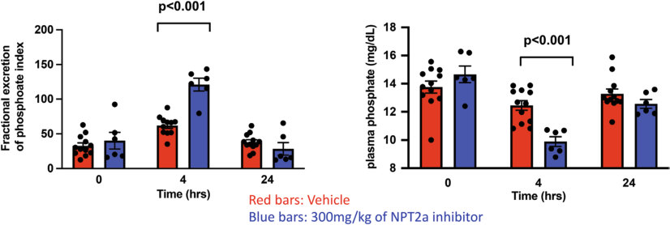

# 20. Disorders of Phosphate Homeostasis
> Source attribution: [Source credits](../../SOURCE_CREDITS.md).

## PDF page 506 | printed page 499

### Disorders of Phosphate Homeostasis

Eva S. Liu and Harald Jüppner

### Contents

### 20.1 Introduction – 500

### 20.2 Phosphate Homeostasis – 500

20.2.1 Regulation of Phosphate Homeostasis – 501 20.2.2 Clinical Symptoms of Hypophosphatemia and Hyperphosphatemia – 503

### 20.3 Disorders of Phosphate Homeostasis – 504

20.3.1 Fanconi’s Syndrome – 505 20.3.2 Hypophosphatemic Syndromes of Excess FGF23 – 507 20.3.3 Genetic Hyperphosphosphatemic Disorders – 515 20.3.4 Disorders of Altered Phosphate Load – 516

### 20.4 Conclusion – 517

### References – 517

© The Author(s), under exclusive license to Springer Nature Switzerland AG 2024 S. Radovick, M. Misra (eds.), Pediatric Endocrinology, https://doi.org/10.1007/978-3-031-66296-6_20

## PDF page 507 | printed page 500

### 20.1 Introduction

Extracellular phosphate is a critical compo nent of the skeleton that plays an important role in modulating skeletal processes like growth plate maturation and skeletal mineral ization. Phosphate homeostasis is regulated by dietary intake and the mineral ionregulating hormones parathyroid hormone (PTH) and fibroblast growth factor (FGF23). Furthermore, disorders disrupting phosphate homeostasis have resulted in a greater under standing of the molecular regulation of phos phate balance as well as the hormones that modulate these processes.

### 20.2 Phosphate Homeostasis

Extracellular phosphate is a critical compo nent of the skeleton that, in combination with calcium, is essential for mineralization of newly formed osteoid. Growing children have positive phosphate balance to support skeletal growth, while healthy adults have a zero phos phate balance. Phosphate deficiency leads to rickets in children and osteomalacia in adults. Phosphate accounts for about 0.6% of the body weight at birth and about 1% of body weight in the adult [1]. Eighty-five percent of phosphate is in the skeleton and in teeth, while 15% of phosphate is located in soft tissue and extracellular fluid [2].

In plasma, phosphate exists in either inor ganic or organic forms; the latter primarily as phospholipids and phosphate esters [3]. The total plasma concentration of phosphate in an adult is about 14 mg/dL, of which 4 mg/dL is inorganic phosphate (Pi). Ten to fifteen per cent of inorganic phosphate (Pi) is protein bound and the remainder is filtered at the renal glomeruli and is usually complexed with sodium, calcium, or magnesium.

About 70% of phosphate filtered by the glomeruli is reabsorbed in the proximal con voluted tubule, while 10% of phosphate is reabsorbed in the proximal straight tubule, and <10% in the distal segments of the neph ron. Thus, the proximal tubule of the kidney is where a majority of the phosphate reab

### 20

sorbed from the filtered load [4]. Renal reab sorption of phosphate progressively increases as more is filtered, until a maximum tubular reabsorption rate for phosphate (TmP) is reached, after which phosphate excretion increases in proportion with the filtered load. TmP can vary even within the same person due in part to differences in GFR, therefore TmP is normalized to GFR (TmP/GFR, max imum tubular reabsorption of phosphate per unit volume of GFR), when quantifying renal tubular phosphate reabsorption [2]. In renal tubular cells, filtered phosphate is reclaimed by sodium (Na+)-dependent phosphate (Pi) transporters at the apical brush border mem brane. Phosphate is then translocated across the cell and returned to the blood circulation at the basolateral membrane, a process that is mediated by the Na+/K+-dependent ATPase [5] and possibly the xenotropic and polytropic retroviral receptor 1 (XPR1) [6].

Type II Na/Pi co-transporters include three highly homologous isoforms, including Type IIa (NPT2a, SLC34A1), Type IIc (NPT2c, SLC24A3), and Type IIb (NPT2b, SLC34A2). NPT2a and NPT2c, expressed on the brush border membrane of renal proxi mal tubules, are the predominant regulators of phosphate reabsorption in renal tubules. In mice, protein levels of NPT2a are approxi mately tenfold higher than those of NPT2c [3]. In contrast, NPT2b is not expressed in the kidney, but it is instead expressed in several other tissues, including lung and particularly the small intestine [7–10]. The ubiquitously expressed type III Na/Pi co-transporters are retroviral cell surface receptors (gibbon ape leukemia virus (Glvr-1, PiT-1, SLC20A1) and murine amphotropic virus (Ram-1, Pit-2, SLC20A2) that are [11, 12] localized to all segments of the nephron at the basolateral membrane and mediate cellular phosphate balance.

Sodium-dependent phosphate cotransporter type IIb (NPT2b, SLC34A2) plays an important role in sodium-phosphatedependent phosphate resorption in the small intestine. Type III sodium-dependent phos phate co-transporters PiT1 and PiT2 contrib ute to phosphate resorption in the small

## PDF page 508 | printed page 501

intestine, but less so than NPT2b [13]. Mutations in PiT2 have been associated with development of brain calcifications in humans and mice. Thus, affected individuals develop familial basal ganglia calcifications (Fahr’s Disease) and mice lacking PiT2 have elevated phosphate levels in their cerebral spinal fluid [14, 15]. About 60–65% of dietary intake of phosphate is absorbed by the small intestine, where in response to an increasing dietary load [1]. If an adult is in zero phosphate bal ance, the intestinal absorption of phosphate is equal to the amount of phosphate excreted by the kidney. In growing children, the net amount of phosphate excreted is less than the amount absorbed by the small intestine, thus resulting in positive phosphate balance [16]. Because serum phosphate concentrations vary throughout the day depending on dietary phosphate intake and oral phosphate supple mentation, collection of a fasting blood sam ple is preferred for clinical analysis.

### 20.2.1 Regulation of Phosphate

### Homeostasis

### 20.2.1.1 Diet

17

18

19 20

21

22 23

20.1

### 20.2.1.2 FGF23

FGF23, a “phosphatonin,” is a secreted FGF and critical regulator of phosphate homeosta sis. It is predominantly expressed in bone, spe

cifically osteocytes and at lower levels in osteoblasts [24, 25]. In the presence of the cofactor Klotho, FGF23 binds to FGFR1 with high affinity [26]. FGFR1 is the predominant receptor for FGF23 action, with FGFR4 likely playing a minor role in the phosphaturic effect when activated by FGF23 [27, 28]. FGF23 decreases serum phosphate levels by reducing expression of NPT2a and NPT2c in the renal tubule cells and decreasing the pro duction of 1,25(OH)2D. As documented in mice, FGF23 regulates 1,25(OH)2D levels by down-regulating expression of Cyp27b1, which encodes 1α-hydroxylase, and it upregu lates Cyp24a1, which encodes an enzyme that catabolizes 1,25(OH)2D, thus decreasing cir culating levels of 1,25(OH)2D. Tmem174, a transmembrane protein localized in the renal proximal tubules, interacts with Npt2a, but not Npt2c to prevent hyperphosphatemia, thus contributing to the regulation of FGF23 levels [29, 30].

Genetic linkage studies identified the genetic cause of autosomal dominant hypo phosphatemic rickets (ADHR), which is caused by FGF23 mutations affecting either Arg176 or Arg179 that render the intact, biologically active hormone resistant to inac tivation by cleavage [31]. In the presence of these mutations, iron deficiency increases intact FGF23 levels [32, 33]. Furthermore, some small, usually benign tumors excrete abundant amounts of FGF23 thereby induc ing urinary phosphate-wasting and osteoma lacia (TIO) [24] that is most likely triggered by expression of a chimeric FGFR/fibronectin protein [34]. Affected patients present with low serum levels of phosphate and 1,25(OH)2D resulting in clinical symptoms that are similar to those observed in other hypophosphatemic disorders.

35

## PDF page 509 | printed page 502

2

like proprotein convertase [36] ( Fig. 20.2). Homozygous or compound heterozygous loss-of-function mutations in DMP1 [38], FAM20C [39], and ENPP1 [40], as well as het erozygous or hemizygous PHEX mutations [41] lead to elevated circulating levels of FGF23 in mice and humans, and thus hypo phosphatemia. FAM20C regulates the phos phorylation of Ser180 in FGF23 which blocks O-glycosylation at Thr178, and thus enhances FGF23 cleavage [37].

### 20

Glycerol-3-phosphate (G-3-P), a down stream product of glycolysis, is converted in the kidney, but also in other tissues, into lyso phosphatidic acid (LPA), which stimulates FGF23 production. It is conceivable that

2

G-3-P serves as a sensor for phosphate levels in the kidney, where phosphate stimulates kidney-specific glycolysis, and thus G-3-P and subsequently production [42].

### 20.2.1.3 PTH

Parathyroid hormone (PTH) regulates serum phosphate levels by increasing internalization and subsequent lysosomal degradation of NPT2a, thus promoting urinary phosphate excretion [43, 44]. On the basolateral mem brane of the proximal renal tubules, PTH binds to PTH/PTHrP receptors (PTHR1), which activates at least two second messenger systems, namely cAMP leading to the activa tion of protein kinase A (PKA) and intracel

Unmatched source image; PDF page 509. Consult the original caption.

## PDF page 510 | printed page 503

lular calcium and IP3 leading to the activation of protein kinase C (PKC). Both pathways then activate ERK/MAPK signaling to induce internalization of NPT2a [45, 46]. Furthermore, the PTHR1 can interact with NHERF2 at the renal apical brush border membrane, thereby stabilizing NPT2a protein on the cell surface and preventing desensitiza tion of the PTH signal [47]. Humans with het erozygous NHERF1 mutations may present with hypophosphatemia and renal phosphatewasting [48, 49].

### 20.2.1.4 Vitamin D

Dietary phosphate and serum phosphate lev els are important regulators of 1,25(OH)2D. Dietary restriction in rats or mice leads to hypophosphatemia, which enhances vitamin D 1α-hydroxylase (CYP27B1) mRNA expression and protein levels in the renal proximal tubule by six- to eightfold [50], thereby increasing the produc tion of 1,25(OH)2D [51]. Furthermore, dietary phosphate restriction in mice decreases renal 24-hydroxylase activity and expression, thus

37

resulting in decreased catabolism of 1,25(OH)2D [52, 53]. On the other hand, treat ment of vitamin D-deficient rats with 1,25(OH)2D enhances NPT2a mRNA expres sion and protein in the renal brush border membrane [54]. Consistent with the findings in animal studies, dietary phosphate restric tion in humans increases serum 1,25(OH)2D levels, while phosphate supplementation has the opposite effect [55].

### 20.2.2 Clinical Symptoms

### of Hypophosphatemia and Hyperphosphatemia

Chronic hypophosphatemia is usually asymp tomatic, though affected individuals can com plain of myalgias. In mice, deletion of both PiT1 and PiT2 in skeletal muscle resulted in hypophosphatemia and muscle atrophy, dem onstrating that these phosphate transporters are required for skeletal myofiber function and survival [56]. Moderate to severe hypo

Unmatched source image; PDF page 510. Consult the original caption.

## PDF page 511 | printed page 504

phosphatemia, either chronic or acute, can be associated with clinical symptoms [57]. Rhabdomyolysis associated with low serum phosphate is most commonly a consequence of chronic alcoholism [58, 59]. A combination of factors, including inappropriate phospha turia, gastrointestinal loss, hyperventilation, or infusion of dextrose-containing fluids, can contribute to hypophosphatemia in alcohol ism [57].

of elevated phosphate levels can be secondary hyperparathyroidism or the suppression of production of 1,25(OH)2D.

### 20.3 Disorders of Phosphate

Hematologic consequences of hypophos phatemia may include hemolysis or leukocyte dysfunction. Adequate phosphate levels are necessary to maintain ATP levels in red blood cells and leukocytes [60]. Consequently, a fall in ATP levels from hypophosphatemia has been associated with decreased red blood life span, cases of hemolytic anemia [61–63], and impaired leukocyte cell function [64, 65].

20.1

Box 20.1 Disorders of Phosphate Homeostasis

Hypophosphatemia can result in respira tory muscle weakness, including impaired contraction of the diaphragm, leading to impaired respiratory function [66, 67]. In hos pitalized patients who had low phosphate lev els, improvement in respiratory muscle function was observed with phosphate reple tion. Severe, acute, or chronic hypophospha temia can compromise myocardial function [68, 69]. However, a study of pediatric patients with chronic hypophosphatemia from X-linked hypophosphatemia (XLH) demon strated no alteration in left ventricular func tion [70]. Central and peripheral nervous system dysfunction has been reported in patients with acute severe hypophosphatemia after developing re-feeding syndrome [71, 72]. Patients may manifest with irritability and muscle weakness and progress to confusion or coma [72, 73].

A high serum phosphate level is usually not associated with significant symptoms, but can lead to the formation of ectopic calcifica tions by precipitating in the soft tissues as calcium-phosphate deposits. Such calcifica tions are observed in chronic renal failure, hypoparathyroidism, pseudohypoparathy roidism, or tumoral calcinosis, all of which are typically characterized by elevated serum phosphate levels. Biochemical consequences

### 20

### Homeostasis

20.1

Hypophosphatemic disorders

Fanconi’s syndrome

Mutations in NPT2a (hypophosphatemia

associated with infantile hypercalcemia)

Mutations in NPT2c (hereditary

hypophosphatemic rickets with hypercal ciuria)

Diseases with excess FGF23

X-linked hypophosphatemia (XLH)

Autosomal dominant hypophosphatemic

rickets (ADHR)

Autosomal recessive hypophosphatemic

rickets (ARHR)

Fibrous dysplasia/McCune Albright

syndrome

Linear nevus sebaceous syndrome

(LNSS)/epidermal nevus syndrome (ENS)

Tumor-induced osteomalacia (TIO)

Hyperphosphatemic disorders

Tumoral calcinosis

Chronic kidney disease

Disorders of altered phosphate load

Phosphate deprivation

Gastrointestinal malabsorption

## PDF page 512 | printed page 505

Alkalosis

Glucose administration

Alcoholism

Burns

Diabetic ketoacidosis

Refeeding syndrome

### 20.3.1 Fanconi’s Syndrome

Fanconi’s syndrome is characterized by impaired proximal renal tubule function due to genetic or secondary causes, leading to proximal renal tubular acidosis, and renal losses of amino acids, glucose, bicarbonate, potassium, and phosphate. The hypophos phatemia can result in osteomalacia and rick ets, with bowing of the legs and short stature [74]. Therefore, phosphate supplementation and/or calcitriol treatment are used to treat the consequences of low serum phosphate lev els. Multiple disorders are complicated by Fanconi’s syndrome. For instance, majority of cases have an acquired form of Fanconi’s syn drome due to secondary causes that may include burn injuries, exposure to certain medications or toxic metals, or a variety of other conditions like multiple myeloma, or amyloidosis [74]. Furthermore, rare inherited disorders like cystinosis, Wilson’s disease, Lowe syndrome, type I glycogen storage dis ease, or galactosemia can lead to renal phos phate wasting. Medications like tenofovir, an anti-retroviral medication used for treatment of HIV/AIDS, is well-documented to be asso ciated with Fanconi’s syndrome-related hypo phosphatemia [75]. Patients infected with acute respiratory syndrome coronavirus (SARS-CoV-2) who have severe disease requiring hospitalization may have a higher incidence of hypophosphatemia associated with acute kidney injury. It is hypothesized that SARS-CoV-2 infection involving the proximal renal tubules may lead to Fanconi’s syndrome [76].

Furthermore, Fanconi’s syndrome has also been described in families with fully pen etrant heterozygous missense autosomal dominant mutations in glycine amidinotrans ferase (GATM), an enzyme prominently expressed in the renal proximal tubules that regulates creatine synthesis. Affected patients develop Fanconi’s syndrome with hyperphos phaturia but no rickets or bone deformities as children, and they may progress to renal fibro sis and end-stage kidney failure as adults [77, 78].

### 20.3.1.1 NPT2a Mutations

The type II sodium phosphate co-transporter (NPT2a, SLC23A1) is expressed exclusively in the brush border membrane of renal proximal tubular cells. Deletion of Npt2a in mice results in enhanced renal phosphate-wasting, leading to hypophosphatemia, a decrease in serum FGF23 levels, and a compensatory increase in serum 1,25(OH)2D levels. The increase in 1,25(OH)2D increases intestinal calcium absorption and results in hypercalce mia, hypercalciuria, and suppressed PTH lev els [79, 80]. The age-dependent increase in serum 1,25(OH)2D levels correlated with the improvement of rickets in these mice, suggest ing that the enhanced 1,25(OH)2D action can compensate for hypophosphatemia in regulat ing growth plate maturation and growth [79].

An autosomal recessive form of renal Fanconi’s syndrome was described in 1988 in two siblings, who had marked hypophospha temia, and elevated 1,25(OH)2D levels, as well as rickets, growth retardation, and skeletal deformities [81]. Both siblings were later shown to have homozygous loss-of-function mutations in SLC34A1 (encodes NPT2a) and that their biochemical abnormalities greatly improved, although renal function remained abnormal [82]. Recently, numerous other homozygous or compound heterozygous NPT2a mutations were described in several infants, who presented with severe hypercalce mia and renal phosphate-wasting, and sup pressed serum PTH levels. Approximately half of the infants in this cohort had elevated serum 1,25(OH)2D levels associated with

## PDF page 513 | printed page 506

hypercalcemia. These metabolic abnormali ties resolved with phosphate supplementation [83], thus potentially preventing nephrocalci nosis. Mice lacking Npt2a fed high phosphate diets with or without high calcium were more likely to develop renal calcifications compared to wild-type mice fed a similar diet, suggesting that optimization of dietary content of phos phate and calcium are needed for proper treat ment of affected individuals [84].

Furthermore, two heterozygous mutations were identified in the SLC34A1 gene (A48P and V147M). The affected individuals pre sented with idiopathic hypophosphatemia, recurrent kidney stones, and osteomalacia [85]. Other heterozygous SLC34A1 mutations (91del7, A133V, H568Y) have been reported in a cohort of patients who have recurrent kidney stones but no hypercalciuria, hypo phosphatemia, or increased urinary phos phate excretion [86].

Table 20.1 Biochemical findings in disorders of phosphate homeostasis

Infantile hypercalcemia

### HHRH XLH

Serum Pi ↓ ↓ ↓

TmP/GFR ↓ ↓ ↓

FGF23 ↓/N ↓/N ↑/N

Serum Ca N/↑ N/↑ N

Urine Ca ↑ ↑ N

PTH ↓ ↓ N/↑

25(OH)D N N N

1,25(OH)2D ↑/N ↑/N ↓/N

Mutant gene NPT2a NPT2c PHEX

XLH X-linked hypophosphatemia, ADHR autosomal dominant hypophosphatemic rickets, ARHR autoso mal recessive hypophosphatemic rickets, TIO tumor-induced osteomalacia, HHRH hereditary hypophospha temic rickets with hypercalciuria, TC tumoral calcinosis N = normal, ↓ = decreased, ↑ = increased

### 20

### 20.3.1.2 NPT2c Mutations

87 88

2

87 88

20.1

89 90

91

### ADHR ARHR TIO TC

↓ ↓ ↓ ↑

↓ ↓ ↓ ↑

↑/N ↑/N ↑/N Intact: ↓ C-term: ↑

N N N N

N N N N

N/↑ N/↑ N ↓

N N N N

↓/N ↓/N ↓/N ↑/N

FGF23 DMP1, ENPP1, FAM20C

FGF23, GALNT3, KLOTHO

### Automatic table extraction — verify rendered original

|Col1|Infantile hypercalcemia|HHRH|XLH|ADHR|ARHR|TIO|TC|
|---|---|---|---|---|---|---|---|
|Serum Pi|↓|↓|↓|↓|↓|↓|↑|
|TmP/GFR|↓|↓|↓|↓|↓|↓|↑|
|FGF23|↓/N|↓/N|↑/N|↑/N|↑/N|↑/N|Intact:↓ C-term:↑|
|Serum Ca|N/↑|N/↑|N|N|N|N|N|
|Urine Ca|↑|↑|N|N|N|N|N|
|PTH|↓|↓|N/↑|N/↑|N/↑|N|↓|
|25(OH)D|N|N|N|N|N|N|N|
|1,25(OH)2D|↑/N|↑/N|↓/N|↓/N|↓/N|↓/N|↑/N|
|Mutant gene|NPT2a|NPT2c|PHEX|FGF23|DMP1, ENPP1, FAM20C||FGF23, GALNT3, KLOTHO|

[Original table](../../tables/ch020_p0513_1.jpg)

## PDF page 514 | printed page 507

Patients with documented SLC34A3 mutations have a significantly increased likeli hood of developing kidney stones. Forty-six percent of subjects with SLC34A3 mutations on both alleles manifest nephrocalcinosis compared with 6% of non-affected family members [92]. Even heterozygous carriers of SLC34A3 mutations have a higher frequency of renal calcifications that are intermediate to those with homozygous/compound heterozy gous mutations and subjects without such mutations. The likelihood of renal calcifica tions increased with the severity of hypophos phatemia and decreased tubular reabsorption of phosphate [92].

### 20.3.2 Hypophosphatemic

### Syndromes of Excess FGF23

### 20.3.2.1 X-Linked

### Hypophosphatemia (XLH)

XLH is the most frequent inherited form of hypophosphatemia, with a reported incidence of 1:20,000 [93]. It is inherited in an X-linked dominant pattern with complete penetrance, thought there is wide phenotypic variation, even within the same family. Establishing the diagnosis of XLH can be delayed until adult hood due to lack of awareness of phosphate levels or expression of a mild phenotype. When a more severe phenotype is present, children typically manifest rickets by age 1–2 years, causing growth retardation and bowed legs. On radiographs, the growth plates of long bones appear abnormal, with expan sion and fraying of the metaphyses [94]. There is discordant growth between the lower extremity long bones and the torso, with the growth retardation being more apparent in the long bones of the legs [95]. Children with XLH can manifest premature cranial synosto sis and often develop dental abscesses and caries due to defective dentoalveolar mineral ization [96, 97]. Adults may manifest with pseudofractures, osteoarthritis, osteophytes, or enthesopathy, which is the abnormal min eralization of the bone-tendon attachment sites, such as the Achilles or patellar entheses

[98, 99]. Hypophosphatemia is often associ ated with myalgias, though many XLH patients are often asymptomatic from the hypophosphatemia [2]. As adults, XLH patients also report tinnitus and conductive hearing loss. Similarly, mice with XLH have conductive hearing loss, which is associated with hypomineralization of the auditory ossi cles [100].

2

25

101 102

20.1 Hyp mice are a murine equivalent of human XLH. These mice carry a deletion in the 3′ region of the Phex gene [103]. The Hyp mouse mimics the XLH phenotype seen in humans, including biochemical abnormali ties, growth retardation, rickets/osteomalacia, and enthesopathy.

### Pathophysiology

XLH is caused by inactivating mutations in the PHEX gene, which is located on chromo some Xp22.1 [104]. Over 800 mutations have been reported in PHEX [105], including mis sense, frameshift, nonsense, duplication, and insertion mutations [106, 107]. PHEX muta tions are catalogued on the website www. db.mcgill.ca. PHEX is predominantly expressed in bone, specifically in osteocytes and osteoblasts. It is also expressed in other tissues such as lung, brain, and teeth, but at lower levels [41, 108]. Although it is known that serum FGF23 levels are elevated in patients with PHEX mutations, the underly ing regulatory mechanisms contributing these FGF23 elevation are not known; PHEX does not directly contribute to cleaving and thus inactivating FGF23 [109, 110]. Although studies demonstrated that PHEX binds to

## PDF page 515 | printed page 508

and cleaves the triphosphorylated acidic, ser ine-, and aspartic acid-rich motif (ASARM) in proteins like MEPE to block their inhibi tion of mineralization [111], the physiological target(s) of the PHEX endopeptidase cur rently remains to be defined.

Analysis of genetically modified mice have supported the pathogenic roles of PHEX and FGF23 in causing hypophosphatemia and rickets in XLH. Conditional ablation of PHEX in osteoblasts (using the osteocalcin promoter) leads to elevated serum FGF23 lev els, low serum phosphate levels, and decreased renal Npt2a expression, resulting in poor skel etal mineralization [41]. Conversely, trans genic overexpression of PHEX under the control of the pro-alpha1(I) collagen pro moter improved the skeletal mineralization in Hyp mice, but it did not normalize serum phosphate levels [112]. Furthermore, overex pression of FGF23 under the alpha1(I) colla gen promoter resulted in impaired growth and hypophosphatemic rickets due to phosphatu ria secondary to decreased renal expression of Npt2a [113]. Deletion of FGF23 from Hyp mice improved serum phosphate and 1,25(OH)2D levels, but did not normalize skeletal mineralization or growth, indicating that PHEX-specific actions aside from its abil ity to regulate FGF23 likely modulate these processes [25]. Overexpression of FGF23 in rat calvarial osteoblasts decreased mineraliza tion and nodule formation, while bone forma tion in parietal organ cultures was decreased [114]. Treatment of wild-type calvarial osteo blasts with recombinant FGF23 furthermore suppressed formation of mineralized nodules in vitro [115]. These studies indicate that FGF23 may suppress mineralization indepen dent of its effect on phosphate homeostasis. Thus, abnormal skeletal mineralization result ing in the XLH phenotype is not only due to abnormal mineral ion and hormone homeo stasis, but likely involves additional molecular defects that are incompletely characterized. It has been reported that the mineralization inhibitor osteopontin is elevated in Hyp bone and that deletion of this PHEX target mod estly improved skeletal mineralization in these

### 20

mice [116]. Also, osteocytes in Hyp mice show decreased expression of tissue nonspecific alkaline phosphatase, which regulates miner alization by metabolizing pyrophosphate (PPi), a potent mineralization inhibitor. These findings suggest that abnormal PPi homeosta sis in XLH bones could contribute to the development of osteomalacia [117]. Furthermore, implantation of Hyp osteo blasts into wild-type mice did not normalize the osteoid volume of the transplants, thus indicating an intrinsic osteoblast defect in XLH [118]. When wild-type osteoblasts were grown in medium with phosphate concentra tions similar to those of serum levels in wildtype mice, alkaline phosphatase activity increased. In contrast, Hyp osteoblasts failed to respond to 1,25(OH)2D treatment when exposed to the same phosphate concentration, thus demonstrating that Hyp osteoblasts have an abnormal response to 1,25(OH)2D [119].

Extracellular phosphate is essential for normal growth plate maturation [120–122]. Mice lacking the vitamin D receptor and Hyp mice fed normal chow as well as mice fed a low phosphate diet all have hypophosphate mia and an expansion of growth plates (hyper trophic layer). Hypophosphatemia impairs Erk1/2 activation, which in turn results in an expansion of the hypertrophic chondrocyte layer demonstrating the critical role of phos phate in regulating growth plate maturation [120, 122]. PTHrP action appears to contrib ute to the growth plate expansion observed during hypophosphatemia because mice het erozygous for PTHLH ablation (the gene encoding PTHrP) did not develop the antici pated growth plate changes when fed a low phosphate diet [123]. Mice and humans with XLH often have elevated serum PTH levels and Hyp mice have increased expression of PTHrP at the peri-articular surface. Consequently, actions of PTH or PTHrP are likely to contribute to the impaired growth plate maturation seen in XLH.

1,25(OH)2D is also an important regulator of growth and skeletal mineralization and structure in XLH, aside from its ability to modulate serum calcium and phosphate lev

## PDF page 516 | printed page 509

els. Hyp mice that are null for the vitamin D 24-hydroxylase (Cyp24a1) or that transgeni cally express FGF23 revealed significantly improved rickets/osteomalacia despite persis tent hypophosphatemia [124]. Although serum 1,25(OH)2D levels decreased paradoxi cally in these mice, there was an increase in local tissue production of 1,25(OH)2D [124]. In addition, treatment of Hyp mice with calcitriol alone restored Npt2a expres sion in the kidney, significantly improved growth and growth plate maturation, as well as skeletal microarchitecture/biomechanics and dentoalveolar mineralization. Treatment of Hyp mice with calcitriol alone was superior to anti-FGF23 antibody therapy despite increased serum levels of FGF23 observed with 1,25D treatment and both treatments increasing serum phosphate to similar levels [93, 125].

2

f/f;DMP1Cre+

f/f;DMP1Cre−

126

2

20.3 127

2

2

2

127

128

f/f;DMP1Cre+

2

f/f;DMP1Cre− 121

Unmatched source image; PDF page 516. Consult the original caption.

## PDF page 517 | printed page 510

of Hyp mice have an expansion of hypertro phic appearing chondrogenic cells that show increased alkaline phosphatase activity and enhanced expression of signaling pathways regulating chondrogenesis, including bone morphogenic protein (BMP) and Indian hedgehog (IHH) signaling. Treatment of Hyp mice with either calcitriol alone or with the anti-FGF23 antibody blocks BMP/IHH sig naling in the entheses and prevents enthesopa thy in the Hyp mice, also pointing to a role for impaired 1,25(OH)2D action in regulating the abnormal mineralization of the entheses observed in XLH [129] ( Fig. 20.4). Taken together, these studies support an important role for 1,25(OH)2D in the pathogenesis of the different skeletal aspects of XLH.

### Treatment

Treatment for XLH in children is predomi nantly aimed at improving their growth, to minimize rickets/osteomalacia, and thus to prevent bowing and orthopedic procedures. Traditionally, children with XLH were treated with a combination of oral phosphate, given multiple times per day, and calcitriol, from the time of diagnosis until active growth has stopped. Treatment with phosphate and cal citriol therapy decreases alkaline phosphatase levels and improves, but does not normalize, skeletal growth and mineralization [94, 101]. Serum phosphate levels do not normalize because of persistent renal phosphate losses due to elevated circulating FGF23 levels, which can increase even further above base line during treatment [130].

Complications of conventional therapy may include hypercalciuria or hypercalcemia from calcitriol therapy [131]. Also, the doses of phosphate (and compliance with this medi cation) and calcitriol are thought to be correlated with the development of nephro calcinosis, which can lead to compromised renal function [132]. Phosphate therapy alone should be avoided because it leads to second ary and tertiary hyperparathyroidism, requir ing parathyroid surgery [133]. Treatment of

### 20

mice with XLH with calcitriol starting on day 2 (prior to enthesis changes) can prevent the development of enthesopathy [129], but treat ing Hyp mice with calcitriol and phosphate starting at day 30 (after enthesis maturation) did not prevent or reduce the extent of enthe sopathies [134], suggesting early and consis tent therapy is needed to attenuate the development of mineralization at the tendonbone insertion sites.

Due to the lack of normalization of the XLH phenotype with conventional therapy, an antibody targeting FGF23, burosumab (Crysvita), was developed. It was FDAapproved for the treatment of children and adults with XLH. Given the efficacy of buro sumab in improving serum biochemistries, skeletal mineralization, and potentially growth, it has largely replaced conventional therapy as the treatment of choice for XLH. However, treated children continued to develop dental abscesses, and the effects of burosumab on the development of enthesopa thies or osteoarthritis has not yet been reported. Studies in Hyp mice comparing an anti-FGF23 blocking antibody (from Amgen) with daily calcitriol therapy (without phos phate supplementation) revealed that daily calcitriol was superior to the antibody in improving growth plate morphology, long bone growth, bone histomorphometric parameters, as well as skeletal mineralization and biomechanics [93]. Thus, calcitriol alone or in combination with burosumab may potentially be alternative treatment options for XLH patients. For further details on XLH treatment, please refer to Chap. 21.

### 20.3.2.2 Autosomal Dominant

### Hypophosphatemic Rickets (ADHR)

20.1

## PDF page 518 | printed page 511

2

2

129

Unmatched source image; PDF page 518. Consult the original caption.

Unmatched source image; PDF page 518. Consult the original caption.

Unmatched source image; PDF page 518. Consult the original caption.

## PDF page 519 | printed page 512

ing symptoms may also vary considerably, where children have short stature and rickets while adults have insufficiency fracture and skeletal pain, but no lower extremity deformi ties. Interestingly, some of the ADHR patients who present with the disorder during child hood had normalization of phosphate levels after puberty [135, 136] and one patient pre sented with severe hypophosphatemia and osteomalacia only after several uncompli cated pregnancies [137].

Econs and McEnery described a large kin dred, in which affected individuals presented with hypophosphatemia and/or rickets at variable ages, ranging from early childhood to adolescence and adulthood; the mode of inheritance was autosomal dominant [135, 138]. After linking the genetic locus of ADHR to chromosome 12p13, Econs and colleagues identified heterozygous missense FGF23 mutations in several different families (R176Q, R179Q, and R179W) [31]. These FGF23 mutations in ADHR patients render FGF23 resistant to cleavage, thus increasing the amount of intact biologically active FGF23 in the circulation [35, 136, 139–141].

ADHR can become apparent with onset of iron deficiency, such as with the start of menses during puberty or during the postpar tum period. In patients with ADHR, serum iron levels are inversely correlated with intact and C-terminal FGF23 levels. Consequently, the lower the iron levels the higher the levels of biologically active FGF23, which reduce serum phosphate levels. In unaffected con trols, only the C-terminal FGF23 levels cor relate with iron levels while intact levels do not [33]. Iron supplementation of iron-deficient adults with ADHR normalized serum FGF23 levels and increased serum phosphate levels [142]. Consistent with the human ADHR phe notype, mice engineered to express FGF23 with the R176Q mutation that are fed an irondeficient diet developed elevated FGF23 levels [32]. These studies emphasize the important role of iron in maintaining normal phosphate homeostasis. They also highlight the impor tance of determining the ratio of intact FGF23 to C-terminal fragments for assessing the regulation of phosphate balance.

### 20

### 20.3.2.3 Autosomal Recessive

### Hypophosphatemic Rickets (ARHR)

20.1

2

143

38 143

144 Loss-of-function mutations of the ectonucleotide pyrophosphatase/pyrophosphodi esterase 1 (ENPP1) gene have been implicated in ARHR [145]. ENPP1 hydrolyzing ATP into pyrophosphate (PPi), an inhibitor of mineral ization, thereby regulating skeletal mineraliza tion [146]. Therefore, patients and mice with loss-of-function mutations in ENPP1 develop ectopic calcifications of the aorta, kidney, and spine. Patients with ENPP1 mutations may present in infancy with generalized arterial cal cification of infancy, with variable calcification of medium and large vessel arteries that can be life-threatening. Like patients with ENPP1 mutations, mice lacking ENPP1 have hypo phosphatemia, undetectable PPi levels, and elevated FGF23 serum levels [147, 148]. Thus, in addition to its role in modulating skeletal mineralization, ENPP1 also regulates phos phate homeostasis and FGF23. As with XLH, patients with ARHR can manifest early onset

## PDF page 520 | printed page 513

hearing loss, mineralizing enthesopathies, and ossification of the posterior longitudinal liga ment of the spine [40, 145, 149]. During ado lescence, serum FGF23 levels begin to rise, leading to hypophosphatemia and rickets; the severity of the rachitic phenotype is variable and correlates with serum FGF23 levels [150, 151]. Limited case reports show that conven tional therapy with phosphate and calcitriol supplementation does not worsen arterial cal cifications [150]. However, the use of the anti- FGF23 antibody burosumab in an affected patient resulted in worsening cardiac and vas cular calcifications [152]. More recently, ENPP1-null mice treated with humanized ENPP1-Fc prevented organ and cardiovascu lar calcifications, increased pyrophosphate lev els, and improved growth and skeletal microarchitecture, pointing to a potential ben eficial role for ENPP1 enzyme replacement therapy in treating affected patients [153].

154

155 156

20.3

146

37

154

### 20.3.2.4 Fibrous Dysplasia (FD)

In Fibrous Dysplasia (FD), normal bone is replaced by fibrous tissue. It can affect one bone (monoostotic) or multiple bones (poly ostotic) in the craniofacial, appendicular, or axial skeleton [157]. Children with this disor der usually present by 10 years of age with bone pain, fracture, or progressive deformity.

FD can manifest on its own or be part of McCune–Albright syndrome, which is caused by somatic post-zygotic mutations in GNAS, the gene encoding Gsα, which mediates the actions of numerous G protein-coupled recep tors that use the cAMP/PKA signaling path way [158]; these missense mutations responsible for McCune–Albright syndrome affect only one of two amino acid residues, Arg201 or Gln227 [159]. Affected patients typically have café-au-lait spots and endocri nopathies reflecting abnormal signaling by GPCRs, which can include gonadotropinindependent precocious puberty, thyroid lesions with or without hyperthyroidism, growth hormone excess, hypercortisolism, or testicular lesions with Leydig and/or Sertoli cell hyperplasia [160].

FD patients may have hypophosphatemia and corresponding low or inappropriately normal serum 1,25(OH)2D levels due to ele vated serum FGF23 levels [161]. The degree of urine phosphate-wasting and disease bur den correlates with FGF23 serum levels [162]. Although fibrous lesions in FD express FGF23, overt hypophosphatemia and classic hypophosphatemic rickets are not frequently observed. It has been shown that there is altered FGF23 cleavage due to decreased gly cosylation and increased furin activity in bone marrow stromal cells isolated from FD sub jects, thus possibly explaining the lack of a rachitic phenotype in FD [163]. These studies suggest Gsα plays a role in the regulation of FGF23 metabolism.

The bone pain associated with FD may be more severe in adults than in children, and can be treated with bisphosphonates. Treatment with bisphosphonates has also been shown to decrease serum FGF23 levels and increase in serum 1,25(OH)2D levels [161]. However, there may be an increased risk of osteonecrosis of the jaw in FD patients on bisphosphonate therapy [164]. There is lim ited data on the efficacy of denosumab (anti- RANKL antibody) in therapy for FD. Administration of denosumab to fibrous dysplasia patients can decrease bone turnover markers, bone pain, and expansion of bony lesions. Thus, its use should be closely moni tored in patients, as treatment with deno

## PDF page 521 | printed page 514

sumab has been reported to cause worsening hypophosphatemia and secondary hyperpara thyroidism [165]. Discontinuation of deno sumab treatment can be complicated by rebound osteoclast activation, leading to hypercalcemia [166]. However, a pediatric patient with McCune–Albright Syndrome/ Fibrous dysplasia with frank hypophosphate mia and rickets was treated with burosumab, leading to improvement in mineral ion homeo stasis, decreased fractures, and improved bone pain and strength [167].

### 20.3.2.5 Linear Nevus Sebaceous

### Syndrome (LNSS)/Epidermal Nevus Syndrome (ENS)

Linear nevus sebaceous syndrome (LNSS), also known as epidermal nevus syndrome (ENS) is a rare, sporadic, and highly variable disorder that is characterized by papilloma tous epidermal hyperplasia and abnormalities in multiple organ systems, including neuro logic, ophthalmic, cardiovascular, and uro genital deformities [168]. LNSS/ENS is associated with elevated serum FGF23 levels and overtly low serum levels of 1,25(OH)2D, leading to hypophosphatemic rickets; the source of the FGF23 had not yet been identi fied [169, 170]. Whole exome sequencing iden tified somatic post-zygotic activating mutations of the HRAS or NRAS genes in affected skin and bone tissue from ENS patients with elevated serum FGF23 levels, suggesting that RAS signaling may play a role in regulating FGF23 [170]. These skin lesions do not express FGF23 mRNA or protein. In affected patients, extensive removal of these lesions failed to improve the hypophosphate mia [171]. Therefore, it is hypothesized that the excess FGF23 could be synthesized by dysplastic bone lesions.

### 20.3.2.6 Tumor-Induced

### Osteomalacia (TIO)

### 20

2

172

20.1

24 173

36 174

175 177

2

176

178

34 TIO patients have rickets/osteomalacia and an increased incidence of fractures. Tumors found in patients with TIO are pre dominantly of mesenchymal in origin and are often very slow growing and are located in obscure or inaccessible areas such as the naso pharynx or mandible, making them difficult to localize and causing significant delays in diagnosis from few months to 19 years [179]. Since somatostatin receptors are often highly expressed on phosphaturic tumors, imaging modalities using radioisotopes to target these receptors are effective in localizing tumors. The 68Ga-DOTATE PET/CT has the highest sensitivity and specificity for detecting tumors [180, 181]. Also, 18FDG-PET/CT aids in the detection of lesions of high metabolic activity. Surgical resection is curative for TIO, but if the tumor cannot be found or completely resected, therapy with calcitriol and phos phate supplementation or burosumab can help improve the metabolic and bone abnor malities [179, 182].

## PDF page 522 | printed page 515

### 20.3.3 Genetic

### Hyperphosphosphatemic Disorders

### 20.3.3.1 Tumoral Calcinosis

183 186

2

20.1

187

188

188

187

188

189 190

188

191 192

193 194

20.5 While tumoral calcinosis is predominantly sporadic, but it can be inherited as an autoso mal recessive disorder. The genetic defects underlying tumoral calcinosis include muta tions in the genes encoding FGF23, GALNT3, or Klotho, all of which lead to impaired FGF23 action. Full-length FGF23 is either destabilized, not secreted due to retention in the Golgi apparatus, or there is resistance to intact, biologically active FGF23 [195, 196]. In these cases, affected individuals had increased circulating levels of the biologically inactive C-terminal FGF23 fragments and decreased circulating levels of intact FGF23 [195, 196].

UDP-N-acetyl-alpha-d-galactosam ine:polypeptide N-acetylgalactosaminyltransferase 3 (GALNT3) mediates the mucin-type O-glycosylation of FGF23 at a subtilisin-like pro-protein convertase recogni tion sequence motif, which is essential for the secretion of biologically active intact FGF23 [197]. Homozygous or compound heterozy gous GALNT3 mutations have been reported to result in defects in the post-translational modification of FGF23 [198, 199]. Circulating levels of intact FGF23 are normal or low, while C-terminal fragments of FGF23 are elevated [198, 200]. Compound heterozygous GALNT3 mutations have also been reported

## PDF page 523 | printed page 516

in patients who presented with hyperostosis of the tibia combined with hyperphosphatemia and elevated 1,25(OH)2D levels, suggesting hyperostosis-hyperphosphatemia syndrome may be a continuum of the tumoral calcinosis phenotype. Like other cases of tumoral calci nosis, this patient also had elevated circulating levels of C-terminal FGF23 fragments and low levels of intact FGF23 [201].

A homozygous mutation in Klotho, which encodes the co-receptor for FGF23, has been reported in a patient who presented with severe vascular and soft tissue calcifications, as well as increased serum levels of phosphate, cal cium, PTH, and 1,25(OH)2D [202]. Both mice and humans with homozygous Klotho muta tions have elevated circulating levels of intact FGF23 and develop ectopic soft tissue and vascular calcifications. The His193Arg muta tion in Klotho destabilizes the Klotho protein, thereby decreasing its production and secre tion [202]. In the absence of Klotho, FGF23 was unable to bind to FGFR1, its receptor.

### 20.3.4 Disorders of Altered

### Phosphate Load

### 20

### 20.3.4.1 Phosphate Deprivation

Although low serum phosphate due to poor dietary intake is rare, severe hypophosphate mia has been reported in children with kwash

193

iorkor or marasmic kwashiorkor [203]. Up to 86% of children admitted for kwashiorkor in the Kenyatta National Hospital in Nairobi had hypophosphatemia. Following nutri tional intervention, serum phosphate levels decreased further during the first 2 days of treatment [203], suggesting a re-feeding syn drome. Serum phosphate levels of less than 1.0 mg/dL were described in a cohort of chil dren presenting with kwashiorkor in Malawi, where the severity of hypophosphatemia cor related with the fatality rate [204].

### 20.3.4.2 GI Malabsorption

Hypophosphatemia may result from chronic ingestion of high doses of phosphate binder medications including calcium acetate or sevelamer [205]. Generally, mild or moderate doses of phosphate binders do not result in phosphate depletion. Use of medications such as aluminum or magnesium containing antac ids have also been reported to cause low serum phosphate levels, leading to osteomalacia and myopathy [206, 207]. The combination of hypophosphatemia with increased 1,25(OH)2D levels impaired skeletal mineral ization. Normal subjects who ingested a com bination of low phosphate diet and antacids for 3 months had serum phosphate levels as low as 1 mg/dL [206].

Disorders where there is a decreased vita min D adsorptive capacity in the gut can also

Unmatched source image; PDF page 523. Consult the original caption.

## PDF page 524 | printed page 517

lead to lower serum phosphate levels. After small bowl resection and in Crohn’s disease, there is reduced surface area for vitamin D adsorption [208, 209]. Also, vitamin D defi ciency, leading to secondary hyperparathy roidism and mild to moderate hypophosphatemia, can result from steator rhea in cystic fibrosis or chronic pancreatitis [210]. Patients who underwent bariatric sur gery have higher serum 1,25(OH)2D levels by 3–6 months post-procedure, where levels are significantly increased by 12 months. Circulating 1,25(OH)2D levels are higher in patients receiving Roux-en-Y gastric bypass or biliopancreatic diversion with duodenal switch as compared with gastric banding [211].

5. Barac-Nieto M, Alfred M, Spitzer A. Basolateral

6. Ansermet C, Moor MB, Centeno G, Auberson

7. Segawa H, Kaneko I, Takahashi A, Kuwahata M,

8. Ohkido I, Segawa H, Yanagida R, Nakamura M,

9. Hilfiker H, Hattenhauer O, Traebert M, Forster I,

### 20.4 Conclusion

10. Murer H, Hernando N, Forster I, Biber

Characterization of molecular basis of genetic and acquired disorders of phosphate homeo stasis has resulted in a greater understanding of the molecular regulation of phosphate bal ance. Phosphate is modulated by an interplay of different hormones regulating mineral ion homeostasis, where the manifestations of dis rupting the actions of these hormones have allowed for better insight into the molecular and skeletal processes which these hormones regulate. While significant advances have been made in deciphering the genetic and molecu lar basis for disorders of phosphate homeo stasis, major gaps still exist in the availability of appropriate treatments of the complica tions of these disorders.

11. Kavanaugh MP, Miller DG, Zhang W, Law W,

12. Collins JF, Bai L, Ghishan FK. The SLC20 fam

13. Sabbagh Y, Giral H, Caldas Y, Levi M, Schiavi

14. Hsu SC, Sears RL, Lemos RR, Quintans B,

15. Wallingford MC, Chia JJ, Leaf EM, Borgeia S,

### References

1. Nordin BEC. Calcium, phosphate, and magne

sium metabolism: clinical physiology and diag nostic procedures. Edinburgh: Churchill Livingstone; 1976. x, 683 p. 2. Imel EA, Econs MJ. Approach to the hypophos

16. Giles MM, Fenton MH, Shaw B, Elton RA,

phatemic patient. J Clin Endocrinol Metab. 2012;97(3):696–706. 3. Singh AK, Williams GH. Textbook of nephro-

17. Dominguez JH, Gray RW, Lemann J Jr. Dietary

endocrinology. 1st ed. Amsterdam: Academic; 2009. x, 522 p. 4. Tenenhouse HS. Cellular and molecular mecha

nisms of renal phosphate transport. J Bone Miner Res. 1997;12(2):159–64.

phosphate transport in renal proximal-tubule-like OK cells. Exp Biol Med. 2002;227(8):626–31.

M, Hu DZ, Baron R, et al. Renal Fanconi syn drome and hypophosphatemic rickets in the absence of xenotropic and polytropic retroviral receptor in the nephron. J Am Soc Nephrol. 2017;28(4):1073–8.

Ito M, Ohkido I, et al. Growth-related renal type II Na/Pi cotransporter. J Biol Chem. 2002;277(22):19665–72.

Miyamoto K. Cloning, gene structure and dietary regulation of the type-IIc Na/Pi cotransporter in the mouse kidney. Pflugers Arch. 2003;446(1):106–15.

Murer H, Biber J. Characterization of a murine type II sodium-phosphate cotransporter expressed in mammalian small intestine. Proc Natl Acad Sci USA. 1998;95(24):14564–9.

J. Proximal tubular phosphate reabsorption: molecular mechanisms. Physiol Rev. 2000;80(4):1373–409.

Kozak SL, Kabat D, et al. Cell-surface receptors for gibbon ape leukemia virus and amphotropic murine retrovirus are inducible sodium-dependent phosphate symporters. Proc Natl Acad Sci USA. 1994;91(15):7071–5.

ily of proteins: dual functions as sodiumphosphate cotransporters and viral receptors. Pflugers Arch. 2004;447(5):647–52.

SC. Intestinal phosphate transport. Adv Chronic Kidney Dis. 2011;18(2):85–90.

Huang A, Spiteri E, et al. Mutations in SLC20A2 are a major cause of familial idiopathic basal ganglia calcification. Neurogenetics. 2013;14(1):11–22.

Chavkin NW, Sawangmake C, et al. SLC20A2 deficiency in mice leads to elevated phosphate lev els in cerebrospinal fluid and glymphatic pathwayassociated arteriolar calcification, and recapitulates human idiopathic basal ganglia cal cification. Brain Pathol. 2017;27(1):64–76.

Clarke M, Lang M, et al. Sequential calcium and phosphorus balance studies in preterm infants. J Pediatr. 1987;110(4):591–8.

phosphate deprivation in women and men: effects on mineral and acid balances, parathyroid hor mone and the metabolism of 25-OH-vitamin D. J Clin Endocrinol Metab. 1976;43(5):1056–68.

## PDF page 525 | printed page 518

18. Hilfiker H, Hartmann CM, Stange G, Murer

H. Characterization of the 5′-flanking region of OK cell type II Na-Pi cotransporter gene. Am J Phys. 1998;274(1 Pt 2):F197–204. 19. Pfister MF, Hilfiker H, Forgo J, Lederer E, Biber

31. ADHR Consortium. Autosomal dominant hypo

J, Murer H. Cellular mechanisms involved in the acute adaptation of OK cell Na/Pi-cotransport to highor low-Pi medium. Pflugers Arch. 1998;435(5):713–9. 20. Levi M, Lotscher M, Sorribas V, Custer M, Arar

32. Farrow EG, Yu X, Summers LJ, Davis SI, Fleet

M, Kaissling B, et al. Cellular mechanisms of acute and chronic adaptation of rat renal P(i) transporter to alterations in dietary P(i). Am J Phys. 1994;267(5 Pt 2):F900–8. 21. Lotscher M, Kaissling B, Biber J, Murer H, Levi

33. Imel EA, Peacock M, Gray AK, Padgett LR, Hui

M. Role of microtubules in the rapid regulation of renal phosphate transport in response to acute alterations in dietary phosphate content. J Clin Invest. 1997;99(6):1302–12. 22. Segawa H, Yamanaka S, Ito M, Kuwahata M,

34. Lee JC, Su SY, Changou CA, Yang RS, Tsai KS,

Shono M, Yamamoto T, et al. Internalization of renal type IIc Na-Pi cotransporter in response to a high-phosphate diet. Am J Physiol Renal Physiol. 2005;288(3):F587–96. 23. Miyamoto K, Ito M, Tatsumi S, Kuwahata M,

35. White KE, Carn G, Lorenz-Depiereux B, Benet-

Segawa H. New aspect of renal phosphate reab sorption: the type IIc sodium-dependent phos phate transporter. Am J Nephrol. 2007;27(5):503–15. 24. Shimada T, Mizutani S, Muto T, Yoneya T, Hino

36. Yamazaki Y, Okazaki R, Shibata M, Hasegawa Y,

R, Takeda S, et al. Cloning and characterization of FGF23 as a causative factor of tumor-induced osteomalacia. Proc Natl Acad Sci USA. 2001;98(11):6500–5. 25. Liu S, Zhou J, Tang W, Jiang X, Rowe DW,

37. Tagliabracci VS, Engel JL, Wiley SE, Xiao J,

Quarles LD. Pathogenic role of Fgf23 in Hyp mice. Am J Physiol Endocrinol Metab. 2006;291(1):E38–49. 26. Urakawa I, Yamazaki Y, Shimada T, Iijima K,

38. Feng JQ, Ward LM, Liu S, Lu Y, Xie Y, Yuan B,

Hasegawa H, Okawa K, et al. Klotho converts canonical FGF receptor into a specific receptor for FGF23. Nature. 2006;444(7120):770–4. 27. Gattineni J, Bates C, Twombley K, Dwarakanath

39. Wang X, Wang S, Li C, Gao T, Liu Y, Rangiani

V, Robinson ML, Goetz R, et al. FGF23 decreases renal NaPi-2a and NaPi-2c expression and induces hypophosphatemia in vivo predomi nantly via FGF receptor 1. Am J Physiol Renal Physiol. 2009;297(2):F282–91. 28. Gattineni J, Alphonse P, Zhang Q, Mathews N,

40. Lorenz-Depiereux B, Schnabel D, Tiosano D,

Bates CM, Baum M. Regulation of renal phos phate transport by FGF23 is mediated by FGFR1 and FGFR4. Am J Physiol Renal Physiol. 2014;306(3):F351–8. 29. Miyazaki-Anzai S, Keenan AL, Blaine J,

41. Yuan B, Takaiwa M, Clemens TL, Feng JQ,

Miyazaki M. Targeted disruption of a proximal tubule-specific TMEM174 gene in mice causes hyperphosphatemia and vascular calcification. J Am Soc Nephrol. 2022;33(8):1477–86. 30. Sasaki S, Shiozaki Y, Hanazaki A, Koike M,

### 20

42. Zhou W, Simic P, Zhou IY, Caravan P, Vela

Tanifuji K, Uga M, et al. Tmem174, a regulator

of phosphate transporter prevents hyperphos phatemia. Sci Rep. 2022;12(1):6353.

phosphataemic rickets is associated with muta tions in FGF23. Nat Genet. 2000;26(3):345–8.

JC, Allen MR, et al. Iron deficiency drives an autosomal dominant hypophosphatemic rickets (ADHR) phenotype in fibroblast growth factor- 23 (Fgf23) knock-in mice. Proc Natl Acad Sci USA. 2011;108(46):E1146–55.

SL, Econs MJ. Iron modifies plasma FGF23 dif ferently in autosomal dominant hypophospha temic rickets and healthy humans. J Clin Endocrinol Metab. 2011;96(11):3541–9.

Collins MT, et al. Characterization of FN1- FGFR1 and novel FN1-FGF1 fusion genes in a large series of phosphaturic mesenchymal tumors. Mod Pathol. 2016;29(11):1335–46.

Pages A, Strom TM, Econs MJ. Autosomaldominant hypophosphatemic rickets (ADHR) mutations stabilize FGF-23. Kidney Int. 2001;60(6):2079–86.

Satoh K, Tajima T, et al. Increased circulatory level of biologically active full-length FGF-23 in patients with hypophosphatemic rickets/osteoma lacia. J Clin Endocrinol Metab. 2002;87(11):4957–60.

Gonzalez DJ, Nidumanda Appaiah H, et al. Dynamic regulation of FGF23 by Fam20C phos phorylation, GalNAc-T3 glycosylation, and furin proteolysis. Proc Natl Acad Sci USA. 2014;111(15):5520–5.

et al. Loss of DMP1 causes rickets and osteoma lacia and identifies a role for osteocytes in mineral metabolism. Nat Genet. 2006;38(11):1310–5.

A, et al. Inactivation of a novel FGF23 regulator, FAM20C, leads to hypophosphatemic rickets in mice. PLoS Genet. 2012;8(5):e1002708.

Hausler G, Strom TM. Loss-of-function ENPP1 mutations cause both generalized arterial calcifi cation of infancy and autosomal-recessive hypo phosphatemic rickets. Am J Hum Genet. 2010;86(2):267–72.

Kumar R, Rowe PS, et al. Aberrant Phex function in osteoblasts and osteocytes alone underlies murine X-linked hypophosphatemia. J Clin Invest. 2008;118(2):722–34.

Parada X, Wen D, et al. Kidney glycolysis serves as a mammalian phosphate sensor that maintains

## PDF page 526 | printed page 519

phosphate homeostasis. J Clin Invest. 2023;133:e164610. 43. Kempson SA, Lotscher M, Kaissling B, Biber J,

Murer H, Levi M. Parathyroid hormone action on phosphate transporter mRNA and protein in rat renal proximal tubules. Am J Phys. 1995;268(4 Pt 2):F784–91. 44. Pfister MF, Ruf I, Stange G, Ziegler U, Lederer E,

55. Insogna KL, Broadus AE, Gertner JM. Impaired

Biber J, et al. Parathyroid hormone leads to the lysosomal degradation of the renal type II Na/Pi cotransporter. Proc Natl Acad Sci USA. 1998;95(4):1909–14. 45. Lederer ED, Sohi SS, McLeish KR. Parathyroid

56. Chande S, Caballero D, Ho BB, Fetene J, Serna J,

hormone stimulates extracellular signal-regulated kinase (ERK) activity through two independent signal transduction pathways: role of ERK in sodium-phosphate cotransport. J Am Soc Nephrol. 2000;11(2):222–31. 46. Bacic D, Schulz N, Biber J, Kaissling B, Murer

57. Amanzadeh J, Reilly RF Jr. Hypophosphatemia:

58. Singhal PC, Kumar A, Desroches L, Gibbons N,

H, Wagner CA. Involvement of the MAPKkinase pathway in the PTH-mediated regulation of the proximal tubule type IIa Na+/Pi cotrans porter in mouse kidney. Pflugers Arch. 2003;446(1):52–60. 47. Wang B, Yang Y, Abou-Samra AB, Friedman

59. Kumar D, McAlister FA. Rhabdomyolysis com

PA. NHERF1 regulates parathyroid hormone receptor desensitization: interference with betaarrestin binding. Mol Pharmacol. 2009;75(5):1189–97. 48. Courbebaisse M, Leroy C, Bakouh N, Salaun C,

60. Nakao K, Wada T, Kamiyama T, Nakao M,

Beck L, Grandchamp B, et al. A new human NHERF1 mutation decreases renal phosphate transporter NPT2a expression by a PTHindependent mechanism. PLoS One. 2012;7(4):e34764. 49. Karim Z, Gerard B, Bakouh N, Alili R, Leroy C,

61. Nakao M, Nakao T, Yamazoe S, Yoshikawa

62. Melvin JD, Watts RG. Severe hypophosphatemia:

Beck L, et al. NHERF1 mutations and respon siveness of renal parathyroid hormone. N Engl J Med. 2008;359(11):1128–35. 50. Yoshida T, Yoshida N, Monkawa T, Hayashi M,

63. Jacob HS, Amsden T. Acute hemolytic anemia

64. Rasmussen A, Segel E, Hessov I, Borregaard

Saruta T. Dietary phosphorus deprivation induces 25-hydroxyvitamin D(3) 1alphahydroxylase gene expression. Endocrinology. 2001;142(5):1720–6. 51. Hughes MR, Brumbaugh PF, Hussler MR,

65. Craddock 66. Aubier M, Murciano D, Lecocguic Y, Viires N,

Wergedal JE, Baylink DJ. Regulation of serum 1alpha,25-dihydroxyvitamin D3 by calcium and phosphate in the rat. Science. 1975;190(4214):578–80. 52. Wu S, Grieff M, Brown AJ. Regulation of renal

vitamin D-24-hydroxylase by phosphate: effects of hypophysectomy, growth hormone and insulinlike growth factor I. Biochem Biophys Res Commun. 1997;233(3):813–7. 53. Wu S, Finch J, Zhong M, Slatopolsky E, Grieff

67. Gravelyn TR, Brophy N, Siegert C, Peters-Golden

M, Brown AJ. Expression of the renal 25-hydroxyvitamin D-24-hydroxylase gene: regu lation by dietary phosphate. Am J Phys. 1996;271(1 Pt 2):F203–8. 54. Taketani Y, Segawa H, Chikamori M, Morita K,

68. Vered Z, Battler A, Motro M, Frank M, Inbar R,

Tanaka K, Kido S, et al. Regulation of type II

renal Na+-dependent inorganic phosphate trans porters by 1,25-dihydroxyvitamin D3. Identification of a vitamin D-responsive element in the human NAPi-3 gene. J Biol Chem. 1998;273(23):14575–81.

phosphorus conservation and 1,25 dihydroxyvita min D generation during phosphorus deprivation in familial hypophosphatemic rickets. J Clin Invest. 1983;71(6):1562–9.

Pesta D, et al. Slc20a1/Pit1 and Slc20a2/Pit2 are essential for normal skeletal myofiber function and survival. Sci Rep. 2020;10(1):3069.

an evidence-based approach to its clinical conse quences and management. Nat Clin Pract Nephrol. 2006;2(3):136–48.

Mattana J. Prevalence and predictors of rhabdo myolysis in patients with hypophosphatemia. Am J Med. 1992;92(5):458–64.

plicating unrecognized hypophosphatemia in an alcoholic patient. Can J Gastroenterol. 1999;13(2):165–7.

Nagano K. A direct relationship between adenos ine triphosphate-level and in vivo viability of erythrocytes. Nature. 1962;194:877–8.

H. Adenosine triphosphate and shape of erythro cytes. J Biochem. 1961;49:487–92.

a rare cause of intravascular hemolysis. Am J Hematol. 2002;69(3):223–4.

with rigid red cells in hypophosphatemia. N Engl J Med. 1971;285(26):1446–50.

N. Reduced function of neutrophils during rou tine postoperative glucose infusion. Acta Chir Scand. 1988;154(7–8):429–33. PR, Yawata Y, VanSanten L, Gilberstadt S, Silvis S, Jacob HS. Acquired phagocyte dysfunction. A complication of the hypophosphatemia of parenteral hyperalimenta tion. N Engl J Med. 1974;290(25):1403–7.

Jacquens Y, Squara P, et al. Effect of hypophos phatemia on diaphragmatic contractility in patients with acute respiratory failure. N Engl J Med. 1985;313(7):420–4.

M. Hypophosphatemia-associated respiratory muscle weakness in a general inpatient popula tion. Am J Med. 1988;84(5):870–6.

Neufeld HN. Left ventricular function in patients with chronic hypophosphatemia. Am Heart J. 1984;107(4):796–8.

## PDF page 527 | printed page 520

69. O’Connor LR, Wheeler WS, Bethune JE. Effect

83. Schlingmann KP, Ruminska J, Kaufmann M,

of hypophosphatemia on myocardial perfor mance in man. N Engl J Med. 1977;297(17):901–3. 70. Vered I, Vered Z, Perez JE, Jaffe AS, Whyte

MP. Normal left ventricular performance in chil dren with X-linked hypophosphatemic rickets: a Doppler echocardiography study. J Bone Miner Res. 1990;5(5):469–74. 71. Junge O. Acute polyneuropathy due to phosphate

84. Li Y, Caballero D, Ponsetto J, Chen A, Zhu C,

deficiency during parenteral feeding. Fortschr Med. 1979;97(8):335–8. 72. Michell AW, Burn DJ, Reading PJ. Central pon

85. Prie D, Huart V, Bakouh N, Planelles G, Dellis O,

tine myelinolysis temporally related to hypophos phataemia. J Neurol Neurosurg Psychiatry. 2003;74(6):820. 73. Silvis SE, Paragas PD Jr. Paresthesias, weakness,

seizures, and hypophosphatemia in patients receiving hyperalimentation. Gastroenterology. 1972;62(4):513–20. 74. Clarke BL, Wynne AG, Wilson DM, Fitzpatrick

86. Lapointe JY, Tessier J, Paquette Y, Wallendorff B,

LA. Osteomalacia associated with adult Fanconi’s syndrome: clinical and diagnostic features. Clin Endocrinol. 1995;43(4):479–90. 75. Mateo L, Holgado S, Marinoso ML, Perez-

87. Tieder M, Modai D, Samuel R, Arie R, Halabe

Andres R, Bonjoch A, Romeu J, et al. Hypophosphatemic osteomalacia induced by tenofovir in HIV-infected patients. Clin Rheumatol. 2016;35(5):1271–9. 76. Kormann R, Jacquot A, Alla A, Corbel A,

88. Tieder M, Modai D, Shaked U, Samuel R, Arie

Koszutski M, Voirin P, et al. Coronavirus disease 2019: acute Fanconi syndrome precedes acute kidney injury. Clin Kidney J. 2020;13(3):362–70. 77. Reichold M, Klootwijk ED, Reinders J, Otto EA,

89. Bergwitz C, Roslin NM, Tieder M, Loredo-Osti

Milani M, Broeker C, et al. Glycine amidino transferase (GATM), renal Fanconi syndrome, and kidney failure. J Am Soc Nephrol. 2018;29(7):1849–58. 78. Seaby EG, Turner S, Bunyan DJ, Seyed-Rezai F,

90. Lorenz-Depiereux B, Benet-Pages A, Eckstein G,

Essex J, Gilbert RD, et al. A novel variant in GATM causes idiopathic renal Fanconi syn drome and predicts progression to end-stage kid ney disease. Clin Genet. 2023;103(2):214–8. 79. Miedlich SU, Zhu ED, Sabbagh Y, Demay

91. Bergwitz C, Miyamoto KI. Hereditary hypophos

MB. The receptor-dependent actions of 1,25-dihydroxyvitamin D are required for normal growth plate maturation in NPt2a knockout mice. Endocrinology. 2010;151(10):4607–12. 80. Beck L, Karaplis AC, Amizuka N, Hewson AS,

92. Dasgupta D, Wee MJ, Reyes M, Li Y, Simm PJ,

Ozawa H, Tenenhouse HS. Targeted inactivation of Npt2 in mice leads to severe renal phosphate wasting, hypercalciuria, and skeletal abnormali ties. Proc Natl Acad Sci USA. 1998;95(9):5372–7. 81. Tieder M, Arie R, Modai D, Samuel R,

93. Liu ES, Martins JS, Raimann A, Chae BT, Brooks

Weissgarten J, Liberman UA. Elevated serum 1,25-dihydroxyvitamin D concentrations in sib lings with primary Fanconi’s syndrome. N Engl J Med. 1988;319(13):845–9. 82. Magen D, Berger L, Coady MJ, Ilivitzki A,

### 20

94. Glorieux FH, Marie PJ, Pettifor JM, Delvin

Militianu D, Tieder M, et al. A loss-of-function mutation in NaPi-IIa and renal Fanconi’s syn drome. N Engl J Med. 2010;362(12):1102–9.

Dursun I, Patti M, Kranz B, et al. Autosomalrecessive mutations in SLC34A1 encoding sodium-phosphate cotransporter 2A cause idio pathic infantile hypercalcemia. J Am Soc Nephrol. 2016;27(2):604–14.

Guo J, et al. Response of Npt2a knockout mice to dietary calcium and phosphorus. PLoS One. 2017;12(4):e0176232.

Gerard B, et al. Nephrolithiasis and osteoporosis associated with hypophosphatemia caused by mutations in the type 2a sodium-phosphate cotransporter. N Engl J Med. 2002;347(13):983–91.

Coady MJ, Pichette V, et al. NPT2a gene varia tion in calcium nephrolithiasis with renal phos phate leak. Kidney Int. 2006;69(12):2261–7.

A, Bab I, et al. Hereditary hypophosphatemic rickets with hypercalciuria. N Engl J Med. 1985;312(10):611–7.

R, Halabe A, et al. “Idiopathic” hypercalciuria and hereditary hypophosphatemic rickets. Two phenotypical expressions of a common genetic defect. N Engl J Med. 1987;316(3):125–9.

JC, Bastepe M, Abu-Zahra H, et al. SLC34A3 mutations in patients with hereditary hypophos phatemic rickets with hypercalciuria predict a key role for the sodium-phosphate cotransporter NaPi-IIc in maintaining phosphate homeostasis. Am J Hum Genet. 2006;78(2):179–92.

Tenenbaum-Rakover Y, Wagenstaller J, Tiosano D, et al. Hereditary hypophosphatemic rickets with hypercalciuria is caused by mutations in the sodium-phosphate cotransporter gene SLC34A3. Am J Hum Genet. 2006;78(2):193–201.

phatemic rickets with hypercalciuria: pathophysi ology, clinical presentation, diagnosis and therapy. Pflugers Arch. 2019;471(1):149–63.

Sharma A, et al. Mutations in SLC34A3/NPT2c are associated with kidney stones and nephrocal cinosis. J Am Soc Nephrol. 2014;25(10):2366–75.

DJ, Jorgetti V, et al. 1,25-Dihydroxyvitamin D alone improves skeletal growth, microarchitec ture and strength in a murine model of XLH, despite enhanced FGF23 expression. J Bone Miner Res. 2016;31:929.

EE. Bone response to phosphate salts, ergocalcif erol, and calcitriol in hypophosphatemic vitamin D-resistant rickets. N Engl J Med. 1980;303(18):1023–31.

## PDF page 528 | printed page 521

95. Haffner D, Wuhl E, Blum WF, Schaefer F, Mehls

O. Disproportionate growth following long-term growth hormone treatment in short children with X-linked hypophosphataemia. Eur J Pediatr. 1995;154(8):610–3. 96. Connor J, Olear EA, Insogna KL, Katz L, Baker

108. Lipman ML, Panda D, Bennett HP, Henderson

S, Kaur R, et al. Conventional therapy in adults with X-linked hypophosphatemia: effects on enthesopathy and dental disease. J Clin Endocrinol Metab. 2015;100(10):3625–32. 97. Murthy AS. X-Linked hypophosphatemic rickets

109. Bowe AE, Finnegan R, Jan de Beur SM, Cho J,

and craniosynostosis. J Craniofac Surg. 2009;20(2):439–42. 98. Liang G, Katz LD, Insogna KL, Carpenter TO,

110. Benet-Pages A, Lorenz-Depiereux B, Zischka H,

Macica CM. Survey of the enthesopathy of X-linked hypophosphatemia and its characteriza tion in Hyp mice. Calcif Tissue Int. 2009;85(3):235–46. 99. Che H, Roux C, Etcheto A, Rothenbuhler A,

111. Addison WN, Nakano Y, Loisel T, Crine P,

Kamenicky P, Linglart A, et al. Impaired quality of life in adults with X-linked hypophosphatemia and skeletal symptoms. Eur J Endocrinol. 2016;174(3):325–33. 100. Delsmann MM, Seist R, Sturznickel J, Schmidt

112. Bai X, Miao D, Panda D, Grady S, McKee MD,

FN, Mansour A, Kobelski MM, et al. Conductive hearing loss in the Hyp mouse model of X-linked hypophosphatemia is accompanied by hypomin eralization of the auditory ossicles. J Bone Miner Res. 2021;36(12):2317–28. 101. Harrell RM, Lyles KW, Harrelson JM, Friedman

113. Larsson T, Marsell R, Schipani E, Ohlsson C,

NE, Drezner MK. Healing of bone disease in X-linked hypophosphatemic rickets/osteomala cia. Induction and maintenance with phosphorus and calcitriol. J Clin Invest. 1985;75(6):1858–68. 102. Carpenter TO, Imel EA, Holm IA, Jan de Beur

SM, Insogna KL. A clinician’s guide to X-linked hypophosphatemia. J Bone Miner Res. 2011;26(7):1381–8. 103. Beck L, Soumounou Y, Martel J, Krishnamurthy

114. Wang H, Yoshiko Y, Yamamoto R, Minamizaki

G, Gauthier C, Goodyer CG, et al. Pex/PEX tis sue distribution and evidence for a deletion in the 3′ region of the Pex gene in X-linked hypophos phatemic mice. J Clin Invest. 1997;99(6):1200–9. 104. A gene (PEX) with homologies to endopeptidases

115. Sitara D, Kim S, Razzaque MS, Bergwitz C,

is mutated in patients with X-linked hypophos phatemic rickets. The HYP Consortium. Nat Genet. 1995;11(2):130–6. 105. Sarafrazi S, Daugherty SC, Miller N, Boada P,

116. Hoac B, Ostergaard M, Wittig NK, Boukpessi T,

Carpenter TO, Chunn L, et al. Novel PHEX gene locus-specific database: comprehensive character ization of vast number of variants associated with X-linked hypophosphatemia (XLH). Hum Mutat. 2022;43(2):143–57. 106. Rowe PS, Oudet CL, Francis F, Sinding C,

117. Murali SK, Andrukhova O, Clinkenbeard EL,

Pannetier S, Econs MJ, et al. Distribution of mutations in the PEX gene in families with X-linked hypophosphataemic rickets (HYP). Hum Mol Genet. 1997;6(4):539–49. 107. Holm IA, Huang X, Kunkel LM. Mutational

118. Ecarot-Charrier B, Glorieux FH, Travers R,

analysis of the PEX gene in patients with X-linked

hypophosphatemic rickets. Am J Hum Genet. 1997;60(4):790–7.

JE, Shane E, Shen Y, et al. Cloning of human PEX cDNA. Expression, subcellular localization, and endopeptidase activity. J Biol Chem. 1998;273(22):13729–37.

Levine MA, Kumar R, et al. FGF-23 inhibits renal tubular phosphate transport and is a PHEX substrate. Biochem Biophys Res Commun. 2001;284(4):977–81.

White KE, Econs MJ, Strom TM. FGF23 is pro cessed by proprotein convertases but not by PHEX. Bone. 2004;35(2):455–62.

McKee MD. MEPE-ASARM peptides control extracellular matrix mineralization by binding to hydroxyapatite: an inhibition regulated by PHEX cleavage of ASARM. J Bone Miner Res. 2008;23(10):1638–49.

Goltzman D, et al. Partial rescue of the Hyp phe notype by osteoblast-targeted PHEX (phosphateregulating gene with homologies to endopeptidases on the X chromosome) expres sion. Mol Endocrinol. 2002;16(12):2913–25.

Ljunggren O, Tenenhouse HS, et al. Transgenic mice expressing fibroblast growth factor 23 under the control of the alpha1(I) collagen promoter exhibit growth retardation, osteomalacia, and disturbed phosphate homeostasis. Endocrinology. 2004;145(7):3087–94.

T, Kozai K, Tanne K, et al. Overexpression of fibroblast growth factor 23 suppresses osteoblast differentiation and matrix mineralization in vitro. J Bone Miner Res. 2008;23(6):939–48.

Taguchi T, Schuler C, et al. Genetic evidence of serum phosphate-independent functions of FGF- 23 on bone. PLoS Genet. 2008;4(8):e1000154.

Buss DJ, Chaussain C, et al. Genetic ablation of osteopontin in osteomalacic Hyp mice partially rescues the deficient mineralization without cor recting hypophosphatemia. J Bone Miner Res. 2020;35(10):2032–48.

White KE, Erben RG. Excessive osteocytic Fgf23 secretion contributes to pyrophosphate accumu lation and mineralization defect in Hyp mice. PLoS Biol. 2016;14(4):e1002427.

Desbarats M, Bouchard F, Hinek A. Defective bone formation by transplanted Hyp mouse bone cells into normal mice. Endocrinology. 1988;123(2):768–73.

## PDF page 529 | printed page 522

119. Yamamoto T, Ecarot B, Glorieux FH. Abnormal

response of osteoblasts from Hyp mice to 1,25-dihydroxyvitamin D3. Bone. 1992;13(3):209–15. 120. Sabbagh Y, Carpenter TO, Demay M. Hypophosphatemia leads to rickets by impair ing caspase-mediated apoptosis of hypertrophic chondrocytes. Proc Natl Acad Sci. 2005;102:9637–42. 121. Zalutskaya AA, Cox MK, Demay MB. Phosphate

132. Verge CF, Lam A, Simpson JM, Cowell CT,

133. Schmitt CP, Mehls O. The enigma of hyperpara

134. Karaplis 135. Econs MJ, McEnery PT. Autosomal dominant

regulates embryonic endochondral bone develop ment. J Cell Biochem. 2009;108(3):668–74. 122. Miedlich SU, Zalutskaya A, Zhu ED, Demay

MB. Phosphate-induced apoptosis of hypertro phic chondrocytes is associated with a decrease in mitochondrial membrane potential and is depen dent upon ERK1/2 phosphorylation. J Biol Chem. 2010;285:18270–5. 123. Liu ES, Zalutskaya A, Chae BT, Zhu ED, Gori F,

Demay MB. Phosphate interacts with PTHrP to regulate endochondral bone formation. Endocrinology. 2014;155(10):3750–6. 124. Bai X, Miao D, Xiao S, Qiu D, St-Arnaud R,

136. Kruse K, Woelfel D, Strom TM. Loss of renal

Petkovich M, et al. CYP24 inhibition as a thera peutic target in FGF23-mediated renal phosphate wasting disorders. J Clin Invest. 2016;126(2):667–80. 125. Lira Dos Santos EJ, Chavez MB, Tan MH,

137. Seton M, Juppner H. Autosomal dominant hypo

Mohamed FF, Kolli TN, Foster BL, et al. Effects of active vitamin D or FGF23 antibody on Hyp mice dentoalveolar tissues. J Dent Res. 2021;100(13):1482–91. 126. Tokarz D, Martins JS, Petit ET, Lin CP, Demay

138. Econs MJ, McEnery PT, Lennon F, Speer

139. Negri AL, Negrotti T, Alonso G, Pasqualini

MB, Liu ES. Hormonal regulation of osteo cyte perilacunar and canalicular remodeling in the Hyp mouse model of X-linked hypophos phatemia. J Bone Miner Res. 2018;33(3):499–509. 127. Yuan Y, Jagga S, Martins JS, Rana R, Pajevic PD,

140. White KE, Lorenz B, Evans WE, Meitinger T,

Liu ES. Impaired 1,25 dihydroxyvitamin D3 action and hypophosphatemia underlie the altered lacuno-canalicular remodeling observed in the Hyp mouse model of XLH. PLoS One. 2021;16(5):e0252348. 128. Hughes M, Macica C, Meriano C, Doyle

141. Sun Y, Wang O, Xia W, Jiang Y, Li M, Xing X,

M. Giving credence to the experience of X-linked hypophosphatemia in adulthood: an interprofes sional mixed-methods study. J Patient Cent Res Rev. 2020;7(2):176–88. 129. Liu ES, Martins JS, Zhang W, Demay MB. Molecular analysis of enthesopathy in a mouse model of hypophosphatemic rickets. Development. 2018;145(15):dev163519. 130. Imel EA, DiMeglio LA, Hui SL, Carpenter TO,

142. Imel EA, Liu Z, Coffman M, Acton D, Mehta R,

143. Lorenz-Depiereux B, Bastepe M, Benet-Pages A,

Econs MJ. Treatment of X-linked hypophospha temia with calcitriol and phosphate increases cir culating fibroblast growth factor 23 concentrations. J Clin Endocrinol Metab. 2010;95(4):1846–50. 131. Friedman NE, Lobaugh B, Drezner MK. Effects

### 20

144. Ni X, Gong Y, Jiang Y, Li X, Pang Q, Liu W,

of calcitriol and phosphorus therapy on the

growth of patients with X-linked hypophosphate mia. J Clin Endocrinol Metab. 1993;76(4):839–44.

Howard NJ, Silink M. Effects of therapy in X-linked hypophosphatemic rickets. N Engl J Med. 1991;325(26):1843–8.

thyroidism in hypophosphatemic rickets. Pediatr Nephrol. 2004;19(5):473–7. AC, Bai X, Falet JP, Macica CM. Mineralizing enthesopathy is a common fea ture of renal phosphate-wasting disorders attrib uted to FGF23 and is exacerbated by standard therapy in hyp mice. Endocrinology. 2012;153(12):5906–17.

hypophosphatemic rickets/osteomalacia: clinical characterization of a novel renal phosphatewasting disorder. J Clin Endocrinol Metab. 1997;82(2):674–81.

phosphate wasting in a child with autosomal dominant hypophosphatemic rickets caused by a FGF23 mutation. Horm Res. 2001;55(6):305–8.

phosphatemic rickets in an 85 year old woman: characterization of her disease from infancy through adulthood. Bone. 2013;52(2):640–3.

MC. Autosomal dominant hypophosphatemic rickets is linked to chromosome 12p13. J Clin Invest. 1997;100(11):2653–7.

T. Different forms of clinical presentation of an autosomal dominant hypophosphatemic rickets caused by a FGF23 mutation in one family. Medicina. 2004;64(2):103–6.

Strom TM, Econs MJ. Molecular cloning of a novel human UDP-GalNAc:polypeptide N-acetylgalactosaminyltransferase, GalNAc-T8, and analysis as a candidate autosomal dominant hypophosphatemic rickets (ADHR) gene. Gene. 2000;246(1–2):347–56.

et al. FGF23 analysis of a Chinese family with autosomal dominant hypophosphatemic rickets. J Bone Miner Metab. 2012;30(1):78–84.

Econs MJ. Oral iron replacement normalizes fibroblast growth factor 23 in iron-deficient patients with autosomal dominant hypophospha temic rickets. J Bone Miner Res. 2020;35(2):231–8.

Amyere M, Wagenstaller J, Muller-Barth U, et al. DMP1 mutations in autosomal recessive hypo phosphatemia implicate a bone matrix protein in the regulation of phosphate homeostasis. Nat Genet. 2006;38(11):1248–50.

et al. The first compound heterozygous mutations

## PDF page 530 | printed page 523

of DMP1 causing rare autosomal recessive hypo phosphatemic rickets type 1. J Clin Endocrinol Metab. 2023;108(4):791–801. 145. Levy-Litan V, Hershkovitz E, Avizov L, Leventhal

156. Ishikawa HO, Xu A, Ogura E, Manning G, Irvine

N, Bercovich D, Chalifa-Caspi V, et al. Autosomal-recessive hypophosphatemic rickets is associated with an inactivation mutation in the ENPP1 gene. Am J Hum Genet. 2010;86(2):273–8. 146. White KE, Hum JM, Econs MJ. Hypophosphatemic rickets: revealing novel control points for phosphate homeostasis. Curr Osteoporos Rep. 2014;12(3):252–62. 147. Mackenzie NC, Zhu D, Milne EM, van’t Hof R,

157. Boyce AM, Collins MT. Fibrous dysplasia/

158. Weinstein LS, Shenker A, Gejman PV, Merino

Martin A, Darryl Quarles L, et al. Altered bone development and an increase in FGF-23 expres sion in Enpp1(−/−) mice. PLoS One. 2012;7(2):e32177. 148. Li Q, Pratt CH, Dionne LA, Fairfield H, Karst

159. Weinstein LS. G(s)alpha mutations in fibrous dys

SY, Sundberg JP, et al. Spontaneous asj-2J mutant mouse as a model for generalized arterial calcification of infancy: a large deletion/insertion mutation in the Enpp1 gene. PLoS One. 2014;9(12):e113542. 149. Saito T, Shimizu Y, Hori M, Taguchi M, Igarashi

160. Collins MT, Singer FR, Eugster E. McCune-

161. Yamamoto T, Imanishi Y, Kinoshita E, Nakagomi

T, Fukumoto S, et al. A patient with hypophos phatemic rickets and ossification of posterior lon gitudinal ligament caused by a novel homozygous mutation in ENPP1 gene. Bone. 2011;49(4):913–6. 150. Ferreira CR, Hackbarth ME, Ziegler SG, Pan

162. Riminucci M, Collins MT, Fedarko NS, Cherman

KS, Roberts MS, Rosing DR, et al. Prospective phenotyping of long-term survivors of general ized arterial calcification of infancy (GACI). Genet Med. 2021;23(2):396–407. 151. Ferreira CR, Ziegler SG, Gupta A, Groden C,

163. Bhattacharyya N, Wiench M, Dumitrescu C,

Hsu KS, Gahl WA. Treatment of hypophospha temic rickets in generalized arterial calcification of infancy (GACI) without worsening of vascular calcification. Am J Med Genet A. 2016;170A(5):1308–11. 152. Stern R, Levi DS, Gales B, Rutsch F, Salusky

164. Metwally T, Burke A, Tsai JY, Collins MT, Boyce

IB. Correspondence on “Prospective phenotyping of long-term survivors of generalized arterial cal cification of infancy (GACI)” by Ferreira et al. Genet Med. 2021;23(10):2006–7. 153. Cheng Z, O’Brien K, Howe J, Sullivan C, Schrier

165. Ganda K, Seibel MJ. Rapid biochemical response

166. Boyce AM, Chong WH, Yao J, Gafni RI, Kelly

D, Lynch A, et al. INZ-701 prevents ectopic tis sue calcification and restores bone architecture and growth in ENPP1-deficient mice. J Bone Miner Res. 2021;36(8):1594–604. 154. Rafaelsen SH, Raeder H, Fagerheim AK,

167. Gladding A, Szymczuk V, Auble BA, Boyce

Knappskog P, Carpenter TO, Johansson S, et al. Exome sequencing reveals FAM20c mutations associated with fibroblast growth factor 23-related hypophosphatemia, dental anomalies, and ecto pic calcification. J Bone Miner Res. 2013;28(6):1378–85. 155. Tagliabracci VS, Engel JL, Wen J, Wiley SE,

168. Menascu S, Donner EJ. Linear nevus sebaceous

169. Avitan-Hersh E, Tatur S, Indelman M, Gepstein

Worby CA, Kinch LN, et al. Secreted kinase phosphorylates extracellular proteins that regu late biomineralization. Science. 2012;336(6085):1150–3.

KD. The Raine syndrome protein FAM20C is a Golgi kinase that phosphorylates biomineralization proteins. PLoS One. 2012;7(8):e42988.

McCune-Albright syndrome. In: Pagon RA, Adam MP, Ardinger HH, Wallace SE, Amemiya A, Bean LJH, et al., editors. GeneReviews(R). Seattle, WA: University of Washington; 1993.

MJ, Friedman E, Spiegel AM. Activating muta tions of the stimulatory G protein in the McCune- Albright syndrome. N Engl J Med. 1991;325(24):1688–95.

plasia and McCune-Albright syndrome. J Bone Miner Res. 2006;21(Suppl 2):P120–4.

Albright syndrome and the extraskeletal manifes tations of fibrous dysplasia. Orphanet J Rare Dis. 2012;7(Suppl 1):S4.

Y, Shimizu N, Miyauchi A, et al. The role of fibroblast growth factor 23 for hypophosphate mia and abnormal regulation of vitamin D metabolism in patients with McCune-Albright syndrome. J Bone Miner Metab. 2005;23(3):231–7.

N, Corsi A, White KE, et al. FGF-23 in fibrous dysplasia of bone and its relationship to renal phosphate wasting. J Clin Invest. 2003;112(5):683–92.

Connolly BM, Bugge TH, Patel HV, et al. Mechanism of FGF23 processing in fibrous dys plasia. J Bone Miner Res. 2012;27(5):1132–41.

AM. Fibrous dysplasia and medication-related osteonecrosis of the jaw. J Oral Maxillofacial Surg. 2016;74:1983.

to denosumab in fibrous dysplasia of bone: report of two cases. Osteoporosis Int. 2014;25(2):777–82.

MH, Chamberlain CE, et al. Denosumab treat ment for fibrous dysplasia. J Bone Miner Res. 2012;27(7):1462–70.

AM. Burosumab treatment for fibrous dysplasia. Bone. 2021;150:116004.

syndrome: case reports and review of the litera ture. Pediatr Neurol. 2008;38(3):207–10.

V, Shreter R, Hershkovitz D, et al. Postzygotic HRAS mutation causing both keratinocytic epi dermal nevus and thymoma and associated with bone dysplasia and hypophosphatemia due to elevated FGF23. J Clin Endocrinol Metab. 2014;99(1):E132–6.

## PDF page 531 | printed page 524

170. Lim YH, Ovejero D, Sugarman JS, Deklotz CM,

183. Narchi H. Hyperostosis with hyperphosphate

Maruri A, Eichenfield LF, et al. Multilineage somatic activating mutations in HRAS and NRAS cause mosaic cutaneous and skeletal lesions, elevated FGF23 and hypophosphatemia. Hum Mol Genet. 2014;23(2):397–407. 171. Ovejero D, Lim YH, Boyce AM, Gafni RI,

184. McClatchie S, Bremner AD. Tumoral calcino

McCarthy E, Nguyen TA, et al. Cutaneous skel etal hypophosphatemia syndrome: clinical spec trum, natural history, and treatment. Osteopor Int. 2016;27(12):3615–26. 172. Jan de Beur SM. Tumor-induced osteomalacia.

185. Hacihanefioglu U. Tumoral calcinosis. A clinical

186. Adams WM, Laitt RD, Davies M, O’Donovan

JAMA. 2005;294(10):1260–7. 173. White KE, Jonsson KB, Carn G, Hampson G,

Spector TD, Mannstadt M, et al. The autosomal dominant hypophosphatemic rickets (ADHR) gene is a secreted polypeptide overexpressed by tumors that cause phosphate wasting. J Clin Endocrinol Metab. 2001;86(2):497–500. 174. Jonsson KB, Zahradnik R, Larsson T, White KE,

187. Boyce AM, Lee AE, Roszko KL, Gafni

Sugimoto T, Imanishi Y, et al. Fibroblast growth factor 23 in oncogenic osteomalacia and X-linked hypophosphatemia. N Engl J Med. 2003;348(17):1656–63. 175. Carpenter TO, Ellis BK, Insogna KL, Philbrick

188. Slavin RE, Wen J, Kumar D, Evans EB. Familial

WM, Sterpka J, Shimkets R. Fibroblast growth factor 7: an inhibitor of phosphate transport derived from oncogenic osteomalacia-causing tumors. J Clin Endocrinol Metab. 2005;90(2):1012–20. 176. Berndt T, Craig TA, Bowe AE, Vassiliadis J,

189. Mozaffarian 190. Gregosiewicz A, Warda E. Tumoral calcinosis:

Reczek D, Finnegan R, et al. Secreted frizzledrelated protein 4 is a potent tumor-derived phos phaturic agent. J Clin Invest. 2003;112(5):785–94. 177. White KE, Larsson TE, Econs MJ. The roles of

191. Lammoglia JJ, Mericq V. Familial tumoral calci

specific genes implicated as circulating factors involved in normal and disordered phosphate homeostasis: frizzled related protein-4, matrix extracellular phosphoglycoprotein, and fibroblast growth factor 23. Endocr Rev. 2006;27(3):221–41. 178. Christov M, Koren S, Yuan Q, Baron R, Lanske

192. Finer G, Price HE, Shore RM, White KE,

B. Genetic ablation of sfrp4 in mice does not affect serum phosphate homeostasis. Endocrinology. 2011;152(5):2031–6. 179. Drezner MK. Tumor-induced osteomalacia. Rev

193. Clerin V, Saito H, Filipski KJ, Nguyen AH,

Endocr Metab Disord. 2001;2(2):175–86. 180. El-Maouche D, Sadowski SM, Papadakis GZ,

Guthrie L, Cottle-Delisle C, Merkel R, et al. (68) Ga-DOTATATE for tumor localization in tumorinduced osteomalacia. J Clin Endocrinol Metab. 2016;101(10):3575–81. 181. Breer S, Brunkhorst T, Beil FT, Peldschus K,

194. Thomas L, Xue J, Murali SK, Fenton RA,

Heiland M, Klutmann S, et al. 68Ga DOTA- TATE PET/CT allows tumor localization in patients with tumor-induced osteomalacia but negative 111In-octreotide SPECT/CT. Bone. 2014;64:222–7. 182. Jan de Beur SM, Miller PD, Weber TJ, Peacock

195. Benet-Pages A, Orlik P, Strom TM, Lorenz-

### 20

M, Insogna K, Kumar R, et al. Burosumab for the treatment of tumor-induced osteomalacia. J Bone Miner Res. 2021;36(4):627–35.

196. Larsson T, Yu X, Davis SI, Draman MS, Mooney

mia: evidence of familial occurrence and associa tion with tumoral calcinosis. Pediatrics. 1997;99(5):745–8.

sis—an unrecognized disease. Br Med J. 1969;1(5637):153–5.

and pathological study of eleven unreported cases in Turkey. J Bone Joint Surg Am. 1978;60(8):1131–5.

DG. Familial tumoral calcinosis: association with cerebral and peripheral aneurysm formation. Neuroradiology. 1999;41(5):351–5.

RI. Hyperphosphatemic tumoral calcinosis: pathogenesis, clinical presentation, and chal lenges in management. Front Endocrinol (Lausanne). 2020;11:293.

tumoral calcinosis. A clinical, histopathologic, and ultrastructural study with an analysis of its calcifying process and pathogenesis. Am J Surg Pathol. 1993;17(8):788–802. G, Lafferty FW, Pearson OH. Treatment of tumoral calcinosis with phos phorus deprivation. Ann Intern Med. 1972;77(5):741–5.

successful medical treatment. A case report. J Bone Joint Surg Am. 1989;71(8):1244–9.

nosis caused by a novel FGF23 mutation: response to induction of tubular renal acidosis with acetazolamide and the non-calcium phos phate binder sevelamer. Horm Res. 2009;71(3):178–84.

Langman CB. Hyperphosphatemic familial tumoral calcinosis: response to acetazolamide and postulated mechanisms. Am J Med Genet A. 2014;164A(6):1545–9.

Garren J, Kisucka J, et al. Selective pharmaco logical inhibition of the sodium-dependent phos phate cotransporter NPT2a promotes phosphate excretion. J Clin Invest. 2020;130(12):6510–22.

Dominguez Rieg JA, Rieg T. Pharmacological Npt2a inhibition causes phosphaturia and reduces plasma phosphate in mice with normal and reduced kidney function. J Am Soc Nephrol. 2019;30(11):2128–39.

Depiereux B. An FGF23 missense mutation causes familial tumoral calcinosis with hyper phosphatemia. Hum Mol Genet. 2005;14(3):385–90.

SD, Cullen MJ, et al. A novel recessive mutation

## PDF page 532 | printed page 525

in fibroblast growth factor-23 causes familial tumoral calcinosis. J Clin Endocrinol Metab. 2005;90(4):2424–7. 197. Kato K, Jeanneau C, Tarp MA, Benet-Pages A,

203. Kimutai D, Maleche-Obimbo E, Kamenwa R,

Lorenz-Depiereux B, Bennett EP, et al. Polypeptide GalNAc-transferase T3 and familial tumoral calcinosis. Secretion of fibroblast growth factor 23 requires O-glycosylation. J Biol Chem. 2006;281(27):18370–7. 198. Topaz O, Shurman DL, Bergman R, Indelman M, Ratajczak P, Mizrachi M, et al. Mutations in GALNT3, encoding a protein involved in O-linked glycosylation, cause familial tumoral calcinosis. Nat Genet. 2004;36(6):579–81. 199. Specktor P, Cooper JG, Indelman M, Sprecher

204. Manary MJ, Hart CA, Whyte MP. Severe hypo

205. Liamis G, Milionis HJ, Elisaf M. Medication-

206. Lotz M, Zisman E, Bartter FC. Evidence for a

E. Hyperphosphatemic familial tumoral calcino sis caused by a mutation in GALNT3 in a European kindred. J Hum Genet. 2006;51(5):487–90. 200. Ichikawa S, Imel EA, Sorenson AH, Severe R,

207. Baker LR, Ackrill P, Cattell WR, Stamp TC,

208. Yamauchi J, Ubara Y, Suwabe T, Yamanouchi M,

Knudson P, Harris GJ, et al. Tumoral calcinosis presenting with eyelid calcifications due to novel missense mutations in the glycosyl transferase domain of the GALNT3 gene. J Clin Endocrinol Metab. 2006;91(11):4472–5. 201. Ichikawa S, Guigonis V, Imel EA, Courouble M,

209. Dedeoglu M, Garip Y, Bodur H. Osteomalacia in

Heissat S, Henley JD, et al. Novel GALNT3 mutations causing hyperostosishyperphosphatemia syndrome result in low intact fibroblast growth factor 23 concentrations. J Clin Endocrinol Metab. 2007;92(5):1943–7. 202. Ichikawa S, Imel EA, Kreiter ML, Yu X,

210. Friedman HZ, Langman CB, Favus MJ. Vitamin

211. Sinha N, Shieh A, Stein EM, Strain G, Schulman

Mackenzie DS, Sorenson AH, et al. A homozy gous missense mutation in human KLOTHO

causes severe tumoral calcinosis. J Clin Invest. 2007;117(9):2684–91.

Murila F. Hypo-phosphataemia in children under five years with kwashiorkor and marasmic kwash iorkor. East Afr Med J. 2009;86(7):330–6.

phosphatemia in children with kwashiorkor is associated with increased mortality. J Pediatr. 1998;133(6):789–91.

induced hypophosphatemia: a review. QJM. 2010;103(7):449–59.

phosphorus-depletion syndrome in man. N Engl J Med. 1968;278(8):409–15.

Watson L. Iatrogenic osteomalacia and myopathy due to phosphate depletion. Br Med J. 1974;3(5924):150–2.

Hayami N, Sumida K, et al. Severe osteomalacia caused by short bowel syndrome in a patient on long-term hemodialysis after parathyroidectomy. J Bone Miner Metab. 2011;29(2):245–50.

Crohn’s disease. Arch Osteoporos. 2014;9:177.

D metabolism and osteomalacia in cystic fibrosis. Gastroenterology. 1985;88(3):808–13.

A, Pomp A, et al. Increased PTH and 1.25(OH) (2)D levels associated with increased markers of bone turnover following bariatric surgery. Obesity. 2011;19(12):2388–93.
