# 23. The Management of Osteoporosis in Children
> Source attribution: [Source credits](../../SOURCE_CREDITS.md).

## PDF page 608 | printed page 603

### The Management of Osteoporosis in Children

Leanne M. Ward, Mei Wang, and Jinhui Ma

### Contents

### 23.1 Introduction – 605

### 23.2 The Aetiology and Mechanisms of Childhood Osteoporosis – 606

23.2.1 Primary Osteoporosis – 606 23.2.2 Secondary Osteoporosis – 607

### 23.3 Clinical Presentations and Predictors of Osteoporotic Fractures – 609

23.3.1 Vertebral Fractures – 609 23.3.2 Non-Vertebral Fractures – 610 23.3.3 The Frequency and Clinical Predictors of Fractures in at-Risk Children – 612

### 23.4 Outcomes and Complications: Morbidity, Mortality, and Recovery – 620

### 23.5 The Definition of Osteoporosis and Diagnostic Evaluation in at-Risk Children – 624

23.5.1 Bone Health Monitoring: Goals and Candidates – 624 23.5.2 Axial Skeletal Health: Vertebral Fracture Detection Methods and Imaging Modalities – 625 23.5.3 Axial Skeletal Health: Trans-Iliac Bone Biopsies – 626 23.5.4 Axial and Appendicular Skeletal Health: Dual-Energy X-Ray Absorptiometry – 627

© The Author(s), under exclusive license to Springer Nature Switzerland AG 2024 S. Radovick, M. Misra (eds.), Pediatric Endocrinology, https://doi.org/10.1007/978-3-031-66296-6_23

## PDF page 609 | printed page 604

23.5.5 Appendicular Skeletal Health: Peripheral Quantitative Computed Tomography – 627 23.5.6 Bone Turnover Markers – 627 23.5.7 The Definition and Diagnosis of Osteoporosis in Children – 628

### 23.6 Treatment – 629

23.6.1 General Measures for Optimization of Bone Health – 629 23.6.2 Drug Therapy: Candidates for Medical Intervention and Timing of Treatment Initiation – 630 23.6.3 Bisphosphonate Treatment of Primary and Secondary Osteoporosis in Childhood – 633 23.6.4 Oral versus Intravenous Bisphosphonate Therapy – 633 23.6.5 Monitoring the Efficacy of Bisphosphonate Treatment – 643 23.6.6 Bisphosphonate Dose Adjustments, Duration of Treatment and the Effect of Treatment Discontinuation – 644 23.6.7 Bisphosphonate Therapy Side Effects and Contraindications – 645

### 23.7 Unmet Needs and Sightline to the Future – 647

23.7.1 The Need for an Efficacious Osteoporosis Agent with a Convenient Route of Administration and Favourable Side Effect Profile – 647 23.7.2 Prevention of First-Ever Fractures Using Drugs that Are Anabolic to Bone, and Sequential Therapy – 648 23.7.3 Prevention of First-Ever Fractures in High-Risk Settings, and Treatment of Residual Bone Health Deficits Following Major Threats to Bone Health – 649

### References – 651

## PDF page 610 | printed page 605

### Abbreviations

### AFF – Atypical femur fractures ALL – Acute lymphoblastic leukaemia

5 Advanced osteoporosis presentations

### AN – Anorexia nervosa

### BMAD – Bone mineral apparent density

### BMD – Bone mineral density

### BTM – Bone turnover markers

### CTX – Collagen type I cross-linked

C-telopeptide

### DMD – Duchenne muscular dystrophy

5 Osteoporosis treatment is divided into

### DXA – Dual-energy x-ray absorptiometry

### GC – Glucocorticoid

### ISCD – International Society for Clinical

Densitometry

### IV – Intravenous

### LS – Lumbar spine

### NTx – Collagen type I cross-linked

N-telopeptides

5 Osteoporosis diagnosis and treatment

### OI – Osteogenesis imperfecta

### ONJ – Osteonecrosis of the jaw

### P1NP – Procollagen type I N-terminal

propeptide

### pQCT – Peripheral quantitative computed

tomography

### PTH – Parathyroid hormone

### SD – Standard deviation

### SDI – Spinal deformity index

### VF – Vertebral fracture(s)

### 23.1 Introduction

### VFA – Vertebral fracture assessment (by

DXA)

Once considered primarily a disease of the elderly, osteoporosis is now recognized as an important facet of clinical care in children with genetic disorders predisposing to bone fragility, and in children with serious acute and chronic illnesses. At the same time, approaches to the management of osteoporo sis during the paediatric years have been made challenging by several factors, including the impact of variable growth rates and tempos of puberty on size-dependent bone mineral density (BMD) testing, distinguishing patho

Key Points

5 Osteoporosis in childhood can be asso

ciated with serious morbidity including premature loss of ambulation in those with mobility disorders, chronic back pain and deformity from vertebral frac tures and long bone deformity limiting functional mobility; even mortality

from fat embolism syndrome following a low-trauma femur fracture has been described.

are no longer acceptable in clinical practice; instead, anticipatory bone health monitoring should be carried out in those with clinically significant risk factors in order to identify the earli est signs of bone fragility (which are often vertebral fractures).

four phases: stabilization, maintenance, treatment discontinuation, and posttreatment monitoring. Bisphospho nates remain the mainstay of osteoporosis therapy, with anabolic therapies on the horizon for children with primary and secondary osteopo rotic conditions.

should be undertaken by clinicians who have the necessary expertise to distin guish children with an underlying bone fragility condition from those who have been unlucky during sports and play, and to ensure the safe and effective adminis tration of bone-targeted drugs in those with limited potential for spontaneous (medication-unassisted) recovery.

## PDF page 611 | printed page 606

logical fractures from those sustained during normal childhood development, and the fact that informative, well-designed intervention trials are often themselves a monumental hur dle due to limitations, including small sample sizes in paediatric trials.

### 23

While many principles from the adult osteoporosis literature can be adapted to chil dren, the development of the mature skeleton is nevertheless a complex, multi-decade pro cess that gives rise to unique considerations. Some of these differences have been unearthed through long-term natural history studies using standard, widely available evaluative tools, while others have been demonstrated through more recent developments such as peripheral quantitative computed tomogra phy (pQCT) and trans-iliac bone histomor phometry. Knowledge of paediatric-specific principles and their biological basis is essen tial when developing logical management decisions in the young.

The purpose of this chapter is to review evidence that shapes the current approach to diagnosis, monitoring and treatment of osteoporosis in childhood, with particular emphasis on the key biological principles that are pivotal to the overall approach, and on the main questions that clinicians face during routine care. The scope of this article spans a review of the specific disorders and risk factors associated with osteoporosis in childhood, the clinical manifestations of osteoporosis, issues in the definition and diagnosis, and the recommendations for monitoring and prevention in at-risk chil dren. As well, this article discusses when a child is a candidate for osteoporosis drug therapy, which agents and doses should be prescribed, the length of therapy, how the response to therapy should be evaluated, and steps to mitigate the side effects of treatment. With this information, the bone health clini cian will be poised to diagnose osteoporosis in children, to identify when children need osteoporosis therapy and for how long, the safe administration of osteoporosis treat ment, and the clinical outcomes that gauge treatment efficacy.

### 23.2 The Aetiology and Mechanisms

### of Childhood Osteoporosis

1 7

23.1a and b

23.2

### 23.2.1 Primary Osteoporosis

8

3 9 10

11

## PDF page 612 | printed page 607

Fig. 23.1 a and b Monogenic causes of osteogenesis imperfecta and other primary osteoporotic conditions of childhood

dental trauma, chronic illness) has been ruled out ( Fig. 23.3).

### 23.2.2 Secondary Osteoporosis

12

## PDF page 613 | printed page 608

### 23

such as Duchenne muscular dystrophy (DMD) [13–15]. With enhanced care for such children ( Fig. 23.2), there is increasing focus on long-term sequelae and quality of life. Despite advances in chemotherapy and disease-modifying interventions, GC therapy remains the mainstay of treatment for many serious illnesses, both in the first few years of the illness for disorders such as leukaemia and rheumatic conditions [16, 17], and for decades in boys with DMD [14]. The use of GC-

sparing biological agents has led to improved health outcomes for children with Crohn’s disease [18] and juvenile arthritis [19, 20]; not surprisingly, evidence for a positive effect of these agents on skeletal health has been dem onstrated in several studies [19, 21–23]. Therefore, a key principle of osteoporosis management in children is to seek a therapeu tic approach that is as GC-sparing as possible, given the potent adverse effect of GC therapy on the developing skeleton [24].

## PDF page 614 | printed page 609

### 23.3 Clinical Presentations

### and Predictors of Osteoporotic Fractures

### 23.3.1 Vertebral Fractures

Low-trauma vertebral fractures, both symp tomatic and asymptomatic, are a radiographic signature of osteoporosis in both children and adults. To this point, the International Society for Clinical Densitometry (ISCD) endorses that ≥1 vertebral fracture, defined as >20% loss of vertebral height ratio according to the Genant semi-quantitative method [25], is con sistent with a diagnosis of osteoporosis in children [26]. Paediatric vertebral fractures are extremely rare in the absence of trauma

[27], but occur in 75% of children with even mild OI [28], in one-third of children with leu kaemia [29], in >50% of boys with GC-treated DMD [30] and in 16% of otherwise healthy fracture-prone children [31]. In a study of children with leukaemia, the positive relation ship between Genant-defined vertebral frac tures at diagnosis and subsequent new vertebral and long bone fractures provided validity for the use of the Genant method to define vertebral fractures in children [29]. The fact that vertebral fractures can be a present ing sign of serious systemic diseases like leu kaemia and inflammatory disorders underscores the importance of the 2013 ISCD recommendation that even a single lowtrauma vertebral fracture can be a manifesta tion of osteoporosis in children [32–34].

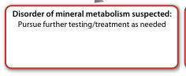

Unmatched source image; PDF page 614. Consult the original caption.

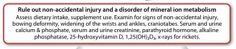

Unmatched source image; PDF page 614. Consult the original caption.

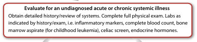

Unmatched source image; PDF page 614. Consult the original caption.

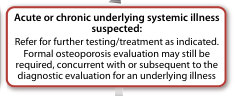

Unmatched source image; PDF page 614. Consult the original caption.

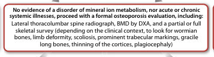

Unmatched source image; PDF page 614. Consult the original caption.

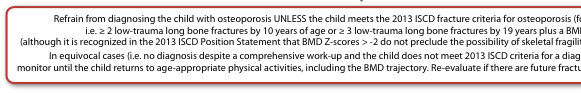

Unmatched source image; PDF page 614. Consult the original caption.

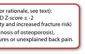

Unmatched source image; PDF page 614. Consult the original caption.

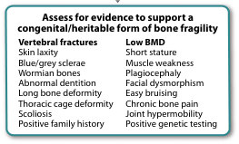

Unmatched source image; PDF page 614. Consult the original caption.

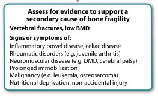

Unmatched source image; PDF page 614. Consult the original caption.

## PDF page 615 | printed page 610

### 23.3.2 Non-Vertebral Fractures

### 23

Despite advances in genetic testing and diag nostic imaging, the history and physical examination still provide most of the informa tion required to decide the extent to which a comprehensive skeletal evaluation is neces sary and/or to formally diagnose a child with osteoporosis. The history is particularly important to understand the mechanisms of injury resulting in fracture; to this end, some basic ‘paediatric fracture statistics’ are neces sary to contextualize the child’s fracture phe notype, as discussed next.

The risk of fracture between birth and 16 years ranges from 42 to 64% for boys and from 27 to 40% for girls [35]. A consistent finding across all epidemiological studies is that the most frequent site of fracture is the forearm, which accounts for nearly half of all paediatric fractures [35, 36]. Sixty-five percent of long bone fractures in childhood involve the upper extremity and 7–28% the lower extremity [35]. The fracture rate during child hood is higher than during adult life, hypoth esized to result from the constant lag during the growing years between the mechanical challenges that induce bone tissue strain (muscle forces and longitudinal growth), and the necessary adaptive changes in bone struc ture that foster bone strength in response to tissue strain [37].

38

23.3 Recognizing that long bone fractures are extremely common in childhood, the ISCD 2013 Position Statement defined a significant fracture history as ≥2 long bone fractures by age 10 years, or ≥3 long bone fractures by age 19 years [39]. These numbers are reasonable for a child without physical stigmata or risk factors for fractures, to avoid over-diagnosis of osteoporosis in a child who has been unlucky during sports or play. However, other factors should also be considered in the deci sion to initiate a comprehensive bone health evaluation and/or to diagnose a child with osteoporosis: the clinical context in which the child presents with fractures, the degree of trauma and the location + radiographic fea tures of the fracture(s).

The importance of the clinical contexts in which children present with fractures (or asso ciated risk factors) cannot be underestimated. Even a single long bone fracture can represent a major osteoporotic event in children with first presentations of OI or other skeletal dys plasias associated with bone fragility [40], and in children with significant risk factors for osteoporosis such as neuromuscular disor ders, leukaemia, and other GC-treated condi tions [32, 41, 42]. In settings without a known fracture risk, the degree of trauma associated with the fracture is particularly important in adjudicating the fracture’s significance. The ISCD [39] has defined low-trauma fractures as those occurring outside of motor vehicle accidents or falling from 10 ft (3 m) or less. With respect to falls in the high-risk chronic illness setting, a more conservative definition has been used—falling from a standing height or less, at no more than walking speed [29]. This latter definition has proven valid in the paediatric chronic illness setting since verte bral fractures predicted incident low-trauma long bone fractures defined in this way [29].

At the same time, it is important to rec ognize that children with high-trauma frac

## PDF page 616 | printed page 611

tures may also have a bone fragility condition, a reminder that screening for tell tale stigmata, even at the time of first pre sentation for fracture management in the orthopaedic clinic, is important. While femur fractures are particularly concerning, even a single tibia or humerus fracture can represent an osteoporotic event in those at risk and should therefore trigger careful evaluation of the injury’s mechanism. Forearm fractures are so common in chil dren that usually recurrent fractures at this site are needed to instigate a more compre hensive bone health evaluation, unless the clinical context and/or physical examination findings (i.e. blue sclerae) suggest otherwise. Comminuted fractures and those with atypi cal displacement are also significant regard less of the long bone site, especially when they occur in the absence of trauma.

23.4

3

41

## PDF page 617 | printed page 612

### 23

43

23.4

### 23.3.3 The Frequency and Clinical

### Predictors of Fractures in at-Risk Children

23.1 16 17 28 29 32 47 60

Vertebral Fractures

23.1

23.1

23.1

16

16 60

16 60

32 34 16 17

The fact that prevalent VF around the time of GC initiation predicted future VF draws attention to the clinical importance of understanding the skeletal phenotype early in the child’s disease course. In children with GC-treated rheumatic disorders, other dis crete clinical features in the first year were also independent predictors of future VF, includ ing increases in disease activity scores in the first 12 months of GC therapy as well as increases in body mass index and decreases in lumbar spine (LS) BMD Z-scores, both in the first 6 months of GC therapy [17]. In children with solid organ transplantation, older age was another consistent predictor of increased VF risk [53, 59, 61, 62].

## PDF page 618 | printed page 613

VF from univariate or multivariable models

– ↓Distal femur BMD (diaphyseal cortical

or incidence (%) Clinical predictors of prevalent or incident

growth plate) Z-score: RR = 1.09 (1.04,

– 1–3 recent wheezy episodes vs. without

bone) Z-score: RR = 1.15 (1.09, 1.22)b

– ↓Distal femur BMD (proximal to the

– ↓Distal femur BMD (transition from

– Recent wheeze vs. no recent wheeze:

– Thalassaemia vs. sickle cell disease:

metaphysis to diaphysis) Z-score:

– ↑Age: OR = 1.03 (1.03,1.08)b,c

– Male: OR = 2.6 (1.5, 4.5)b,c

(with effect size and 95% CI)

RR = 1.06 (1.02, 1.10)b

OR = 1.26 (1.03, 1.55)b

OR = 2.3 (1.2, 4.6)b,c

(823/16438) For boys:

1.13)b

patients 12–18 years of

study NR – Prevalence: 27% (at an

Fracture prevalence and/

– Prevalence: 17% (in

– Prevalence: 5.0%

average age of

11.8 years)

age)

patients Study design Fracture location (with

assessment method for

extremities and other

– Fractures of both

vertebral fractures)a

Table 23.1 Osteoporosis risk factors for fractures in children with specific disorders

Upper and lower

non-vertebral

vertebral and

fractures

Predictors of prevalent fractures (vertebral and non-vertebral fractures combined)

sites

619 Cross-sectional

16,438 Cross-sectional

natural history

retrospective

comparative

136 Prospective,

study by

review

study

Author Disease # of

(2010) Cerebral palsy

Fung (2008) Thalassaemia

or muscular

or treated

sickle cell

dystrophy

prevalent

(2018) Children

asthma

having

disease

Henderson

Degabriele

(continued)

– Age 11.0–15.0 vs. 3.5–6.9: OR = 2.55 (1.93,

– Age 9.0–10.9 vs. 3.5–6.9: OR = 1.83 (1.41,

– Asthma status and age are not significant

recent wheeze: OR = 1.40 (1.12, 1.77)b

For girls:

2.39)b

3.35)b

– Radiological reports

[44]

### Automatic table extraction — verify rendered original

|Fung (2008)|Thalassaemia or treated sickle cell disease|136|Prospective, natural history comparative study|Upper and lower extremities and other sites|– Prevalence: 17% (in patients 12–18 years of age)|– Thalassaemia vs. sickle cell disease: OR = 2.3 (1.2, 4.6)b,c – Male: OR = 2.6 (1.5, 4.5)b,c – ↑Age: OR = 1.03 (1.03,1.08)b,c|
|---|---|---|---|---|---|---|
|Henderson (2010)|Cerebral palsy or muscular dystrophy|619|Cross-sectional study|NR|– Prevalence: 27% (at an average age of 11.8years)|– ↓Distal femur BMD (proximal to the growth plate) Z-score: RR=1.09 (1.04, 1.13)b – ↓Distal femur BMD (transition from metaphysis to diaphysis) Z-score: RR=1.06 (1.02, 1.10)b – ↓Distal femur BMD (diaphyseal cortical bone) Z-score: RR=1.15 (1.09, 1.22)b|
|Degabriele (2018)|Children having prevalent asthma|16,438|Cross-sectional study by retrospective review|– Fractures of both vertebral and non-vertebral fractures – Radiological reports [44]|– Prevalence: 5.0% (823/16438)|For boys: – Recent wheeze vs. no recent wheeze: OR=1.26 (1.03, 1.55)b – 1–3 recent wheezy episodes vs. without recent wheeze: OR=1.40 (1.12, 1.77)b – Age 9.0–10.9 vs. 3.5–6.9: OR=1.83 (1.41, 2.39)b – Age 11.0–15.0 vs. 3.5–6.9: OR=2.55 (1.93, 3.35)b For girls: – Asthma status and age are not signifcant|

[Original table](../../tables/ch023_p0618_2.jpg)

## PDF page 619 | printed page 614

### 23

Predictors of prevalent and incident fractures

VF from univariate or multivariable models

or incidence (%) Clinical predictors of prevalent or incident

– ↑Spine defect level: RR = 1.65 (1.09,

– Weight for age Z scores: adjusted

– Back pain: OR = 4.7 (1.5, 14.5)b

– ↑Age: RR = 1.03 (1.00, 1.07)b,c

(with effect size and 95% CI)

OR = 0.41 (0.19, 0.86)b

combined:

2.50)b,c

patients 2–58 years of

Fracture prevalence and/

– Prevalence: 16% (at a

– Prevalence: 20%c (in

– Annual incidence:

2–18 years of age)

– Not specified the

2.6% (in patients

prevalence

age)

patients Study design Fracture location (with

– The measurement of

assessment method for

the fracture was not

extremities and other

– Long bone fracture

vertebral fractures)a

Upper and lower

– Vertebrae

specified

sites

Halton (2009) Leukaemiad 186 Cross-sectional

cross-sectional

19 Case-control

Predictors of prevalent fractures (non-vertebral fracture only)

Dosa (2007) Spina bifida 221 Historical

Predictors of prevalent fractures (vertebral fracture only)

study

study

Author Disease # of

cerebral palsy

ambulatory

Table 23.1 (continued)

children

Ko (2006) Non-

– ↑Cumulative GC (g/kg): OR = 4.50 (1.42,

– ↓% cortical area Z-score: OR = 2.0 (1.0,

– ↓LS BMD Z-score: OR = 1.8 (1.1, 2.9)b

– ↓LSBMD Z-score: OR = 0.4 (0.2, 0.9)b

– ↑BMI Z-score: OR = 1.49 (1.05, 2.09)b

– Male: OR = 6.04 (2.85, 12.81)b

– Male: OR = 6.6 (1.5, 28.3)b

14.28)b

3.2)b

– Prevalence: 71% (at an

– Prevalence: 19% (at a

from GC initiation)

median of 18 days

average age of

median age of

13.1 years)

7.4 years)

– Lateral spine x-ray

– Lateral spine x-ray

– Lateral spine x-ray

diseasesd 90 Cross-sectional – Vertebrae

– Vertebrae

[25] a

[25] a

[25] a

imperfecta 58 Cross-sectional

study

study

(2013) Osteogenesis

Nakhla (2009) Rheumatic

Ben Amor

### Automatic table extraction — verify rendered original

|Ko (2006)|Non-­ ambulatory cerebral palsy children|19|Case-­control study|– Long bone fracture – The measurement of the fracture was not specified|– Not specified the prevalence|– Weight for age Z scores: adjusted OR = 0.41 (0.19, 0.86)b|
|---|---|---|---|---|---|---|
|Dosa (2007)|Spina bifda|221|Historical cross-sectional study|Upper and lower extremities and other sites|– Prevalence: 20%c (in patients 2–58years of age) – Annual incidence: 2.6% (in patients 2–18years of age)|Predictors of prevalent and incident fractures combined: – ↑Spine defect level: RR=1.65 (1.09, 2.50)b,c – ↑Age: RR=1.03 (1.00, 1.07)b,c|

[Original table](../../tables/ch023_p0619_2.jpg)

### Automatic table extraction — verify rendered original

|Halton (2009)|Leukaemiad|186|Cross-­sectional study|– Vertebrae – Lateral spine x-ray [25] a|– Prevalence: 16% (at a median of 18 days from GC initiation)|– Back pain: OR = 4.7 (1.5, 14.5)b – ↓% cortical area Z-score: OR = 2.0 (1.0, 3.2)b – ↓LS BMD Z-score: OR = 1.8 (1.1, 2.9)b|
|---|---|---|---|---|---|---|
|Nakhla (2009)|Rheumatic diseasesd|90|Cross-sectional|– Vertebrae – Lateral spine x-ray [25] a|– Prevalence: 19% (at a median age of 13.1years)|– Male: OR=6.04 (2.85, 12.81)b – ↑Cumulative GC (g/kg): OR=4.50 (1.42, 14.28)b – ↑BMI Z-score: OR=1.49 (1.05, 2.09)b|
|Ben Amor (2013)|Osteogenesis imperfecta|58|Cross-sectional study|– Vertebrae – Lateral spine x-ray [25] a|– Prevalence: 71% (at an average age of 7.4years)|– ↓LSBMD Z-score: OR=0.4 (0.2, 0.9)b – Male: OR=6.6 (1.5, 28.3)b|

[Original table](../../tables/ch023_p0619_3.jpg)

## PDF page 620 | printed page 615

According to the Poisson regression analysis,

VF from univariate or multivariable models

or incidence (%) Clinical predictors of prevalent or incident

the independent predictor for the fracture

– Age at the time of transplant (13–20 vs.

– Sex (male vs. female): HR = 2.15 (1.22,

– Age at the time of transplant (5–12 vs.

– Transplant organ (heart vs. kidney):

– Transplant organ (liver vs. kidney):

0–4 years: HR = 1.80 (1.01, 3.20)b

0–4 years: HR = 2.02 (1.07, 3.83)b

(with effect size and 95% CI)

– Gastrostomy use: p = 0.05

– Higher body fat: p = 0.03

HR = 1.78 (1.01, 3.14)b

HR = 1.90 (0.93, 3.92)b

were as follows:

3.81)b

fractures per 100 years

average 9.2 years from

– Cumulative incidence:

Fracture prevalence and/

– Incidence: 9.2 per 100

in 604.5 person-years

person-years (on

– Incidence: 4.0

of follow-up

transplant)

40%

– The fracture sites were

lateral spine x-ray [45] a

extremities, vertebrae

patients Study design Fracture location (with

– The measurement of

assessment method for

the fracture was not

absorptiometry and

– Dual-energy X-ray

vertebral fractures)a

– Upper and lower

and other sites

not specified.

specified

Predictors of incident fractures (vertebral and non-vertebral fractures combined)

case-series study

after transplant

transplantd 196 Retrospective

plus 10 years

chart review

observation

children 261 Prospective

prospective

Author Disease # of

(2006) Cerebral palsy

(2006) Solid organ

Stevenson

Helenius

(continued)

– Deflazacort vs. GC naive: HR = 16.0 (1.4,

– Dexamethasone therapy: OR = 3.4 (1.31,

– Ambulant vs. non-ambulant: HR = 3.7

– ↓LS-BMD during the continuation

therapy: OR = 1.8 (1.2, 2.8)b

(1.5, 9.2)b

180.8)b

7.52) b

– Incidence rate 682 per

– Incidence proportion:

10,000 person-years

18.5% (23/124)

– The fracture sites were

– Clinical record reviews

– VF and non-VF

not specified

832 A retrospective

cohort study

124 Prospective

review

lymphoblastic

Rayar (2012) Children with

leukaemia d

dystrophyd

muscular

Joseph (2019) Duchene

acute

### Automatic table extraction — verify rendered original

|Helenius (2006)|Solid organ transplantd|196|Retrospective chart review plus 10 years prospective observation after transplant|– Upper and lower extremities, vertebrae and other sites – Dual-­energy X-ray absorptiometry and lateral spine x-ray [45] a|– Incidence: 9.2 per 100 person-­years (on average 9.2 years from transplant) – Cumulative incidence: 40%|– Sex (male vs. female): HR = 2.15 (1.22, 3.81)b – Age at the time of transplant (5–12 vs. 0–4 years: HR = 1.80 (1.01, 3.20)b – Age at the time of transplant (13–20 vs. 0–4 years: HR = 2.02 (1.07, 3.83)b – Transplant organ (liver vs. kidney): HR = 1.78 (1.01, 3.14)b – Transplant organ (heart vs. kidney): HR = 1.90 (0.93, 3.92)b|
|---|---|---|---|---|---|---|
|Stevenson (2006)|Cerebral palsy children|261|Prospective case-series study|– The fracture sites were not specifed. – The measurement of the fracture was not specifed|– Incidence: 4.0 fractures per 100years in 604.5 person-years of follow-up|According to the Poisson regression analysis, the independent predictor for the fracture were as follows: – Higher body fat:_p_=0.03 – Gastrostomy use:_p_=0.05|
|Rayar (2012)|Children with acute lymphoblastic leukaemiad|124|Prospective cohort study|– The fracture sites were not specifed|– Incidence proportion: 18.5% (23/124)|– Dexamethasone therapy: OR=3.4 (1.31, 7.52)b – ↓LS-BMD during the continuation therapy: OR=1.8 (1.2, 2.8)b|
|Joseph (2019)|Duchene muscular dystrophyd|832|A retrospective review|– VF and non-VF – Clinical record reviews|– Incidence rate 682 per 10,000 person-years|– Defazacort vs. GC naive: HR=16.0 (1.4, 180.8)b – Ambulant vs. non-ambulant: HR=3.7 (1.5, 9.2)b|

[Original table](../../tables/ch023_p0620_2.jpg)

## PDF page 621 | printed page 616

### 23

– ↑BMI Z-score at diagnosis: OR = 1.3 (1.1,

– ↓LS BMD Z-scores at diagnosis OR = 1.6

– ↓LS BMD Z-scores at diagnosis OR = 1.5

For symptomatic fractures occurred during

treatment or until 12 months after cessation

VF from univariate or multivariable models

For symptomatic fractures occurred in the

or incidence (%) Clinical predictors of prevalent or incident

– Age at the time of transplant (13–20 vs.

– Sex (male vs. female): RR = 2.14 (1.17,

– Fracture before transplant (yes vs. no):

– Age at the time of transplant (5–12 vs.

– ↑6-month glucocorticoid dose (g/m2):

0–4 years: RR = 1.95 (0.98, 3.89)

0–4 years: RR = 2.24 (1.01, 5.00)

(with effect size and 95% CI)

RR = 4.61 (1.12, 18.90)

OR = 1.9 (1.1, 3.2)b

first year of therapy:

(1.1, 2.4)b

(1.2, 1.8)b

3.93)

1.6)b

– 3.4% within 12 months

average 9.2 years from

– Cumulative incidence:

Fracture prevalence and/

– Incidence: 3.8 per 100

Incidence proportion:

person-years (on

after treatment

– 18.7% during

transplant)

treatment

27.0%

– Symptomatic fractures

lateral spine x-ray [45]

extremities and other

patients Study design Fracture location (with

assessment method for

absorptiometry and

confirmed on plain

– Dual-energy X-ray

vertebral fractures)a

– Upper and lower

non-vertebral)

(vertebral and

subsequently

radiographs

sites

a

(DCOG-ALL9

after transplant

transplantd 196 Retrospective

plus 10 years

chart review

and STOPP)

observation

Prospective

prospective

Predictors of incident fractures (non-vertebral fracture only)

studies

(n = 249)

DCOG-

STOPP

(n = 99)

ALL9

Author Disease # of

and

lymphoblastic

(2021) Children with

(2006) Solid organ

leukaemia d

Table 23.1 (continued)

acute

Verwaaijen

Helenius

– ↓LS BMD Z-score around the time of each

– ↑Average daily GC (10 mg/m2): HR = 3.80

– ↓Age at baseline (years): HR = 1.05 (0.95,

– VF at baseline (yes vs. no): HR = 4.40

non-VF: HR = 1.82 (1.11, 2.98)b

(1.72, 11.26)b

(1.94, 7.46)b

1.21)b

years for non-vertebral

and 3.4 per 100 person

for vertebral fracture

per 100 person years

– Incidence rate: 11.9

fractures

– By lateral thoracolum

bar spine radiographs

quantitative method

– Both vertebral and

using the modified

non-vertebral

Genant semi-

fractures

[25] a

cohort study

186 Prospective

lymphoblastic

Ward (2018) Children with

leukaemia d

acute

### Automatic table extraction — verify rendered original

|Author|Disease|# of patients|Study design|Fracture location (with assessment method for vertebral fractures)a|Fracture prevalence and/ or incidence (%)|Clinical predictors of prevalent or incident VF from univariate or multivariable models (with effect size and 95% CI)|
|---|---|---|---|---|---|---|
|Verwaaijen (2021)|Children with acute lymphoblastic leukaemiad|DCOG- ALL9 (_n_=249) and STOPP (_n_=99)|Prospective studies (DCOG-ALL9 and STOPP)|– Symptomatic fractures (vertebral and non-vertebral) subsequently confrmed on plain radiographs|Incidence proportion: – 18.7% during treatment – 3.4% within 12months after treatment|For symptomatic fractures occurred in the frst year of therapy: – ↓LS BMD Z-scores at diagnosis OR=1.6 (1.1, 2.4)b – ↑6-month glucocorticoid dose (g/m2): OR=1.9 (1.1, 3.2)b For symptomatic fractures occurred during treatment or until 12months after cessation – ↓LS BMD Z-scores at diagnosis OR=1.5 (1.2, 1.8)b – ↑BMI Z-score at diagnosis: OR=1.3 (1.1, 1.6)b|

[Original table](../../tables/ch023_p0621_1.jpg)

### Automatic table extraction — verify rendered original

|Helenius (2006)|Solid organ transplantd|196|Retrospective chart review plus 10 years prospective observation after transplant|– Upper and lower extremities and other sites – Dual-­energy X-ray absorptiometry and lateral spine x-ray [45] a|– Incidence: 3.8 per 100 person-­years (on average 9.2 years from transplant) – Cumulative incidence: 27.0%|– Fracture before transplant (yes vs. no): RR = 4.61 (1.12, 18.90) – Sex (male vs. female): RR = 2.14 (1.17, 3.93) – Age at the time of transplant (5–12 vs. 0–4 years: RR = 1.95 (0.98, 3.89) – Age at the time of transplant (13–20 vs. 0–4 years: RR = 2.24 (1.01, 5.00)|
|---|---|---|---|---|---|---|
|Ward (2018)|Children with acute lymphoblastic leukaemiad|186|Prospective cohort study|– Both vertebral and non-vertebral fractures – By lateral thoracolum- bar spine radiographs using the modifed Genant semi- quantitative method [25] a|– Incidence rate: 11.9 per 100 person years for vertebral fracture and 3.4 per 100 person years for non-vertebral fractures|– ↑Average daily GC (10mg/m2): HR=3.80 (1.94, 7.46)b – VF at baseline (yes vs. no): HR=4.40 (1.72, 11.26)b – ↓LS BMD Z-score around the time of each non-VF: HR=1.82 (1.11, 2.98)b – ↓Age at baseline (years): HR=1.05 (0.95, 1.21)b|

[Original table](../../tables/ch023_p0621_2.jpg)

## PDF page 622 | printed page 617

– Prior diagnosis of osteoporosis: HR = 9.5

– BMI ≥ 19 kg/m2 at transplant: RR = 4.30

VF from univariate or multivariable models

or incidence (%) Clinical predictors of prevalent or incident

– ↓TB BMC SDS: OR = 0.002 (0.0, 0.77)b

– Age at the time of transplant (13–20 vs.

– Age at the time of transplant (5–12 vs.

0–4 years): RR = 4.16 (1.60, 10.81)

0–4 years): RR = 2.32 (1.07, 5.05)

(with effect size and 95% CI)

– ↑Age: HR = 1.8 (1.2, 2.7)b

(1.26, 9.97)

(2.6, 35)b

average 9.2 years after

– Cumulative incidence:

– Cumulative incidence:

Fracture prevalence and/

– Incidence: 5.7 per 100

20%c (in the 15 years

following transplant)

– 1.5-year cumulative

person-years (on

incidence: 31.3%

transplant)

18%

– Fracture measurement

lateral spine x-ray [45]

patients Study design Fracture location (with

assessment method for

absorptiometry and

– Dual-energy X-ray

– Lateral spine x-ray

vertebral fractures)a

– Upper and lower

was not specified

extremities

– Vertebrae

– Vertebrae

[46] a

a

after transplant

Chen (2019) T1D 32 Retrospective

transplantd 86 Retrospective

transplantd 196 Retrospective

plus 15 years

plus 10 years

study within

chart review

chart review

case-control

observation

prospective

prospective

follow-up

1.5 years

Predictors of incident fractures (vertebral fracture only)

Author Disease # of

(2006) Solid organ

(2004) Renal

Helenius

Vautour

(continued)

– Prevalent VF (yes vs. no): OR = 7.30 (2.30,

– Prevalent VF (moderate/severe vs. none):

– Prevalent VF (mild vs. none): OR = 7.6

– ↓LS BMD Z-score: OR = 1.8 (1.2, 2.7)b

OR = 7.0 (1.6, 30.2)b

(1.8, 31.8)b

23.14)b

– Incidence proportion:

following diagnosis)

16% (at 12 months

– Lateral spine x-ray

– Vertebrae

[25] a

observational

prospective,

Alos (2012) Leukaemiad 155 12 months

study

### Automatic table extraction — verify rendered original

|Author|Disease|# of patients|Study design|Fracture location (with assessment method for vertebral fractures)a|Fracture prevalence and/ or incidence (%)|Clinical predictors of prevalent or incident VF from univariate or multivariable models (with effect size and 95% CI)|
|---|---|---|---|---|---|---|
|Chen (2019)|T1D|32|Retrospective case-control study within 1.5years|– Upper and lower extremities – Fracture measurement was not specifed|– 1.5-year cumulative incidence: 31.3%|– ↓TB BMC SDS: OR=0.002 (0.0, 0.77)b|

[Original table](../../tables/ch023_p0622_1.jpg)

### Automatic table extraction — verify rendered original

|Vautour (2004)|Renal transplantd|86|Retrospective chart review plus 15 years prospective follow-up|– Vertebrae – Lateral spine x-ray [46] a|– Cumulative incidence: 20%c (in the 15 years following transplant)|– ↑Age: HR = 1.8 (1.2, 2.7)b – Prior diagnosis of osteoporosis: HR = 9.5 (2.6, 35)b|
|---|---|---|---|---|---|---|
|Helenius (2006)|Solid organ transplantd|196|Retrospective chart review plus 10years prospective observation after transplant|– Vertebrae – Dual-energy X-ray absorptiometry and lateral spine x-ray [45]  a|– Incidence: 5.7 per 100 person-years (on average 9.2years after transplant) – Cumulative incidence: 18%|– BMI≥19kg/m2 at transplant: RR=4.30 (1.26, 9.97) – Age at the time of transplant (5–12 vs. 0–4years): RR=2.32 (1.07, 5.05) – Age at the time of transplant (13–20 vs. 0–4years): RR=4.16 (1.60, 10.81)|
|Alos (2012)|Leukaemiad|155|12 months prospective, observational study|– Vertebrae – Lateral spine x-ray [25] a|– Incidence proportion: 16% (at 12months following diagnosis)|– Prevalent VF (yes vs. no): OR=7.30 (2.30, 23.14)b – Prevalent VF (mild vs. none): OR=7.6 (1.8, 31.8)b – Prevalent VF (moderate/severe vs. none): OR=7.0 (1.6, 30.2)b – ↓LS BMD Z-score: OR=1.8 (1.2, 2.7)b|

[Original table](../../tables/ch023_p0622_2.jpg)

## PDF page 623 | printed page 618

### 23

VF from univariate or multivariable models

– Prevalent VF (moderate/severe vs. none):

– ↑Average daily GC (10 mg/m2): HR = 5.9

or incidence (%) Clinical predictors of prevalent or incident

– ↑Recente GC dose intensity (10 mg/m2):

– ↑Recente average daily GC (10 mg/m2):

– Prevalent VF (mild vs. none): HR = 4.2

– ↑Average daily GC dose (0.5 mg/kg):

– ↓LSBMD Z-score at the time of VF

assessment: HR = 1.6 (1.2, 2.2)b

(with effect size and 95% CI)

– ↓Age: HR = 1.1 (1.0, 2.2)b

HR = 6.2 (3.4, 11.4)b

HR = 5.1 (2.8, 9.5)b

HR = 1.2 (1.1, 1.4)b

(3.0, 11.8)b

(1.9, 9.6)b

Fracture prevalence and/

– Incidence: 8.7 per 100

– Incidence: 4.4 per 100

– Cumulative incidence

person-years (in the

first 4 years after

diagnosis)

26.4%

patients Study design Fracture location (with

assessment method for

– Lateral spine x-ray

vertebral fractures)a

– Vertebrae

– Vertebrae

[25] a

observational

prospective,

(2015) Leukaemiad 186 48 months

134 36 months

study

Author Disease # of

Rheumatic

Table 23.1 (continued)

Cummings

LeBlanc

– ↑Duration (month) of GC therapy in the

– ↓LSBMD Z-score, baseline to 6 months:

preceding 12 months of each VF assess

preceding each annual VF assessment:

– ↑VAS score, baseline to 12 months:

– ↑BMI Z-score in the first 6 months

ment: HR = 1.2 (1.1, 1.4)b

HR = 2.0 (1.1, 3.5)b

HR = 1.4 (1.1, 1.7)b

HR = 3.2 (1.6, 6.5)b

HR = 3.0 (1.1, 1.8)b

– Cumulative incidence:

3 years following GC

person-years (in the

initiation)

12.4%

– Lateral spine x-ray

[25] a

observational

prospective,

study

diseasesd

(2015)

### Automatic table extraction — verify rendered original

|Author|Disease|# of patients|Study design|Fracture location (with assessment method for vertebral fractures)a|Fracture prevalence and/ or incidence (%)|Clinical predictors of prevalent or incident VF from univariate or multivariable models (with effect size and 95% CI)|
|---|---|---|---|---|---|---|
|Cummings (2015)|Leukaemiad|186|48months prospective, observational study|– Vertebrae – Lateral spine x-ray [25] a|– Incidence: 8.7 per 100 person-years (in the frst 4years after diagnosis) – Cumulative incidence 26.4%|– Prevalent VF (mild vs. none): HR=4.2 (1.9, 9.6)b – Prevalent VF (moderate/severe vs. none): HR=6.2 (3.4, 11.4)b – ↑Average daily GC (10mg/m2): HR=5.9 (3.0, 11.8)b – ↓LSBMD Z-score at the time of VF assessment: HR=1.6 (1.2, 2.2)b – ↓Age: HR=1.1 (1.0, 2.2)b – ↑Recente average daily GC (10mg/m2): HR=5.1 (2.8, 9.5)b – ↑Recente GC dose intensity (10mg/m2): HR=1.2 (1.1, 1.4)b|
|LeBlanc (2015)|Rheumatic diseasesd|134|36months prospective, observational study|– Vertebrae – Lateral spine x-ray [25] a|– Incidence: 4.4 per 100 person-years (in the 3years following GC initiation) – Cumulative incidence: 12.4%|– ↑Average daily GC dose (0.5mg/kg): HR=2.0 (1.1, 3.5)b – ↑VAS score, baseline to 12months: HR=1.4 (1.1, 1.7)b – ↑BMI Z-score in the frst 6months preceding each annual VF assessment: HR=3.2 (1.6, 6.5)b – ↓LSBMD Z-score, baseline to 6months: HR=3.0 (1.1, 1.8)b – ↑Duration (month) of GC therapy in the preceding 12months of each VF assess- ment: HR=1.2 (1.1, 1.4)b|

[Original table](../../tables/ch023_p0623_1.jpg)

## PDF page 624 | printed page 619

– VF at baseline, mild versus none: HR = 4.52

– ↑Average daily GC (10 mg/m2): HR = 6.25

– ↓Age at baseline (years): HR = 1.09 (1.02,

VF from univariate or multivariable models

annual VF assessment: HR = 1.55 (1.12,

or incidence (%) Clinical predictors of prevalent or incident

– VF at baseline, moderate/severe versus

– ↓LS BMD Z-score at the time of each

none: HR = 8.08 (4.41, 14.79)b

(with effect size and 95% CI)

(3.22, 12.15)b

(2.01, 10.15)b

2.13)b

1.16)b

6 years since diagnosis:

fracture and 23.0% for

non-vertebral fractures

Fracture prevalence and/

– Cumulative fracture

32.5% for vertebral

incidence over the

– By lateral thoracolum

bar spine radiographs

patients Study design Fracture location (with

assessment method for

quantitative method

– Both vertebral and

using the modified

vertebral fractures)a

non-vertebral

Genant semi-

fractures

[25] a

cohort study

186 Prospective

Author Disease # of

lymphoblastic

Ward (2018) Children with

leukaemiad

acute

a Assessment methods for vertebral fractures reported in these studies (see references, Genant Semi-Quantitative Method [25]; Method reported by Makitie [45]; Method

Abbreviations: BMC bone mineral content; BMD bone mineral density; BMI body mass index; CI confidence interval; DRI dietary reference intake; GC glucocorticoid(s);

HR hazard ratio; IRR incident rate ratio; LSBMD lumbar spine bone mineral density; NR not reported; OR odds ratio; SDS standard deviation score; TB total body; T1D

Studies were included in the table if prevalence or incidence fracture data were available and risk factors for prevalent or incident fractures were investigated from uni

variate or multivariable models. Studies which show significant differences in relevant clinical parameters between those with and without fractures were not included

b Magnitude of association was obtained from multi-variable models

c This result was based on a cohort with both children and adults

e Recent: 12 months preceding VF assessment

reported by Eastell [46])

d Steroid-treated disease

type 1 diabetes

### Automatic table extraction — verify rendered original

|Author|Disease|# of patients|Study design|Fracture location (with assessment method for vertebral fractures)a|Fracture prevalence and/ or incidence (%)|Clinical predictors of prevalent or incident VF from univariate or multivariable models (with effect size and 95% CI)|
|---|---|---|---|---|---|---|
|Ward (2018)|Children with acute lymphoblastic leukaemiad|186|Prospective cohort study|– Both vertebral and non-vertebral fractures – By lateral thoracolum- bar spine radiographs using the modifed Genant semi- quantitative method [25] a|– Cumulative fracture incidence over the 6years since diagnosis: 32.5% for vertebral fracture and 23.0% for non-vertebral fractures|– ↑Average daily GC (10mg/m2): HR=6.25 (3.22, 12.15)b – VF at baseline, mild versus none: HR=4.52 (2.01, 10.15)b – VF at baseline, moderate/severe versus none: HR=8.08 (4.41, 14.79)b – ↓LS BMD Z-score at the time of each annual VF assessment: HR=1.55 (1.12, 2.13)b – ↓Age at baseline (years): HR=1.09 (1.02, 1.16)b|

[Original table](../../tables/ch023_p0624_1.jpg)

## PDF page 625 | printed page 620

Non-vertebral Fractures

### 23

23.1

48

### 23.4 Outcomes and Complications:

### Morbidity, Mortality, and Recovery

The clinical consequences of osteoporosis arise from the fractures themselves plus other short- and long-term consequences of bone fragility. Fractures cause pain, and anyone who has sustained a fracture will attest to the clinically significant nature of such pain. Lower extremity fractures invariably compro mise mobility in the short term; however, pre mature loss of ambulation is seen in disease groups with tenuous ambulation to begin with such as cerebral palsy and DMD. Fractures can also cause deformity of the spine and extremities, both of which can lead to func tional impairment. In such cases, surgical intervention may be needed to restore func tional abilities. In adults, mortality has long been linked to hip and spine fractures [63]; whether these associations are true in children remains unclear. However, fat embolism syn drome following long bone fractures has been described in paediatric DMD [64, 65]; on the other hand, another study suggested that bisphosphonate therapy for osteoporosis was linked to longevity in DMD [66].

The paediatric skeleton is a dynamic struc ture with the distinct capability to not only reclaim BMD lost during transient bone health insults but also to reshape fractured

bone (including vertebral bodies) through the process of skeletal modelling. Both indices are important measures of recovery in children, either spontaneously or following osteoporo sis therapy (i.e. bisphosphonate treatment). Since vertebral body reshaping appears to be growth-mediated, as it has never been unequivocally reported in adults [67], bisphos phonate therapy does not appear to directly bring about reshaping but rather has a per missive effect by enhancing BMD in order to prevent further collapse [68].

23.5a

23.5b

23.5c

69 70

To understand the vertebral body reshap ing phenomenon further, the Canadian STeroid-Induced Osteoporosis in the Paediatric Population (STOPP) Consortium studied determinants of complete versus

## PDF page 626 | printed page 621

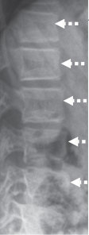

Unmatched source image; PDF page 626. Consult the original caption.

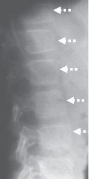

Unmatched source image; PDF page 626. Consult the original caption.

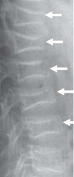

Unmatched source image; PDF page 626. Consult the original caption.

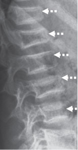

Unmatched source image; PDF page 626. Consult the original caption.

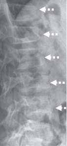

Unmatched source image; PDF page 626. Consult the original caption.

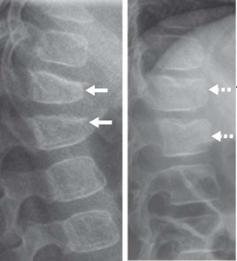

Unmatched source image; PDF page 626. Consult the original caption.

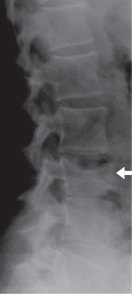

Unmatched source image; PDF page 626. Consult the original caption.

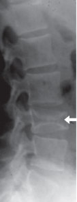

Unmatched source image; PDF page 626. Consult the original caption.

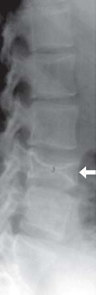

Unmatched source image; PDF page 626. Consult the original caption.

## PDF page 627 | printed page 622

incomplete reshaping in bisphosphonatenaïve ALL (quantified by a decrease in a posi tive Spinal Deformity Index (SDI) [71]. By studying children with leukaemia over 6 years following diagnosis who had baseline or inci dent vertebral fractures, the Canadian STOPP Consortium showed that 77% of children had complete reshaping by their last follow-up visit, 18% had incomplete reshaping and 5% had no change in their vertebral dimensions [24]. Children with incomplete or absent ver tebral body reshaping were older (on average 8 years of age at diagnosis, compared with 4.8 years in those with complete reshaping), and more frequently experienced moderate and severe collapse. In practical terms, these data revealed that younger children, and those with less severe collapse, appeared to reshape vertebral bodies more frequently in this con text.

### 23

As mentioned earlier, the long-term conse quences of permanent vertebral deformity remain unknown. Adult studies have shown reduced quality of life due to chronic back pain, and also significant functional limita tions [69, 70]. Whether this is true in adults who experienced permanent vertebral defor mity as children merits further study. In age ing, vertebral fractures contribute to excess mortality [72] as well as restrictive pulmonary function compared to those without vertebral fractures [73], due to the well-known loss of spinal height in the elderly that is associated with vertebral collapse. Loss of vertebral height contributing to loss of linear height in children has also been suggested in paediatric leukaemia [74], a clinical context where up to 1/3 of children will experience at least one ver tebral fracture in the 6 years following diagno sis [29]. Together, these adult studies suggest that permanent reductions in vertebral height sustained in childhood may have important consequences later in life. The GC-treated dis ease where this dialogue is particularly rele vant is DMD, given the shortened lifespan

due to cardiorespiratory failure. To date, there are no published reports of vertebral body reshaping without bisphosphonate therapy in paediatric DMD, an aggressive form of osteo porosis. This is likely because the GC pre scription is long-term, growth is limited by the toxic effect of GC on the growth plate, and the myopathy is progressive.

Increases in bone turnover markers and improvements in BMD are also important signs of recovery. Thayu et al. [19] reported that reductions in bone turnover markers in paediatric Crohn’s disease were inversely asso ciated with disease activity and that treatment with infliximab was associated with dramatic increases over 1 year. In childhood leukaemia, studies have shown degrees of BMD restitu tion in the years after chemotherapy [75, 76]. Cranial and spinal radiation predict a lack of BMD restitution, particularly at doses ≥24 Gy [76], related in part due to growth hormone deficiency and short stature. In leukaemia sur vivors, other reported risk factors for incom plete BMD restitution include vitamin D deficiency, hypogonadism and reduced physi cal activity [77]. Mostoufi-Moab [78] assessed children by tibia pQCT and found that tra becular and cortical BMD Z-scores were low compared to healthy controls within 2 years post-chemotherapy completion, but that sig nificant improvements (on average 0.5 SD) were evident a year later. Cortical dimensions also increased, followed by increases in corti cal BMD.

29

23.6

78

## PDF page 628 | printed page 623

reports highlight that children should be encouraged to re-establish physical condi tioning following chemotherapy cessation (and to maintain physical conditioning as far as possible during leukaemia therapy), but that the increased risk of fractures in the first year or so after stopping leukaemia therapy merits avoidance of activities with an increased risk of falling during this criti cal recovery period.

79

23.7

80

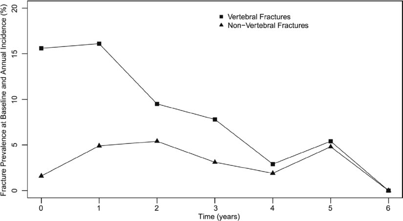

Unmatched source image; PDF page 628. Consult the original caption.

## PDF page 629 | printed page 624

### 23

### 23.5 The Definition

### of Osteoporosis and Diagnostic Evaluation in at-Risk Children

### 23.5.1 Bone Health Monitoring:

### Goals and Candidates

The ultimate goal of monitoring is to identify high-risk patients for intervention that will prevent the first fracture. However, lack of available data to support such primary pre vention has led to monitoring that identifies early rather than late signs of osteoporosis, followed by bone-active treatment in those with limited potential for spontaneous recov ery (including limited potential to undergo

vertebral body reshaping). This is in line with a secondary prevention approach, which seeks to mitigate the progression of osteoporosis following identification in its earlier stages.

Two important observations have shifted monitoring away from a BMD-centric to a more functional approach: (1) The use of a BMD Z-score threshold to identify a child as having osteoporosis is problematic due to variability in the Z-scores generated by the different available normative databases [81–83], and (2) Asymptomatic VF can occur at BMD Z-scores > −2, thereby requiring imaging surveillance for VF detection [83]. Other functional outcomes should also be tracked during monitoring including history of non-VF, growth, pubertal status, mobility, pain, muscle strength, and the potential for spontaneous recovery (vertebral body reshap

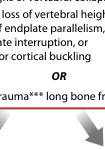

Unmatched source image; PDF page 629. Consult the original caption.

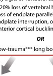

Unmatched source image; PDF page 629. Consult the original caption.

## PDF page 630 | printed page 625

ing and bone density restitution). BMD remains a vital part of the bone health moni toring paradigm but as an adjuvant tool to chart the child’s BMD trajectory, thereby sig nalling a child who is losing ground and thereby at increased risk for fractures, or who is showing signs of recovery following a tran sient bone health threat (potentially obviating the need for osteoporosis treatment). These concepts have recently been reviewed in a doc ument that discussed the overall approach to the definition and diagnosis of osteoporosis in childhood with a contemporary lens [43].

84

16 29 84

23.1

32 34 60 84 86

23.1a, b 23.2

23.1

28 87

Since BMD is useful as a serial measure ment to assist the clinician in understanding the child’s overall bone health trajectory and in making logical decisions about the need for ongoing monitoring, discharge from bone healthcare, or intervention, it is recommended that a BMD is carried out at least as fre quently as spine imaging according to the above guidelines [39, 88].

### 23.5.2 Axial Skeletal Health:

### Vertebral Fracture Detection Methods and Imaging Modalities

The most widely used tool for the assessment of VF in both children and adults is the Genant semi-quantitative method [25, 89]. According to the Genant method, the defini tion of a VF is ≥20% loss in vertebral height ratio regardless of the VF morphology (wedge, bi- or mono-concave, or crush). VF are subjectively graded by trained readers according to the magnitude of the reduction in vertebral body height ratios, without direct measurement. Vertebral height ratios are gen erated when the anterior vertebral height is compared with the posterior height (for an anterior wedge fracture), middle height to the posterior height (bi- or mono-concave frac ture) and posterior height to the posterior height of adjacent vertebral bodies (crush fracture). The Genant scores correspond to the following reductions in height ratios: grade 0 (normal), <20%; grade 1 fracture (mild), ≥20 to 25%; grade 2 fracture (moder ate), >25–40%; grade 3 fracture (severe), >40%. Overall, the Genant semi-quantitative method is preferred over quantitative (6-point)

## PDF page 631 | printed page 626

vertebral morphometry [46], since it is faster, and takes into consideration the expertise of an experienced reader. In addition, it quanti fies the severity of VF (an important predictor of the lack of potential for spontaneous verte bral body reshaping following VF in children). Furthermore, the Genant scoring system per mits the calculation of the SDI, the sum of the Genant grades from T4 to L4 [71]. The SDI is a global index of spine morbidity that is useful clinically and can be used as a con tinuous outcome variable in research studies [90], since it quantifies both VF severity and number. The kappa statistics for intra- and inter-observer agreement are similar for chil dren compared to adults using the Genant semi-quantitative method [25, 91, 92].

### 23

A number of recent studies have provided validity for the Genant approach in children. First, Genant-defined VF show a bi-modal distribution from T4 to L4 similar to the known distribution in adults [93–96], with a predilection for the mid-thoracic region (T5 to T8, the site of the natural kyphosis) and the thoracolumbar junction (the site of transition to the natural lordosis) [32, 96]. Secondly, bio logically relevant clinical predictors of Genant-defined VF have been identified including back pain, low LS BMD Z-scores, longitudinal declines in LS BMD Z-scores, and GC exposure [17, 32, 60]. One of the most important observations to assert the validity in children is that both mild and moderatesevere Genant-defined VF at leukaemia diag nosis are robust clinical predictors of new VF over the next 3 years [16, 60].

To date, the most common imaging tool for VF detection in childhood is lateral thora columbar spine radiographs. Because of the high radiation exposure from spine radio graphs but nevertheless the critical need for VF assessments as part of bone health evalu ations, non-radiographic imaging techniques have been developed which use the scoring methods described above. The use of DXA to diagnose VF is called “vertebral fracture assessment” (VFA), with images captured on a lateral spine view. VFA is attractive as an assessment tool given its minimal radiation and the fact that fan-beam technology facili

tates the capture of the entire spine on a single image without divergent beam issues due to parallax. Newer DXA machines have a rotat ing ‘c-arm’ which obviates the need to re-posi tion the patient from the supine to the lateral position. Image quality varies significantly depending on the densitometer [97]. Recently, guidelines have been published by the ISCD on the use of DXA-based VFA in children, an approach that seeks to minimize radiation in settings where periodic spine surveillance is needed to unveil overt but nevertheless asymp tomatic signs of bone fragility [26]. In addi tion, the sensitivity and specificity of VF detection rates in children with GC disorders, depending upon their clinical profiles (i.e. the presence of back pain, low BMD or a combi nation of the two) have also been reported to provide clinicians with different strategies for minimizing radiation and maximizing VF detection rates [98, 99].

Vertebral fractures are so important in the diagnostic algorithm that they should be eval uated by a healthcare professional with trained expertise, including the ability to dis tinguish vertebral fractures from normal physiological rounding in the thoracic region and other normal variants [100].

### 23.5.3 Axial Skeletal Health:

### Trans-Iliac Bone Biopsies

Iliac crest bone biopsies with tetracycline label ling provide unique diagnostic information about static and dynamic bone properties that cannot be obtained by any other means (i.e. osteoid thickness, bone formation rate, miner alization lag time, and other bone formation and resorption indices) [101]. In practical terms, biopsies are useful in establishing the cause of osteoporosis in special cases such as a child with unexplained bone fragility and neg ative genetic studies. Idiopathic juvenile osteo porosis has a characteristic histomorphometric appearance—low bone turnover and thin oste oid seams—but clinically may be difficult to distinguish from other forms of osteoporosis such as non-deforming OI without blue sclerae, wormian bones, or family history [102,

## PDF page 632 | printed page 627

103]. Similarly, patients with OI typically have a histological hallmark (hyperosteocytosis) that is helpful diagnostically in rare cases when studies are falsely negative [102, 103]. At the same time, few clinicians are trained in this technique so overall, it is a rarely used tool aside from highly specialized clinics.

### 23.5.4 Axial and Appendicular

### Skeletal Health: Dual-Energy X-Ray Absorptiometry

104

48 105

23.1

106

3

107

108

109

48

23.1

### 23.5.5 Appendicular Skeletal

### Health: Peripheral Quantitative Computed Tomography

pQCT at the radius and tibia provides infor mation that cannot be obtained by DXA about musculoskeletal geometry as well as ‘true’ (volumetric) cortical and trabecular BMD. For example, in children with cerebral palsy, it has been shown that smaller bone and cortical cross-sectional area are the main structural defects, rather than lower cortical BMD [110]; pQCT studies have also shown that cortical thickness and not density is the main parameter impacted by growth hormone deficiency and treatment [111]. pQCT is par ticularly useful when DXA studies are pre cluded due to spine deformity, hip and knee contractures, or metallic hardware. The new est technique, high-resolution pQCT, has the spatial resolution to measure trabecular geometry and microarchitecture. At the moment, pQCT and high-resolution pQCT are research tools in most centres.

### 23.5.6 Bone Turnover Markers

Bone turnover markers (BTM) are often mea sured in children undergoing a bone health assessment or while on osteoporosis therapy. Recently, two markers have been recom mended by the International Osteoporosis Foundation and the International Federation of Clinical Chemistry and Laboratory Medicine [112]: serum procollagen type I N-terminal propeptide (PINP, a marker of bone formation) and serum collagen type I cross-linked C-telopeptide (CTx, a marker of

## PDF page 633 | printed page 628

bone resorption), both of which have been studied in healthy children in order to gener ate reference data [113–116]. These analytes were chosen because of their specificity to bone and their relationship to relevant out comes in adult clinical studies as well as their stability, wide availability and ease of analysis and procurement.

### 23

BTM are influenced by several factors that lead to high intra- and inter-individual vari ability, including age/pubertal stage, gender, time of day, food intake, physical activity, recent fractures, serum 25-hydroxyvitamin D status, assay methods, and sample transport and storage conditions. One of the main fac tors that have limited their use in children, particularly for those with chronic illness and growth delay, is that BTM are largely a reflec tion of linear growth and not bone turnover per se. In children, the only available method to determine the bone turnover status with certainty is to directly measure bone forma tion and resorption on trabecular surfaces via trans-iliac bone biopsy; however, this tool is not in widespread clinical use.

In children, BTM provide some insight into general diagnostic categories; for exam ple, urinary NTx levels are high prebisphosphonate treatment in children over 3 years of age with OI [117] and correlate with an increased trabecular bone formation rate on trans-iliac biopsies [118]. Low BTM and trabecular bone formation are frequently observed in chronic illness osteoporosis both before [68, 119] and after [68] years of GC therapy. LRP5 mutations causing juvenile osteoporosis are also characterized by low BTM and trabecular bone formation [120, 121]. On the other hand, brisk increases in BTM can signal recovery from growth failure and bone mass deficits as observed in children undergoing effective treatment for Crohn’s disease [19]. A low-alkaline phosphatase can separate patients with treatment-naive OI from those with hypophosphatasia—an important distinction since bisphosphonates are contraindicated in hypophosphatasia and a life-saving medical therapy is now available to treat the severe infantile form [122].

To date, there are no studies in childhood which have assessed the fracture risk reduc tion or frequency of adverse effects according to thresholds of bone turnover reduction with bisphosphonate therapy. At the present time, BTM during paediatric osteoporosis therapy serve to document that the drug is exerting the anticipated biological effect and provide a measure of compliance.

### 23.5.7 The Definition and Diagnosis

### of Osteoporosis in Children

23.1

81 83

83

These disparate results in BMD Z-scores depending on the reference data that is used plus the fact that both VF and non-VF [32, 48] can occur with BMD Z-scores above the −2.0 threshold suggested that the use of a LS BMD Z-score cut-off as part of the definition of osteoporosis in children with VF was not valid [83]. This view was underscored by the ISCD in the 2013 Position Statement [39] which noted a BMD Z-score threshold of ≤ −2.0 was no longer required to diagnose

## PDF page 634 | printed page 629

osteoporosis in a child with a VF. In the 2013 ISCD recommendation, the use of a BMD Z-score threshold (−2.0 or worse) was retained to denote osteoporosis in children with long bone fractures, provided such children also had a clinically significant fracture history defined as ≥2 long bone fractures by age 10, and ≥3 long bone fractures by age 18 [39]. At the same time, the 2013 ISCD position state ment did acknowledge that a BMD (or bone mineral content) Z-score > −2.0 did not pre clude an increased fracture risk of long bone fractures. This line of thinking is concordant with a study by Henderson et al. who showed that up to about 15% of children with neuro muscular disorders and lower limb fractures had lateral distal femur BMD Z-scores > −2.0 [48]. Yet another critical caveat is that recur rent fractures are not needed in patients with a clinical context known to be associated with bone fragility [43]. One such logical example is a child with DMD and a single long bone (femur or tibia) fracture, which is well-known to cause permanent, premature loss of ambu lation in this setting [41]. Instead, recurrent long bone fractures are recommended when a confirmed osteoporosis aetiology (such as OI or secondary osteoporosis) is absent, so as not to inappropriately diagnose an otherwise healthy child with osteoporosis who has been unlucky during sports and play.

Despite the disparity in LS BMD Z-score generated by different normative databases, Ma et al. [83] showed in children with ALL at diagnosis that the relationships between LS BMD Z-scores and VF are consistent regard less of the reference databases that are used to generate the Z-scores. This is not surprising, since the available reference databases are all highly correlated with one another (with r value ranging from 0.85 to 0.99) [83]. These findings suggested that while the use of an LS BMD Z-score threshold is not valid for the diagnosis of osteoporosis in children with VF, and that this is likely also true in relation to other BMD sites in children with extremity fractures [48], the use of LS BMD Z-scores as a continuous variable risk factor for VF in clin ical research studies nevertheless remains valid.

Where does this leave the clinician in the pivotal decision to label a child with osteopo rosis? On balance, current evidence puts the weight of the diagnosis on the fracture his tory. Among children with risk factors for osteoporosis, a low-trauma fracture is usually apparent (falling from a wheelchair, sustain ing a fracture during a seizure); in such cases, a size-corrected BMD Z-score > −2.0 should not deter the clinician from the osteoporosis diagnostic label [43].

23.4

### 23.6 Treatment

### 23.6.1 General Measures

### for Optimization of Bone Health

First-line measures to optimize bone health fall into three main categories: nutrition (cal cium, vitamin D, protein, potassium, magne sium, copper, iron, fluoride, zinc and vitamins A, C, and K), physical activity plus treatment of the underlying condition and associated co-morbidities; these have been recently reviewed extensively elsewhere [1, 2, 123–130] and will not be reiterated here. The exception is vitamin D status given its tendency to be entrenched in controversy, making it difficult for the clinician to see the forest for the trees.

## PDF page 635 | printed page 630

The recommended intake of vitamin D is a minimum of 600 IU/day [131], although higher doses are often required to meet target levels, particularly in those with malabsorp tion, obesity and darker skin [131]. Adequate total body vitamin D stores have been defined at a serum 25-hydroxyvitamin D level ≥50 nmol/L (20 ng/mL) [131, 132] or ≥75 nmol/L (30 ng/mL) [133], mostly based on adult studies. In children, the optimal serum 25OHD threshold remains under debate. A meta-analysis showed a lack of sig nificant effect of vitamin D supplementation and 25OHD levels ≥50 nmol/L on BMD in healthy youth [134], a bone histomorphomet ric study in children with OI failed to show an association between serum 25OHD levels and bone mineralization or bone mass [135], and calcium plus vitamin D supplementation had no effect on spine BMD in children with inflammatory bowel disease [136] and leukae mia [137]. Overall, the optimal serum 25OHD threshold associated with health benefits across the life cycle remains controversial as discussed in a large contemporary ‘umbrella’ assessment of published systematic reviews and meta-analyses [138]. From a practical perspective, a minimum 25-hydroxyvitamin D level of 50 nmol/L (20 ng/mL) is recom mended in youth through diet and/or supple mentation, with measurement of 25-hydroxyvitamin D in high-risk populations ideally at the end of winter in order to deter mine compliance with and efficacy of pre scribed doses at the time of the nadir.

### 23

For children with chronic illnesses, ade quate treatment of the underlying illness is the mainstay of osteoporosis prevention and treatment. The situation is complicated by the fact that some of the standard therapies are osteotoxic, including GC therapy, high-dose methotrexate in the cancer setting [139], calci neurin inhibitors [140], hepatic microsomal enzyme-inducing anti-epileptics increasing catabolism of 25-hydroxyvitamin D, and longterm use of anticoagulants [141]. Wherever possible, these agents should be used sparingly in children with risk factors for osteoporosis, a principle that is not always practical given, for

example, the need for GC therapy to treat sys temic inflammatory diseases and leukaemia, and to slow the progression of the myopathy in DMD. Identification of endocrine comorbidities is also appropriate, including treatment of delayed puberty, growth hor mone deficiency, hyperthyroidism and diabe tes. Growth hormone therapy increases areal BMD even after final adult height attainment, and should be continued through adulthood in those with low size-adjusted BMD or frac tures [142]. A word of caution in the use of growth hormone to treat GC-induced growth failure in DMD—in addition to a paucity of data to support the safety and efficacy of this approach, one of the current postulates is that short stature may be beneficial to muscle strength in DMD since stresses on the sarco lemma are higher with increases in the size of the muscle fibre [143].

### 23.6.2 Drug Therapy: Candidates

### for Medical Intervention and Timing of Treatment Initiation

When to initiate medical treatment is a fre quently posed question by clinicians. To date, intervention studies in children have largely been limited to case series and small observa tional or case-control studies, given the rela tive paucity of patients with various diseases at any one medical centre, and the challenges in securing funding for large, multi-centre drug trials in the young. The absence of treat ment trials targeting the prevention of firstever fractures in children has led to a conservative approach overall, with therapy typically reserved for children with overt bone fragility. Among those with chronic illness osteoporosis, there is an additional consider ation—not every child with symptomatic osteoporotic fractures and chronic illness requires osteoporosis therapy given the poten tial for spontaneous (medication unassisted) recovery if risk factors are transient, including reshaping of previously fractured vertebral

## PDF page 636 | printed page 631

bodies. The potential for spontaneous recov ery in children with transient risk factors demands controlled trials in this setting.

Where primary prevention with drug ther apy prior to the first fracture is concerned, at present there are insufficient data to recom mend anticipatory osteoporosis drug therapy routinely in paediatric osteoporosis practice. However, in very high-risk populations with significant clinical consequences arising from even a single fracture (such as paediatric DMD as discussed earlier), discussions are underway to explore the prevention of firstever fractures via anticipatory osteoporosis drug therapy. Here, there is an urgent need for well-designed trials or convincing real-world data with sufficient patient numbers to effec tively assess functional outcomes including fractures, pain, and mobility when treatment is started before the first fracture.

Since there are insufficient data to rou tinely recommend drug therapy for the pri mary prevention of osteoporotic fractures in children with any condition at the present time, careful monitoring of at-risk children to identify those with early signs of bone fragil ity, particularly in those with limited potential for spontaneous recovery, is indicated. Such an approach follows the principles of second ary prevention—to mitigate osteoporosis pro gression and foster recovery in those with earlier (rather than later) signs of osteoporo sis. Given the knowledge that has emerged about the clinical populations at risk for osteoporosis and the disease-specific predic tors of fractures, it is no longer appropriate for children to present to medical attention with, for example, back pain due to advanced vertebral collapse necessitating ‘rescue ther apy’. Rather, paediatric programs should be established to effectively monitor at-risk chil dren in order to identify earlier stages of ver tebral collapse, followed by an assessment of the child’s potential for medication-unassisted recovery versus the need for osteoporosis treatment. A monitoring program also pro vides the clinician with an opportunity to identify and treat vitamin D, mineral and hor monal deficiencies, encourage a healthy

weight, promote physical activity within the limits of the child’s underlying condition, and encourage compliance with treatment of the underlying condition [19, 144].

23.7 23.8

23.8

## PDF page 637 | printed page 632

### 23

sis. As shown in Fig. 23.8, a frequent conundrum is whether to start treatment with out a specific underlying diagnosis—a sce nario referred to as ‘low-trauma, recurrent

(usually extremity) fractures in otherwise healthy children’. In such cases, the clinician needs to make every effort to unearth a known cause, including the now expanded aetiologies

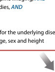

Unmatched source image; PDF page 637. Consult the original caption.

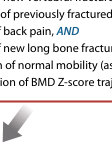

Unmatched source image; PDF page 637. Consult the original caption.

## PDF page 638 | printed page 633

of heritable bone fragility outlined in Fig. 23.1a and b, or chronic illnesses with insidious onset (such as Crohn’s or rheumatic diseases) outlined in Fig. 23.2. When genetic and chronic illness evaluations are negative, a trans-iliac bone biopsy can also provide important clues although this tech nique is less readily available. When no specific diagnosis is forthcoming despite a compre hensive evaluation, the criteria to label a child with osteoporosis provided in the most recent ISCD position statement support the decision to initiate osteoporosis treatment: ≥2 long bone fractures by age 10 or ≥3 or more long bone fractures by age 18 and a size-corrected BMD or bone mineral content Z-score of −2 or less [39] ( Fig. 23.8). Low-trauma VF may also prompt treatment in these cases.

### 23.6.3 Bisphosphonate Treatment

### of Primary and Secondary Osteoporosis in Childhood

Bisphosphonates, synthetic analogues of pyrophosphate, are the most extensively pub lished agents to treat osteoporosis in child hood [145, 146], even though they remain off-label in most countries. The vast majority of publications describing the effect of bisphosphonate therapy in children are obser vational pre-post studies; there are relatively few controlled studies of bisphosphonate therapy in children and even fewer studies have been sufficiently powered to assess frac ture outcomes. The paucity of fracture out come data in controlled trials reflects a number of considerations when studying chil dren: the relatively small numbers of patients available for study, the historically adult focus of industry-sponsored trials and the logistical and philosophical challenges enrolling younger patients.

23.2 147 159

23.9 147 148 150 152 153 156 159

23.10 147 149 152 153 155 159

23.11 147 149 150 152 155 158 159

### 23.6.4 Oral versus Intravenous

### Bisphosphonate Therapy

The use of oral versus intravenous (IV) bisphosphonate therapy for paediatric osteo porosis has long been debated [160]. Overall, IV pamidronate was historically the mostly extensively reported agent in children follow ing the inaugural, observational study in the late 90s which showed improved pain, mobil ity and reshaping of vertebral bodies follow ing pamidronate therapy in children with moderate to severe OI [161]. Children were treated with cyclical, IV pamidronate at a dose of 9 mg/kg/year divided every 2–4 months up to 5 years duration [161]. In recent years,

## PDF page 639 | printed page 634

### 23

No major adverse events

because of dyspepsia

patient discontinued

– Placebo group: One

in either treatment or

otherwise similar

between groups

– Adverse events

the medication

Not reported

(years) Agent, dose and route Main efficacy outcomes Side effects

– Non-significant differences compared to placebo:

– Non-significant differences compared to placebo:

–

23.10 23.11

– BMD: comparisons between groups not reported

etry, height of the vertebral bodies, urinary bone

↓Relative risk of long bone fractures and ↑Spine

–

23.9

–

23.9

alkaline phosphatase, urinary deoxypyridinoline

mobility, self-care, muscle strength, anthropom

femoral neck and LS areal BMD, bone-specific

– Significant differences compared to placebo:

Table 23.2 Bisphosphonate therapy in children: results of blinded randomized controlled trials with at least ten patients per group

– Significant differences compared to

placebo:↑femoral neck vBMD.

resorption markers

23.10 23.11

23.10

BMC

– Oral olpadronate

– Oral alendronate

– Oral alendronate

Treatment group:

Treatment group:

Treatment group:

– 10 mg/m2 daily

Control group:

Control group:

– 10 mg/day

– Placebo

– Placebo

– Age: mean (SD) = 10.7 (3.9)

– Age: mean (SD) = 16.9 (1.6)

– Age: mean (SD) = 16.9 (2.2)

– Age: mean (SD) = 1.0 (3.1)

design and diagnosis Number of patients, age

Treatment group:

Treatment group:

Treatment group

Placebo group:

Placebo group

– N = 16

– N = 18

– N = 15

– N = 17

– N = 11

– OI (mild to severe)

– RCT, double-blind

– RCT, double-blind

– RCT, double-blind

– Anorexia nervosa

– Duration: 2 years

Publication, study

– Duration: 1 year

– Sakkers (2004)

– Golden (2005)

– Rudge (2005)

placebo group

– Alendronate group: ↑LS vBMD compared to

– Alkaline phosphatase group: non-significant

– Placebo group: no change in LS vBMD

differences compared to placebo

compared to baseline

baseline

– 1–2 mg/kg once-weekly

Control group:

– Placebo

max) = 8.7 years (6.3, 14.5)

– Age: median years (min,

max) = 8.0 (4.3, 17.2)

– Age: median (min,

Placebo group:

– N = 11

treated with GC

– Duration: 1 year

– Chronic illness

therapy

### Automatic table extraction — verify rendered original

|Publication, study design and diagnosis|Number of patients, age (years)|Agent, dose and route|Main efficacy outcomes|Side effects|
|---|---|---|---|---|
|– Sakkers (2004) – RCT, double-blind – OI (mild to severe) – Duration: 2years|Treatment group – _N_=16 – Age: mean (SD)=1.0 (3.1) Placebo group – _N_=18 – Age: mean (SD)=10.7 (3.9)|Treatment group: – Oral olpadronate – 10mg/m2 daily Control group: – Placebo|– See BMD and fracture outcomes in. Figs.23.9,  23.10, and23.11 – Signifcant differences compared to placebo: ↓Relative risk of long bone fractures and↑Spine BMC – Non-signifcant differences compared to placebo: mobility, self-care, muscle strength, anthropom- etry, height of the vertebral bodies, urinary bone resorption markers|Not reported|
|– Golden (2005) – RCT, double-blind – Anorexia nervosa – Duration: 1year|Treatment group: – _N_=15 – Age: mean (SD)=16.9 (1.6) Placebo group: – _N_=17 – Age: mean (SD)=16.9 (2.2)|Treatment group: – Oral alendronate – 10mg/day Control group: – Placebo|– See BMD and fracture outcomes in. Figs.23.9 and23.10 – Signifcant differences compared to placebo:↑femoral neck vBMD. – Non-signifcant differences compared to placebo: femoral neck and LS areal BMD, bone-specifc alkaline phosphatase, urinary deoxypyridinoline|– Placebo group: One patient discontinued the medication because of dyspepsia – Adverse events otherwise similar between groups|
|– Rudge (2005) – RCT, double-blind – Chronic illness treated with GC therapy – Duration: 1year|Treatment group: – _N_=11 – Age: median (min, max)=8.7years (6.3, 14.5) Placebo group: – _N_=11 – Age: median years (min, max)=8.0 (4.3, 17.2)|Treatment group: – Oral alendronate – 1–2mg/kg once-weekly Control group: – Placebo|– See fracture outcomes in. Figs.23.10 and23.11 – BMD: comparisons between groups not reported – Alendronate group:↑LS vBMD compared to baseline – Placebo group: no change in LS vBMD compared to baseline – Alkaline phosphatase group: non-signifcant differences compared to placebo|No major adverse events in either treatment or placebo group|

[Original table](../../tables/ch023_p0639_1.jpg)

## PDF page 640 | printed page 635

alendronate group and

discomfort: 2/20 in the

Mild gastrointestinal

0/20 in the placebo

in improving BMD in risedronate group Not reported

(years) Agent, dose and route Main efficacy outcomes Side effects

group

– Non-significant differences compared to placebo:

–

23.9

– ↑BMD for both groups with even more effective

serum calcium, osteocalcin, PTH, 1,25 (OH)2

– Significant differences compared to placebo:

↑Improved QOL scores, except for mobility;

↑Height Z-score; and ↓Urinary NTx

vitamin D3, urinary hydroxyproline

23.11

weight < 30 kg; 10 mg/

day if weight > 30 kg

– Alfacalcidol + Oral

– Dose not specified

– Alfacarcidol only

– Oral alendronate

Treatment group:

Treatment group:

Control group:

Control group

Risedronate

– 5 mg/day if

– Placebo

– Cross-over design, therefore

– Age: mean (SD) = 9.8 (1.06)

same patients as in the

design and diagnosis Number of patients, age

Overall age: 1–16 years;

treatment group

Treatment group

Treatment group

Placebo group

Control group

mean = 9.1

– N = 20

– N = 10

– N = 10

crossover to placebo

crossover to treatment

– Duration: 6 months

– Bedridden patients

with cerebral palsy

– OI (mild to severe)

– RCT, double-blind

1 year placebo, then

– RCT with double-

– Duration: 1 year

Publication, study

blind crossover

treatment then

– Iwasaki (2008)

– Seikaly (2005)

design

OR

(continued)

treatment and placebo

Similar between

groups

metacarpal cortical width, grip strength and bone

–

23.9

volume, bone turnover; vertebral height; second

body; trans-iliac cortical width, trabecular bone

– Non-significant differences: BMC/BMD at the

radial metaphysis and diaphysis, hip and total

– Significant differences compared to placebo:

23.10 23.11

↓Serum NTx

pain

weight < 40 kg; 30 mg/

week if weight > 0 kg

– Oral risedronate

Treatment group:

– 15 mg/week if

Control group:

– Placebo

– Age: mean (SD) = 11.7 (3.6)

– Age: mean (SD) = 11.9 (4.0)

Treatment group

Placebo group

– N = 13

– N = 13

– RCT, double-blind

– Duration: 2 years

– Rauch (2009)

– OI type I

### Automatic table extraction — verify rendered original

|Publication, study design and diagnosis|Number of patients, age (years)|Agent, dose and route|Main efficacy outcomes|Side effects|
|---|---|---|---|---|
|– Seikaly (2005) – RCT with double- blind crossover design – OI (mild to severe) – Duration: 1year treatment then crossover to placebo OR 1year placebo, then crossover to treatment|Treatment group – _N_=20 – Age: mean (SD)=9.8 (1.06) Placebo group – Cross-over design, therefore same patients as in the treatment group|Treatment group: – Oral alendronate – 5mg/day if weight<30kg; 10mg/ day if weight>30kg Control group: – Placebo|– See BMD and fracture outcomes in. Figs.23.9 and23.11 – Signifcant differences compared to placebo: ↑Improved QOL scores, except for mobility; ↑Height Z-score; and↓Urinary NTx – Non-signifcant differences compared to placebo: serum calcium, osteocalcin, PTH, 1,25 (OH)2 vitamin D3, urinary hydroxyproline|Mild gastrointestinal discomfort: 2/20in the alendronate group and 0/20in the placebo group|
|– Iwasaki (2008) – RCT, double-blind – Bedridden patients with cerebral palsy – Duration: 6months|Overall age: 1–16years; mean=9.1 Treatment group – _N_=10 Control group – _N_=10|Treatment group: – Alfacalcidol + Oral Risedronate – Dose not specifed Control group – Alfacarcidol only|– ↑BMD for both groups with even more effective in improving BMD in risedronate group|Not reported|
|– Rauch (2009) – RCT, double-blind – OI type I – Duration: 2years|Treatment group – _N_=13 – Age: mean (SD)=11.7 (3.6) Placebo group – _N_=13 – Age: mean (SD)=11.9 (4.0)|Treatment group: – Oral risedronate – 15mg/week if weight<40kg; 30mg/ week if weight>0kg Control group: – Placebo|– See BMD and fracture outcomes in. Figs.23.9,  23.10, and23.11 – Signifcant differences compared to placebo: ↓Serum NTx – Non-signifcant differences: BMC/BMD at the radial metaphysis and diaphysis, hip and total body; trans-iliac cortical width, trabecular bone volume, bone turnover; vertebral height; second metacarpal cortical width, grip strength and bone pain|Similar between treatment and placebo groups|

[Original table](../../tables/ch023_p0640_1.jpg)

## PDF page 641 | printed page 636

### 23

treatment and placebo

Similar between

Similar between

Not reported

(years) Agent, dose and route Main efficacy outcomes Side effects

groups

(p = 0.006), and the difference in BMD at ≥1 year

–

23.10 23.11

–

23.9

– ↓In urinary NTx with risedronate versus placebo

from pretreatment to post-treatment in all cases

vertebral height, iliac cortical width, bone pain

– ↑ BAP from pretreatment to post-treatment in

group: ↑BMD for treatment group at ≥1 year

– ↓N-telopeptides of type I collagen (NTX)/Cr

– Non-significant differences: average midline

– Significant differences compared to control

was also significant (p = 0.005).

both groups at ≥1 year

and physical activity

at ≥1 year

23.10

weight < 40 kg; 10 mg/

day if weight ≥ 40 kg

– Alfacalcidol + oral

– Alfacarcidol only

– Oral alendronate

Treatment group:

Treatment group:

– 0.05 mg/kg/day

Treatment group

Control group:

Control group

Risedronate

– 5 mg/day if

Placebo

– Age: mean (SD) = 11.0 (3.6)

– Age: mean (SD) = 11.1 (4.0)

Age range: 1–16 years; mean

design and diagnosis Number of patients, age

Treatment group:

Treatment group

Treatment group

Placebo group

Control group

age: 7.6 years

– N = 109

– N = 30

– N = 10

– N = 10

Table 23.2 (continued)

– Patients with cerebral

– OI (mild to severe)

– RCT, double-blind

– RCT, double-blind

– Duration: 2 years

Publication, study

comparison to

control group:

– Duration with

– Iwasaki (2012)

– Bianchi (2013)

– Ward (2011)

5 years

palsy

treatment and placebo

groups

– Significant differences compared to placebo: ↑ LS

– Non-significant differences compared to placebo:

CTx and urinary NTx and ↓ serum bone-specific

BMAD; ↑proportion of patients who attained a

normal-for-age bone BMAD Z-score; ↓serum

serum osteocalcin and PTH

alkaline phosphatase

weight ≤ 25 kg or 10 mg/

day if weight > 25 kg

– Oral alendronate

Control group

– 5 mg/day if

– Placebo

– Age: mean (SD) = 13.5 (5.3)

– Age: mean (SD) = 13.2 (5.1)

Placebo group:

– N = 65

– N = 63

– RCT, double-blind

– Duration: 1 year

– Cystic fibrosis

### Automatic table extraction — verify rendered original

|Publication, study design and diagnosis|Number of patients, age (years)|Agent, dose and route|Main efficacy outcomes|Side effects|
|---|---|---|---|---|
|– Ward (2011) – RCT, double-blind – OI (mild to severe) – Duration: 2years|Treatment group – _N_=109 – Age: mean (SD)=11.0 (3.6) Placebo group – _N_=30 – Age: mean (SD)=11.1 (4.0)|Treatment group: – Oral alendronate – 5mg/day if weight<40kg; 10mg/ day if weight≥40kg Control group: Placebo|– See BMD and fracture outcomes in. Figs.23.9 and23.10 – ↓In urinary NTx with risedronate versus placebo – Non-signifcant differences: average midline vertebral height, iliac cortical width, bone pain and physical activity|Similar between treatment and placebo groups|
|– Iwasaki (2012) – RCT, double-blind – Patients with cerebral palsy – Duration with comparison to control group: 5years|Age range: 1–16years; mean age: 7.6years Treatment group – _N_=10 Control group – _N_=10|Treatment group – Alfacalcidol + oral Risedronate – 0.05mg/kg/day Control group – Alfacarcidol only|– Signifcant differences compared to control group:↑BMD for treatment group at≥1year (_p_=0.006), and the difference in BMD at≥1year was also signifcant (_p_=0.005). – ↑ BAP from pretreatment to post-treatment in both groups at≥1year – ↓N-telopeptides of type I collagen (NTX)/Cr from pretreatment to post-treatment in all cases at≥1year|Not reported|
|– Bianchi (2013) – RCT, double-blind – Cystic fbrosis – Duration: 1year|Treatment group: – _N_=65 – Age: mean (SD)=13.5 (5.3) Placebo group: – _N_=63 – Age: mean (SD)=13.2 (5.1)|Treatment group: – Oral alendronate – 5mg/day if weight≤25kg or 10mg/ day if weight>25kg Control group – Placebo|– See fracture outcomes in. Figs.23.10 and23.11 – Signifcant differences compared to placebo:↑ LS BMAD;↑proportion of patients who attained a normal-for-age bone BMAD Z-score;↓serum CTx and urinary NTx and↓ serum bone-specifc alkaline phosphatase – Non-signifcant differences compared to placebo: serum osteocalcin and PTH|Similar between treatment and placebo groups|

[Original table](../../tables/ch023_p0641_1.jpg)

## PDF page 642 | printed page 637

treatment and placebo

treatment and placebo

AEs: 15/18 in the ZA

Similar between

Similar between

(years) Agent, dose and route Main efficacy outcomes Side effects

groups

groups

in the biochemical profiles between the groups at

– There were no statistically significant differences

–

23.9

–

23.9

–

23.9

– Significant differences compared to placebo:

↓Urinary NTx/creatinine

3 months and 1 year

23.10

23.10

week for body weight less

10–30 kg; 5 mg/day if

week for body weight

than 30 kg, or 35 mg/

– Risedronate 1 mg/kg/

– 2.5 mg/day if weight

greater than 30 kg.

– Oral risedronate

weight > 30 kg

Treatment group

Treatment group

Treatment group

Control group

Control group

– Placebo

– Placebo

– Age: mean (SD) = 12.0 (3.4)

– Age: mean (SD) = 12.1 (3.5)

– Age: mean (SD) = 8.9 (3.4)

– Age: mean (SD) = 8.6 (3.1)

design and diagnosis Number of patients, age

Treatment group

Treatment group

Treatment group

Placebo group

Placebo group

– N = 94

– N = 49

– N = 69

– N = 77

control group: 1 year

control group: 1 year

– Juvenile rheumatic

– OI (mild to severe)

– RCT, double-blind

– RCT, double-blind

Publication, study

comparison to

comparison to

– Duration with

– Duration with

– Rooney (2019)

– Bishop (2013)

– Ward (2021)

disease

(continued)

group and 12/16 in the

placebo group

– Non-significant differences compared to placebo:

– Significant differences compared to placebo: In

significantly on ZA compared with the placebo

average midline vertebral height, iliac cortical

remained stable (TRAP5b). However, NTX,

the placebo group, bone turnover markers

PINP and BS-ALP but TRAP5b declined

increased (NTX, PINP and BS-ALP), or

width, bone pain, physical activity

23.10

– 0.05 mg/kg (maximum

– Intravenous ZA

Control group

– Placebo

5 mg)

– Age: mean (SD) = 13.0 (3.5)

– Age: mean (SD) = 12.3 (3.4)

Control group

– N = 18

– N = 16

induced osteoporosis

– Duration: 12 months

– RCT, double-blind

– Paediatric GC-

### Automatic table extraction — verify rendered original

|Publication, study design and diagnosis|Number of patients, age (years)|Agent, dose and route|Main efficacy outcomes|Side effects|
|---|---|---|---|---|
|– Bishop (2013) – RCT, double-blind – OI (mild to severe) – Duration with comparison to control group: 1year|Treatment group – _N_=94 – Age: mean (SD)=8.9 (3.4) Placebo group – _N_=49 – Age: mean (SD)=8.6 (3.1)|Treatment group – Oral risedronate – 2.5mg/day if weight 10–30kg; 5mg/day if weight>30kg Control group – Placebo|– See BMD and fracture outcomes in. Figs.23.9 and23.10 – Signifcant differences compared to placebo: ↓Urinary NTx/creatinine|Similar between treatment and placebo groups|
|– Rooney (2019) – RCT, double-blind – Juvenile rheumatic disease – Duration with comparison to control group: 1year|Treatment group – _N_=69 – Age: mean (SD)=12.0 (3.4) Placebo group – _N_=77 – Age: mean (SD)=12.1 (3.5)|Treatment group – Risedronate 1mg/kg/ week for body weight less than 30kg, or 35mg/ week for body weight greater than 30kg. Control group – Placebo|– See BMD and fracture outcomes in. Figs.23.9 and23.10 – There were no statistically signifcant differences in the biochemical profles between the groups at 3months and 1year|Similar between treatment and placebo groups|
|– Ward (2021) – RCT, double-blind – Paediatric GC- induced osteoporosis – Duration: 12months|Treatment group – _N_=18 – Age: mean (SD)=13.0 (3.5) Control group – _N_=16 – Age: mean (SD)=12.3 (3.4)|Treatment group – Intravenous ZA – 0.05mg/kg (maximum 5mg) Control group – Placebo|– See BMD and fracture outcomes in. Figs.23.9 and23.10 – Signifcant differences compared to placebo: In the placebo group, bone turnover markers increased (NTX, PINP and BS-ALP), or remained stable (TRAP5b). However, NTX, PINP and BS-ALP but TRAP5b declined signifcantly on ZA compared with the placebo – Non-signifcant differences compared to placebo: average midline vertebral height, iliac cortical width, bone pain, physical activity|AEs: 15/18in the ZA group and 12/16in the placebo group|

[Original table](../../tables/ch023_p0642_1.jpg)

## PDF page 643 | printed page 638

### 23

and 3/24 respectively at

Studies were included if they met the following criteria: (1) Study design: blinded RCT with at least ten patients per group, (2) population: children with osteoporosis (no

matter primary or secondary), (3) intervention: bisphosphonate therapy, (4) control: placebo or no treatment, (5) outcome: efficacy or safety outcomes were compared

after ZA infusion; 4/25

72 h after ZA infusion.

hypophosphataemia

were 10/27 and 1/26

hypocalcaemia and

respectively at 48 h

– 0/16 in the placebo

– Asymptomatic

(years) Agent, dose and route Main efficacy outcomes Side effects

group

– Non-significant differences compared to placebo:

– Puberty induction: Five boys in the ZA interven

–

23.9

between the ZA and control arms at baseline or

Mobility, pain and bone turnover markers were

difference in ALP, calcium, PTH, or 25(OH) D

similar between arms at 12 and 24 months. No

tion arm and 4 boys in the control arm had

puberty induced at age > 14.5 years

23.10 23.11

24 months

and 5 at 0.05 mg/kg at 6,

3 months, and doses 3, 4

0.025 mg/kg at 0 and

12 and 18 months

– Doses 1 and 2 at

– Intravenous ZA

Treatment group

Control group

– Placebo

– Age: mean (SD) = 10.1 (2.8)

– Age: mean (SD) = 10.1 (2.6)

design and diagnosis Number of patients, age

Treatment group

Control group

– N = 31

– N = 16

Table 23.2 (continued)

– RCT, radiologist mea

conducting the DXA

analysis were blinded

– Duration: 24 months

fractures and the

dependent DMD

Publication, study

suring vertebral

– Zacharin (2021)

glucocorticoid-

radiographer

– Boys with

Duchenne muscular dystrophy; GC glucocorticoid; LS lumbar spine; NTx urinary n-telopeptide of type I collagen; OI osteogenesis imperfecta; PTH parathyroid hormone;

mineral apparent density; BP bisphosphonate; vBMD volumetric bone mineral density; BUN blood urea nitrogen; CTx serum c-telopeptide of type I collagen; DMD

Abbreviations: AE adverse event; ALP alkaline phosphatase; BAP bone-specific alkaline phosphate; BMC bone mineral content; BMD bone mineral density; BMAD bone

specific details about who was blinded; or the authors reported that while patients and personnel delivering the treatment were not blinded, the physicians (radiologists)

between treatment and control groups. An RCT is categorized as blinded RCT if the authors explicitly reported their RCT as double-blinded, with or without providing

responsible for assessing patient outcomes were indeed blinded

RCT randomized, controlled trial; ZA zoledronic acid

### Automatic table extraction — verify rendered original

|Publication, study design and diagnosis|Number of patients, age (years)|Agent, dose and route|Main efficacy outcomes|Side effects|
|---|---|---|---|---|
|– Zacharin (2021) – RCT, radiologist mea- suring vertebral fractures and the radiographer conducting the DXA analysis were blinded – Boys with glucocorticoid- dependent DMD – Duration: 24months|Treatment group – _N_=31 – Age: mean (SD)=10.1 (2.8) Control group – _N_=16 – Age: mean (SD)=10.1 (2.6)|Treatment group – Intravenous ZA – Doses 1 and 2 at 0.025mg/kg at 0 and 3months, and doses 3, 4 and 5 at 0.05mg/kg at 6, 12 and 18months Control group – Placebo|– See BMD and fracture outcomes in. Figs.23.9,  23.10, and23.11 – Non-signifcant differences compared to placebo: Mobility, pain and bone turnover markers were similar between arms at 12 and 24months. No difference in ALP, calcium, PTH, or 25(OH) D between the ZA and control arms at baseline or 24months – Puberty induction: Five boys in the ZA interven- tion arm and 4 boys in the control arm had puberty induced at age>14.5years|– Asymptomatic hypocalcaemia and hypophosphataemia were 10/27 and 1/26 respectively at 48h after ZA infusion; 4/25 and 3/24 respectively at 72h after ZA infusion. – 0/16in the placebo group|

[Original table](../../tables/ch023_p0643_1.jpg)

## PDF page 644 | printed page 639

$

&

## PDF page 645 | printed page 640

### 23

### Automatic table extraction — verify rendered original

|All Fracture Sites Combined Rauch, JBMR, 2009 OI PO RIS 2 7/13 6/13 Non−Vertebral Fractures Bianchi, Lancet RM*, 2013 CF PO ALN 1 0/65 2/63 Rudge, JCEM, 2005 GC PO ALN 1 0/11 1/11 Bishop, Lancet, 2013 OI PO RIS 1 29/94 24/49 Sakkers, Lancet, 2004 OI PO OLP 2 8/16 14/18 Ward, JCEM, 2011 OI PO ALN 2 71/95 21/29 Zacharin, JCEM, 2021 DMD IV ZA 2 1/27 1/29 Golden, JCEM, 2005 AN PO ALN 1 2/15 1/17 Vertebral Fractures Ward, JCEM, 2021 GIO IV ZA 1 0/18 2/16 Bianchi, Lancet RM*, 2013 CF PO ALN 1 1/65 4/63 Zacharin, JCEM, 2021 DMD IV ZA 2 4/27 7/29 Bishop, Lancet, 2013 OI PO RIS 1 29/91 8/48 Rooney, eClinical Medicine, 2019 JRD PO RIS 1 3/53 0/54|Col2|Col3|Col4|1.17 [0.54, 2.53] 0.19 [0.01, 3.96] 0.33 [0.02, 7.39] 0.63 [0.42, 0.96] 0.64 [0.37, 1.11] 1.03 [0.80, 1.33] 1.07 [0.07, 16.33] 2.27 [0.23, 22.56] 0.18 [0.01, 3.47] 0.24 [0.03, 2.11] 0.61 [0.20, 1.86] 1.91 [0.95, 3.85] 7.12 [0.38, 134.78]|Col6|Col7|
|---|---|---|---|---|---|---|
|OI CF GC OI OI OI DMD AN GIO CF DMD OI JRD PO RIS PO ALN PO ALN PO RIS PO OLP PO ALN IV ZA PO ALN IV ZA PO ALN IV ZA PO RIS PO RIS 2 1 1 1 2 2 2 1 1 1 2 1 1 7/13 0/65 0/11 29/94 8/16 71/95 1/27 2/15 0/18 1/65 4/27 29/91 3/53 6/13 2/63 1/11 24/49 14/18 21/29 1/29 1/17 2/16 4/63 7/29 8/48 0/54 _All Fracture Sites Combined_ Rauch, JBMR, 2009 _Non−Vertebral Fractures_ Bianchi, Lancet_ RM*_, 2013 Rudge,JCEM, 2005 Bishop, Lancet_, _2013 Sakkers, Lancet, 2004 Ward, JCEM, 2011 Zacharin, JCEM, 2021 Golden, JCEM, 2005 _Vertebral Fractures_ Ward, JCEM, 2021 Bianchi, Lancet RM_*_, 2013 Zacharin, JCEM, 2021 Bishop, Lancet_, _2013 Rooney,_e_Clinical Medicine, 2019|||||||

[Original table](../../tables/ch023_p0645_1.jpg)

## PDF page 646 | printed page 641

&

### Automatic table extraction — verify rendered original

|All Fracture Sites Combined Seikaly, J Pediatr Orthop, 2005& OI PO ALN 1 3/10 9/10 Rauch, JBMR, 2009 OI PO RIS 2 11/13 11/13 Non−Vertebral Fractures Bianchi, Lancet RM*, 2013 CF PO ALN 1 0/65 2/63 Rudge, JCEM, 2005 GC PO ALN 1 0/11 1/11 Sakkers, Lancet, 2004 OI PO OLP 2 18/16 50/18 Zacharin, JCEM, 2021 DMD IV ZA 2 1/27 1/29 Vertebral Fractures Ward, JCEM, 2021 GIO IV ZA 1 0/18 2/16 Bianchi, Lancet RM, 2013 CF PO ALN 1 1/65 4/63 Zacharin, JCEM, 2021 DMD IV ZA 2 15/27 16/29|Col2|Col3|Col4|0.33 [0.09, 1.23] 1.00 [0.43, 2.31] 0.19 [0.01, 4.04] 0.33 [0.01, 8.18] 0.41 [0.24, 0.69] 1.07 [0.07, 17.17] 0.18 [0.01, 3.73] 0.24 [0.03, 2.17] 1.01 [0.50, 2.04]|Col6|
|---|---|---|---|---|---|
|OI OI CF GC OI DMD GIO CF DMD PO ALN PO RIS PO ALN PO ALN PO OLP IV ZA IV ZA PO ALN IV ZA 1 2 1 1 2 2 1 1 2 3/10 11/13 0/65 0/11 18/16 1/27 0/18 1/65 15/27 9/10 11/13 2/63 1/11 50/18 1/29 2/16 4/63 16/29 **_All Fracture Sites Combined_** Seikaly, J Pediatr Orthop, 2005 Rauch, JBMR, 2009 **_Non−Vertebral Fractures_** Bianchi, Lancet RM_*_, 2013 Rudge, JCEM, 2005 Sakkers, Lancet, 2004 Zacharin, JCEM, 2021 **_Vertebral Fractures_** Ward, JCEM, 2021 Bianchi, Lancet RM, 2013 Zacharin, JCEM, 2021 &||||||

[Original table](../../tables/ch023_p0646_1.jpg)

## PDF page 647 | printed page 642

IV zoledronic acid has been introduced given the advantage that it can be given over a shorter period of time and less frequently [68, 162]; zoledronic acid is 100 times more potent than pamidronate [163]. Both agents are nitrogen-containing bisphosphonates that inhibit farnesyl diphosphate synthase and thereby protein prenylation, a process crucial for osteoclast survival. A randomized study comparing the two agents in OI showed that zoledronic acid had similar effects on LS BMD Z-scores and fracture rates over 12 months [162]. Of the oral agents, alendro nate and risedronate have been the most extensively studied, with two reports confirm ing that the oral bioavailability of alendronate in children is <1%, similar to adults [164, 165].

### 23

23.9

23.9

148

146 145

23.10

23.11

156

23.10 147 149 152 153 155 159 166

23.10

156

157

23.11

23.10

23.11 147

23.10 23.11

The study by Rooney et al. merits further attention due to some important findings [157]. Fracture rates were low after 1 year in this report [157], but there was insufficient power to detect statistically significant differ ences. In this study, all of the patients in the risedronate group, and most on placebo (54/77, 70%), did not have VF at baseline. However, it is noteworthy that three children on risedro nate had incident VF at 12 months, including one child without VF at baseline who devel oped a severe (Grade 3) VF at 12 months. A

## PDF page 648 | printed page 643

strikingly unexpected finding in the study by Rooney et al. [157] was that all measured BTM (bone-specific alkaline phosphatase, c-termi nal peptide of type I collagen and osteocalcin) increased on risedronate, whereas a sustained decline in serum bone turnover markers is the biological signature of anti-resorptive therapy even in high bone turnover states [117]. Whether this observation was due to non-com pliance versus the low bioavailability of oral risedronate remains unclear.

So how do we adjudicate whether oral or IV bisphosphonate therapy is more effica cious in the presence of relatively little con trolled data and inadequate sample sizes to determine the effects on fractures? The answer appears to lie in the VF and vertebral body reshaping data. Based on observational stud ies, it is expected that fractured vertebral bodies will undergo reshaping with bisphos phonate therapy [68, 90, 167, 168], thereby providing a key index of benefit. The con trolled trials to date which quantified verte bral body height clearly showed increases in those receiving IV bisphosphonate therapy [166, 169, 170], whereas none of the controlled oral bisphosphonate studies in which it was measured showed a positive effect on verte bral height [147, 152, 171]. Furthermore, in a large randomized trial of daily oral alendro nate for moderate and severe paediatric OI [153], there was no effect of alendronate on the cortical width of trans-iliac specimens. In contrast, this is a key structural index derived from a precise measurement which has shown a positive response in OI to IV bisphospho nate therapy [118]. Another compelling obser vation that supports IV over oral therapy is from a controlled OI trial [152], where risedro nate did not lead to an increase in the trabecu lar volumetric BMD at the distal radius compared to placebo; on the other hand, IV therapy caused significant increases in BMD at this site [172]. In addition, Frank Rauch’s group showed that the vast majority of previ ously fractured vertebral bodies underwent reshaping after long-term IV bisphosphonate therapy in paediatric OI [90].

23.10 23.11

### 23.6.5 Monitoring the Efficacy

### of Bisphosphonate Treatment

Gauging the efficacy of bisphosphonate ther apy rests on a number of clinical parameters, most of which are focused on the functional musculoskeletal health of the child. One of the main goals of therapy is the remittance of back and bone pain which typically occurs within 2–6 weeks following IV bisphosphate therapy [68, 161]. In a child with VF, followup spine imaging should be carried out in order to evaluate the overall VF trajectory (stable, reshaping or new fractures).

In addition, the history of new non-VF should be recorded, along with details about the site of fracture, degree of trauma associ ated with the injury, need for surgical man agement, impact on the quality of life and duration of healing. Improvements in energy level [161], mobility and muscle strength [173] are also monitored. BMD parameters are tracked as a measure of efficacy follow ing initiation of bisphosphonate therapy; however, there are no studies which have addressed which BMD increment or cut-off is associated with a clinically acceptable decrease in fracture rates post-treatment ini tiation. In the absence of such data, it is advised that the areal BMD Z-score should stabilize (if previously on the decline) or increase beyond the precision of the mea surement and that the areal BMD Z-score will approximate the patient’s height Z-score. Another approach is to aim for a BMD Z-score > −2 SD [90].

## PDF page 649 | printed page 644

### 23.6.6 Bisphosphonate Dose

### 23

### Adjustments, Duration of Treatment and the Effect of Treatment Discontinuation

8 117 146 161 174

162 175 176

177 178

23.2

162

179

The approach to dose adjustments and the duration of bisphosphonate therapy are also questions frequently posed by paediatri cians. A number of key observations unique to children have influenced practice in this regard. The first observation has led to con tinuing bisphosphonate therapy until final height attainment in those with permanent or persistent risk factors, as follows. Among children with open epiphysis and ongoing endochondral bone formation, following treatment discontinuation the newly formed bone adjacent to the growth plate will be ‘treatment naïve’ and thereby low density, creating a stress riser between high (previ ously treated) and low (untreated) density bone [172]. Not surprisingly, metaphyseal fractures have occurred post-bisphosphonate discontinuation in children with OI (i.e. per sistent risk factors for low bone density) at the interface between the treated and untreated bone [180]. Metaphyseal fractures have even occurred during intermittent IV bisphosphonate therapy, at the interface between the dense metaphyseal lines created at the time of therapy and the (2 mm) adja cent treatment-naïve bone [181]. This latter report raises the question of whether IV bisphosphonates should be administered with as short an infusion interval as possible, a line of thinking that is challenged by the demands on the patient and health care sys tem from frequent infusions.

180

## PDF page 650 | printed page 645

with a higher dose regimen until the patient is clinically stable ( Fig. 23.8). Usually, this equates to a minimum of 2 years, the time point at which the maximum benefit from bisphosphonate therapy has been observed in children with OI [118].

Once the patient is clinically stable, a lower (half-dose or less) [90, 182] mainte nance protocol is given until the patient attains final adult height, at which time treat ment can be discontinued if the patient is stable [90]. The goal of the maintenance phase of therapy in children with permanent or persistent risk factors is to preserve the gains realized during high-dose therapy while avoiding over-treatment [90, 182]. To this end, the dose of IV bisphosphonate therapy in the maintenance phase may require fur ther downward titration to avoid unnecessar ily high BMD Z-scores—this can be achieved by decreasing the dose or by increasing the interval between infusions. Palomo et al. [90] recently reported that long-term (at least 6 years) bisphosphonate therapy with down ward dose titration in paediatric OI led to higher BMD Z-scores compared to historical controls and to vertebral body reshaping, although it was notable that non-VF rates were still high and most patients developed scoliosis. An outstanding question about the duration of therapy in those who stop around the time of adult height attainment but have persistent risk factors for fractures (e.g. OI, ongoing GC exposure) is whether they will require re-introduction of bisphosphonate therapy in the adult years and, if so, at what time point.

In children with resolution of risk factors during growth (i.e. cessation of GC therapy, resolution of inflammation and recuperation of mobility), discontinuation of therapy can be considered once the child has been fracturefree (VF and non-VF) for at least 6–12 months, previously fractured vertebral bodies have sta bilized or undergone reshaping, and BMD Z-scores are appropriate for height. Reintroduction of therapy may be required dur ing growth if the prior risk factors for

osteoporosis recur and patients once again meet the criteria for treatment initiation.

### 23.6.7 Bisphosphonate Therapy

### Side Effects and Contraindications

Short-Term The most frequent side effects of bisphosphonate therapy, reported with both oral and IV treatment [161, 164, 166, 183, 184], are collectively referred to as ‘the acute phase reaction’ and include fever, malaise, back and bone pain, nausea and vomiting. These symp toms usually begin 24–72 h following the initial dose, remit over a few days, typically do not occur with subsequent infusions or oral doses, and are usually effectively managed with antiinflammatory and anti-emetic medications. Asymptomatic hypocalcaemia is frequent even with repeat infusions (though most marked with the first), reaching a nadir usually 1–3 days post-infusion [117]. The frequency of first-dose hypocalcaemia appears to be mitigated by reducing the initial dose [167], a practice that is now in widespread use. Interestingly, a lower dose with the first infusion does not appear to mitigate the frequency of acute phase side effects [167]. Symptoms have been reported in up to 30% of children with first-infusion hypo calcaemia [68, 167]. This has led to the wide spread practice of prescribing calcium supplementation at published doses [131] for 5–10 days following the first bisphosphonate infusion, as well as ensuring vitamin D ade quacy pre- and post-treatment. Children at risk for either hypocalcaemia or its consequences (i.e. children with hypoparathyroidism or sei zure disorders) may require even more aggres sive hypocalcaemia prevention such as an active form of vitamin D. Untreated hypocalcaemia, hypophosphataemia, vitamin D deficiency and rickets/osteomalacia are contraindications to bisphosphonate therapy. In these cases, the underlying vitamin D and/or mineral ion defi ciency must be adequately treated before bisphosphonate therapy is administered (i.e.

## PDF page 651 | printed page 646

25-hydroxyvitamin D level ≥50 nmol/L (20 ng/ mL) and calcium intake sufficient for age.)

### 23

The more serious acute side effects associ ated with bisphosphonate therapy in adults (such as uveitis, thrombocytopaenia and mucosal ulcerations with oral agents) are rare in children. Furthermore, a recent review of bisphosphonates in adults concluded that there is no link between bisphosphonates and atrial fibrillation, while the association between oral agents and oesophageal cancer remains inconclusive [185]. In any patient with poor renal function (estimated glomeru lar filtration rate <35 mL/min), bisphospho nates are contraindicated. Recently, the United States Food and Drug Administration updated the label for zoledronic acid, stating it is also contraindicated in patients with acute renal impairment, and that patients should be screened for renal insufficiency before initiat ing treatment. To this end, it should be noted that serum creatinine may not be a reliable marker of renal function in those with myopa thies such as DMD, raising the need for other measures such as cystatin C to ensure ade quate renal function before each zoledronic acid infusion. In our centre, we also verify normal renal function before all IV bisphos phonate infusions.

While bisphosphonate-induced hypocal caemia is a well-known phenomenon, it is less appreciated that hypophosphataemia is also a frequent consequence post-bisphosphonate therapy, particularly in patients with chronic illness osteoporosis [183, 184], and may require phosphate supplementation to restore euphosphataemia. In addition, myoglobin uria has been rarely described in boys with DMD who received IV zoledronic acid, hypothesized to be mediated by hypophosphataemia versus a direct effect of the drug on muscle metabolism in DMD [186]. This observation heightens the need to ensure euphosphataemia peri-bisphosphonate therapy, as well as overall hydration. The first infusion side effects of IV bisphosphonate therapy can also precipitate adrenal insuffi ciency in patients on chronic GC therapy, even when they are taking supra-physiological doses to treat their underlying condition. The reason for this recommendation is that

although children with chronic illnesses may be receiving supra-physiological GC doses on a once-daily regimen for the treatment of their underlying illnesses, the GC duration of action may not be sufficient to cover the entire 24-h period leading up to the next GC dose [187, 188]. Therefore, it is prudent to recom mend steroid stress dosing following the first dose of IV bisphosphonates in patients on chronic GC therapy, either prophylactically, or upon developing symptoms that would prompt such intervention in routine clinical practice (i.e. fever, vomiting) [189, 190].

Long-Term Concern about the effects of bisphosphonates on linear growth has ulti mately been quelled by studies which confirm expected growth rates in children with bisphos phonate-treated OI [174] and osteoporosis [191]; there are even reports of improved growth with long-term bisphosphonate therapy [90], likely attributable to a positive effect on vertebral height. On the other hand, chronic bone turnover suppression has two rare but serious sequelae in adults: osteonecrosis of the jaw (ONJ) and atypical sub-trochanteric or metaphyseal ‘fatigue’ fractures (AFF). Both are proposed to arise from accumulated micro damage due to suppressed osteoclast activity. ONJ is defined as exposed bone in the maxil lofacial area that does not heal within 8 weeks following identification by a healthcare pro vider, in the absence of radiation therapy [192]. In children, there are no reports of ONJ despite three studies which examined over 350 bisphos phonate-treated children with OI following dental procedures [193–195], in addition to large observational studies and literature reviews [184, 196]. Despite the lack of reported ONJ in children to date, one position statement has nevertheless recommended to safeguard the bisphosphonate-treated child’s oral health by referral to a dentist before bisphosphonate initiation, completion of necessary invasive dental procedures before treatment initiation, regular dental evaluations by a dentist during treatment and good daily oral hygiene [197].

AFF are also rare in adults, and while there is no direct causal link between bisphos phonates and AFF, the number of case series and cohort analyses suggesting an association

## PDF page 652 | printed page 647

are increasing in adults, as summarized in a recent report [185]. These fractures are located in the sub-trochanteric region or femoral shaft, arise from minimal or no trauma, are characterized by transverse or short oblique fracture lines without comminution and a medial spike when the fracture is complete [198]. They are often bilateral (in up to twothirds of cases) and may be associated with prodromal thigh pain. In the paediatric set ting, Hegazy et al. [199] reported unusual femur stress fractures in children with OI and intramedullary rods on long-term bisphos phonate therapy (6–11 years); two patients had a ‘drug holiday’ of 18–24 months before the femoral fractures. Of 72 children on IV pamidronate therapy, 18 had femur fractures and of these, 6/72 met the adult criteria for AFF (8%). All children had intramedullary rodding, none of the fractures were displaced, and all were treated successfully with pro tected weight-bearing and a hiatus from bisphosphonate therapy. While the duration of bisphosphonate therapy in those with AFF was reported in this study [199], there was no record of the frequency of such fractures in bisphosphonate-naïve children, nor the approach to pamidronate dosing (starting dose, maximum dose, dose titration, or total cumulative pamidronate dose). On the other hand, two different research groups (Rauch and Makitie) independently showed that the frequency of fractures with atypical features was not increased in patients on IV bisphos phonate therapy and furthermore, that con tinuous IV cycles throughout the growing years [200] versus ‘drug holiday’ regimens gave similar results [201]; both groups concluded that the atypical features of the femur frac tures were related to the OI disease severity.

Delayed osteotomy but not fracture heal ing has been shown in children with bisphosphonate-treated OI and intramedul lary rods; higher mobility scores were the only positive predictor of delayed healing that was identified [202]. This observation has led to withholding bisphosphonate therapy in the week leading up to surgery and withholding therapy following intramedullary rodding until adequate fracture healing has been doc umented on x-ray, usually about 4 months.

Surgical management has also switched to the use of an osteotome instead of a power saw [203]. With these changes to medical and sur gical management, a recent study has reported a significant reduction in the frequency of delayed osteotomy healing [203].

Since the skeleton acts as an endogenous reservoir of bisphosphonates that theoreti cally can be mobilized in subsequent years, concern has been raised about the safety of pre-conceptual use. Despite this theoretical concern, there have been no human reports to date of a significant adverse effect of bisphos phonates when administered either preconception or during pregnancy. This appears to stem from the fact that the amount of bisphosphonate mobilized from the skeleton in subsequent years is clinically insignificant [204]. Reviews of women or girls who have received bisphosphonates pre-conception or during pregnancy reported an absence of skel etal abnormalities or congenital malforma tions in the infants apart from marginal decreases in gestational age, weight, and tran sient, asymptomatic hypocalcaemia [205–208]. While these data are reassuring, clinicians should ensure that menstruating females have negative pregnancy tests before each infusion and/or they are using a medically approved form of contraception if sexually active.

### 23.7 Unmet Needs and Sightline

### to the Future

### 23.7.1 The Need for an Efficacious

### Osteoporosis Agent with a Convenient Route of Administration and Favourable Side Effect Profile

While there is now higher quality evidence for the use of intravenous bisphosphonate ther apy in both primary and secondary osteopo rosis of childhood (as discussed earlier), the first-infusion side effects of IV bisphospho nate therapy, along with the inconvenience of the IV route, have spurred interest in alterna tive forms of anti-resorptive therapy. RANKL

## PDF page 653 | printed page 648

is a critical mediator of osteoclast formation, function and survival [209]; denosumab is a fully human, monoclonal antibody that tar gets RANKL to prevent the activation of RANK, thus inhibiting cortical and trabecu lar bone resorption without directly interact ing with the skeletal surface [210]. Large studies in adults showed that denosumab 60 mg every 6 months reduces hip, vertebral, and non-vertebral fracture rates compared with placebo, in the absence of an increased frequency of adverse events [211]. Other adult studies have also confirmed that adverse events with denosumab are similar to an active comparator (oral alendronate), including the frequency and magnitude of hypocalcaemia [211, 212]. Denosumab is approved for osteo porotic men and post-menopausal women, with a high risk for fracture; it is also approved for adult GC-induced osteoporosis.

### 23

In children, however, the denosumabrelated ‘rebound’ or ‘overshoot’ phenomenon, previously characterized in adults as loss of BMD and an increase in vertebral fractures following denosumab discontinuation [213], appears amplified due to its association with severe (even life-threatening) hypercalcaemia [214]. In a variety of disease states in which denosumab has been used in children includ ing classic forms of OI, OI type VI, giant cell tumours, aneurysmal bone cysts, and fibrous dysplasia [215–220], the hypercalcaemic rebound phenomenon has occurred both fol lowing denosumab discontinuation and while on active treatment. In children with surgically unresectable giant cell tumours, aneurysmal bone cysts, and fibrous dysplasia lesions, the benefits of denosumab may outweigh the risks, although studies are needed to determine the optimal dosing regimens to achieve maximum benefit and minimize side effects (including the rebound phenomenon). While denosumab monotherapy is generally ill-advised in classic forms of OI, there does appear to be rationale for its use in OI type VI in combination with IV zoledronic acid as alternating therapy (the latter, to prevent the rebound phenomenon, while allowing the child to benefit from the denosumab otherwise) [217]. OI type VI is an unusual form of the condition whereby the abnormal (osteomalacic bone) is hypothesized

to interfere with bisphosphonate adherence to the bone surface, which in turn may result in reduced bisphosphonate efficacy [221]. A recent report describing alternating short- (denosumab) and long- (zoledronic acid) act ing anti-resorptive therapy in a child with OI VI was successful in mitigating the rebound phenomenon, thereby allowing the child to benefit from the potent anti-resorptive effect of denosumab [217].

Since the rebound phenomenon arises from exuberant skeletal resorption following reactivation of osteoclasts when the effect of the antibody wanes, it is unclear whether this phenomenon will be a concern in low bone turnover states such as paediatric GC-induced osteoporosis. On the other hand, rebound may theoretically occur when bone turnover increases at the time of spontaneous or induced puberty, or following GC cessation. As such, denosumab in low bone turnover states merits careful study in clinical trials and should not be administered outside of highly specialized paediatric osteology clinics. Since RANKL is also implicated in the inflamma tory pathway that contributes to muscle destruction in DMD [222], studies assessing the impact of denosumab on muscle strength in DMD show promise in pre-clinical models [223]. In the first author’s clinical experience, however, the low bone turnover of DMD does not protect against the denosumab-induced rebound phenomenon (unpublished data).

### 23.7.2 Prevention of First-Ever

### Fractures Using Drugs that Are Anabolic to Bone, and Sequential Therapy

The BMD of trabecular-rich bone such as the spine is more readily modifiable by antiresorptive therapy than cortical bone, because porous (spongy) bone has greater surface area to accommodate a bone density-altering ther apy, compared with compact bone. In addi tion, while anti-resorptive therapy increases the cortical width of long bones in children who are growing, the reductions in long bone periosteal circumference that are germane to

## PDF page 654 | printed page 649

diseases like DMD and OI are not modifiable by any therapy that acts only on endocortical and trabecular surfaces (such as antiresorptive drugs); therefore, medications are needed that also target periosteal apposition.

As such, the door is decidedly open to novel therapies that are anabolic to bone, and which would be ideal in children with a need for prolonged GC therapy, with poor growth, and with reductions in periosteal circumfer ence (the latter, whether due to myopathies as in DMD, or due to the periosteal appositionlimiting effects of prolonged GC). The overall goal of such an approach would be to prevent first-ever fractures in children with the great est risk of bone fragility, and the least poten tial for recovery.

Teriparatide, recombinant human PTH (1-34), is approved by the United States Food and Drug Administration (FDA) for initial treatment of post-menopausal osteoporosis with a high risk of fracture, for patients who have failed prior osteoporosis therapy and for adults with GC-associated osteoporosis [224]. Teriparatide reduces the risk of VF, and non- VF, in post-menopausal women; the effect on fractures of the hip was inconclusive due to a low incidence of hip fractures in a large, ran domized controlled trial [225]. Overall, teriparatide positively affects spine BMD, but not BMD at the hip or forearm [225]. Where children are concerned, this anabolic drug recently had an FDA black box warning lifted, initially in place due to the development of osteosarcoma in growing rats treated at doses that were 3–50 times higher than human, adult equivalents [226]. Subsequent studies in the same strain of rats found no evidence of malignancy with doses that were three times higher than the human equivalent [227].

BMD declines rapidly in the 12 months following teriparatide cessation, although fracture reductions persist for up to 2 years [228]. Teriparatide, followed by alendronate, mitigates this loss [229]. A recent case report of teriparatide in a 20-year-old man with DMD described improvement in back pain due to VF after 6 months of teriparatide, plus increases in LS BMD, improvement in quality of life, and increases in suppressed bone bio markers [230]. These findings support further

study of PTH in DMD post-epiphyseal fusion. On the other hand, the impact of PTH on bone is attenuated in adults when adminis tered after bisphosphonate therapy [231]. This may undermine its use in men with DMD who received bisphosphonates in childhood.

Sclerostin is a potent inhibitor of bone formation, secreted by the osteocyte to inhibit the anabolic Wnt signalling pathway. Sclerostin antibody therapy releases the inhi bition of sclerostin-mediated bone formation and has been approved for women with postmenopausal osteoporosis (romosozumab). Mice treated with anti-sclerostin antibody show not only increases in BMD and bone formation markers but also positive changes in bone geometry (including increases in peri osteal circumference) [232]. In adults receiv ing anti-sclerostin antibody, bone formation returns to baseline by about 6 months after the first subcutaneous injection, and subse quent doses appear to have less of a beneficial effect on bone formation [233]. As a result, it has been recommended to ‘seal in’ the gains of sclerostin antibody treatment with a sequen tial therapy approach, using an anti-resorptive treatment [233, 234]. Anti-sclerostin antibody (BPS804) has been used in a phase 2 study of adults with OI [235], showing a significant increase in markers of bone formation and reduction in bone resorption. International paediatric OI trials are now underway investigating the use of BPS804 in this set ting ( clinicaltrials.gov NCT01417091, NCT05768854 and NCT05125809).

### 23.7.3 Prevention of First-Ever

### Fractures in High-Risk Settings, and Treatment of Residual Bone Health Deficits Following Major Threats to Bone Health

The time is nigh to focus efforts on prevention of first fractures in high-risk settings. Children with OI at greatest need for prevention of first fractures typically present with bone fragility in the first few years of life; as a result, treat ment at a young age/early stage is already

## PDF page 655 | printed page 650

often inherent to this genetic bone fragility condition. On the other hand, fracture rates increase precipitously in boys with DMD fol lowing GC initiation (which typically starts around 4–6 years of age), with an ongoing high probability of fractures thereafter [56]. Death due to fat embolism syndrome has been described following fractures in this setting [64], and long bone fractures are associated with premature, permanent loss of ambula tion [41]. Recent observations have provided insight into the clinical variables that are asso ciated with bone loss and vertebral fractures in DMD, including systemic signs of GC exposure such as bone age delay, short stature, and excess weight [236] plus loss of ambula tion [237]. These characteristics will guide future efforts to identify the best candidates for early anticipatory osteoporosis preven tion.

3. What is the definition of osteoporosis

### 23

4. What is the preferred first-line therapy

5. Name one absolute contraindication

6. What are the clinical goals of treatment

v Answers

1. Glucocorticoid exposure and reduced

2. Even a single, low-trauma long-bone or

3. In children without any known risk

Another clinical scenario that prompts consideration for a modified approach is patients who have escaped significant enough bone fragility during chronic illness manage ment to dodge osteoporosis therapy, but who nevertheless are left with residual BMD defi cits; examples include leukaemia and other cancer survivors, and adolescents with chronic GC administration. In order to optimize BMD accrual during the critical years of bone mass acquisition, the question has been raised whether IV (or oral, given the lack of overt bone fragility) bisphosphonate therapy may reduce the reported increased fracture rates later in life [238, 239].

With these unmet needs in mind, the pae diatric osteology field has its work cut out for the next decade, on a background of signifi cant progress already made in osteoporosis diagnosis, monitoring, and treatment since the most recent turn of the century.

4. Intravenous bisphosphonate therapy,

Review Questions

5. Acute renal failure. 6. Prevention of new long-bone fractures.

1. What are the two main risk factors for

osteoporosis in children with chronic illnesses? 2. What is the definition of osteoporosis

in children with risk factors for bone fragility?

in children without any known risk factors or confirmed aetiology for bone fragility?

to treat osteoporosis—oral or IV bisphosphonate drugs?

to zoledronic acid therapy.

efficacy in those prescribed bisphos phonate therapy? Name at least five.

mobility.

vertebral fracture is sufficient to diag nose osteoporosis in an at-risk child.

factors or confirmed aetiology for bone fragility, the definition of osteo porosis is conservative. In such cases, the diagnosis of osteoporosis can be made in the presence of specific verte bral fracture criteria OR specific longbone fracture criteria, as follows: a) at least one low-trauma vertebral fracture (in the absence of associated BMD Z-score criteria), or b) the presence of two or more low-trauma long-bone fractures by 10 years of age, or c) three or more low-trauma long-bone frac tures by 19 years age (with the criteria in b and c further linked to BMD Z-scores≤ -2 following appropriate cor rection for small bone size.)

due to its more favourable impact in clinical trials on vertebral body reshap ing and increases in cortical width, compared with oral bisphosphonate treatment.

Prevention of new vertebral fractures. Improvement in vertebral fractureinduced back pain. Vertebral body reshaping following vertebral fractures. Improved mobility and muscle function.

## PDF page 656 | printed page 651

### Acknowledgements This work was supported

by the following programs and organizations (to LMW) The Canadian Institutions for Health Research Operating Grants Program, the Canadian Institutes for Health Research New Investigator Program, The Canadian Child Health Clinician Scientist Program, the Children’s Hospital of Eastern Ontario (CHEO) Research Institute, The University of Ottawa Research Chair Program and the CHEO Departments of Paediatrics and Surgery, Parent Project Muscular Dystrophy, Defeat Duchenne Canada and Muscular Dystrophy Canada. Dr. Ward would like to thank Dr. Kevin Smit, Paediatric Orthopaedic Surgeon for day-to-day partnership in the care of children with bone disorders, and Marika Pagé, for expert nursing and case management (both at the Children’s Hospital of Eastern Ontario).

5. Ciancia S, Hogler W, Sakkers RJB, Appelman-

6. Madhuchani D, Seneviratne SN, Ward LM. Bone

7. El-Gazzar A, Hogler W. Mechanisms of bone fra

8. Rauch F, Glorieux FH. Osteogenesis imperfecta.

9. Forlino A, Marini JC. Osteogenesis imperfecta.

10. Marini JC, Forlino A, Bachinger HP, et al.

11. Rauch F, Lalic L, Roughley P, Glorieux

### Conflict of Interest LMW declares participa

tion in clinical trials with Edgewise, Ascendis, Inozyme and Ultragenyx, and consultancy to Amgen, Alexion, Ultragenyx, Ipsen, Roche and Santhera (with funds to Dr. Ward’s insti tution). MW and JM have no conflicts of interest to disclose.

12. Pui CH, Evans WE. A 50-year journey to cure

13. Birnkrant DJ, Bushby K, Bann CM, Alman BA,

### Funding Sources Dr. Ward is supported by a

Tier 1 (Senior) Research Chair in Paediatric Bone Disorders from the University of Ottawa and from The Children’s Hospital of Eastern Ontario Research Institute.

14. Birnkrant DJ, Bushby K, Bann CM, et al.

### References

1. Bachrach LK. Diagnosis and treatment of pedi

15. Birnkrant DJ, Bushby K, Bann CM, Apkon SD,

atric osteoporosis. Curr Opin Endocrinol Diabetes Obes. 2014;21:454–60. 2. Ward LM, Konji VN, Ma J. The management of

osteoporosis in children. Osteoporos Int. 2016;27:2147–79. 3. Makitie RE, Costantini A, Kampe A, Alm JJ,

Makitie O. New insights into monogenic causes of osteoporosis. Front Endocrinol (Lausanne). 2019;10:70. 4. Grover M, Bachrach LK. Osteoporosis in chil

dren with chronic illnesses: diagnosis, monitor ing, and treatment. Curr Osteoporos Rep. 2017;15:271–82.

Dijkstra NM, Boot AM, Sas TCJ, Renes JS. Osteoporosis in children and adolescents: how to treat and monitor? Eur J Pediatr. 2023;182:501–11.

health in childhood and adolescence: an overview on dual-energy X-ray absorptiometry scanning, fracture surveillance and bisphosphonate therapy for low-middle-income countries. Front Endocrinol (Lausanne). 2023;14:1082413.

gility: from osteogenesis imperfecta to secondary osteoporosis. Int J Mol Sci. 2021:22.

Lancet. 2004;363:1377–85.

Lancet. 2016;387:1657–71.

Osteogenesis imperfecta. Nat Rev Dis Primers. 2017;3:17052.

FH. Genotype-phenotype correlations in nonle thal osteogenesis imperfecta caused by mutations in the helical domain of collagen type I. Eur J Hum Genet. 2010;18:642–7.

childhood acute lymphoblastic leukemia. Semin Hematol. 2013;50:185–96.

Apkon SD, Blackwell A, Case LE, Cripe L, Hadjiyannakis S, Olson AK, Sheehan DW, Bolen J, Weber DR, Ward LM; DMD Care Considerations Working Group. Diagnosis and management of Duchenne muscular dystrophy, part 2: respiratory, cardiac, bone health, and orthopaedic management. Lancet Neurol. 2018;17(4):347–361. https://doi.org/10.1016/ S1474-4422(18)30025-5. Epub 2018 Feb 3. PMID: 29395990; PMCID: PMC5889091.

Diagnosis and management of Duchenne muscu lar dystrophy, part 1: diagnosis, and neuromuscu lar, rehabilitation, endocrine, and gastrointestinal and nutritional management. Lancet Neurol. 2018;17:251–67.

Blackwell A, Colvin MK, Cripe L, Herron AR, Kennedy A, Kinnett K, Naprawa J, Noritz G, Poysky J, Street N, Trout CJ, Weber DR, Ward LM; DMD Care Considerations Working Group. Diagnosis and management of Duchenne muscu lar dystrophy, part 3: primary care, emergency management, psychosocial care, and transitions of care across the lifespan. Lancet Neurol. 2018;17(5):445–55. https://doi.org/10.1016/ S1474-4422(18)30026-7. Epub 2018 Feb 2. PMID: 29398641; PMCID: PMC5902408.

## PDF page 657 | printed page 652

16. Cummings EA, Ma J, Fernandez CV, et al.

### 23

Incident vertebral fractures in children with leu kemia during the four years following diagnosis. J Clin Endocrinol Metab. 2015;100:3408–17. 17. LeBlanc CM, Ma J, Taljaard M, et al. Incident

30. Singh A, Schaeffer EK, Reilly CW. Vertebral frac

vertebral fractures and risk factors in the first three years following glucocorticoid initiation among pediatric patients with rheumatic disor ders. J Bone Miner Res. 2015;30:1667–75. 18. Hyams JS. Biologics in pediatric Crohn’s disease:

31. Mayranpaa MK, Viljakainen HT, Toiviainen-

is it time to move to an earlier therapeutic approach? Expert Rev Clin Immunol. 2014;10:1423–6. 19. Thayu M, Leonard MB, Hyams JS, et al.

32. Halton J, Gaboury I, Grant R, et al. Advanced

Improvement in biomarkers of bone formation during infliximab therapy in pediatric Crohn’s disease: results of the REACH study. Clin Gastroenterol Hepatol. 2008;6:1378–84. 20. Kessler EA, Becker ML. Therapeutic advance

33. Thearle M, Horlick M, Bilezikian JP, Levy J,

ments in juvenile idiopathic arthritis. Best Pract Res Clin Rheumatol. 2014;28:293–313. 21. Billiau AD, Loop M, Le PQ, Berthet F, Philippet

P, Kasran A, Wouters CH. Etanercept improves linear growth and bone mass acquisition in MTXresistant polyarticular-course juvenile idiopathic arthritis. Rheumatology (Oxford). 2010;49:1550–8. 22. Simonini G, Giani T, Stagi S, de Martino M,

34. Huber AM, Gaboury I, Cabral DA, et al.

35. Clark EM. The epidemiology of fractures in oth

Falcini F. Bone status over 1 yr of etanercept treatment in juvenile idiopathic arthritis. Rheumatology (Oxford). 2005;44:777–80. 23. Griffin LM, Thayu M, Baldassano RN, et al.

36. Fiscaletti M, Coorey CP, Biggin A, Briody J,

Improvements in bone density and structure dur ing anti-TNF-alpha therapy in pediatric Crohn’s disease. J Clin Endocrinol Metab. 2015;100:2630–9. 24. Ward LM. Glucocorticoid-induced osteoporosis:

37. Rauch F, Bailey DA, Baxter-Jones A, Mirwald R,

why kids are different. Front Endocrinol (Lausanne). 2020;11:576. 25. Genant HK, Wu CY, van Kuijk C, Nevitt

38. Baty JM, Vogt EC. Bone changes of leukemia in

39. Bishop N, Arundel P, Clark E, Dimitri P, Farr J,

MC. Vertebral fracture assessment using a semi quantitative technique. J Bone Miner Res. 1993;8:1137–48. 26. Weber DR, Boyce A, Gordon C, et al. The utility

of DXA assessment at the forearm, proximal femur, and lateral distal femur, and vertebral frac ture assessment in the pediatric population: the 2019 official pediatric positions of the ISCD. J Clin Densitom. 2019. 27. Cooper C, Dennison EM, Leufkens HG, Bishop

40. Bardai G, Moffatt P, Glorieux FH, Rauch

N, van Staa TP. Epidemiology of childhood frac tures in Britain: a study using the general practice research database. J Bone Miner Res. 2004;19:1976–81. 28. Ben Amor IM, Roughley P, Glorieux FH, Rauch

41. Ma J, McMillan HJ, Karaguzel G, et al. The time

42. Dal Osto LC, Konji VN, Halton J, Matzinger

F. Skeletal clinical characteristics of osteogenesis imperfecta caused by haploinsufficiency muta tions in COL1A1. J Bone Miner Res. 2013;28:2001–7. 29. Ward LM, Ma J, Lang B, et al. Bone morbidity

43. Ward LM, Weber DR, Munns CF, Hogler W,

and recovery in children with acute lymphoblastic

leukemia: results of a six-year prospective cohort study. J Bone Miner Res. 2018;33:1435–43.

tures in Duchenne muscular dystrophy patients managed with deflazacort. J Pediatr Orthop. 2016.

Salo S, Kallio PE, Makitie O. Impaired bone health and asymptomatic vertebral compressions in fracture-prone children: a case-control study. J Bone Miner Res. 2012;27:1413–24.

vertebral fracture among newly diagnosed chil dren with acute lymphoblastic leukemia: results of the Canadian Steroid-Associated Osteoporosis in the Pediatric Population (STOPP) research program. J Bone Miner Res. 2009;24:1326–34.

Gertner JM, Levine LS, Harbison M, Berdon W, Oberfield SE. Osteoporosis: an unusual presenta tion of childhood Crohn’s disease. J Clin Endocrinol Metab. 2000;85:2122–6.

Prevalent vertebral fractures among children ini tiating glucocorticoid therapy for the treatment of rheumatic disorders. Arthritis Care Res (Hoboken). 2010;62:516–26.

erwise healthy children. Curr Osteoporos Rep. 2014;12:272–8.

Little DG, Schindeler A, Munns CF. Diagnosis of recurrent fracture in a pediatric cohort. Calcif Tissue Int. 2018;103:529–39.

Faulkner R. The ‘muscle-bone unit’ during the pubertal growth spurt. Bone. 2004;34:771–5.

children. Am J Roentgenol. 1935;34:310–3.

Jones G, Makitie O, Munns CF, Shaw N. Fracture prediction and the definition of osteoporosis in children and adolescents: the ISCD 2013 pediat ric official positions. J Clin Densitom. 2014;17:275–80.

F. DNA sequence analysis in 598 individuals with a clinical diagnosis of osteogenesis imperfecta: diagnostic yield and mutation spectrum. Osteoporos Int. 2016;27:3607–13.

to and determinants of first fractures in boys with Duchenne muscular dystrophy. Osteoporos Int. 2017;28:597–608.

MA, Bassal M, Rauch F, Ward LM. The Spectrum of recovery from fracture-induced ver tebral deformity in pediatric leukemia. Pediatr Blood Cancer. 2016;63:1107–10.

Zemel BS. A contemporary view of the definition

## PDF page 658 | printed page 653

and diagnosis of osteoporosis in children and adolescents. J Clin Endocrinol Metab. 2020:105. 44. Pasco JA, Henry MJ, Gaudry TM, Nicholson

56. Joseph S, Wang C, Bushby K, Guglieri M,

GC, Kotowicz MA. Identification of incident fractures: the Geelong osteoporosis study. Aust NZ J Med. 1999;29(2):203–6. https://doi. org/10.1111/j.1445-5994.1999.tb00684.x. Epub 1999/05/26. 45. Makitie O, Doria AS, Henriques F, Cole WG,

57. Verwaaijen EJ, Ma J, de Groot-Kruseman HA,

Compeyrot S, Silverman E, Laxer R, Daneman A, Sochett EB. Radiographic vertebral morphol ogy: a diagnostic tool in pediatric osteoporosis. J Pediatr. 2005;146(3):395–401. 46. Eastell R, Cedel SL, Wahner HW, Riggs BL,

58. Chen SC, Shepherd S, McMillan M, McNeilly J,

Melton LJ 3rd. Classification of vertebral frac tures. J Bone Miner Res. 1991;6:207–15. https:// doi.org/10.1002/jbmr.5650060302. Epub 1991/03/01. 47. Fung EB, Harmatz PR, Milet M, et al. Fracture

59. Vautour LM, Melton LJ 3rd, Clarke BL,

prevalence and relationship to endocrinopathy in iron overloaded patients with sickle cell disease and thalassemia. Bone. 2008;43:162–8. 48. Henderson RC, Berglund LM, May R, et al. The

60. Alos N, Grant RM, Ramsay T, et al. High inci

relationship between fractures and DXA mea sures of BMD in the distal femur of children and adolescents with cerebral palsy or muscular dys trophy. J Bone Miner Res. 2010;25:520–6. 49. Degabriele EL, Holloway KL, Pasco JA, Hyde

61. Valta H, Jalanko H, Holmberg C, Helenius I,

NK, Vuillermin PJ, Williams LJ, Brennan-Olsen SL. Associations between asthma status and radiologically confirmed fracture in children: a data-linkage study. J Paediatr Child Health. 2018;54:855–60. 50. Ko CH, Tse PW, Chan AK. Risk factors of long

62. Valta H, Makitie O, Ronnholm K, Jalanko

63. Dennison E, Cooper C. Epidemiology of osteopo

bone fracture in non-ambulatory cerebral palsy children. Hong Kong Med J. 2006;12:426–31. 51. Dosa NP, Eckrich M, Katz DA, Turk M, Liptak

64. McAdam LC, Rastogi A, Macleod K, Douglas

GS. Incidence, prevalence, and characteristics of fractures in children, adolescents, and adults with spina bifida. J Spinal Cord Med. 2007;30(Suppl 1):S5–9. 52. Nakhla M, Scuccimarri R, Duffy KN, Chedeville

65. Medeiros MO, Behrend C, King W, Sanders J,

G, Campillo S, Duffy CM, Azouz EM, Shenouda N, Sharma AK, Rodd C. Prevalence of vertebral fractures in children with chronic rheumatic dis eases at risk for osteopenia. J Pediatr. 2009;154:438–43. 53. Helenius I, Remes V, Salminen S, et al. Incidence

66. Gordon KE, Dooley JM, Sheppard KM,

67. Nelson 68. Sbrocchi AM, Rauch F, Jacob P, McCormick A,

and predictors of fractures in children after solid organ transplantation: a 5-year prospective, population-based study. J Bone Miner Res. 2006;21:380–7. 54. Stevenson RD, Conaway M, Barrington JW,

Cuthill SL, Worley G, Henderson RC. Fracture rate in children with cerebral palsy. Pediatr Rehabil. 2006;9:396–403. 55. Rayar MS, Nayiager T, Webber CE, Barr RD,

Athale UH. Predictors of bony morbidity in chil dren with acute lymphoblastic leukemia. Pediatr Blood Cancer. 2012;59:77–82.

69. Burger H, Van Daele PL, Grashuis K, Hofman

Horrocks I, Straub V, Ahmed SF, Wong SC, Network UKNC. Fractures and linear growth in a Nationwide cohort of boys with Duchenne muscular dystrophy with and without glucocorti coid treatment: results from the UK NorthStar database. JAMA Neurol. 2019;76:701–9.

et al. A validated risk prediction model for bone fragility in children with acute lymphoblastic leu kemia. J Bone Miner Res. 2021;36:2290–9.

Foster J, Wong SC, Robertson KJ, Ahmed SF. Skeletal fragility and its clinical determinants in children with type 1 diabetes. J Clin Endocrinol Metab. 2019;104:3585–94.

Achenbach SJ, Oberg AL, McCarthy JT. Longterm fracture risk following renal transplanta tion: a population-based study. Osteoporos Int. 2004;15:160–7.

dence of vertebral fractures in children with acute lymphoblastic leukemia 12 months after the ini tiation of therapy. J Clin Oncol. 2012;30:2760–7.

Makitie O. Impaired bone health in adolescents after liver transplantation. Am J Transplant. 2008;8:150–7.

H. Bone health in children and adolescents after renal transplantation. J Bone Miner Res. 2009;24:1699–708.

rotic fractures. Horm Res. 2000;54(Suppl 1):58–63.

Biggar W. Fat embolism syndrome following minor trauma in Duchenne muscular dystrophy. Neuromuscul Disord. 2012;22:1035–9.

Kissel J, Ciafaloni E. Fat embolism syndrome in patients with Duchenne muscular dystrophy. Neurology. 2013;80:1350–2.

MacSween J, Esser MJ. Impact of bisphospho nates on survival for patients with Duchenne muscular dystrophy. Pediatrics. 2011;127:e353–8. DA, Kleerekoper M, Peterson EL. Reversal of vertebral deformities in osteopo rosis: measurement error or “rebound”? J Bone Miner Res. 1994;9:977–82.

McMillan HJ, Matzinger MA, Ward LM. The use of intravenous bisphosphonate therapy to treat vertebral fractures due to osteoporosis among boys with Duchenne muscular dystrophy. Osteoporos Int. 2012;23:2703–11.

A, Grobbee DE, Schutte HE, Birkenhager JC, Pols HA. Vertebral deformities and functional

## PDF page 659 | printed page 654

impairment in men and women. J Bone Miner Res. 1997;12:152–7. 70. Nevitt MC, Ettinger B, Black DM, Stone K,

81. Kocks J, Ward K, Mughal Z, Moncayo R, Adams

### 23

Jamal SA, Ensrud K, Segal M, Genant HK, Cummings SR. The association of radiographi cally detected vertebral fractures with back pain and function: a prospective study. Ann Intern Med. 1998;128:793–800. 71. Kerkeni S, Kolta S, Fechtenbaum J, Roux

82. Leonard MB, Propert KJ, Zemel BS, Stallings VA,

83. Ma J, Siminoski K, Alos N, et al. The choice of

C. Spinal deformity index (SDI) is a good predic tor of incident vertebral fractures. Osteoporos Int. 2009;20:1547–52. 72. Center JR. Fracture burden: what two and a half

decades of Dubbo osteoporosis epidemiology study data reveal about clinical outcomes of osteoporosis. Curr Osteoporos Rep. 2017;15:88–95. 73. Watanabe R, Shiraki M, Saito M, Okazaki R,

84. Rodd C, Lang B, Ramsay T, et al. Incident verte

Inoue D. Restrictive pulmonary dysfunction is associated with vertebral fractures and bone loss in elderly postmenopausal women. Osteoporos Int. 2018;29:625–33. 74. Ma J, Siminoski K, Alos N, et al. Impact of verte

85. Feber J, Gaboury I, Ni A, et al. Skeletal findings

bral fractures and glucocorticoid exposure on height deficits in children during treatment of leu kemia. J Clin Endocrinol Metab. 2019;104:213–22. 75. Marinovic D, Dorgeret S, Lescoeur B, Alberti C,

86. Phan V, Blydt-Hansen T, Feber J, et al. Skeletal

Noel M, Czernichow P, Sebag G, Vilmer E, Leger J. Improvement in bone mineral density and body composition in survivors of childhood acute lym phoblastic leukemia: a 1-year prospective study. Pediatrics. 2005;116:e102–8. 76. Gurney JG, Kaste SC, Liu W, et al. Bone mineral

87. Kilpinen-Loisa P, Paasio T, Soiva M, Ritanen

88. Bianchi ML, Leonard MB, Bechtold S, Hogler W,

density among long-term survivors of childhood acute lymphoblastic leukemia: results from the St. Jude lifetime cohort study. Pediatr Blood Cancer. 2014;61:1270–6. 77. Makitie O, Heikkinen R, Toiviainen-Salo S,

Henriksson M, Puukko-Viertomies LR, Jahnukainen K. Long-term skeletal consequences of childhood acute lymphoblastic leukemia in adult males: a cohort study. Eur J Endocrinol. 2013;168:281–8. 78. Mostoufi-Moab S, Brodsky J, Isaacoff EJ,

89. Grigoryan M, Guermazi A, Roemer FW, Delmas

90. Palomo T, Fassier F, Ouellet J, Sato A, Montpetit

Tsampalieros A, Ginsberg JP, Zemel B, Shults J, Leonard MB. Longitudinal assessment of bone density and structure in childhood survivors of acute lymphoblastic leukemia without cranial radiation. J Clin Endocrinol Metab. 2012;97:3584–92. 79. Kelly A, Shults J, Mostoufi-Moab S, et al.

91. Genant HK, Jergas M, Palermo L, Nevitt M,

Pediatric bone mineral accrual Z-score calcula tion equations and their application in childhood disease. J Bone Miner Res. 2019;34:195–203. 80. Montero-Lopez R, Laurer E, Tischlinger K,

Nagy D, Scala M, Kranewitter W, Webersinke G, Hortenhuber T, Hogler W. Spontaneous reshap ing of vertebral fractures in an adolescent with osteogenesis imperfecta. Bone Rep. 2022;16:101595.

92. Siminoski K, Lentle B, Matzinger MA, Shenouda

J, Hogler W. Z-score comparability of bone min eral density reference databases for children. J Clin Endocrinol Metab. 2010;95:4652–9.

Feldman HI. Discrepancies in pediatric bone min eral density reference data: potential for misdiag nosis of osteopenia. J Pediatr. 1999;135:182–8.

normative pediatric reference database changes spine bone mineral density Z-scores but not the relationship between bone mineral density and prevalent vertebral fractures. J Clin Endocrinol Metab. 2015;100:1018–27.

bral fractures among children with rheumatic dis orders 12 months after glucocorticoid initiation: a national observational study. Arthritis Care Res. 2012;64:122–31.

in children recently initiating glucocorticoids for the treatment of nephrotic syndrome. Osteoporos Int. 2012;23:751–60.

findings in the first 12 months following initiation of glucocorticoid therapy for pediatric nephrotic syndrome. Osteoporos Int. 2014;25:627–37.

UM, Lautala P, Palmu P, Pihko H, Makitie O. Low bone mass in patients with motor disabil ity: prevalence and risk factors in 59 Finnish chil dren. Dev Med Child Neurol. 2010;52:276–82.

Mughal MZ, Schonau E, Sylvester FA, Vogiatzi M, van den Heuvel-Eibrink MM, Ward L. Bone health in children and adolescents with chronic diseases that may affect the skeleton: the 2013 ISCD pediatric official positions. J Clin Densitom. 2014;17:281–94.

PD, Genant HK. Recognizing and reporting osteoporotic vertebral fractures. Eur Spine J. 2003;12(Suppl 2):S104–12.

K, Glorieux FH, Rauch F. Intravenous bisphos phonate therapy of young children with osteo genesis imperfecta: skeletal findings during follow-up throughout the growing years. J Bone Miner Res. 2015.

Valentin RS, Black D, Cummings SR. Comparison of semiquantitative visual and quantitative mor phometric assessment of prevalent and incident vertebral fractures in osteoporosis the study of osteoporotic fractures research group. J Bone Miner Res. 1996;11:984–96.

N, Ward LM. Observer agreement in pediatric semiquantitative vertebral fracture diagnosis. Pediatr Radiol. 2014;44:457–66.

## PDF page 660 | printed page 655

93. Adachi JD, Olszynski WP, Hanley DA, et al.

107. Kroger H, Kotaniemi A, Vainio P, Alhava

Management of corticosteroid-induced osteopo rosis. Semin Arthritis Rheum. 2000;29:228–51. 94. Vallarta-Ast N, Krueger D, Wrase C, Agrawal S,

Binkley N. An evaluation of densitometric verte bral fracture assessment in men. Osteoporos Int. 2007;18:1405–10. 95. Spiegel LR, Schneider R, Lang BA, Birdi N,

108. Zemel BS, Kalkwarf HJ, Gilsanz V, et al. Revised

Silverman ED, Laxer RM, Stephens D, Feldman BM. Early predictors of poor functional outcome in systemic-onset juvenile rheumatoid arthritis: a multicenter cohort study. Arthritis Rheum. 2000;43:2402–9. 96. Siminoski K, Lee KC, Jen H, et al. Anatomical

109. Crabtree NJ, Hogler W, Cooper MS, Shaw

distribution of vertebral fractures: comparison of pediatric and adult spines. Osteoporos Int. 2012;23:1999–2008. 97. Buehring B, Krueger D, Checovich M, Gemar D,

110. Binkley T, Johnson J, Vogel L, Kecskemethy H,

Vallarta-Ast N, Genant HK, Binkley N. Vertebral fracture assessment: impact of instrument and reader. Osteoporos Int. 2010;21:487–94. 98. Ma J, Siminoski K, Wang P, et al. The accuracy

111. Hogler W, Shaw N. Childhood growth hormone

of prevalent vertebral fracture detection in chil dren using targeted case-finding approaches. J Bone Miner Res. 2020;35:460–8. 99. Ma J, Siminoski K, Wang P, et al. The accuracy

112. Vasikaran S, Cooper C, Eastell R, Griesmacher

of incident vertebral fracture detection in chil dren using targeted case-finding approaches. J Bone Miner Res. 2021;36:1255–68. 100. Jaremko JL, Siminoski K, Firth GB, et al.

Common normal variants of pediatric vertebral development that mimic fractures: a pictorial review from a national longitudinal bone health study. Pediatr Radiol. 2015;45:593–605. 101. Glorieux FH, Travers R, Taylor A, Bowen JR,

113. Rauchenzauner M, Schmid A, Heinz-Erian P,

Rauch F, Norman M, Parfitt AM. Normative data for iliac bone histomorphometry in growing children. Bone. 2000;26:103–9. 102. Bacchetta J, Wesseling-Perry K, Gilsanz V, Gales

114. Bayer M. Reference values of osteocalcin and

B, Pereira RC, Salusky IB. Idiopathic juvenile osteoporosis: a cross-sectional single-centre expe rience with bone histomorphometry and quanti tative computed tomography. Pediatr Rheumatol Online J. 2013;11:6. 103. Rauch F. Bone biopsy: indications and methods.

115. Morovat A, Catchpole A, Meurisse A, Carlisi A,

Endocr Dev. 2009;16:49–57. 104. Crabtree NJ, Arabi A, Bachrach LK, Fewtrell M,

El-Hajj Fuleihan G, Kecskemethy HH, Jaworski M, Gordon CM. Dual-energy X-ray absorptiom etry interpretation and reporting in children and adolescents: the revised 2013 ISCD pediatric offi cial positions. J Clin Densitom. 2014;17:225–42. 105. Zemel BS, Stallings VA, Leonard MB, Paulhamus

116. Huang Y, Eapen E, Steele S, Grey V. Establishment

117. Rauch F, Plotkin H, Travers R, Zeitlin L,

DR, Kecskemethy HH, Harcke HT, Henderson RC. Revised pediatric reference data for the lat eral distal femur measured by Hologic discovery/ Delphi dual-energy X-ray absorptiometry. J Clin Densitom. 2009;12:207–18. 106. Greulich WW, Pyle SI. Radiographic atlas of

118. Rauch F, Travers R, Plotkin H, Glorieux FH. The

skeletal development of the hand and wrist. 2nd ed. Stanford University Press; 1959.

E. Bone densitometry of the spine and femur in children by dual-energy x-ray absorptiometry. Bone Miner. 1992;17:75–85.

reference curves for bone mineral content and areal bone mineral density according to age and sex for black and non-black children: results of the bone mineral density in childhood study. J Clin Endocrinol Metab. 2011;96:3160–9.

NJ. Diagnostic evaluation of bone densitometric size adjustment techniques in children with and without low-trauma fractures. Osteoporos Int. 2013;24:2015–2024.

Henderson R, Specker B. Bone measurements by peripheral quantitative computed tomography (pQCT) in children with cerebral palsy. J Pediatr. 2005;147:791–6.

deficiency, bone density, structures and fractures: scrutinizing the evidence. Clin Endocrinol. 2010;72:281–9.

A, Morris HA, Trenti T, Kanis JA. International osteoporosis foundation and International Federation of Clinical Chemistry and Laboratory Medicine position on bone marker standards in osteoporosis. Clin Chem Lab Med. 2011;49:1271–4.

Kapelari K, Falkensammer G, Griesmacher A, Finkenstedt G, Hogler W. Sex- and age-specific reference curves for serum markers of bone turn over in healthy children from 2 months to 18 years. J Clin Endocrinol Metab. 2007;92:443–9.

procollagen type I N-propeptide plasma levels in a healthy central European population aged 0–18 years. Osteoporos Int. 2014;25:729–36.

Bekaert AC, Rousselle O, Paddon M, James T, Cavalier E. IDS iSYS automated intact procollagen-1-N-terminus pro-peptide assay: method evaluation and reference intervals in adults and children. Clin Chem Lab Med. 2013;51:2009–18.

of reference intervals for bone markers in chil dren and adolescents. Clin Biochem. 2011;44:771–8.

Glorieux FH. Osteogenesis imperfecta types I, III, and IV: effect of pamidronate therapy on bone and mineral metabolism. J Clin Endocrinol Metab. 2003;88:986–92.

effects of intravenous pamidronate on the bone tissue of children and adolescents with osteogen esis imperfecta. J Clin Invest. 2002;110:1293–9.

## PDF page 661 | printed page 656

119. Ward LM, Rauch F, Matzinger MA, Benchimol

133. Holick MF, Binkley NC, Bischoff-Ferrari HA,

### 23

EI, Boland M, Mack DR. Iliac bone histomor phometry in children with newly diagnosed inflammatory bowel disease. Osteoporos Int. 2010;21:331–7. 120. Hartikka H, Makitie O, Mannikko M, Doria AS,

Daneman A, Cole WG, Ala-Kokko L, Sochett EB. Heterozygous mutations in the LDL receptorrelated protein 5 (LRP5) gene are associated with primary osteoporosis in children. J Bone Miner Res. 2005;20:783–9. 121. Fahiminiya S, Majewski J, Roughley P, Roschger

134. Winzenberg T, Powell S, Shaw KA, Jones

135. Edouard T, Glorieux FH, Rauch F. Predictors

P, Klaushofer K, Rauch F. Whole-exome sequenc ing reveals a heterozygous LRP5 mutation in a 6-year-old boy with vertebral compression frac tures and low trabecular bone density. Bone. 2013;57:41–6. 122. Whyte MP, Greenberg CR, Salman NJ, et al.

136. Benchimol EI, Ward LM, Gallagher JC, Rauch F,

Enzyme-replacement therapy in life-threatening hypophosphatasia. N Engl J Med. 2012;366:904–13. 123. Mitchell PJ, Cooper C, Dawson-Hughes B,

137. Kaste SC, Qi A, Smith K, et al. Calcium and cho

Gordon CM, Rizzoli R. Life-course approach to nutrition. Osteoporos Int. 2015;26:2723–42. 124. Specker B, Thiex NW, Sudhagoni RG. Does exer

cise influence pediatric bone? A systematic review. Clin Orthop Relat Res. 2015;473:3658–72. 125. Golden NH, Abrams SA. Optimizing bone health

138. Theodoratou E, Tzoulaki I, Zgaga L, Ioannidis

in children and adolescents. Pediatrics. 2014;134:e1229–43. 126. Abrams SA, Coss-Bu JA, Tiosano D. Vitamin D:

effects on childhood health and disease. Nat Rev Endocrinol. 2013;9:162–70. 127. Julian-Almarcegui C, Gomez-Cabello A, Huybrechts I, Gonzalez-Aguero A, Kaufman JM, Casajus JA, Vicente-Rodriguez G. Combined effects of interaction between physical activity and nutrition on bone health in children and ado lescents: a systematic review. Nutr Rev. 2015;73:127–39. 128. Handel MN, Heitmann BL, Abrahamsen B. Nutrient and food intakes in early life and risk of childhood fractures: a systematic review and meta-analysis. Am J Clin Nutr. 2015;102:1182–95. 129. Tan VP, Macdonald HM, Kim S, Nettlefold L,

139. Mandel K, Atkinson S, Barr RD, Pencharz

140. Kalayci AG, Kansu A, Girgin N, Kucuk O, Aras

141. Avgeri M, Papadopoulou A, Platokouki H,

142. Molitch ME, Clemmons DR, Malozowski S,

Gabel L, Ashe MC, McKay HA. Influence of physical activity on bone strength in children and adolescents: a systematic review and narrative synthesis. J Bone Miner Res. 2014;29:2161–81. 130. Makitie O. Causes, mechanisms and management

143. Bodor M, McDonald CM. Why short stature is

of paediatric osteoporosis. Nat Rev Rheumatol. 2013;9:465–75. 131. Institute of Medicine. Dietary reference intakes

144. Dubner SE, Shults J, Baldassano RN, Zemel BS,

for calcium and vitamin D. washington, DC: The National Academies Press; 2011. 132. Misra M, Pacaud D, Petryk A, Collett-Solberg

PF, Kappy M. Vitamin D deficiency in children and its management: review of current knowledge and recommendations. Pediatrics. 2008;122:398–417.

145. Dwan K, Phillipi CA, Steiner RD, Basel

Gordon CM, Hanley DA, Heaney RP, Murad MH, Weaver CM. Evaluation, treatment, and prevention of vitamin D deficiency: an Endocrine Society clinical practice guideline. J Clin Endocrinol Metab. 2011;96:1911–30.

G. Effects of vitamin D supplementation on bone density in healthy children: systematic review and meta-analysis. BMJ. 2011;342:c7254.

and correlates of vitamin d status in children and adolescents with osteogenesis imperfecta. J Clin Endocrinol Metab. 2011;96:3193–8.

Barrowman N, Warren J, Beedle S, Mack DR. Effect of calcium and vitamin D supplemen tation on bone mineral density in children with inflammatory bowel disease. J Pediatr Gastroenterol Nutr. 2007;45:538–45.

lecalciferol supplementation provides no added benefit to nutritional counseling to improve bone mineral density in survivors of childhood acute lymphoblastic leukemia (ALL). Pediatr Blood Cancer. 2014;61:885–93.

JP. Vitamin D and multiple health outcomes: umbrella review of systematic reviews and metaanalyses of observational studies and randomised trials. BMJ. 2014;348:g2035.

P. Skeletal morbidity in childhood acute lympho blastic leukemia. J Clin Oncol. 2004;22:1215–21.

G. Bone mineral density and importance of a gluten-free diet in patients with celiac disease in childhood. Pediatrics. 2001;108:E89.

Douros K, Rammos S, Nicolaidou P, Aronis S. Assessment of bone mineral density and mark ers of bone turnover in children under long-term oral anticoagulant therapy. J Pediatr Hematol Oncol. 2008;30:592–7.

Merriam GR, Vance ML. Evaluation and treat ment of adult growth hormone deficiency: an Endocrine Society clinical practice guideline. J Clin Endocrinol Metab. 2011;96:1587–609.

beneficial in Duchenne muscular dystrophy. Muscle Nerve. 2013;48:336–42.

Thayu M, Burnham JM, Herskovitz RM, Howard KM, Leonard MB. Longitudinal assess ment of bone density and structure in an incident cohort of children with Crohn’s disease. Gastroenterology. 2009;136:123–30.

D. Bisphosphonate therapy for osteogenesis

## PDF page 662 | printed page 657

imperfecta. Cochrane Database Syst Rev. 2014;7:CD005088. 146. Ward L, Tricco AC, Phuong P, Cranney A,

158. Ward LM, Choudhury A, Alos N, et al.

Barrowman N, Gaboury I, Rauch F, Tugwell P, Moher D. Bisphosphonate therapy for children and adolescents with secondary osteoporosis. Cochrane Database Syst Rev. 2007;2007:CD005324. 147. Sakkers R, Kok D, Engelbert R, van Dongen A,

159. Zacharin M, Lim A, Gryllakis J, et al.

Jansen M, Pruijs H, Verbout A, Schweitzer D, Uiterwaal C. Skeletal effects and functional out come with olpadronate in children with osteogene sis imperfecta: a 2-year randomised placebo-controlled study. Lancet. 2004;363:1427–31. 148. Golden NH, Iglesias EA, Jacobson MS, Carey D,

160. Ward LM, Rauch F. Oral bisphosphonates for

161. Glorieux FH, Bishop NJ, Plotkin H, Chabot G,

Meyer W, Schebendach J, Hertz S, Shenker IR. Alendronate for the treatment of osteopenia in anorexia nervosa: a randomized, double-blind, placebo-controlled trial. J Clin Endocrinol Metab. 2005;90:3179–85. 149. Rudge S, Hailwood S, Horne A, Lucas J, Wu F,

162. Barros ER, Saraiva GL, de Oliveira TP, Lazaretti-

Cundy T. Effects of once-weekly oral alendronate on bone in children on glucocorticoid treatment. Rheumatology (Oxford). 2005;44:813–8. 150. Seikaly MG, Kopanati S, Salhab N, Waber P,

163. Grey A, Bolland M, Wattie D, Horne A, Gamble

Patterson D, Browne R, Herring JA. Impact of alendronate on quality of life in children with osteogenesis imperfecta. J Pediatr Orthop. 2005;25:786–91. 151. Iwasaki T, Takei K, Nakamura S, Hosoda N,

164. Ward LM, Denker AE, Porras A, et al. Single-

Yokota Y, Ishii M. Secondary osteoporosis in long-term bedridden patients with cerebral palsy. Pediatr Int. 2008;50:269–75. 152. Rauch F, Munns CF, Land C, Cheung M,

165. Nakhla M, Denker AE, Connor JD, et al.

Glorieux FH. Risedronate in the treatment of mild pediatric osteogenesis imperfecta: a ran domized placebo-controlled study. J Bone Miner Res. 2009;24:1282–9. 153. Ward LM, Rauch F, Whyte MP, et al. Alendronate

166. Gatti D, Antoniazzi F, Prizzi R, Braga V, Rossini

for the treatment of pediatric osteogenesis imper fecta: a randomized placebo-controlled study. J Clin Endocrinol Metab. 2011;96:355–64. 154. Iwasaki T, Nonoda Y, Ishii M. Long-term out

167. Munns CF, Rauch F, Travers R, Glorieux

comes of children and adolescents who had cere bral palsy with secondary osteoporosis. Curr Med Res Opin. 2012;28:737–47. 155. Bianchi ML, Colombo C, Assael BM, et al.

168. Land C, Rauch F, Munns CF, Sahebjam S,

Treatment of low bone density in young people with cystic fibrosis: a multicentre, prospective, open-label observational study of calcium and calcifediol followed by a randomised placebocontrolled trial of alendronate. Lancet Respir Med. 2013;1:377–85. 156. Bishop N, Adami S, Ahmed SF, et al. Risedronate

169. Antoniazzi F, Zamboni G, Lauriola S, Donadi L,

in children with osteogenesis imperfecta: a ran domised, double-blind, placebo-controlled trial. Lancet. 2013;382:1424–32. 157. Rooney M, Bishop N, Davidson J, et al. The pre

170. Astrom E, Jorulf H, Soderhall S. Intravenous

vention and treatment of glucocorticoid-induced osteopaenia in juvenile rheumatic disease: a ran

domised double-blind controlled trial. EClinicalMedicine. 2019;12:79–87.

Zoledronic acid vs. placebo in pediatric glucocorticoid-induced osteoporosis: a random ized, double-blind, phase 3 trial. J Clin Endocrinol Metab. 2021;106:e5222–35.

Randomized controlled trial evaluating the use of Zoledronic acid in Duchenne muscular dystrophy. J Clin Endocrinol Metab. 2021;106:2328–42.

paediatric osteogenesis imperfecta? Lancet. 2013;282:1388–9.

Lanoue G, Travers R. Cyclic administration of pamidronate in children with severe osteogenesis imperfecta. N Engl J Med. 1998;339:947–52.

Castro M. Safety and efficacy of a 1-year treat ment with zoledronic acid compared with pamidronate in children with osteogenesis imper fecta. J Pediatr Endocrinol Metab. 2012;25:485–91.

G, Reid IR. Prolonged antiresorptive activity of zoledronate: a randomized, controlled trial. J Bone Miner Res. 2010;25:2251–5.

dose pharmacokinetics and tolerability of alen dronate 35- and 70-milligram tablets in children and adolescents with osteogenesis imperfecta type I. J Clin Endocrinol Metab. 2005;90:4051–6.

Bioavailability and short-term tolerability of alendronate in glucocorticoid-treated children. Clin Ther. 2011;33:1516–23.

M, Tato L, Viapiana O, Adami S. Intravenous neridronate in children with osteogenesis imperfecta: a randomized controlled study. J Bone Miner Res. 2005;20:758–63.

FH. Effects of intravenous pamidronate treat ment in infants with osteogenesis imperfecta: clinical and histomorphometric outcome. J Bone Miner Res. 2005;20:1235–43.

Glorieux FH. Vertebral morphometry in children and adolescents with osteogenesis imperfecta: effect of intravenous pamidronate treatment. Bone. 2006;39:901–6.

Adami S, Tato L. Early bisphosphonate treat ment in infants with severe osteogenesis imper fecta. J Pediatr. 2006;149:174–9.

pamidronate treatment of infants with severe osteogenesis imperfecta. Arch Dis Child. 2007;92:332–8.

## PDF page 663 | printed page 658

171. Ward LM, Glorieux FH, Rauch F, Verbruggen N,

184. Nasomyont N, Hornung LN, Gordon CM,

### 23

Heyden N, Lombardi A. A randomized, placebocontrolled trial of oral alendronate in children and adolescents with osteogenesis imperfecta. Bone. 2005;36:0–18. 172. Rauch F, Munns C, Land C, Glorieux FH. Pamidronate in children and adolescents with osteogenesis imperfecta: effect of treatment discon tinuation. J Clin Endocrinol Metab. 2006;91:1268–74. 173. Land C, Rauch F, Montpetit K, Ruck-Gibis J,

185. Brown 186. Ivanyuk A, Garcia Segarra N, Buclin T, Klein A,

Glorieux FH. Effect of intravenous pamidronate therapy on functional abilities and level of ambu lation in children with osteogenesis imperfecta. J Pediatr. 2006;148:456–60. 174. Zeitlin L, Rauch F, Plotkin H, Glorieux

187. Becker DE. Basic and clinical pharmacology of

FH. Height and weight development during four years of therapy with cyclical intravenous pami dronate in children and adolescents with osteo genesis imperfecta types I, III, and IV. Pediatrics. 2003;111:1030–6. 175. Vuorimies I, Toiviainen-Salo S, Hero M, Makitie

188. Parente L. Deflazacort: therapeutic index, rela

O. Zoledronic acid treatment in children with osteogenesis imperfecta. Horm Res Paediatr. 2011;75:346–53. 176. Ooi HL, Briody J, Biggin A, Cowell CT, Munns

189. Ahmet A, Gupta A, Malcolm J, Constantacos

CF. Intravenous zoledronic acid given every 6 months in childhood osteoporosis. Horm Res Paediatr. 2013;80:179–84. 177. Gandrud LM, Cheung JC, Daniels MW,

190. Weber DR, Hadjiyannakis S, McMillan HJ,

Bachrach LK. Low-dose intravenous pamidro nate reduces fractures in childhood osteoporosis. J Pediatr Endocrinol Metab. 2003;16:887–92. 178. Steelman J, Zeitler P. Treatment of symptomatic

191. Unal E, Abaci A, Bober E, Buyukgebiz

pediatric osteoporosis with cyclic single-day intravenous pamidronate infusions. J Pediatr. 2003;142:417–23. 179. Whyte MP, Wenkert D, Clements KL, McAlister

192. Khosla S, Burr D, Cauley J, et al. Bisphosphonate-

WH, Mumm S. Bisphosphonate-induced osteo petrosis. N Engl J Med. 2003;349:457–63. 180. Rauch F, Cornibert S, Cheung M, Glorieux

193. Malmgren B, Astrom E, Soderhall S. No osteone

FH. Long-bone changes after pamidronate dis continuation in children and adolescents with osteogenesis imperfecta. Bone. 2007;40:821–7. 181. Biggin A, Briody JN, Ormshaw E, Wong KK,

194. Chahine C, Cheung MS, Head TW, Schwartz S,

Bennetts BH, Munns CF. Fracture during intra venous bisphosphonate treatment in a child with osteogenesis imperfecta: an argument for a more frequent, low-dose treatment regimen. Horm Res Paediatr. 2014;81:204–10. 182. Biggin A, Zheng L, Briody JN, Coorey CP,

195. Brown 196. Hennedige 197. Bhatt RN, Hibbert SA, Munns CF. The use of

Munns CF. The long-term effects of switching from active intravenous bisphosphonate treat ment to low-dose maintenance therapy in chil dren with osteogenesis imperfecta. Horm Res Paediatr. 2015;83:183–9. 183. George S, Weber DR, Kaplan P, Hummel K,

Monk HM, Levine MA. Short-term safety of Zoledronic acid in young patients with bone dis orders: an extensive institutional experience. J Clin Endocrinol Metab. 2015;100:4163–71.

Wasserman H. Outcomes following intravenous bisphosphonate infusion in pediatric patients: a 7-year retrospective chart review. Bone. 2019;121:60–7. JP, Morin S, Leslie W, et al. Bisphosphonates for treatment of osteoporosis: expected benefits, potential harms, and drug holi days. Can Fam Physician. 2014;60:324–33.

Jacquier D, Newman CJ, Bloetzer C. Myoglobinuria in two patients with Duchenne muscular dystrophy after treatment with zoledro nate: a case-report and call for caution. Neuromuscul Disord. 2018;28:865–7.

glucocorticosteroids. Anesth Prog. 2013;60:25–31. quiz 32

tive potency and equivalent doses versus other corticosteroids. BMC Pharmacol Toxicol. 2017;18:1.

C. Approach to the patient: preventing adrenal crisis through patient and clinician education. J Clin Endocrinol Metab. 2023.

Noritz G, Ward LM. Obesity and endocrine man agement of the patient with Duchenne muscular dystrophy. Pediatrics. 2018;142:S43–52.

A. Efficacy and safety of oral alendronate treat ment in children and adolescents with osteoporo sis. J Pediatr Endocrinol Metab. 2006;19:523–8.

associated osteonecrosis of the jaw: report of a task force of the American Society for Bone and Mineral Research. J Bone Miner Res. 2007;22:1479–91.

crosis in jaws of young patients with osteogenesis imperfecta treated with bisphosphonates. J Oral Pathol Med. 2008;37:196–200.

Glorieux FH, Rauch F. Tooth extraction socket healing in pediatric patients treated with intrave nous pamidronate. J Pediatr. 2008;153:719–20. JJ, Ramalingam L, Zacharin MR. Bisphosphonate-associated osteonecrosis of the jaw: does it occur in children? Clin Endocrinol. 2008;68:863–7. AA, Jayasinghe J, Khajeh J, Macfarlane TV. Systematic review on the inci dence of bisphosphonate related osteonecrosis of the jaw in children diagnosed with osteogenesis imperfecta. J Oral Maxillofac Res. 2013;4:e1.

bisphosphonates in children: review of the litera ture and guidelines for dental management. Aust Dent J. 2014;59:9–19.

## PDF page 664 | printed page 659

198. Shane E, Burr D, Abrahamsen B, et al. Atypical

subtrochanteric and diaphyseal femoral fractures: second report of a task force of the American Society for Bone and Mineral Research. J Bone Miner Res. 2014;29:1–23. 199. Hegazy A, Kenawey M, Sochett E, Tile L,

212. Cummings SR, San Martin J, McClung MR,

Cheung AM, Howard AW. Unusual femur stress fractures in children with osteogenesis imperfecta and intramedullary rods on Long-term intrave nous Pamidronate therapy. J Pediatr Orthop. 2015. 200. Trejo P, Fassier F, Glorieux FH, Rauch

213. Lamy O, Gonzalez-Rodriguez E, Stoll D, Hans

F. Diaphyseal femur fractures in osteogenesis imperfecta: characteristics and relationship with bisphosphonate treatment. J Bone Miner Res. 2017;32:1034–9. 201. Vuorimies I, Mayranpaa MK, Valta H, Kroger

214. Setsu N, Kobayashi E, Asano N, Yasui N,

H, Toiviainen-Salo S, Makitie O. Bisphosphonate treatment and the characteristics of femoral frac tures in children with osteogenesis imperfecta. J Clin Endocrinol Metab. 2017;102:1333–9. 202. Munns CF, Rauch F, Zeitlin L, Fassier F,

215. Trejo P, Rauch F, Ward L. Hypercalcemia and

Glorieux FH. Delayed osteotomy but not frac ture healing in pediatric osteogenesis imperfecta patients receiving pamidronate. J Bone Miner Res. 2004;19:1779–86. 203. Anam EA, Rauch F, Glorieux FH, Fassier F,

216. Semler O, Netzer C, Hoyer-Kuhn H, Becker J,

Hamdy R. Osteotomy healing in children with osteogenesis imperfecta receiving bisphosphonate treatment. J Bone Miner Res. 2015;30:1362–8. 204. Papapoulos SE, Cremers SC. Prolonged bisphos

217. Seale E, Molina MO, Carsen S, et al. Mitigating

phonate release after treatment in children. N Engl J Med. 2007;356:1075–6. 205. Djokanovic N, Klieger-Grossmann C, Koren

218. Karras NA, Polgreen LE, Ogilvie C, Manivel JC,

G. Does treatment with bisphosphonates endan ger the human pregnancy? J Obstet Gynaecol Can. 2008;30:1146–8. 206. Green SB, Pappas AL. Effects of maternal

219. Lange T, Stehling C, Frohlich B, et al. Denosumab:

bisphosphonate use on fetal and neonatal out comes. Am J Health Syst Pharm. 2014;71:2029–36. 207. Levy S, Fayez I, Taguchi N, Han JY, Aiello J,

220. Boyce AM, Chong WH, Yao J, et al. Denosumab

Matsui D, Moretti M, Koren G, Ito S. Pregnancy outcome following in utero exposure to bisphos phonates. Bone. 2009;44:428–30. 208. Munns CF, Rauch F, Ward L, Glorieux

221. Land C, Rauch F, Travers R, Glorieux

FH. Maternal and fetal outcome after long-term pamidronate treatment before conception: a report of two cases. J Bone Miner Res. 2004;19:1742–5. 209. Eghbali-Fatourechi G, Khosla S, Sanyal A, Boyle

222. Boulanger Piette A, Hamoudi D, Marcadet L,

WJ, Lacey DL, Riggs BL. Role of RANK ligand in mediating increased bone resorption in early postmenopausal women. J Clin Invest. 2003;111:1221–30. 210. Hofbauer LC, Zeitz U, Schoppet M, Skalicky M,

223. Hamoudi D, Marcadet L, Piette Boulanger A,

Schuler C, Stolina M, Kostenuik PJ, Erben RG. Prevention of glucocorticoid-induced bone loss in mice by inhibition of RANKL. Arthritis Rheum. 2009;60:1427–37. 211. Dempster DW, Lambing CL, Kostenuik PJ,

224. Camacho PM, Petak SM, Binkley N, et al.

Grauer A. Role of RANK ligand and deno

sumab, a targeted RANK ligand inhibitor, in bone health and osteoporosis: a review of pre clinical and clinical data. Clin Ther. 2012;34:521–36.

et al. Denosumab for prevention of fractures in postmenopausal women with osteoporosis. N Engl J Med. 2009;361:756–65.

D, Aubry-Rozier B. Severe rebound-associated vertebral fractures after denosumab discontinua tion: 9 clinical cases report. J Clin Endocrinol Metab. 2017;102:354–8.

Kawamoto H, Kawai A, Horiuchi K. Severe hypercalcemia following denosumab treatment in a juvenile patient. J Bone Miner Metab. 2016;34:118–22.

hypercalciuria during denosumab treatment in children with osteogenesis imperfecta type VI. J Musculoskelet Neuronal Interact. 2018;18:76–80.

Eysel P, Schoenau E. First use of the RANKL antibody denosumab in osteogenesis imperfecta type VI. J Musculoskelet Neuronal Interact. 2012;12:183–8.

the denosumab-induced rebound phenomenon with alternating short- and long-acting antiresorptive therapy in a Young boy with severe OI type VI. Calcif Tissue Int. 2023;112:613–20.

Skubitz KM, Lipsitz E. Denosumab treatment of metastatic giant-cell tumor of bone in a 10-yearold girl. J Clin Oncol. 2013;31:e200–2.

a potential new and innovative treatment option for aneurysmal bone cysts. Eur Spine J. 2013;22:1417–22.

treatment for fibrous dysplasia. J Bone Miner Res. 2012;27:1462–70.

FH. Osteogenesis imperfecta type VI in child hood and adolescence: effects of cyclical intrave nous pamidronate treatment. Bone. 2007;40:638–44.

Morin F, Argaw A, Ward L, Frenette J. Targeting the muscle-bone unit: filling two needs with one deed in the treatment of Duchenne muscular dys trophy. Curr Osteoporos Rep. 2018;16:541–53.

Yagita H, Bouredji Z, Argaw A, Frenette J. An anti-RANKL treatment reduces muscle inflam mation and dysfunction and strengthens bone in dystrophic mice. Hum Mol Genet. 2019;28:3101–12.

American Association of Clinical

## PDF page 665 | printed page 660

Endocrinologists and American College of Endocrinology Clinical Practice guidelines for the diagnosis and treatment of postmenopausal osteoporosis—2016. Endocr Pract. 2016;22:1–42. 225. Neer RM, Arnaud CD, Zanchetta JR, et al.

232. Ominsky MS, Vlasseros F, Jolette J, et al. Two

### 23

Effect of parathyroid hormone (1-34) on frac tures and bone mineral density in postmeno pausal women with osteoporosis. N Engl J Med. 2001;344:1434–41. 226. Vahle JL, Sato M, Long GG, Young JK, Francis

233. Cosman F, Crittenden DB, Adachi JD, et al.

234. Perosky JE, Khoury BM, Jenks TN, et al. Single

PC, Engelhardt JA, Westmore MS, Linda Y, Nold JB. Skeletal changes in rats given daily subcutane ous injections of recombinant human parathy roid hormone (1-34) for 2 years and relevance to human safety. Toxicol Pathol. 2002;30:312–21. 227. Vahle JL, Long GG, Sandusky G, Westmore M,

235. Glorieux FH, Devogelaer JP, Durigova M,

Ma YL, Sato M. Bone neoplasms in F344 rats given teriparatide [rhPTH(1-34)] are dependent on duration of treatment and dose. Toxicol Pathol. 2004;32:426–38. 228. Lindsay R, Scheele WH, Neer R, Pohl G, Adami

S, Mautalen C, Reginster JY, Stepan JJ, Myers SL, Mitlak BH. Sustained vertebral fracture risk reduction after withdrawal of teriparatide in postmenopausal women with osteoporosis. Arch Intern Med. 2004;164:2024–30. 229. Black DM, Bilezikian JP, Ensrud KE, Greenspan

236. Phung K, McAdam L, Ma J, et al. Risk factors

237. Crabtree NJ, Roper H, Shaw NJ. Cessation of

SL, Palermo L, Hue T, Lang TF, McGowan JA, Rosen CJ. One year of alendronate after one year of parathyroid hormone (1-84) for osteoporosis. N Engl J Med. 2005;353:555–65. 230. Catalano A, Vita GL, Russo M, Vita G, Lasco A,

238. Bloomhardt HM, Sint K, Ross WL, Rotatori J,

Morabito N, Messina S. Effects of teriparatide on bone mineral density and quality of life in Duchenne muscular dystrophy related osteoporo sis: a case report. Osteoporos Int. 2016;27:3655–9. 231. Obermayer-Pietsch BM, Marin F, McCloskey

239. Siffledeen JS, Siminoski K, Jen H, Fedorak

EV, et al. Effects of two years of daily teripara tide treatment on BMD in postmenopausal women with severe osteoporosis with and without prior antiresorptive treatment. J Bone Miner Res. 2008;23:1591–600.

doses of sclerostin antibody in cynomolgus mon keys increases bone formation, bone mineral den sity, and bone strength. J Bone Miner Res. 2010;25:948–59.

Romosozumab treatment in postmenopausal women with osteoporosis. N Engl J Med. 2016;375:1532–43.

dose of bisphosphonate preserves gains in bone mass following cessation of sclerostin antibody in Brtl/+ osteogenesis imperfecta model. Bone. 2016;93:79–85.

Goemaere S, Hemsley S, Jakob F, Junker U, Ruckle J, Seefried L, Winkle PJ. BPS804 antisclerostin antibody in adults with moderate OSTEOGENESIS imperfecta: results of a ran domized phase 2a trial. J Bone Miner Res. 2017;32:1496–504.

associated with prevalent vertebral fractures in Duchenne muscular dystrophy. Osteoporos Int. 2022.

ambulation results in a dramatic loss of trabecu lar bone density in boys with Duchenne muscular dystrophy (DMD). Bone. 2022;154:116248.

Ness K, Robinson C, Carpenter TO, Chow EJ, Kadan-Lottick NS. Severity of reduced bone mineral density and risk of fractures in long-term survivors of childhood leukemia and lymphoma undergoing guideline-recommended surveillance for bone health. Cancer. 2020;126:202–10.

RN. Vertebral fractures and role of low bone mineral density in Crohn’s disease. Clin Gastroenterol Hepatol. 2007;5:721–8.
