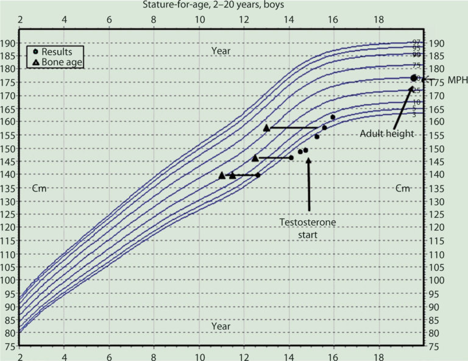

# 24. Delayed Puberty Onset and Hypogonadism
> Source attribution: [Source credits](../../SOURCE_CREDITS.md).

## PDF page 667 | printed page 663

### Delayed Puberty Onset and Hypogonadism

Stephanie A. Roberts and Diane E. J. Stafford

### Contents

### 24.1 Introduction and Background – 664

24.1.1 Transient Causes of Pubertal Delay – 666 24.1.2 Functional and Systemic Disorders Leading to Delayed Pubertal Onset – 666 24.1.3 Hypogonadotropic Hypogonadism – 667 24.1.4 Hypergonadotropic Hypogonadism – 669

### 24.2 Clinical Presentation – 672

24.2.1 History – 672 24.2.2 Physical Examination – 673

### 24.3 Diagnostic Evaluation – 674

### 24.4 Outcomes and Possible Complications – 675

### 24.5 Treatment – 676

24.5.1 Boys – 676 24.5.2 Girls – 678

### 24.6 Summary – 682

### References – 682

© The Author(s), under exclusive license to Springer Nature Switzerland AG 2024 S. Radovick, M. Misra (eds.), Pediatric Endocrinology, https://doi.org/10.1007/978-3-031-66296-6_24

## PDF page 668 | printed page 664

Key Points

5 Delayed puberty is defined as the

### 24

absence of any sign of puberty in a child at a chronologic age 2–2.5 stan dard deviations above the mean age of pubertal development for a given popu lation. 5 Causes of delayed puberty include vari

ants of normal puberty timing, func tional disorders leading to transient hypogonadism, hypogonadotropic hypogonadism and hypergonadotropic hypogonadism. 5 Self-limited delayed puberty (e.g., con

stitutional delay of puberty) does not require treatment; however, short-term low-dose sex hormone administration may be considered. 5 In most cases, the diagnosis of Congen

ital Hypogonadotropic Hypogonadism should be delayed until 18 years of age in the setting of absent pubertal devel opment due to central hypogonadism.

### 24.1 Introduction and Background

Following the mini-puberty of the fetal and neonatal periods, the hypothalamic-pituitarygonadal (HPG) axis undergoes a period of quiescence in childhood and is subsequently reactivated at the onset of puberty. This reac tivation is due to a complex interplay of genetic, epigenetic, environmental, and nutri tional factors. Puberty is initiated by the release of tonic inhibition of pulsatile secre tion of gonadotropin-releasing hormone (GnRH) from the hypothalamus in the setting of increased stimulatory factors on GnRH secretion [1]. Kisspeptin is a principal regula tor of the secretion of GnRH. Following paracrine stimulatory and inhibitory inputs from neurokinin B and dynorphin (KNDy neuropeptides), kisspeptin signals directly to GnRH neurons to control pulsatile GnRH release. These pulses cause release of luteiniz ing hormone (LH) and follicular-stimulating hormone (FSH) from the pituitary gland.

These pituitary gonadotropins then circulate to the gonads and stimulate production of sex steroids, predominantly estrogen from the ovary and testosterone from the testes [2].

Delayed puberty is defined as the absence of any sign of puberty in a child at a chrono logic age 2–2.5 standard deviations above the mean age of pubertal development for a given population [3]. This is defined as a testicular volume remaining less than 4 mL at 14 years in a boy or absence of any breast develop ment at 13 years in a girl [4, 5]. However, population-based studies suggest that these cut-offs may be conservative and that boys and girls are likely to enter puberty sooner [6, 7]. In addition, pathologic abnormalities may be associated with abnormal progression through puberty once initial pubertal changes have begun and are worthy of further evalua tion. In boys, a period of 3.2 ± 1.8 (mean ± SD) years is necessary to achieve adult testicular volume after the onset of puberty. In girls, the period from breast bud ding to menarche is 2.4 ± 1.1 (mean ± SD) years [8]. Therefore, evaluation is warranted if more than 4–5 years have elapsed from the onset of puberty to adult testicular size in boys or menarche in girls. Typically, further evaluation is pursued in girls in the absence of menarche by age 16 or after 3 years from the onset of breast bud development. Further evaluation is necessary to determine the etiol ogy of pubertal delay and for determination of necessary therapy. Clinical and laboratory assessment is aimed at differentiating a lag in normal pubertal development from abnor malities in need of further investigation and/ or therapy.

Etiology

## PDF page 669 | printed page 665

Table 24.1 Etiologies of delayed and/or absent pubertal development

### Transient Causes of Delay

Self-limited delayed puberty

– Sporadic

– Familial (e.g., IGSF10, TAC3, EAP1, LGR4, etc.) Functional disorders

– Nutritional disorders (Malnutrition, Anorexia Nervosa, Avoidant Restrictive Food Intake Disorder

(ARFID), Relative Energy Deficiency in Sport (RED-S))

– Psychological or emotional stress

– Chronic illness (gastrointestinal disease, renal failure, hepatic disease, hematologic abnormalities, malig

nancy, pulmonary disease, etc.)

– Endocrinopathies (diabetes mellitus, growth hormone deficiency, hypothyroidism, hyperprolactinemia,

glucocorticoid excess)

– Medication or drug effect (i.e., anabolic steroids, opiates)

### Hypogonadotropic Hypogonadism

Congenital

Monogenic mutations

Kallmann syndrome (e.g., KAL1 FGF8,

FGFR1, SEMA3A, HS6ST1, FGF17, IL17RD, DUSP6, SPRY4, FLRT3 PROK2, PROKR2, CHD7, WDR11)

Normosmic hypogonadotropic hypogonadism

(e.g., GNRH1, GNRHR, TAC3, TAC3R, KISS1, KISS1R (GPR54), FGFR1, PROK2, PROK2R, CHD7, FGF8)

Other inherited forms (PNPLA6, RNF216,

OTUD4, STUB1, POLR3A, POLR3B, RAB3GAP1, RAB3GAP2, RAB18, TBC1D20)

Gonadotropin gene mutations (LHβ, FSHβ)

Multiple pituitary hormone deficiencies

Idiopathic Genetic (e.g. PROP-1, LHX3, HESX1 and SOX2)

Adrenal hypoplasia congenital (DAX1)

Obesity-related (LEP, LEPR, PCSK1)

Syndromic (Prader-Willi, CHARGE,

Lawrence-Moon, Bardet-Biedl syndromes) Acquired

Suprasellar tumors (e.g., craniopharyngiomas)

Infiltrative/inflammatory (e.g., Histiocytosis X)

Effects of radiotherapy

Effects of surgery

Cranial trauma

secondary/tertiary) hypogonadism, in which hypothalamic or pituitary hormonal insuffi ciency results in deficiency of circulating gonadotropins and hypergonadotropic (e.g., peripheral or primary) hypogonadism, which results from gonadal insufficiency, with subse

### Hypergonadotropic Hypogonadism

Congenital

Males

Klinefelter syndrome

Pure gonadal dysgenesis

Defects in steroidogenesis

Leydig cell hypoplasia (LHCGR)

Androgen insensitivity syndromes

Testicular regression syndrome or Cryptorchidism

Noonan syndrome

Females

Turner syndrome

Pure gonadal dysgenesis

Gonadotropin receptor mutations (LHCGR,

FSHR)

Androgen insensitivity syndromes

Estrogen receptor alpha mutation (ESR1)

Noonan syndrome Acquired

Males

Surgical or traumatic castration

Bilateral orchitis

Chemotherapy, radiotherapy effects

Hemochromatosis

Females

Surgical or traumatic castration

Premature idiopathic ovarian insufficiency

Autoimmune ovarian insufficiency

Fragile X (FMR1) premutation carrier

Chemotherapy, radiotherapy effects

Galactosemia

quent lack of negative feedback of sex ste roids at the hypothalamic and pituitary levels resulting in elevated serum gonadotropin lev els. Table 24.1 lists the various etiologies of hypogonadism resulting in absent, delayed, and/or stalled pubertal development.

## PDF page 670 | printed page 666

### 24.1.1 Transient Causes of Pubertal

### Delay

### 24

Pubertal onset at the extreme of the distribu tion of normal pubertal timing, as opposed to overt pathology, accounts for the majority of cases of delayed puberty (65% of males and 30% of females) in both genders. Despite its high frequency, self-limited delayed puberty remains a diagnosis of exclusion. While many alternate causes of delayed puberty due to organic conditions may be evident from the history, physical examination, and biochemi cal evaluation, differentiating self-limited delay of puberty from congenital hypogonad otropic hypogonadism can be challenging [9].

### 24.1.1.1 Self-Limited Delayed

### Puberty

The most common cause of delay is selflimited delayed puberty, previously referred to as constitutional delay of growth and puberty, which is a transient form of hypogonado tropic hypogonadism, affecting an estimated 2–5% of adolescents [10, 11]. These children represent the extreme of the normal physio logic variations in the timing of the onset of puberty, on average 3 years delayed in boys and 2.5 years in girls, though there can be sig nificant variability [11]. However, given the emergence of potential short-term and longterm health consequences, it may not be con sidered “normal” in the future [3]. This diagnosis occurs twice as frequently in boys compared to girls for unclear reasons. This may partly be explained by a higher degree of social pressure placed on boys with delayed development and, subsequently, a higher fre quency of referral for evaluation. Frequently, there is a family history of late menarche in the mother or sisters or a delayed growth spurt in the father, suggesting an autosomal dominant inheritance pattern. Boys and girls with self-limited delayed puberty frequently have a positive family history of pubertal delay (50–70%) [12, 13]. However, sporadic cases are also seen and a lack of family history does not exclude this diagnosis. Monogenic etiologies of self-limited delayed puberty have been reported in genes associated with con

genital hypogonadotropic hypogonadism (e.g., TAC3, TACR3, GNRHR) as well those distinct from CHH (e.g., IGSF10, EAP1, LGR4) [10, 14–18].

Children with self-limited delay often have a longer duration of the childhood phase of growth (e.g., delay of growth and puberty), delayed skeletal maturation, shorter interval from pubertal onset to pubertal growth veloc ity and delayed yet attenuated pubertal growth spurt. Height and growth velocity are appro priate when evaluated in the context of bone age. However, some children may also demon strate stable growth trajectories without declining height percentiles [19]. The adult height may be shorter than predicted by the mid-parental height or predicted height from a bone age, on average 1.85 standard devia tions below the mean. However, the effects on adult height have been mixed and limited by smaller sample sizes [20]. In addition, familial short stature co-occurs in 40% of cases [21]. On-going concerns about compromised bone mineral density and fertility warrant the need for future studies [22].

### 24.1.2 Functional and Systemic

### Disorders Leading to Delayed Pubertal Onset

### 24.1.2.1 Functional Disorders

Patients with nutritional disorders, including anorexia nervosa, may present with delays in growth and/or pubertal development [23]. In the case of anorexia nervosa and ARFID, the cause in most likely both lack of energy intake, as well as a central nervous system effect alter ing neuroendocrine control of gonadotropins [24, 25]. Excessive energy expenditure, such as that seen in young gymnasts and long-distance runners (RED-S), causes pubertal delay by similar mechanisms [26, 27]. Psychological and emotional stress can also lead to delayed pubertal onset.

### 24.1.2.2 Chronic Systemic Disease

A variety of chronic diseases are associated with delayed growth and puberty and may be diagnosed in the context of endocrinologic

## PDF page 671 | printed page 667

evaluation of an otherwise asymptomatic child. Gastrointestinal disorders such as inflammatory bowel disease or celiac disease, as well as chronic renal failure, cardiac dis ease, and other severe chronic illnesses are causes of pubertal delay. These disorders are usually associated with impaired availability or utilization of fuels, although clinical evi dence of malnutrition may be absent.

### 24.1.2.3 Endocrinopathies

Other endocrinopathies can also be associ ated with delays of puberty and growth. Isolated growth hormone deficiency is an important differential diagnosis in children with self-limited delayed puberty, because both present with decreased growth velocity for chronological age and bone age retarda tion. Furthermore, growth delay in children with self-limited delay may develop early and therefore make the distinction between these two entities more difficult. Delay or arrest in pubertal development may also be caused by acquired hypothyroidism and hyperprolac tinemia. Type 1 diabetes mellitus may be asso ciated with delays in pubertal development, even with optimal glycemic control [28]. Cushing’s syndrome may cause delayed growth and puberty, though it may also result in premature development of sexual hair.

### 24.1.2.4 Drug Effects

A history of use of medications, recreational drugs and supplements must be included in the evaluation. Anabolic steroid, opiate, and marijuana use are well known causes of hypo gonadism. However hidden sources of steroids or opiates may be found in easily obtained supplements, such as Kratom, or Mitragyna speciosa, a plant in the coffee family, which is believed to bind to the mu-opioid receptor and can result in hypogonadism [29–31].

### 24.1.3 Hypogonadotropic

### Hypogonadism

Disorders in this category are characterized by low or low-normal circulating levels of the pituitary gonadotropins, LH and FSH. This

may be the result of genetic defects altering hypothalamic and/or pituitary development, defects in hormonal synthesis or action, or acquired due to intracranial disease or trauma.

### 24.1.3.1 Congenital

### Hypogonadotropic Hypogonadism

Defects in the development of GnRH neu rons, impaired GnRH secretion, and GnRH resistance are causes of congenital hypogo nadotropic hypogonadism (CHH). To date, ~60 genes have been described in association with CHH [32]. A single gene defect is detected in approximately 50% of all cases of CHH [33, 34]. Identification of these genes has been difficult due to the rarity of the disease, small kindreds due to reproductive abnormalities, incomplete penetrance and variable expressiv ity affecting phenotype, and overlapping phe notypes [35, 36]. CHH is frequently divided into two categories: CHH with anosmia (Kallmann syndrome) and normosmic CHH (nCHH). Kallmann syndrome results when embryonic aplasia of GnRH neurons occurs) in the context of developmental defects of the olfactory bulb. However, genes involved in GnRH neuronal migration associated with Kallmann syndrome may also present with normosmic CHH [37, 38].

### 24.1.3.2 Kallmann Syndrome

Kallmann syndrome is a well-recognized form of hypogonadotropic hypogonadism consisting of gonadotropin deficiency accompanied by anosmia or hyposmia, found in approximately 50% of cases of Idiopathic hypogonadotropic hypogonadism (IHH) [37]. It is frequently transmitted as an X-linked recessive trait but may less commonly also have autosomal domi nant or recessive inheritance patterns. The X-linked form of Kallmann syndrome has been associated with defects in the KAL1 gene, located on the pseudoautosomal region of Xp [35]. The protein product of the KAL1 gene, anosmin-1, has neural cell adhesion molecule properties and provides scaffolding for GnRH neuron and olfactory nerve migration across the cribriform plate to their appropriate syn apses [39]. In the absence of anosmin-1, GnRH

## PDF page 672 | printed page 668

and olfactory fibers do not synapse properly, producing GnRH deficiency and anosmia. However, KAL1 gene mutations account for only about 10–20% of individuals with Kallmann syndrome. Autosomal dominant forms of Kallmann syndrome can occur with mutations in FGF8, FGFR1, SEMA3A, HS6ST1, FGF17, IL17RD, DUSP6, SPRY4, and FLRT3. Autosomal recessive forms of Kallmann syndrome also have been reported in conjunction with mutations in PROK2, PROKR2, CHD7, and WDR11. These collec tively account for 25–30% of Kallmann syn drome [40]. The cause in the remainder of cases remains unclear. Individuals with Kallmann syndrome may also have a variety of other asso ciated anomalies which may direct genetic eval uation such as unilateral renal agenesis in KAL1 mutations, and dental agenesis or digital bone abnormalities in FGF8 or FGFR1 mutations.

### 24

### 24.1.3.3 Normosmic Congenital

### Hypogonadotropic Hypogonadism

Mutations in some genes (e.g., FGFR1, PROK2, PROK2R, CHD7, and FGF8) over lap in causing Kallmann syndrome and norm osmic CHH. The reasons for the variation in phenotype remain unclear but imply not only a role in migration but potentially the secre tion of GnRH. Autosomal recessive forms of nCHH have been associated with mutations in GNRH1, GNRHR, TAC3, TAC3R, KISS1, and KISS1R (formerly GPR54), all of which cause variations in GnRH secretion or response [41, 42]. Mutations in GNRHR are the most common cause of normosmic CHH. Identified mutations in these genes account for approximately 50% of cases of nCHH [35]. Digenic and oligogenic cases of CHH have been reported with individuals having mutations in two or more genes known to cause GnRH deficiency [43].

### 24.1.3.4 Other Inherited Forms

### of Hypogonadotropic Hypogonadism

A host of disorders causing CHH associated with neurodegenerative syndromes have now been described, such as Gordon Holmes

Syndrome, which is associated with cerebellar ataxia and atrophy. Inactivating mutations in PNPLA6, RNF216, OTUD4, and STUB1 have been associated with this syndrome. Other mutations associated with neurodegen erative syndromes and IHH include muta tions in POLR3A, POLR3B, RAB3GAP1, RAB3GAP2, RAB18, and TBC1D20 [42]. Leptin deficiency and leptin receptor defects have also been associated with hypogonadism. Patients with defects in leptin production (LEP) or action (LEPR), typically have extreme obesity and hyperinsulinemia, in addition to hypogonadism [44]. Deficiency in proprotein convertase 1, a rare form of mono genic obesity, can also lead to hypogonado tropic hypogonadism due to mutations in PCSK1 [45].

Several patients with combined pituitary hormone deficiency, characterized by defi ciencies in growth hormone, TSH, prolactin, and gonadotropins, have been shown to have mutations in the PROP1 gene [46, 47]. PROP1 is a transcription factor necessary for differen tiation of multiple pituitary cell lineages, and its absence results in lack of proper pituitary cellular development. Mutations in LHX3, HESX1, and SOX2, other genes important in pituitary development and function, are also associated with IHH in the context of com bined pituitary hormone deficiencies [48].

DAX-1 is a nuclear receptor important for adrenal development and development of the pituitary gonadotroph. Mutations in the DAX-1 gene (NR0B1) are associated with IHH and adrenal hypoplasia congenital (AHC), an X-linked form of adrenal insuffi ciency due to lack of proper adrenal develop ment [34]. While males are most frequently affected due to the X-linked inheritance pat tern, a female patient with CHH, but not AHC, has been identified in a family of males with AHC and CHH, and was found to have an AHC gene mutation [49, 50].

Defects in the genes coding for the sub units of pituitary gonadotropins have been isolated in cases of delayed puberty. Pituitary glycoprotein hormones consist of a common α-subunit encoded by a single gene and a β-subunit that is specific for LH, FSH, hCG, and TSH. No α-subunit mutations have been

## PDF page 673 | printed page 669

described in humans. However, inactivating β-subunit mutations have been identified in both LHB and FSHB. In boys, mutations in LHB (e.g., fertile eunuch syndrome) leads to absent pubertal development with normal tes ticular size and viable spermatogenesis. Weiss et al. described a male patient who presented at age 17 with delayed puberty, elevated serum LH levels, but low FSH and testosterone lev els. He was found to have an autosomal reces sive defect in LHB that produced LH that was immunoactive and therefore measurable by current assays, but had decreased bioactivity, resulting in delayed puberty [51]. Girls typi cally present with normal pubertal develop ment but may have secondary amenorrhea, infertility, and multicystic ovaries [52].

Inactivating mutations have also been identified in the FSHβ subunit. Boys typically undergo normal pubertal development although they have azoospermia, whereas girls present with delayed puberty and pri mary amenorrhea. Matthews et al. and Layman et al. each described young women with no evidence of thelarche, undetectable FSH levels, and elevated LH. Both young women had no FSH response to GnRH stim ulation but had an exaggerated rise in LH to menopausal levels [53, 54]. In females, FSH deficiency is expected to produce delayed puberty as a result of lack of follicular devel opment, estradiol production, and matura tion of oocytes, as has been described. However, in males, as LH stimulation is responsible for testosterone production, one would predict normal pubertal development, but azoospermia or oligospermia due to lack of FSH stimulation. However, one case of delayed puberty in a boy with an FSHB muta tion has been described [55].

### 24.1.3.5 Syndromic CHH

Hypogonadotropic hypogonadism is also associated with other more complex syn dromes such as mutations in the CHD7 gene in association with and without CHARGE syndrome [3, 56]. Interestingly, mutations in CHD7 also have now been identified as a monogenic etiology in self-limited delayed puberty [18]. Hypogonadotropic hypogonad ism is also seen in Prader-Willi, Bardet-Biedl,

and Laurence-Moon syndromes. The etiology of gonadotropin deficiency in these syn dromes remains unclear, though further inves tigation of the genetic causes of the underlying syndrome may provide important insights into the regulation of this complex system.

### 24.1.3.6 Acquired Causes

### of Hypogonadotropic Hypogonadism

Intracranial disease processes, or therapy designed to treat such diseases, are wellknown acquired causes of hypogonadotropic hypogonadism. Histiocytosis X may be asso ciated with HH, depending on the extent of pituitary involvement. Other infiltrative and inflammatory processes such as sarcoidosis or hemochromatosis may also be involved. Suprasellar tumors, such as craniopharyngio mas, frequently involve the pituitary and/or hypothalamus. Gonadotropin deficiency may be caused by tumor invasion, or by surgical removal of the tumor with subsequent dam age to the pituitary or hypothalamus. Radiation therapy for any intracranial tumor may cause hypogonadism, depending on the field involved and the dose of radiation received by the hypothalamus and pituitary. The exact dose required to cause hypotha lamic or pituitary dysfunction is unclear. However, hypothalamic GnRH neurons and the pituitary gonadotrophs appear to be less sensitive to radiation effects than somato trophs, making gonadotropin deficiency unusual in the absence of growth hormone deficiency [57]. Cranial trauma causing hypo thalamic or pituitary damage, as well as infec tion involving these areas of the brain are associated with gonadotropin deficiency.

### 24.1.4 Hypergonadotropic

### Hypogonadism

Disorders in this category are characterized by elevated gonadotropin levels. The hypothalamic-pituitary-gonadal axis is acti vated with the release of GnRH in a pulsatile manner from the hypothalamus, subsequent increases in LH and FSH, and circulation of

## PDF page 674 | printed page 670

these hormones to the gonads. If the gonads cannot properly respond by producing estro gen or testosterone, there is insufficiency in the normal feedback to the hypothalamus and pituitary with a compensatory increase in gonadotropin levels above the normal range. Patients present with lack of pubertal devel opment, low serum testosterone or estrogen levels, and elevations of LH and FSH.

### 24

### 24.1.4.1 Klinefelter Syndrome

Klinefelter syndrome is the most frequent form of hypogonadism in males with an inci dence of approximately 1:500–1000 males. The pubertal delay in this syndrome is caused by seminiferous tubule dysgenesis. These chil dren typically have a karyotype of 47,XXY or its variants, including mosaicism, 48,XXXY, or 49,XXXY. These patients usually enter into puberty at an average age but do not appro priately progress. Typical phenotypic charac teristics include tall stature with long legs and arms, gynecomastia, small, firm testes, bor derline IQ, and poor social adaptation. Physical examination typically reveals the socalled “eunuchoid” proportions with an upper to lower segment ratio of less than one, dem onstrating increased long bone growth. Some children with Klinefelter syndrome may have micropenis, hypospadias, and/or cryptorchi dism [58, 59].

### 24.1.4.2 Tuner Syndrome

Turner syndrome, characterized by a karyo type of XO or its mosaics, is the most com mon cause of hypergonadotropic hypogonadism in females. The syndrome is characterized by 45,X or mosaic karyotype, short stature, webbed neck, low posterior hairline, hypertelorism, and left-sided cardiac defects. However, all of these features need not be present. Ovarian function varies in girls with Turner syndrome, with variable pro gression through puberty, with a small pro portion of patients reaching menarche. In girls presenting with short stature and puber tal delay, possible phenotypic features of Turner syndrome should be evaluated and a karyotype considered [60].

### 24.1.4.3 Gonadal Dysgenesis

In phenotypic females, pure gonadal dysgen esis is defined by the complete or nearly com plete absence of ovarian tissue. Genotype in these girls may be 46,XX, 46,XY, or 45,XO/46,XY mosaic. In cases of a 46,XY karyotype, genetic studies have shown micro deletions on either the Y or the X chromo some [61, 62]. Girls with pure gonadal dysgenesis may have complete lack of puber tal development, or some degree of breast development, but remain amenorrheic. Gonadal dysgenesis is also associated with Denys-Drash syndrome (nephropathy, Wilms tumor, and genital abnormalities) and the WAGR complex (Wilms tumor, aniridia, geni tal abnormalities, and mental retardation).

### 24.1.4.4 Gonadotropin Receptor

### Mutation

Several patients with Leydig cell hypoplasia or aplasia have been shown to have inactivat ing mutations in the LH receptor gene LHCGR. The degree of masculinization is variable, depending on the particular muta tion, ranging from microphallus to genital ambiguity. Testes are small to normal size; FSH levels are normal, with low serum testos terone, but LH levels are elevated, implying resistance. Women identified with LH recep tor defects appear to present with amenorrhea and partial ovarian failure characterized by defective folliculogenesis, anovulation, absence of a luteal phase, delayed or incom plete feminization at puberty, and infertility [63–66].

Inactivating mutations in the FSH recep tor gene (FSHR) leads to normal pubertal progression in males with normal or small tes ticular size and impaired fertility. Girls may have primary or secondary amenorrhea, infer tility, and premature ovarian failure. These patients are clinically similar to patients with pure ovarian dysgenesis, presenting with vari able development of secondary sexual charac teristics, primary or early secondary amenorrhea, and high serum FSH and LH levels. However, women with FSH receptor mutations frequently have ovarian follicles on

## PDF page 675 | printed page 671

ultrasound examination, possibly due to residual receptor activity [67, 68].

### 24.1.4.5 Defects in Steroidogenesis

Inborn errors of enzymes required in the bio synthetic pathway of testosterone can result in incomplete male sexual differentiation and incomplete progression through puberty. Five enzymes are necessary for testosterone pro duction, three of which are common to the pathway of cortisol production as well. The phenotypic presentation of patients with these defects varies with the location of the enzyme defect in the pathway of steroid production.

Congenital lipoid adrenal hyperplasia is due to deficiency in either the steroidogenic acute regulatory (StAR) protein or choles terol side-chain cleavage deficiency (P450scc). Affected 46,XY subjects do not show puber tal development, whereas affected 46,XX sub jects may undergo breast development at the usual age of puberty and cyclical vaginal bleeding, at least for some period of time [69]. This is because lipid accumulation in the ova ries in patients with STAR defects begins at puberty and is minimal earlier when the ova ries are not active. 3β-hydroxysteroid dehydro genase deficiency presents with adrenal insufficiency with salt-losing and abnormal sexual differentiation. Males have genital ambiguity and females may be normal, or have moderate clitoromegaly. As this enzyme complex is common to synthesis of all active steroid hormones, puberty is incomplete in both sexes. 17α-hydroxylase is essential for biosynthesis of androgens, glucocorticoids, and estrogens. Deficiency causes lack of viril ization in genetic males, with elevated LH and FSH and low testosterone levels in puberty. 17,20 desmolase deficiency impairs produc tion of androgens and estrogens with normal cortisol and aldosterone. Genetic males with this deficiency may present with incomplete virilization, or as phenotypic females, with absent uterus and lack of pubertal viriliza tion. In 17β-hydroxysteroid dehydrogenase type III deficiency, affected genetic males present with female external genitalia and moderate labioscrotal fusion. At puberty, breast development is associated with acne,

hirsutism, voice deepening, and amenorrhea, and the virilization is consequent to the con version of androstenedione to testosterone by extra-gonadal 17β-HSD isoforms. These patients have elevated plasma androstenedi one and estrone levels with low or normal tes tosterone [70, 71].

5α-reductase enzyme activity is necessary for the conversion of testosterone to dihy drotestosterone (DHT). DHT is necessary for masculinization of the fetal external genitalia. Autosomal recessive defects in 5α-reductase type II result in female external genitalia with male internal genital structures and a urogeni tal sinus with a perineal opening. Partial viril ization may be seen at puberty due to increases in testosterone production and residual enzy matic activity, or from the action of 5α-reductase type I in peripheral tissue. Females with aromatase deficiency, the enzyme responsible for the conversion of tes tosterone to estradiol, are typically detected in the newborn period and later have absent pubertal development with progressive viril ization [72].

### 24.1.4.6 Estrogen Receptor α

### Mutation

One woman and an unrelated man have been described with estrogen resistance due to estrogen receptor α mutations. They have a similar phenotype to those with aromatase deficiency but biochemically have very ele vated estradiol levels [73, 74].

### 24.1.4.7 Androgen Insensitivity

### Syndrome

Androgen insensitivity syndrome (AIS) is a heterogeneous disorder caused by mutations in the androgen receptor gene (AR). Phenotype in affected patients varies greatly from normal female (complete androgen insensitivity syn drome [CAIS]), to ambiguous forms more closely resembling male (partial androgen insensitivity [PAIS]). This variation is depen dent on the location and extent of mutation and the subsequent activity of the androgen receptor. Karyotype in these patients is 46,XY, and under the influence of Mullerian inhibit ing substance (MIS), thus, they have male

## PDF page 676 | printed page 672

internal structures. However, they fail to develop male external genitalia that normally results from androgen effects in embryonic development. Phenotypic females usually enter puberty with breast development as a result of aromatization of testosterone to estrogen, but there is little or no body hair development. Primary amenorrhea may be the first manifestation of this condition, par ticularly for CAIS. Phenotypic males will have variable progression through puberty depend ing on the activity of the androgen receptor [75–77].

### 24

### 24.1.4.8 Testicular Regression

### Syndrome (Vanishing Testes Syndrome)

Bilateral anorchia is found in approximately 1 in 20,000 males. Their external genitalia are normal, implying normal testicular function during the first 14–16 weeks of embryonic development. However, at birth, no testicular tissue is present, resulting in the previously used term “vanishing testes.” These patients are born with cryptorchidism and may fail to develop secondary sexual characteristics. Unlike males with abdominal cryptorchidism, these patients have no increase in testosterone levels following human chorionic gonadotro pin administration, and MIS levels are unde tectable [78].

### 24.1.4.9 Noonan Syndrome

Noonan syndrome shares many phenotypic features with Turner syndrome including short stature, webbed neck, low posterior hairline, hypertelorism, and hypogonadism. However, patients with Noonan syndrome have a normal 46,XX or XY karyotype as this is an autosomal dominant disorder. Females with Noonan syndrome typically undergo normal pubertal development and have nor mal ovarian function but can also have delayed pubertal development. Male patients, in contrast, typically have undescended testes and abnormal Leydig cell function, causing hypergonadotropic hypogonadism. Noonan syndrome is caused by mutations on the long arm of chromosome 12 and are typically

inherited in an autosomal dominant manner [79, 80].

### 24.1.4.10 Acquired Causes of Gonadal

### Insufficiency

Bilateral testicular torsion, surgical castra tion, and severe trauma to the scrotum and testes are known causes of hypergonadotropic hypogonadism in males. Bilateral orchitis (e.g., mumps) is also an unusual but known cause of gonadal failure. Exposure to chemo therapeutic agents may cause gonadal failure but is more likely to affect Sertoli cell develop ment and cause infertility, rather than puber tal delay [81]. Inclusion of the testes in the direct field of radiation usually causes testicu lar failure. Exposure to total body radiation associated with bone marrow transplantation raises concern for possible gonadal failure, though approximately half of the patients have normal pubertal development with frac tionated regimens [82]. Hemochromatosis typically causes iron accumulation in the pitu itary gland but may also affect the testes.

Autoimmune ovarian failure is seen in girls, either as an isolated autoimmune phe nomenon or, more frequently, in association with polyglandular autoimmune failure. The presence of a Fragile X premutation carrier, associated with mutations in FMR1, should be considered if antibody testing for autoim mune POI is negative [83]. Idiopathic prema ture ovarian failure is an infrequent cause. As with boys, ovarian failure may be consequent to chemotherapy or radiation therapy, as well as surgical or traumatic injury to the ovary. Galactosemia is a rare cause of hypergonado tropic hypogonadism in females [84].

### 24.2 Clinical Presentation

### 24.2.1 History

A thorough medical history and family his tory are essential in the evaluation of pubertal delay. The hallmark of pubertal onset in girls is breast bud development and in boys is tes ticular enlargement; the latter may make the

## PDF page 677 | printed page 673

exact timing of pubertal onset challenging to assess given its subtlety. The history should include the presence or absence of secondary sexual characteristics including breast devel opment, acne, changes in skin, axillary and pubic hair, apocrine body, growth accelera tion, distribution of fat to the thighs and hips, leukorrhea and vaginal bleeding. In boys, this includes penile and testicular enlargement, axillary and pubic hair, apocrine body odor, acne, facial hair, Adam’s apple protrusion, deepening of the voice, erections, changes in body composition, and growth acceleration [1]. The progression and maintenance of these signs should be explored as hypogonadism may develop after pubertal onset, leading to stalled puberty. Differentiating signs of puber tal onset from adrenarche may be important in children with self-limited delayed puberty as they often have concomitant delay in adre narche while those with CHH have may iso lated pubertal delay.

The review of systems should assess for pertinent symptoms that are consistent with systemic disease or chronic disorders, includ ing other endocrinopathies. Hyposmia or anosmia should be assessed, such as being able to smell what is being cooked for a meal, as formal olfactory testing is typically not per formed during the physical exam. A family history of delayed puberty is commonly seen in those with self-limited delayed puberty and CHH.

Review of previous growth data, includ ing weight for height, is essential. The puber tal growth spurt occurs in the early stages of puberty in girls (peaking at Tanner stage III), but at the later stages of puberty in boys (peaking at Tanner IV to V) with a peak pubertal growth velocity of 8–12 cm/year in girls and 10–14 cm/year in boys. Parents may note an increase in shoe size as hands and feet are the first to increase during a growth spurt. Interpreting the height and growth pattern in the context of mid-parental height is impor tant. A discrepancy of more than two stan dard deviations (10 cm or 4 inches) from mid-parental height may indicate underlying pathology. Parental heights may need to be measured in clinic for accurate assessment. Plotting growth data on a longitudinal growth

curve, such as the Bayer and Bayley, is useful to demonstrate a pattern of growth consis tent with self-limited delay [85]. These chil dren frequently have relatively slow growth during childhood. Low weight for height increases the suspicion for nutritional disor ders or underlying gastrointestinal disease. Patients with hypothyroidism, glucocorticoid excess, or Prader-Willi syndrome may have slight or significantly increased weight for height.

### 24.2.2 Physical Examination

Physical examination should include a careful evaluation of pubertal staging which may note the presence of breast development or testicular enlargement not previously detected by the child, parents, or other medical provid ers. In girls, breast development begins with formation of breast buds. This development is frequently unilateral for several months. Enlargement of the areolar diameter usually accompanies breast budding. Development of axillary and pubic hair may or may not accompany the onset of puberty, as andro gens are mainly produced by the adrenal gland, which is under separate control. Under the influence of estrogen, the vaginal mucosa changes from a reddish tint to pink, and a whitish vaginal discharge may be seen. The average interval from breast budding to men arche is 2 years.

The increase in testicular size is usually the first sign of puberty in boys. In general, tes ticular size greater than or equal to 4 mL in volume or a longitudinal measurement greater than 2.5 cm is consistent with the onset of pubertal development. Penile length is not routinely assessed; however, penile width is easily obtained. Scrotal skin also changes in texture and reddens in early puberty. Pubic hair development usually correlates with geni tal development in boys, as both are under androgen control, but pubertal stage is best assessed by evaluating these factors separately [86]. Gynecomastia is a common finding in mid-puberty but may also be associated with Klinefelter’s syndrome or partial androgen insensitivity.

## PDF page 678 | printed page 674

In addition to height and weight, arm span and lower segment measurements should be performed. The lower segment measurement is the distance from the pubic symphysis to the floor when standing. An upper-to-lower segment ratio can be determined by subtract ing the lower segment measurement from the standing height (upper segment) and evaluat ing the ratio. During normal pubertal devel opment, this ratio changes from greater than 1 prepubertally (with torso length greater than leg length) to slightly less than or equal to one with increased long bone growth at puberty. Children with delayed puberty will have an increased upper-to-lower ratio for age and an arm span exceeding height sometimes by more than 5 cm due to delayed epiphyseal closure. In patients with Klinefelter’s syndrome, the upper to lower segment ratio is low due to long bone growth but without significant signs of pubertal development.

### 24

A careful neurological evaluation is par ticularly important in the evaluation of delayed puberty. Neurologic deficits may indi cate the presence of central nervous system disease. Synkinesis, or mirror movements of the hands, should raise suspicion for Kallmann syndrome. Physical abnormalities suggestive of genetic syndromes such as Turner or Klinefelter syndromes as described above should be specifically evaluated, as well as findings that suggest underlying chronic ill ness or endocrinopathy.

### 24.3 Diagnostic Evaluation

In patients with findings suspicious of under lying chronic disease, either by history or physical examination, individual evaluation, aimed at the suspected diagnosis, should be undertaken. This may include an erythrocyte sedimentation rate for evaluation of inflam matory disease, a complete blood cell count, electrolytes, renal or liver panel, or gastroin testinal studies to rule out systemic condi tions, and exclusion of endocrinopathies such as thyroid disease or hyperprolactinemia [3].

Bone age evaluation is frequently helpful in the assessment of delayed puberty; how

ever, a delayed bone age does not confirm a diagnosis of self-limited delay of puberty. Skeletal age more closely correlates with sex ual development than does chronologic age. A skeletal age of 10 in girls and 12.5 in boys usu ally correlates with the onset of pubertal development [87, 88]. If a patient’s bone age is significantly delayed, pubertal delay may be caused by underlying chronic disease or endo crinopathy, and further diagnostic evaluation is indicated. In self-limited delay, height plot ted for bone age rather than chronological age is usually the expected percentile range for genetic target and observation may be appro priate.

24.1

Assessment of estradiol levels is infre quently helpful in early puberty. Measurable levels are reassuring for onset of early puberty, but levels below the limit of many standard assays may also be seen in early puberty. Morning serum testosterone levels may be useful in determination of progression into early puberty. One study determined that an 8 a.m. serum testosterone level greater than 0.7 nmol/L predicted an increase in testicular size to greater than 4 mL within 1 year in 77% in boys and within 15 months in 100% of boys. In boys with levels less than 0.7 nmol/L, only 12.5% of boys progressed to the same point within 1 year [89]. Total testosterone levels may be lower in adolescent boys due to lower levels of sex-hormone binding globulin.

Karyotype determination, while not rou tinely indicated, should be carried out if phys ical examination suggests the presence of a genetic syndrome such as Klinefelter or

## PDF page 679 | printed page 675

Turner syndrome. It should also be performed in cases of hypergonadotropic hypogonadism to evaluate for gonadal dysgenesis. Cranial magnetic resonance imaging should be per formed in patients with hypogonadotropic hypogonadism suspected of having intracra nial lesions or defects on the basis of initial history or physical examination. In other patients, such imaging may be considered after further evaluation is completed but need not be performed as part of the initial evalua tion. Similarly, in phenotypic males with cryptorchidism or phenotypic females sus pected of having androgen insensitivity syn drome, pelvic ultrasound may be part of the initial assessment, though this is typically deferred in most cases to a later time. hCG stimulation testing may be performed or MIS levels measured to assess for the presence or function of testicular tissue. In girls with hypergonadotropic hypogonadism, anti-21 hydroxylase antibodies should be sent to screen for autoimmune POI. If negative, test ing for FMR1 pre-mutations may be consid ered.

Despite promising developments, there is currently no single simple discriminating bio chemical test to accurately distinguish selflimited delay from CHH, with considerable overlap of results among patients with these diagnoses. Studies have explored using basal gonadotropins, nocturnal gonadotropin sam pling, as well as GnRH, GnRH analog, and hCG stimulation tests without consistent results. Inhibin B and MIS have also been examined as potential biochemical markers. Despite advances in identifying genes that cause CHH, mutations in known genes account for only 30–40% of cases. Thus, rou tine genetic testing for diagnostic differentia tion between self-limited delay and CHH is not indicated. Differentiating CHH from selflimited delay can be challenging and the diag nosis of CHH should typically be delayed until age 18 years if there is clinical uncer tainty. Absent, slow pubertal tempo or cessa tion of pubertal development, bilateral cryptorchidism, small penile size, and anos mia raise the suspicion for CHH [90, 91].

### 24.4 Outcomes and Possible

### Complications

Adult height in patients with self-limited delayed puberty can be difficult to predict. Some observational studies suggest that chil dren with this diagnosis eventually reach their genetic potential [92, 93]. However, other studies have reported that final height is con sistent with predicted height based on bone age, but shorter than mid-parental target height [94–97]. Familial short stature and a slow rate of pre-pubertal growth have been associated with lack of attainment of genetic target height at adulthood [20]. Treatment with short-term low dose sex steroids does not appear to impact adult height [93, 98]. While self-esteem was not correlated with adult height, Crowne et al. found that most girls and boys felt that their pubertal delay had an impact on success at school, work, or socially [80, 81]. Some, but not all, studies have shown lower bone mineral density in those with a history of delayed pubertal development, regardless of sex steroid therapy [20, 22]. In those with CHH, fertility requires treatment with gonadotropins or pulsatile GnRH. While not all patients respond to therapy, up to 90% of women and 50% of men with CHH have been reported to achieve fertility with pulsa tile GnRH therapy with rates slightly lower for gonadotropin therapy [22]. Patients with CHH can undergo a so-called “reversal” with activation of their HPG axis and normaliza tion of steroidogenesis. This may occur in an estimated 22% of patients with CHH and with varying genotypes and phenotypes. As a result, patient with CHH require lifelong monitoring [99].

While sex steroid therapy improves bone mineral density in those with CHH, several studies have shown a continued impairment in adults with CHH despite appropriate therapy. However, treatment likely prevents further loss of bone density [100, 101].

Both chemotherapy and radiation therapy for treatment of childhood cancers are known to cause hypergonadotropic hypogonadism. However, counseling concerning fertility pres

## PDF page 680 | printed page 676

ervation prior to therapy can be difficult due to the need for urgent therapy, parental con cerns, and confusion over the responsibility of various providers [102]. As a result, the risks of infertility and the possibility of techniques for preservation may not be fully discussed. Recent articles have advocated for a multidis ciplinary approach including oncologists, fer tility specialists, ethicists and mental health providers. Discussions prior to therapy may allow sperm banking or cryopreservation of ovarian tissue as indicated [103, 104].

### 24

Fertility preservation and other options for parenting should also be discussed with patients diagnosed with Turner syndrome and Klinefelter syndrome. Girls diagnosed with Turner Syndrome at an early age may have ovarian reserve and cryopreservation of mature oocytes or ovarian tissue may be pos sible, though there are ethical considerations [105–108]. In Klinefelter syndrome, there is progressive decline in testicular function. However, spermatozoa can be found by tes ticular sperm extraction (TESE) in 50% of adults with Kallmann syndrome [109]. Recommendations for the timing of sperm retrieval via TESE have been variable with some advocating for this procedure in the peri-pubertal or adolescent age range. While evidence suggests that there may be no advan tage to this practice and argue for retrieval to be delayed until at least after 16 years of age or until adulthood [109, 110], there is variabil ity in the literature [111]. Ethical concerns have also been raised about intervention in the pediatric age group arguing for delay until decisions can be made by the patient and any potential partner [109].

### 24.5 Treatment

For children warranting treatment for hypo gonadism, testosterone and estradiol replace ment in boys and girls, respectively, are first line. Sex hormone replacement therapy is indicated in children with permanent forms of hypogonadism requiring pubertal induc tion and may also be considered in those with self-limited delayed puberty for psychosocial well-being [91]. Treatment in children with

functional disorders is less clear and the first line therapy should be aimed at improving the underlying disease when possible and attainment of positive energy balance to pro mote resumption of HPG activity. In some cases of hypogonadotropic hypogonadism, pulsatile administration of kisspeptin or gonadotropin-releasing hormone has resulted in induction of puberty [112, 113]; however, these remain experimental. GnRH or gonad otropins are options for stimulation of sper matogenesis or induction of ovulation in infertile adult patients due to hypothalamic etiologies.

### 24.5.1 Boys

Short-term and low dose testosterone therapy is utilized for induction of puberty in boys with self-limited delayed puberty, and in esca lating doses for long-term treatment in per manent forms of hypogonadism. Oral testosterone undecanoate, which has been available for several decades in Europe, was approved in the United States Food and Drug Administration in 2019 for adult men with some forms of hypogonadism; however, clini cal experience in the pediatric population has not been reported [114].

24.2

116

## PDF page 681 | printed page 677

Table 24.2 Hormone replacement therapy: testosterone formulations

Method Concentrations

Injectable

100 mg/mL, 200 mg/ mL vial

Testosterone

cypionate

Testosterone

200 mg/mL vial 50 mg/0.5 mL, 75 mg/0.5 mL, 100 mg/0.5 mL auto-injector pens 750 mg/3 mL vial

enanthate

Testosterone

750 mg/3 mL vial

undecanoate

Topical

1% (25 mg/2.5 g packet, 50 mg/5 g packet, 12.5 mg/1.25 g per pump, 50 mg/5 g gel, 100 mg/10 g gel)

Testosterone gel

1.62% (20.25 mg/1.25 g per pump, 20.25 mg packet, 40.5 mg packet)

2% (10 mg/0.5 g gel)

Testosterone axillary

2% (30 mg/1.5 mL solution)

solution

Testosterone

2 mg/24 h, 4 mg/24 h

transdermal patch

Implant

75 mg/pellet

Testosterone pellets

Adapted from Bhasin et al. [115]. Other formulations (e.g., intranasal, oral) may be available but have not been included given limited clinical experience in this population

Dosing Notes

Pubertal induction: 25–50 mg IM monthly then increasing by 25–50 mg biweekly every 3–6 months or 10 mg SQ weekly, increasing by 5–10 mg SC weekly every 3–6 months Adult replacement dosing: 50–100 mg IM weekly or 100–200 mg IM biweekly or 50–100 mg SQ weekly

Suspended in cottonseed oil

Same as testosterone cypionate Pubertal induction: Not recommended Adult replacement dosing: 50–100 mg SC weekly

Suspended in sesame oil

Pubertal induction: Not recommended Adult replacement dosing: 750 mg IM followed by 750 mg IM at 4 weeks, and then 750 mg every 10 weeks

Risk of pulmonary oil embolism (rare) requires observation in-office following injection

Pubertal induction: Not recommended Maintenance dosing: 50–100 mg/day

Risk of secondary exposure of testosterone resulting in virilization in girls and women with all gels/solutions

Pubertal induction: Not recommended Maintenance dosing: 20.25–81 mg/day

Pubertal induction: Not recommended Maintenance dosing: 10–70 mg/ day

Pubertal induction: Not recommended Maintenance dosing: 30–120 mg/day

Pubertal induction: Not recommended Maintenance dosing: 2–8 mg/ day

Patients may not tolerate due to skin irritation

Pubertal induction: Not recommended Maintenance dosing: 150–450 mg SC q3–6 months

Requires a surgical incision for place ment/removal

### Automatic table extraction — verify rendered original

|Method|Concentrations|Dosing|Notes|
|---|---|---|---|
|Injectable  Testosterone cypionate|100mg/mL, 200mg/ mL vial|Pubertal induction: 25–50mg IM monthly then increasing by 25–50mg biweekly every 3–6months or 10mg SQ weekly, increasing by 5–10mg SC weekly every 3–6months Adult replacement dosing: 50–100mg IM weekly or 100–200mg IM biweekly or 50–100mg SQ weekly|Suspended in cottonseed oil|
|Testosterone enanthate|200mg/mL vial 50mg/0.5mL, 75mg/0.5mL, 100mg/0.5mL auto-injector pens 750mg/3mL vial|Same as testosterone cypionate Pubertal induction: Not recommended Adult replacement dosing: 50–100mg SC weekly|Suspended in sesame oil|
|Testosterone undecanoate|750mg/3mL vial|Pubertal induction: Not recommended Adult replacement dosing: 750mg IM followed by 750mg IM at 4weeks, and then 750mg every 10weeks|Risk of pulmonary oil embolism (rare) requires observation in-offce following injection|
|Topical  Testosterone gel|1% (25mg/2.5g packet, 50mg/5g packet, 12.5mg/1.25g per pump, 50mg/5g gel, 100mg/10g gel)|Pubertal induction: Not recommended Maintenance dosing: 50–100mg/day|Risk of secondary exposure of testosterone resulting in virilization in girls and women with all gels/solutions|
|Topical  Testosterone gel|1.62% (20.25mg/1.25g per pump, 20.25mg packet, 40.5mg packet)|Pubertal induction: Not recommended Maintenance dosing: 20.25–81mg/day|Pubertal induction: Not recommended Maintenance dosing: 20.25–81mg/day|
|Topical  Testosterone gel|2% (10mg/0.5g gel)|Pubertal induction: Not recommended Maintenance dosing: 10–70mg/ day|Pubertal induction: Not recommended Maintenance dosing: 10–70mg/ day|
|Testosterone axillary solution|2% (30mg/1.5mL solution)|Pubertal induction: Not recommended Maintenance dosing: 30–120mg/day|Pubertal induction: Not recommended Maintenance dosing: 30–120mg/day|
|Testosterone transdermal patch|2mg/24h, 4mg/24h|Pubertal induction: Not recommended Maintenance dosing: 2–8mg/ day|Patients may not tolerate due to skin irritation|
|Implant  Testosterone pellets|75mg/pellet|Pubertal induction: Not recommended Maintenance dosing: 150–450mg SC q3–6months|Requires a surgical incision for place­ ment/removal|

[Original table](../../tables/ch024_p0681_1.jpg)

## PDF page 682 | printed page 678

establish other formulations. Once a patient is on near full replacement doses, he may be switched to the gel or patch or testosterone pellets if desired.

### 24

In boys with self-limited delayed puberty, most physicians recommend observation; however, a short course of testosterone ther apy may be initiated in some cases, typically after age 14. A low dose of testosterone enan thate or cypionate (50–100 mg given intra muscularly every 4 weeks for 3–6 months) will stimulate linear growth and some secondary sexual characteristics without inappropriately accelerating bone age and compromising adult height [116]. When distinction between self-limited delay and CHH is difficult, a short course of therapy followed by discontinuation and monitoring for 4–6 months for progres sion of puberty and continued testicular enlargement may be of diagnostic use. Enlargement of testicular volume under tes tosterone treatment becomes obvious in patients with self-limited delayed puberty as opposed to those with hypogonadotropic hypogonadism [117, 118]. However, one 6-month course may not be sufficient, even in patients with true self-limited delay, and sometimes a second such course is adminis tered.

119

24.2

120 121

While transdermal therapies are an appeal ing alternative to intramuscular injections and

have been used for induction of pubertal development, no clear guidelines for dosing have been established and vary based on the type of gel preparation. Some studies have shown that appropriate serum testosterone levels for early puberty can be attained using a transdermal patch (Androderm) of 2.5 mg/ day for 8–12 h overnight [122, 123]. More experience is needed with these preparations.

### 24.5.2 Girls

24.3

Use of transdermal 17β-estradiol for pubertal induction and maintenance is increasing in clinical practice and is now avail able in formulations that are changed once or twice-weekly. If estrogen replacement is given orally, use of 17β-estradiol is preferred (e.g., as compared to ethinyl estradiol). A starting dose of oral 17β-estradiol at 0.25 mg daily can be used and gradually increased over an 18–24-month period to a full adult dose of 1–2 mg daily. Alternatively, transdermal 17β-estradiol matrix patches can be used with a starting dose of 1⁄4 to a full 25 mcg/24 h patch and titrated up to a maximum dose of 75–100 mcg/24 h patch [125]. These patches are commonly cut to provide the lowest dose to patients. Given some controversy about cutting the patches, as this is not supported by

## PDF page 683 | printed page 679

Table 24.3 Hormone replacement therapy: estradiol formulations

Method Concentrations Dosing

Transdermal

0.025 mg/24 h, 0.0375 mg/24 h, 0.05 mg/24 h, 0.06 mg/24 h, 0.075 mg/24 h, 0.1 mg/24 h

Pubertal induction: 1/4 to a full 0.025 mg/24 h patch changed one to two times weekly dose increased by 0.025 mg/24 h every 3–6 months Maintenance dosing: 0.1 mg/24 h patch

17β-estradiol

patch

Oral

0.5 mg, 1 mg, 2 mg tablets Pubertal induction: 0.25 mg by mouth once daily, increase by 0.25 mg/day every 3–6 months Maintenance dosing: 2 mg by mouth once daily

17β-estradiol

Injectable

5 mg/mL, 10 mg/mL, 20 mg/mL, 40 mg/mL

Pubertal induction: Not recommended Maintenance dosing: 10–20 mg IM every 4 weeks Pubertal induction: Not recommended Maintenance dosing: 1.5–5 mg IM every 4 weeks

Estradiol

valerate

Estradiol

cypionate

Adapted from Klein et al. [124]. Other formulations (e.g., transdermal gel) may be available but have not been included given limited clinical experience in this population

the manufacturer, some practitioners prefer to apply higher doses overnight only or cycling doses for limited time periods during a month [126]. Oral estradiol has been shown to decrease IGF-1 levels while transdermal estra diol does not appear to have the same effect [127]. Transdermal estradiol may also have an added comparative benefit for bone density [128]. Injectable estradiol cypionate is now less commonly used, and limited data are available for other preparations (i.e., gels) in this population. Monitoring of serum estra diol levels is not common practice given limi tations of the assay; breast development and growth are typically used as biomarkers of estrogen exposure.

With each of these therapies, a progestin should be added after 12–24 months of ther apy, preferably before spontaneous menstrual bleeding occurs and/or breast development is complete or if the child is at maximum adult replacement dose of estrogen. This can be given as micronized progesterone 200 mg daily or medroxyprogesterone 5–10 mg daily

Notes

Ability to cut estradiol patch and frequency of dose change dependent on brand

Consider transdermal over oral due to more favorable thrombo genic profile and less effects on IGF-1

for 7–14 days/month [125]. Dose and duration should be tailored to the individual patient based on occurrence of side effects, such as nausea. After adult doses of estradiol and progestin are reached, an oral contraceptive pill may be substituted for separate prepara tions of these compounds. In girls without a uterus, such as in androgen insensitivity or XY gonadal dysgenesis, the same guidelines for estrogen replacement can be used, but there is no need for the addition of progestin, as the latter is mostly necessary for mainte nance of uterine health by inducing cyclic endometrial shedding.

In girls with functional hypothalamic amenorrhea, the use of oral contraceptive pills with the sole purpose of improving bone mineral density or regaining menses is dis couraged [129]. However, in girls, with func tional hypothalamic amenorrhea, short-term use of transdermal estradiol with a cyclic oral progestin is suggested after a trial of lifestyle modification to improve energy bal ance [129].

### Automatic table extraction — verify rendered original

|Method|Concentrations|Dosing|Notes|
|---|---|---|---|
|Transdermal  17β-estradiol patch|0.025mg/24h, 0.0375mg/24h, 0.05mg/24h, 0.06mg/24h, 0.075mg/24h, 0.1mg/24h|Pubertal induction: 1/4 to a full 0.025mg/24h patch changed one to two times weekly dose increased by 0.025mg/24h every 3–6months Maintenance dosing: 0.1mg/24h patch|Ability to cut estradiol patch and frequency of dose change dependent on brand|
|Oral  17β-estradiol|0.5mg, 1mg, 2mg tablets|Pubertal induction: 0.25mg by mouth once daily, increase by 0.25mg/day every 3–6months Maintenance dosing: 2mg by mouth once daily|Consider transdermal over oral due to more favorable thrombo­ genic profle and less effects on IGF-1|
|Injectable  Estradiol valerate  Estradiol cypionate|5mg/mL, 10mg/mL, 20mg/mL, 40mg/mL|Pubertal induction: Not recommended Maintenance dosing: 10–20mg IM every 4weeks Pubertal induction: Not recommended Maintenance dosing: 1.5–5mg IM every 4weeks||

[Original table](../../tables/ch024_p0683_1.jpg)

## PDF page 684 | printed page 680

Case Study

H.S. is a 12 and 7/12-year-old boy referred for evaluation of short stature. He and his parents are concerned that he is small for his age and that this may affect his adult height. Neither he nor his parents report any body odor, acne, axillary hair, or pubic hair development. His birth weight was 7 lbs., 8 oz. at term. He was noted to have a dermoid cyst that was removed, but no other abnormalities. He has no chronic diseases and has had no other surgeries or hos pitalization. His review of systems is remark able for a variable appetite, but both he and his parents report that he smells food cooking in the kitchen without difficulty. He has no hair or skin changes and no heat or cold intolerance. His weight gain is variable depending on his level of activity and his appetite.

### 24

24.1

Fig. 24.1 Growth chart for delayed puberty case. MPH mid-parental target height

On initial physical examination, he was a well-appearing, small, slightly thin boy who appeared younger than his chronologic age. He had no dysmorphic features or mid-line abnor malities. He had no axillary or pubic hair and no acne. His testes were 3 cc in volume bilater ally. His exam was otherwise unremarkable.

His initial evaluation included normal screening for growth hormone deficiency (IGF-1 normal for pubertal status), thyroid dysfunc tion, celiac disease, anemia, inflammatory bowel disease, and hyperprolactinemia. Morning gonadotropins were pre-pubertal, as was his tes tosterone. His bone age was delayed at 11 years. He was felt to have a self-limited delay of puberty and observation was recommended.

Unmatched source image; PDF page 684. Consult the original caption.

## PDF page 685 | printed page 681

He was next seen at 14 1/12 years of age. In the interval, he had been well with no major intercurrent illness. His growth velocity had been 4.42 cm/year with a decline in his height percentiles to the first percentile. On physical exam, he had no pubic or axillary hair, but his testes were now 4 cc bilaterally. Laboratory evaluation revealed pubertal LH and FSH and early pubertal testosterone. Bone age had advanced to 12 6/12 years, appropriate change for the interval. He was felt to be on the cusp of puberty with the start of testicular enlargement.

When seen again at age 14 9/12, his growth rate was 4.68 cm/year with maintenance of his height at first percentile, and his physical exam ination was essentially unchanged. Repeat gonadotropins were unchanged and his testos terone remained steady in the early pubertal range. As a result of his lack of progressive pubertal development and his desire to enter puberty with his peers, a course of testosterone enanthate, 50 mg IM every 4 weeks, was pre scribed.

At 15 2/12 years of age, after 5 months of testosterone therapy, his growth velocity had increased to 10.4 cm/year and his testes had increased in size to 6 cc bilaterally. He had sparse pubic and axillary hair and some penile enlargement. His testosterone enanthate was discontinued in favor of continued monitoring. At 15 7/12 years, his testicular volume had con tinued to increase, along with pubic hair devel opment and penile enlargement. His growth velocity was consistent with mid-puberty at 10 cm/year. At his last follow-up visit at 16 years of age, his testes were 8 cc bilaterally and his growth rate continued at 10 cm/year. He was very pleased with his growth and progress.

Discussion Boys are more commonly referred for evalua tion of delayed puberty, particularly when associated with short stature. This is likely related to a greater degree of parental and patient concern with adult height. Determining

the etiology of this delay can be difficult, unless the history or physical examination reveals abnormalities implying underlying associated genetic syndromes or functional abnormalities. In this case, at presentation, the patient did not meet criteria for a diagnosis of delayed puberty as he was younger than 14 years. However, his pattern of growth at a percentile lower than expected for family and his delayed bone age, along with his normal laboratory screening, were consistent with self-limited delay of puberty.

By age 14 1/12, the patient had continued to grow at a pre-pubertal rate resulting in a decline in growth percentiles while his peers progressed through their pubertal growth spurt. However, his physical examination implied spontaneous entrance into puberty with testicular enlarge ment to 4 cc. This was supported by his puber tal gonadotropins and testosterone. However, 8 months later, he had failed to progress through puberty, raising concern. As noted in the chapter, utilization of sex steroid therapy in cases such as this allows appropriate growth and physical development which ease the con cerns of the patient and family and can also “jump start” spontaneous pubertal develop ment. In boys, the use of testosterone enan thate or cypionate at a dose of 50 mg IM every 4 weeks for four to six doses can often be suffi cient to induce activation of the HPG axis.

Differentiation between self-limited delay and IHH often requires long-term follow-up. Patients with IHH generally do not continue to progress through puberty following testoster one therapy, though this is not consistent. In this case, the patient progressed spontaneously following short-term administration of testos terone and, at last report, had continued to progress to adult reproductive status. While the incidence of self-limited delay is higher than that of IHH, making self-limited delay the more likely diagnosis, long-term follow-up of patients through their teen years is needed for a final diagnosis [11].

## PDF page 686 | printed page 682

### 24.6 Summary

The causes of delays in pubertal development can be most easily divided into four catego ries: (1) transient causes of delays in puberty; (2) functional and systemic disorders; (3) hypogonadotropic hypogonadism; and (4) hypergonadotropic hypogonadism. Although self-limited delayed puberty is the most com mon cause, evaluation for other possible eti ologies is warranted in children with no signs of pubertal development by 14 years of age for boys and 13 years of age for girls. While genetic etiologies for pubertal delay continue to be uncovered, there remain many questions about the control of pubertal development, frequently making definitive diagnosis diffi cult. Replacement of sex steroids may be indi cated, even without a definitive diagnosis, and the “tincture of time” with continued moni toring may be needed to help differentiate self-limited delay from other permanent forms of hypogonadotropic hypogonadism.

### 24

### v Answers

1. C 2. D 3. C

### References

1. Roberts SA, Kaiser UB. GENETICS IN

2. Livadas S, Chrousos GP. Control of the onset of

3. Howard SR, Dunkel L. Delayed puberty—phe

4. Marshall WA, Tanner JM. Variations in the pat

5. Marshall WA, Tanner JM. Variations in the pat

### Review Questions

1. FGFR1 mutations are associated with

6. Lawaetz JG, Hagen CP, Mieritz MG, Blomberg

which of the following: A. CHARGE syndrome B. Combined pituitary hormone defi

ciency C. Kallmann Syndrome D. Klinefelter Syndrome 2. A 14-year-old boy presents for evalua

7. Mul D, Fredriks AM, van Buuren S, Oostdijk W,

tion for pubertal delay. His height is at the tenth percentile for age, declining from 25th percentile at 11 years of age. His weight is at the 20th percentile. On examination, his testes are 4–5 cc bilat erally and he has Tanner I pubic hair. The most likely diagnosis for this boy is: A. Idiopathic hypogonadotropic hypogonadism (IHH) B. Klinefelter Syndrome C. Growth hormone deficiency D. Self-limited delayed puberty 3. Each of the following genetic syn

8. Argente J. Diagnosis of late puberty. Horm Res.

9. Harrington J, Palmert MR. Clinical review: dis

10. Zhu J, Choa RE, Guo MH, Plummer L, Buck C,

dromes is associated with hypogonad otropic hypogonadism EXCEPT: A. Prader Willi Syndrome B. CHARGE syndrome

11. Jonsdottir-Lewis E, Feld A, Ciarlo R, Denhoff E,

C. Noonan Syndrome D. Bardet-Biedl Syndrome

ENDOCRINOLOGY: genetic etiologies of cen tral precocious puberty and the role of imprinted genes. Eur J Endocrinol. 2020;183(4):R107–17. https://doi.org/10.1530/EJE-20-0103.

puberty. Curr Opin Pediatr. 2016;28(4):551–8.

notypic diversity, molecular genetic mechanisms, and recent discoveries. Endocr Rev. 2019;40(5):1285–317. https://doi.org/10.1210/ er.2018-00248.

tern of pubertal changes in girls. Am J Dis Child. 1969;44:291–301.

tern of pubertal changes in boys. Am J Dis Child. 1970;45:13–21.

Jensen M, Petersen JH, Juul A. Evaluation of 451 Danish boys with delayed puberty: diagnostic use of a new puberty nomogram and effects of oral testosterone therapy. J Clin Endocrinol Metab. 2015;100(4):1376–85. https://doi.org/10.1210/ jc.2014-3631. Epub 2015 Jan 16.

Verloove-Vanhorick SP, Wit JM. Pubertal devel opment in The Netherlands 1965-1997. Pediatr Res. 2001;50(4):479–86. https://doi. org/10.1203/00006450-200110000-00010.

1999;51(Suppl 3):95–100.

tinguishing constitutional delay of growth and puberty from isolated hypogonadotropic hypo gonadism: critical appraisal of available diagnos tic testes. J Clin Endocrinol Met. 2012;97(9):3056–67.

Palmert MR, Hirschhorn JN, Seminara SB, Chan YM. A shared genetic basis for self-limited delayed puberty and idiopathic hypogonado tropic hypogonadism. J Clin Endocrinol Metab. 2015;100(4):E646–54. https://doi.org/10.1210/ jc.2015-1080. Epub 2015 Jan 30.

Feldman HA, Chan YM. Timing of pubertal

## PDF page 687 | printed page 683

onset in girls and boys with constitutional delay. J Clin Endocrinol Metab. 2021;106(9):e3693–703. https://doi.org/10.1210/clinem/dgab270. 12. Sedelmeyer I, Palmert MR. Delayed puberty:

21. Soliman AT, De Sanctis V. An approach to con

analysis of a large case series from an academic center. J Clin Endocrinol Metab. 2002;87(4):1613–20. 13. Rosenfield RL. Clinical review 6: diagnosis and

22. Zhu J, Chan YM. Fertility issues for patients with

management of delayed puberty. J Clin Endocrinol Metab. 1990;70(3):559–62. 14. Howard SR, Guasti L, Ruiz-Babot G, Mancini A,

23. Warren PW. Effects of undernutrition on repro

David A, Storr HL, Metherell LA, Sternberg MJ, Cabrera CP, Warren HR, Barnes MR, Quinton R, de Roux N, Young J, Guiochon-Mantel A, Wehkalampi K, André V, Gothilf Y, Cariboni A, Dunkel L. IGSF10 mutations dysregulate gonadotropin-releasing hormone neuronal migration resulting in delayed puberty. EMBO Mol Med. 2016;8(6):626–42. https://doi. org/10.15252/emmm.201606250. 15. Mancini A, Howard SR, Cabrera CP, Barnes

24. Warren MP, Van de Wiele RL. Clinical and meta

25. Hudson JL, Hudson MS. Endocrine dysfunction

26. Weimann E, Witzel C, Schwidergall S, Bohles

MR, David A, Wehkalampi K, Heger S, Lomniczi A, Guasti L, Ojeda SR, Dunkel L. EAP1 regula tion of GnRH promoter activity is important for human pubertal timing. Hum Mol Genet. 2019;28(8):1357–68. https://doi.org/10.1093/hmg/ ddy451. 16. Mancini A, Howard SR, Marelli F, Cabrera CP,

27. Warren MP, Stiehl AL. Exercise and female ado

Barnes MR, Sternberg MJ, Leprovots M, Hadjidemetriou I, Monti E, David A, Wehkalampi K, Oleari R, Lettieri A, Vezzoli V, Vassart G, Cariboni A, Bonomi M, Garcia MI, Guasti L, Dunkel L. LGR4 deficiency results in delayed puberty through impaired Wnt/β-catenin signaling. JCI Insight. 2020;5(11):e133434. https://doi.org/10.1172/jci.insight.133434. 17. Saengkaew T, Patel HR, Banerjee K, Butler G,

28. Picardi A, Cipponeri E, Bizzarri C, Fallucca S,

29. Nieschlag E, Vorona E. Mechanisms in endocri

Dattani MT, McGuigan M, Storr HL, Willemsen RH, Dunkel L, Howard SR. Genetic evaluation supports differential diagnosis in adolescent patients with delayed puberty. Eur J Endocrinol. 2021;185(5):617–27. https://doi.org/10.1530/EJE- 21-0387. 18. Barroso PS, Jorge AAL, Lerario AM, Montenegro

30. Harclerode J. Endocrine effects of marijuana in

31. Prozialeck 32. Cangiano B, Swee DS, Quinton R, Bonomi

LR, Vasques GA, Lima Amato LG, Gontijo Silveira LF, Mendonca BB, Latronico AC. Clinical and genetic characterization of a constitutional delay of growth and puberty cohort. Neuroendocrinology. 2020;110(11–12):959–66. https://doi. org/10.1159/000504783. Epub 2019 Nov 15. 19. Zhu J, Liu E, Feld A, Jonsdottir-Lewis E, Shirey

A, Feldman HA, Astley CM, Chan YM. Approaches to identify factors associated with pubertal timing in self-limited delayed puberty. Horm Res Paediatr. 2022;96:267. https:// doi.org/10.1159/000526590. 20. Zhu J, Chan YM. Adult consequences of self-

33. Chan Y, de Guillebon A, Lang-Muritano M,

limited delayed puberty. Pediatrics.

2017;139(6):e20163177. https://doi.org/10.1542/ peds.2016-3177. Epub 2017 May 18.

stitutional delay of growth and puberty. Indian J Endocrinol Metab. 2012;16(5):698–705.

hypogonadotropic causes of delayed puberty. Endocrinol Metab Clin N Am. 2015;44(4):821–34.

ductive function in the human. Endocr Rev. 1983;4:363–77.

bolic features of anorexia nervosa. Am J Obstet Gynecol. 1973;117:435–49.

in anorexia nervosa and bulimia: comparison with abnormalities in other psychiatric disorders and disturbances due to metabolic factors. Psychiatr Dev. 1984;2(4):237–72.

HJ. Prepubertal perturbations in elite gymnasts caused by sport specific training regimens and inadequate nutritional intake. Int J Sports Med. 2000;21(3):210–5.

lescents: effects on the reproductive and skeletal systems. J Am Med Womens Assoc. 1999;54(3):115–20.

Guglielmi C, Pozzilli P. Menarche in type 1 diabe tes is still delayed despite good metabolic control. Fertil Steril. 2008;90(5):1875–7. https://doi. org/10.1016/j.fertnstert.2007.09.035. Epub 2008 Jan 14.

nology: medical consequences of doping with anabolic androgenic steroids: effects on reproduc tive functions. Eur J Endocrinol. 2015;173(2):R47–58.

the male: preclinical studies. NIDA Res Monogr. 1984;44:46–64. WC, Jivan JK, Anurkar SV. Pharmacology of kratom: an emerging botanical agent with stimulant, analgesic and opioid-like effects. J Am Osteopath Assoc. 2012;112(12):792–9.

M. Genetics of congenital hypogonadotropic hypogonadism: peculiarities and phenotype of an oligogenic disease. Hum Genet. 2021;140(1):77–111. https://doi.org/10.1007/ s00439-020-02147-1. Epub 2020 Mar 21.

Plummer L, Cerrato F, Tsiaris S, Gaspert A, Lavoie HB, Wu C-H, Crowley WF Jr, Amory JK, Pitteloud N, Seminara S. GNRH1 mutations in patients with idiopathic hypogonadotropic hypo gonadism. Proc Natl Acad Sci USA. 2009;106(28):11703–8.

## PDF page 688 | printed page 684

34. Pallais JC, Au M, Pitteloud N, Seminara S,

Crowley W Jr. Isolated gonadotropin-releasing hormone (GnRH) deficiency overview. In: Pagon RA, Bird TD, Dolan CR, Stephens K, editors. GeneReviews. Seattle, WA: University of Washington, Seattle; 1993–2007. 35. Dwyer AA, Hayes FJ, Plummer L, Pitteloud N,

47. Wu W, Cogan JD, Pfaffle RW, Dasen JS, Frisch

### 24

Crowley WF Jr. The long-term clinical follow-up and natural history of men with adult-onset idio pathic hypogonadotropic hypogonadism. J Clin Endocrinol Metab. 2010;95(9):4235–43. 36. Boehm U, Bouloux PM, Dattani MT, de Roux

48. Kelberman D, Dattani MT. Role of transcription

49. Niakan LL, McCabe ER. DAX-1 origin, function

N, Dode C, Dunkel L, et al. Expert consensus document: European consensus statement on congenital hypogonadotropic hypogonadism— pathogenesis, diagnosis and treatment. Nat Rev Endocrinol. 2015;11(9):547–64. 37. Vezzoli V, Duminuco P, Bassi I, Guizzardi F,

50. Merke 51. Weiss J, Axelrod L, Whitcomb RW, Harris PE,

Persani L, Bonomi M. The complex genetic basis of congenital hypogonadotropic hypogonadism. Minerva Endocrinol. 2016;41(2):223–39. 38. Layman LC. The molecular basis of human

hypogonadotropic hypogonadism. Mol Genet Metab. 1999;68:191–9. 39. Valdes-Socin H, Rubio Almanza M, Tome

52. Lofrano-Porto A, Barra GB, Giacomini LA,

Fernandez-Ladreda M, Debray FG, Bours V, Beckers A. Reproduction, smell and neurodevel opmental disorders: genetic defects in different hypogonadotropic hypogonadal syndromes. Front Endocrinol (Lausanne). 2014;5:109. 40. Silveria L, Trarback E, Latronico AC. Genetic

53. Matthews CH, Borgato S, Beck-Peccoz P, Adams

basis for GnRH-dependent pubertal disorders in humans. Mol Cell Endocrinol. 2010;324:30–8. 41. Beate K, Joseph N, Nicholas de R, Wolfram

K. Genetics of isolated hypogonadotropic hypo gonadism: role of GnRH receptor and other genes. Int J Endocrinol. 2012;2012:1. 42. Topaloglu AK, Kotan DL. Genetics of hypogo

54. Layman LC, Lee EJ, Peak DB, Namnoum AB,

nadotropic hypogonadism. Endocr Dev. 2016;29:36–49. 43. Pitteloud N, Quinton R, Pearce S, Raivio T,

Acierno J, Dwyer A, Plummer L, Hughes V, Seminara S, Cheng YZ, Li WP, Maccoll G, Eliseenkova AV, Olsen SK, Ibrahimi OA, Hayes FJ, Boepple P, Hall JE, Bouloux P, Mohammadi M, Crowley W. Digenic mutations account for variable phenotypes in idiopathic hypogonado tropic hypogonadism. J Clin Invest. 2007;117(2):457–63. https://doi.org/10.1172/ JCI29884. Epub 2007 Jan 18. 44. Dubern B, Clement K. Leptin and leptin receptor-

55. Siegel ET, Kim H-G, Nishimoto KH, Layman

56. Dauber A, Hirschhorn JN, Picker J, Maher TA,

57. Rappaport R, Brauner R. Growth and endocrine

related monogenic obesity. Biochimie. 2012;94(10):2111–5. 45. Stijnen P, Ramos-Molina B, O’Rahilly S,

58. Smyth CM, Bremner WJ. Klinefelter syndrome.

Creemers JW. PCSK1 mutations and human endocrinopathies: from obesity to gastrointesti nal disorders. Endocr Rev. 2016;37:347–71. 46. Cogan JD, Wu W, Phillips JAI, Arnhold IJP,

59. Chang S, Skakkebaek A, Gravholt CH. Klinefelter

Agapito A, Fofanova OV, Osorio MGF, Bircan I, Moreno A, Mendonca BB. The PROP1 2-base pair deletion is a common cause of combined

60. Levitsky LL, Luria AH, Hayes FJ, Lin AE. Turner

pituitary hormone deficiency. J Clin Endocrinol Metab. 1998;83:3346–9.

H, O’Connell SM, Flynn SE, Brown MR, Mullis PE, Parks JS, Phillips JA III, Rosenfeld MG. Mutations in PROP1 cause familial com bined pituitary hormone deficiency. Nat Genet. 1998;18:147–9.

factors in midline central nervous system and pituitary defects. Endocr Dev. 2009;14:67–82.

and novel role. Mol Genet Metab. 2005;86(1–2):70–83. DP, Tajima T, Baron J, Cutler GB. Hypogonadotropic hypogonadism in a female caused by an X-linked recessive mutation in the DAX1 gene. N Engl J Med. 1999;340:1248–52.

Crowley W Jr, Jameson JL. Hypogonadism caused by a single amino acid substitution in the β subunit of luteinizing hormone. N Engl J Med. 1992;326:179–83.

Nascimento PP, Latronico AC, Casulari LA, et al. Luteinizing hormone beta mutations and hypogonadism in men and women. N Engl J Med. 2007;357(9):897–904.

M, Tone Y, Gambin G, Casagrande S, Tedeschini G, Benedetti A, Chaterjee VKK. Primary amen orrhea and infertility due to mutation in the β-subunit of follicle-stimulating hormone. Nat Genet. 1993;5:83–6.

Vu KK, van Lingen BL, Gray MR, McDonough PG, Reindollar RH, Jameson JL. Delayed puberty and hypogonadism caused by a mutation in the follicle stimulating hormone beta-subunit gene. N Engl J Med. 1997;337:607–11.

LC. The molecular basis of impaired folliclestimulating hormone action: evidence from human mutations and mouse models. Reprod Sci. 2013;20(3):211–33.

Milunsky A. Delayed puberty due to a novel mutation in CHD7 causing CHARGE. Pediatrics. 2010;126(6):e1594–8.

disorders secondary to cranial irradiation. Pediatr Res. 1989;25(6):561–7.

Arch Intern Med. 1998;158(12):1309–14.

syndrome and medical treatment: hypogonadism and beyond. Hormones (Athens). 2015;14(4):531–48.

syndrome: update on biology and management

## PDF page 689 | printed page 685

across the life span. Curr Opin Endocrinol Diabetes Obes. 2015;22(1):65–72. 61. Blagovidow N, Page DC, Huff DE, et al. Ullrich

75. Brinkmann AO. Molecular basis of androgen

turner syndrome in a XY female fetus with dele tion of the sex-determining portion of the Y chromosome. Am J Med Genet. 1989;34:159–62. 62. Scherer G, Chempp W, Baccichetti C, et al.

76. McPhaul MJ. Molecular defects of the androgen

Duplication of an Xp segment that includes the ZFX locus causes sex inversion in man. Hum Genet. 1989;81:291–4. 63. Laue L, Wu SM, Kudo M, et al. A nonsense

77. Evans BAJ, Hughes IA, Bevan CL, Patterson

mutation of the human luteinizing hormone receptor gene in Leydig cell hypoplasia. Hum Mol Genet. 1995;4:1429–33. 64. Kremer H, Kraaij R, Toledo SP, et al. Male pseu

78. Hunter JD, Pierce SR, Calikoglu AS, Howell

dohermaphroditism due to a homozygous mis sense mutation of the luteinizing hormone receptor gene. Nat Genet. 1995;9:160–4. 65. Latronico AC, Anasti J, Arnhold IJP, et al.

79. Jamieson CR, van der Burgt I, Brady AF, van

Testicular and ovarian resistance to luteinizing hormone caused by inactivating mutations of the luteinizing hormone-receptor gene. N Engl J Med. 1996;334:507–12. 66. Gromoll J, Eiholzer U, Nieschlag E, Simoni

80. Romano AA, Allanson JE, Dahlgren J, Gelb BD,

M. Male hypogonadism caused by homozygous deletion of exon 10 of the luteinizing hormone (LH) receptor: differential action of human cho rionic gonadotropin and LH. J Clin Endocrinol Metab. 2000;85(6):2281–6. 67. Aittomaki K, Herva R, Stenman U-H, Juntunen

81. Bramswig JH, Heimes U, Heiermann E, et al. The

K, Ylostalo P, Hovatta O, de la Chapelle A. Clinical features of primary ovarian failure caused by a point mutation in the follicle-stimu lating hormone receptor gene. J Clin Endocrinol Metab. 1996;81:3722–6. 68. Desai SS, Roy BS, Mahale SD. Mutations and

82. Sanders JE. Growth and development after

83. Bouali N, Hmida D, Mougou S, Bouligand J,

polymorphisms in FSH receptor: functional implications in human reproduction. Reproduction. 2013;146:R235–48. 69. Fujieda K, Okuhara K, Abe S, Tajima T, Mukai

T, Nakae J. Molecular pathogenesis of lipoid adrenal hyperplasia and adrenal hypoplasia con genita. J Steroid Bichem Mol Biol. 2003;85(2–5):483–9. 70. Rappaport R, Maguelone GF. Disorders of sex

84. Berry GT. Galactosemia and amenorrhea in the

85. Bayer L, Bayley N. Growth diagnosis. Chicago:

86. Reynolds EL, Wines JV. Physical changes associ

ual differentiation. In: Bertrand J, Rappaport R, Sizonenko P, editors. Pediatric endocrinology: physiology, pathophysiology, and clinical aspects. 2nd ed. London: Williams and Wilkins; 1993. 71. New MI. Inborn errors of adrenal steroidogene

87. Harlan W, Grillo G, Cornoni-Huntley J,

sis. Mol Cell Endocrinol. 2003;211(1–2):75–83. 72. Bulun SE. Aromatase and estrogen receptor α

88. Harlan W, Harlan E, Grillo G. Sexual character

deficiency. Fertil Steril. 2014;101(2):323–9. 73. Smith EP, Boyd J, Frank GR, Takahashi H,

Cohen RM, Specker B, et al. Estrogen resistance caused by a mutation in the estrogen-receptor gene in a man. N Engl J Med. 1994;331:1056–61. 74. Quaynor SD, Stradtman EW, Kim H-K, Shen Y,

89. Wu FCW, Brown DC, Butler GE, Stirling HF,

Chorich LP, Schreihofer DA, Layman LC. Delayed puberty and estrogen resistance in a

90. Harrington J, Palmert MR. Distinguishing con

woman with estrogen receptor α variant. N Engl J Med. 2013;369:164–71.

insensitivity. Mol Cell Endocrinol. 2001;179(1–2):105–9.

receptor. J Steroid Biochem Mol Biol. 1999;69(1–6):315–22.

MN, Gregory JW. Phenotypic diversity in siblings with partial androgen insensitivity syndrome. Arch Dis Child. 1997;76:529–31.

JO. Embryonic testicular regression syndrome presenting as primary amenorrhea: a case report and review of disorders of sexual development. J Pediatr Adolesc Gyncol. 2016;29(4):e59–62.

Reen M, Elsawi MM, Hol F, Jeffrey S, Patton MA, Mariman E. Mapping a gene for Noonan syndrome to the long arm of chromosome 12. Nat Genet. 1994;8:357–60.

Hall B, Pierpont ME, Roberts AE, Robinson W, Takemoto CM, Noonan JA. Noonan syndrome: clinical features, diagnosis, and management guidelines. Pediatrics. 2010;126(4):746–59.

effects of different cumulative doses of chemo therapy on testicular function. Cancer. 1990;65:1298–302.

hematopoietic cell transplant in children. Bone Marrow Transplant. 2008;41(2):223–7.

Lakhal B, Dimessi S, et al. Analysis of FMR1 gene premutation and X chromosome cytogenetic abnormalities in 100 Tunisian patients presenting premature ovarian failure. Ann Endocrinol (Paris). 2015;76(6):671–8.

adolescent. Ann N Y Acad Sci. 2008;1135:112–7.

University of Chicago Press; 1959.

ated with adolescence in boys. Am J Dis Child. 1951;82:529–47.

Leaverton P. Sexual characteristics of boys 12 to 17 years of age: the U.S. health examination sur vey. J Pediatr. 1979;95(2):293–7.

istics of girls 12 to 17 years of age: the U.S. Health Examination Survey. J Pediatr. 1980;96(6):1074–8.

Kelnar CJH. Early morning plasma testosterone is an accurate predictor of imminent pubertal development in prepubertal boys. J Clin Endocrinol Metab. 1990;70:26–31.

stitutional delay of growth and puberty from iso

## PDF page 690 | printed page 686

lated hypogonadotropic hypogonadism: critical appraisal of available diagnostic tests. J Clin Endocrinol Metab. 2012;97(9):3056–67. 91. Palmert MR, Dunkel L. Delayed puberty. N Engl

104. Wallace 105. Oktay K, Bedoschi G, Berkowitz K, et al. Fertility

### 24

J Med. 2012;366(5):443–53. 92. Von Kalckreuth G, Haverkamp F, Kessler M,

et al. Constitutional delay of growth and puberty: do they really reach their target height? Horm Res. 1991;35(6):222–5. 93. Arrigo T, Cisternino M, Luca De F, et al. Final

106. Grynberg M, Bidet M, Bernard J, et al. Fertility

height outcomes in both untreated and testosterone-treated boys with constitutional delay of growth and puberty. J Pediatri Endocrinol Metabl. 1996;9(5):511–7. 94. LaFranchi S, Hanna CE, Mandel SH. Constitutional delay of growth: expected ver sus final adult height. Pediatrics. 1991;97(1):82–7. 95. Crowne EC, Shalet SM, Wallace WH, et al. Final

107. Bollig KJ, Mainigi M, Senapati S, Lin AE,

108. Więcek M, Gawlik J, Nowak Z, Gawlik

height in boys with untreated constitutional delay of growth and puberty. Arch Dis Child. 1990;65(10):1109–12. 96. Crowne EC, Shalet SM, Wallace WH, et al. Final

height in girls with untreated constitutional delay of growth and puberty. Eur J Pediatr. 1991;150(10):708–12. 97. Rohani F, Alai MR, Moradi S, Amirkashani

109. Franik S, Hoeijmakers Y, D’Hauwers K, et al.

D. Evaluation of near final height in boys with constitutional delay in growth and puberty. Endocr Connect. 2018;7(3):456–9. https://doi. org/10.1530/EC-18-0043. Epub 2018 Feb 19. 98. Zucchini S, Wasniewska M, Cisternino M, et al.

110. Renault L, Labrune E, Giscard d’Estaing S,

Adult height in children with short stature and idiopathic delayed puberty after different man agement. Eur J Pediatr. 2008;167(6):677–81. 99. Sidhoum VF, Chan YM, Lippincott MF, et al.

Reversal and relapse of hypogonadotropic hypo gonadism: resilience and fragility of the repro ductive neuroendocrine system. J Clin Endocrinol Metab. 2014;99(3):861–70. 100. Ostertag A, Papadakis GE, Collet C, Trabado S,

111. Pook CJ, Cocca A, Grandone A, Al-Hussini M,

Maione L, Pitteloud N, Bouligand J, De Vernejoul MC, Cohen-Solal M, Young J. Compromised volumetric bone density and microarchitecture in men with congenital hypogonadotropic hypogo nadism. J Clin Endocrinol Metab. 2021;106(9):e3312–26. https://doi.org/10.1210/ clinem/dgab169. 101. Antonio L, Caerels S, Jardi F, Delaunay E,

112. Hoffman AR, Crowley WF. Induction of puberty

Vanderschueren D. Testosterone replacement in congenital hypogonadotropic hypogonadism maintains bone density but has only limited osteoanabolic effects. Andrology. 2019;7(3):302–6. https://doi.org/10.1111/ andr.12604. Epub 2019 Mar 8. 102. Nahata L, Quinn GP, Tishelman A. A call for fer

113. Chan YM, Lippincott MF, Butler JP, Sidhoum

114. Patel M, Muthigi A, Ramasamy R. JATENZO®:

tility and sexual function counseling in pediatrics. Pediatrics. 2016;137(6):e20160180. 103. Nahata L, Cohen LE, Yu RN. Barriers to fertility

preservation in male adolescents with cancer: it’s time for a multidisciplinary approach that includes urologists. Urology. 2012;79(6):1206–9.

115. Bhasin S, Brito JP, Cunningham GR, Hayes FJ,

WHB, Kelsey TW, Anderson RA. Fertility preservation in pre-pubertal girls with cancer; the role of ovarian tissue cryopreser vation. Fertil Steril. 2016;105(1):6–12.

preservation in women with turner syndrome; a comprehensive review and practical guidelines. J Pediar Adolesc Gynecol. 2015;29:409–16.

preservation in turner syndrome. Fertil Steril. 2016;105(1):13–9.

Levitsky LL, Bamba V. Turner syndrome: fertility counselling in childhood and through the repro ductive lifespan. Curr Opin Endocrinol Diabetes Obes. 2023;30(1):16–26. https://doi.org/10.1097/ MED.0000000000000784. Epub 2022 Nov 24.

A. Questions concerning fertility preservation during transition in girls with turner syndrome: review of the literature. Endocr Connect. 2022;11(12):e220344. https://doi.org/10.1530/EC- 22-0344.

Klinefelter syndrome and fertility: sperm preser vation should not be offered to children with Klinefelter syndrome. Hum Reprod. 2016;31:1952.

Cuzin B, Lapoirie M, Benchaib M, Lornage J, Soignon G, de Souza A, Dijoud F, Fraison E, Pral-Chatillon L, Bordes A, Sanlaville D, Schluth- Bolard C, Salle B, Ecochard R, Lejeune H, Plotton I. Delaying testicular sperm extraction in 47,XXY Klinefelter patients does not impair the sperm retrieval rate, and AMH levels are higher when TESE is positive. Hum Reprod. 2022;37(11):2518–31. https://doi.org/10.1093/ humrep/deac203.

Lam W. The evidence for fertility preservation in pediatric Klinefelter syndrome. Front Reprod Health. 2021;3:629179. https://doi.org/10.3389/ frph.2021.629179.

in men by long-term pulsatile administration of low dose gonadotropin-releasing hormone. N Engl J Med. 1982;307:1237–41.

VF, Li CX, Plummer L, et al. Exogenous kiss peptin administration as a probe of GnRH neu ronal function in patients with idiopathic hypogonadotropic hypogonadism. J Clin Endocrinol Metab. 2014;99(12):E2762–71.

challenges in the development of oral testoster one. Int J Impot Res. 2022;34(7):721–4. https:// doi.org/10.1038/s41443-021-00461-4. Epub 2021 Aug 5.

Hodis HN, Matsumoto AM, Snyder PJ, Swerdloff

## PDF page 691 | printed page 687

RS, Wu FC, Yialamas MA. Testosterone therapy in men with hypogonadism: an Endocrine Society clinical practice guideline. J Clin Endocrinol Metab. 2018;103(5):1715–44. https://doi. org/10.1210/jc.2018-00229. 116. Gambineri A, Pasquali R. Testosterone therapy

125. Divasta AD, Gordon CM. Hormone replacement

in men: clinical and pharmacological perspec tives. J Endocrinol Investig. 2000;23:196–214. 117. Brook CGD. Treatment of late puberty. Horm

126. Rosenfield RL, DiMeglio LA, Mauras N, Ross J,

Res. 1999;51(suppl 3):101–3. 118. Richmond EJ, Rogol AD. Male pubertal develop

ment and the role of androgen therapy. Nat Clin Pract Endocrinol Metab. 2007;3:338–44. 119. Kaminetsky JC, McCullough A, Hwang K, Jaffe

JS, Wang C, Swerdloff RS. A 52-week study of dose adjusted subcutaneous testosterone Enanthate in oil self-administered via disposable auto-injector. J Urol. 2019;201(3):587–94. https:// doi.org/10.1016/j.juro.2018.09.057. 120. Bourguignon J-P. Delayed puberty and hypogo

127. Isotton AL, Wender MC, Casagrande A, Rollin

nadism. In: Bertrand J, Rappaport R, Sizonenko P, editors. Pediatric endocrinology: physiology, pathophysiology, and clinical aspects. 2nd ed. London: Williams and Wilkins; 1993. 121. Pozo J, Argente J. Ascertainment and treatment

128. Dural O, Ulusoy HE, Tikiz MA, Gurbanova T,

of delayed puberty. Horm Res. 2003;60(suppl 3):35–48. 122. Mayo A, Macintyre H, Wallace AM, Ahmed

SF. Transdermal testosterone application: phar macokinetics and effects on pubertal status, short-term growth, and bone turnover. J Clin Endocrinol Metab. 2004;89(2):681–7. 123. De Sanctis V, Vullo C, Urso L, Rigolin F,

129. Gordon CM, Ackerman KE, Berga SL, Kaplan

Cavallini A, Caramelli K, Daugherty C, Mazer N. Clinical experience using the Androderm tes tosterone transdermal system in hypogonadal adolescents and young men with beta-thalassemia major. J Pediatr Endocrinol Metab. 1998;11(Suppl 3):891–900. 124. Klein KO, Rosenfield RL, Santen RJ, Gawlik

AM, Backeljauw PF, Gravholt CH, Sas TCJ,

Mauras N. Estrogen replacement in turner syn drome: literature review and practical consider ations. J Clin Endocrinol Metabol. 2018;103(5):1790–803. https://doi.org/10.1210/ jc.2017-02183.

therapy and the adolescent. Curr Opin Obstet Gynecol. 2010;22:363–8.

Shaw ND, Greeley SA, et al. Commentary: launch of a quality improvement network for evidence-based management of uncommon pedi atric endocrine disorders: turner syndrome as a prototype. J Clin Endocrinol Metab. 2015;100(4):1234–6.

G, Czepielewski MA. Effects of oral and trans dermal estrogen on IGF1, IGFBP3, IGFBP1, serum lipids, and glucose in patients with hypopi tuitarism during GH treatment: a randomized study. Eur J Endocrinol. 2012;166(2):207–13. https://doi.org/10.1530/EJE-11-0560. Epub 2011 Nov 22.

Yasa C, Ugurlucan FG, Akhan SE. Effects of hormone replacement therapy on low bone min eral density in adolescents and Young women with hypogonadism: comparison of Oral and transdermal 17 Beta-estradiol administration. J Pediatr Adolesc Gynecol. 2022;35(6):634–7. https://doi.org/10.1016/j.jpag.2022.05.004. Epub 2022 May 26.

JR, Mastorakos G, Misra M, Murad MH, Santoro NF, Warren MP. Functional hypotha lamic amenorrhea: an Endocrine Society clinical practice guideline. J Clin Endocrinol Metab. 2017;102(5):1413–39. https://doi.org/10.1210/ jc.2017-00131.
