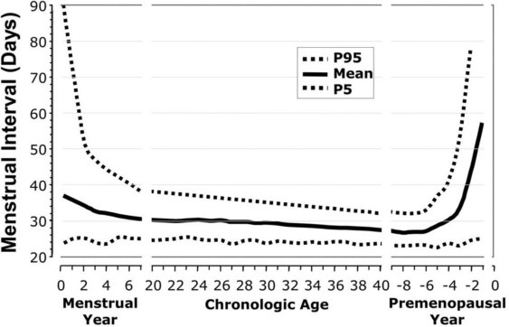
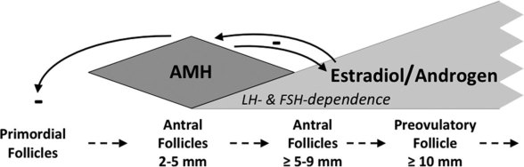
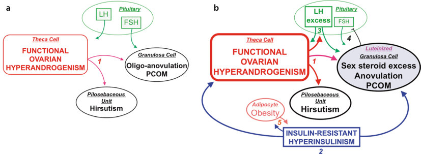
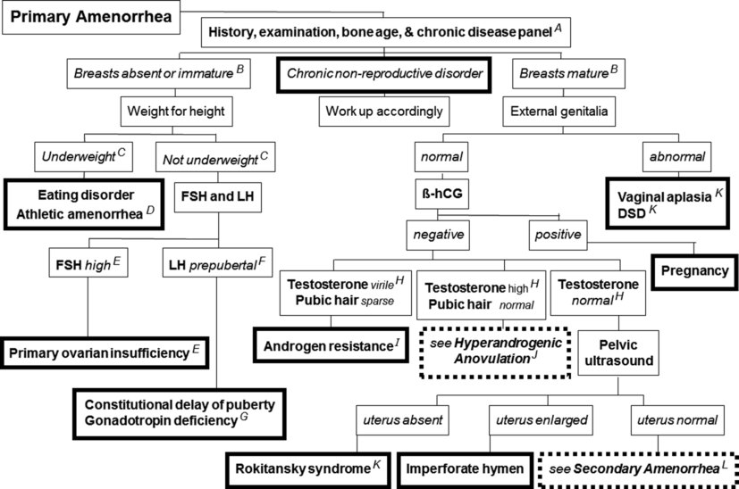
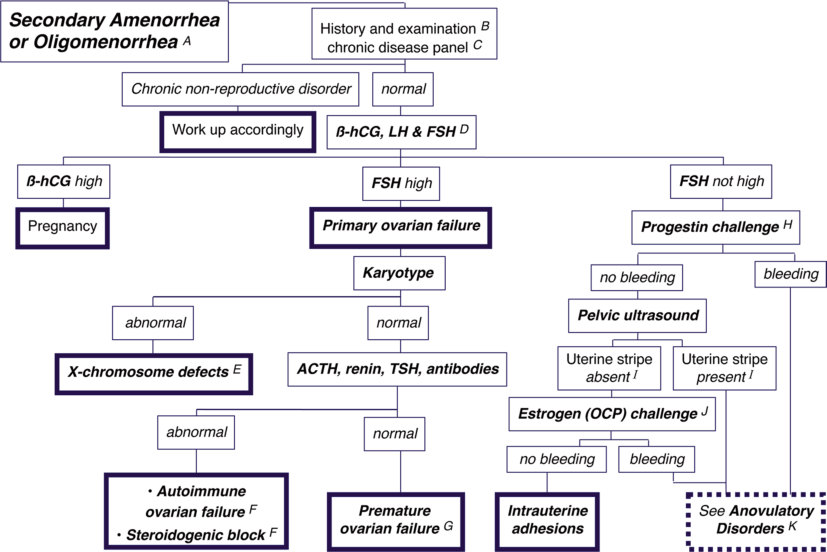
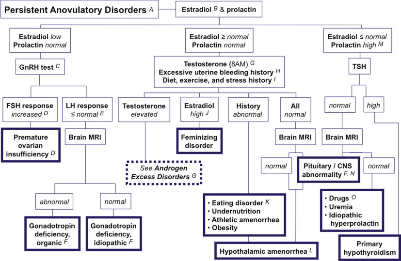
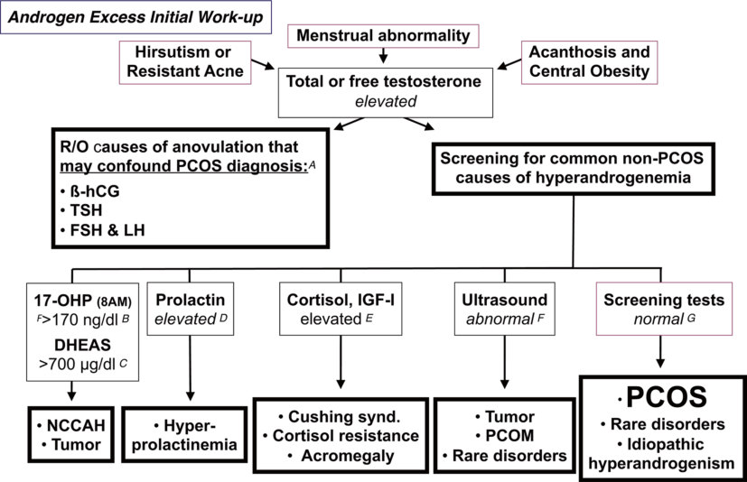
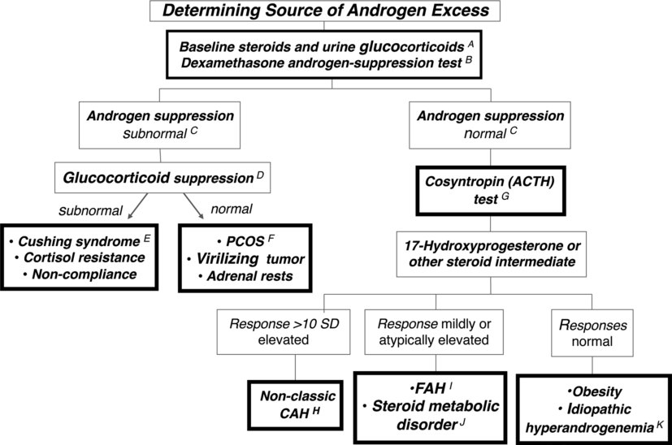

# 27. Menstrual Disorders and Hyperandrogenism in Adolescence
> Source attribution: [Source credits](../../SOURCE_CREDITS.md).

## PDF page 750 | printed page 747

### Menstrual Disorders and Hyperandrogenism in Adolescence

Sara A. DiVall and Robert L. Rosenfield

### Contents

### 27.1 Introduction and Background – 748

### 27.2 Etiology – 749

27.2.1 Genital Tract Disorders – 749 27.2.2 Anovulatory Disorders – 751 27.2.3 Polycystic Ovary Syndrome – 753

### 27.3 Differential Diagnosis – 760

### 27.4 Management – 768

### References – 771

© The Author(s), under exclusive license to Springer Nature Switzerland AG 2024 S. Radovick, M. Misra (eds.), Pediatric Endocrinology, https://doi.org/10.1007/978-3-031-66296-6_27

## PDF page 751 | printed page 748

Key Points

5 Anovulatory disorders that feature a

low estradiol level are caused by hypo gonadism (hypergonadotropic or hypo gonadotropic). 5 Anovulatory disorders that feature nor

mal estradiol may be due to pregnancy, hyperandrogenism, hyperprolactinemia, or hypogonadism in its early phases. 5 Tandem mass spectroscopy after prelim

### 27

inary chromatography is the most accu rate and reliable method to accurately measure estradiol and testosterone.

### 27.1 Introduction and Background

The evaluation of menstrual disorders in ado lescents requires special consideration. Adolescents are in the midst of developing physically and physiologically to achieve adult reproductive function. Thus, the normal varia tion in the age of onset of puberty and subse quent menarche should be taken into account when evaluating adolescent girls. Menarche will be delayed if puberty is delayed in onset. The average age of menarche is 12.6 years in the normal-weight general American popula tion, with the normal range being 10.0–14.1 years [1]. The age of menarche is

12.6 years in White girls, 12.7 years in Asian girls, 11.8 years in Hispanic girls, and 12.0 years in Black girls [1]. Although breast development is gradually beginning earlier since the 1970s associated with the obesity epidemic and pos sibly environmental chemicals, this has had only a small impact on age of menarche [1–4].

5 7

27.1 8

5 7 9

8

Unmatched source image; PDF page 751. Consult the original caption.

## PDF page 752 | printed page 749

menstruating), oligomenorrhea (fewer than normal menstrual periods a year), and exces sive anovulatory bleeding (formerly termed “dysfunctional uterine bleeding”: bleeding that occurs more often than at 19–21-day intervals or is excessive) ( Table 27.1) [6]. Normally, cyclic menstrual bleeding usually occurs at 21–45-day intervals even during the first post-menarcheal year, and cycles outside 19–90 days are always abnormal. Because these menstrual patterns are statis tically abnormal, even within the first year after menarche (occurring in less than 5% of adolescents), these patterns represent “symptomatic” rather than the usual “physi ologic” adolescent anovulation, and evalua tion is suggested if they persist. The risk of persistent menstrual irregularity is slightly over 50% if symptoms persist for 1 year beyond menarche and nearly two-thirds if symptoms persist 2 years beyond menarche; thus, evaluation is indicated if symptoms persist for 1–2 years after menarche [10].

Table 27.1 Definition of abnormal uterine bleeding (AUB) in adolescence

Descriptor Definition

Lack of menarche by 15 years of age or by 3 years after the onset of breast developmenta

Primary amenorrhea

Secondary amenorrhea

Over 90 days without a menstrual period after initially menstruating

Oligomenorrhea Post-menarcheal year 0–1: average cycle length >60 days (<6 periods in the year) Post-menarcheal year 1–3: average cycle length >45 days (<8 periods in the year) Post-menarcheal year 3–menopause: Average cycle length >38 days (<9 periods per year)

Excessive AUBb Menstrual bleeding more frequently than every 21 days (19 days in year 1), prolonged (lasts >7 days), or heavy (soaking pads or tampons sufficiently to interfere with quality of life)

Generated according to Adams Hillard PJ. Menstruation in adolescents: what do we know? And what do we do with the information? J Pediatr Adolesc Gynecol 2014;27:309–1; Teede HJ, Misso ML, Costello MF, et al. Recommendations from the international evidence-based guideline for the assessment and management of poly cystic ovary syndrome. Fertil Steril 2018;110:364–7; and Munro MG, Critchley HOD, Fraser IS, FIGO Men strual Disorders Committee. The two FIGO systems for normal and abnormal uterine bleeding symptoms and classification of causes of abnormal uterine bleeding in the reproductive years: 2018 revisions. Int J Gynaecol Obstet 2018;143:393–408 a Bone age of 15 years may be substituted for chronologic age in girls with earlier than average age at puberty onset b Encompasses frequent, intermenstrual, heavy, and/or prolonged AUB. Traditionally termed “dysfunctional uterine bleeding”

### 27.2 Etiology

27.2 10

### 27.2.1 Genital Tract Disorders

Primary amenorrhea can result from struc tural abnormalities of the genital tract that occur independently or are secondary to a difference of sex development (DSD). Varying degrees of vaginal and uterine apla sia are found in the Mayer-Rokitansky- Kuster-Hauser syndrome [11]. This syndrome occurs as a single gene defect or as an acquired teratogenic event which sometimes affects differentiation of the urinary tract. Uterine aplasia may occur alone or in combi

### Automatic table extraction — verify rendered original

|Descriptor|Definition|
|---|---|
|Primary amenorrhea|Lack of menarche by 15years of age or by 3years after the onset of breast developmenta|
|Secondary amenorrhea|Over 90days without a menstrual period after initially menstruating|
|Oligomenorrhea|Post-menarcheal year 0–1: average cycle length >60days (<6 periods in the year) Post-menarcheal year 1–3: average cycle length >45days (<8 periods in the year) Post-menarcheal year 3–menopause: Average cycle length >38 days (<9 periods per year)|
|Excessive AUBb|Menstrual bleeding more frequently than every 21days (19days in year 1), prolonged (lasts >7days), or heavy (soaking pads or tampons suffciently to interfere with quality of life)|

[Original table](../../tables/ch027_p0752_1.jpg)

## PDF page 753 | printed page 750

Table 27.2 Causes of Adolescent Menstrual Abnormalities

Abnormal genital structure

Aplasiaa

Hymenal

Müllerian

Disorders of sex development

Endometrial adhesions

### 27

Ambiguous genitalia

Disorders of sex development

Anovulatory disorders

Hypoestrogenism: FSH elevated (hypergonadotropic hypogonadism)

Primary ovarian insufficiency

Congenital

Chromosomal disorders

Genetic disorders

Resistant ovaries

Bioinactive gonadotropin

Steroidogenic block

Acquired

Oophorectomy

Radiotherapy or chemotherapy

Oophoritis

Idiopathic

Hypoestrogenism: FSH not elevated (hypo- or eugonadotropic hypogonadism)

Gonadotropin deficiency

Congenital

Acquired

Organic

Functional (nonorganic)

Delayed puberty

Constitutional delaya

Growth-retarding disease

Primary ovarian insufficiency (before FSH elevation is evident)

Complete, if BA <11 yeara

Incomplete, if BA >11 year

Virilization

Estrogenized: FSH not elevated

(continued)

## PDF page 754 | printed page 751

Table 27.2 (continued)

Pregnancy

Functional hypothalamic anovulation

Athletic amenorrhea

Psychogenic amenorrhea

Idiopathic functional hypothalamic amenorrhea

Post-pill amenorrhea

Epilepsy

Secondary hypothalamic anovulation

Chronic disease

Undernutrition or obesity

Cushing’s syndrome

Hypothyroidism

Hyperprolactinemia

Hyperandrogenism

Modified from Rosenfield et al. [10] a Cause only primary amenorrhea

nation with renal, cardiac, or limb abnormal ities. A subtype due to Wnt4 gene defects is associated with hyperandrogenism [12]. Obstruction of the genital outflow tract— most commonly due to imperforate hymen— causes hydrocolpos, which results in a fullness and bluish appearance at the vaginal introitus from the bulging imperforate hymen, or hydrometrocolpos when the uterus is involved, which may present as an abdominal mass. Uterine aplasia may also result from differences in sexual differentiation (DSD) in which anti-Müllerian hormone secretion by testicular tissue has occurred. For this rea son, primary amenorrhea may be the present ing symptom of phenotypic girls with complete androgen resistance (formally known as testicular feminization syndrome), congenital deficiency in one of the enzymes necessary for testicular testosterone secre tion, or in patients with ambiguous genitalia due to partial versions of these disorders or due to 5α-reductase deficiency.

Intrauterine adhesions (Asherman’s syn drome) may result from trauma, such as postcurettage or as a complication of radiation

therapy of pelvic disease or chronic inflamma tory disease [13].

Abnormal bleeding, on the other hand, can result from genital tract trauma or infec tion such as from sexual abuse or a foreign body. Bleeding may also result from genital tract tumors.

### 27.2.2 Anovulatory Disorders

## PDF page 755 | printed page 752

gonadism may cause either secondary amen orrhea or oligomenorrhea. At its mildest, hypogonadism may present with abnormal menstrual bleeding. Hypogonadism can be categorized according to whether or not gonadotropins, particularly serum follicle stimulating hormone (FSH) levels, are ele vated ( Table 27.1).

Hypergonadotropic hypogonadism: Hypoestrogenism with elevated FSH (hypergo nadotropic hypergonadism) indicates primary ovarian insufficiency (POI). The causes include both hereditary and acquired disor ders [14] . Acquired ovarian insufficiency may result from irradiation, chemotherapy, trauma to the ovary, galactosemia, or autoimmune disease. Gonadal dysgenesis due to deficiency of genes on the X chromosome causing Turner syndrome is the most common cause of POI, with an incidence of about 1 in 2500 live-born girls. About one-third of girls with Turner syndrome enter puberty spontane ously, and about 5% progress to complete it, with most developing secondary amenorrhea [15]. In women and adolescents with sponta neous POI not due to gonadal agenesis, a cause is identified in ~15% [16]. Fragile X chromosome premutation causes some cases of X-linked POI. Genetic causes of POI include hereditary gonadotropin resistance due to mutations in the LH or FSH receptor or along their signaling pathway, as in the context of Albright hereditary osteodystro phy, or to steroidogenic blocks in estradiol biosynthesis [14]. Genes involved in ovarian development, meiosis, and germ cell mainte nance have been identified as single gene causes of POI [14].

### 27

Hypogonadotropic hypogonadism: Frank hypoestrogenemia without elevated FSH lev els usually indicates secondary ovarian insuf ficiency (gonadotropin deficiency, hypogonadotropic hypogonadism). FSH lev els are not necessarily low because a normal gonadotropin level is inappropriate in the set ting of hypoestrogenism. Gonadotropin defi ciency can be congenital or acquired.

Congenital gonadotropin deficiency can arise from diverse cerebral, hypothalamic, or pituitary disorders, single gene mutations in the pituitary development cascade [17], or a

chromosomal disorder (such as Prader-Willi syndrome). Congenital isolated gonadotropin deficiency may result from autosomal domi nant or recessive disorders [18], of which GnRH receptor deficiency is more common in women than the anosmia-associated Kallmann syndrome. These and other specific gene defects that cause congenital isolated gonadotropin deficiency are discussed in Chap. 25. These disorders are typically associated with absent puberty but primary or secondary amenorrhea may manifest.

Acquired gonadotropin deficiency may be organic or functional. Organic acquired gonadotropin deficiency can be a consequence of tumors, trauma, autoimmune hypophysitis [19], irradiation [20], or chronic illness of vir tually any organ system [21]. Functional hypogonadotropinism (referred to as func tional hypothalamic amenorrhea in sexually mature girls) is commonly caused by energydeficit states such as eating disorders and excessive exercise (associated with low or nor mal weight) and emotional or psychological stress [22].

In some situations, it can be difficult to dif ferentiate between gonadotropin deficiency and POI as a cause of low estrogen. The most common situation is in children who are too young to have undergone neuroendocrine puberty, as indicated by a bone age less than about 11 years. The other situation occurs in incomplete or early POI because gonadotro pin levels are often normal in the early stages as ovarian function is declining progressively yet intermittently, as during the menopausal transition [16]. Suppression of gonadotropins and estrogens also occurs in frankly virilizing disorders.

Functional hypothalamic amenorrhea occurs in sexually mature (e.g., feminized) adolescents. It occurs in patients who secrete sufficient gonadotropin to feminize normally but have functional disorders which interfere with normal GnRH pulsatility. These disor ders arise from disturbances of cyclic or pul satile GnRH release that interfere with LH pulse frequency and the positive feedback mechanism necessary for ovulation. If the dis turbance of GnRH release affects baseline LH pulse frequency, then a hypogonadotropic

## PDF page 756 | printed page 753

hypogonadism clinical picture results with hypoestrogenemia. If disturbance of GnRH pulsatile release primarily affects the positive feedback mechanism for ovulation, then amenorrhea with normal serum estradiol will occur. Functional hypothalamic amenorrhea is commonly caused by disorders of energy imbalance or psychological stress [22].

Anorexia nervosa is the prototypic eating disorder, but bulimia nervosa, the bingeeating/purging variant, is easily overlooked because the weight is often normal and vomit ing surreptitious. Energy imbalance due to excessive exercise and disorganized eating may occur in adolescents with normal weight who are muscular without appropriate fat stores; insight can be provided by a careful exercise history. It is also seen in the setting of psychological stress. Implicit with its categori zation as “functional,” return of menses occurs with amelioration of energy imbalance or psychological stress. Even when these fac tors are not obvious, similar mechanisms seem to underlie idiopathic functional hypo thalamic amenorrhea [23]. Post-pill amenor rhea may be suspected after the long-term use of hormonal contraceptives. However, this entity usually results from an undetected ante cedent anovulatory disturbance or an inter current illness, so a diagnostic evaluation is required.

Hyperprolactinemia requires special con sideration because it varies greatly in its pre sentation, depending to a great extent on the degree of gonadotropin deficiency. Prime among the multiple mechanisms of functional hypothalamic anovulation is disruption of GnRH pulsatility [24]. Galactorrhea is pres ent in about half of the patients, occurring among those with sufficient gonadotropin secretion to maintain residual estrogen pro duction; these girls may also have adrenal hyperandrogenism. The causes of hyperpro lactinemia are diverse and include hypotha lamic or pituitary disorders, medications, hypothyroidism, renal or liver failure, periph eral neuropathy, stress, or idiopathic [25]. Hyperprolactinemia is not only in the differ ential diagnosis of hypogonadotropic hypo gonadism and hypothalamic amenorrhea; it may cause short luteal phase (characterized

by menstrual cycles less than 22 days), exces sive uterine bleeding, or hyperandrogenic symptoms.

Chronic disease of virtually any organ sys tem can mimic gonadotropin deficiency or functional hypothalamic amenorrhea. Obesity may cause amenorrhea via suppression of LH levels, distinct from its roles in polycystic ovary syndrome, discussed below [26]. The main mechanism involves in part accelerated LH turnover [26, 27] and possibly in part gonadotropin suppression by inflammatory cytokines [28]. Glucocorticoid excess (organic or iatrogenic) causes amenorrhea by multiple mechanisms, prime among which is interfer ence with gonadotropin responsiveness to GnRH [29]. Thyroid disorders are well-known causes of menstrual irregularity.

27.3

### 27.2.3 Polycystic Ovary Syndrome

PCOS accounts for over 80% of cases of androgen excess presenting at or after the onset of puberty. The classic syndrome origi nally described by Stein and Leventhal includes various combinations of amenor rhea, hirsutism (defined as excessive malepattern hair growth), and polycystic ovaries and is frequently associated with obesity and insulin resistance. The etiology of PCOS is not fully understood, and the manifestations differ widely among affected females. Consequently, there is no single test to diag nose PCOS. Diagnostic criteria for PCOS in adult women are encompassed in the “Rotterdam criteria” as various combinations of hyperandrogenism, oligo-anovulation, and polycystic ovary morphology (PCOM) that are otherwise unexplained [30]. If adult crite ria are applied to adolescents, the criteria will result in overdiagnosis of PCOS because nor mal physiologic events of adolescence may

## PDF page 757 | printed page 754

Table 27.3 Differential diagnosis of hyperandrogenism in adolescents

A. Physiologic adolescent anovulation

B. Functional gonadal hyperandrogenism

1. PCOS: Primary functional ovarian hyperandrogenism (common form of PCOS)

2. Secondary functional ovarian hyperandrogenism

(a) Virilizing congenital adrenal hyperplasia

(b) Adrenal rests of ovary

(c) Ovarian steroidogenic blocks

(d) Insulin resistance syndrome

(e) Acromegaly

### 27

(f) Seizure disorder ± valproic acid therapy

3. Disorders of sex development

4. Pregnancy-related hyperandrogenism (placental aromatase deficiency and luteomas)

C. Functional adrenal hyperandrogenism

1. PCOS primary functional adrenal hyperandrogenism (uncommon form of PCOS)

2. Virilizing congenital adrenal hyperplasia

3. Other glucocorticoid-suppressible functional adrenal hyperandrogenism

(a) Hyperprolactinemia

(b) Cortisone reductase deficiency (and apparent reductase deficiency)

(c) Dehydroepiandrosterone sulfotransferase deficiency, apparent

4. Glucocorticoid-nonsuppressible functional adrenal hyperandrogenism

(a) Cushing syndrome

(b) Glucocorticoid resistance

D. Peripheral androgen metabolic disorders

1. Obesity

2. Idiopathic hyperandrogenism

3. Portohepatic shunting

E. Virilizing tumors

F. Androgenic drugs

mimic some of the features of PCOS used to diagnose adults.

27.4 31 33

27.1

Table 27.4 Diagnostic criteria for polycystic ovary syndrome in adolescents

Otherwise unexplained combination of:

1. Abnormal uterine bleeding pattern

(a) Abnormal for age or gynecologic age

(b) Persistent symptoms for 1–2 years

2. Evidence of hyperandrogenism

(a) Persistent testosterone elevation above

adult norms in a reliable reference laboratory is the best evidence

(b) Moderate-severe hirsutism is clinical

evidence of hyperandrogenism

(c) Moderate-severe inflammatory acne

vulgaris is an indication to test for hyperandrogenemia

Reproduced with permission from Rosenfield RL [33]

## PDF page 758 | printed page 755

obtained in serum total or calculated bioavail able testosterone relative to adult female norms in a specialty reference laboratory. Polycystic ovaries are a physiologic variant in normal adolescent girls, and there is a paucity of nor mative data in adolescents; thus, use of ovarian morphology or size parameters in adolescents as diagnostic criteria is not recommended [31, 32, 34]. To avoid mislabeling physiologic anovulation as PCOS, it is recommended that the menstrual abnormality and hyperandro genemia persist for 2 years [31, 32]. This recom mendation should not preclude earlier diagnostic evaluation for causes other than PCOS if hyperandrogenic anovulation occurs in this timeframe (see ‘other causes of hyperan drogenic anovulation’).

The manifestations of PCOS are quite variable. Only about a third of cases have the classic Stein-Leventhal syndrome. Anovula tory symptoms vary from oligomenorrhea to excessive anovulatory bleeding to otherwise asymptomatic infertility. Hirsutism or inflam matory acne may not be evident at presenta tion. Over half of PCOS adolescents have an abnormal degree of hirsutism or acne, but hyperandrogenemia does not always have a cutaneous manifestation. Obesity and acan thosis nigricans, a sign of insulin resistance, are common presenting features [35]. Obesity is present in about half of cases. Females with PCOS have a high prevalence of the metabolic syndrome and are predisposed to type 2 dia betes mellitus [26]. In adolescents, there may be an antecedent history of premature adre narche or early childhood obesity with a Cushingoid fat distribution or overgrowth (i.e., pseudo-Cushing’s syndrome or pseudoacromegaly) [36]. Congenital virilizing disor ders, such as congenital adrenal hyperplasia, are a risk factor for PCOS at puberty.

Pathophysiology

PCOS was initially thought to be a fundamen tally neuroendocrine disorder. This concept was rooted in the early observation that base line LH levels and responses to GnRH are elevated in PCOS. Compared to control women, women with PCOS have increased LH pulse frequency and amplitude. In addi tion, LH stimulates the expression of thecal

steroidogenic enzymes and steroidogenesis; conversely, LH suppression inhibits them. Therefore, the increased LH of PCOS was ini tially considered the cause of the androgen excess. However, this theory does not account for the subsequent finding that half of women with PCOS do not have elevated LH levels because LH levels are inversely correlated with the degree of obesity [27]. Furthermore, normally the ovarian response to excessive LH stimulation is downregulation of andro gen secretion. The mechanism involves down regulation of LH receptor expression (“homologous desensitization”), which is fol lowed by specific downregulation of androgen secretion that is exerted by intraovarian fac tors inhibiting the rate-limiting step in andro gen formation, the 17,20-lyase activity of cytochrome P450c17, which has both 17-hydroxylase and 17,20-lyase activities. As a consequence, increased LH levels normally cause downregulation of LH receptor sites, downregulation of 17,20-lyase activity with a rise in 17-hydroxyprogesterone levels, but the downstream androgenic response to LH is limited [26]. In PCOS, there is partial escape from these normal downregulation processes, so ovarian androgen excess occurs [26].

Excessive LH levels in some women with PCOS may be the result of hyperandrogenism inhibit ing estrogen-progestin negative feedback [26, 37, 38]. The LH pulse frequency of women with PCOS is less sensitive than that of controls to sex steroid suppression. Antiandrogen therapy restores the inhibitory effect of estrogen-proges tin on LH pulse frequency [39].

Eighty-seven percent of individuals with PCOS have functional ovarian hyperan drogenism (FOH) according to tests of ovar ian androgenic function [26]. Two-thirds of cases have functionally typical PCOS, which is characterized by steroidogenic hyperrespon siveness, particularly at the level of 17-hydroxyprogesterone, to LH (as deter mined by a GnRH agonist or hCG test); most of these cases also have an elevated free tes tosterone after suppression of adrenocortical function with dexamethasone [40]. One-third of cases have only the latter abnormality (functionally atypical FOH) [41].

## PDF page 759 | printed page 756

An abnormal degree of insulin resistance, obesity, or luteinizing hormone (LH) excess is each found in approximately one-half of cases. The common denominator in most PCOS then is ovarian hyperandrogenism, with insulin-resistant hyperinsulinism being a nonessential but common aggravating factor in the pathophysiology. LH excess and the propensity to obesity seem to usually be sec ondary to the underlying ovarian hyperan drogenism and hyperinsulinism, respectively. However, the heterogeneity in the syndrome leaves open the possibility that in some cases LH excess or severe insulin resistance may be the inciting factor.

### 27

In vitro studies indicate that PCOS theca cells in culture have a steroidogeneic pheno type similar to women with PCOS in response to GnRH agonist testing [42, 43]. This results from an overexpression of enzymes on the ste roidogenic pathway from cytochrome P450scc (cholesterol side chain cleavage) through P450c17. The abnormal steroidogenesis is due to an intrinsic defect in the theca cells of PCOS patients that persists through passage [42, 43]. Recently, genome-wide association screening (GWAS) has led to the discovery of involvement of a previously unsuspected pro tein modulating steroidogenesis: DENND (differentially expressed in normal and neo plastic differentiation). The expression of the DENND1A.V2 isoform is increased in PCOS theca cells and accounts for the PCOS theca cell steroidogenic phenotype in culture [44].

A related steroidogenic defect some times seems to involve the adrenal gland. About a quarter of women with FOH have a related steroidogenic defect in adrenal formation of DHEA and its precursor, 17-hydroxypregnenolone, without evidence of a steroidogenic block in response to ACTH stimulation, as would occur in viril izing congenital adrenal hyperplasia. This dysfunction is termed primary functional adrenal hyperandrogenism (FAH). FAH had earlier been mistaken for “exaggerated adrenarche” or nonclassical 3ß-hydroxys teroid dehydrogenase deficiency, which is now known to be a rare disorder. Notably, DENND1A is also highly expressed in the adrenal androgen-forming zone [44].

Insulin-resistance is a common feature of PCOS [26, 45]. This insulin resistance is intrin sic: it is abnormal for the degree of obesity in about half of cases. The insulin resistance affects the glucose metabolic effects of insulin and is tissue-selective, primarily affecting skel etal muscle and hepatic cells, but it spares the ovaries and adipose tissue. Consequently, the hyperinsulinemia that is compensatory for the glucose-metabolic defect in insulin resistance acts on the ovary, causing “insulin-resistant hyperinsulinism”. An important effect of this hyperinsulinism is that it counteracts normal homologous desensitization/downregulation of LH receptors, thereby sensitizing the ovary to LH [46]. Insulin also stimulates formation of testosterone by 17ß-hydroxysteroid dehy drogenase. It does so by stimulating expres sion of KLF15, a Kruppel-like transcription factor that is part of the gene’s proximal pro moter coactivator complex and that also stim ulates adipogenesis in adipocytes [47]. Thus, the insulin-resistant hyperinsulinism of PCOS seems to contribute to both androgen and fat excess.

Another aggravating factor in hyperan drogenism is the pro-inflammatory nature of obesity, which occurs because monocytes accumulate in adipose tissue and the gastroin testinal microbiome changes. These mono cytes elaborate that increased inro-inflammatory cytokines such as tumor necrosis factor-alpha and lipopolysaccharide directly upregulate insulin resistance and ste roidogenesis [26, 48–51]. Glucose or saturated fat ingestion aggravates insulin resistance and FOH by triggering increased serum levels of several of these proinflammatory factors, often more so in PCOS than in obesity [50, 51].

26

## PDF page 760 | printed page 757

aromatase expression and estradiol secretion as follicles grow over 5 mm diameter ( Fig. 27.2). The arrest of follicular matura tion that causes anovulation may in part be related to the high AMH levels and in part related to the premature luteinization of gran ulosa cells, which seems to result from thecal androgen excess when accompanied by insulin excess [52]; however, an independent folliculo genesis defect cannot be ruled out [26, 41, 53].

26

27.3

Etiology

Similar to type 2 diabetes mellitus, PCOS is a complex trait that seems to arise because of an interaction between congenital predispos ing factors and environmental factors [26]. These complex interactions generally mimic an autosomal dominant pattern of inheri tance with variable penetrance. Heritability of PCOS has been estimated at over 70%, based on studies in identical twin sisters [54].

Highly heritable traits include elevated tes tosterone levels, PCOM, maternal PCOS, parental metabolic syndrome, and type 2 dia betes mellitus [26]. Ongoing research aims to identify specific genes that underlie PCOS pathogenesis. A wide variety of genetic vari

ants with linkage to and/or association with PCOS have been identified by candidate gene and molecular genetic studies. The candidate gene approach led to the discovery of coding and regulatory variants in the AMH and AMH receptor gene (AMHR2) in 6.7% of PCOS patients who have decreased signaling and may have pathologic significance [55]. Deleterious androgen receptor splice variants may underlie about 1% of PCOS [56, 57]. Several important investigations utilizing GWAS identified multiple genes linked to PCOS [58]. One of the most striking findings from GWAS studies in diverse PCOS cohorts has been the discovery of the DENND1A splice variant DENND1A.V2, which, as dis cussed above, encodes a previously unrecog nized protein that accounts for the PCOS biochemical phenotype in cultured theca cells [44]. A whole-genome sequencing study of 261 individuals from 62 PCOS families showed that half of these PCOS families had one or more of 30 rare DENND1A variants [59]. The vast majority of these were noncod ing variants, most of which were predicted to alter V2 expression via altered binding of transcription factors or RNA-binding pro teins. Cluster analysis based on anthropomet ric, reproductive, and metabolic traits in a population of nearly 1000 women with PCOS showed two distinct clusters of cases: a rela tively nonobese group (21–23% of cases) with

Unmatched source image; PDF page 760. Consult the original caption.

## PDF page 761 | printed page 758

### 27

higher LH and higher sex hormone-binding globulin levels (termed “reproductive” group) and a relatively obese group (37–39%) with higher glucose and insulin levels (“metabolic” group) [60]. DENND1A variants were present in two-thirds of the reproductive phenotype group, which differed significantly from those with the intermediate (35%) or metabolic (27%) phenotype. Micro-RNAs (miRNAs) have been found to be differentially expressed in ovarian cells from PCOS and normal; these molecules inhibit gene expression via post transcriptional mechanisms. Pathway and network analysis suggested that miR-130b-3p was at the hub of a network that links DENND1A to upregulation of LH receptor expression and to the insulin signaling path way [61]). DENND1A.V2 may also directly stimulate steroidogenic transcription [62].

Epigenetic change may be important to the pathogenesis of PCOS. Abnormal epigen etic methylation of cytosine-guanine (CpG) has been identified in multiple tissues from adult women with PCOS [26] reflecting envi

ronmental exposures and altered expression of diverse genes. Epigenetic changes have var iously been found to reflect dietary distur bances in the intrauterine [63] or postnatal [64] environment. Perhaps the best known of the intrauterine perturbations is that indi cated by low birth weight, which has a delete rious effect on cardiovascular outcome [65] and which may be a risk factor for PCOS [26, 66].

Early prenatal virilization of the female fetus is well-established to cause PCOS in humans [26] and a PCOS-like state in all species studied [67]. The mechanism likely involves epigenetic changes [68]. The patho physiology may involve reduction of hypotha lamic progesterone receptor expression by prenatal androgen excess, with consequent hypersecretion of LH [69]. Although ordinary PCOS seems unlikely to be attributable to pre natal virilization in humans [26], the prenatal effect of virilization is transgenerational in mice and related to PCOS-related epigenetic changes [70]: common gene expression signa

Unmatched source image; PDF page 761. Consult the original caption.

## PDF page 762 | printed page 759

tures were found in oocytes of prenatally androgenized mice and in blood cells of PCOS daughters and unrelated women with PCOS.

Postnatal risk factors in the internal or external environment can be viewed as a sec ond “hit,” which cause a latent heritable or congenitally programmed susceptibility trait to manifest as PCOS. These include obesity, syndromes of severe insulin resistance, and poorly controlled congenital virilizing con genital adrenal hyperplasia [26]. Premature adrenarche may sometimes be an early mani festation of the steroidogenic dysregulation that underlies PCOS.

### 27.2.3.1 Other Causes of Functional

### Ovarian Hyperandrogenism

27.3

71 72

73

74 75

27.3

76 78

79

80

81 Dexamethasone-resistant forms of hyper androgenism such as Cushing’s syndrome and cortisol resistance are even less prevalent than nonclassical congenital adrenal hyperplasia. Prolactin excess causes adrenal hyperan drogenism; Cushing’s disease and hyperpro lactinemia are sometimes associated with polycystic ovaries [82, 83].

In approximately 10% of hyperandrogenic patients, a gonadal or adrenal source of androgen cannot be ascertained after thor ough testing. Most of these cases have mild hyperandrogenemia, lack DHEAS and LH elevation, and seem to be due to the excess adipose tissue of obesity forming of excess

## PDF page 763 | printed page 760

testosterone from androstenedione and sup pressing gonadotropin levels [26–28, 47]. Other idiopathic hyperandrogenemia cases may be due to hereditary quirks in peripheral metabolism of steroids. Androgen producing tumors are rare causes of virilization.

### 27.3 Differential Diagnosis

### 27

27.4 10

85

27.5 10

86

87

27.6 10

27.1

27.6

88 89

27.7

33 75

## PDF page 764 | printed page 761

10

27.5 27.6

27.5

27.7

27.5

Unmatched source image; PDF page 764. Consult the original caption.

## PDF page 765 | printed page 762

### 27

10

27.6

Unmatched source image; PDF page 765. Consult the original caption.

## PDF page 766 | printed page 763

Dependable testosterone assays may not be available to all practitioners, but are becom ing more widely available. The most available, reliable methods to assay total testosterone in women and children involve preliminary chro matography followed by either specific radio immunoassay or tandem mass spectrometry (abbreviated LC-MS) [75, 84, 90]. Most com mercial specialty laboratories now use tandem mass spectrometry. Some direct total testos terone radioimmunoassays give comparable results to LC/MS, but many do not [84, 91]. The automated assays of total testosterone, available in multichannel immunometric pan els, and direct free testosterone assays are very inaccurate at the relatively low testosterone levels of women and children; thus they give misleading information about androgen sta tus in women and girls.

The calculated serum-free testosterone (aka bioavailable testosterone) is also useful to detect androgen excess [75]. The most reliable method to detect free testosterone is to calculate it as the product of the total testosterone and the frac tion that is free from sex hormone-binding glob ulin (SHBG) binding (free testosterone = total testosterone X percent free testosterone). Percent-free testosterone is calculated from the SHBG concentration or directly determined by dialysis methods. The main problem with inter preting calculated serum-free testosterone levels is that the absolute values are method-depen dent, so it is important to use a specialty labora tory that has well-established normal ranges.

27.4 27.6

27.7

31 32 34

10 33

31

27.4 27.5 27.6

31 32

92

## PDF page 767 | printed page 764

presented in Fig. 27.8 [10]. An early morn ing blood sample for total testosterone by LC/ MS, steroid intermediates, and cortisol is obtained, followed by a dexamethasone andro gen suppression test [84]. We reserve ACTH testing for a comprehensive panel of steroid intermediates, for the subset of patients in whom dexamethasone-suppressible androgen excess is present. Mutation-confirmed nonclas sical congenital adrenal hyperplasia is present if one of the steroid intermediates rises over 10

### 27

SD above average in response to ACTH [93–95]. Rare steroid metabolic defects are in the differential diagnosis [79, 96–98].

If the source of androgen excess cannot be localized by these tests, one may be able to definitively demonstrate an ovarian source by a GnRH agonist challenge test [84]. If no source for the androgen excess can be found, one is dealing with idiopathic hyperandrogenism; such patients should be followed to ensure that their course is as benign as expected.

Unmatched source image; PDF page 767. Consult the original caption.

## PDF page 768 | printed page 765

10

27.5

27.5

27.7

## PDF page 769 | printed page 766

### 27

84

Unmatched source image; PDF page 769. Consult the original caption.

## PDF page 770 | printed page 767

84

Unmatched source image; PDF page 770. Consult the original caption.

## PDF page 771 | printed page 768

### 27.4 Management

Appropriate therapy of menstrual disorders depends upon the diagnosis. Amenorrhea due to genital tract outflow obstruction often requires surgical treatment, as in the case of vaginal aplasia or imperforate hymen. Some cases of intrauterine adhesions respond to hysteroscopic lysis. If a DSD is diagnosed, utmost sensitivity must be used when discuss ing the diagnosis with the patient and family. The gender identity and wishes of the patient must be considered when recommending hor monal therapy. Persons with ovotesticular gonadal dysgenesis are at risk for gonadal malignancy; close follow-up to monitor for gonadoblastoma is mandatory. In some cases, prophylactic surgical removal of dysgenetic gonadal tissue is advisable.

### 27

For some underlying causes, treatment of hypogonadism is achieved without hormone replacement. The treatment of choice for a prolactinoma is dopaminergic agents. Hyperprolactinemia will be maximally sup pressed within 1 month, and the menstrual cycle will normalize within 3 months with an effective regimen. Cabergoline 0.25–1.0 mg once or twice weekly will usually control galactorrhea and shrink prolactinomas [25]. To minimize nausea, it is best to start with a low dose at bedtime. Two years of treatment will minimize recurrence. Transsphenoidal resection of prolactinomas is considered if the patient’s condition or eyesight is critical and for the rare treatment failures. A link between cabergoline treatment and mild-moderate tri cuspid valve regurgitation has been suggested in elderly patients with Parkinson’s disease who often take large doses of the drug. It appears that younger persons without preex isting cardiac findings are at low risk for devel opment of valve problems with the doses of cabergoline commonly used for prolactino mas; it is currently recommended to screen for valvulopathy if doses exceed 3 mg/week or a murmur is present [99].

Hypogonadism due to chronic diseases such as cystic fibrosis, heart failure, cirrhosis, chronic renal failure, regional enteritis, or sys temic lupus erythematosus is best treated by controlling the underlying illness. Anorexia

nervosa is best managed by an experienced multidisciplinary team. Refeeding is the first priority, accompanied by long-term manage ment of the psychodynamic disorders [100]. Menses resume when psychotherapy is effec tive and body fat is restored to normal. Estrogen treatment of patients with an eating disorder may mask the psychopathology that underlies the menstrual disturbance by induc ing regular menses, and oral estrogenprogesterone combination therapy does not yield the recovery of bone loss that occurs with weight gain [101], although more promis ing results have been reported with physio logic transdermal estradiol replacement [102].

Hormone replacement is the treatment of choice in hypergonadotropic hypogonadism and organic causes of hypogonadotropic hypogonadism, such as congenital or acquired hypopituitarism. Stature is an important consideration in sexually imma ture teenagers, especially those with Turner syndrome. The dose of estrogen in standard oral contraceptive pills (OCPs) will inhibit growth and lead to premature fusion of the epiphyses in sexually immature patients. Panhypopituitary patients require replace ment of growth hormone, thyroid hormone, and cortisol deficits. Further discussion of full pituitary hormone replacement is beyond the scope of this chapter.

Optimal estrogen replacement therapy in the sexually immature girl requires the induc tion of puberty in a physiologic manner with extremely low doses of estrogen to maximize growth. Gradual, physiologic replacement of estrogen can be started at a peer-appropriate age without compromising height potential. This technique has been validated using intra muscular depot estradiol [103]. The low doses of intramuscular estradiol required for this effect are only available at compounding pharmacies, so transdermal E2 is the usual alternative [15]. There are various techniques to initiate therapy at an appropriate age at the very low doses required [104]. The recom mended starting dose averages 3–6 mcg daily. Although data are limited, the most widely used regimen begins with one-quarter of a 25 mcg patch applied twice weekly [104, 105]. The dose is increased every 6 months over a

## PDF page 772 | printed page 769

span of 2 years to adult replacement doses of transdermal estradiol 75–100 mcg daily or 2 mg micronized E2 by mouth daily. Conjugated equine estrogens are not advised since doses as low as 0.325 mg daily inhibit growth [106]. Progestin should be added to estrogenic regimens after 2 years of estrogen replacement or after bleeding occurs: the most physiologic replacement regimen is with micronized progesterone (Prometrium®) 100 mg daily for 7 days monthly and advance to a full maintenance dose of 200 mg daily for 10–12 days monthly as tolerated [105]. In the setting of estrogen replacement at adult doses, the addition of progesterone is necessary to lower the risk of endometrial hyperplasia and endometrial carcinoma [107].

Hypoestrogenism in sexually mature girls may be managed by administration of an oral contraceptive (OCP) or transdermal patches with a progestin component. The currently available OCPs carry very little risk of venous thromboembolic disease (VTE) [108], and the progestational component protects against endometrial hyperplasia, but evidence in post menopausal women suggests that transder mal estradiol is slightly safer [109, 110]. VTE risk is related to the dose of estrogen (combi nation OCPs have ethinyl estradiol doses that range from 10 to 35 mcg) and the type of pro gestin (with norethindrone and norgestimate having the lowest risk and antiandrogenic progestins, e.g., drospirenone, with a higher risk). Obese patients may require higher doses of estrogen to achieve menstrual regularity. However, patients at risk of VTE or sensitive to estrogen because of conditions such as hypertension, migraine, or lymphedema are best advised to use a more physiologic form of therapy, such as 17β-estradiol delivered trans dermally. When using an estradiol patch, a progestin is administered for 7–12 days to induce menstrual shedding (e.g., micronized progesterone 100–200 mg orally daily); the more progestin administered, the less the risk of endometrial hyperplasia, but the greater the risk of premenstrual symptoms.

27.4

An acute episode of excessive vaginal bleeding typically responds to the adminis tration of a combination estrogen-progestin, low-dose OCP, one tablet four times daily for 7 days. Treatment is then stopped for 5 days, and the patient is warned that heavy with drawal bleeding with cramps may occur. Thereafter, therapy with a low-dose OCP, given as for contraception, is begun to pre vent recurrence of bleeding and is continued for about three cycles. Cyclic progesterone is an alternative treatment to oral contracep tive pills.

A patient who is hypovolemic because of rapid, heavy bleeding should be hospitalized and treated with intravenous fluids, an antifi brinolytic agent (e.g., aminocaproic acid or transenamic acid), and blood products as nec essary [111, 112]. Conjugated equine estro gens in a dose of 25 mg intravenously every 3–4 h for three to four doses are customary to reduce the bleeding, although other oral estro gens are sometimes used. In cases of bleeding of this severity, a bleeding diathesis or uterine structural abnormality should be considered. If heavy bleeding persists, curettage should be performed by a gynecologist.

The management of hyperandrogenic states is individualized according to symp toms and patient goals—hirsutism, acne, and alopecia, menstrual irregularity, obesity, and insulin resistance—and the source of andro gen excess. The hyperandrogenism associated with Cushing’s syndrome, virilizing tumors, DSD, hyperprolactinemia, or acromegaly improves with appropriate treatment of the underlying cause. Undesirable side effects of glucocorticoid treatment of congenital adre nal hyperplasia can be minimized by using a

## PDF page 773 | printed page 770

modest bedtime dose (about 5–7.5 mg predni sone); however, adrenal suppression may still occur and stress dose precautions may still be needed. Monitoring 17-hydroxyprogesterone and testosterone while on treatment is neces sary for dose adjustment [113]. Control of androgens in congenital adrenal hyperplasia may not suffice for menstrual control unless nocturnal progesterone excess is also con trolled [114]. This treatment will typically nor malize the menstrual pattern in nonclassical congenital adrenal hyperplasia, but PCOS complicates many of these cases as a result of congenital or perinatal masculinization [26].

### 27

The management of PCOS is directed toward treating symptoms and monitoring for associated disorders. Treatment of menstrual irregularities in PCOS is recommended to pre vent amenorrhea and the associated risk of endometrial hyperplasia and carcinoma. A combination OCP containing estrogen and progestin is the first-line treatment to induce regular menstrual cycles, especially in those with hirsutism or its cutaneous equivalents. OCPs containing non-androgenic progestins such as norgestimate generally have favorable risk-benefit ratios and optimize lipid profiles. Those on drospirenone may benefit from its weak antiandrogenic and moderate antimin eralocorticoid effects, though it poses slightly more risk for thromboembolic events: drospi renone is available in the USA with 20 or 30 mcg ethinyl estradiol. Obese patients may require a higher dose of estradiol to provide menstrual regularity.

Progestin-only regimens can be used to induce menstrual regularity as detailed above, especially if hirsutism and its cutaneous equivalents are not a concern. Progestin-only regimens are also useful in patients in whom OCPs are contraindicated or in patients with objections to the use of contraceptive therapy.

The hyperandrogenic manifestations of hirsutism and acne are treated by topical der matologic and cosmetic measures and/or endocrinologic treatment. The choice between the treatment options depends upon symptoms and patient preference. Mild hir sutism can be treated by hair removal tech niques such as shaving, bleaching, or waxing. Eflornithine hydrochloride cream (Vaniqa®)

is a topical agent that is FDA-approved for the removal of unwanted facial hair. Six to eight weeks of use is required before effects are seen, and it must be used indefinitely to prevent regrowth. It is often not covered by third-party payers. Laser therapy and elec trolysis are techniques of permanent hair reduction. Because of expense, discomfort, and occasional scarring, these techniques may be most appropriate for limited areas in patients who do not respond to other means of treating hirsutism.

OCPs are useful to treat hyperandrogenic symptoms as an adjunct to cosmetic treat ments. The estrogen component decreases bioactive testosterone by suppressing LH secretion and ovarian androgen production while increasing serum SHBG. The decrease in bioactive testosterone, assessed 3–6 months after start of therapy, is associated with an improvement in hyperandrogenic cutaneous symptoms; acne can improve within 3 months and progression of hirsutism may arrest within 9–12 months in most PCOS patients. Endocrinologic treatment reduces the androgen-induced transformation of vellus to terminal hairs, and the effects of these agents are maximal at 9–12 months because of the long growth cycles of sexual hair follicles. Thus, a minimum of 6 months is required to determine improvement. OCPs are recom mended as a first-line treatment of hirsutism [33, 75]. Many OCPs contain progestins that may have a mild androgenic component. It is logical, therefore, to treat hirsute women with OCPs that contain non-androgenic or antian drogenic progestins, as detailed above. If after 6 months of treatment no substantial improve ment in hirsutism occurs, antiandrogen ther apy is suggested [75]. Spironolactone has been shown to be effective to the extent of lowering hirsutism score by about one third [115], with considerable individual variation, and is prob ably the most potent and safe antiandrogen available in the USA. We recommend starting with 100 mg twice daily and then reducing the dosage to 50 mg twice daily for maintenance therapy after the maximal effect has been achieved. This dosage is usually well-tolerated; however, polyuria, fatigue, and hyperkalemia at higher doses may limit its usefulness. It is

## PDF page 774 | printed page 771

potentially teratogenic to fetal male genital development and may cause menstrual distur bance in the patient; therefore, it should be prescribed with an oral contraceptive. Flutamide is another antiandrogen of similar efficacy, but is not recommended because of potential hepatotoxicity and expense [75].

menstrual disorders. Girls with delayed puberty, whether it has an organic or func tional basis, can almost always be assured that they will feminize and, if a uterus is present, that they will experience menses. Girls can be reassured that menstrual abnormalities will be regulated. In addition, patients with Turner syndrome or similar primary hypogonadism disorders have the ability to carry a pregnancy, and patients with hypogonadotropic hypogo nadism and chronic anovulatory disorders have the ability to conceive, though in both situations this may require special care by a reproductive endocrinologist.

The risk of metabolic syndrome and type 2 diabetes mellitus is increased in PCOS; thus a fasting lipid panel and oral glucose tolerance test or other screening methods for type 2 dia betes are recommended in patients with central obesity, hypertension, or family history of type 2 diabetes mellitus [116]. The 2-h blood sugar during an oral glucose tolerance test deterio rated at an average rate of 9 mg/dL/year over about a 3-year period in one study [45]. Women with obesity and PCOS are at risk for obstruc tive sleep apnea; thus, questioning about sleep patterns with appropriate referral to a sleep clinic may be necessary [117]. Screening for fatty liver disease with serum AST and ALT may also be necessary with appropriate referral to a liver specialist as needed.

### References

1. Biro FM, Pajak A, Wolff MS, Pinney SM,

2. Biro FM, Greenspan LC, Galvez MP, Pinney SM,

Weight loss improves ovulation, acanthosis nigricans, androgen excess, and cardiovascular risk in PCOS patients [118, 119], while antian drogens have only a modest effect on metabolic abnormalities [120]. This observation lends promise to the idea that insulin-lowering agents could be useful in the treatment of PCOS. The biguanide metformin is the most studied of the insulin-lowering agents in the treatment of PCOS. Metformin suppresses appetite and enhances weight loss, which is critical to its effect [121]. Randomized trials in adolescents demonstrate that metformin increases the fre quency of menses and ovulation and modestly lowers testosterone levels [122–124]. The decrease in testosterone is not sufficient to improve hirsutism in most adolescents. It is rec ommended that metformin be considered as an adjunct to weight-control measures in women with impaired glucose tolerance, especially if weight-loss measures fail [125]. The new potent generation of glucagon-like peptide agonists shows promise as a means of inducing weight loss beyond that attainable with metformin [126, 127].

3. Eckert-Lind C, Busch AS, Petersen JH, Biro FM,

4. Uldbjerg CS, Koch T, Lim YH, Gregersen LS,

5. Zhang K, Pollack S, Ghods A, Dicken C, Isaac B,

6. American Academy of Pediatrics Committee on

7. Apter D, Viinikka L, Vihko R. Hormonal pattern

8. Treloar AE, Boynton RE, Behn BG, Brown

9. Sun BZ, Kangarloo T, Adams JM, Sluss PM,

Psychological support is an important aspect of the management of teenagers with

Windham GC, Galvez MP, et al. Age of men arche in a longitudinal US cohort. J Pediatr Adolesc Gynecol. 2018;31(4):339–45.

Teitelbaum S, Windham GC, et al. Onset of breast development in a longitudinal cohort. Pediatrics. 2013;132(6):1019–27.

Butler G, Brauner EV, et al. Worldwide secular trends in age at pubertal onset assessed by breast development among girls: a systematic review and meta-analysis. JAMA Pediatr. 2020;174(4):e195881.

Olesen CS, Andersson AM, et al. Prenatal and postnatal exposures to endocrine disrupting chemicals and timing of pubertal onset in girls and boys: a systematic review and meta-analysis. Hum Reprod Update. 2022;28(5):687–716.

Adel G, et al. Onset of ovulation after menarche in girls: a longitudinal study. J Clin Endocrinol Metab. 2008;93(4):1186–94.

A, American College of O, Gynecologists Committee on Adolescent Health C, Diaz A, Laufer MR, Breech LL. Menstruation in girls and adolescents: using the menstrual cycle as a vital sign. Pediatrics. 2006;118(5):2245–50.

of adolescent menstrual cycles. J Clin Endocrinol Metab. 1978;47(5):944–54.

BW. Variation of the human menstrual cycle through reproductive life. Int J Fertil. 1967;12(1 Pt 2):77–126.

Welt CK, Chandler DW, et al. Healthy post- Menarchal Adolescent girls demonstrate multi-

## PDF page 775 | printed page 772

level reproductive Axis immaturity. J Clin Endocrinol Metab. 2019;104(2):613–23. 10. Rosenfield RL, Cooke DW, Radovick S. Puberty

23. Laughlin 24. Sauder SE, Frager M, Case GD, Kelch RP,

and its disorders in the female. In: Sperling MA, Majzoub JA, Menon RK, Stratakis CA, editors. Pediatric endocrinology. 5th ed. Philadelphia, PA: Elsevier; 2021. p. 528–626. 11. Committee on Adolescent Health C. ACOG

Committee Opinion No. 728: Mullerian agenesis: diagnosis, management, and treatment. Obstet Gynecol. 2018;131(1):e35–e42. 12. Philibert P, Biason-Lauber A, Rouzier R,

### 27

Pienkowski C, Paris F, Konrad D, et al. Identification and functional analysis of a new WNT4 gene mutation among 28 adolescent girls with primary amenorrhea and mullerian duct abnormalities: a French collaborative study. J Clin Endocrinol Metab. 2008;93(3):895–900. 13. March CM. Asherman’s syndrome. Semin

25. Melmed S, Casanueva FF, Hoffman AR,

26. Rosenfield RL, Ehrmann DA. The pathogenesis

Reprod Med. 2011;29(2):83–94. 14. McGlacken-Byrne SM, Conway GS. Premature

ovarian insufficiency. Best Pract Res Clin Obstet Gynaecol. 2022;81:98–110. 15. Gravholt CH, Andersen NH, Conway GS,

27. Srouji SS, Pagan YL, D’Amato F, Dabela A,

Dekkers OM, Geffner ME, Klein KO, et al. Clinical practice guidelines for the care of girls and women with turner syndrome: proceedings from the 2016 Cincinnati international turner syndrome meeting. Eur J Endocrinol. 2017;177(3):G1–G70. 16. Nelson LM. Clinical practice. Primary ovarian

28. Al-Safi ZA, Liu H, Carlson NE, Chosich J, Lesh

insufficiency. N Engl J Med. 2009;360(6):606–14. 17. Giordano M. Genetic causes of isolated and

combined pituitary hormone deficiency. Best Pract Res Clin Endocrinol Metab. 2016;30(6):679–91. 18. Boehm U, Bouloux PM, Dattani MT, de Roux N,

29. Lado-Abeal J, Rodriguez-Arnao J, Newell-Price

Dode C, Dunkel L, et al. Expert consensus docu ment: European consensus statement on congeni t a l hypogonadotropic hypogonadism—pathogenesis, diagnosis and treatment. Nat Rev Endocrinol. 2015;11(9):547–64. 19. Imber BS, Lee HS, Kunwar S, Blevins LS, Aghi

30. Rotterdam EA-SPCWG. Revised 2003 consensus

MK. Hypophysitis: a single-center case series. Pituitary. 2015;18(5):630–41. 20. van Iersel L, Li Z, Srivastava DK, Brinkman TM,

31. Witchel SF, Oberfield S, Rosenfield RL, Codner

Bjornard KL, Wilson CL, et al. Hypothalamicpituitary disorders in childhood cancer survivors: prevalence, risk factors and long-term Health outcomes. J Clin Endocrinol Metab. 2019;104(12):6101–15. 21. Van den Berghe G, de Zegher F, Bouillon

32. Ibanez L, Oberfield SE, Witchel S, Auchus RJ,

R. Clinical review 95: acute and prolonged criti cal illness as different neuroendocrine para digms. J Clin Endocrinol Metab. 1998;83(6):1827–34. 22. Gordon CM, Ackerman KE, Berga SL, Kaplan

33. Rosenfield RL. Perspectives on the international

34. Mortensen

JR, Mastorakos G, Misra M, et al. Functional hypothalamic amenorrhea: an Endocrine Society

clinical practice guideline. J Clin Endocrinol Metab. 2017;102(5):1413–39. GA, Dominguez CE, Yen SS. Nutritional and endocrine-metabolic aberra tions in women with functional hypothalamic amenorrhea. J Clin Endocrinol Metab. 1998;83(1):25–32.

Marshall JC. Abnormal patterns of pulsatile luteinizing hormone secretion in women with hyperprolactinemia and amenorrhea: responses to bromocriptine. J Clin Endocrinol Metab. 1984;59(5):941–8.

Kleinberg DL, Montori VM, Schlechte JA, et al. Diagnosis and treatment of hyperprolactinemia: an Endocrine Society clinical practice guideline. J Clin Endocrinol Metab. 2011;96(2):273–88.

of polycystic ovary syndrome (PCOS): the hypothesis of PCOS as functional ovarian hyper androgenism revisited. Endocr Rev. 2016;37(5):467–520.

Jimenez Y, Supko JG, et al. Pharmacokinetic fac tors contribute to the inverse relationship between luteinizing hormone and body mass index in polycystic ovarian syndrome. J Clin Endocrinol Metab. 2007;92(4):1347–52.

J, Robledo C, et al. Estradiol priming improves gonadotrope sensitivity and pro-inflammatory cytokines in obese women. J Clin Endocrinol Metab. 2015;100(11):4372–81.

JD, Perry LA, Grossman AB, Besser GM, et al. Menstrual abnormalities in women with Cushing’s disease are correlated with hypercorti solemia rather than raised circulating androgen levels. J Clin Endocrinol Metab. 1998;83(9):3083–8.

on diagnostic criteria and long-term health risks related to polycystic ovary syndrome. Fertil Steril. 2004;81(1):19–25.

E, Bonny A, Ibanez L, et al. The diagnosis of polycystic ovary syndrome during adolescence. Horm Res Paediatr. 2015;83:376.

Chang RJ, Codner E, et al. An international con sortium update: pathophysiology, diagnosis, and treatment of polycystic ovarian syndrome in ado lescence. Horm Res Paediatr. 2017;88(6):371–95.

recommendations for the diagnosis and treatment of polycystic ovary syndrome in adolescence. J Pediatr Adolesc Gynecol. 2020;33(5):445–7. M, Rosenfield RL, Littlejohn E. Functional significance of polycystic-size ova

## PDF page 776 | printed page 773

ries in healthy adolescents. J Clin Endocrinol Metab. 2006;91(10):3786–90. 35. Rosenfield RL, Ehrmann DA, Littlejohn EE. Adolescent polycystic ovary syndrome due to functional ovarian hyperandrogenism persists into adulthood. J Clin Endocrinol Metab. 2015;100(4):1537–43. 36. Littlejohn EE, Weiss RE, Deplewski D, Edidin

46. Wu S, Divall S, Nwaopara A, Radovick S,

47. Du X, Rosenfield RL, Qin K. KLF15 is a tran

DV, Rosenfield R. Intractable early childhood obesity as the initial sign of insulin resistant hyperinsulinism and precursor of polycystic ovary syndrome. J Pediatr Endocrinol Metab. 2007;20(1):41–51. 37. Daniels TL, Berga SL. Resistance of gonadotro

48. Fox CW, Zhang L, Sohni A, Doblado M,

pin releasing hormone drive to sex steroidinduced suppression in hyperandrogenic anovulation. J Clin Endocrinol Metab. 1997;82(12):4179–83. 38. Pastor CL, Griffin-Korf ML, Aloi JA, Evans WS,

49. Qi X, Yun C, Sun L, Xia J, Wu Q, Wang Y, et al.

Marshall JC. Polycystic ovary syndrome: evi dence for reduced sensitivity of the gonadotropinreleasing hormone pulse generator to inhibition by estradiol and progesterone. J Clin Endocrinol Metab. 1998;83(2):582–90. 39. Eagleson CA, Gingrich MB, Pastor CL, Arora

50. Gonzalez F, Considine RV, Abdelhadi OA, Acton

TK, Burt CM, Evans WS, et al. Polycystic ovar ian syndrome: evidence that flutamide restores sensitivity of the gonadotropin-releasing hor mone pulse generator to inhibition by estradiol and progesterone. J Clin Endocrinol Metab. 2000;85(11):4047–52. 40. Ehrmann DA, Rosenfield RL, Barnes RB, Brigell

51. Gonzalez F, Considine RV, Abdelhadi OA, Acton

52. Willis DS, Watson H, Mason HD, Galea R,

DF, Sheikh Z. Detection of functional ovarian hyperandrogenism in women with androgen excess. N Engl J Med. 1992;327(3):157–62. 41. Hirshfeld-Cytron J, Barnes RB, Ehrmann DA,

Caruso A, Mortensen MM, Rosenfield RL. Characterization of functionally typical and atypical types of polycystic ovary syndrome. J Clin Endocrinol Metab. 2009;94(5):1587–94. 42. Nelson VL, Legro RS, Strauss JF 3rd, McAllister

53. Dewailly D, Pigny P, Soudan B, Catteau-Jonard

JM. Augmented androgen production is a stable steroidogenic phenotype of propagated theca cells from polycystic ovaries. Mol Endocrinol. 1999;13(6):946–57. 43. Nelson VL, Qin KN, Rosenfield RL, Wood JR,

54. Vink JM, Sadrzadeh S, Lambalk CB, Boomsma

Penning TM, Legro RS, et al. The biochemical basis for increased testosterone production in theca cells propagated from patients with poly cystic ovary syndrome. J Clin Endocrinol Metab. 2001;86(12):5925–33. 44. McAllister JM, Legro RS, Modi BP, Strauss JF

55. Gorsic LK, Dapas M, Legro RS, Hayes MG,

3rd. Functional genomics of PCOS: from GWAS to molecular mechanisms. Trends Endocrinol Metab. 2015;26(3):118–24. 45. Ehrmann DA, Barnes RB, Rosenfield RL,

56. Wang F, Pan J, Liu Y, Meng Q, Lv P, Qu F, et al.

Cavaghan MK, Imperial J. Prevalence of impaired glucose tolerance and diabetes in women with polycystic ovary syndrome. Diabetes Care. 1999;22(1):141–6.

57. Tian L, Zou Y, Tan J, Wang Y, Chen J, Xia L,

Wondisford F, Ko C, et al. Obesity-induced infer tility and hyperandrogenism are corrected by deletion of the insulin receptor in the ovarian theca cell. Diabetes. 2014;63(4):1270–82.

scriptional regulator of the human 17betahydroxysteroid dehydrogenase type 5 gene. A potential link between regulation of testosterone production and fat stores in women. J Clin Endocrinol Metab. 2009;94(7):2594–601.

Wilkinson MF, Chang RJ, et al. Inflammatory stimuli trigger increased androgen production and shifts in gene expression in theca-interstitial cells. Endocrinology. 2019;160(12):2946–58.

Gut microbiota-bile acid-interleukin-22 axis orchestrates polycystic ovary syndrome. Nat Med. 2019;25(8):1225–33.

AJ. Saturated fat ingestion promotes lipopolysaccharide-mediated inflammation and insulin resistance in polycystic ovary syndrome. J Clin Endocrinol Metab. 2019;104(3):934–46.

AJ. Inflammation triggered by saturated fat inges tion is linked to insulin resistance and Hyperandrogenism in polycystic ovary syndrome. J Clin Endocrinol Metab. 2020;105(6):e2152.

Brincat M, Franks S. Premature response to luteinizing hormone of granulosa cells from anovulatory women with polycystic ovary syn drome: relevance to mechanism of anovulation. J Clin Endocrinol Metab. 1998;83(11):3984–91.

S, Decanter C, Poncelet E, et al. Reconciling the definitions of polycystic ovary syndrome: the ovarian follicle number and serum anti-Mullerian hormone concentrations aggregate with the markers of hyperandrogenism. J Clin Endocrinol Metab. 2010;95(9):4399–405.

DI. Heritability of polycystic ovary syndrome in a Dutch twin-family study. J Clin Endocrinol Metab. 2006;91(6):2100–4.

Urbanek M. Functional genetic variation in the anti-Mullerian hormone pathway in women with polycystic ovary syndrome. J Clin Endocrinol Metab. 2019;104(7):2855–74.

Alternative splicing of the androgen receptor in polycystic ovary syndrome. Proc Natl Acad Sci USA. 2015;112(15):4743–8.

et al. Androgen receptor gene mutations in 258 Han Chinese patients with polycystic ovary syn drome. Exp Ther Med. 2021;21(1):31.

## PDF page 777 | printed page 774

58. Day F, Karaderi T, Jones MR, Meun C, He C,

Drong A, et al. Large-scale genome-wide metaanalysis of polycystic ovary syndrome suggests shared genetic architecture for different diagnosis criteria. PLoS Genet. 2018;14(12):e1007813. 59. Dapas M, Sisk R, Legro RS, Urbanek M, Dunaif

70. Risal S, Pei Y, Lu H, Manti M, Fornes R, Pui HP,

A, Hayes MG. Family-based quantitative trait meta-analysis implicates rare noncoding variants in DENND1A in polycystic ovary syndrome. J Clin Endocrinol Metab. 2019;104:3835. 60. Dapas M, Lin FTJ, Nadkarni GN, Sisk R, Legro

71. Hensleigh 72. Meldrum DR, Frumar AM, Shamonki IM,

RS, Urbanek M, et al. Distinct subtypes of poly cystic ovary syndrome with novel genetic associa tions: an unsupervised, phenotypic clustering analysis. PLoS Med. 2020;17(6):e1003132. 61. McAllister JM, Han AX, Modi BP, Teves ME,

### 27

Mavodza GR, Anderson ZL, et al. miRNA pro filing reveals miRNA-130b-3p mediates DENND1A variant 2 expression and androgen biosynthesis. Endocrinology. 2019;160(8):1964–81. 62. Kulkarni R, Teves ME, Han AX, McAllister JM,

73. Kaltsas GA, Mukherjee JJ, Jenkins PJ, Satta MA,

74. Herzog AG. Menstrual disorders in women with

Strauss JF 3rd. Colocalization of polycystic ovary syndrome candidate gene products in theca cells suggests novel signaling pathways. J Endocr Soc. 2019;3(12):2204–23. 63. Echiburu B, Milagro F, Crisosto N, Perez-Bravo

75. Martin KA, Anderson RR, Chang RJ, Ehrmann

F, Flores C, Arpon A, et al. DNA methylation in promoter regions of genes involved in the repro ductive and metabolic function of children born to women with PCOS. Epigenetics. 2020;15(11):1178–94. 64. Carbone L, Davis BA, Fei SS, White A, Nevonen

76. Qin K, Rosenfield RL. Mutations of the hexose-

77. Lavery GG, Walker EA, Tiganescu A, Ride JP,

KA, Takahashi D, et al. Synergistic effects of hyperandrogenemia and obesogenic western-style diet on transcription and DNA methylation in visceral adipose tissue of nonhuman primates. Sci Rep. 2019;9(1):19232. 65. Barker DJ, Eriksson JG, Forsen T, Osmond

78. Lawson AJ, Walker EA, Lavery GG, Bujalska IJ,

C. Fetal origins of adult disease: strength of effects and biological basis. Int J Epidemiol. 2002;31(6):1235–9. 66. Ibanez L, Potau N, Francois I, de Zegher

F. Precocious pubarche, hyperinsulinism, and ovarian hyperandrogenism in girls: relation to reduced fetal growth. J Clin Endocrinol Metab. 1998;83(10):3558–62. 67. Stener-Victorin E, Padmanabhan V, Walters KA,

79. Noordam C, Dhir V, McNelis JC, Schlereth F,

80. Speiser PW, Susin M, Sasano H, Bohrer S,

Campbell RE, Benrick A, Giacobini P, et al. Animal models to understand the etiology and pathophysiology of polycystic ovary syndrome. Endocr Rev. 2020;41(4). 68. Salinas I, Sinha N, Sen A. Androgen-induced epi

81. Bas S, Guran T, Atay Z, Haliloglu B, Abali S,

genetic modulations in the ovary. J Endocrinol. 2021;249(3):R53–64. 69. Foecking EM, Szabo M, Schwartz NB, Levine

JE. Neuroendocrine consequences of prenatal androgen exposure in the female rat: absence of luteinizing hormone surges, suppression of pro gesterone receptor gene expression, and accelera

82. Kaltsas GA, Korbonits M, Isidori AM, Webb JA,

tion of the gonadotropin-releasing hormone pulse generator. Biol Reprod. 2005;72(6):1475–83.

et al. Prenatal androgen exposure and transgen erational susceptibility to polycystic ovary syn drome. Nat Med. 2019;25(12):1894–904. PA, Woodruff JD. Differential maternal-fetal response to androgenizing lute oma or hyperreactio luteinalis. Obstet Gynecol Surv. 1978;33(4):262–71.

Benirschke K, Judd HL. Ovarian and adrenal steroidogenesis in a virilized patient with gonadotropin-resistant ovaries and hilus cell hyperplasia. Obstet Gynecol. 1980;56(2):216–21.

Islam N, Monson JP, et al. Menstrual irregularity in women with acromegaly. J Clin Endocrinol Metab. 1999;84(8):2731–5.

epilepsy. Neurology. 2006;66(6 Suppl 3):S23–8.

DA, Lobo RA, Murad MH, et al. Evaluation and treatment of hirsutism in premenopausal women: an Endocrine Society clinical practice guideline. J Clin Endocrinol Metab. 2018;103(4):1233–57.

6-phosphate dehydrogenase gene rarely cause hyperandrogenemic polycystic ovary syndrome. Steroids. 2011;76(1–2):135–9.

Shackleton CH, Tomlinson JW, et al. Steroid biomarkers and genetic studies reveal inactivat ing mutations in hexose-6-phosphate dehydroge nase in patients with cortisone reductase deficiency. J Clin Endocrinol Metab. 2008;93(10):3827–32.

Hughes B, Arlt W, et al. Cortisone-reductase defi ciency associated with heterozygous mutations in 11beta-hydroxysteroid dehydrogenase type 1. Proc Natl Acad Sci USA. 2011;108(10):4111–6.

Hanley NA, Krone N, et al. Inactivating PAPSS2 mutations in a patient with premature pubarche. N Engl J Med. 2009;360(22):2310–8.

Markowitz J. Ovarian hyperthecosis in the setting of portal hypertension. J Clin Endocrinol Metab. 2000;85(2):873–7.

Turan S, et al. Premature pubarche, hyperinsu linemia and hypothyroxinemia: novel manifesta tions of congenital portosystemic shunts (Abernethy malformation) in children. Horm Res Paediatr. 2015;83(4):282–7.

Trainer PJ, Monson JP, et al. How common are polycystic ovaries and the polycystic ovarian syn

## PDF page 778 | printed page 775

drome in women with Cushing’s syndrome? Clin Endocrinol. 2000;53(4):493–500. 83. Futterweit W, Krieger DT. Pituitary tumors asso

ciated with hyperprolactinemia and polycystic ovarian disease. Fertil Steril. 1979;31(6):608–13. 84. Rosenfield RL, Mortensen M, Wroblewski K,

95. Lutfallah C, Wang W, Mason JI, Chang YT,

Littlejohn E, Ehrmann DA. Determination of the source of androgen excess in functionally atypical polycystic ovary syndrome by a short dexametha sone androgen-suppression test and a low-dose ACTH test. Hum Reprod. 2011;26(11):3138–46. 85. Frisch RE, McArthur JW. Menstrual cycles: fat

96. Lavery GG, Idkowiak J, Sherlock M, Bujalska I,

ness as a determinant of minimum weight for height necessary for their maintenance or onset. Science. 1974;185(4155):949–51. 86. Rebar RW, Connolly HV. Clinical features of

97. Storbeck KH, Schiffer L, Baranowski ES, Chortis

young women with hypergonadotropic amenor rhea. Fertil Steril. 1990;53(5):804–10. 87. Rosner W, Hankinson SE, Sluss PM, Vesper HW,

Wierman ME. Challenges to the measurement of estradiol: an endocrine society position state ment. J Clin Endocrinol Metab. 2013;98(4):1376–87. 88. Zimmer CA, Ehrmann DA, Rosenfield RL. Potential diagnostic utility of intermittent administration of short-acting gonadotropinreleasing hormone agonist in gonadotropin defi ciency. Fertil Steril. 2010;94(7):2697–702. 89. Rosenfield RL, Bordini B, Yu C. Comparison of

98. Oostdijk W, Idkowiak J, Mueller JW, House PJ,

99. Caputo C, Prior D, Inder WJ. The need for annual

detection of normal puberty in girls by a hor monal sleep test and a gonadotropin-releasing hormone agonist test. J Clin Endocrinol Metab. 2013;98(4):1591–601. 90. Salameh WA, Redor-Goldman MM, Clarke NJ,

100. Lock J, Le Grange D, Agras WS, Moye A, Bryson

Mathur R, Azziz R, Reitz RE. Specificity and predictive value of circulating testosterone assessed by tandem mass spectrometry for the diagnosis of polycystic ovary syndrome by the National Institutes of Health 1990 criteria. Fertil Steril. 2014;101(4):1135–41 e2. 91. Legro RS, Schlaff WD, Diamond MP, Coutifaris

101. Miller KK, Lee EE, Lawson EA, Misra M,

C, Casson PR, Brzyski RG, et al. Total testoster one assays in women with polycystic ovary syn drome: precision and correlation with hirsutism. J Clin Endocrinol Metab. 2010;95(12):5305–13. 92. Nieman LK, Biller BM, Findling JW, Newell-

102. Singhal V, Nimmala S, Slattery M, Eddy KT,

Price J, Savage MO, Stewart PM, et al. The diag nosis of Cushing’s syndrome: an Endocrine Society clinical practice guideline. J Clin Endocrinol Metab. 2008;93(5):1526–40. 93. Escobar-Morreale HF, Sanchon R, San Millan

103. Rosenfield RL, Devine N, Hunold JJ, Mauras N,

JL. A prospective study of the prevalence of non classical congenital adrenal hyperplasia among women presenting with hyperandrogenic symp toms and signs. J Clin Endocrinol Metab. 2008;93(2):527–33. 94. Bidet M, Bellanne-Chantelot C, Galand-Portier

104. Klein KO, Rosenfield RL, Santen RJ, Gawlik

MB, Tardy V, Billaud L, Laborde K, et al. Clinical and molecular characterization of a cohort of 161 unrelated women with nonclassical congeni

105. Cattoni A, Parissone F, Porcari I, Molinari S,

tal adrenal hyperplasia due to 21-hydroxylase deficiency and 330 family members. J Clin Endocrinol Metab. 2009;94(5):1570–8.

Haider A, Rich B, et al. Newly proposed hor monal criteria via genotypic proof for type II 3beta-hydroxysteroid dehydrogenase deficiency. J Clin Endocrinol Metab. 2002;87(6):2611–22.

Ride JP, Saqib K, et al. Novel H6PDH mutations in two girls with premature adrenarche: ‘appar ent’ and ‘true’ CRD can be differentiated by uri nary steroid profiling. Eur J Endocrinol. 2013;168(2):K19–26.

V, Prete A, Barnard L, et al. Steroid metabolome analysis in disorders of adrenal steroid biosynthe sis and metabolism. Endocr Rev. 2019;40(6):1605–25.

Taylor AE, O’Reilly MW, et al. PAPSS2 defi ciency causes androgen excess via impaired DHEA sulfation—in vitro and in vivo studies in a family harboring two novel PAPSS2 mutations. J Clin Endocrinol Metab. 2015;100(4):E672–80.

echocardiography to detect cabergolineassociated valvulopathy in patients with prolacti noma: a systematic review and additional clinical data. Lancet Diabetes Endocrinol. 2015;3(11):906–13.

SW, Jo B. Randomized clinical trial comparing family-based treatment with adolescent-focused individual therapy for adolescents with anorexia nervosa. Arch Gen Psychiatry. 2010;67(10):1025–32.

Minihan J, Grinspoon SK, et al. Determinants of skeletal loss and recovery in anorexia nervosa. J Clin Endocrinol Metab. 2006;91(8):2931–7.

Miller KK, Klibanski A, et al. Physiologic trans dermal estradiol replacement mimics effects of endogenous estrogen on bone outcomes in Hypoestrogenic women with anorexia nervosa. Nutrients. 2022;14(13).

Moshang T Jr, Root AW. Salutary effects of com bining early very low-dose systemic estradiol with growth hormone therapy in girls with turner syn drome. J Clin Endocrinol Metab. 2005;90(12):6424–30.

AM, Backeljauw PF, Gravholt CH, et al. Estrogen replacement in turner syndrome: literature review and practical considerations. J Clin Endocrinol Metab. 2018;103(5):1790–803.

Masera N, Franchi M, et al. Hormonal replace

## PDF page 779 | printed page 776

ment therapy in adolescents and young women with chemo- or radio-induced premature ovarian insufficiency: practical recommendations. Blood Rev. 2021;45:100730. 106. Chernausek SD, Attie KM, Cara JF, Rosenfeld

118. Eid GM, Cottam DR, Velcu LM, Mattar SG,

RG, Frane J. Growth hormone therapy of Turner syndrome: the impact of age of estrogen replace ment on final height. Genentech, Inc., Collaborative Study Group. J Clin Endocrinol Metab. 2000;85(7):2439–45. 107. Woodruff JD, Pickar JH. Incidence of endome

119. Moran LJ, Pasquali R, Teede HJ, Hoeger KM,

trial hyperplasia in postmenopausal women tak ing conjugated estrogens (Premarin) with medroxyprogesterone acetate or conjugated estrogens alone. The Menopause Study Group. Am J Obstet Gynecol. 1994;170(5 Pt 1):1213–23. 108. Stegeman BH, de Bastos M, Rosendaal FR, van

### 27

120. Ibanez L, Potau N, Marcos MV, de Zegher

Hylckama VA, Helmerhorst FM, Stijnen T, et al. Different combined oral contraceptives and the risk of venous thrombosis: systematic review and network meta-analysis. BMJ. 2013;347:f5298. 109. Renoux C, Dell’aniello S, Garbe E, Suissa

121. Eisenhardt S, Schwarzmann N, Henschel V,

S. Transdermal and oral hormone replacement therapy and the risk of stroke: a nested casecontrol study. BMJ. 2010;340:c2519. 110. Santen RJ, Allred DC, Ardoin SP, Archer DF,

122. Fleming R, Hopkinson ZE, Wallace AM, Greer

Boyd N, Braunstein GD, et al. Postmenopausal hormone therapy: an Endocrine Society scientific statement. J Clin Endocrinol Metab. 2010;95(7 Suppl 1):s1–s66. 111. Haamid F, Sass AE, Dietrich JE. Heavy men

strual bleeding in adolescents. J Pediatr Adolesc Gynecol. 2017;30(3):335–40. 112. O’Brien SH. Evaluation and management of

123. Moghetti P, Castello R, Negri C, Tosi F, Perrone

heavy menstrual bleeding in adolescents: the role of the hematologist. Hematology Am Soc Hematol Educ Program. 2018;2018(1):390–8. 113. Speiser PW, Arlt W, Auchus RJ, Baskin LS, Conway

GS, Merke DP, et al. Congenital adrenal hyperpla sia due to steroid 21-hydroxylase deficiency: an endocrine society clinical practice guideline. J Clin Endocrinol Metab. 2018;103(11):4043–88. 114. Rosenfield RL, Bickel S, Razdan AK. Amenorrhea

124. Hoeger K, Davidson K, Kochman L, Cherry T,

related to progestin excess in congenital adrenal hyperplasia. Obstet Gynecol. 1980;56(2):208–15. 115. Swiglo BA, Cosma M, Flynn DN, Kurtz DM,

Labella ML, Mullan RJ, et al. Clinical review: antiandrogens for the treatment of hirsutism: a systematic review and metaanalyses of random ized controlled trials. J Clin Endocrinol Metab. 2008;93(4):1153–60. 116. Wild RA, Carmina E, Diamanti-Kandarakis E,

125. Salley KE, Wickham EP, Cheang KI, Essah PA,

126. Rubino DM, Greenway FL, Khalid U, O’Neil

Dokras A, Escobar-Morreale HF, Futterweit W, et al. Assessment of cardiovascular risk and pre vention of cardiovascular disease in women with the polycystic ovary syndrome: a consensus state ment by the Androgen Excess and Polycystic Ovary Syndrome (AE-PCOS) society. J Clin Endocrinol Metab. 2010;95(5):2038–49. 117. Tasali E, Chapotot F, Leproult R, Whitmore H,

127. Wilding JPH, Batterham RL, Calanna S, Davies

Ehrmann DA. Treatment of obstructive sleep

apnea improves cardiometabolic function in young obese women with polycystic ovary syndrome. J Clin Endocrinol Metab. 2011;96(2):365–74.

Korytkowski MT, Gosman G, et al. Effective treatment of polycystic ovarian syndrome with Roux-en-Y gastric bypass. Surg Obes Relat Dis. 2005;1(2):77–80.

Norman RJ. Treatment of obesity in polycystic ovary syndrome: a position statement of the Androgen Excess And Polycystic Ovary Syn drome Society. Fertil Steril. 2009;92(6):1966–82.

F. Treatment of hirsutism, hyperandrogenism, oligomenorrhea, dyslipidemia, and hyperinsulin ism in nonobese, adolescent girls: effect of flu tamide. J Clin Endocrinol Metab. 2000;85(9):3251–5.

Germeyer A, von Wolff M, Hamann A, et al. Early effects of metformin in women with poly cystic ovary syndrome: a prospective randomized, double-blind, placebo-controlled trial. J Clin Endocrinol Metab. 2006;91(3):946–52.

IA, Sattar N. Ovarian function and metabolic factors in women with oligomenorrhea treated with metformin in a randomized double blind placebo-controlled trial. J Clin Endocrinol Metab. 2002;87(2):569–74.

F, Caputo M, et al. Metformin effects on clinical features, endocrine and metabolic profiles, and insulin sensitivity in polycystic ovary syndrome: a randomized, double-blind, placebo-controlled 6-month trial, followed by open, long-term clini cal evaluation. J Clin Endocrinol Metab. 2000;85(1):139–46.

Kopin L, Guzick DS. The impact of metformin, oral contraceptives, and lifestyle modification on polycystic ovary syndrome in obese adolescent women in two randomized, placebo-controlled clinical trials. J Clin Endocrinol Metab. 2008;93(11):4299–306.

Karjane NW, Nestler JE. Glucose intolerance in polycystic ovary syndrome—a position statement of the Androgen Excess Society. J Clin Endocrinol Metab. 2007;92(12):4546–56.

PM, Rosenstock J, Sorrig R, et al. Effect of weekly subcutaneous semaglutide vs daily liraglu tide on body weight in adults with overweight or obesity without diabetes: the STEP 8 randomized clinical trial. JAMA. 2022;327(2):138–50.

M, Van Gaal LF, Lingvay I, et al. Once-weekly Semaglutide in adults with overweight or obesity. N Engl J Med. 2021;384(11):989–1002.
