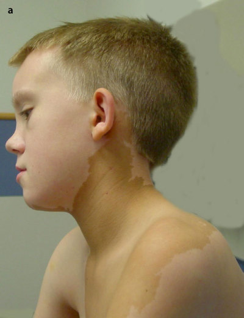
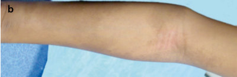

# 37. McCune-Albright Syndrome
> Source attribution: [Source credits](../../SOURCE_CREDITS.md).

## PDF page 993 | printed page 997

### McCune-Albright Syndrome

Sarah A. Ackah and Erica A. Eugster

Contents

37.1 Introduction – 998

37.2 Pathophysiology – 998

37.3 Phenotype/Clinical Features – 999

37.3.1 Skin – 999 37.3.2 Gonads – 999 37.3.3 Thyroid – 1000 37.3.4 Pituitary – 1000 37.3.5 Adrenal – 1001 37.3.6 Bone – 1001 37.3.7 Rare Manifestations – 1001

37.4 Diagnostic Criteria – 1002

37.5 Genetic Testing – 1002

37.6 Surveillance – 1003

37.7 Management – 1003

37.7.1 Precocious Puberty – 1003 37.7.2 Thyroid – 1003 37.7.3 GH Excess – 1004 37.7.4 Bone Disease – 1004

37.8 Future Directions – 1005

References – 1005

© The Author(s), under exclusive license to Springer Nature Switzerland AG 2024 S. Radovick, M. Misra (eds.), Pediatric Endocrinology, https://doi.org/10.1007/978-3-031-66296-6_37

## PDF page 994 | printed page 998

### Abbreviations

AI – Aromatase inhibitor CAL – Café-au-lait

FD – Fibrous dysplasia

FGF23 – Fibroblast growth factor 23

GH – Growth hormone

GPCR – G-protein coupled receptor

Gsα – G protein alpha subunit

HPG – Hypothalamic pituitary gonadal

IPMNs – Intraductal papillary mucinous neo plasms

MAS – McCune-Albright syndrome

PP – Precocious puberty

### 37.1 Introduction

McCune-Albright Syndrome (MAS) is a rare genetic disorder that was first described in 1936 by Dr. Donavan McCune who reported a 9-year-old girl with precious puberty (PP), skin hyperpigmentation and hyperthyroidism [1]. Then in 1937 Dr. Fuller Albright pub lished a case series of 5 patients [2]. The first was a 23-year-old female with skin hyperpig mentation, PP, and osteitis fibrosa cystica with a fracture of the right femur. The second patient was a 39-year-old female with a frac ture of the right femur with osteitis fibrosis, history of PP, irregular menses, hyperpig mented skin, and hyperparathyroidism. The third patient was a 31⁄2 year old female with fractures, PP, rickets, skin hyperpigmentation, intellectual disability, hypophosphatemia, hydrocephalus, and bilateral fibrous dysplasia (FD) of bone. The fourth patient was an 8-year-old female with PP, skin hyperpigmen tation, FD of bone and hypercalcemia. The last was a 10-year-old boy with hyperparathy roidism who had multiple fractures, FD of bone, frontal bossing and skin hyperpigmen tation. It was on the basis of these early cases

### 37

that MAS was characterized as a classic triad of FD of bone, PP, and café-au-lait (CAL) skin pigmentation. However, as is clear from these original reports, the disease exists within a broad spectrum of additional manifesta tions including other associated endocrinopa thies besides PP.

### 37.2 Pathophysiology

3

4

37.1 With this mutation, there is dysregulation of production of cyclic AMP leading to unregulated ligand-independent signal trans duction affecting multiple receptors including those for LH, FSH, TSH, GHRH, and ACTH [5].

The mutations causing MAS arise de novo in an early embryologic cell line and are thus postzygotic and present in a mosaic distribu tion. The most common is the substitution of arginine at codon 201 with cystine or histidine but mutations at codon 227 have also been noted [3, 6]. The presence of mosaicism was first discovered by Dr. Happle in 1986 who found that there was an intermingling of nor mal cells with mutated cells, which presum ably allowed for their survival [7]. The inherent variability in the number of cells and cells lines affected leads to extreme phenotypic heterogeneity among patients with MAS.

## PDF page 995 | printed page 999

### 37.3 Phenotype/Clinical Features

### 37.3.1 Skin

8

37.2a

37.2b

### 37.3.2 Gonads

Early pubertal development in children with MAS is independent of the HPG axis and is thus a form of peripheral PP.

Unmatched source image; PDF page 995. Consult the original caption.

Unmatched source image; PDF page 995. Consult the original caption.

## PDF page 996 | printed page 1000

PP occurs in up to about 85% of affected girls. This is due to autonomously functioning unilateral ovarian cysts which intermittently produce extreme elevations in serum estra diol. This phenomenon has been termed “constitutive activation”. The PP in MAS is manifested clinically as a sudden onset of painless vaginal bleeding (which can be pro fuse) most commonly beginning between the ages of 1 and 5 years with minimal breast development. The frequency of vaginal bleed ing in girls with MAS is extremely variable. Some girls experience rare episodes separated by long intervals of quiescence whereas others may have frequent vaginal bleeding accompa nied by growth acceleration, advanced skele tal maturation, and a poor prognosis for adult height. If girls with MAS are not identified appropriately, unnecessary oophorectomies can occur due to concerns for ovarian granu losa cell tumors. On ultrasound, the ovaries of girls with MAS typically demonstrate a uni lateral cystic mass which cannot be differenti ated from an ovarian tumor [9]. Once central puberty starts, it generally overrides the autonomous ovarian activation and normal ovulatory cycles (with the potential for nor mal fertility) occur. However, intermittent epi sodes of autonomous ovarian function leading to irregular menses have been reported in adolescent girls and women with MAS. Rarely, these episodes can lead to large and persistent ovarian cysts with risk of tor sion [10, 11].

### 37

In boys, PP is much less common but when present is characterized by autonomous tes tosterone production due to Leydig cells har boring the mutation. About 85% of males have abnormal testes with unilateral or bilat eral macroorchidism [12]. In cases of Sertoli cell only involvement, there have been elevated levels of inhibin B and anti-Müllerian hor mone with enlarged testes but prepubertal tes tosterone and gonadotropin concentrations. Testicular microlithiasis has also been reported in 30–62% of boys with MAS. On testicular ultrasound, focal hyper- and hypoechoic lesions are seen as well as diffuse heterogeneity and focal calcifications, which tend to not progress [12, 13]. Current recom mendations are to monitor these with repeat

Table 37.1 Potential clinical features of gonadal involvement in boys vs girls with MAS

Boys Girls

PP: Testicular enlargement Penile enlargement Pubic hair Growth acceleration Secondary central PP Sertoli cell only involvement: Macroorchidism (unilateral or bilateral) Testicular microlithiasis Calcification on testicular US

PP: Vaginal bleeding Breast development Pubic hair Growth acceleration Unilateral ovarian cyst/mass on US Secondary central PP

ultrasound, although the exact interval for repeat imaging has not been established [12].

37.1

### 37.3.3 Thyroid

About half of all individuals with MAS have thyroid involvement. Ultrasound findings of mixed cystic and solid lesions interspersed with areas of normal-appearing tissue are common. Hyperthyroidism is present in 10–30% of individuals and is caused by both increased hormone production and increased conversion of thyroxine (T4) to triiodothyro nine (T3) [11]. If undetected this can lead to thyroid storm during anesthetic induction for surgery. Uncontrolled hyperthyroidism can cause accelerated skeletal maturation, ele vated bone turnover and increased susceptibility to fracture [14].

### 37.3.4 Pituitary

Growth hormone (GH) excess with or with out concurrent hyperprolactinemia can occur if the anterior pituitary is involved. If GH

### Automatic table extraction — verify rendered original

|Boys|Girls|
|---|---|
|PP: Testicular enlargement Penile enlargement Pubic hair Growth acceleration Secondary central PP Sertoli cell only involvement: Macroorchidism (unilateral or bilateral) Testicular microlithiasis Calcifcation on testicular US|PP: Vaginal bleeding Breast development Pubic hair Growth acceleration Unilateral ovarian cyst/mass on US Secondary central PP|

[Original table](../../tables/ch037_p0996_1.jpg)

## PDF page 997 | printed page 1001

excess is present, individuals may develop gigantism as well as acromegalic features including jaw and tongue enlargement [15]. GH hypersecretion can lead to the expansion of craniofacial FD, which increases the risk of vision loss and can lead to macrocephaly [11, 16]. Therefore, early diagnosis and treat ment are essential.

### 37.3.5 Adrenal

Cushing syndrome due to hypercortisolism is a very rare manifestation of MAS. When it occurs, it is typically in the neonatal period and is caused by excess cortisol production from the fetal adrenal gland. Cortisol excess is caused by tonic activation of the G-protein coupled ACTH receptor within the adrenal cortex leading to unregulated overproduction of cAMP [17]. These infants can present as small for gestational age with failure to thrive, hypertension, feeding difficulties, Cushingoid features or respiratory illness [11]. Spontaneous regression from involution of the adrenal gland has been reported in approximately half of survivors of neonatal Cushing syndrome and MAS [17, 18]. Monitoring is needed for late onset develop ment of adrenal insufficiency after the neona tal period [19].

### 37.3.6 Bone

FD occurs early in life and expands during childhood. Increases in the RANKL and IL-6 messaging pathways leads to the formation of abnormal bone and increased osteoclast activ ity. On a cellular level, this appears as poorly mineralized woven bone that replaces the marrow. There is unregulated osteoclast acti vation with increased bone turnover/resorp tion. This can be seen on CT scan as a characteristic ground glass appearance or increased uptake on bone scintigraphy. It is helpful to obtain a Tc99m or 18F-NaF PET/ CT scan to assess the extent of the skeletal burden [20]. It is recommended to obtain the first bone scan at age 5 years as the majority (90% or more) of the clinically significant

skeletal lesions can be identified by that time [10, 11, 21, 22].

Due to the increase in osteoclastic activity, there is also an increase in FGF23, which can lead to renal tubulopathy with some degree of phosphate wasting [23, 24]. Hypophosphatemia, though infrequent, is due to alterations in FGF23 processing result ing in abnormal cleavage patterns leading to increased intact serum FGF23 [25]. This can increase during periods of rapid skeletal growth. Hypophosphatemia may contribute to rickets/osteomalacia, increased fractures, and bone pain. Hypophosphatemia and hyperthyroidism are both risk factors for sco liosis [14, 26].

Skeletal manifestations can occur in a sin gle bone (classified as monostotic), multiple bones (polyostotic) or all bones (panostotic). Patchy bone disease occurs throughout the body leading to pain, deformities, and/or frac tures. Skull invasion can lead to deformities, hydrocephalus and nerve compression leading to hearing loss or blindness. There can also be some nasal obstruction and malocclusion along with facial asymmetry. Vertebral involvement can lead to scoliosis. Appendicular skeletal abnormalities that are commonly seen include “wind-swept” defor mity and “shepherd’s crook” deformity. Windswept deformities are those in which it appears that both legs have been swept to one side by a gust of wind. Shepard’s crook deformity refers to abnormal curvature of the femur or humerus. Fragility fractures are common. As treatment options are extremely limited, bone disease is typically the greatest source of mor bidity in individuals with MAS [5, 27].

### 37.3.7 Rare Manifestations

### 37.3.7.1 Gastrointestinal

Intraductal papillary mucinous neoplasms (IPMNs) have been described in patients with MAS. These are pancreatic mucin-producing cysts. IPMNs have also been associated with hepatic adenomas, hemangiomas, hamarto mas, focal nodular hyperplasia, biliary cysts and fatty liver in MAS [28]. These findings

## PDF page 998 | printed page 1002

can also occur independent of IPMNs. IPMNs are thought to form because of increased signaling in the JAK/STAT pathway [29].

Upper gastrointestinal polyps have also been described. Gastroesophageal reflux may manifest in childhood. When present, hepati tis and neonatal cholestasis generally wane with age in severity but are persistent [30]. Pancreatitis and diabetes mellitus have also been reported. Diabetes is thought to be caused by a combination of decreased insulin secretion secondary to recurrent pancreatitis and insulin resistance in overweight and obese individuals [10].

### 37.3.7.2 Mass Cell Hypersensitivity

Patients with MAS may have an increased risk of anaphylaxis, the exact etiology of which is poorly understood. The histamine 1 (H1) and histamine 2 (H2) receptors are coupled with G proteins [31]. The H2 receptor works with Gsα and cAMP for signaling [32–34], which has been associated with increased gastric his taminic activity and a predisposition for reflux. The H1 receptor, which is associated with allergy and urticaria, is coupled with a different G-protein (Gqα) pathway but there is known crosstalk between Gsα and Gq/11α. This may explain the increased wheal and flare responses to histamine observed in MAS patients [35].

### 37.3.7.3 Multisystemic Involvement

Rare cases of MAS have been described in which there is involvement of the heart, liver, kidneys, and other vital tissues. In all such cases, the condition has been lethal [36].

### 37

### 37.3.7.4 Malignancy

There have been some rare cases of malignant transformation of areas of FD associated with previous radiation therapy and GH excess in adults with MAS. Therefore, radia tion therapy should be avoided in these patients as they are at increased risk of osteo sarcoma [37].

There have also been case reports of papil lary thyroid carcinoma in children with MAS in the setting of hyperthyroidism [38]. There is

one report of a clear cell thyroid carcinoma in an adult patient [38]. Breast cancer risk is increased in women with MAS especially in those with thoracic FD lesions. Therefore, it is recommended to start screening mammo grams in the third and fourth decades of life [39].

Testicular carcinoma has been described at a very low incidence. Abnormal testicular ultrasound findings should be monitored closely [12].

IPMNs can be high grade or have worri some features on imaging that should be mon itored as it is not known whether or when malignant transformation will occur or when resection would be optimal [28]. Pancreatic adenocarcinoma has only been described in one patient in the literature [40]. GI and liver tumors have been rarely described [40].

### 37.4 Diagnostic Criteria

MAS is a clinical diagnosis. The criteria include having two or more classic clinical fea tures including CAL macules, FD and endo crinopathies (PP, hyperthyroidism, GH excess, hypophosphatemia or neonatal hypercorti solism). However, it has long been recognized that some patients with MAS have a forme fruste of the disease with only a single mani festation such as isolated FD or isolated peripheral PP. Patients previously thought to have isolated FD have also been found to have other features of MAS on careful review of history and physical exam [41].

### 37.5 Genetic Testing

There is low yield in identification of a somatic activating pathogenic variant in GNAS1 in peripheral blood lymphocytes. In contrast, genetic analysis of tissue with a suspected mutation has significantly increased accuracy and sensitivity [42]. Biopsies with fresh or fresh frozen samples are ideal but may need to be repeated if they contain more normal tis sue than tissue with the mutation. When undertaken, targeted analysis of exons 8 and

## PDF page 999 | printed page 1003

9 in lesional tissue using PCR sequencing based methods is recommended [43].

### 37.6 Surveillance

The initial evaluation in children with sus pected MAS should include a bone age x-ray and serum IGF-1, prolactin, GH, thyroid function tests, LH/FSH, and testosterone/ estradiol levels, as indicated. An elevated IGF1 or growth acceleration should prompt an oral glucose tolerance test to look for GH excess. Thyroid ultrasound should also be obtained periodically after age 3 years. For concerns of neonatal hypercortisolism, a chemical metabolic panel, 24-h urinary free cortisol, serum cortisol, and/or low dose dexa methasone suppression test may be employed [17]. As mentioned earlier, first bone scans should be performed by age 5 years as most FD lesions will be apparent and additional studies are not necessary after age 15 years [10, 11].

Patients with PP should have ongoing clinic follow-up and annual bone ages [11]. Annual evaluations by an ophthalmologist and audiologist are important for patients with craniofacial FD [10]. GI surveillance with imagining should be considered in those with a history of pancreatitis [29].

### 37.7 Management

### 37.7.1 Precocious Puberty

No single therapy has been found to be supe rior for the treatment of PP in girls with MAS. In addition, clinical trials are hampered by the extreme rarity of the disease and the remarkable phenotypic heterogeneity among affected patients. In the studies that have been conducted, girls typically serve as their own controls. Given the unpredictable nature of vaginal bleeding episodes, a period of obser vation is recommended following an initial diagnosis of MAS. If therapy is deemed nec essary, the goal is to block the effects of estro

gen or to decrease its synthesis. Tamoxifen, a selective estrogen receptor modulator, has been shown to cause cessation of vaginal bleeding and a significant increase in predicted adult height in girls with MAS [44]. While an increase in uterine size was noted after treat ment for 1 year, long term follow-up of tamox ifen treated patients failed to identify any safety signals associated with its use [45]. The third-generation aromatase inhibitor (AI), letrozole, has also been shown to decrease rates of skeletal maturation, growth velocity, and improve predicted adult height, although ovarian torsion has also been reported with the use of this medication [46]. First- and sec ond-generation AIs have not been found to be efficacious in MAS, nor has the thirdgeneration AI, anastrozole [47]. Fulvestrant, a pure estrogen receptor antagonist, has been shown to decrease vaginal bleeding and rate of skeletal maturation [48]. However, the need for weekly injections is a significant drawback of this medication. Surgical intervention for ovarian cysts is typically discouraged as these almost always resolve on their own [9].

In boys, a combination of an androgen receptor blocker such as bicalutamide with a third-generation AI such as letrozole or anas trozole represents state of the art treatment [12]. In both boys and girls, surveillance for the onset of central puberty through periodic measurement of ultrasensitive LH or GnRHa stimulation testing is imperative. If secondary central PP ensues, a GnRH analog is added as adjunctive therapy.

### 37.7.2 Thyroid

Methimazole is effective for the medical man agement of hyperthyroidism. Propylthiouracil is not recommended because of an increased risk of hepatotoxicity in children. Thyroidectomy is definitive treatment [21]. Radioablation is not recommended due to the potential for increased uptake by tissues bear ing a somatic activating GNAS mutation, which could theoretically increase the risk of malignancy [11, 14].

## PDF page 1000 | printed page 1004

Table 37.2 Current therapeutic options for the endocrinopathies in MAS and associated side effects

Endocrinopathy Treatment

Precocious puberty Letrozole Tamoxifen Fulvestrant

Hyperthyroidism Methimazole Total thyroidectomy

Acromegaly Pegvisomant Somatostatin analogs Pituitary surgery Radiotherapy

Hyperprolactinemia Cabergoline Bromocriptine

Cushing syndrome Metyrapone Ketoconazole Adrenalectomy

Hypophosphatemia Rickets/osteomala cia

Phosphorus and calcium supplementa tion Calcitriol

Hyperparathyroid ism

Primary: Parathyroidectomy Secondary: Vitamin D supplementation

### 37.7.3 GH Excess

### 37

49

11

16 47

37.2

Side effects

Ovarian torsion Uterine enlargement

Agranulocytosis, acute liver failure Permanent hypothyroidism

Injection site reactions, hepatotoxicity Cholelithiasis, hepatotoxicity High risk of sarcomatous transforma tion

Dizziness, impulsive behavior, nausea

Hypertension, hirsutism, hyperkalemia Hepatotoxicity, hypogonadism Adrenal insufficiency

GI side effects Hypercalciuria, hypercalcemia

### 37.7.4 Bone Disease

Medical treatment with bisphosphonates has been used in patients with MAS. It is also important to ensure that Vitamin D and cal cium supplementation are adequate in these patients. Denosumab, a RANKL inhibitor, has also been used to treat FD, but there is a rebound increase in fracture risk when this medication is discontinued in addition to a risk of hypercalcemia and increased bone resorption [21].

Surgery may be needed for management or prevention of fracture or deformities but is extremely problematic as it can worsen FD. Surgery may also be needed for manage ment of scoliosis as complications of restric tive lung disease can be life threatening. Lower

### Automatic table extraction — verify rendered original

|Endocrinopathy|Treatment|Side effects|
|---|---|---|
|Precocious puberty|Letrozole Tamoxifen Fulvestrant|Ovarian torsion Uterine enlargement|
|Hyperthyroidism|Methimazole Total thyroidectomy|Agranulocytosis, acute liver failure Permanent hypothyroidism|
|Acromegaly|Pegvisomant Somatostatin analogs Pituitary surgery Radiotherapy|Injection site reactions, hepatotoxicity Cholelithiasis, hepatotoxicity High risk of sarcomatous transforma­ tion|
|Hyperprolactinemia|Cabergoline Bromocriptine|Dizziness, impulsive behavior, nausea|
|Cushing syndrome|Metyrapone Ketoconazole Adrenalectomy|Hypertension, hirsutism, hyperkalemia Hepatotoxicity, hypogonadism Adrenal insuffciency|
|Hypophosphatemia Rickets/osteomala­ cia|Phosphorus and calcium supplementa­ tion Calcitriol|GI side effects Hypercalciuria, hypercalcemia|
|Hyperparathyroid­ ism|Primary: Parathyroidectomy Secondary: Vitamin D supplementation||

[Original table](../../tables/ch037_p1000_1.jpg)

## PDF page 1001 | printed page 1005

extremity surgery may be indicated for weight bearing pain and deformities that impair gait. Craniofacial surgery is needed for facial defor mities, nerve compression and aneurysmal cysts. As mentioned earlier, skull lesions can lead to narrowing of the optic canals, which can lead to blindness if not treated with surgi cal intervention [27, 50].

9. Nabhan 10. Robinson C, Collins MT, Boyce AM. Fibrous dys

11. Spencer T, et al. the clinical spectrum of McCune-

12. Aversa T, et al. Phenotypic testicular abnormali

### 37.8 Future Directions

Despite significant advances in diagnosis and treatment, lingering questions remain regard ing many aspects of MAS. The physiologic trigger for the intermittent episodes of gonadal activation in children with MAS and PP is unknown. Whether newer medications will result in improved outcomes of bone dis ease and various endocrinopathies in MAS remains to be seen. Continued multidisci plinary collaboration and multicenter studies are key in order to enhance knowledge and optimize quality of life in patients with MAS.

13. Boyce AM, et al. Characterization and manage

14. Tessaris D, et al. Thyroid abnormalities in children

15. Katznelson L, et al. Acromegaly: an endocrine

16. Boyce AM, et al. Optic neuropathy in McCune-

17. Brown RJ, Kelly MH, Collins MT. Cushing syn

### References

18. Carney JA, Young WF, Stratakis CA. Primary

1. McCune D, Bruch H. Progress in paediatrics:

osteodystrophia fibrosis. Am J Child. 1937;54:806–48. 2. Albright F, et al. Syndrome characterized by oste

19. Tatsi C, Stratakis CA. Neonatal Cushing syn

itis fibrosa disseminata, areas of pigmentation and endocrine dysfunction, with precocious puberty in females. N Engl J Med. 1937;216(17):727–46. 3. Weinstein LS, et al. Activating mutations of the

20. Hartley I, et al. Fibrous dysplasia of bone and

21. Javaid MK, et al. Best practice management guide

stimulatory G protein in the McCune-Albright syndrome. N Engl J Med. 1991;325(24):1688–95. 4. Bianco P, et al. Reproduction of human fibrous

dysplasia of bone in immunocompromised mice by transplanted mosaics of normal and Gsalphamutated skeletal progenitor cells. J Clin Invest. 1998;101(8):1737–44. 5. Dumitrescu CE, Collins MT. McCune-Albright

22. Kuznetsov SA, et al. Age-dependent demise of

syndrome. Orphanet J Rare Dis. 2008;3(1):12. 6. Riminucci M, et al. Fibrous dysplasia as a stem cell

23. Völkl TM, Dörr HG. McCune-Albright syndrome:

disease. J Bone Miner Res. 2006;21(Suppl. 2):P125–31. 7. Happle R. The McCune-Albright syndrome: a

24. Collins MT, et al. Renal phosphate wasting in

lethal gene surviving by mosaicism. Clin Genet. 1986;29(4):321–4. 8. Aase JM. The dysmorphology detective. Pediatr

Ann. 1981;10(7):38–43.

ZM, West KW, Eugster EA. Oophorectomy in McCune-Albright syn drome: a case of mistaken identity. J Pediatr Surg. 2007;42(9):1578–83.

plasia/McCune-Albright syndrome: clinical and translational perspectives. Curr Osteoporos Rep. 2016;14(5):178–86.

Albright syndrome and its management. Horm Res Paediatr. 2019;92(6):347–56.

ties and pubertal development in boys with McCune-Albright syndrome. Ital J Pediatr. 2018;44(1):136.

ment of testicular pathology in McCune-Albright syndrome. J Clin Endocrinol Metab. 2012;97(9):E1782–90.

and adolescents with McCune-Albright syndrome. Horm Res Paediatr. 2012;78(3):151–7.

society clinical practice guideline. J Clin Endocrinol Metab. 2014;99(11):3933–51.

Albright syndrome: effects of early diagnosis and treatment of growth hormone excess. J Clin Endocrinol Metab. 2013;98(1):E126–34.

drome in the McCune-Albright syndrome. J Clin Endocrinol Metab. 2010;95(4):1508–15.

bimorphic adrenocortical disease: cause of hyper cortisolism in McCune-Albright syndrome. Am J Surg Pathol. 2011;35(9):1311–26.

drome: a rare but potentially devastating disease. Clin Perinatol. 2018;45(1):103–18.

McCune-Albright syndrome: a bench to bedside review. Calcif Tissue Int. 2019;104(5):517–29.

lines for fibrous dysplasia/McCune-Albright syn drome: a consensus statement from the FD/MAS international consortium. Orphanet J Rare Dis. 2019;14(1):139.

GNAS-mutated skeletal stem cells and “normal ization” of fibrous dysplasia of bone. J Bone Miner Res. 2008;23(11):1731–40.

clinical picture and natural history in children and adolescents. J Pediatr Endocrinol Metab. 2006;19(Suppl. 2):551–9.

fibrous dysplasia of bone is part of a generalized renal tubular dysfunction similar to that seen in

## PDF page 1002 | printed page 1006

tumor-induced osteomalacia. J Bone Miner Res. 2001;16(5):806–13. 25. Ackah SA, Imel EA. Approach to hypophospha

37. Ruggieri P, et al. Malignancies in fibrous dysplasia.

38. Collins MT, et al. Thyroid carcinoma in the

temic rickets. J Clin Endocrinol Metabol. 2022;108(1):209–20. 26. de Castro LF, Ovejero D, Boyce AM. Diagnosis of

endocrine disease: Mosaic disorders of FGF23 excess: fibrous dysplasia/McCune-Albright syn drome and cutaneous skeletal hypophosphatemia syndrome. Eur J Endocrinol. 2020;182(5):R83– r99. 27. Zhadina M, et al. Genotype-phenotype correlation

39. Majoor BC, et al. Increased risk of breast cancer at

40. Gaujoux S, et al. McCune Albright syndrome is a

in fibrous dysplasia/McCune-Albright syndrome. J Clin Endocrinol Metabol. 2021;106(5):1482–90. 28. Gaujoux S, et al. Hepatobiliary and pancreatic

neoplasms in patients with McCune-Albright syn drome. J Clin Endocrinol Metab. 2014;99(1):E97–101. 29. Robinson C, et al. Clinical and radiographic gas

41. Hannon TS, et al. Is McCune-Albright syndrome

42. Lumbroso S, Paris F, Sultan C. Activating Gsalpha

trointestinal abnormalities in McCune-Albright syndrome. J Clin Endocrinol Metab. 2018;103(11):4293–303. 30. Ikawa Y, et al. Neonatal McCune-Albright syn

drome with giant cell hepatitis. J Pediatr. 2016;178:298. 31. Garbarg M, Schwartz J-C. Synergism between his

43. Elli FM, et al. Improved molecular diagnosis of

tamine H1-and H2-receptors in the cAMP response in guinea pig brain slices: effects of phor bol esters and calcium. Mol Pharmacol. 1988;33(1):38–43. 32. Sullivan TJ, et al. Modulation of cyclic AMP in

44. Eugster EA, et al. Tamoxifen treatment for preco

45. de Buff Passone CG, et al. Tamoxifen improves

purified rat mast cells: II. Studies on the relation ship between intracellular cyclic AMP concentra tions and histamine release. J Immunol. 1975;114(5):1480–5. 33. Sullivan TJ, et al. Modulation of cyclic AMP in

46. Estrada A, et al. Long-term outcomes of letrozole

purified rat mast cells: I. Responses to pharmaco logic, metabolic, and physical stimuli. J Immunol. 1975;114(5):1473–9. 34. Suh BC, et al. Modulation of H2 histamine

47. Mieszczak J, et al. The aromatase inhibitor anas

receptor-mediated cAMP generation and granulo cytic differentiation by extracellular nucleotides via activation of protein kinase C. J Leukoc Biol. 2001;69(1):169–76. 35. Jacobson JD, Turpin AL, Sands SA. Allergic man

### 37

48. Sims EK, et al. Fulvestrant treatment of preco

ifestations and cutaneous histamine responses in patients with McCune Albright syndrome. World Allergy Organ J. 2013;6(1):9. 36. Lourenço R, et al. Neonatal McCune-Albright

49. Galland F, et al. McCune-Albright syndrome and

syndrome with systemic involvement: a case report. J Med Case Rep. 2015;9:189.

50. Gladding A, et al. Burosumab treatment for

Cancer. 1994;73(5):1411–24.

McCune-Albright syndrome: contributory role of activating Gs alpha mutations. J Clin Endocrinol Metab. 2003;88(9):4413–7.

a young age in women with fibrous dysplasia. J Bone Miner Res. 2018;33(1):84–90.

genetic predisposition to intraductal papillary and mucinous neoplasms of the pancreas associated pancreatic cancer in relation with GNAS somatic mutation—a case report. Medicine (Baltimore). 2019;98(50):e18102.

overlooked in subjects with fibrous dysplasia of bone? J Pediatr. 2003;142(5):532–8.

mutations: analysis of 113 patients with signs of McCune-Albright syndrome—a European Collaborative Study. J Clin Endocrinol Metab. 2004;89(5):2107–13.

McCune-Albright syndrome and bone fibrous dysplasia by digital PCR. Front Genet. 2019;10:862.

cious puberty in McCune-Albright syndrome: a multicenter trial. J Pediatr. 2003;143(1):60–6.

final height prediction in girls with McCune- Albright syndrome: a long follow-up. Horm Res Paediatr. 2015;84(3):184–9.

treatment for precocious puberty in girls with McCune-Albright syndrome. Eur J Endocrinol. 2016;175(5):477–83.

trozole is ineffective in the treatment of precocious puberty in girls with McCune-Albright syndrome. J Clin Endocrinol Metab. 2008;93(7):2751–4.

cious puberty in girls with McCune-Albright syn drome. Int J Pediatr Endocrinol. 2012;2012(1):26.

acromegaly: effects of hypothalamopituitary radiotherapy and/or pegvisomant in somatostatin analog-resistant patients. J Clin Endocrinol Metab. 2006;91(12):4957–61.

fibrous dysplasia. Bone. 2021;150:116004.
