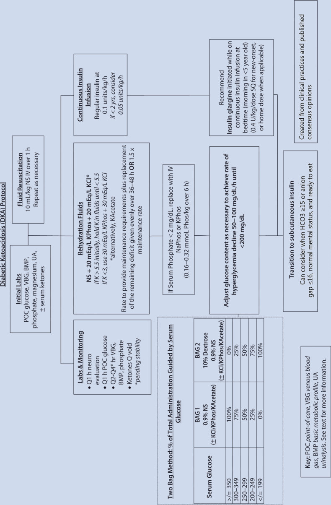

# 40. Management of Endocrine Emergencies
> Source attribution: [Source credits](../../SOURCE_CREDITS.md).

## PDF page 1038 | printed page 1043

### Management of Endocrine Emergencies

Sonum Bharill, Priya Vaidyanathan, Bruce L. Klein, and Joanna S. Cohen

### Contents

### 40.1 Diabetic Ketoacidosis and Hyperosmolar Hyperglycemic Syndrome – 1045

40.1.1 Introduction – 1045 40.1.2 Clinical Presentation – 1045 40.1.3 Differential Diagnosis – 1045 40.1.4 Diagnostic Evaluation – 1045 40.1.5 Management – 1047 40.1.6 Adverse Events – 1049 40.1.7 Hyperosmolar Hyperglycemic Syndrome – 1050 40.1.8 Disposition – 1050

### 40.2 Adrenal Crisis – 1050

40.2.1 Introduction – 1051 40.2.2 Clinical Presentation – 1051 40.2.3 Diagnostic Evaluation – 1052 40.2.4 Management and Disposition – 1052

### 40.3 Diabetes Insipidus and Acute Hypernatremia – 1054

40.3.1 Introduction – 1054 40.3.2 Clinical Presentation – 1054 40.3.3 Diagnostic Evaluation – 1055 40.3.4 Management and Disposition – 1056

### 40.4 Thyroid Storm – 1057

40.4.1 Introduction – 1057 40.4.2 Clinical Presentation – 1057 40.4.3 Diagnostic Evaluation – 1059 40.4.4 Management and Disposition – 1059

© The Author(s), under exclusive license to Springer Nature Switzerland AG 2024 S. Radovick, M. Misra (eds.), Pediatric Endocrinology, https://doi.org/10.1007/978-3-031-66296-6_40

## PDF page 1039 | printed page 1044

### 40.5 Hypoglycemia – 1061

40.5.1 Introduction – 1061 40.5.2 Clinical Presentation – 1061 40.5.3 Diagnostic Evaluation – 1061 40.5.4 Management and Disposition – 1062

### References – 1065

## PDF page 1040 | printed page 1045

### 40.1 Diabetic Ketoacidosis

### and Hyperosmolar Hyperglycemic Syndrome

Key Points

5 Diabetic ketoacidosis (DKA) is the

most common endocrine emergency. 5 Common presenting symptoms and signs

of DKA include polyuria, polydipsia, weight loss, dehydration, abdominal pain, vomiting, and Kussmaul breathing. 5 Hyperglycemia (blood glucose >200),

HCO3 <18, and venous pH <7.30 are consistent with DKA in the presence of classic symptoms and signs. 5 Management of DKA includes cau

tious attention to intravenous fluid administration and insulin dosing. 5 Hyperglycemic hyperosmolar syndrome

(HHS) is increasing in incidence; diagno sis is based on blood glucose >600, serum osmolality >320 mOsm/kg, and absence of significant ketosis and acidosis.

### 40.1.1 Introduction

Diabetic ketoacidosis (DKA) is the most com mon endocrine emergency. DKA occurs when there is insufficient insulin available for cellu lar uptake of glucose. Free fatty acids are con verted to ketone bodies for alternative cellular fuel [1]. Excess buildup of acidic ketone bod ies, primarily beta-hydroxybutyrate and ace toacetate, causes metabolic acidosis [2]. Though traditionally thought of in patients with type 1 diabetes, DKA can also be seen in patients with type 2 diabetes, due to actual or relative insulin deficiency and dysregulated glucagon secretion, often precipitated by the stress of illness or infection. Approximately 30% of new-onset type 1 diabetes patients present initially in DKA, while approximately 11% of patients with new-onset type 2 diabe tes present in DKA [3]. In patients with an established diagnosis of type 1 diabetes, DKA is most commonly precipitated by missed insulin doses or illness [1]. Prompt treatment

with hydration and insulin is key to the man agement of DKA.

### 40.1.2 Clinical Presentation

Polyuria, polydipsia, and weight loss are the cardinal symptoms of new-onset diabetes mellitus. DKA should be suspected in patients with complaints of abdominal pain, nausea, or vomiting. Clinical signs include ill appear ance, dehydration, tachycardia, and rapid breathing, also called Kussmaul respirations. Kussmaul breathing increases minute ventila tion to optimize exhalation of carbon dioxide and thus compensates for the metabolic acido sis from accumulated ketone bodies. There is often a fruity odor to the breath from exhaled ketone bodies. Worsening DKA can progress to altered mental status and coma if untreated.

Risk factors for DKA as the initial presen tation of type 1 diabetes include lower socio economic status, lack of private insurance [4] younger age (<4 years) and no first-degree relatives with type 1 diabetes.

### 40.1.3 Differential Diagnosis

40.1

### 40.1.4 Diagnostic Evaluation

40.2 Initial testing for DKA should include: 1. Point-of-care blood glucose and confirma

tory laboratory serum glucose. 2. Venous (or arterial) blood gas. 3. Serum electrolytes (most importantly

HCO3), blood urea nitrogen (BUN), and creatinine, as well as calculation of anion gap: (sodium + potassium) − (chlo ride + bicarbonate).

## PDF page 1041 | printed page 1046

Table 40.1 Differential diagnoses for diabetic ketoacidosis (DKA) categorized by presenting feature

Presenting symptom

Polyuria/polydipsia

Abdominal pain/anorexia/emesis

Respiratory distress/tachypnea

Altered cognition

### 40

MCHAD, medium-chain acyl-CoA dehydrogenase deficiency; OTC, ornithine transcarbamylase

Differential diagnoses for DKA

Diabetes insipidus

Electrolyte derangement (hypercalcemia, hypokalemia)

Hyperglycemia without DKA

Urinary tract infection (polyuria without polydipsia)

Appendicitis

Constipation

Gastroenteritis

Ovarian or testicular pathology

Urinary tract infection

Anaphylaxis

Asthma

Heart failure

Inborn error of metabolism/hyperammonemia

Carbohydrate metabolism defect (e.g., galactosemia)

Disorders of fatty acid oxidation (e.g., MCHAD)

Organic acidemias (e.g., methylmalonic acidemia)

Primary lactic acidemias

Urea cycle defects (e.g., OTC deficiency)

Increased intracranial pressure (Cushing’s triad)

Respiratory tract infection

Sepsis

Toxic ingestion (e.g., salicylates, methanol)

Uremia

Central nervous system trauma

Encephalitis/meningitis

Hyperosmolar coma

Hypoglycemia

Inborn error of metabolism/hyperammonemia

Seizure

Septic shock

Stroke

Toxidrome

### Automatic table extraction — verify rendered original

|Presenting symptom|Differential diagnoses for DKA|
|---|---|
|Polyuria/polydipsia|Diabetes insipidus|
|Polyuria/polydipsia|Electrolyte derangement (hypercalcemia, hypokalemia)|
|Polyuria/polydipsia|Hyperglycemia without DKA|
|Polyuria/polydipsia|Urinary tract infection (polyuria without polydipsia)|
|Abdominal pain/anorexia/emesis|Appendicitis|
|Abdominal pain/anorexia/emesis|Constipation|
|Abdominal pain/anorexia/emesis|Gastroenteritis|
|Abdominal pain/anorexia/emesis|Ovarian or testicular pathology|
|Abdominal pain/anorexia/emesis|Urinary tract infection|
|Respiratory distress/tachypnea|Anaphylaxis|
|Respiratory distress/tachypnea|Asthma|
|Respiratory distress/tachypnea|Heart failure|
|Respiratory distress/tachypnea|Inborn error of metabolism/hyperammonemia|
|Respiratory distress/tachypnea|_Carbohydrate metabolism defect (_e.g.,_galactosemia)_|
|Respiratory distress/tachypnea|_Disorders of fatty acid oxidation (_e.g.,_MCHAD)_|
|Respiratory distress/tachypnea|_Organic acidemias (_e.g.,_methylmalonic acidemia)_|
|Respiratory distress/tachypnea|_Primary lactic acidemias_|
|Respiratory distress/tachypnea|_Urea cycle defects (_e.g.,_OTC defciency)_|
|Respiratory distress/tachypnea|Increased intracranial pressure (Cushing’s triad)|
|Respiratory distress/tachypnea|Respiratory tract infection|
|Respiratory distress/tachypnea|Sepsis|
|Respiratory distress/tachypnea|Toxic ingestion (e.g., salicylates, methanol)|
|Respiratory distress/tachypnea|Uremia|
|Altered cognition|Central nervous system trauma|
|Altered cognition|Encephalitis/meningitis|
|Altered cognition|Hyperosmolar coma|
|Altered cognition|Hypoglycemia|
|Altered cognition|Inborn error of metabolism/hyperammonemia|
|Altered cognition|Seizure|
|Altered cognition|Septic shock|
|Altered cognition|Stroke|
|Altered cognition|Toxidrome|

[Original table](../../tables/ch040_p1041_1.jpg)

## PDF page 1042 | printed page 1047

Table 40.2 Severity of DKA based on biochemical criteria

Mild Moder ate

Severe

Blood glucose (mg/dl)

>200 >200 >200

Venous pHa <7.3 <7.2 <7.1

a <18 <10 <5

HCO3

Anion gap >10 >12 >12

aInternational Society for Pediatric and Adoles cent Diabetes [5]

4. Urine dipstick for glucosuria and ketonu

ria. 5. Serum acetone and beta-hydroxybutyrate

are optional. 6. Electrocardiogram (EKG) if there is hyper-

or hypokalemia. 7. Head computed tomography (CT) scan if

there is altered sensorium concerning for cerebral edema (after giving mannitol or hypertonic saline).

### 40.1.5 Management

### 40.1.5.1 Administration

### of Intravenous (IV) Fluid

Patients who present in DKA have varying degrees of dehydration. The insertion of two larger peripheral catheters is recommended over central venous access due to the high risk of thrombosis in pediatric DKA [6, 7]. Volume should be expanded as required to restore adequate peripheral circulation [5, 8]. Isotonic fluid, such as normal saline, should be admin istered intravenously. Consensus guidelines recommend administering aliquots of 10–20 ml/kg over 1–2 h to be repeated as necessary [5, 8]. Once the patient’s circulation has been stabilized, the remaining fluid deficit should be calculated and replaced, along with main tenance fluids, as a continuous infusion spread over the next 24–48 h [5, 8] using 0.45–0.9% saline or a balanced salt solution. For ease of quick calculation, using the calculation of

1.5× maintenance rate is often adequate for an estimated 10% dehydration. Historically, there has been concern that rapid IV rehydra tion leads to osmotic shifts and subsequent cerebral edema [9–12]. However, the available literature is inconclusive regarding the poten tial risk for cerebral edema with specific rehy dration techniques. Well-controlled studies identify no increased risk of cerebral edema based on IV fluid infusion rate or sodium con tent [13–17]. Given inconclusive data, the fluid administration described here is based on the widely accepted International Society for Pediatric and Adolescent Diabetes, Pediatric Endocrine Society, and American Diabetes Association guidelines [2, 5, 8].

### 40.1.5.2 Insulin Therapy

3

5 8

40.1

### Automatic table extraction — verify rendered original

|Col1|Mild|Moder­ ate|Severe|
|---|---|---|---|
|Blood glucose (mg/dl)|>200|>200|>200|
|Venous pHa|<7.3|<7.2|<7.1|
|HCO3 a|<18|<10|<5|
|Anion gap|>10|>12|>12|

[Original table](../../tables/ch040_p1042_1.jpg)

## PDF page 1043 | printed page 1048

### 40

Unmatched source image; PDF page 1043. Consult the original caption.

## PDF page 1044 | printed page 1049

with the insulin infusion, as a onetime subcu taneous dose per the patient’s home dosing or weight-based calculation (0.3–0.4 units/kg) for new-onset type 1 patients (see Fig. 40.1), which helps with the transition off of the insulin infusion once the acidosis resolves and decreases rebound hyperglycemia. This should be done in consultation with endocrinology ( Table 40.2).

### 40.1.5.3 Correction of Electrolyte

### Imbalance

Numerous electrolyte imbalances occur in acute DKA, but fortunately many of them resolve with insulin and rehydration. Potassium is the most unstable electrolyte dur ing DKA treatment. Extracellular acidosis causes upregulation of potassium proton pumps in the cellular membrane in order to transport hydrogen protons into the cells in exchange for potassium, causing elevated extracellular potassium. This extracellular potassium leads to increased serum potas sium, which is ultimately excreted in the urine. Thus, serum potassium levels may be high, normal, or low at any given point of DKA. However, total body potassium tends to be low secondary to obligatory losses from osmotic diuresis. Consensus guidelines recom mend adding 40 mEq/L of IV potassium when the serum potassium is within the normal range in a patient with DKA who has demon strated successful urination [5, 8]. If the patient presents with hyperkalemia, potas sium should be withheld from fluids until the serum potassium normalizes. If the patient presents with hypokalemia, replacement potassium should be initiated right away with administration of insulin [5, 8]. Insulin admin istration will cause potassium to shift from the extracellular to the intracellular space with a rapid decrease in serum potassium levels. In patients in severe DKA and prolonged potas sium losses, more than 40 mEq/L of potas sium may be necessary to avoid hypokalemia.

Similar trends occur with phosphorus in DKA. Thus, the guidelines recommend con sidering replacement of phosphorus in the form of 20 mEq/L of IV potassium phos phate, with close monitoring [5, 8]. Therefore,

the recommended 40 mEq/L of potassium could be administered as 20 mEq/L of potas sium phosphate and 20 mEq/L of potassium chloride or acetate.

Hyperglycemia causes an osmotic shift of fluid from the intracellular to the extracellu lar space, leading to pseudohyponatremia. The actual sodium content can be calculated by adjusting for hyperglycemia as follows: corrected sodium = measured sodium + [(serum glucose − 100) × 0.016], as the mea sured serum sodium is decreased by 1.6 mmol/L (=mEq/L) for every 100 mg/dl blood glucose over 100 mg/dl [5]. Fluid resus citation with isotonic saline such as normal saline and standard insulin management of DKA will correct any remaining mild hypo natremia.

### 40.1.6 Adverse Events

Cerebral edema occurs in 0.5–1% of pediatric patients with DKA [13, 18]. The exact cause of cerebral edema is unknown and widely debated [19]. As discussed above, some have postulated that the rate and composition of fluid resuscitation contributes to cerebral edema [9, 10, 12]. Others postulate that insu lin administration can precipitate cerebral edema [20, 21]. Recent studies have found that dehydration and cerebral hypoperfusion asso ciated with DKA itself may be the cause [5]. Although no consensus on etiology exists, risk factors for cerebral edema in DKA include younger age, new onset of diabetes, as well as longer duration and more severe signs and symptoms before initiation of treatment [1]. Once cerebral edema occurs, mortality is around 20% and approximately 25% of survi vors have permanent neurologic sequelae [1, 21]. Symptoms and signs of cerebral edema include headache, change in consciousness, unequal pupils, emesis, incontinence, hyper tension, and bradycardia [1]. Morbidity and mortality from cerebral edema can be mini mized if treated promptly by reducing the rate of IV fluid administration and administering mannitol 0.5–1 g/kg IV per dose or 3% hyper tonic saline 2.5–5 mL/kg IV over 10–15 min

## PDF page 1045 | printed page 1050

[1, 5]. Treatment can be repeated every 2–4 h if symptoms persist [1]. It is important to note that imaging should not delay administration of hypertonic therapy when concerned for cerebral edema. The head of the bed should also be elevated to 30° and the patient’s head kept in the midline position.

### 40.1.7 Hyperosmolar

### Hyperglycemic Syndrome

Hyperosmolar hyperglycemic syndrome (HHS) is a complication of diabetes mellitus classically characterized by severe hyperglyce mia (plasma glucose >600 mg/dl), hyperosmo lality (serum osmolality >320 mOsm/kg), and dehydration, without significant ketoacidosis (or ketonuria), although mild ketoacidosis may be associated. HHS is more common in type 2 diabetes mellitus, in which residual insulin action results in less lipolysis, and hence less ketosis, than is seen with DKA [5]. However, HHS can also be seen in type 1 dia betes following intake of high carbohydrate beverages or in children with learning disabili ties who are unable to ask for drinks [22]. Manifestations vary and can include tachy cardia, hypotension, hyper- or hypothermia, depressed level of consciousness, seizure activity, and/or focal neurological symptoms, among others [5]. Although rare in children, this syndrome is increasingly recognized in adolescents with type 2 diabetes mellitus [5].

HHS is treated differently from DKA. Volume repletion is key and should be performed quickly and aggressively using normal saline, 20 ml/kg boluses to be repeated as needed, followed by fluid deficit plus maintenance of 0.45–0.9% NS IV infusion over 24–48 h. Individuals in a hyper osmolar hyperglycemic state are particularly prone to vascular collapse and venous thrombo sis, making fluid resuscitation extremely impor tant. Regarding insulin treatment, HHS necessitates less insulin than DKA, and therefore consensus recommendations advise holding insulin until glucose ceases to decline from fluid resuscitation, and then administering 0.025–0.05 units/kg/h of insulin (as opposed to 0.1 units/ kg/h as recommended for DKA). The aim is to decrease serum glucose by 75–100 mg/dl/h [5].

### 40

Mixed HHS and DKA has also been seen with type 1 and type 2 diabetes. Fluid resus citation exceeds that normally required in typical DKA, and insulin infusion should be started per HHS guidelines, after the initial fluid bolus(es) and hemodynamic stability is achieved. Rates of cerebral edema are higher in mixed HHS/DKA, so frequent monitor ing of mental status and avoidance of excess fluid administration are essential [5, 23].

### 40.1.8 Disposition

Ideally, care for a child or adolescent with DKA or HHS should occur at a specialty cen ter experienced with the treatment of diabetes mellitus in pediatric patients. If the initial pre sentation is not at such a facility, support from an experienced center should be obtained and arrangements made for safe transfer, if possi ble [5]. Severe DKA or HHS requires inten sive care monitoring for frequent electrolyte measurements and close neurologic assess ments. At some centers, mild DKA can be managed in a nonintensive care hospital unit experienced with DKA management. Insulin infusion should be continued until transition criteria are met for subcutaneous insulin. Acceptable criteria for transitioning a patient from an insulin infusion to subcutaneous insulin include a HCO3 ≥15 or normalization of the anion gap [24]. Mild DKA requires less frequent monitoring and has negligible neuro logic concerns.

### 40.2 Adrenal Crisis

Key Points

5 An adrenal crisis is characterized by

shock associated with severe glucocorti coid deficit. 5 Common presenting signs of adrenal

crisis include tachycardia, hypotension, and hypoglycemia. 5 Fluid resuscitation and hydrocortisone

are the mainstays of treatment for adre nal crisis.

## PDF page 1046 | printed page 1051

### 40.2.1 Introduction

Adrenal crisis is an important cause of shock in children [25]. An adrenal crisis is a state of car diovascular decompensation caused by a severe glucocorticoid deficit with or without concur rent mineralocorticoid deficit and electrolyte abnormalities. Adrenal crisis occurs when the demand for glucocorticoid is not met. Such an imbalance commonly occurs when a patient with primary adrenal insufficiency (including Addison’s disease and congenital adrenal hyper plasia) or secondary adrenal insufficiency (hypo pituitarism) develops a routine illness, and glucocorticoid dosing is not increased as recom mended for such times. Additionally, illness in a patient in whom the hypothalamic-pituitary axis has been suppressed from chronic exoge nous steroid use (resulting in secondary adrenal insufficiency) can bring about an adrenal crisis. Rarely, it can be an initial presentation of undi agnosed primary or central adrenal insufficiency or due to under- or missed dosing of glucocorti coid therapy.

### 40.2.2 Clinical Presentation

Patients with adrenal crisis can present with long-standing insidious symptoms or acute symptoms depending on underlying etiology [26]. If the crisis develops from a progressive loss of adrenal function, preceding symptoms can include depression, fatigability, weakness, anorexia, nausea, abdominal pain, constipa tion or diarrhea, and weight loss or failure to thrive [26, 27]. Primary adrenal insufficiency with insidious onset classically presents with a history of salt craving and orthostatic hypo tension due to mineralocorticoid deficiency. Salt craving in children can be elicited by ask ing about consumption of table salt or other high salt-containing foods. Salt craving does not occur in secondary adrenal insufficiency because the renin-angiotensin-aldosterone system remains intact [27]. Insufficient corti sol synthesis in primary adrenal insufficiency causes an upregulation of proopiomelanocor tin, the precursor of both adrenocorticotropic hormone (ACTH) and melanocortin, which can lead to increased skin pigmentation in

sun-exposed regions of the body as well as flexor surfaces and mucosal membranes [26, 28, 29]. Providers typically describe a “bronzed” appearance of the skin as if the patient has been suntanning.

Some patients with adrenal insufficiency have no insidious symptoms, and the crisis develops acutely after a sudden physiologic stress. Sudden stress such as trauma, hemor rhage, acute infection, or a medical procedure may trigger an adrenal crisis [26].

If the patient has developed acute primary insufficiency from adrenal hemorrhage associ ated with bacterial sepsis (as in Waterhouse- Friderichsen syndrome due to meningococcemia), a petechial rash may be present and progress to frank ecchymoses.

30

31 33

40.3

34 Several syndromes may be associated with adrenal insufficiency. Adrenoleukodys trophy is an X-linked syndrome in which progressive cerebral demyelination leads to neurological symptoms and primary adrenal insufficiency. A diagnosis of adrenoleuko dystrophy should be considered in a young male with cognitive regression and adrenal insufficiency [26]. Another cause of adrenal insufficiency is autoimmune-mediated destruction of the adrenal glands, which can present in conjunction with other autoim mune diseases. Type 1 or type 2 autoimmune polyendocrine syndromes may include adre nal insufficiency, hypoparathyroidism, hypo thyroidism, pernicious anemia, gonadal failure, alopecia, and vitiligo [26]. Other causes of adrenal insufficiency include con genital adrenal hyperplasia, which is an important cause of adrenal insufficiency in neonates and children [26]. In the United

## PDF page 1047 | printed page 1052

Table 40.3 Common drugs that can cause adrenal insufficiency

Mechanism Drug

Direct inhibition of cortisol synthesis (via p-450-depen dent enzymes)

Etomidate

Fluconazole

Ketoconazole

Activation of cortisol metabolism

Phenobarbital

Phenytoin

Rifampin

Suppression of corticotro pin-releasing hormone and corticotropin synthesis

Systemic and inhaled glucocor ticoids (rarely topical glucocorti coids)

Opioids (chronic use)

Peripheral resistance to glucocorticoids

Chlorpromazine

Imipramine

Recreated from Bornstein (2009); Ref. [34]

States, classic congenital adrenal hyperplasia due to 21-hydroxylase deficiency is diagnosed through the mandatory neonatal screening program, and presents with virilization or ambiguous genitalia in girls, while boys have normal genitalia. Left undiagnosed by 10–14 days of age, adrenal or salt-losing crisis occurs. Immediate confirmation with a 17-OH progesterone level, basic metabolic panel, and renin level and prompt initiation of hydrocortisone and fludrocortisone averts adrenal crisis. Adrenal hypoplasia congenita is a rare X-linked disorder due to DAX1 gene mutations, which results in adrenal insuffi ciency and hypogonadism [26]. Both entities are likely to present in infancy due to crises but are rarely not identified until later in life.

### 40

Regardless of the course of symptom onset, patients with an adrenal crisis pres ent with tachycardia, hypotension, and hypoglycemia, with or without hyponatre mia, hyperkalemia, and metabolic acidosis. Depending on the severity of hypoglycemia and hyponatremia, patients can have

severely altered cognition or even seizure activity [26].

### 40.2.3 Diagnostic Evaluation

35

40.4

In the acute setting, diagnostic hormone concentration results are not often available. If an adrenal crisis is suspected, the provider should obtain a serum cortisol, ACTH, glu cose, and electrolyte panel and administer glucocorticoid therapy immediately without waiting for laboratory results [25]. Replacement glucocorticoid therapy must be administered emergently to prevent morbid ity and in some cases death. A cortisol level <18 mcg/dl during cardiovascular collapse is diagnostic of adrenal insufficiency and should be treated as such [36]. An elevated ACTH level drawn before glucocorticoid therapy suggests primary adrenal disease, and elevated 21-hydroxylase antibodies are consistent with Addison disease. An ACTH stimulation test is often performed of gluco corticoid therapy to confirm the diagnosis if basal testing is inconclusive.

### 40.2.4 Management

### and Disposition

Normal saline boluses of 20 ml/kg should be administered until perfusion improves [25, 37].

2

28

### Automatic table extraction — verify rendered original

|Mechanism|Drug|
|---|---|
|Direct inhibition of cortisol synthesis (via p-450-depen­ dent enzymes)|Etomidate|
|Direct inhibition of cortisol synthesis (via p-450-depen­ dent enzymes)|Fluconazole|
|Direct inhibition of cortisol synthesis (via p-450-depen­ dent enzymes)|Ketoconazole|
|Activation of cortisol metabolism|Phenobarbital|
|Activation of cortisol metabolism|Phenytoin|
|Activation of cortisol metabolism|Rifampin|
|Suppression of corticotro­ pin-releasing hormone and corticotropin synthesis|Systemic and inhaled glucocor­ ticoids_(rarely_ _topical glucocorti­_ _coids)_|
|Suppression of corticotro­ pin-releasing hormone and corticotropin synthesis|Opioids (chronic use)|
|Peripheral resistance to glucocorticoids|Chlorpromazine|
|Peripheral resistance to glucocorticoids|Imipramine|

[Original table](../../tables/ch040_p1047_1.jpg)

## PDF page 1048 | printed page 1053

Table 40.4 Differential diagnoses of adrenal crisis categorized by presenting feature

Presenting symptom Differential diagnoses

Hemodynamic collapse Shock

Anaphylactic

Cardiogenic (heart failure)

Hypovolemic (hemorrhage/trauma)

Neurogenic (spinal cord injury)

Septic

Hyponatremia Cerebral salt wasting

Pseudohypoaldosteron ism Syndrome of inappropriate antidiuretic hormone (SIADH) Thiazide diuretics

Hypoglycemia Hyperinsulinism Hypopituitarism

Iatrogenic/ingestion (e.g., sulfonylureas, propranolol)

Inborn error of metabolism

Ketotic hypoglycemia

Sepsis

ries are alternatives [25, 38]. In the acute set ting, the patient’s body surface area (BSA) may be difficult to determine. Estimated stress doses of hydrocortisone sodium succi nate based on age are as follows [38] ( Table 40.5):

Uncertain age or BSA should be treated with a higher hydrocortisone dose, as excess hydrocortisone has negligible side effects, but underdosing will lead to continued hemody namic compromise. The initial hydrocorti sone bolus should be followed by administration of the same dose run as a

Table 40.5 Estimated stress doses of hydrocortisone sodium succinate based on age

Age Hydrocortisone dose

0–3 years 25 mg IV

3–12 years 50 mg IV

>12 years 100 mg IV

continuous infusion over the next 24 h or divided into every 4–6 h doses. Thereafter, continued “stress dosing” of glucocorticoid therapy will be necessary until the patient has recovered from the underlying illness. Standard stress dosing for a moderate to severe illness is 50–100 mg/m2/day of hydro cortisone divided into every 4–6 h dosing. If hydrocortisone is unavailable, dexametha sone (1.5–2 mg/m2/dose) may be used; how ever, dexamethasone is not recommended for salt-wasting adrenal crisis as it does not have mineralocorticoid effect. Methylpredniso lone (10–25 mg/m2/dose) may be used in this scenario, though it has less mineralocorti coid effect compared to hydrocortisone [39].

Hypoglycemia must be corrected. If the serum glucose level is <70 mg/dl, we recom mend administering an IV bolus of dextrose (see hypoglycemia management), which can be repeated as necessary [40].

Hyperkalemia should be further assessed with an EKG to evaluate for peaked T waves and other abnormalities. Emergency treat ment for significant hyperkalemia includes calcium for myocardial stabilization, bicar bonate, and insulin and glucose infusion, although these are rarely needed in adrenal insufficiency [40, 41].

Finally, concurrent illnesses such as bacterial sepsis should be treated as neces sary.

Once stabilized, the patient will need close monitoring of neurologic as well as hemody namic status, usually in the intensive care unit. Adrenal crisis precipitating events such as sepsis often require intensive care unit man agement, too.

### Automatic table extraction — verify rendered original

|Presenting symptom|Differential diagnoses|
|---|---|
|Hemodynamic collapse|Shock|
|Hemodynamic collapse|_Anaphylactic_|
|Hemodynamic collapse|_Cardiogenic (heart_ _failure)_|
|Hemodynamic collapse|_Hypovolemic_ _(hemorrhage/trauma)_|
|Hemodynamic collapse|_Neurogenic (spinal_ _cord injury)_|
|Hemodynamic collapse|_Septic_|
|Hyponatremia|Cerebral salt wasting|
|Hyponatremia|Pseudohypoaldosteron­ ism Syndrome of inappropriate antidiuretic hormone (SIADH) Thiazide diuretics|
|Hypoglycemia|Hyperinsulinism Hypopituitarism|
|Hypoglycemia|Iatrogenic/ingestion (e.g., sulfonylureas, propranolol)|
|Hypoglycemia|Inborn error of metabolism|
|Hypoglycemia|Ketotic hypoglycemia|
|Hypoglycemia|Sepsis|

[Original table](../../tables/ch040_p1048_1.jpg)

### Automatic table extraction — verify rendered original

|Age|Hydrocortisone dose|
|---|---|
|0–3 years|25mg IV|
|3–12 years|50mg IV|
|>12 years|100mg IV|

[Original table](../../tables/ch040_p1048_2.jpg)

## PDF page 1049 | printed page 1054

### 40.3 Diabetes Insipidus and Acute

### Hypernatremia

Key Points

5 Diabetes insipidus (DI) is caused by

insufficient secretion or action of vaso pressin (also known as antidiuretic hor mone [ADH]). 5 Common presenting signs of DI include

polyuria, polydipsia, dehydration, and hypernatremia. 5 Treatment of DI includes fluid resusci

tation and desmopressin replacement (DDAVP) when appropriate (i.e., cen tral DI).

### 40.3.1 Introduction

Diabetes insipidus (DI) is the pathologic state caused by insufficient arginine vasopressin secretion or action. Vasopressin (also known as antidiuretic hormone, ADH) is a key regu latory hormone for maintenance of intravas cular volume. In the kidney, vasopressin binds to V2 vasopressin receptors which leads to upregulation of aquaporin channels, allow ing water to flow down the osmotic gradient from the tubular lumen into the hypertonic medullary interstitium, thus concentrating urine and increasing intravascular volume [42]. Vasopressin also causes vasoconstriction via V1 vasopressin receptors located on vas cular smooth muscle [42, 43]. DI is either a problem with the production of ADH, known as central DI, or with the kidneys’ response to ADH, referred to as nephrogenic DI. A lack of vasopressin, as in central DI, causes water loss through inappropriately dilute urine, as well as decreased intravascular tone. Nephrogenic DI, caused by aberrant function of the renal vasopressin receptors, is unre sponsive or hyporesponsive to vasopressin replacement. Despite these differences, the acute presentation and management of the decompensated state of DI—i.e., dehydration and hypernatremia—are the same for both central and nephrogenic DI.

### 40

### 40.3.2 Clinical Presentation

Patients presenting with acute decompensa tion from DI or new-onset DI usually have a history of chronic or acute polyuria and poly dipsia. They may have a history of extreme water intake, including eating ice chips or even drinking from the toilet bowl, as well as newonset nocturia and urinary incontinence. Younger infants typically present with more nonspecific symptoms and signs, such as irri tability, vomiting (despite a vigorous suck), and recurrent fevers [44–46].

All patients with DI who are unable to maintain hydration by increasing water intake will become progressively dehydrated and hypernatremic due to excessive free water loss through urine. Hypernatremia and dehydra tion can be severe; the patient may present with altered mental status, seizure activity, shock, or even death [45].

Patients may also present with complaints associated with the underlying pathology. Between 18% and 50% of children with central DI are found to have an underlying tumor such as a craniopharyngioma or germ cell tumor [45, 47, 48]. An additional 12–16% of patients with new-onset central DI have an infiltrative disease such as Langerhans cell histiocytosis [45, 47, 48]. With these intracranial processes, patients may report headaches or, in some cases, visual disturbances [47]. They may also exhibit addi tional signs of pituitary or hypothalamic dys function, such as short stature or delayed or precocious puberty, in addition to DI. Langerhans cell histiocytosis may also be asso ciated with fever, weight loss, rash, lymphade nopathy, ear drainage, pulmonary infiltrates, hepatosplenomegaly, and/or bone lesions [49].

Congenital central DI can occur in con junction with syndromes displaying midline cerebral and cranial anatomic malformations (e.g., septo-optic dysplasia with agenesis of the corpus callosum, cleft lip and palate) [47, 50, 51]. Familial central DI, caused by muta tions in the AVP gene (named for arginine vasopressin) with an autosomal dominant or recessive inheritance pattern, can present throughout childhood and may be accompa nied by a positive family history [45, 52].

## PDF page 1050 | printed page 1055

Central DI may also develop secondary to an abrupt CNS insult such as trauma, hemor rhage, severe infection, or neurosurgery, espe cially transsphenoidal pituitary surgery.

Hereditary nephrogenic DI is most com monly the result of an X-linked genetic defect causing an inactivating mutation of the renal vasopressin V2 receptor [53]. Nephrogenic DI may also arise from autosomal recessive or dominant inheritance mutations in the aquaporin 2 (AQP2) gene [45, 53]. Secondary nephrogenic DI may be due to medication administration. Medications commonly asso ciated with nephrogenic DI [45, 54] include:

–– Alkylating chemotherapeutic agents –– Aminoglycosides –– Amphotericin B –– Lithium

Also note that diuretics or other medications which alter urine solute load can affect the concentrating ability of the kidney, but this is not usually a result of vasopressin receptor malfunction.

### 40.3.3 Diagnostic Evaluation

40.6

A patient presenting with concerns for decompensated DI should be evaluated emer gently with a serum sodium, serum osmolal ity, and urine osmolality. If a measured serum osmolality is not rapidly available, serum osmolality can be calculated using the follow ing equation: serum osmolality (mOsm/kg or mmol/kg) = (2 × sodium [mEq/L or mmol/L]) + (glucose [mg/dl]/18) + (BUN [mg/dl]/2.8) [55]. A serum osmolality >300 mOsm/kg and a serum sodium >145 mEq/L, with a concur rent urine osmolality <300 mOsm/kg, are diagnostic of complete DI [55, 56]. Serum osmolality >290–300 mOsm/kg or hyperna tremia, in conjunction with urine osmolality in the more moderate range of 300–600 mOsm/kg, raises concern for partial DI, in which case further diagnostics, such as water

Table 40.6 Differential diagnoses for diabetes insipidus categorized by presenting feature

Presenting symptom Differential diagnoses

Polyuria Diabetes mellitus

Fluid overload

Hypercalcemia

Hypokalemia

Osmotic diuresis, including glucosuria of DKA

Postobstructive diuresis

Urinary tract infection

Polydipsia Dehydration

Gastroenteritis

Increased insensible losses

Osmotic diuresis, including glucosuria of DKA

Psychogenic polydipsia

Hypernatremia Dehydration

Gastroenteritis

Increased insensible losses

Osmotic diuresis

Iatrogenic (hypertonic fluid administration)

Salt poisoning

deprivation testing, are necessary for a defini tive diagnosis [56].

Patients with intact thirst can, in the face of the severe polyuria, compensate by drinking enough water and will not have a raised serum osmolality or hypernatremia but will have dilute urine. In order to differentiate excessive urine production from primary polydipsia, a water deprivation test will be necessary.

Urine specific gravity correlates with urine osmolality, but is not as reliable as a direct measurement of urine osmolality [57]. Never theless, because specific gravity is often quick est to obtain in the clinical setting, its crude estimate of osmolality may be helpful. A urine

### Automatic table extraction — verify rendered original

|Presenting symptom|Differential diagnoses|
|---|---|
|Polyuria|Diabetes mellitus|
|Polyuria|Fluid overload|
|Polyuria|Hypercalcemia|
|Polyuria|Hypokalemia|
|Polyuria|Osmotic diuresis, including glucosuria of DKA|
|Polyuria|Postobstructive diuresis|
|Polyuria|Urinary tract infection|
|Polydipsia|Dehydration|
|Polydipsia|Gastroenteritis|
|Polydipsia|Increased insensible losses|
|Polydipsia|Osmotic diuresis, including glucosuria of DKA|
|Polydipsia|Psychogenic polydipsia|
|Hypernatremia|Dehydration|
|Hypernatremia|Gastroenteritis|
|Hypernatremia|Increased insensible losses|
|Hypernatremia|Osmotic diuresis|
|Hypernatremia|Iatrogenic (hypertonic fuid administration)|
|Hypernatremia|Salt poisoning|

[Original table](../../tables/ch040_p1050_1.jpg)

## PDF page 1051 | printed page 1056

specific gravity >1.030 correlates with a urine osmolality >600 mOsm/kg and thus usually rules out diabetes insipidus, while a specific gravity <1.010 usually correlates with an osmolality <350 mOsm/kg and thus is highly suggestive of DI in a hypernatremic patient. Values ranging between 1.010 and 1.030 may represent partial DI [58].

At the end of a water deprivation test, when the serum is hyperosmotic and the urine rela tively dilute (specific gravity <1.030), a trial dose of vasopressin (1 unit/m2 SC) is administered to differentiate nephrogenic versus central DI [54]. A urine osmolality increase <50% after the test dose is highly suggestive of nephrogenic DI, whereas an increase >50% in 60 min indicates central DI [56]. Copeptin, a fragment of the vasopressin prohormone pre-pro-vasopressin, can be measured in the blood and has been used as a surrogate marker of vasopressin secretion to help distinguish central and nephrogenic DI. Baseline copeptin >20 pmol/L with polyuria and polydipsia is diagnostic of nephrogenic DI, while values <2.6 pmol/L after a water depriva tion test are consistent with central DI [59].

Additional diagnostics may be necessary, including BUN and creatinine levels to evalu ate for renal injury associated with severe dehy dration, as well as intracranial imaging to uncover underlying pathology in a child with new-onset central DI [55]. Magnetic resonance imaging is the “gold standard” method for evaluating the hypothalamic-pituitary axis [55]. The imaging protocol should include sag ittal and coronal thin (≤2–3 mm) slices, T1and T2-weighted images, and contrast. Additional sequences of the remainder of the brain should be performed to evaluate for comorbid pathology. If MRI is unavailable or if there is concern for intracranial hemorrhage, a head CT scan with multi-slice helical coronal and sagittal images can provide adequate rapid evaluation of the suprasellar region [55].

### 40

### 40.3.4 Management

### and Disposition

Initial treatment of the dehydration and hypernatremia is aimed at stabilizing the patient’s intravascular volume. Normal saline

boluses of 20 ml/kg should be administered as necessary. When the patient is hemodynami cally stable, IV fluids must be administered cautiously, so as to gradually decrease the serum sodium and replete the free water defi cit. A widely used calculation for free water deficit is free water deficit (L) = 0.6 × weight (kg) × ([serum sodium (mEq/L)/145] − 1) [60]. Once the free water deficit is calculated and any previous fluid volume given for resuscita tion accounted for (i.e., subtracted from the total deficit), replacement fluid should be started, with the infusion rate calculated to replete the remaining deficit over 24–48 h. Hypotonic fluids, such as 0.45% normal saline or D5 0.22% normal saline intravenously or enterally (e.g., through a preexisting gastros tomy tube), should be used to replete the fluid deficit [61]. Additionally, urinary losses must be monitored closely and replaced periodi cally with 0.5–1 ml of hypotonic IV fluid (0.45% normal saline or D5 0.22% normal saline) for every 1 ml of urine volume. One should aim for a rate of sodium decline no greater than 0.5 mEq/L/h [62, 63]. A rate of decline >0.5 mEq/L/h has been associated with an increased incidence of cerebral edema and seizure activity compared to a rate of decline <0.5 mEq/L/h [63, 64]. The patient’s serum sodium should be measured every 2–3 h initially and then can be gradually spaced out. Adjustments to the infusion rate and/or saline content will need to be made on an indi vidualized basis because each patient’s recov ery can be very unpredictable. The patient must be monitored closely for signs and symp toms of cerebral edema including headache and altered cognition. Because of the close monitoring required, patients with significant hypernatremia and dehydration are typically managed in the intensive care unit.

Use of DDAVP should be individualized. If a patient is known to have DI and has had a predictable response to DDAVP administra tion, his or her prescribed dose should be given as soon as possible. If the presentation is unequivocally central DI, a vasopressin infu sion can be started in the intensive care unit. Once the patient improves, the IV infusion can be stopped, and oral, intranasal, or subcutane ous DDAVP administered. Of note, infants

## PDF page 1052 | printed page 1057

with central DI are typically treated with a lowsolute diet and free water replacement, with/ without a thiazide diuretic—rather than DDAVP—due to their unpredictable response and higher risk of developing hyponatremia [65]. Sometimes, though, it may be reasonable to try very small doses of oral or subcutaneous DDAVP. Transitional and long-term treatment of nephrogenic DI will need to address exacer bating factors, and fluid intake must be opti mized, in consultation with nephrology.

### 40.4 Thyroid Storm

Key Points

5 Thyroid storm is a very rare life-threat

ening illness in children. 5 There is no single clinical or laboratory

abnormality that is diagnostic of thy roid storm. Several clinical features are considered when making the diagnosis, which can be made using a clinical score. 5 Thyroid hormone levels are not neces

sarily higher in patients with thyroid storm (as compared to those without). Thyroid storm is thought to be caused by the abrupt availability of excess thy roid hormone and/or increased sensitiv ity to it. 5 There is often a precipitating acute

event, such as infection, trauma, sur gery, stopping antithyroid medication, or very rarely after radioactive iodine therapy. 5 The mainstays of treatment are stabili

zation of the airway and circulation; management of hyperthermia; use of beta-blockers, potassium iodide, stress dose hydrocortisone, and antithyroid medication; and judicious use of resus citation fluids.

### 40.4.1 Introduction

Thyroid storm is the state of clinical decom pensation associated with severe thyrotoxico sis. Although hyperthyroidism is relatively

common in the pediatric population (occur ring in 1:1000–1:10,000 children), thyroid storm is fortunately exquisitely rare [66–68]. Despite its rarity, thyroid storm is a medical emergency with significant mortality, and pro viders must be aware of its presenting fea tures, diagnosis, and management.

### 40.4.2 Clinical Presentation

Thyroid storm presents with extreme fea tures of hyperthyroidism. Symptoms and signs of thyroid storm are listed below and represent a hypermetabolic state. On physical exam, a goiter and exophthalmos are tip-offs to preexisting hyperthyroidism in a patient who does not have a known diagnosis of hyperthyroidism.

69

69

40.7 In neonates, a maternal history of Graves’ disease is significant. Thyroid-stimulating immunoglobulin (TSI) can be transmitted across the placenta to the fetus causing neo natal Graves’ disease. This can occur despite adequate control of maternal hyperthyroid ism, including mothers with a past history of Graves’ disease treated with radioactive iodine therapy or thyroidectomy who con tinue to have high TSI titers in their blood [70]. Affected fetuses often have intrauterine growth restriction and are born small for ges tational age [68, 71]. The affected newborn may show signs of thyrotoxicosis at birth, although it is important to note that thyroid storm itself is exceedingly rare. Alternatively, if the mother received antithyroid medica tion, the clinical manifestations of thyrotoxi cosis may be delayed until several days after birth, once the antithyroid medication clears the neonatal circulation [68].

## PDF page 1053 | printed page 1058

Table 40.7 Burch-Wartofsky point scale

Thermoregulatory dysfunction

Temperature (°F|°C)

99–99.9 | 37.2–37.7 5

100–100.9 | 37.8–38.2 10

101–101.9 | 38.3–38.8 15

102–102.9 | 38.9–39.4 20

103–103.9 | 39.4–39.9 25

≥104.0 | >40.0 30

Central nervous system effects

Mild 10

Agitation

Moderate 20

Delirium

Psychosis

Extreme lethargy

Severe 30

as well as in those with an established diagno sis, thyroid storm may be triggered by infec tion, trauma, surgery, or parturition (to name just a few precipitants of this condition). Abrupt cessation of antithyroid therapy or ingestion of excess thyroid hormone can also trigger thyroid storm [66, 72].

Seizure

Coma

Gastrointestinal-hepatic dysfunction

Moderate 10

Diarrhea

Nausea/vomiting

5 Hyperpyrexia

Abdominal pain

5 Altered mental status

Severe 20

Unexplained jaundice

Cardiovascular dysfunction

Tachycardia

5 Gastrointestinal dysfunction

99–109 5

### 40

110–119 10

120–129 15

130–139 20

5 Tachycardia

≥140 25

5 Congestive heart failure

Atrial fibrillation 10

Heart failure

(continued)

Table 40.7 (continued)

Cardiovascular dysfunction

Mild 5

Pedal edema

Moderate 10

Bibasilar rales

Severe 15

Pulmonary edema

Precipitant history

Negative 0

Positive 10

It is important to note that this scale, with these metrics, was created for diagnostic use in adults aA score of 45 or more is highly suggestive of thy roid storm, a score of 25–44 supports the diagno sis, and a score below 25 makes thyroid storm unlikely

In those with new-onset hyperthyroidism,

### –– Agitation –– Lethargy –– Delirium –– Psychosis –– Seizure –– Coma

### –– Abdominal pain –– Nausea, vomiting –– Diarrhea –– Unexplained jaundice

### –– Pedal edema –– Bibasilar rales, wheezing, cough

### Automatic table extraction — verify rendered original

|Mild|5|
|---|---|
|Pedal edema|Pedal edema|
|**Moderate**|10|
|Bibasilar rales|Bibasilar rales|
|**Severe**|15|
|Pulmonary edema|Pulmonary edema|

[Original table](../../tables/ch040_p1053_1.jpg)

### Automatic table extraction — verify rendered original

|Temperature (°F|°C)|Col2|
|---|---|
|99–99.9 | 37.2–37.7|5|
|100–100.9 | 37.8–38.2|10|
|101–101.9 | 38.3–38.8|15|
|102–102.9 | 38.9–39.4|20|
|103–103.9 | 39.4–39.9|25|
|≥104.0 | >40.0|30|

[Original table](../../tables/ch040_p1053_2.jpg)

### Automatic table extraction — verify rendered original

|Precipitant history|Col2|
|---|---|
|Negative|0|
|Positive|10|

[Original table](../../tables/ch040_p1053_3.jpg)

### Automatic table extraction — verify rendered original

|Mild|10|
|---|---|
|Agitation|Agitation|
|**Moderate**|20|
|Delirium|Delirium|
|Psychosis|Psychosis|
|Extreme lethargy|Extreme lethargy|
|**Severe**|30|
|Seizure|Seizure|
|Coma|Coma|

[Original table](../../tables/ch040_p1053_4.jpg)

### Automatic table extraction — verify rendered original

|Moderate|10|
|---|---|
|Diarrhea|Diarrhea|
|Nausea/vomiting|Nausea/vomiting|
|Abdominal pain|Abdominal pain|
|**Severe**|20|
|Unexplained jaundice|Unexplained jaundice|

[Original table](../../tables/ch040_p1053_5.jpg)

### Automatic table extraction — verify rendered original

|Tachycardia|Col2|
|---|---|
|99–109|5|
|110–119|10|
|120–129|15|
|130–139|20|
|≥140|25|
|**Atrial fbrillation**|10|

[Original table](../../tables/ch040_p1053_6.jpg)

## PDF page 1054 | printed page 1059

–– Shortness of breath, particularly while

Table 40.8 Differential diagnoses of thyroid storm categorized by presenting features

lying down –– Fatigue, weakness –– Hepatomegaly, abdominal swelling 5 Arrhythmia

Presenting symptom

Tachycardia with compromise

### 40.4.3 Diagnostic Evaluation

40.8

Thyroid stimulating hormone (TSH) is suppressed and free thyroxine (T4) and triio dothyronine (T3) levels are elevated several fold. Thyroid-stimulating immunoglobulin (TSH receptor stimulating antibody) is ele vated in Graves’ disease.

Hyperpyrexia

Electrolytes (including calcium), glucose, BUN, creatinine, and liver function tests may reveal potential renal and hepatic end-organ dysfunction. An EKG is necessary when there is concern for a dysrhythmia or for certain electrolyte abnormalities (e.g., significant hypercalcemia). If cardiovascular compro mise is severe, echocardiography should be performed as soon as possible. If sepsis is sus pected, a complete blood count as well as blood and other appropriate cultures should be obtained and antibiotics administered. If ingestion is a possibility, a toxicology evalua tion should be performed as well. Finally, a patient with severe altered consciousness may warrant emergent intracranial imaging.

Anxiety/agitation

### 40.4.4 Management

### and Disposition

Initial treatment of thyroid storm is aimed at stabilizing the patient’s airway, circulation, and body temperature. Patients in thyroid storm are usually net fluid positive; therefore, resuscitation fluids should be administered cautiously.

strated efficacy and is most commonly used as it can decrease T4–T3 conversion as well. Propranolol may be initiated at 0.25–0.5 mg/ kg orally every 6 h (maximum 40 mg/dose)

Beta-blockers are the agents of choice for cardiovascular compromise secondary to thy roid storm [68, 73]. Propranolol has demon

Differential diagnoses

Autonomic dysfunction from intracranial pathology (e.g., neuroblastoma, brain injury)

Ingestion (sympathomimet ics, anticholinergics, cocaine)

Myocarditis

Pheochromocytoma

Primary arrhythmia

Sepsis

Central nervous system insult (trauma, stroke)

Diabetes insipidus

Exertional heat stroke

Ingestion (sympathomimet ics, anticholinergics, cocaine)

Malignant hyperthermia

Neuroleptic malignant syndrome

Pheochromocytoma

Sepsis

Carbon monoxide poisoning

Ingestion (alcohol intoxication or withdrawal, caffeine, sympathomimet ics, anticholinergics, hallucinogens, amphet amines)

Primary psychiatric disorder (mania, psychosis, anxiety)

Trauma

### Automatic table extraction — verify rendered original

|Presenting symptom|Differential diagnoses|
|---|---|
|Tachycardia with compromise|Autonomic dysfunction from intracranial pathology (e.g., neuroblastoma, brain injury)|
|Tachycardia with compromise|Ingestion (sympathomimet­ ics, anticholinergics, cocaine)|
|Tachycardia with compromise|Myocarditis|
|Tachycardia with compromise|Pheochromocytoma|
|Tachycardia with compromise|Primary arrhythmia|
|Tachycardia with compromise|Sepsis|
|Hyperpyrexia|Central nervous system insult (trauma, stroke)|
|Hyperpyrexia|Diabetes insipidus|
|Hyperpyrexia|Exertional heat stroke|
|Hyperpyrexia|Ingestion (sympathomimet­ ics, anticholinergics, cocaine)|
|Hyperpyrexia|Malignant hyperthermia|
|Hyperpyrexia|Neuroleptic malignant syndrome|
|Hyperpyrexia|Pheochromocytoma|
|Hyperpyrexia|Sepsis|
|Anxiety/agitation|Carbon monoxide poisoning|
|Anxiety/agitation|Ingestion (alcohol intoxication or withdrawal, caffeine, sympathomimet­ ics, anticholinergics, hallucinogens, amphet­ amines)|
|Anxiety/agitation|Primary psychiatric disorder (mania, psychosis, anxiety)|
|Anxiety/agitation|Trauma|

[Original table](../../tables/ch040_p1054_1.jpg)

## PDF page 1055 | printed page 1060

and titrated based on heart rate and blood pressure to a total daily dose between 1–4 mg/ kg/day. Atenolol, a more cardio-selective beta-blocker, is used in patients with asthma and dosed at 1–2 mg/kg orally once daily (maximum 100 mg/day). Alternatively, IV esmolol (which is also a cardio-selective beta-1 blocker) can be used for its rapid onset of action and can be titrated to normalize heart rate and blood pressure [68, 73]. Beta blockers should be initiated at a standard dose for age and titrated to normalization of the heart rate.

69 74 75

Table 40.9 Antithyroid medication administration recommendations [73–75]

Antithyroid medications

Methimazole

Potassium iodide (supersaturated K “SSKI”) (1–2 h after methimazole)

Lugol’s solution (potassium iodide and iodine) (1–2 h after methima zole)

### 40

Patients in thyroid storm should be admitted to the intensive care unit for continued monitoring, stabiliza tion, and management

74 75

40.5

76 77

40.9

73 75

Suggested initial dosing

Weight-based dosing:

– Neonates: 0.25–1 mg/kg/day orally divided into two or three doses

– Children/adolescents: 0.2–0.5 mg/kg/day orally once daily (range

0.1–1 mg/kg/dose)

Fixed dosing:

– Infant: 1.25 mg orally daily

– Ages 1–5 years: 2.5–5 mg orally daily

– Ages 5–10 years: 5–10 mg orally daily

– Ages 10–18 years: 10–20 mg orally daily

– Neonates: 50 mg (one drop) orally three times daily

– Infants: 100 mg (two drops) orally four times daily

– Children/adolescents: 250 mg (five drops) orally two to four times

daily

– Children/adolescents: Four to ten drops orally three times daily

### Automatic table extraction — verify rendered original

|Antithyroid medications|Suggested initial dosing|
|---|---|
|Methimazole|_Weight-based dosing:_  – Neonates: 0.25–1mg/kg/day orally divided into two or three doses  – Children/adolescents: 0.2–0.5mg/kg/day orally once daily (range 0.1–1 mg/kg/dose)|
|Methimazole|_Fixed dosing:_|
|Methimazole|–_ Infant: 1.25mg orally daily_  –_ Ages 1–5 years: 2.5–5mg orally daily_  –_ Ages 5–10 years: 5–10mg orally daily_  –_ Ages 10–18 years: 10–20mg orally daily_|
|Potassium iodide (supersaturated K “SSKI”) (1–2 h after methimazole)|– Neonates: 50mg (one drop) orally three times daily  – Infants: 100mg (two drops) orally four times daily  – Children/adolescents: 250mg (fve drops) orally two to four times daily|
|Lugol’s solution (potassium iodide and iodine) (1–2 h after methima­ zole)|– Children/adolescents: Four to ten drops orally three times daily|

[Original table](../../tables/ch040_p1055_1.jpg)

## PDF page 1056 | printed page 1061

### 40.5 Hypoglycemia

Key Points

5 Hypoglycemia can present with hunger,

irritability, seizures, or coma. 5 Hypoglycemia is caused by increased

glucose utilization or decreased glucose production. 5 Hypoglycemia should be corrected with

oral glucose or IV dextrose.

### 40.5.1 Introduction

Hypoglycemia is a common pediatric emer gency with significant morbidity and mortal ity. The reported prevalence in pediatric emergency departments ranges from 6.5 to 29 per 100,000 visits [78, 79]. Hypoglycemia can cause seizures, coma, permanent neurologic impairment, and, rarely, death. Timely diag nosis can prevent significant neurocognitive sequelae and be helpful in discovering the underlying etiology.

### 40.5.2 Clinical Presentation

The most common presentation of hypoglyce mia is hunger, followed by altered neurologic function. A neonate or young infant may be irritable, jittery, and feed poorly [80]. An older patient may be anxious, confused, and/or trem ulous and complain of palpitations. Severe hypoglycemia can cause seizures or coma in patients of all ages [78, 81]. In addition to these neuro-adrenergic manifestations, the patient may have cholinergic-related complaints such as flushing, diaphoresis, emesis, and gastroin testinal distress [78, 81]. Additional features depend upon the underlying etiology—e.g., fever and signs of infection with sepsis. If hypoglycemia is due to an inborn error of metabolism that produces metabolic acidosis, the patient may have compensatory tachypnea.

Important information to ascertain include the patient’s age, duration of symp toms, timing of last oral intake, prior episodes of hypoglycemia, chronic diagnoses, and med

ications (including the possibility of an acci dental ingestion or intentional overdose [e.g., of a beta-blocker, sulfonylurea, or insulin]).

It can be helpful to evaluate hypoglycemia based on the age and fasting status of the indi vidual. The most common cause of fasting hypoglycemia in toddlers is ketotic hypoglyce mia, which is associated with poor oral intake or prolonged fasting, usually in the setting of a concurrent acute illness, and is a diagnosis of exclusion [82–84]. These children have no iden tifiable underlying pathology in glucose homeostasis or their endocrine regulatory axes. On the other hand, neonatal hypoglyce mia, which occurs regardless of recent oral intake, is more likely the result of hyperinsulin ism, an inborn error of metabolism, or a defect in a counter-regulatory hormone pathway.

### 40.5.3 Diagnostic Evaluation

40.10

28 78 79 84 85

Table 40.10 Some causes of pediatric hypoglycemia [28, 78, 79, 84, 85]

Glucose metabolism

Differential diagnoses

Increased glucose utilization

Hyperinsulinism

Ingestion/Injection

Insulin overdose

Oral hypoglycemic agents

Sepsis

Decreased glu cose production

Counter-regulatory hormone deficiency (e.g., growth hormone, cortisol)

Hepatic injury (Reye syn drome)

Inborn error of metabolism

Ingestion

Beta-blockers

Ethanol

Ketotic hypoglycemia

### Automatic table extraction — verify rendered original

|Glucose metabolism|Differential diagnoses|
|---|---|
|Increased glucose utilization|Hyperinsulinism|
|Increased glucose utilization|Ingestion/Injection|
|Increased glucose utilization|_Insulin overdose_|
|Increased glucose utilization|_Oral hypoglycemic agents_|
|Increased glucose utilization|Sepsis|
|Decreased glu­ cose production|Counter-regulatory hormone defciency (e.g., growth hormone, cortisol)|
|Decreased glu­ cose production|Hepatic injury (Reye syn­ drome)|
|Decreased glu­ cose production|Inborn error of metabolism|
|Decreased glu­ cose production|Ingestion|
|Decreased glu­ cose production|_Beta-blockers_|
|Decreased glu­ cose production|_Ethanol_|
|Decreased glu­ cose production|Ketotic hypoglycemia|

[Original table](../../tables/ch040_p1056_1.jpg)

## PDF page 1057 | printed page 1062

categorized by the underlying mechanism of either increased glucose utilization or decreased glucose production.

The diagnosis of hypoglycemia is made with a low serum glucose level obtained in the setting of symptoms and signs of hypoglyce mia. Because rapid glucose determination is standard of care when assessing an acutely ill patient, this is frequently performed by emer gency medical services personnel prior to reaching the emergency department. If it was not done or needs to be verified, a point-ofcare glucose should be obtained promptly. If low, a confirmatory serum glucose should be obtained, but should not delay correction.

Historically, there has been much debate regarding the biochemical definition of pediat ric hypoglycemia, and accordingly, several cut off levels are provided by various sources [71, 81, 84, 86]. In general, serum glucose less than 70 mg/dl is considered low blood glucose. When the serum glucose decreases below 65–70 mg/dl, counter-regulatory systems are acti vated, and the patient may develop signs and symptoms of hypoglycemia [81, 84]. When the glucose has declined below 50–55 mg/dl, all counter-regulatory systems are employed, and the patient will likely be symptomatic.

Once hypoglycemia has been identified, additional diagnostic studies should be obtained to ascertain the underlying etiology and evaluate for any associated comorbidities. When possible, a panel of labs (commonly referred to as a “critical sample”) should be obtained prior to administering glucose. An appropriate laboratory panel obtained while the patient is hypoglycemic <50 mg/dl can effectively rule in or rule out many differential diagnoses. The panel should include serum glucose, insulin, c-peptide, growth hormone, cortisol, free fatty acid, beta-hydroxybutyrate, ammonia, and lactate levels, as well as urinary ketones [71, 81, 84, 86]. Note, if highly suspi cious for hyperinsulinism, a glucagon chal lenge should be administered while the patient

### 40

is hypoglycemic (and assumedly stable). A rise in glucose ≥30 mg/dl after administration of 1 mg of glucagon IV or IM is consistent with hyperinsulinism.

### 40.5.4 Management

### and Disposition

Hypoglycemia must be promptly corrected with IV dextrose or oral glucose [e.g., juice, glucose tablets] for milder cases. A recom mended initial IV bolus dose for a child is 4 ml/kg of 10% dextrose. A neonate should receive 2 ml/kg of 10% dextrose by slow IV push [40]. The glucose level should then be rechecked, and an infusion of 10% dextrosecontaining fluid started at a standard mainte nance rate. If the serum glucose has normalized (and remains normal), no further dextrose boluses are needed.

If the underlying diagnosis is known, spe cific therapy should be initiated. For example, hyperinsulinism can be treated with glucagon (neonate, infant, and child <20 kg, 0.02–0.03 mg/kg/dose; child or adolescent ≥20 kg, 1 mg/ dose IV/IO/IM/SC), if glucose or dextrose are not available or do not correct the hypoglyce mia [40]. Treat with stress hydrocortisone dos ing (as described in the adrenal crisis section) for adrenal insufficiency [28].

Once stabilized, disposition must be indi vidualized. Some forms of hypoglycemia may be mild and respond to treatment quickly (e.g., ketotic hypoglycemia). Without addi tional comorbidities, most of these patients can be treated with dextrose-containing infu sions and are easily managed on a standard hospital unit. Other forms of hypoglycemia may present with severe acidosis, neurologic impairment, and/or respiratory compromise. These patients require close monitoring, with frequent adjustments in therapy, and need to be admitted to an intensive care unit for con tinued care.

## PDF page 1058 | printed page 1063

Case Studies and Questions

Case 1

An 8-year-old male presents with 2 weeks of polyuria, polydipsia, and a 7 lb. weight loss. His respiratory rate is 30 breaths/min and his heart rate is 130 beats/min. On physical exam, he is found to have dry mucous membranes and a fruity odor to his breath.

Case 2

A 7-year-old male presents to the emergency department with tachycardia and hypotension. His parents report recent anorexia, constipation, weight loss, change in behavior, and a decline in school performance. He is not currently on any medications and has had no recent major ill nesses. On exam, the patient is noted to have bronzed skin on his face, neck, arms, and legs.

Case 3

A 4-year-old boy presents with complaints of extreme thirst and frequent headaches. His par

Review Questions

1. Which of the following labs are indi

cated for the patient in Case #1? A. Point-of-care glucose B. Urine dipstick C. Serum electrolytes D. Blood gas E. All of the above 2. While treating the boy in Case 1, he

becomes sleepy and difficult to arouse. Your next step in his management would include which of the following? A. Discontinue his glucose-contain

ing fluid infusion B. Consider administering mannitol or

hypertonic saline and then ordering a head CT to evaluate for cerebral edema C. Increase his insulin infusion D. Repeat a CBC E. Order an ECG 3. Hyperosmolar hyperglycemic state is

characterized by all of the following EXCEPT A. Hyperglycemia B. Hyperosmolality

ents report that he has been drinking from the toilet bowl and wetting his bed at night. On phys ical exam, he is tachycardiac and has dry mucous membranes but is neurologically intact. His labs are concerning for an elevated sodium level.

Case 4

A 17-year-old female presents to the emer gency department with agitation. Her heart rate is 163 beats/min and temperature 39.8 °C. She complains of severe abdominal pain as well.

Case 5

A 4-day-old infant presents to the emergency department with irritability, jitteriness, and poor feeding. EMS reported a point-of-care glucose of 36 mg/dl. He was treated with 8 ml of 10% dextrose en route. A repeat point-ofcare glucose on arrival in the emergency depart ment is 80 mg/dl.

C. Significantly elevated serum acetone D. Dehydration E. All of the above are characteristics of HHS v Answers

1. E 2. B 3. C

Review Questions

1. Which cause of adrenal insufficiency is

most likely in the patient in Case 2? A. Congenital adrenal hyperplasia B. Chronic exogenous steroid use C. Adrenoleukodystrophy D. Autoimmune polyendocrine syndrome E. Waterhouse-Friderichsen syndrome 2. Which of the following labs are NOT

indicated in the acute care setting when adrenal crisis is suspected? A. Serum cortisol B. Antibody testing C. ACTH (adrenocorticotropic hormone) D. Glucose E. Electrolytes

## PDF page 1059 | printed page 1064

v Answers

1. C 2. B

Review Questions

1. For the patient in Case 3, which of the

3. The most rapid control of hyperthy

following tests should NOT be ordered acutely? A. Serum sodium B. Cerebral spinal fluid evaluation C. Urine osmolality D. Serum osmolality E. All of the above should be ordered acutely 2. Which of the following labs would be

v Answers

1. B 2. D 3. A

expected in a patient with decompen sated DI? A. Elevated serum osmolality B. Elevated urine osmolality C. Hyponatremia D. Elevated urine specific gravity E. Hyperkalemia 3. Which of the following underlying dis

Review Questions

1. Likely causes for hypoglycemia in the

ease is known to be associated with DI? A. Graves’ disease B. Melanoma C. Langerhans cell histiocytosis D. Hyperinsulinemia E. Congenital adrenal hyperplasia

2. Which of the following are appropriate

v Answers

1. B 2. A 3. C

Review Questions

1. If the patient in Case 4 is found to have

Graves’ disease, which of the following labs would you expect to find on pre sentation? A. Undetectable thyroid-stimulating immunoglobulin B. Suppressed thyroid-stimulating hormone C. Suppressed free thyroxine (T4) D. Undetectable triiodothyronine (T3) E. You would expect to find all of these lab values 2. The preferred agent to treat this

v Answers

1. C 2. E

### 40

### Acknowledgments We want to thank Dr.

Miranda Broadney for her major contribu tions to the initial version of this chapter which was published in the last edition.

We also want to thank Da Won (Sara) Choi, PharmD, BCPPS for so helpfully answering our medication questions.

patient’s cardiovascular compromise is

A. Intravenous isotonic fluid B. Digoxin C. Nitroprusside D. Esmolol E. Thyroxine

roidism can be achieved with A. Potassium iodide B. Propylthiouracil C. Vasopressin D. Methimazole E. Insulin infusion

infant above include all of the follow ing EXCEPT A. Hyperinsulinism B. Inborn error of metabolism C. Insulinoma D. Counter-regulatory hormone pathway defect E. All the above are possible causes

of hypoglycemia in this neonate

treatments for hypoglycemia in an older child? A. Apple juice B. 5 ml/kg of 10% dextrose solution C. 4 ml/kg of 25% dextrose solution D. Glucose tablets E. All of the above may be acceptable

treatments for a hypoglycemic child

## PDF page 1060 | printed page 1065

### References

14. Lawrence SE, Cummings EA, Gaboury I,

1. Sperling MA, Tamborlane WV, Battelino T,

Weinzimer SA, Phillip M. Diabetes mellitus. In: Sperling M, editor. Pediatric endocrinology. 4th ed. Philadelphia: Saunders, Inc.; 2014. p. 846–900. 2. Wolfsdorf J, Glaser N, Sperling MA, American

15. Mahoney CP, Vlcek BW, DelAguila M. Risk fac

Diabetes Association. Diabetic ketoacidosis in infants, children, and adolescents: a consensus statement from the American Diabetes Association. Diabetes Care. 2006;29(5):1150–9. 3. Klingensmith GJ, Connor CG, Ruedy KJ, et al.

16. McGregor S, Metzger DL, Amed S, et al. Fluid

17. Kuppermann N, Ghetti S, Schunk JE, Stoner MJ,

Presentation of youth with type 2 diabetes in the Pediatric Diabetes Consortium. Pediatric Diabetes Consort. 2016;17(4):266–73. 4. Everett EM, Copeland TP, Moin T, et al. National

trends in pediatric admissions for diabetic ketoaci dosis, 2006–2016. J Clin Endocrinol Metab. 2021;106(8):2343–54. 5. Glaser N, Fritsch M, Priyambada L, Rewers A,

18. Edge JA, Hawkins MM, Winter DL, Dunger

Cherubini V, Estrada S, Wolfsdorf JI, Codner E. ISPAD clinical practice consensus guidelines 2022: what is new in diabetes care. Pediatr Diabetes. 2022;23(7):835–56. 6. Gutierrez JA, Bagatell R, Samson MP, Theodorou

19. Glaser N. New perspectives on the pathogenesis of

AA, Berg RA. Femoral central venous catheterassociated deep venous thrombosis in children with diabetic ketoacidosis. Crit Care Med. 2003;31(1):80–3. 7. Worly JM, Fortenberry JD, Hansen I, Chambliss

20. Durr JA, Hoffman WH, Sklar AH, el Gammal T,

CR, Stockwell J. Deep venous thrombosis in chil dren with diabetic ketoacidosis and femoral cen tral venous catheters. Pediatrics. 2004;113(1 Pt 1):e57–60. 8. Dunger DB, Sperling MA, Acerini CL, Bohn DJ,

21. Edge JA, Jakes RW, Roy Y, Hawkins M, Winter

Daneman D, Danne TP, et al. European Society for Paediatric Endocrinology/Lawson Wilkins Pediatric Endocrine Society consensus statement on diabetic ketoacidosis in children and adoles cents. Pediatrics. 2004;113(2):e133–40. 9. Arieff AI, Kleeman CR. Cerebral edema in dia

22. Ng SM, Edge J. Hyperglycaemic hyperosmolar

23. Zeitler P, Haqq A, Rosenbloom A, Glaser

betic comas. II. Effects of hyperosmolality, hyper glycemia and insulin in diabetic rabbits. J Clin Endocrinol Metab. 1974;38(6):1057–67. 10. Duck SC, Wyatt DT. Factors associated with brain

herniation in the treatment of diabetic ketoacido sis. J Pediatr. 1988;113(1 Pt 1):10–4. 11. Harris GD, Fiordalisi I, Finberg L. Safe manage

24. Ferreira JP, Hamui M, Torrents M, Carrano R,

ment of diabetic ketoacidemia. J Pediatr. 1988;113(1 Pt 1):65–8. 12. Harris GD, Fiordalisi I, Harris WL, Mosovich LL,

Finberg L. Minimizing the risk of brain herniation during treatment of diabetic ketoacidemia: a retro spective and prospective study. J Pediatr. 1990;117(1 Pt 1):22–31. 13. Glaser N, Barnett P, McCaslin I, Nelson D,

25. Dellinger RP, Levy MM, Rhodes A, Annane D,

Trainor J, Louie J, et al. Risk factors for cerebral edema in children with diabetic ketoacidosis. The pediatric emergency medicine collaborative research Committee of the American Academy of Pediatrics. N Engl J Med. 2001;344(4):264–9.

26. Miller WL, Flück CE. Adrenal cortex and its dis

Daneman D. Population-based study of incidence and risk factors for cerebral edema in pediatric dia betic ketoacidosis. J Pediatr. 2005;146(5):688–92.

tors for developing brain herniation during dia betic ketoacidosis. Pediatr Neurol. 1999;21(4):721–7.

management in children with diabetic ketoacido sis. Can Fam Physician. 2020;66(11):817–9.

Rewers A, McManemy JK, Myers SR, Nigrovic LE, Garro A, Brown KM, Quayle KS, Trainor JL, Tzimenatos L, Bennett JE, DePiero AD, Kwok MY, Perry CS 3rd, Olsen CS, Casper TC, Dean JM, et al. Clinical trial of fluid infusion rates for pediatric diabetic ketoacidosis. N Engl J Med. 2018;378(24):2275–87. https://doi.org/10.1056/ NEJMoa1716816.

DB. The risk and outcome of cerebral oedema developing during diabetic ketoacidosis. Arch Dis Child. 2001;85(1):16–22. Pubmed Central PMCID: 1718828

cerebral edema complicating diabetic ketoacidosis in children. Pediatr Endocrinol Rev. 2006;3(4):379–86.

Steinhart CM. Correlates of brain edema in uncontrolled IDDM. Diabetes. 1992;41(5):627–32.

D, Ford-Adams ME, et al. The UK case-control study of cerebral oedema complicating diabetic ketoacidosis in children. Diabetologia. 2006;49(9):2002–9.

state (HHS) in children: a practical guide to man agement. Paediatr Child Health J. 2017;27(4):171–5.

N. Hyperglycemic hyperosmolar syndrome in chil dren: pathophysiological considerations and suggested guidelines for treatment. Drugs and Therapeutics Committee of the Lawson Wilkins Pediatric Endocrine Society. J Pediatr. 2011;158(1):9–14.

Ferraro M, Toledo I. The influence of chloride for the interpretation of plasma bicarbonate during the treatment of diabetic ketoacidosis. Pediatric Emerg Care. 2020;36(3):e143–5.

Gerlach H, Opal SM, et al. Surviving sepsis cam paign: international guidelines for management of severe sepsis and septic shock: 2012. Crit Care Med. 2013;41(2):580–637.

orders. In: Sperling MA, editor. Pediatric endocri nology. 4th ed. Philadelphia: Saunders, Inc.; 2014. p. 508–15.

## PDF page 1061 | printed page 1066

27. Radovick S, MacGillivray MH. Pediatric endocri

nology: a practical clinical guide. 2nd ed. New York: Humana Press; 2013. xv, 624 pp 28. Auron M, Raissouni N. Adrenal insufficiency.

42. Majzoub JA, Muglia LJ, Srivatsa A. Disorders of

Pediatr Rev/Am Acad Pediatr 2015;36(3):92–102; quiz 3, 29. 29. Shah SS, Ch O, Coffin SE, Yan AC. Addisonian

43. Hirasawa 44. Mishra G, Chandrashekhar SR. Management of

pigmentation of the oral mucosa. Cutis. 2005;76(2):97–9. 30. Shulman DI, Palmert MR, Kemp SF, Lawson

Wilkins D, Therapeutics C. Adrenal insufficiency: still a cause of morbidity and death in childhood. Pediatrics. 2007;119(2):e484–94. 31. Bancos I, Hahner S, Tomlinson J, Arlt W. Diagnosis

and management of adrenal insufficiency. Lancet Diabetes Endocrinol. 2015;3(3):216–26. 32. Spiegel RJ, Vigersky RA, Oliff AI, Echelberger

45. Saborio P, Tipton GA, Chan JC. Diabetes insipi

CK, Bruton J, Poplack DG. Adrenal suppression after short-term corticosteroid therapy. Lancet. 1979;1(8117):630–3. 33. Chrousos G, Pavlaki AN, Magiakou MA. Glucocorticoid therapy and adrenal suppres sion. In: De Groot LJ, Beck-Peccoz P, Chrousos G, Dungan K, Grossman A, Hershman JM, et al., editors. Endotext. South Dartmouth: MDText. com, Inc.; 2000. 34. Bornstein SR. Predisposing factors for adrenal

46. Jain V, Ravindranath A. Diabetes insipidus in chil

47. Di Iorgi N, Allegri AE, Napoli F, Calcagno A,

48. Werny D, Elfers C, Perez FA, Pihoker C, Roth

insufficiency. N Engl J Med. 2009;360(22):2328–39. 35. De Silva SDN, Aravinthan M, Katulanda

P. Glucocorticoid-induced adrenal insufficiency: an uncommon cause of hypercalcaemia. Endocrinol Diabetes Metab Case Rep. 2022;2022(1) 36. Reddy P. Diagnosis and management of adrenal

49. Marchand I, Barkaoui MA, Garel C, Polak M,

insufficiency in hospitalized patients. Am J Ther. 2021;28(2):e238–44. 37. de Caen AR, Maconochie IK, Aickin R, Atkins

DL, Biarent D, Guerguerian AM, et al. Part 6: pediatric basic life support and pediatric advanced life support: 2015 international consensus on car diopulmonary resuscitation and emergency cardio vascular care science with treatment recommendations (reprint). Pediatrics. 2015;136(Suppl. 2):S88–119. 38. Clayton PE, Miller WL, Oberfield SE, Ritzen EM,

50. Masera N, Grant DB, Stanhope R, Preece

51. Secco A, Allegri AE, di Iorgi N, Napoli F,

Sippell WG, Speiser PW, et al. Consensus state ment on 21-hydroxylase deficiency from the European Society for Paediatric Endocrinology and the Lawson Wilkins Pediatric Endocrine Society. Horm Res. 2002;58(4):188–95. 39. Miller BS, Spencer SP, Geffner ME, et al.

### 40

52. Repaske 53. Bichet DG, Oksche A, Rosenthal W. Congenital

Emergency management of adrenal insufficiency in children: advocating for treatment options in outpatient and field settings. J Investig Med. 2020;68(1):16–25. 40. Hegenbarth MA, American Academy of Pediatrics

Committee on D. Preparing for pediatric emergen cies: drugs to consider. Pediatrics. 2008;121(2):433–43. 41. Lui K, Thungappa U, Nair A, John E. Treatment

with hypertonic dextrose and insulin in severe

hyperkalaemia of immature infants. Acta Paediatr. 1992;81(3):213–6.

the posterior pituitary. In: Sperling MA, editor. Pediatric endocrinology. 4th ed. Philadelphia: Saunders, Inc; 2014. p. 405–43. A, Hashimoto K, Tsujimoto G. Distribution and developmental change of vasopressin V1A and V2 receptor mRNA in rats. Eur J Pharmacol. 1994;267(1):71–5.

diabetes insipidus in children. Indian. J Endocrinol Metab. 2011;15(Suppl. 3):S180–7. Pubmed Central PMCID: 3183526

dus. Pediatr Rev/Am Acad Pediatr. 2000;21(4):122–9. quiz 9

dren. J Pediatr Endocrinol Metab. 2016;29(1):39–45.

Calandra E, Fratangeli N, et al. Central diabetes insipidus in children and young adults: etiological diagnosis and long-term outcome of idiopathic cases. J Clin Endocrinol Metab. 2014;99(4):1264–72.

CL. Pediatric central diabetes insipidus: brain mal formations are common and few patients have idiopathic disease. J Clin Endocrinol Metab. 2015;100(8):3074–80.

Donadieu J, Writing C. Central diabetes insipi dus as the inaugural manifestation of Langerhans cell histiocytosis: natural history and medical evaluation of 26 children and ado lescents. J Clin Endocrinol Metab. 2011;96(9):E1352–60.

MA. Diabetes insipidus with impaired osmotic regulation in septo-optic dysplasia and agenesis of the corpus callosum. Arch Dis Child. 1994;70(1):51–3. Pubmed Central PMCID: 1029683

Calcagno A, Bertelli E, et al. Posterior pituitary (PP) evaluation in patients with anterior pituitary defect associated with ectopic PP and septo-optic dysplasia. Eur J Endocrinol/Eur Fed Endocr Soc. 2011;165(3):411–20. DR, Medlej R, Gultekin EK, Krishnamani MR, Halaby G, Findling JW, et al. Heterogeneity in clinical manifestation of autoso mal dominant neurohypophyseal diabetes insipi dus caused by a mutation encoding Ala-1-->Val in the signal peptide of the arginine vasopressin/neu rophysin II/copeptin precursor. J Clin Endocrinol Metab. 1997;82(1):51–6.

nephrogenic diabetes insipidus. J Am Soc Nephrol. 1997;8(12):1951–8.

## PDF page 1062 | printed page 1067

54. Saifan C, Nasr R, Mehta S, Sharma Acharya P,

70. Vliet GV, Deladoëy J. Disorders of the thyroid in

Perrera I, Faddoul G, et al. Diabetes insipidus: a challenging diagnosis with new drug therapies. ISRN Nephrol. 2013;2013:797620. 55. Di Iorgi N, Morana G, Napoli F, Allegri AE, Rossi

71. Kwon KT, Tsai VW. Metabolic emergencies. Emerg

A, Maghnie M. Management of diabetes insipidus and adipsia in the child. Best Pract Res Clin Endocrinol Metab. 2015;29(3):415–36. 56. Fenske W, Allolio B. Clinical review: current state

72. Sarlis NJ, Gourgiotis L. Thyroid emergencies. Rev

73. Bahn RS, Burch HB, Cooper DS, Garber JR,

and future perspectives in the diagnosis of diabetes insipidus: a clinical review. J Clin Endocrinol Metab. 2012;97(10):3426–37. 57. Souza AC, Zatz R, de Oliveira RB, Santinho MA,

Ribalta M, Romao JE Jr, et al. Is urinary density an adequate predictor of urinary osmolality? BMC Nephrol. 2015;16:46. Pubmed Central PMCID: 4404565 58. Thomas WC Jr. Diabetes insipidus. J Clin

74. Nayak B, Burman K. Thyrotoxicosis and thyroid

75. Rivkees SA. Pediatric Graves’ disease: controver

Endocrinol Metab. 1957;17(4):565–82. 59. Refardt J, Winzeler B, Christ‐Crain M. Copeptin

and its role in the diagnosis of diabetes insipidus and the syndrome of inappropriate antidiuresis. Clin Endocrinol. 2019;91(1):22–32. 60. Jain A. Body fluid composition. Pediatr Rev/Am

76. Chiha M, Samarasinghe S, Kabaker AS. Thyroid

77. Nayak B, Burman K. Thyrotoxicosis and thyroid

Acad Pediatr. 2015;36(4):141–50. quiz 51-2 61. Christ-Crain M, Gaisl O. Diabetes insipidus. La

78. Pershad J, Monroe K, Atchison J. Childhood

Presse Médicale. 2021;50(4):104093. 62. Bolat F, Oflaz MB, Guven AS, Ozdemir G, Alaygut

D, Dogan MT, et al. What is the safe approach for neonatal hypernatremic dehydration? A retrospec tive study from a neonatal intensive care unit. Pediatr Emerg Care. 2013;29(7):808–13. 63. Fang C, Mao J, Dai Y, Xia Y, Fu H, Chen Y, et al.

79. Losek JD. Hypoglycemia and the ABC'S (sugar)

80. Cornblath M, Reisner SH. Blood glucose in the

Fluid management of hypernatraemic dehydration to prevent cerebral oedema: a retrospective case control study of 97 children in China. J Paediatr Child Health. 2010;46(6):301–3. 64. Kahn A, Brachet E, Blum D. Controlled fall in

81. Thornton PS, Stanley CA, De Leon DD, Harris D,

natremia and risk of seizures in hypertonic dehy dration. Intensive Care Med. 1979;5(1):27–31. 65. Dabrowski E, Kadakia R, Zimmerman D. Diabetes

insipidus in infants and children. Best Pract Res Clin Endocrinol Metab. 2016;30(2):317–28. 66. Akamizu T, Satoh T, Isozaki O, Suzuki A, Wakino

82. Daly 83. LaFranchi S. Hypoglycemia of infancy and child

S, Iburi T, et al. Diagnostic criteria, clinical fea tures, and incidence of thyroid storm based on nationwide surveys. Thyroid. 2012;22(7):661–79. Pubmed Central PMCID: 3387770 67. Jacobson DL, Gange SJ, Rose NR, Graham

84. Langdon 85. Temple AR. Pathophysiology of aspirin overdos

NM. Epidemiology and estimated population bur den of selected autoimmune diseases in the United States. Clin Immunol Immunopathol. 1997;84(3):223–43. 68. Srinivasan S, Misra M. Hyperthyroidism in chil

dren. Pediatr Rev/Am Acad Pediatr. 2015;36(6):239–48. 69. Burch HB, Wartofsky L. Life-threatening thyro

86. Lteif AN, Schwenk WF. Hypoglycemia in infants

toxicosis. Thyroid storm. Endocrinol Metab Clin N Am. 1993;22(2):263–77.

the newborn and infant. In: Sperling MA, editor. Pediatric endocrinology. 4th ed. Philadephia: Saunders, Inc.; 2014. p. 186–208.

Med Clin North Am. 2007;25(4):1041–60. vi

Endocr Metab Disord. 2003;4(2):129–36.

Greenlee MC, Klein I, et al. Hyperthyroidism and other causes of thyrotoxicosis: management guidelines of the American Thyroid Association and American Association of Clinical Endocri nologists. Endocr Pract. 2011;17(3):456–520.

storm. Endocrinol Metab Clin N Am. 2006;35(4):663–86. vii

sies in management. Horm Res Paediatr. 2010;74(5):305–11.

storm: an updated review. J Intensive Care Med. 2015;30(3):131–40.

storm. Endocrinol Metab Clin. 2006;35(4):663–86.

hypoglycemia in an urban emergency department: epidemiology and a diagnostic approach to the problem. Pediatr Emerg Care. 1998;14(4):268–71.

of pediatric resuscitation. Ann Emerg Med. 2000;35(1):43–6.

neonate and its clinical significance. N Engl J Med. 1965;273(7):378–81.

Haymond MW, Hussain K, et al. Recommendations from the pediatric endocrine society for evaluation and management of persistent hypoglycemia in neonates, infants, and children. J Pediatr. 2015;167(2):238–45. LP, Osterhoudt KC, Weinzimer SA. Presenting features of idiopathic ketotic hypo glycemia. J Emerg Med. 2003;25(1):39–43.

hood. Pediatr Clin N Am. 1987;34(4):961–82. DR, Stanley CA, Sperling MA. Hypoglycemia in the todller and child. In: Sperling M, editor. Pediatric endocrinology. 4th ed. Philadephia, PA: Saunders, Inc.; 2014. p. 920–55.

age toxicity, with implications for management. Pediatrics. 1978;62(5 Pt 2 Suppl):873–6.

and children. Endocrinol Metab Clin N Am. 1999;28(3):619–46. vii
