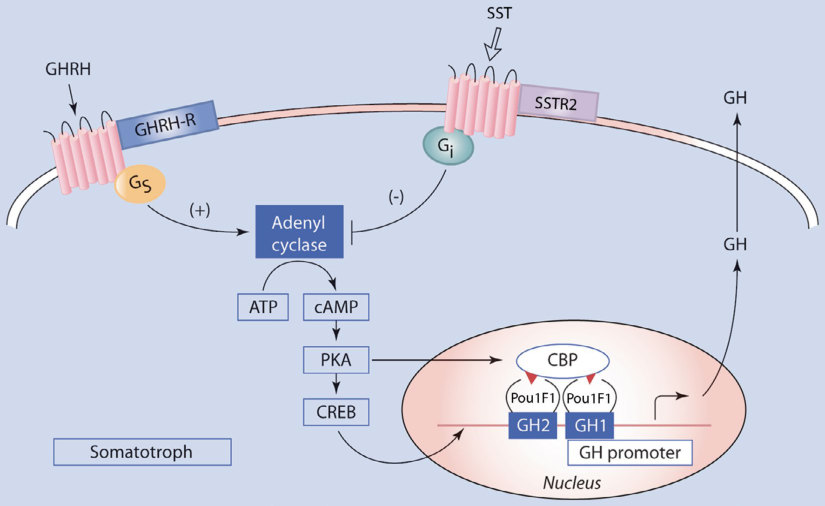
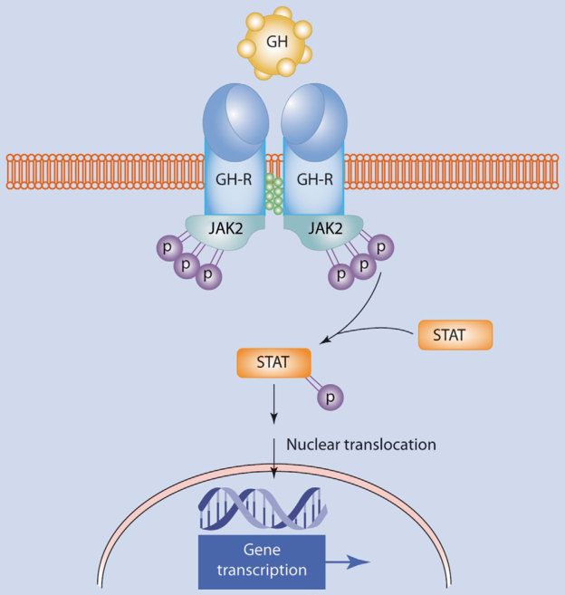
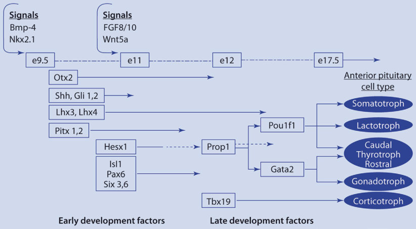
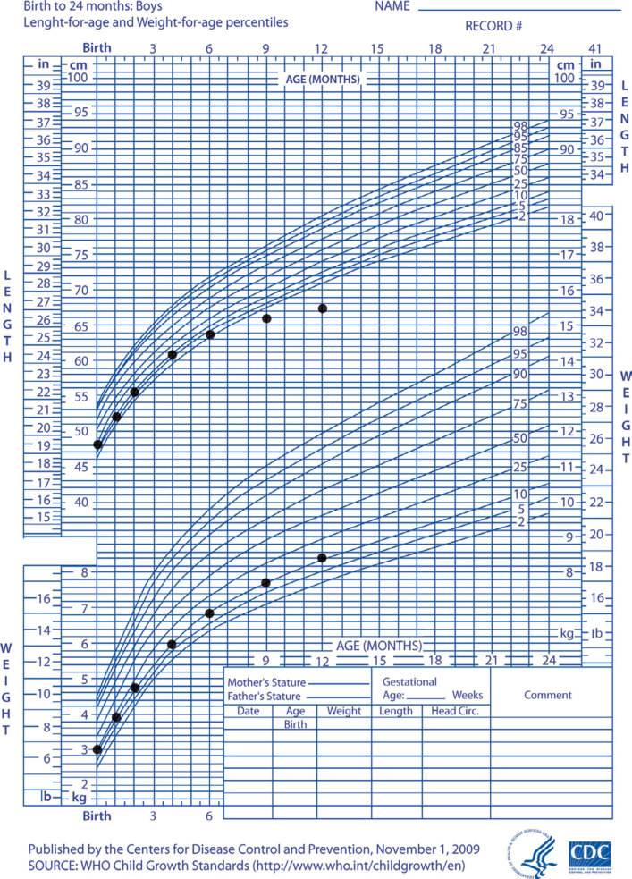

# 1. Childhood Growth Hormone Deficiency and Hypopituitarism
> [Source credits](../../SOURCE_CREDITS.md).

## Study pillars

### Mechanism and Etiology

Hypopituitarism and growth hormone deficiency (GHD) arise from congenital developmental mutations (HESX1, PROP1, POU1F1/PIT1, LHX3, LHX4, OTX2, SOX2, SOX3) affecting pituitary ontogeny, GHRH receptor defects, or acquired insults including craniopharyngiomas, CNS germinomas, histiocytosis, traumatic brain injury, and cranial irradiation (threshold ≥18 Gy, highest risk ≥30 Gy).

PDF p. 26

### Clinical Recognition

Severe neonatal presentation includes recurrent hypoglycemia, prolonged conjugated hyperbilirubinemia, and micropenis with cryptorchidism in males. Childhood presentation features progressive deceleration of linear growth velocity (<25th percentile or <4-5 cm/year), delayed bone age, truncal adiposity, midfacial hypoplasia with frontal bossing, and a high-pitched voice.

PDF p. 34

### Diagnostic Workup

Evaluation requires auxology, screening IGF-I and IGFBP-3 (standardized for age, sex, and pubertal stage), and two provocative GH stimulation tests (clonidine, arginine, glucagon, or insulin tolerance test) demonstrating peak GH <7-10 mcg/L. Sex-steroid priming (estrogen or testosterone) is recommended in prepubertal boys ≥11 years and girls ≥10 years with bone age delay to prevent false-positive failures. Brain/pituitary MRI assesses structural integrity, stalk interruption, ectopic neurohypophysis, or intracranial neoplasms.

PDF p. 35

### Treatment and Interventions

Recombinant human growth hormone (rhGH/somatropin) is initiated at 22-35 mcg/kg/day (0.16-0.24 mg/kg/week) subcutaneously daily at bedtime. Dose titration is monitored by linear growth velocity, clinical response, and keeping serum IGF-I within the normal reference range (-1 to +1.5 SDS). Concomitant anterior pituitary axes (TSH, ACTH, gonadotropins) must be monitored, as GH replacement accelerates peripheral T4-to-T3 deiodination and may unmask central hypothyroidism.

PDF p. 38

### Outcomes and Safety

Short-term adverse effects include benign intracranial hypertension (pseudotumor cerebri, presenting with headache and papilledema), slipped capital femoral epiphysis (SCFE, presenting with hip/knee pain and limp), scoliosis progression during rapid catch-up growth, and fluid retention. Long-term surveillance indicates no increased risk of primary tumor recurrence in childhood cancer survivors, though secondary solid neoplasm surveillance is maintained.

PDF p. 39

## Full source extraction

# 1. Childhood Growth Hormone Deficiency and Hypopituitarism
> Source attribution: [Source credits](../../SOURCE_CREDITS.md).

## PDF page 21 | printed page 3

### Childhood Growth Hormone Deficiency and Hypopituitarism

Laurie E. Cohen, Carmen L. Soto-Rivera, and Christopher J. Romero

Contents

1.1 Introduction and Background Information – 4

1.1.1 Pituitary Gland Structure and Function – 4 1.1.2 Growth Hormone – 5

1.2 Etiology of Growth Hormone Deficiency – 8

1.2.1

Congenital Forms of GH Deficiency (Box 1.1) – 8

1.2.2

Acquired Forms of GH Deficiency (Box 1.2) – 15

1.3 Clinical Presentation of Growth Hormone Deficiency – 16

1.4 Diagnostic Evaluation of Growth Hormone Deficiency – 16

1.4.1 IGF-I and IGFBP-3 – 17 1.4.2 Growth Hormone Stimulation Tests – 17 1.4.3 Physiologic Assessment of Growth Hormone Secretion – 19 1.4.4 Bone Age Evaluation – 19 1.4.5 Prediction of Adult Height – 19 1.4.6 Magnetic Resonance Imaging – 20

1.5 Treatment of Growth Hormone Deficiency – 20

1.6 Outcomes and Possible Complications – 21

1.6.1 Short-Term Follow-Up – 21 1.6.2 Long-Term Risks – 22

1.7 Summary – 25

References – 25

© The Author(s), under exclusive license to Springer Nature Switzerland AG 2024 S. Radovick, M. Misra (eds.), Pediatric Endocrinology, https://doi.org/10.1007/978-3-031-66296-6_1

## PDF page 22 | printed page 4

### 1

Key Points

5 Severe GH deficiency in the newborn

period may be characterized by hypo glycemia and conjugated hyperbilirubi nemia, as well as a small phallus in boys, consistent with multiple anterior pituitary hormone deficiencies. 5 Hypopituitarism due to mutations in

genes involved in pituitary development may be associated with other develop mental anomalies. 5 The diagnosis of GH deficiency should

be made on the basis of physical find ings and the integration of auxologic, biochemical, and radiographic data. 5 Potential adverse effects of GH therapy

include benign intracranial hyperten sion, slipped capital femoral epiphysis, and progression of scoliosis.

### 1.1 Introduction and Background

### Information

### 1.1.1 Pituitary Gland Structure

### and Function

The pituitary gland is formed of two portions derived from different sources: the anterior (adenohypophysis) and the posterior (neuro hypophysis) [1]. The upward invagination of stomodeal ectoderm forms the primordium of the anterior pituitary, Rathke’s pouch, while the posterior pituitary arises from the neural ectoderm of the forebrain [2]. Rathke’s pouch can be identified by the third week of pregnancy [3].

The anterior pituitary comprises 80% of the pituitary and consists of three parts: the pars distalis (pars anterior or anterior lobe), the pars intermedia (intermediate lobe), and the pars tuberalis (pars infundibularis or pars proximalis). In humans, the pars distalis is the largest portion of the anterior pituitary and where most of the anterior pituitary hor

mones are produced [3]. The intermediate lobe is poorly developed in humans with only a tiny remnant identifiable in adults, although more obvious in the fetus and in pregnant women [4]. The upward extension of the pars distalis onto the pituitary stalk forms the pars tuberalis, which may contain a small number of gonadotropin-producing cells [3].

Peptide hormones produced in neurons of the hypothalamus are transported via a capil lary plexus in the pituitary stalk to the ante rior pituitary, where they regulate the synthesis and release of several hormones from special ized cell types. Somatotrophs produce somato tropin, more commonly known as growth hormone (GH); lactotrophs produce prolac tin (PRL); thyrotrophs produce thyrotropin, also known as thyroid-stimulating hormone (TSH); gonadotrophs produce the two gonad otropins, follicle-stimulating hormone (FSH) and luteinizing hormone (LH); and cortico trophs produce adrenocorticotropin (ACTH) [5]. Earlier studies suggested localization of the various cell types, for example, lactotrophs to the rostral and caudal regions and somato trophs predominantly to the anterolateral wings of the gland. However, the organization appears to be much more complicated with the anterior pituitary cells arranged in net works and adapting dynamically in response to the hypothalamic-releasing and -inhibiting hormones [6]. Posterior pituitary hormones are synthesized in cell bodies of neurons in the hypothalamus and transported along their axons through the neurohypophyseal tract of the pituitary stalk. These hormones, arginine vasopressin (also known as antidi uretic hormone [ADH]) and oxytocin, are then stored in, and secreted from, the poste rior pituitary [7].

Hypopituitarism is the deficiency in vary ing degrees of one or multiple pituitary hor mones. In this chapter, GH deficiency (GHD) will be discussed, while other hormonal defi ciencies are presented elsewhere in this book. To understand GHD, an understanding of GH physiology is important and follows below.

## PDF page 23 | printed page 5

### 1.1.2 Growth Hormone

Growth hormone is a single-chain α-helical nonglycosylated polypeptide. The majority (75–90%) of circulating GH is a 22-kDA form consisting of 191 amino acids and two intra molecular disulfide bonds [3, 8]. There is also a 20-kDa variant form, which arises from alternative splicing during the processing of human GH pre-mRNA [9, 10]. The remainder of the GH produced by the pituitary is in the N-acetylated and desamidated forms and oligomers [3]. Secreted GH circulates both unbound and bound to binding proteins, which are portions of the extracellular domain of the GH receptor (GHR) [11].

The GH1 gene encodes for GH and is part of a 50-kb cluster of five genes located on human chromosome 17q22–24: GH1, chori onic somatomammotropin (CS)-like (L), CS- A, GH-2, and CS-B [12]. The CS-L translated protein appears nonfunctional, while the CS- A and CS-B genes encode human chorionic somatomammotropin (hCS), also known as human placental lactogen (hPL). hCS is pro duced by syncytiotrophoblastic cells and has 85% homology to GH. While hCS also con tains two disulfide bonds that occur at the same positions as in GH-N, it only has 0.5% affinity for the GHR. Interestingly, hCS does not appear necessary for fetal or extrauterine growth, nor does it appear essential for the maintenance of pregnancy or lactation [13]. The GH-2 gene product, which is known as the GH variant (GH-V), differs from GH-N by 13 amino acids. It is expressed as at least four alternatively spliced mRNAs in the pla centa and is continuously secreted during the second half of pregnancy, suppressing mater nal pituitary GH-1 gene function [14, 15].

16

17 18

19 20

21

21

i

22 23

24 25

1.1 Infants have nonpulsatile GH secretion. There is a gradual increase in 24-h integrated GH secretion during childhood. The ampli tudes of GH pulses are increased during puberty, which may be secondary to the effect of gonadal steroids on GHRH [26–28]. Although GH production continues through out life, the levels decline in the elderly [29, 30].

There are multiple other factors that affect GH secretion. Thyroid hormone regulates GH secretion at the level of the hypothalamus and pituitary, and hypothyroidism is associ ated with a decrease in GH secretion [31]. Adiposity (in particular visceral fat) is associ ated with decreased GH secretion [32], while undernutrition leads to the oversecretion of GH but low IGF-I levels indicating GH resis tance [33].

Synthetic hexapeptides capable of stimu lating GH secretion are termed GH secreta gogues (GHS) or GH-releasing peptides (GHRP). These compounds can stimulate GH release but do not act through the GHRH or SST receptors [34, 35]; rather, they act via the GHS receptor (GHS-R), which is distinct from the GHRHR. These peptides can initi ate and amplify pulsatile GH release [35]. The

## PDF page 24 | printed page 6

### 1

Fig. 1.1 GH secretion. Simplified model of growth hormone (GH) gene activation. GH synthesis and release from somatotrophs are regulated by growth hormonereleasing hormone (GHRH) stimulation and somatosta tin (SST) inhibition. GHRH activation of its Gs-protein-coupled receptor leads to an increase in cyclic adenosine monophosphate (cAMP) and intracel lular calcium, resulting in the activation of protein kinase A (PKA). PKA phosphorylates and activates

GHS-R is a seven-transmembrane G-proteincoupled receptor that acts via protein kinase C activation and is expressed in the hypothal amus and in pituitary somatotrophs [36].

An endogenous ligand for the GHS-R, ghrelin, stimulates GH release in a doserelated manner, as well as potentiates GHRHdependent secretion of GH [37, 38]. It is produced mainly by the oxyntic cells of the stomach but is also found throughout the gastrointestinal tract, as well as in the hypo thalamus, heart, lung, and adipose tissue [39]. Several studies have demonstrated that ghre lin has a wide range of effects, including act ing as a physiological mediator of feeding [40, 41].

Approximately 50% of circulating GH is bound to GH-binding protein (GHBP). GHBP is produced in multiple tissues, with the liver being the predominant source. GHBP

cAMP response element-binding protein (CREB), which binds to cAMP response elements in the GH pro moter to enhance GH1 gene transcription. There is also a PKA-dependent, CREB-independent mechanism of human GH gene activation by Pit-1 and CREB-binding protein (CBP). SST activation of its Gi-coupled protein leads to a decrease in cAMP and a reduction in calcium influx

acts as a circulating buffer or reservoir for GH, prolonging the half-life of plasma GH and competing with the GHR for GH, prob ably forming an unproductive heterodimer. In general, GHBP levels reflect GHR levels and activity. In rodents, GHBP appears to be syn thesized de novo from alternative splicing of GHR mRNA. In humans, rabbits, and others, it is shed from membrane-bound GHR by proteolytic cleavage [11, 42].

43

44

Unmatched source image; PDF page 24. Consult the original caption.

## PDF page 25 | printed page 7

dimerized in an unbound or inactive state [45, 46]. The GH-binding sites on the extracellular domains of the two subunits are placed asym metrically; GH binding to the constitutive dimer induces rotation of the two subunits, which allows downstream kinase activation by phosphorylation of Janus kinase 2 (Jak2) [46]. Subsequently, the Jak2 molecule induces tyrosine phosphorylation on the intracellular portion of the GHR, which then provides docking sites for intermediary signal trans ducers and activators of transcription (STAT) proteins [47–49]. After phosphorylation, STATs dimerize and move to the nucleus, where they activate gene transcription [50, 51] ( Fig. 1.2).

Fig. 1.2 GH action. Schematic model of growth hormone receptor (GHR) binding and signaling. A sin gle GH molecule binds asymmetrically to the extracel lular domain of two receptor molecules, causing a conformational change. This leads to the interaction of the GHR with Janus kinase (Jak2) and tyrosine phos

Many of the actions of GH, both meta bolic and mitogenic, are mediated by insulinlike growth factors (IGFs) or somatomedins, initially identified by their ability to incorpo rate sulfate into rat cartilage [52]. IGF-I, which is a basic 70-amino-acid peptide, is pro duced under the direction of GH predomi nantly in the liver [53]. It plays an important role in both embryonic and postnatal growth. Both systemic and local IGF-I have been shown to stimulate longitudinal bone growth [54–58].

Human fetal serum IGF-I levels, which are approximately 30–50% of adult levels, have been positively correlated with gestational age [59, 60]. The levels of IGF-I gradually increase

phorylation of both Jak2 and GHR, followed by phos phorylation of cytoplasmic transcription factors known as signal transducers and activators of transcription (STATs). After phosphorylation, STATs dimerize and move to the nucleus, where they activate gene transcrip tion

Unmatched source image; PDF page 25. Consult the original caption.

## PDF page 26 | printed page 8

during childhood and peak during pubertal development, achieving two to three times the normal adult values [61, 62]. IGF-I produc tion during puberty is augmented by the rise in gonadal steroids leading to increased GH secretion and the pubertal growth spurt [60, 63]. Testosterone mediates its effects on GH pulse amplitude through aromatization to estrogen [64]. After adolescence, serum IGF-I concentrations decline gradually with age [60, 63].

### 1

IGFs circulate within the plasma com plexed to high-affinity binding proteins or IGF-binding proteins (IGFBPs). IGFBPs extend the serum half-life of IGFs, transport IGFs into target cells, and modulate the inter action of IGFs with their receptors [60, 65]. Six distinct IGFBPs have been cloned and sequenced [66, 67]. IGFBP-3, which is GH dependent, is the major IGFBP in human serum and transports over 90% of the circu lating IGF-I [3].

The IGF-I receptor (IGF-IR), which is structurally related to the insulin receptor, is a heterotetramer comprised of two membranespanning α-subunits and two intracellular β-subunits [68, 69]. The subunits contain binding sites for IGF-I, are linked by disulfide bonds, and are composed of a transmem brane domain, an adenosine triphosphate (ATP)-binding site, and a tyrosine kinase domain that mediates the presumed signal transduction mechanism for the receptor [3, 70].

### 1.2 Etiology of Growth Hormone

### Deficiency

### 1.2.1 Congenital Forms of GH

### Deficiency (Box 1.1)

The incidence of congenital isolated GHD (IGHD) has been reported as between 1:4000 and 1:10,000 live births [71, 72]. Congenital cranial malformations, including holoprosen cephaly, septo-optic dysplasia (SOD) spec trum, and midline craniocerebral or midfacial

abnormalities, can be associated with anoma lies of the pituitary gland, including pituitary hypoplasia and/or aplasia or an ectopic poste rior pituitary gland (EPP) [7]. Clinically, they may be associated with pituitary hormone deficiencies at birth or with the risk of devel oping future hormone deficiencies. Although these conditions often have no identifiable eti ology, ongoing advances in understanding pituitary development have provided a genetic basis to account for pituitary pathology. Mutations have been found in genes necessary for pituitary development and function. The following presents a summary of reported genetic defects associated with pituitary pathology.

Box 1.1 Congenital Forms of Hypopi tuitarism. Congenital Causes of or Associations with Growth Hormone Deficiency Cranial and central nervous system abnor malities

5 Septo-optic dysplasia/optic nerve hypoplasia 5 Cleft lip ± palate

5 Empty sella syndrome

5 Holoprosencephaly, anencephaly

5 Pituitary aplasia or hypoplasia

5 Thin or absent pituitary stalk

5 Ectopic posterior pituitary

5 Hydrocephalus

Genetic (mutations, deletions)

5 GHRH receptor (GHRHR)

5 Ventral diencephalon factors

### –– FGF8 –– GLI2 –– SIX6

5 Pituitary developmental factors

–– Pituitary primordium factors

–– HESX1 –– OTX2 –– PITX2 –– LHX3 –– LHX4 –– SOX3 –– SOX2

## PDF page 27 | printed page 9

### –– Pituitary-specific

transcription factors

–– PROP1 –– Pit-1 5 GH-1

### –– Types Ia, Ib, II, and III –– Multiple GH family gene deletions –– Bioinactive GH

5 GH receptor (GHR)

5 IGF-I

5 IGF-I receptor (IGF-IR)

5 STAT5B

Fig. 1.3 Anterior pituitary development. The devel opment of the mature pituitary gland initiates with the contact of the oral ectoderm with the neural ectoderm followed by a cascade of events consisting of both sig naling molecules and transcription factors expressed in a specific temporal and spatial fashion. This figure pres ents a modified overview of pituitary development adapted from previous embryological studies performed in murine species by illustrating the temporal expression of various developmental factors. Early on, bone mor phogenetic protein 4 (Bmp-4) and NK2 Homeobox 1 (Nkx2.1) are expressed along with sonic hedgehog (Shh) in order to form the primordial Rathke’s pouch, which will become the mature pituitary. Also expressed are Gli1 and 2, Lhx3, and Pitx1 and 2, which all play a role

### 1.2.1.1 Developmental Factor

### Mutations

1.3

in the development of progenitor pituitary cell types. Subsequently, the expression of Hesx1, Isl1, paired box gene 6 (Pax6), and Six3 assists in appropriate cellular development, proliferation, and migration. The hashed arrows denote the attenuation of an expressed factor, such as seen with Hesx1, and are often required for the expression of another factor. The attenuation of Hesx1, for example, is required for the expression of Prop1. Similarly, Pit-1 (Pit-1), which is required for somato troph, lactotroph, and thyrotroph development, is expressed upon the attenuation of Prop1 expression. Ultimately, the mature pituitary gland is marked by the differentiated cell types: somatotrophs, lactotrophs, thy rotrophs, gonadotrophs, and corticotrophs [73–75]

Unmatched source image; PDF page 27. Consult the original caption.

## PDF page 28 | printed page 10

Mutations in genes involved in pituitary development may be associated with other developmental anomalies ( Table 1.1).

### 1

Gli2

Gli transcription factors mediate sonic hedge hog (Shh) signaling, which controls cell fate specification and proliferation in multiple tis sues. Gli2/Shh signaling controls the expres sion of genes in the ventral diencephalon that are necessary for the early patterning of Rathke’s pouch, as well as the proliferation of pituitary progenitors [76]. Mice deficient in Gli2 have early forebrain, spinal cord, skele ton, and ventral diencephalon defects with variable pituitary loss. Pituitary cell types develop, but corticotrophs, somatotrophs, and lactotrophs do not proliferate [77]. Mutations in GLI2 have been found in patients with GH deficiency alone or with one or more other anterior pituitary deficiencies

Table 1.1 Developmental abnormalities seen in association with hypopituitarism due to mutations in genes involved in pituitary development

Gene Associated findings

GLI2 Holoprosencephaly Midline defects Polydactyly

FGF8 Holoprosencephaly

HESX1 Optic nerve hypoplasia Absent septum pellucidum and corpus callosum

PITX2 Reiger syndrome

OTX2 Micro- or anophthalmia

LHX3 Cervical spine/vertebral anomalies Deafness Hyperextensible joints

LHX4 Hypoplastic corpus callosum Chiari syndrome

SOX2 Micro- or anophthalmia Esophageal atresia Sensorineural hearing loss

SOX3 Absent corpus callosum Craniofacial abnormalities Intellectual disability

with and without holoprosencephaly and in patients with holoprosencephaly with and without pituitary hormone deficiencies. When pituitary hormone deficiencies are present, the GLI2 protein is usually truncated; when pituitary hormone deficiencies are absent, there is usually a missense mutation. The anterior pituitary may be absent or hypoplas tic, and there may or may not be an EPP. Polydactyly is often an associated find ing [78].

Hesx1 (Rpx)

Hesx1, a member of the paired-like class of homeobox genes originally described in Drosophila melanogaster, is one of the earliest known specific markers for the pituitary pri mordium and is a transcriptional repressor [79, 80]. Hesx1 null mutant mice demonstrate abnormalities in the corpus callosum, anterior and hippocampal commissures, and septum pellucidum, a phenotype similar to the defects seen in humans with SOD [79]. The initial report of a human HESX1 mutation was in two siblings with agenesis of the corpus cal losum, optic nerve hypoplasia, and panhypo pituitarism who were found to have a homozygous mutation at codon 53 (arginine to cysteine) in the homeodomain (DNAbinding domain) of HESX1, resulting in a drastic reduction in DNA binding [79]. Subsequently, autosomal recessive and domi nant HESX1 mutations have been found in association with SOD (although a rare cause of SOD) or with combined pituitary hormone deficiency (CPHD) [81].

Several investigators have screened patients with a wide spectrum of congenital hypopitu itarism for mutations in HESX1. Thomas et al., for example, evaluated 228 patients: 85 with isolated pituitary hypoplasia (including IGHD and CPHD), 105 with SOD, and 38 with holoprosencephaly or related pheno types. In this cohort, three missense mutations were identified [82]. In another study, approxi mately 850 patients were studied for muta tions in HESX1 (300 with SOD; 410 with isolated pituitary dysfunction, optic nerve hypoplasia, or midline brain anomalies; and 126 with familial inheritance). Only 1% of the group was found to have coding region muta

### Automatic table extraction — verify rendered original

|Gene|Associated findings|
|---|---|
|_GLI2_|Holoprosencephaly Midline defects Polydactyly|
|_FGF8_|Holoprosencephaly|
|_HESX1_|Optic nerve hypoplasia Absent septum pellucidum and corpus callosum|
|_PITX2_|Reiger syndrome|
|_OTX2_|Micro- or anophthalmia|
|_LHX3_|Cervical spine/vertebral anomalies Deafness Hyperextensible joints|
|_LHX4_|Hypoplastic corpus callosum Chiari syndrome|
|_SOX2_|Micro- or anophthalmia Esophageal atresia Sensorineural hearing loss|
|_SOX3_|Absent corpus callosum Craniofacial abnormalities Intellectual disability|

[Original table](../../tables/ch001_p0028_1.jpg)

## PDF page 29 | printed page 11

tions, suggesting that mutations in HESX1 are a rare cause of hypopituitarism and SOD [83]. As the described mutations in HESX1 present with variable phenotypes, it has been suggested hormone abnormalities may be affected by modifier genes or environmental factors [84].

Otx2

Otx genes are expressed in the rostral brain during development and are homologous to the Drosophila orthodenticle (otd) gene, which is essential for the development of the head in Drosophila melanogaster [85]. Otx2 is expressed in the ventral diencephalon, where it interacts with Hesx1, and in Rathke’s pouch. Homozygous inactivation of Otx2 in mice leads to extreme brain defects, while heterozy gous inactivation results in eye abnormalities, commonly pituitary hypoplasia, and some times holoprosencephaly. Heterozygous muta tions of the OTX2 gene, which have been implicated in severe ocular malformations such as anophthalmia, have also been reported in patients with hypopituitarism ranging from GHD to multiple pituitary hormone deficien cies [86–89]. There are variable findings of hypoplastic pituitary, EPP, and Chiari syn drome [90–92].

Pitx2 (Ptx2)

Pitx2 is a paired-like homeodomain transcrip tion factor closely related to the mammalian Otx genes [85]. Pitx2 null mice show embry onic lethality; however, a hypomorphic allele model of Pitx2 demonstrated pituitary hypo plasia and cellular differentiation defects in proportion to the reduced dosage of Ptx2. The gonadotrophs were most severely affected, followed by somatotrophs and thyro trophs [93–95].

RIEG is the human homolog of Pitx2, and clinical mutations of PTX2 have been described in patients with Axenfeld-Rieger syndrome. This syndrome is an autosomal dominant condition with variable manifesta tions including anomalies of the anterior chamber of the eye, dental hypoplasia, a pro tuberant umbilicus, mental retardation, and pituitary alterations [96]. One group of inves

tigators described mutations in six out of ten families with autosomal dominant Rieger syndrome [96, 97]. Five of the six mutations reported were in the homeobox region, and several showed loss of DNA-binding capacity.

Lhx3 (Lim-3, P-Lim) and Lhx4

Lhx3 is a LIM-type homeodomain protein expressed in the anterior and intermediate lobes of the pituitary gland, the ventral hind brain, and the spinal cord. Lhx3 expression persists in the adult pituitary, suggesting a maintenance function in one or more of the anterior pituitary cell types [97]. In addition, its expression is associated with cells that secrete GH and PRL, as well as the expression of the α-glycoprotein subunit (α-GSU), sug gesting a common cell precursor for gonado trophs, thyrotrophs, somatotrophs, and lactotrophs [98, 99].

In humans, homozygous loss-of-function mutations in LHX3 have been identified in patients with hypopituitarism including GH, TSH, PRL, LH, and FSH deficiencies, ante rior pituitary defects, and cervical abnormal ities with or without restricted neck rotation [100, 101]. Among 366 studied patients with IGHD or CPHD, only seven patients from four families were found to have LHX3 mutations, suggesting LHX3 gene mutations are a rare cause of CPHD [102]. A com pound heterozygous mutation of LHX3 was described that leads to a short protein induc ing a dominant negative effect (from a pater nally derived change) and a protein with impaired transactivational ability (from a maternally derived change) [103]. As with other described LHX3 mutations, the patient presented with pituitary hormone deficien cies, in addition to deafness and limited neck rotation.

Lhx4 is a closely related transcription fac tor to Lhx3. Heterozygous sporadic and familial LHX4 mutations have been reported. Pituitary hormone deficiencies range from IGHD to panhypopituitarism, and the pitu itary may be hypoplastic with or without an EPP. Some patients also have corpus callosum hypoplasia or Chiari syndrome with pointed cerebellar tonsils [104].

## PDF page 30 | printed page 12

Other Transcription Factors

In addition to the more commonly cited fac tors, several other mutated developmental factors have been reported to cause CPHD [104]. For example, patients with reported SOX2 mutations present phenotypes that include hormone deficiencies (primarily iso lated gonadotroph deficiency, but occasion ally GH deficiency), pituitary hypoplasia, and eye abnormalities [104, 105]. Sox2 is a member of the SRY-related HMG box (SOX) family of transcription factors and plays a role in the stem cell compartment and in the maintenance of the pituitary progenitor cells and their differentiation into all the pituitary cell types. Sox2 is also expressed in the dien cephalon, the developing central nervous sys tem, in the sensory placodes, inner ear, cochlea, and the developing lens, retina, and optic nerve [104].

### 1

Another interesting development has been the association of pituitary hormone deficien cies with mutations in the gonadotroph genes prokineticin receptor 2 (PROKR2), fibroblast growth factor 8 (FGF8), and FGF receptor 1 (FGFR1), which have been traditionally reported in patients with isolated hypogonad otropic hypogonadism [106]. Mutations in PROKR2, similar to those in LHX4, OTX2, HESX1, and SOX3, may be associated with pituitary stalk interruption syndrome (PSIS). Additionally, genetic variations in Roundabout, Axon Guidance Receptor and Homolog 1 (ROBO1), which play a critical function in axonal guidance, may have a role in the development of PSIS [107].

### 1.2.1.2 Pituitary-Specific

### Transcription Factors

Prop1

Prop1 is a paired-like homeodomain tran scription factor with expression restricted to the anterior pituitary during development [2, 108]. During pituitary development, Prop1 acts as a repressor in downregulating Hesx1 and as an activator of Pit-1 [73]. More recent evidence suggests that Prop1 may play a more central role in pituitary stem cell differentia tion than previously recognized [73].

Bi-allelic PROP1 mutations are the most frequent genetic etiology of CPHD [109]. At least 42 heterozygous or compound heterozy gous human mutations have been described [104, 110]. The most common is a recurring homozygous autosomal recessive mutation of PROP1, delA301_302AG (also known as 296delGA) in exon 2, which changes a serine to a stop codon at codon 109 in the homeodo main, resulting in a truncated gene product. The other common mutation is 150delA [110, 111]. These mutations have been found in nonconsanguineous patients from over 21 countries worldwide, and while previously were thought to be a consequence of hot spots, they are now thought to be founder variants [112]. A considerable variation in clinical phenotypes of patients with PROP1 mutations has been demonstrated, even in patients bearing identical genotypes [108, 113, 114]. Several reports have shown that the hor mone deficiencies may be variable and dynamic; some patients may develop hypogo nadotropic hypogonadism, despite the pro gression into spontaneous puberty, or cortisol deficiency over time [108, 115–117]. Interestingly, some patients present with pitu itary hyperplasia prior to developing hypopla sia, which is speculated to be due to pituitary progenitors accumulating in the intermediate lobe rather than differentiating into more mature cell types [118].

Pit-1

Pit-1 (Pit-1, GHF-1) is a member of a family of transcription factors, POU, which are responsible for mammalian development, and its expression is restricted to the anterior pitu itary lobe [119, 120]. Pit-1 has been shown to be essential for the development of somato trophs, lactotrophs, and thyrotrophs, as well as for their cell-specific gene expression and regulation [120].

Mutations in Pit-1 in humans were described in 1992 by four different groups in patients with CPHD consisting of GHD, TSH, and PRL deficiencies and variable hypo plastic anterior pituitaries on MRI [121–124]. At least 47 different mutations have been

## PDF page 31 | printed page 13

described, with the majority demonstrating autosomal recessive inheritance [74]. The most common mutation, however, is an R271W substitution affecting the POU homeodomain; this leads to a mutant protein that binds nor mally to DNA but acts as a dominant inhibi tor of transcription and may act by impairing dimerization [122, 124–130]. In another single allele mutation, K216E, the mutant Pit-1 is able to bind DNA but unable to support reti noic acid induction of the Pit-1 gene distal enhancer either alone or in combination with wild-type Pit-1. This ability to selectively impair the interaction with the superfamily of nuclear hormone receptors is thus another mechanism responsible for CPHD [131]. Several other point mutations in the Pit-1 gene resulting in CPHD have been described, as well as a few deletions and insertions [110]. Some alter residues important for DNA bind ing and/or alter the predicted α-helical nature of the Pit-1, while others have been shown to or postulated to impair the transactivation of target genes [74, 132].

### 1.2.1.3 Isolated Growth Hormone

### Deficiency

Growth Hormone-Releasing Hormone Receptor Mutations

Inactivating mutations reported in the GHRHR are often classified as a type of IGHD. The little mouse (lit/lit), which dem onstrates dwarfism and a decreased number of somatotrophs, has a recessively inherited missense mutation in the extracellular domain of the Ghrhr gene [133–135]. In addition to GHD and postnatal growth failure, these mice exhibit delayed pubertal maturation [135]. The first human mutation identified was a nonsense mutation that introduced a stop codon at position 72 (E72X) in two cousins who presented clinically with the typ ical phenotype of severe GHD [136]. Subsequently, a nonsense mutation was found in codon 50 in “Dwarfism of Sindh” in Pakistan [137]. Since then, more than 64 non sense, missense, and splice site mutations in the GHRH gene and deletions and regulatory

mutations in the Pit-1-binding sites in the GHRHR promotor have been identified [110, 138].

Growth Hormone Mutations

Four forms of IGHD have been described, and their classification is based upon the clini cal presentation, inheritance pattern, and GH secretion.

IGHD Type IA results primarily from large deletions, along with microdeletions and sin gle base-pair substitutions, of the GH1 gene, which ultimately prevents the synthesis or secretion of the hormone. This condition is associated with growth retardation in infancy and subsequent severe dwarfism. Heterogeneous deletions of both alleles rang ing from 6.7 to 45 kb have been described [139–142]. In addition to GH1 gene abnor malities, a report of siblings with IGHD described two homozygous variants in the proximal GH1 promoter within a highly con served region and predicted binding sites [143]. Patients with IGHD type 1A frequently develop antibodies to exogenous GH therapy, which is attributed to the lack of immune tol erance because of prenatal GHD [144, 145]. Some patients may eventually become insensi tive to GH replacement therapy demonstrat ing a decreased clinical response; subsequently, recombinant IGF-I therapy may be an alter native option.

IGHD Type IB is a less severe autosomal recessive form of GHD resulting from muta tions or rearrangements of the GH1 gene, such as splice site mutations that lead to par tial GH deficiency [140, 146, 147]. In one study, a homozygous splice site G to C trans version in intron 4 of the GH-1 gene was iden tified, causing a splice deletion of half of exon 4, as well as a frameshift within exon 5. These changes ultimately affected the stability and biological activity of the mutant GH protein [148]. Several other deletions or frameshift mutations have been described by others [149–151].

IGHD Type II is an autosomal dominant condition considered the most common genetic form of IGHD. Several patients have

## PDF page 32 | printed page 14

been found to have intronic transitions in intron 3, inactivating the donor splice site of intron 3 and deleting exon 3 [147, 148, 152–156].

### 1

IGHD Type III is a partial GH deficiency with X-linked inheritance due to interstitial Xq13.3-Xq21.1 deletions or microduplica tions of certain X regions. Patients may also have hypogammaglobulinemia, suggesting a contiguous Xq21.2-Xq22 deletion [157, 158].

Bioinactive Growth Hormone

Bioinactive GH has been reported in patients with short stature demonstrating normal GH immunoreactivity but reduced biopotency. A child with severe growth retardation, high serum GH levels, elevated GHBP, low IGF-I levels, and increased GH levels after provoca tive testing was found to have an autosomal arginine to cysteine mutation at codon 77. The child expressed both mutant and wildtype GH; however, the mutant GH had a higher affinity for GHBP, a lower phosphory lating activity, and an inhibitory or dominant negative effect on wild-type GH activity [159]. In another patient, an aspartic acid to lysine mutation at codon 112 was identified and suggested to prevent appropriate GHR dimerization [160].

There are also patients with the phenotype of growth hormone insensitivity who do not demonstrate mutations of the GHR gene, but have identified mutations in downstream GHR signaling molecules. Homozygous mutations in STAT5B, a major GH-dependent mediator of IGF-I gene transcription, have been identi fied as a cause of GH insensitivity [161, 162]. The first mutation characterized was a point mutation resulting in a marked decrease in phosphorylation of tyrosine [162], a critical step in the pathway to STAT activation of IGF-I gene transcription; while the second characterized mutation was an insertion in exon 10 leading to early protein termination [161, 163, 164]. In addition to growth retarda tion, both patients had evidence of immune dysfunction presumably because STAT5B is involved in downstream signaling for multiple cytokines. An additional 12 mutations in the STAT5B gene have been reported [110].

### 1.2.1.4 Growth Hormone Receptor

### Mutations

Laron dwarfism is an autosomal recessive dis order characterized by clinical features of severe GH deficiency along with low IGF-I levels but with normal to high levels of GH after provocative testing [165]. Several dele tions and point mutations of several GHR exons have been described [166–174]. Many of these mutations affect the extracellular domain and, therefore, lead to absent or decreased levels of GHBP [175]. Recombinant IGF-I therapy has been demonstrated to effectively treat these patients [176, 177]. It has also been hypothesized that some patients with idiopathic short stature (ISS), normal GH secretion, and low serum concentrations of GHBP may have partial insensitivity to GH due to mutations in the GHR gene [173].

### 1.2.1.5 IGF-I and IGF-I Receptor

### Mutations

A patient noted to have a homozygous partial IGF-I gene deletion with undetectable levels of IGF-I presented with severe prenatal and postnatal growth failure, bilateral sensorineu ral deafness, mental retardation, moderately delayed motor development, and behavioral difficulties. His evaluation did not demon strate a significant delay in his bone age, and an IGFBP-3 level was normal [178]. Subsequently, a few other cases of IGF-I mutations have been described.

Studies with African Pygmies demonstrate normal levels of GH but decreased IGF-I lev els and unresponsiveness to exogenous GH. Although IGF-I deficiency has been hypothesized, Bowcock et al. found no differ ences in restriction fragment length polymor phisms in the IGF-I gene in Pygmy versus non-Pygmy black Africans [179]. Furthermore, Pygmy T cell lines show IGF-I resistance at the receptor level with secondary GH resis tance [180]. In subsequent studies, it was dem onstrated that adult Pygmies demonstrate a reduction in both GH gene expression (1.8fold) and GHR gene expression (8-fold). This decrease of the GHR expression in Pygmies was associated with reduced serum levels of IGF-I and GHBP [181].

## PDF page 33 | printed page 15

Abnormalities in the IGF-IR gene have also been reported and are associated with intrauterine growth retardation (IUGR) and usually postnatal growth retardation. Several heterozygous, and occasionally compound heterozygous, mutations of the IGF-IR gene have been reported, as well as an association with deletions in chromosome 15q [182–187]. Phenotypic expression is variable, even between relatives with the same mutation, although microcephaly is a specific finding [188]. IGF-I levels are often high or high nor mal at baseline, but may be low in patients with feeding difficulties; they rise markedly after starting GH therapy [188]. Walenkamp et al. have proposed that partial IGF-I resis tance is likely if a patient has three or more of the following: birth weight and/or birth length below −1 SDS, height at presentation below −2.5 SDS, head circumference at presentation below −2 SDS, and IGF-I level greater than 0 SDS [189].

Other post-signal transduction defects and mutations in IGF-binding proteins may occur but have not been demonstrated as of yet.

### 1.2.2 Acquired Forms of GH

### Deficiency (Box 1.2)

Hypopituitarism can be caused by anything that damages the hypothalamus, pituitary stalk, or pituitary gland. Head trauma can injure the pituitary stalk and infundibulum and lead to the development of transient and permanent diabetes insipidus, as well as other hormonal deficiencies [190, 191]. There are a number of reports suggesting an association between hypopituitarism and a complicated perinatal course, especially breech delivery [192, 193]. It is not clear if a complicated peri natal course causes hypopituitarism or if a brain anomaly leads to both a complicated delivery and hypopituitarism. The finding that some of these patients have a microphal lus at birth suggests that pituitary dysfunction may precede birth trauma [7].

Infiltrative conditions can also disrupt the pituitary stalk. Diabetes insipidus can be the

first manifestation of germ cell tumors, Langerhans cell histiocytosis [194–196], or sarcoidosis [197]. Lymphocytic hypophysitis, usually in adult women in late pregnancy or in the postpartum period, can result in hypopi tuitarism [198].

Metabolic disorders can cause hypopitu itarism through the destruction of the hypo thalamus, pituitary stalk, or pituitary. Hemochromatosis is characterized by iron deposition in various tissues, including the pituitary. It may be idiopathic or secondary to multiple transfusions (e.g., for thalassemia major); gonadotropin deficiency is the most common hormonal deficiency, but GHD has also been described [199, 200].

Hypothalamic or pituitary tissue can also be destroyed by the mass effect of suprasellar tumors or by their surgical resection. These tumors include craniopharyngiomas, lowgrade gliomas/hypothalamic astrocytomas, germ cell tumors, and pituitary macroadenomas [201]. Treatment of brain tumors, nasopharyngeal carcinoma, or acute lymphoblastic leukemia (ALL) with cranial irradiation may also result in GHD. Discordancy between failure to pro voke an adequate GH response to insulininduced hypoglycemia and normal response to exogenous GHRH stimulation suggests that the hypothalamus is more vulnerable than the anterior pituitary [202]. The higher the radiation dose, the more likely and the earlier GHD will occur after treatment [203, 204]. Clayton et al. reported that 84% of children who received greater than 30 Gy to the hypothalamic-pituitary area had evi dence of GH deficiency more than 5 years after irradiation [203]. Higher radiation doses also increase the likelihood of the development of other anterior pituitary hor mone deficiencies [204]. Lower radiation doses preserve pharmacologic response of GH to stimulation, but there may be decreased spontaneous GH secretion [205]. Data, however, from Darzy et al. show that spontaneous GH secretion is maintained in adults after low-dose cranial irradiation, suggesting there is not GHRH deficiency.

## PDF page 34 | printed page 16

There is a normal but decreased peak GH response to stimulation testing indicating decreased somatotroph reserve. They postu lated that there is a compensatory increase in hypothalamic stimulatory input (GHRH) and suggested that “neurosecretory dysfunc tion” after low-dose cranial irradiation may only be seen in puberty during this time of increased GH demand [206]. Lifelong peri odic clinical assessment for GHD is recom mended for childhood cancer survivors who have received a hypothalamic-pituitary radi ation dose of ≥18, with the highest risk in those who have received ≥30 Gy [207]. Cranial irradiation can also cause precocious puberty leading to premature epiphyseal fusion, and spinal irradiation can lead to skeletal impaired spinal growth [207, 208]; both will further compromise adult height.

### 1

Box 1.2 Acquired Forms of Hypopituitarism. Etiologies of Acquired Growth Hormone Deficiency Trauma

5 Head injury

5 Perinatal events

Infiltrative and autoimmune diseases

5 Langerhans histiocytosis

5 Germinoma

5 Sarcoidosis

5 Lymphocytic hypophysitis

Infections

5 Meningitis

5 Granulomatous diseases

Hemochromatosis

Cerebral edema Neoplasms 5 Craniopharyngioma

5 Germinoma

5 Hypothalamic astrocytoma/optic gli

oma 5 Pituitary macroadenomas

Cranial irradiation

### 1.3 Clinical Presentation of Growth

### Hormone Deficiency

Growth failure presenting in infancy and childhood is the most common sign of GHD. Children with mild GHD usually pres ent after 6 months of age when the influences of the prenatal environment wane [209]. They generally have normal birth weights and lengths slightly below average [209]. The height percentile of a child with GH defi ciency will progressively decline, and typically the bone age will be delayed. They develop increased peri-abdominal fat [210] and decreased muscle mass and may also have delayed dentition, thin hair, poor nail growth, and a high-pitched voice [209]. Severe GHD in the newborn period may be characterized by hypoglycemia and conjugated hyperbiliru binemia, as well as a small phallus in boys due to other concomitant anterior pituitary hor mone deficiencies [209].

### 1.4 Diagnostic Evaluation

### of Growth Hormone Deficiency

There is much debate as to the proper meth ods to diagnose GHD in childhood. It is clear that there is a spectrum of GHD, and the clin ical presentation varies with the degree of hormonal deficiency. The diagnosis of GHD should be based on the integration of auxo logical, biochemical, and radiographic crite ria.

GHD should be considered in children with short stature, defined as a height more than 3 SD below the population mean or height more than 2 SD below the population mean with a height velocity more than 1 SD below the mean, and in children with a very low height velocity (more than 2 SD below the mean) irrespective of current height. In con sidering who should undergo evaluation for GHD, it is important to first exclude other causes of growth failure and then assess the patient for clinical features that can coexist with GHD. These features include hypoglyce

## PDF page 35 | printed page 17

mia, prolonged jaundice, microphallus, trau matic delivery in the neonate, and craniofacial midline abnormalities. Additionally, a history of other pituitary hormone deficiencies, cra nial radiation, and central nervous system infection, as well as a family history of GHD, should be ascertained [211]. When present, the majority of these features are seen in patients on the severe end of the spectrum of GHD. These patients are typically easy to diagnose and have low height velocity and biochemical markers of GHD, including low IGF-I levels [212] and low peak GH levels after stimulation tests [213]. Nonetheless, most patients with GHD will present with short stature without any of these other fea tures.

### 1.4.1 IGF-I and IGFBP-3

GH induces the expression of IGF-I in the liver and cartilage. The use of age and pubertycorrected IGF-I levels has become a major tool in the diagnosis of GHD [213]. Because of little diurnal variation, their quantification in random samples is useful. However, sensi tivity is still limited due to a significant over lap with normal values. Low levels of IGF-I may be found in normal children, especially in those less than 5 years of age. Similarly, low levels are reported in children with malnutri tion, hypothyroidism, renal failure, hepatic disease, and diabetes mellitus. Serum levels of IGF-I do not correlate perfectly with GH sta tus as determined by provocative GH testing [214, 215].

IGFBP-3 is the major carrier of IGF-I [216]. It is GH dependent but has less age vari ation and is less affected by the nutritional sta tus compared to IGF-I [217]. Although low levels of IGFBP-3 are suggestive of GH defi ciency, up to 43% of normal short children have been reported to have low concentrations [218]. Similarly, normal values have been reported in children with partial GHD [214].

The combination of a low height velocity and a low IGF-I level for pubertal status may remove the need for provocative testing in patients [219] where other causes for growth

failure, especially malnutrition and gastroin testinal illness, have been excluded. This is particularly true in patients with CPHD.

### 1.4.2 Growth Hormone Stimulation

### Tests

GH is secreted episodically, mostly during slow-wave sleep. Between the pulses of pitu itary GH secretion, serum concentrations are typically low, even in GH-sufficient children, and thus a single sample is not useful. Thus, a variety of pharmacological tests have been implemented to assess the GH secretory capacity of the pituitary gland [220]. These tests are expensive, have side effects, and require fasting conditions, as high glucose lev els inhibit GH secretion [221, 222]. GH pro vocative tests have been divided into two groups: screening tests including levodopa and clonidine and definitive tests including arginine, insulin, and glucagon [221, 222]. There is poor reproducibility of the same and different tests in the same subject [223]. Due to their low specificity, sensitivity, and repro ducibility, in order to exclude normal children who might fail a single stimulation test, two different provocative tests are required per patient [221, 222].

The sensitivity and specificity of these tests are also limited by the use of different labora tory techniques for the measurement of GH. Radioimmunoassays used in early stud ies employ polyclonal antibodies, which ren der low specificity and higher GH levels when compared with the more specific immunora diometric assays used today that employ two highly specific monoclonal antibodies. Discrepancies up to two- to four-fold have been reported among different assays [224]. The discrepancies between GH assays are also addressed in current guidelines, which recom mend that institutions require laboratories to provide harmonized GH assays using the somatropin standard 98/574 [225].

Conventionally in the United States, the gold standard for the diagnosis of GHD has been a peak serum GH of less than 10 μg/L after two different GH stimulation tests. This

## PDF page 36 | printed page 18

cutoff is arbitrary. While very low GH peak levels on provocative testing are consistent with severe GHD and generally correlate with a favorable response to GH replacement, there is considerable overlap of GH peak lev els in patients with partial GHD and healthy subjects. Multiple studies have shown that many children diagnosed with IGHD based on peak GH levels less than 10 μg/L will have normal GH secretion on retesting both in childhood [226] and as adults [227, 228]. With newer GH assays that use monoclonal anti body testing and result in GH levels that are up to 40% lower than those obtained with older immunoassay-based testing, many experts believe that the diagnostic threshold should be lowered to a peak serum GH of less than 7 ng/mL [229].

### 1

Guidelines from the Pediatric Endocrine Society suggest that in patients who meet aux ological criteria and have a hypothalamicpituitary insult (congenital malformation, tumor, history of radiation, etc.) and defi ciency of one additional pituitary hormone, diagnosis of GHD can be established without provocative testing of GH secretion [225]. Similarly, in newborns with congenital hypo pituitarism and deficiency of at least one additional pituitary hormone (or imaging findings of EPP with pituitary hypoplasia and an abnormal stalk), GHD can be diagnosed without formal provocative testing if GH fails to rise above 5 μg/L during hypoglycemia. In patients who do undergo GH provocative testing, their results should not be used as the sole diagnostic criterion for GHD [225].

In normal children, serum levels of GH are age and sex dependent and show a sharp puber tal increase. During the first few weeks of life, GH levels rise but are associated with low levels of IGF-I. In addition, there is a low number and immaturity of GH receptors, along with lower levels of GHBP. Newborns, therefore, show a state of GH resistance that resolves over time. Because of this, random GH levels can be useful in assessing a neonate for GH deficiency. Mamilly et al. determined that a random GH level in the first 28 days of life ≤4.5 ng/mL has 100% specificity and 83% sen sitivity in the diagnosis of GHD [230].

Immediately before puberty, GH secretion may normally be very low, making the dis crimination between GHD and constitutional delay of growth and puberty difficult. In a study by Marin et al., 61% of normal stature prepubertal children who were not primed with sex steroids failed to raise their peak serum GH concentration above 7 μg/L follow ing a provocative test [231]. Sex steroid prim ing with estrogen to prepubertal girls older than 10 years of age and either estrogen or testosterone to prepubertal boys older than 11 years of age is suggested by experts [225] and can reduce unnecessary treatment of chil dren with slow growth due to constitutional delay of growth and puberty. Priming can be achieved with β-estradiol 2 mg (1 mg if less than 20 kg) orally on each of the two evenings before the test is performed for both boys and girls or with one dose of intramuscular testos terone (50–100 mg) 1 week prior to testing in boys [225, 232]. While children with GHD might have an attenuated response, those with constitutional growth delay will have a nor mal pattern [233].

Obesity also affects the results of GH stimulation testing. There is a negative impact of adipose tissue on GH secretion [234]. These lower stimulated GH values in obese children normalize after weight loss [32, 234]. However, a lower GH peak cutoff in children who are obese has not been established.

In summary, the threshold to define GH deficiency to various provocative stimuli is arbitrary and based on no physiological data. Pharmacological tests involve the use of potent GH secretagogues, which may not reflect GH secretion under physiological cir cumstances, masking the child with partial GH deficiency. Age, gender, and body weight all affect responses. GH stimulation tests are reliable only in the diagnosis of severe or complete GH deficiency. In addition to their low reproducibility [225], a “normal” secre tory response does not exclude the possibility of various forms of GH insensitivity or par tial GH deficiency. The usefulness and reli ability of GH provocative tests for the diagnosis of GHD remain a matter of ongo ing debate.

## PDF page 37 | printed page 19

### 1.4.3 Physiologic Assessment

### of Growth Hormone Secretion

In addition to pharmacological tests of growth hormone secretion, frequent blood sampling can be performed overnight to test for spontaneous GH secretion. The term GH neurosecretory dysfunction refers to patients with an abnormally slow growth rate and low integrated GH concentration (mean serum 24-h GH concentration) but appropriate GH response to provocative tests [235, 236]. The pathophysiology and the incidence of this condition remain unknown. Although the integrated GH concentration has better repro ducibility compared to the standard provoca tive tests, there are still significant intraindividual variations and overlapping with the values found in normal short chil dren [237]. Lanes et al. reported decreased overnight GH concentrations in 25% of nor mally growing children [238]. As sampling is required every 20 min for a minimum of 12–24 h, this test is not practical for routine clinical care. Current guidelines advise against the use of overnight GH sampling, as there are very limited data on its usefulness to dis tinguish between GH-deficient and normal subjects. Thus, it does not warrant the burden to the patient [225].

### 1.4.4 Bone Age Evaluation

The evaluation of skeletal maturation is cru cial in the assessment of growth disorders, as osseous growth and maturation are influenced by nutritional, genetic, environmental, and endocrine factors. Skeletal maturation is sig nificantly delayed in patients with GHD, hypothyroidism, hypercortisolism, and chronic diseases. Children with constitutional growth delay will show a delayed skeletal age or bone age (BA), which corresponds with the height age.

In children over 1 year of age, the radio graph of the left hand is commonly used to evaluate skeletal maturation. The BA is deter mined by comparing the epiphyseal ossifica

tion centers with chronological standards from normal children. Several methods to determine the BA are available, with the Greulich and Pyle (GP) and Tanner- Whitehouse (TW) methods most widely used. For the GP method, a radiograph of the left hand and wrist is compared with the stan dards of the Brush Foundation Study of skel etal maturation in normal boys and girls [239]. The standards correspond to a cohort of white children, so its applicability to other racial groups may be less accurate. It is still the most popular method as it is relatively quick and easy to learn but has a high interand intra-observer variability. The TW2 method [240], updated in 2001 to Tanner- Whitehouse 3 (TW3), assigns a score to each one of the epiphyses. It is more accurate and carries less intra-observer variability, but it is also more time consuming.

Several automated methods have been developed in an attempt to provide more objective, immediate results. BoneXpert is an automated computer program that analyzes 13 points of interest of the same 13 bones used in the TW3 system, and rates them indi vidually, and transforms the summary BA according to GP and TW criteria. It has been validated in different populations with report edly higher reliability and precision than traditional methods [241]. Another validated option, though not yet approved for clinical use, is the Paediatric Bone Age Calculator from 16Bit.ai, which uses artificial intelli gence (AI) and machine learning with similar results [241].

### 1.4.5 Prediction of Adult Height

The growth potential of an individual must be evaluated according to the parents’ and other relatives’ heights, as genetic influences play a crucial role in determining the adult’s height. An approximation of the ultimate adult height is obtained by calculating the midpa rental height (MPH). For girls, MPH is (mother’s height + father’s height − 13 cm)/2 and for boys (mother’s height + father’s height + 13 cm)/2. Tanner originally suggested a 95% confidence interval for target height of

## PDF page 38 | printed page 20

±8.5 cm, but subsequently increased it to ±9 cm in girls and ±10 cm in boys [242–244]. However, more than 12,000 common variants with independent effects on height have been identified in the genome (European ancestry). It is the combined, polygenic effects of these common genetic variants that explain much of the variation in height SDS, and the MPH does not account for all the polygenic varia tion [245]. Nevertheless, when the growth pat tern deviates from the parental target height, an underlying pathology should be consid ered.

### 1

Four methods to predict adult height are available: (1) Bayley-Pinneau is based on cur rent stature, chronologic age, and BA obtained by the Greulich and Pyle method [246]. This method probably underpredicts growth potential [247]. (2) The TW2 method consid ers current height, chronologic age, TW2 assessment of BA, midparental stature, and pubertal status [240]. (3) The Roche-Wainer- Thissen method requires recumbent length, weight, chronologic age, midparental stature, and Greulich and Pyle BA assessment [248]. (4) The Khamis-Roche (KR) algorithm directly calculates predicted adult height from a linear combination of the child’s height and weight, together with midparental height. Sex- and age-specific coefficients for both sexes are provided [249].

There is wide variation in predicted adult heights using height prediction algorithms, and different methods are useful under certain circumstances, with accuracy varying accord ing to subjects’ age, gender, and BA [250]. It remains unclear whether newer methods using AI will be more precise. In addition, predic tions of adult height may be of limited value in patients with underlying pathology.

### 1.4.6 Magnetic Resonance Imaging

Magnetic resonance imaging (MRI) of the brain is a sensitive and specific indicator of hypopituitarism: a high proportion of chil dren with IGHD with normal or small pitu itary glands showed normalization of GH secretion at the completion of GH treatment,

whereas GHD was permanent in all patients with congenital anatomical abnormalities, such as pituitary hypoplasia with pituitary stalk agenesis and an EPP [227]. In a study by Hamilton et al., structural abnormalities were more common in patients with CPHD or pan hypopituitarism (93%) and in those with severe GH deficiency (80%) compared to those with IGHD [251]. Likewise, Hwang et al. reported GH values less than or equal to 5 ng/mL were associated with more severe MRI abnormalities [252]. Mass lesions such as suprasellar tumors or thickening of the pituitary stalk due to infiltrative disorders may be found in patients with acquired GHD.

### 1.5 Treatment of Growth Hormone

### Deficiency

There is wide variability in the dose of recom binant human GH used to treat GHD. Traditionally, GH dosage has been based on weight, and consensus guidelines recommend doses of 22–35 μg/kg/day given 6–7 days/week (0.16–0.24 mg/kg/week) with possible, but not routine, increase in GH dose during puberty [225]. There is great variability in response to GH therapy. IGF-I levels should be monitored and maintained within the laboratory-defined normal range for the age or pubertal stage of the patient. Treatment should be discontinued once height velocity falls below 2–2.5 cm/year [225]. Recently, long-acting preparations of growth hormone (LAGH) administered weekly have been approved with the goal of improving patient adherence. Their pharmacogenetics are differ ent from daily GH leading to prolonged GH bioactivity, and IGF-I levels with peaks postinjection and troughs pre-injection rather than a relatively stable level. There have been no safety concerns with short-term use [253]. Long-term data are not yet available.

In order to decrease variability and improve adult height outcomes, two strategies have evolved to help refine GH dosing. The first strategy employs prediction models that calculate expected height velocity based on baseline parameters [254]. These prediction

## PDF page 39 | printed page 21

models are derived from large pharmaceutical company GH registries and provide impor tant insights into GH responsiveness. Peak GH levels during stimulation testing, age at onset of GH therapy, and height deficit from midparental target height have been found to be the most significant predictors of first-year height velocity [255]. This indicates that indi viduals with more severe GHD, younger age at therapy start, and greater genetic potential will have the greatest response to therapy. Height velocity in subsequent years is highly dependent on growth response in the first year. One study has shown that using individ ualized GH doses based on a prediction model decreased variability in response without compromising efficacy [256].

The second strategy for refining GH dos ing involves using IGF-I levels to target ther apy. One study showed that targeting higher IGF-I levels leads to an increase in height gain without apparent adverse effects [257]. With this strategy, there is still a range of responses, which depend on the individual patient’s GH sensitivity. To date, there is no consensus on the optimal IGF-I level that results in favor able growth while minimizing long-term risk. For this reason, current guidelines propose aiming to keep IGF-I within normal range for age and pubertal status [225].

Regardless of the strategy used to select a dose for initiation of GH therapy, one must assess response to therapy and make further decisions about dose adjustments or discon tinuation of therapy. Typically, response is assessed after a year of therapy, and the most important parameters are height velocity and change in height standard deviation score (SDS). Height velocity varies by age and gen der, while change in height SDS intrinsically corrects for these factors [258, 259]. In patients with severe GHD defined as a peak GH level less than 5 ng/mL on stimulation testing, a change in height SDS less than 0.4 in the first year of therapy is a poor response, while in those with less severe GHD, the corresponding value is 0.3 [259]. A suboptimal response may be indicative of an incorrect diagnosis of GH deficiency, lack of adherence to therapy, improper preparation, and/or administration

of the GH, associated hypothyroidism, con current chronic disease, complete osseous mat uration, and, rarely, anti-GH antibodies. Development of antibodies to exogenous GH has been reported in 10–30% of recipients of GH. However, the presence of GH antibodies does not usually attenuate the hormonal effect, as growth failure has been reported in less than 0.1% [260]. Additionally, one can compare actual growth response to predicted growth response based on the aforementioned growth prediction models. As GH dose is included in the models, a poor actual versus predicted response indicates either decreased GH sensi tivity or nonadherence [259]. Finally, there is some evidence that underlying genetic variants in the GHR influence response to therapy [261], but this area requires further research.

In summary, to evaluate the response to GH therapy, the most important parameter is the determination of the height velocity (expressed as the change in height SDS score). While monitoring of IGF-I levels has gained wide acceptance to assess safety and adherence [225], the level does not always correlate with the obtained increment in height velocity. Additionally, although rec ommended by some [262], regular monitor ing of the BA in children receiving GH therapy is questionable. Interobserver differ ences in BA interpretation and erratic changes over time in osseous maturation make the estimation of adult height inaccu rate. Similarly, predictions of adult height may be overestimated, as GH may accelerate the bone maturation in advance of any radio graphic evidence [262].

### 1.6 Outcomes and Possible

### Complications

### 1.6.1 Short-Term Follow-Up

Potential adverse effects of recombinant human GH (rhGH) treatment include benign intracranial hypertension, slipped capital fem oral epiphysis, and progression of scoliosis, all of which should be monitored during physical

## PDF page 40 | printed page 22

exams on follow-up visits and require counsel ing of patients prior to the start of treatment.

### 1

### 1.6.1.1 Benign Intracranial

### Hypertension

This neurological complication has been described in patients receiving rhGH, but with a low incidence. A prospective study collect ing data on 3332 children in Australia and New Zealand found a low incidence of 1.2 cases per 1000 patients [263]. Data from the Kabi International Growth Study further demonstrated the incidence is lower than pre viously reported [264]. Nevertheless, an oph thalmologic evaluation is mandatory in rhGH recipients in the event of persistent headaches, nausea, visual symptoms, and dizziness. Symptoms usually resolve with discontinua tion of treatment.

### 1.6.1.2 Slipped Capital Femoral

### Epiphysis

Slipped capital femoral epiphysis (SCFE) occurs with an incidence of 73 per 100,000 treatment years in rhGH-treated patients. The incidence is significantly lower in patients with IGHD (12.2) than in those with Turner syn drome (56.4), congenital GHD (54.5), Prader- Willi syndrome (PWS) (68.3), and chronic renal insufficiency (147.8), and not increased from the general population in children with ISS [264]. It occurs from 0.01 to 1.3 years after the onset of therapy in various diagnostic groups, but up to 2.5 years into treatment in other series. Typically, these children were older and heavier [260]. SCFE, however, can be associated with not only obesity, but also untreated endocrine conditions (e.g., hypothy roidism), trauma, and radiation exposure. Although the incidence of SCFE in all data bases appears to remain greater than for the general population, it is difficult to assess the risk of SCFE in the general population because of several variables (age, sex, race, and geography) [264, 265].

### 1.6.1.3 Scoliosis Progression

Rapid growth during GH treatment can worsen existing scoliosis. Scoliosis is more fre quent during GH treatment in groups with a

higher baseline incidence, such as Turner syn drome and PWS [225].

### 1.6.1.4 Diabetes and Insulin

### Resistance

The incidence of type 1 diabetes mellitus in children and adults is not increased by GH treatment. Recombinant human GH decreases insulin sensitivity, which can result in higher insulin requirements for patients with coexist ing diabetes or result in the development of type 2 diabetes mellitus in those at risk. The increase in insulin resistance appears to hap pen early and returns to baseline with time or after discontinuation of treatment. Monitoring for impaired glucose metabolism and potential diabetes mellitus should be focused on patients at risk [266].

### 1.6.1.5 Other Side Effects

Other recognized side effects include muscu loskeletal symptoms such as edema, carpal tunnel syndrome, and muscular pain related to fluid retention which might correlate with overdosage. They are less likely to occur if the starting dose is low and titrated up as needed. GH can cause tonsillar hypertrophy and can exacerbate obstructive sleep apnea, which is a particularly important risk in patients with PWS. Polysomnography prior to initiating treatment and monitoring during treatment is recommended for those patients. Pancreatitis, although rare, is another listed side effect of rhGH, but whether there is a causal relation ship from rhGH treatment is still unknown. Lastly, increases in the metabolism of cortisol and thyroid hormone may help unmask adre nal insufficiency or hypothyroidism, respec tively after starting GH treatment [225].

### 1.6.2 Long-Term Risks

In 2016, the European Society of Paediatric Endocrinology (ESPE), the GH Research Society (GRS), and the Pediatric Endocrine Society (PES) released a position statement to address rhGH safety: “GH exposure and treatment data throughout studies are incom plete and lack harmony in how patients are

## PDF page 41 | printed page 23

characterized, diagnosed, and treated, how and which risk factors are quantified, and risk metrics reported. The available evidence to date does not support an association between rhGH therapy and all-cause mortality, and there is inadequate data to reach a conclusion regarding the association to cause specific” [266].

### 1.6.2.1 Primary Cancer Recurrence

### and Secondary Malignancies

GH and IGF-I, which both have anabolic and mitogenic effects, have been suggested to cause the proliferation of normal and malig nant cells. GH and IGFs may favor the devel opment of tumors because they promote cell proliferation, epithelial-mesenchymal transi tion, and angiogenesis, as well as inhibit apop tosis. Therefore, the potential role of GH in tumor growth has been considered. On the other hand, IGFBPs may protect against tumor progression by inhibiting mitogenesis and stimulating apoptosis [267, 268].

Initial data from the Kabi International Growth Study (KIGS) [269] and the National Cooperative Growth Study (NCGS) [270] did not support an increased risk of brain tumor recurrence. Follow-up data by the NCGS in 2010, which comprises approximately 20 years of GH therapy and 192,345 patient-years, continued to report no increase in new malig nancies or recurrences of CNS tumors in rhGH-treated patients without risk factors [265].

The Childhood Cancer Survivor Study ini tially reported that cancer survivors treated with GH appeared to have an increased risk of developing secondary neoplasms com pared to survivors not treated of 3.21 (95% CI 1.88–5.46) [271], which decreased to 2.15 (95% CI 1.3–3.5) [272] with longer follow-up, and more recent data showed no significant asso ciation [273]. The most common secondary malignancy was meningioma. The French Childhood Cancer Survivor study showed that meningioma risk increased with higher radiation doses, but was not associated with GH therapy [274]; rather, both GHD and meningioma develop independently after radiation therapy. Thus, at most, the risk for

secondary neoplasia from rhGH is minor at best.

Including these and other observation studies, to date, rhGH therapy in childhood cancer survivors does not appear to increase the risk of primary tumor recurrence or the development of secondary malignancies [275]. Therefore, cancer surveillance is not recom mended beyond local standard practice, including in children and adults with prior malignancy [225, 266]. However, there are only a small number of subjects with longterm follow-up. The latter should be discussed with patients and families before starting rhGH therapy [266].

### 1.6.2.2 Skin Cancer

The statistics of the NCGS have not shown a higher incidence of melanocyte nevi or skin cancer in individuals treated with rhGH [276].

### 1.6.2.3 Stroke and Cardiovascular

### Mortality

An association between rhGH treatment and subarachnoid hemorrhage, intracerebral hem orrhage, and ischemic stroke was found in a French Registry [277], but an increased inci dence of cardiovascular events was not seen in other European countries [278]. When the full cohort of 24,232 patients treated with rhGH during childhood and with more than 400,000 patient-years of follow-up was analyzed, low-risk patients with IGHD or ISS did not have a significant increase in all-cause mortal ity (SMR 1.1, 95% CI 0.9–1.3). In children born small for gestational age, all-cause mor tality was significantly increased (SMR 1.5, 95% CI 1.1–1.9), but this was due to the French cohort; potential confounders included family history and coexisting condi tions. However, cause-specific mortality from diseases of the circulatory and hematological systems was increased in all risk groups [279]. Another recent cohort study reported an increased risk of cardiovascular events in young adults, particularly women who had been treated with rhGH in childhood [280]. This is an association and does not prove cau sality. The absolute risk was low. Longer-term surveillance studies are needed.

## PDF page 42 | printed page 24

Case Study

### 1

Fig. 1.4 Case study—growth chart

1.4

Unmatched source image; PDF page 42. Consult the original caption.

## PDF page 43 | printed page 25

### 1.7 Summary

2. Dutour A. A new step understood in the cascade

Congenital anomalies or anything that dam ages the hypothalamus, pituitary stalk, or pituitary gland can result in GHD. It is now recognized that there are molecular defects at multiple levels of the GH axis that cause GHD. Diagnosis of GHD, however, remains problematic. Once it is diagnosed, GH ther apy is an effective treatment for a patient who is truly GH deficient.

3. Rosenfeld RG. Disorders of growth hormone and

4. Reichlin S. Neuroendocrinology. In: Wilson JD,

5. Gorczyca W, Hardy J. Arterial supply of the

### Review Questions

6. Le Tissier PR, et al. Anterior pituitary cell net

1. The statement that is MOST correct

about his low IGF-I level is that it: A. Confirms GH deficiency B. May indicate GH deficiency C. Rules out GH deficiency D. Suggests liver disease

7. Blethen SL. Hypopituitarism. In: Lifshitz F, edi

8. Backeljauw PHV. Growth hormone physiology.

2. The patient undergoes cranial mag

netic resonance imaging and is discov ered to have a hypoplastic anterior pituitary and an ectopic posterior pitu itary. Of the following choices, the diagnosis MOST likely to be the etiol ogy of his growth failure is a: A. GHRH mutation B. GLI2 mutation C. IGF-I mutation D. STAT5B mutation

9. DeNoto FM, Moore DD, Goodman HM. Human

10. Cooke NE, et al. Human growth hormone gene

11. Baumann G, et al. A specific growth hormone-

3. You initiate therapy with recombinant

12. Chen EY, et al. The human growth hormone

human growth hormone. He is subse quently MOST likely to develop: A. Adrenal insufficiency B. Diabetes mellitus C. Leukemia D. Pancreatitis

13. Nielsen 14. Frankenne F, et al. Identification of placental

### v Answers

1. B 2. B 3. A

15. de Zegher F, et al. Perinatal growth hormone

### References

16. Mayo KE. Molecular cloning and expression of a

1. Asa SL, et al. The transcription activator ste

roidogenic factor-1 is preferentially expressed in the human pituitary gonadotroph. J Clin Endocrinol Metab. 1996;81(6):2165–70.

17. Chen C, Clarke IJ. Modulation of Ca2+ influx in

of tissue-specific regulators orchestrating pitu itary lineage determination: the Prophet of Pit-1 (Prop-1). Eur J Endocrinol. 1997;137(6):616–7.

insulin-like growth factor secretion and action. In: Sperling MA, editor. Pediatric endocrinology. Philadelphia: W.B. Saunders; 1996. p. 117–69.

Foster DW, editors. Williams textbook of endo crinology. Philadelphia: W.B. Saunders; 1991. p. 1079–138.

human anterior pituitary gland. Neurosurgery. 1987;20(3):369–78.

works. Front Neuroendocrinol. 2012;33(3):252–66.

tor. Pediatric endocrinology. New York: Marcel Dekker Inc.; 1996. p. 19–31.

In: Cohen LE, editor. Growth hormone defi ciency, physiology and clinical management. Cham: Springer International Publishing; 2016. p. 7–20.

growth hormone DNA sequence and mRNA structure: possible alternative splicing. Nucleic Acids Res. 1981;9(15):3719–30.

and the highly homologous growth hormone variant gene display different splicing patterns. J Clin Invest. 1988;82(1):270–5.

binding protein in human plasma: initial charac terization. J Clin Endocrinol Metab. 1986;62(1):134–41.

locus: nucleotide sequence, biology, and evolu tion. Genomics. 1989;4(4):479–97. PV, Pedersen H, Kampmann EM. Absence of human placental lactogen in an otherwise uneventful pregnancy. Am J Obstet Gynecol. 1979;135(3):322–6.

human growth hormone as the growth hormone- V gene expression product. J Clin Endocrinol Metab. 1990;71(1):15–8.

(GH) physiology: effect of GH-releasing factor on maternal and fetal secretion of pituitary and placental GH. J Clin Endocrinol Metab. 1990;71(2):520–2.

pituitary-specific receptor for growth hormonereleasing hormone. Mol Endocrinol. 1992;6(10):1734–44.

the ovine somatotroph by growth hormone-

## PDF page 44 | printed page 26

releasing factor. Am J Phys. 1995;268(2 Pt 1):E204–12. 18. Mayo KE, et al. Growth hormone-releasing hor

32. Stanley TL. Obesity and growth hormone secre

### 1

mone: synthesis and signaling. Recent Prog Horm Res. 1995;50:35–73. 19. Barinaga M, et al. Transcriptional regulation of

33. Baskaran C, Misra M. Undernutrition, inflam

growth hormone gene expression by growth hormone-releasing factor. Nature. 1983;306(5938):84–5. 20. Bilezikjian LM, Vale WW. Stimulation of ade

nosine 3′,5′-monophosphate production by growth hormone-releasing factor and its inhibi tion by somatostatin in anterior pituitary cells in vitro. Endocrinology. 1983;113(5):1726–31. 21. Cohen LE, et al. CREB-independent regulation

34. Korbonits M, Grossman AB. Growth hormone-

by CBP is a novel mechanism of human growth hormone gene expression. J Clin Invest. 1999;104(8):1123–30. 22. Law SF, Manning D, Reisine T. Identification of

35. Smith RG, et al. Peptidomimetic regulation of

36. Howard AD, et al. A receptor in pituitary and

the subunits of GTP-binding proteins coupled to somatostatin receptors. J Biol Chem. 1991;266(27):17885–97. 23. Law SF, et al. Gi alpha 3 and G(o) alpha selec

37. Kojima M, et al. Ghrelin is a growth-hormone-

tively associate with the cloned somatostatin receptor subtype SSTR2. J Biol Chem. 1993;268(15):10721–7. 24. Fujii Y, et al. Somatostatin receptor subtype

38. Hataya Y, et al. A low dose of ghrelin stimulates

SSTR2 mediates the inhibition of high voltage activated calcium channels by somatostatin and its analogue SMS. FEBS Lett. 1996;355:117–20. 25. Tannenbaum GS, Ling N. Evidence for autoregu

39. Date Y, et al. Ghrelin, a novel growth hormone-

lation of growth hormone secretion via the cen tral nervous system. Endocrinology. 1980;115:1952–7. 26. Mauras N, et al. Augmentation of growth hor

40. Nakazato M, et al. A role for ghrelin in the cen

mone secretion during puberty: evidence for a pulse amplitude-modulated phenomenon. J Clin Endocrinol Metab. 1987;64(3):596–601. 27. Rose SR, et al. Spontaneous growth hormone

41. Higgins 42. Baumann G. Growth hormone binding protein

secretion increases during puberty in normal girls and boys. J Clin Endocrinol Metab. 1991;73:428–35. 28. Martha PM Jr, et al. Endogenous growth hormone

43. Bazan JF. Structural design and molecular evolu

secretion and clearance rates in normal boys, as determined by deconvolution analysis: relation ship to age, pubertal status, and body mass. J Clin Endocrinol Metab. 1992;74(2):336–44. 29. Dudl RJ, et al. Effect of age on growth hormone

44. Godowski PJ, et al. Characterization of the

secretion in man. J Clin Endocrinol Metab. 1973;37(1):11–6. 30. Rudman D, et al. Impaired growth hormone

45. Gent J, et al. Ligand-independent growth hor

secretion in the adult population: relation to age and adiposity. J Clin Invest. 1981;67(5):1361–9. 31. Leung AM, Brent GA. The influence of thyroid

hormone on growth hormone secretion and action. In: Cohen LE, editor. Growth hormone deficiency, physiology and clinical management. Cham: Springer International Publishing; 2016. p. 29–46.

46. Brown RJ, et al. Model for growth hormone

tion. In: Cohen LE, editor. Growth hormone defi ciency, physiology and clinical management. Cham: Springer International Publishing; 2016. p. 63–77.

mation and catabolic illness, and growth hor mone secretion. In: Cohen LE, editor. Growth hormone deficiency, physiology and clinical man agement. Cham: Springer International Publishing; 2016. p. 47–61.

releasing peptide and its analogues novel stimuli to growth hormone release. Trends Endocrinol Metab. 1995;6(2):43–9.

growth hormone secretion. Endocr Rev. 1997;18(5):621–45.

hypothalamus that functions in growth hormone release. Science. 1996;273(5277):974–7.

releasing acylated peptide from stomach. Nature. 1999;402(6762):656–60.

growth hormone (GH) release synergistically with GH-releasing hormone in humans. J Clin Endocrinol Metab. 2001;86(9):4552.

releasing acylated peptide, is synthesized in a dis tinct endocrine cell type in the gastrointestinal tracts of rats and humans. Endocrinology. 2000;141(11):4255–61.

tral regulation of feeding. Nature. 2001;409(6817):194–8. SC, Gueorguiev M, Korbonits M. Ghrelin, the peripheral hunger hormone. Ann Med. 2007;39(2):116–36.

2001. J Pediatr Endocrinol Metab. 2001;14(4):355–75.

tion of a cytokine receptor superfamily. Proc Natl Acad Sci USA. 1990;87(18):6934–8.

human growth hormone receptor gene and dem onstration of a partial gene deletion in two patients with Laron-type dwarfism. Proc Natl Acad Sci USA. 1989;86(20):8083–7.

mone receptor dimerization occurs in the endo plasmic reticulum and is required for ubiquitin system-dependent endocytosis. Proc Natl Acad Sci USA. 2002;99(15):9858–63.

receptor activation based on subunit rotation within a receptor dimer. Nat Struct Mol Biol. 2005;12(9):814–21.

## PDF page 45 | printed page 27

47. Campbell GS, Christian LJ, Carter-Su C. Evidence for involvement of the growth hor mone receptor-associated tyrosine kinase in actions of growth hormone. J Biol Chem. 1993;268(10):7427–34. 48. Argetsinger LS, et al. Identification of JAK2 as a

63. Johanson AJ, Blizzard RM. Low somatomedin-C

64. Metzger DL, Kerrigan JR. Estrogen receptor

growth hormone receptor-associated tyrosine kinase. Cell. 1993;74(2):237–44. 49. Silva CM, Weber MJ, Thorner MO. Stimulation

of tyrosine phosphorylation in human cells by activation of the human growth hormone recep tor. Endocrinology. 1995;132:101–8. 50. Silva CM, Lu H, Day RN. Characterization and

65. Elgin RG, Busby WH Jr, Clemmons DR. An

cloning of STAT5 from IM-9 cells and its activa tion by growth hormone. Mol Endocrinol. 1996;10(5):508–18. 51. Smit LS, et al. The role of the growth hormone

66. Lamson G, Giudice LC, Rosenfeld RG. Insulin-

(GH) receptor and JAK1 and JAK2 kinases in the activation of Stats 1, 3, and 5 by GH. Mol Endocrinol. 1996;10(5):519–33. 52. Salmon WD Jr, Daughaday WH. A hormonally

67. Kelley KM, et al. Insulin-like growth factor-

controlled serum factor which stimulates sulfate incorporation by cartilage in vitro. J Lab Clin Med. 1957;49(6):825–36. 53. Daughaday WH, Rotwein P. Insulin-like growth

68. Chernausek SD, Jacobs S, Van Wyk JJ. Structural

factors I and II. Peptide, messenger ribonucleic acid and gene structures, serum, and tissue con centrations. Endocr Rev. 1989;10(1):68–91. 54. Ohlsson C, et al. Growth hormone and bone.

69. Massague J, Czech MP. The subunit structures of

Endocr Rev. 1998;19(1):55–79. 55. Isaksson OG, Jansson JO, Gause IA. Growth

70. Oh Y, et al. Characterization of the affinities of

hormone stimulates longitudinal bone growth directly. Science. 1982;216(4551):1237–9. 56. Maor G, Hochberg Z, Silbermann M. Growth

hormone stimulates the growth of mouse neona tal condylar cartilage in vitro. Acta Endocrinol. 1989;120(4):526–32. 57. Maor G, et al. Human growth hormone enhances

71. Rona RJ, Tanner JM. Aetiology of idiopathic

chondrogenesis and osteogenesis in a tissue cul ture system of chondroprogenitor cells. Endocrinology. 1989;125(3):1239–45. 58. Isgaard J, et al. Regulation of insulin-like growth

72. Vimpani GV, et al. Prevalence of severe growth

73. Dasen JS, et al. Temporal regulation of a paired-

factor messenger ribonucleic acid in rat growth plate by growth hormone. Endocrinology. 1988;122(4):1515–20. 59. Gluckman PD, et al. Studies of insulin-like

growth factor -I and -II by specific radioligand assays in umbilical cord blood. Clin Endocrinol (Oxf). 1983;19(3):405–13. 60. Bennett A, et al. Levels of insulin-like growth fac

74. Kelberman D, et al. Genetic regulation of pitu

75. Scully KM, Rosenfeld MG. Pituitary develop

tors I and II in human cord blood. J Clin Endocrinol Metab. 1983;57(3):609–12. 61. Luna AM, et al. Somatomedins in adolescence: a

76. Wang Y, Martin JF, Bai CB. Direct and indirect

cross-sectional study of the effect of puberty on plasma insulin-like growth factor I and II levels. J Clin Endocrinol Metab. 1983;57(2):268–71. 62. Cara JF, Rosenfield RL, Furlanetto RW. A longi

77. Park HL, et al. Mouse Gli1 mutants are viable

tudinal study of the relationship of plasma somatomedin-C concentration to the pubertal growth spurt. Am J Dis Child. 1987;141(5):562–4.

levels in older men rise in response to growth hor mone administration. Johns Hopkins Med J. 1981;149(3):115–7.

blockade with tamoxifen diminishes growth hor mone secretion in boys: evidence for a stimula tory role of endogenous estrogens during male adolescence. J Clin Endocrinol Metab. 1994;79(2):513–8.

insulin-like growth factor (IGF) binding protein enhances the biologic response to IGF-I. Proc Natl Acad Sci USA. 1987;84(10):3254–8.

like growth factor binding proteins: structural and molecular relationships. Growth Factors. 1991;5(1):19–28.

binding proteins (IGFBPs) and their regulatory dynamics. Int J Biochem Cell Biol. 1996;28(6):619–37.

similarities between human receptors for somato medin C and insulin: analysis by affinity labeling. Biochemistry. 1981;20(26):7345–50.

two distinct receptors for insulin-like growth fac tors I and II and their relationship to the insulin receptor. J Biol Chem. 1982;257(9):5038–45.

insulin-like growth factor (IGF)-binding proteins 1-4 for IGF-I, IGF-II, IGF-I/insulin hybrid, and IGF-I analogs. Endocrinology. 1993;132(3):1337–44.

growth hormone deficiency in England and Wales. Arch Dis Child. 1977;52:197–208.

hormone deficiency. Br Med J. 1977;2(6084):427–30.

like homeodomain repressor/TLE corepressor complex and a related activator is required for pituitary organogenesis. Genes Dev. 2001;15(23):3193–207.

itary gland development in human and mouse. Endocr Rev. 2009;30(7):790–829.

ment: regulatory codes in mammalian organo genesis. Science. 2002;295(5563):2231–5.

requirements of Shh/Gli signaling in early pitu itary development. Dev Biol. 2010;348(2):199–209.

but have defects in SHH signaling in combination with a Gli2 mutation. Development. 2000;127(8):1593–605.

## PDF page 46 | printed page 28

78. Cohen LE. GLI2 mutations as a cause of hypopi

### 1

tuitarism. Pediatr Endocrinol Rev. 2012;9(4):706–9. 79. Dattani MT, et al. Mutations in the homeobox

93. Henderson RH, et al. A rare de novo nonsense

gene HESX1/Hesx1 associated with septo-optic dysplasia in human and mouse. Nat Genet. 1998;19(2):125–33. 80. Hermesz E, Mackem S, Mahon KA. Rpx: a novel

94. Lin CR, et al. Pitx2 regulates lung asymmetry,

anterior-restricted homeobox gene progressively activated in the prechordal plate, anterior neural plate and Rathke’s pouch of the mouse embryo. Development. 1996;122(1):41–52. 81. Cohen LE. Genetic disorders of the pituitary.

95. Gage PJ, Suh H, Camper SA. Dosage require

Curr Opin Endocrinol Diabetes Obes. 2012;19(1):33–9. 82. Thomas PQ, et al. Heterozygous HESX1 muta

96. Semina EV, Reiter RS, Murray JC. Isolation of a

tions associated with isolated congenital pituitary hypoplasia and septo-optic dysplasia. Hum Mol Genet. 2001;10(1):39–45. 83. McNay DE, et al. HESX1 mutations are an

97. Amendt BA, Semina EV, Alward WL. Rieger

uncommon cause of septooptic dysplasia and hypopituitarism. J Clin Endocrinol Metab. 2007;92(2):691–7. 84. Fang Q, et al. HESX1 mutations in patients with

98. Zhadanov AB, et al. Expression pattern of the

congenital hypopituitarism: variable phenotypes with the same genotype. Clin Endocrinol (Oxf). 2016;85(3):408–14. 85. Lamonerie T, et al. Ptx1, a bicoid-related homeo

99. Sheng HZ, et al. Specification of pituitary cell lin

box transcription factor involved in transcription of the pro-opiomelanocortin gene. Genes Dev. 1996;10(10):1284–95. 86. Shimada A, et al. A novel mutation in OTX2

100. Kristrom B, et al. A novel mutation in the LIM

causes combined pituitary hormone deficiency, bilateral microphthalmia, and agenesis of the left internal carotid artery. Horm Res Paediatr. 2016;86(1):62–9. 87. Lonero A, et al. A novel OTX2 gene frameshift

101. Rajab A, et al. Novel mutations in LHX3 are

mutation in a child with microphthalmia, ectopic pituitary and growth hormone deficiency. J Pediatr Endocrinol Metab. 2016;29(5):603–5. 88. Tajima T, Ishizu K, Nakamura A. Molecular and

102. Pfaeffle RW, et al. Four novel mutations of the

clinical findings in patients with LHX4 and OTX2 mutations. Clin Pediatr Endocrinol. 2013;22(2):15–23. 89. Gorbenko Del Blanco D, et al. A novel OTX2

103. Sobrier ML, et al. Symptomatic heterozygotes

mutation in a patient with combined pituitary hormone deficiency, pituitary malformation, and an underdeveloped left optic nerve. Eur J Endocrinol. 2012;167(3):441–52. 90. Diaczok D, et al. A novel dominant negative

104. Castinetti F, et al. Mechanisms in endocrinology:

mutation of OTX2 associated with combined pituitary hormone deficiency. J Clin Endocrinol Metab. 2008;93(11):4351–9. 91. Dateki S, et al. OTX2 mutation in a patient with

105. Kelberman D, et al. Mutations within Sox2/

anophthalmia, short stature, and partial growth hormone deficiency: functional studies using the IRBP, HESX1, and POU1F1 promoters. J Clin Endocrinol Metab. 2008;93(10):3697–702. 92. Tajima T, et al. OTX2 loss of function mutation

106. Raivio T, et al. Genetic overlap in Kallmann syn

causes anophthalmia and combined pituitary

hormone deficiency with a small anterior and ectopic posterior pituitary. J Clin Endocrinol Metab. 2009;94(1):314–9.

mutation in OTX2 causes early onset retinal dys trophy and pituitary dysfunction. Mol Vis. 2009;15:2442–7.

cardiac positioning and pituitary and tooth mor phogenesis. Nature. 1999;401(6750):279–82.

ment of Pitx2 for development of multiple organs. Development. 1999;126(20):4643–51.

new homeobox gene belonging to the Pitx/Rieg family: expression during lens development and mapping to the aphakia region on mouse chro mosome 19. Hum Mol Genet. 1997;6(12):2109–16.

syndrome: a clinical, molecular, and biochemical analysis. Cell Mol Life Sci. 2000;57(11):1652–66.

murine LIM class homeobox gene Lhx3 in sub sets of neural and neuroendocrine tissues. Dev Dyn. 1995;202(4):354–64.

eages by the LIM homeobox gene Lhx3. Science. 1996;272(5264):1004–7.

homeobox 3 gene is responsible for combined pituitary hormone deficiency, hearing impair ment, and vertebral malformations. J Clin Endocrinol Metab. 2009;94(4):1154–61.

associated with hypopituitarism and sensorineu ral hearing loss. Hum Mol Genet. 2008;17(14):2150–9.

LHX3 gene cause combined pituitary hormone deficiencies with or without limited neck rotation. J Clin Endocrinol Metab. 2007;92(5):1909–19.

and prenatal diagnoses in a nonconsanguineous family with syndromic combined pituitary hor mone deficiency resulting from two novel LHX3 mutations. J Clin Endocrinol Metab. 2012;97(3):E503–9.

an update in the genetic aetiologies of combined pituitary hormone deficiency. Eur J Endocrinol. 2016;174(6):R239–47.

SOX2 are associated with abnormalities in the hypothalamo-pituitary-gonadal axis in mice and humans. J Clin Invest. 2006;116(9):2442–55.

drome, combined pituitary hormone deficiency, and septo-optic dysplasia. J Clin Endocrinol Metab. 2012;97(4):E694–9.

## PDF page 47 | printed page 29

107. Bashamboo A, et al. Mutations in the human

122. Radovick S, et al. A mutation in the POU-

ROBO1 gene in pituitary stalk interruption syn drome. J Clin Endocrinol Metab. 2017;102(7):2401–6. 108. Fluck C, et al. Phenotypic variability in familial

123. Pfaffle RW, et al. Mutation of the POU-specific

combined pituitary hormone deficiency caused by a PROP1 gene mutation resulting in the substi tution of Arg->Cys at codon 120 (R120C). J Clin Endocrinol Metab. 1998;83(10):3727–34. 109. Correa FA, et al. Combined pituitary hormone

124. Ohta K, et al. Mutations in the Pit-1 gene in chil

deficiency caused by PROP1 mutations: update 20 years post-discovery. Arch Endocrinol Metab. 2019;63(2):167–74. 110. Cooper DN et al. The human gene mutation

125. Cohen LE, et al. A “hot spot” in the Pit-1 gene

database (HGMD®). Jun 2023. Available from: https://www.hgmd.cf.ac.uk/ac/index.php. 111. Fofanova OV, et al. A mutational hot spot in the

126. Okamoto N, et al. Monoallelic expression of nor

Prop-1 gene in Russian children with combined pituitary hormone deficiency. Pituitary. 1998;1(1):45–9. 112. Dusatkova P, et al. Genesis of two most prevalent

PROP1 gene variants causing combined pituitary hormone deficiency in 21 populations. Eur J Hum Genet. 2016;24(3):415–20. 113. Vieira TC, da Silva MR, Abucham J. The natural

127. de Zegher F, et al. The prenatal role of thyroid

history of the R120C PROP1 mutation reveals a wide phenotypic variability in two untreated adult brothers with combined pituitary hormone deficiency. Endocrine. 2006;30(3):365–9. 114. Lebl J, et al. Auxological and endocrine pheno

128. Holl RW, et al. Combined pituitary deficiencies

129. Aarskog D, et al. Pituitary dwarfism in the

type in a population-based cohort of patients with PROP1 gene defects. Eur J Endocrinol. 2005;153(3):389–96. 115. Bottner A, et al. PROP1 mutations cause progres

130. Arnhold IJ, et al. Clinical and molecular charac

sive deterioration of anterior pituitary function including adrenal insufficiency: a longitudinal analysis. J Clin Endocrinol Metab. 2004;89(10):5256–65. 116. Pavel ME, et al. Long-term follow-up of

131. Jacobson EM, et al. Structure of Pit-1 POU

childhood-onset hypopituitarism in patients with the PROP-1 gene mutation. Horm Res. 2003;60(4):168–73. 117. Deladoey J, et al. “Hot spot” in the PROP1 gene

132. Romero CJ, Nesi-Franca S, Radovick S. The

responsible for combined pituitary hormone defi ciency. J Clin Endocrinol Metab. 1999;84(5):1645–50. 118. Himes AD, Raetzman LT. Premature differentia

133. Gaylinn BD, et al. The mutant growth hormone-

tion and aberrant movement of pituitary cells lacking both Hes1 and Prop1. Dev Biol. 2009;325(1):151–61. 119. Bodner M, et al. The pituitary-specific transcrip

134. Godfrey P, et al. GHRH receptor of little mice

tion factor GHF-1 is a homeobox-containing protein. Cell. 1988;55(3):505–18. 120. Simmons DM, et al. Pituitary cell phenotypes

135. Lin SC, et al. Molecular basis of the little mouse

involve cell-specific Pit-1 mRNA translation and synergistic interactions with other classes of tran scription factors. Genes Dev. 1990;4(5):695–711. 121. Tatsumi K, et al. Cretinism with combined hor

136. Wajnrajch MP, et al. Nonsense mutation in the

mone deficiency caused by a mutation in the PIT1 gene. Nat Genet. 1992;1(1):56–8.

137. Maheshwari HG, et al. Phenotype and genetic

homeodomain of Pit-1 responsible for combined pituitary hormone deficiency. Science. 1992;257(5073):1115–8.

domain of Pit-1 and hypopituitarism without pituitary hypoplasia. Science. 1992;257(5073):1118–21.

dren with combined pituitary hormone defi ciency. Biochem Biophys Res Commun. 1992;189(2):851–5.

responsible for combined pituitary hormone deficiency: clinical and molecular correlates. J Clin Endocrinol Metab. 1995;80(2):679–84.

mal mRNA in the PIT1 mutation heterozygotes with normal phenotype and biallelic expression in the abnormal phenotype. Hum Mol Genet. 1994;3(9):1565–8.

hormone evidenced by fetomaternal Pit-1 defi ciency. J Clin Endocrinol Metab. 1995;80(11):3127–30.

of growth hormone, thyroid stimulating hormone and prolactin due to Pit-1 gene mutation: a case report. Eur J Pediatr. 1997;156(11):835–7.

R271W Pit-1 gene mutation. Eur J Pediatr. 1997;156(11):829–34.

terization of a Brazilian patient with Pit-1 defi ciency. J Pediatr Endocrinol Metab. 1998;11(5):623–30.

domain bound to DNA as a dimer: unexpected arrangement and flexibility. Genes Dev. 1997;11(2):198–212.

molecular basis of hypopituitarism. Trends Endocrinol Metab. 2009;20(10):506–16.

releasing hormone (GHRH) receptor of the little mouse does not bind GHRH. Endocrinology. 1999;140(11):5066–74.

contains a missense mutation in the extracellular domain that disrupts receptor function. Nat Genet. 1993;4(3):227–32.

phenotype and implications for cell type-specific growth. Nature. 1993;364(6434):208–13.

human growth hormone-releasing hormone receptor causes growth failure analogous to the little (lit) mouse. Nat Genet. 1996;12(1):88–90.

analysis of a syndrome caused by an inactivating

## PDF page 48 | printed page 30

mutation in the growth hormone-releasing hor mone receptor: Dwarfism of Sindh. J Clin Endocrinol Metab. 1998;83(11):4065–74. 138. Wit JM, Losekoot M, Baumann G. Growth

### 1

152. Lopez-Bermejo A, Buckway CK, Rosenfeld

hormone-releasing hormone receptor and growth hormone gene abnormalities. In: Cohen LE, edi tor. Growth hormone deficiency, physiology and clinical management. Cham: Springer International Publishing; 2016. p. 149–75. 139. Illig R, Prader A, Zachmann M. Hereditary pre

153. Procter AM, Phillips JA 3rd, Cooper DN. The

154. Cogan JD, et al. A recurring dominant negative

natal growth hormone deficiency with increased tendency to growth hormone antibody formation (A-type) of isolated growth hormone deficiency. Acta Paediatr Scand. 1971;60:607. 140. Phillips JA, Cogan JD. Molecular basis of famil

155. Kamijo T, et al. An identical mutation in GH 1

ial human growth hormone deficiency. J Clin Endocrinol Metab. 1994;78:11–6. 141. Braga S, et al. Familial growth hormone defi

ciency resulting from a 7.6 kb deletion within the growth hormone gene cluster. Am J Med Genet. 1986;25(3):443–52. 142. Perez Jurado LA, Argente J. Molecular basis of

156. Saitoh H, et al. A Japanese family with autosomal

157. Fleisher TA, et al. X-linked hypogammaglobu

familial growth hormone deficiency. Horm Res. 1994;42(4–5):189–97. 143. Madeira JL, et al. A homozygous point mutation

158. Conley ME, et al. Molecular analysis of X-linked

in the GH1 promoter (c.-223C>T) leads to reduced GH1 expression in siblings with isolated GH deficiency (IGHD). Eur J Endocrinol. 2016;175(2):K7–15. 144. Prader A, et al. Long-term treatment with human

159. Takahashi Y, et al. Brief report: short stature

growth hormone (Raben) in small doses. Evaluation of 18 hypopituitary patients. Helv Paediatr Acta. 1967;22(5):423–40. 145. Phillips JA. Inherited defects in growth hormone

160. Takahashi Y, et al. Biologically inactive growth

161. Hwa V, et al. Severe growth hormone insensitivity

synthesis and action. In: Scriver CR, et al., edi tors. Metabolic basis of inherited disease. St. Louis, MO: McGraw Hill; 1995. p. 3023–44. 146. Mullis PE, et al. Isolated autosomal dominant

162. Kofoed EM, et al. Growth hormone insensitivity

growth hormone deficiency: an evolving pituitary deficit? A multicenter follow-up study. J Clin Endocrinol Metab. 2005;90(4):2089–96. 147. Binder G, Ranke MB. Screening for growth hor

163. Fang P, et al. A mutant signal transducer and

mone (GH) gene splice-site mutations in sporadic cases with severe isolated GH deficiency using ectopic transcript analysis. J Clin Endocrinol Metab. 1995;80(4):1247–52. 148. Cogan JD, et al. Familial growth hormone defi

164. Chia DJ, et al. Aberrant folding of a mutant

ciency: a model of dominant and recessive muta tions affecting a monomeric protein. J Clin Endocrinol Metab. 1994;79(5):1261–5. 149. Cogan JD, et al. Heterogeneous growth hormone

165. Laron Z, Pertzelan A, Mannheimer S. Genetic

(GH) gene mutations in familial GH deficiency. J Clin Endocrinol Metab. 1993;76(5):1224–8. 150. Duquesnoy P, et al. A frameshift mutaiton caus

ing isolated growth hormone deficiency type IA. Am J Hum Genet. 1990;47:A110. 151. Igarashi Y, et al. A new type of inherited growth

166. Amselem S, et al. Laron dwarfism and mutations

hormone deficiency: a compound heterozygote of a 6.7 kb deletion, including the GH-1 gene, and

167. Amselem S, et al. Recurrent nonsense mutations

two base deletion deletion in the third exon of the GH-1 gene. Pediatr Res. 1993;33:S35.

RG. Genetic defects of the growth hormoneinsulin-like growth factor axis. Trends Endocrinol Metab. 2000;11(2):39–49.

molecular genetics of growth hormone deficiency. Hum Genet. 1998;103(3):255–72.

mutation causes autosomal dominant growth hormone deficiency—a clinical research center study. J Clin Endocrinol Metab. 1995;80(12):3591–5.

gene associated with IGHD in two sporadic Japanese patients. Horm Res. 1997;48(Suppl 2):92.

dominant growth hormone deficiency. Eur J Pediatr. 1999;158(8):624–7.

linemia and isolated growth hormone deficiency. N Engl J Med. 1980;302(26):1429–34.

agammaglobulinemia with growth hormone defi ciency. J Pediatr. 1991;119(3):392–7.

caused by a mutant growth hormone. N Engl J Med. 1996;334(7):432–6.

hormone caused by an amino acid substitution. J Clin Invest. 1997;100(5):1159–65.

resulting from total absence of signal transducer and activator of transcription 5b. J Clin Endocrinol Metab. 2005;90(7):4260–6.

associated with a STAT5b mutation. N Engl J Med. 2003;349(12):1139–47.

activator of transcription 5b, associated with growth hormone insensitivity and insulin-like growth factor-I deficiency, cannot function as a signal transducer or transcription factor. J Clin Endocrinol Metab. 2006;91(4):1526–34.

Stat5b causes growth hormone insensitivity and proteasomal dysfunction. J Biol Chem. 2006;281(10):6552–8.

pituitary dwarfism with high serum concentation of growth hormone—a new inborn error of metabolism? Isr J Med Sci. 1966;2(2):152–5.

of the growth hormone-receptor gene. N Engl J Med. 1989;321(15):989–95.

in the growth hormone receptor from patients

## PDF page 49 | printed page 31

with Laron dwarfism. J Clin Invest. 1991;87(3):1098–102. 168. Berg MA, et al. Diverse growth hormone receptor

182. Inagaki K, et al. A familial insulin-like growth

gene mutations in Laron syndrome. Am J Hum Genet. 1993;52(5):998–1005. 169. Berg MA, et al. Mutation creating a new splice

183. Raile K, et al. Clinical and functional characteris

site in the growth hormone receptor genes of 37 Ecuadorean patients with Laron syndrome. Hum Mutat. 1992;1(1):24–32. 170. Kaji H, et al. Novel compound heterozygous

184. Walenkamp MJ, et al. A variable degree of intra

mutations of growth hormone (GH) receptor gene in a patient with GH insensitivity syndrome. J Clin Endocrinol Metab. 1997;82(11):3705–9. 171. Woods KA, et al. A homozygous splice site muta

tion affecting the intracellular domain of the growth hormone (GH) receptor resulting in Laron syndrome with elevated GH-binding protein. J Clin Endocrinol Metab. 1996;81(5):1686–90. 172. Ayling RM, et al. A dominant-negative mutation

185. Kawashima Y, et al. Mutation at cleavage site of

of the growth hormone receptor causes familial short stature. Nat Genet. 1997;16(1):13–4. 173. Goddard AD, et al. Mutations of the growth hor

186. Abuzzahab MJ, et al. IGF-I receptor mutations

mone receptor in children with idiopathic short stature. The Growth Hormone Insensitivity Study Group. N Engl J Med. 1995;333(17):1093–8. 174. Iida K, et al. Growth hormone (GH) insensitivity

187. Roback EW, et al. An infant with deletion of the

syndrome with high serum GH-binding protein levels caused by a heterozygous splice site muta tion of the GH receptor gene producing a lack of intracellular domain. J Clin Endocrinol Metab. 1998;83(2):531–7. 175. Baumann G, Shaw MA, Winter RJ. Absence of

188. Giabicani E, et al. Increasing knowledge in

189. Walenkamp MJE, et al. Phenotypic features and

the plasma growth hormone-binding protein in Laron-type dwarfism. J Clin Endocrinol Metab. 1987;65(4):814–6. 176. Backeljauw PF, Underwood LE. Prolonged treat

190. Barreca T, et al. Evaluation of anterior pituitary

ment with recombinant insulin-like growth fac tor-I in children with growth hormone insensitivity syndrome—a clinical research center study. GHIS Collaborative Group. J Clin Endocrinol Metab. 1996;81(9):3312–7. 177. Laron Z, Anin S, Klinger B. Long-term IGF-1

191. Yamanaka C, et al. Acquired growth hormone

treatment of children with Laron syndrome. Lessons fro Laron syndrome 1966–1992. Pediatr Adolesc Endocrinol. 1993;24:226–36. 178. Woods KA, et al. Intrauterine growth retardation

192. Craft WH, Underwoood LE, Van Wyk JJ. High

and postnatal growth failure associated with dele tion of the insulin-like growth factor I gene. N Engl J Med. 1996;335(18):1363–7. 179. Bowcock A, Sartorelli V. Polymorphism and

193. Cruikshank DP. Breech presentation. Clin Obstet

194. Dunger DB, et al. The frequency and natural his

mapping of the IGF1 gene, and absence of asso ciation with stature among African Pygmies. Hum Genet. 1990;85(3):349–54. 180. Geffner ME, et al. Insulin-like growth factor-I

195. Tien RD, et al. Thickened pituitary stalk on MR

unresponsiveness in an Efe Pygmy. Biochem Biophys Res Commun. 1993;193(3):1216–23. 181. Bozzola M, et al. The shortness of Pygmies is

196. O’Sullivan RM, et al. Langerhans cell histiocyto

associated with severe under-expression of the growth hormone receptor. Mol Genet Metab. 2009;98(3):310–3.

factor-I receptor mutant leads to short stature: clinical and biochemical characterization. J Clin Endocrinol Metab. 2007;92(4):1542–8.

tics of the human Arg59Ter insulin-like growth factor i receptor (IGF1R) mutation: implications for a gene dosage effect of the human IGF1R. J Clin Endocrinol Metab. 2006;91(6):2264–71.

uterine and postnatal growth retardation in a family with a missense mutation in the insulinlike growth factor I receptor. J Clin Endocrinol Metab. 2006;91(8):3062–70.

insulin-like growth factor receptor in a shortstature child born with intrauterine growth retardation. J Clin Endocrinol Metab. 2005;90(8):4679–87.

resulting in intrauterine and postnatal growth retardation. N Engl J Med. 2003;349(23):2211–22.

distal long arm of chromosome 15 (q26.1-qter) and loss of insulin-like growth factor 1 receptor gene. Am J Med Genet. 1991;38(1):74–9.

IGF1R defects: lessons from 35 new patients. J Med Genet. 2020;57(3):160–8.

response to GH treatment of patients with a molecular defect of the IGF-1 receptor. J Clin Endocrinol Metab. 2019;104(8):3157–71.

function in patients with posttraumatic diabetes insipidus. J Clin Endocrinol Metab. 1980;51(6):1279–82.

deficiency due to pituitary stalk transection after head trauma in childhood. Eur J Pediatr. 1993;152(2):99–101.

incidence of perinatal insult in children with idio pathic hypopituitarism. J Pediatr. 1980;96(3 Pt 1):397–402.

Gynecol. 1986;29(2):255–63.

tory of diabetes insipidus in children with Langerhans-cell histiocytosis. N Engl J Med. 1989;321(17):1157–62.

images in patients with diabetes insipidus and Langerhans cell histiocytosis. AJNR Am J Neuroradiol. 1990;11(4):703–8.

sis of hypothalamus and optic chiasm: CT and MR studies. J Comput Assist Tomogr. 1991;15(1):52–5.

## PDF page 50 | printed page 32

197. Freda PU, et al. Hypothalamic-pituitary sarcoid

214. Tillmann V, et al. Male sex and low physical

### 1

osis. Trends Endocrinol Metab. 1992;2:321–5. 198. Bevan JS, et al. Reversible adrenocorticotropin

deficiency due to probable autoimmune hypophy sitis in a woman with postpartum thyroiditis. J Clin Endocrinol Metab. 1992;74(3):548–52. 199. Duranteau L, et al. Non-responsiveness of serum

215. Reiter EO, Lovinger RD. The use of a commer

gonadotropins and testosterone to pulsatile GnRH in hemochromatosis suggesting a pitu itary defect. Acta Endocrinol (Copenh). 1993;128(4):351–4. 200. Oerter KE, et al. Multiple hormone deficiencies

216. Martin JL, Baxter RC. Insulin-like growth factor-

in children with hemochromatosis. J Clin Endocrinol Metab. 1993;76(2):357–61. 201. Pollack IF. Brain tumors in children. N Engl J

217. Blum WF, Ranke MB. Use of insulin-like growth

Med. 1994;331(22):1500–7. 202. Cohen LE. Endocrine late effects of cancer treat

ment. Endocrinol Metab Clin N Am. 2005;34(3):769–89, xi. 203. Clayton PE, Shalet SM. Dose dependency of

218. Hasegawa Y, et al. Usefulness and limitation of

time of onset of radiation-induced growth hor mone deficiency. J Pediatr. 1991;118(2):226–8. 204. Shalet SM. Growth and endocrine sequelae fol

219. Cianfarani S, et al. Height velocity and IGF-I

lowing the treatment of childhood cancer. In: Brook CGD, editor. Clinical paediatric endocri nology. Oxford: Blackwell Science Ltd.; 1995. p. 383–96. 205. Rappaport R, Brauner R. Growth and endocrine

220. Shalet SM, et al. The diagnosis of growth hor

disorders secondary to cranial irradiation. Pediatr Res. 1989;25(6):561–7. 206. Darzy KH, et al. Cranial irradiation and growth

221. Fass B, Lippe BM, Kaplan SA. Relative useful

hormone neurosecretory dysfunction: a critical appraisal. J Clin Endocrinol Metab. 2007;92(5):1666–72. 207. Sklar CA, et al. Hypothalamic-pituitary and

222. Penny R, Blizzard RM, Davis WT. Sequential

growth disorders in survivors of childhood can cer: an Endocrine Society Clinical Practice Guideline. J Clin Endocrinol Metab. 2018;103(8):2761–84. 208. Shalet SM, et al. Effect of spinal irradiation on

223. Carel JC, et al. Growth hormone testing for the

growth. Arch Dis Child. 1987;62(5):461–4. 209. Shulman DI. Growth hormone therapy: an

224. Popii V, Baumann G. Laboratory measurement

update. Contemp Pediatr. 1998;15(8):95–100. 210. Wabitsch M, Heinze E. Body fat in GH-deficient

children and the effect of treatment. Horm Res. 1993;40(1–3):5–9. 211. GH Research Society. Consensus guidelines for

225. Grimberg A, et al. Guidelines for growth hor

the diagnosis and treatment of growth hormone (GH) deficiency in childhood and adolescence: summary statement of the GH Research Society. J Clin Endocrinol Metab. 2000;85(11):3990–3. 212. Adan L, Souberbielle JC, Brauner R. Diagnostic

226. Loche S, et al. Results of early reevaluation of

markers of permanent idiopathic growth hor mone deficiency. J Clin Endocrinol Metab. 1994;78(2):353–8. 213. Ranke MB, et al. Significance of basal IGF-I,

227. Maghnie M, et al. Growth hormone (GH) defi

IGFBP-3 and IGFBP-2 measurements in the diagnostics of short stature in children. Horm Res. 2000;54(2):60–8.

activity are associated with reduced spine bone mineral density in survivors of childhood acute lymphoblastic leukemia. J Bone Miner Res. 2002;17(6):1073–80.

cially available somatomedin-C radioimmunoas say in patients with disorders of growth. J Pediatr. 1981;99(5):720–4.

binding protein from human plasma. Purification and characterization. J Biol Chem. 1986;261(19):8754–60.

factor-binding protein 3 for the evaluation of growth disorders. Horm Res. 1990;33(Suppl 4):31–7.

measurement of insulin-like growth factor bind ing protein-3 (IGFBP-3) for diagnosis of growth hormone deficiency. Endocrinol Jpn. 1992;39(6):585–91.

assessment in the diagnosis of childhood onset GH insufficiency: do we still need a second GH stimulation test? Clin Endocrinol. 2002;57(2):161–7.

mone deficiency in children and adults. Endocr Rev. 1998;19(2):203–23.

ness of three growth hormone stimulation screen ing tests. Am J Dis Child. 1979;133(9):931–3.

arginine and insulin tolerance tests on the same day. J Clin Endocrinol Metab. 1969;29(11):1499–501.

diagnosis of growth hormone deficiency in child hood: a population register-based study. J Clin Endocrinol Metab. 1997;82(7):2117–21.

of growth hormone. Clin Chim Acta. 2004;350(1–2):1–16.

mone and insulin-like growth factor-I treatment in children and adolescents: growth hormone deficiency, idiopathic short stature, and primary insulin-like growth factor-I deficiency. Horm Res Paediatr. 2016;86(6):361–97.

growth hormone secretion in short children with apparent growth hormone deficiency. J Pediatr. 2002;140(4):445–9.

ciency (GHD) of childhood onset: reassessment of GH status and evaluation of the predictive cri teria for permanent GHD in young adults. J Clin Endocrinol Metab. 1999;84(4):1324–8.

## PDF page 51 | printed page 33

228. Secco A, et al. Reassessment of the growth hor

243. Tanner 244. Tanner JM. Human growth, vol. 3. 2nd ed.

mone status in young adults with childhood-onset growth hormone deficiency: reappraisal of insu lin tolerance testing. J Clin Endocrinol Metab. 2009;94(11):4195–204. 229. Collett-Solberg PF, et al. Diagnosis, genetics, and

therapy of short stature in children: a Growth Hormone Research Society international per spective. Horm Res Paediatr. 2019;92(1):1–14. 230. Mamilly L, et al. The utility of a random growth

245. Yengo L, et al. A saturated map of common

246. Bayley N, Pinneau SR. Tables for predicting adult

hormone level in determining neonatal growth hormone sufficiency. Clin Endocrinol. 2021;94(3):392–8. 231. Marin G, et al. The effects of estrogen priming

247. Shulman DI, Bercu BB. Abstract 1079: Predicted

and puberty on the growth hormone response to standardized treadmill exercise and arginineinsulin in normal girls and boys. J Clin Endocrinol Metab. 1994;79(2):537–41. 232. Wetterau LA. The pros and cons of sex steroid

248. Roche AF, Wainer H, Thissen D. The RWT

priming in growth hormone stimulation testing. J Pediatr Endocrinol Metab. 2012;25(11–12):1049–55. 233. Duncan G, Kiff S, Mitchell RT. Sex steroid prim

249. Khamis HJ, Roche AF. Predicting adult stature

ing for growth hormone stimulation testing in children and adolescents with short stature: a sys tematic review. Clin Endocrinol (Oxf). 2023;98(4):527–35. 234. Stanley TL, et al. Effect of body mass index on

250. Topor LS, et al. Variation in methods of predict

251. Hamilton J, Blaser S, Daneman D. MR imaging

peak growth hormone response to provocative testing in children with short stature. J Clin Endocrinol Metab. 2009;94(12):4875–81. 235. Zadik Z, et al. Reproducibility of growth hor

252. Hwang J, et al. Prevalence of brain MRI findings

mone testing procedures: a comparison between 24-hour integrated concentration and pharmaco logical stimulation. J Clin Endocrinol Metab. 1990;71(5):1127–30. 236. Spiliotis BE, et al. Growth hormone neurosecre

253. Christiansen JS, et al. Growth Hormone Research

tory dysfunction. A treatable cause of short stat ure. JAMA. 1984;251(17):2223–30. 237. Rose SR, et al. The advantage of measuring stim

254. Ranke MB, Lindberg A. Predicting growth in

ulated as compared with spontaneous growth hormone levels in the diagnosis of growth hor mone deficiency. N Engl J Med. 1988;319:201–7. 238. Lanes R. Diagnostic limitations of spontaneous

255. Ranke MB, et al. Derivation and validation of a

growth hormone measurements in normally growing prepubertal children. Am J Dis Child. 1989;143(11):1284–6. 239. Greulich WW, Pyle SI. Radiographic atlas of

skeletal development of the hand and wrist. 2nd ed. Stanford, CA: Stanford University Press; 1959. 240. Tanner JM, et al. Assessment of skeletal maturity

256. Kristrom B, et al. Growth hormone (GH) dosing

and prediction of adult height (TW2 method). New York: Academic Press; 1975. 241. Prokop-Piotrkowska M, et al. Traditional and

257. Cohen P, et al. Insulin growth factor-based dos

new methods of bone age assessment-an over view. J Clin Res Pediatr Endocrinol. 2021;13(3):251–62. 242. Vogiatzi MG, Copeland KC. The short child.

258. Bakker B, et al. Height velocity targets from the

Pediatr Rev. 1998;19(3):92–9.

JM, Goldstein H, Whitehouse RH. Standards for children’s height at ages 2-9 years allowing for heights of parents. Arch Dis Child. 1970;45(244):755–62.

New York: Plenum Press; 1986.

genetic variants associated with human height. Nature. 2022;610(7933):704–12.

height from skeletal age: revised for use with the Greulich-Pyle hand standards. J Pediatr. 1952;40(4):423–41.

heights in children with growth retardation and bone age delay following 1 to 3 years of growth hormone therapy. In: 72nd annual meeting of the Endocrine Society. 1990.

method for the prediction of adult stature. Pediatrics. 1975;56(6):1027–33.

without using skeletal age: the Khamis-Roche method. Pediatrics. 1994;94(4 Pt 1):504–7.

ing adult height for children with idiopathic short stature. Pediatrics. 2010;126(5):938–44.

in idiopathic growth hormone deficiency. AJNR Am J Neuroradiol. 1998;19(9):1609–15.

in children with nonacquired growth hormone deficiency: a systematic review and meta-analysis. Neuroradiology. 2021;63(7):1121–33.

Society perspective on the development of longacting growth hormone preparations. Eur J Endocrinol. 2016;174(6):C1–8.

response to growth hormone treatment. Growth Hormon IGF Res. 2009;19(1):1–11.

mathematical model for predicting the response to exogenous recombinant human growth hor mone (GH) in prepubertal children with idio pathic GH deficiency. KIGS International Board. Kabi Pharmacia International Growth Study. J Clin Endocrinol Metab. 1999;84(4):1174–83.

during catch-up growth guided by individual responsiveness decreases growth response vari ability in prepubertal children with GH deficiency or idiopathic short stature. J Clin Endocrinol Metab. 2009;94(2):483–90.

ing of growth hormone therapy in children: a ran domized, controlled study. J Clin Endocrinol Metab. 2007;92(7):2480–6.

national cooperative growth study for first-year

## PDF page 52 | printed page 34

growth hormone responses in short children. J Clin Endocrinol Metab. 2008;93(2):352–7. 259. Ranke MB, Lindberg A. Observed and predicted

270. Moshang T Jr, et al. Brain tumor recurrence in

### 1

growth responses in prepubertal children with growth disorders: guidance of growth hormone treatment by empirical variables. J Clin Endocrinol Metab. 2010;95(3):1229–37. 260. Blethen SL, et al. Safety of recombinant deoxyri

271. Sklar CA, et al. Risk of disease recurrence and

bonucleic acid-derived growth hormone: the National Cooperative Growth Study experience. J Clin Endocrinol Metab. 1996;81(5):1704–10. 261. Wassenaar MJ, et al. Impact of the exon 3-deleted

272. Ergun-Longmire B, et al. Growth hormone treat

growth hormone (GH) receptor polymorphism on baseline height and the growth response to recombinant human GH therapy in GH-deficient (GHD) and non-GHD children with short stat ure: a systematic review and meta-analysis. J Clin Endocrinol Metab. 2009;94(10):3721–30. 262. Kaufman FR, Sy JP. Regular monitoring of bone

273. Mackenzie S, et al. Long-term safety of growth

274. Journy NMY, et al. Risk factors of subsequent

age is useful in children treated with growth hor mone. Pediatrics. 1999;104(4 Pt 2):1039–42. 263. Crock PA, et al. Benign intracranial hypertension

275. Tamhane S, et al. GH therapy in childhood can

and recombinant growth hormone therapy in Australia and New Zealand. Acta Paediatr. 1998;87(4):381–6. 264. Darendeliler F, Karagiannis G, Wilton P. Headache, idiopathic intracranial hypertension and slipped capital femoral epiphysis during growth hormone treatment: a safety update from the KIGS database. Horm Res. 2007;68(Suppl 5):41–7. 265. Bell J, et al. Long-term safety of recombinant

276. Wyatt D. Melanocytic nevi in children treated

277. Carel JC, et al. Long-term mortality after recom

human growth hormone in children. J Clin Endocrinol Metab. 2010;95(1):167–77. 266. Allen DB, et al. GH safety workshop position

278. Savendahl L, et al. Long-term mortality and

paper: a critical appraisal of recombinant human GH therapy in children and adults. Eur J Endocrinol. 2016;174(2):P1–9. 267. Holly JM, Gunnell DJ, Davey Smith G. Growth

hormone, IGF-I and cancer. Less intervention to avoid cancer? More intervention to prevent can cer? J Endocrinol. 1999;162(3):321–30. 268. Boguszewski CL, Boguszewski M. Growth hor

279. Savendahl L, et al. Long-term mortality after

mone’s links to cancer. Endocr Rev. 2019;40(2):558–74. 269. Wilton P. Adverse events during GH treatment:

280. Tidblad A, et al. Association of childhood growth

10 years’ experience in KIGS, a pharmacoepide miological survey. In: Ranke MB, Wilton P, edi tors. Growth hormone therapy in KIGS—10 years’ experience. Heidelberg: Johann Ambrosius Barth Verlag; 1999. p. 349–64.

children treated with growth hormone: the National Cooperative Growth Study experience. J Pediatr. 1996;128(5 Pt 2):S4–7.

second neoplasms in survivors of childhood can cer treated with growth hormone: a report from the Childhood Cancer Survivor Study. J Clin Endocrinol Metab. 2002;87(7):3136–41.

ment and risk of second neoplasms in the child hood cancer survivor. J Clin Endocrinol Metab. 2006;91(9):3494–8.

hormone replacement after CNS irradiation. J Clin Endocrinol Metab. 2011;96(9):2756–61.

central nervous system tumors after childhood and adolescent cancers: findings from the French Childhood Cancer Survivor Study. Cancer Epidemiol Biomarkers Prev. 2021;30(1):133–41.

cer survivors: a systematic review and metaanalysis. J Clin Endocrinol Metab. 2018;103(8):2794–801.

with growth hormone. Pediatrics. 1999;104(4 Pt 2):1045–50.

binant growth hormone treatment for isolated growth hormone deficiency or childhood short stature: preliminary report of the French SAGhE study. J Clin Endocrinol Metab. 2012;97(2):416–25.

causes of death in isolated GHD, ISS, and SGA patients treated with recombinant growth hor mone during childhood in Belgium, the Netherlands, and Sweden: preliminary report of 3 countries participating in the EU SAGhE study. J Clin Endocrinol Metab. 2012;97(2):E213–7.

childhood growth hormone treatment: the SAGhE cohort study. Lancet Diabetes Endocrinol. 2020;8(8):683–92.

hormone treatment with long-term cardiovascu lar morbidity. JAMA Pediatr. 2021;175(2):e205199.
