# 2. Growth Hormone Insensitivity
> [Source credits](../../SOURCE_CREDITS.md).

## Study pillars

### Mechanism and Molecular Etiology

Growth hormone insensitivity (GHI, or Laron syndrome) is caused by homozygous or compound heterozygous inactivating mutations in the growth hormone receptor (GHR) gene, or downstream defects in STAT5B, PTPN11, IGF1, IGFALS, IGF1R, and PAPP-A2. The classic defect impairs GHR homodimerization or intracellular Jak2-STAT signaling, causing extreme IGF-I deficiency despite normal or markedly elevated circulating GH levels.

PDF p. 57

### Clinical Presentation

Patients exhibit extreme short stature (height SDS -4 to -10), severe midfacial hypoplasia with prominent forehead and depressed nasal bridge ('doll-like' facies), blue sclerae, high-pitched voice, sparse hair, small hands and feet (acromicria), micropenis in males, delayed dentition, marked truncal adiposity, and recurrent fasting hypoglycemia in infancy.

PDF p. 64

### Diagnostic Evaluation

Biochemical hallmarks are elevated basal and stimulated serum GH with severely decreased or undetectable serum IGF-I and IGFBP-3. In extracellular GHR mutations, serum growth hormone-binding protein (GHBP) is low or undetectable. The IGF-I generation test confirms insensitivity: failure of serum IGF-I to rise significantly following 4-7 days of daily rhGH administration (0.1 mg/kg/day).

PDF p. 72

### Treatment and Interventions

Because endogenous GH action is impaired, rhGH is ineffective. Treatment requires recombinant human insulin-like growth factor-1 (rhIGF-I / mecasermin) administered subcutaneously twice daily at an initial dose of 40-80 mcg/kg/dose, titrating to a maximum of 120 mcg/kg/dose twice daily. Mecasermin must be taken shortly before or immediately after a carbohydrate-containing meal or snack to prevent hypoglycemia.

PDF p. 76

### Safety and Outcomes

Primary adverse effects of rhIGF-I include hypoglycemia (mitigated by carbohydrate co-ingestion), lymphoid tissue hypertrophy (tonsillar and adenoidal enlargement causing sleep apnea), coarsening of facial features, and intracranial hypertension. Interestingly, homozygous GHR mutation carriers (such as the Ecuadorian cohort) display near-complete protection from cancer and type 2 diabetes despite severe obesity.

PDF p. 81

## Full source extraction

# 2. Growth Hormone Insensitivity
> Source attribution: [Source credits](../../SOURCE_CREDITS.md).

## PDF page 53 | printed page 35

### Growth Hormone Insensitivity

Arlan L. Rosenbloom, Timothy P. Foster, Michael Haller, and Jaime Guevara-Aguirre

### Contents

### 2.1 Introduction and Background – 37

2.1.1 Growth Hormone (GH)-Insulin-Like Growth Factor (IGF)-I Axis – 37

### 2.2 Etiology – 39

2.2.1 Molecular Etiology – 39 2.2.2 Genetic Disorders Affecting GH-GHR Signal Transduction and Transcription – 42

### 2.3 Epidemiology – 44

2.3.1 Race/Nationality – 44 2.3.2 Gender – 44 2.3.3 Morbidity and Mortality – 45 2.3.4 Cancer Protection in Ecuadorian Laron Syndrome (ELS) – 45

### 2.4 Clinical Presentation – 46

2.4.1 Clinical Features of Severe IGF-I Deficiency Due to GH Deficiency or GH Receptor Deficiency – 46

### 2.5 Diagnostic Evaluation – 54

2.5.1 Growth Hormone (GH) – 54 2.5.2 Growth Hormone Binding Protein (GHBP) – 54 2.5.3 Insulin-Like Growth Factors (IGFs) – 55 2.5.4 IGF Binding Proteins (IGFBPs) – 55

### 2.6 Diagnostic Issues – 56

2.6.1 Partial GH Resistance – 56

© The Author(s), under exclusive license to Springer Nature Switzerland AG 2024 S. Radovick, M. Misra (eds.), Pediatric Endocrinology, https://doi.org/10.1007/978-3-031-66296-6_2

## PDF page 54 | printed page 36

### 2.7 Treatment – 58

2.7.1 rhIGF Treatment of GHRD – 58 2.7.2 rhIGF-I Therapy of PAPP-A2 Deficiency – 61 2.7.3 Limitations of Endocrine rhIGF-I Replacement – 61 2.7.4 Purported Partial GHI – 61 2.7.5 Safety Concerns with rhIGF-I Treatment – 63 2.7.6 rhGH Therapy of GHI – 64

### 2.8 Conclusions – 65

### References – 66

## PDF page 55 | printed page 37

Key Points

5 Growth hormone (GH) exerts its

growth effects via IGF-I activation of transcription and transduction at the cellular level and direct effects on osteo blasts and osteoclasts. 5 Mutation of cell surface GH-binding

protein, IGF-I, IGF-I binding protein, and other intracellular growth factors is rare, whereas secondary GH insensitiv ity due to undernutrition, renal failure, and disease states is common. 5 rhIGF-I replacement therapy is only

partially effective in restoring growth in IGF-I deficiency states.

Fig. 2.1 Simplified diagram of the hypothalamic-pituitary-GH/IGF-I axis, showing mutational targets resulting in GH insensitivity indicated in italics and bold

### 2.1 Introduction and Background

### 2.1.1 Growth Hormone

### (GH)-Insulin-Like Growth Factor (IGF)-I Axis

2.1

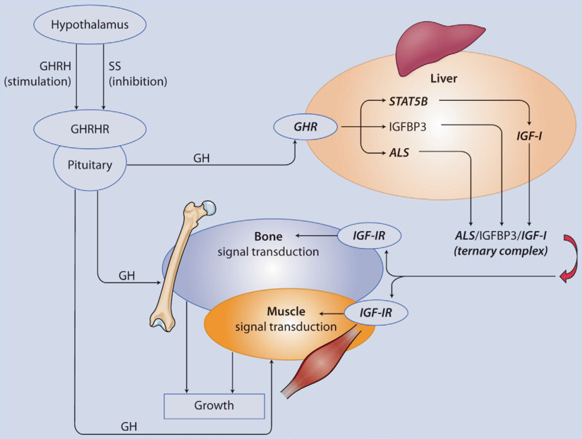

Unmatched source image; PDF page 55. Consult the original caption.

## PDF page 56 | printed page 38

rologic, metabolic, and hormonal influences; of particular importance to discussions of GHI is the feedback stimulation of SS by IGF- I, with resultant inhibition of GH release [1].

### 2

After its release from hypophyseal somato trophs, GH binds to its receptor in the liver to initiate signaling of the growth cascade; how ever, after binding occurs, GH remains attached to the external domain of its recep tor—known as GH-binding protein (GHBP), which is the proteolytic cleavage product of the full-length membrane-bound receptor molecule [2]. This binary complex circulates in equilibrium with approximately equal amounts of free GH. Because the binding sites for the radioimmunoassay of GH are not affected by the GHBP, both bound and unbound GH are measured [3]. This charac teristic permits assaying circulating GHBP as a measure of cellular bound GH receptor (GHR), which usually correlates [1].

The GH molecule is enveloped by a cell surface dimerized GHR molecule [4]. The intact receptor lacks tyrosine kinase activity but is closely associated with JAK2, a member of the Janus kinase family. JAK2 is activated by binding of GH with the GHR dimer, which results in self-phosphorylation of the JAK2 and a cascade of phosphorylation and activa tion of cellular proteins, including signal transducers and activators of transcription (STATs), which couple ligand binding to the activation of gene expression and mitogenactivated protein kinases (MAPK). STAT5b is the most important of these activator pro teins. This is a mechanism typical of the type 1 cytokine receptor family that includes recep tors for GH, prolactin, erythropoietin, inter leukins, and other growth factors [3].

The effect of GH on growth is indirect, via stimulation of IGF-I production in the liver and growing tissues, particularly bone and muscle [1]. Hepatic (endocrine) IGF-I circu lates almost exclusively bound to IGFBPs; less than 1% being unbound. The IGFBPs are a family of seven structurally related proteins with a high affinity for binding IGFs [5, 6]. IGFBP-3 is the most abundant IGFBP, bind ing 75–90% of circulating IGF-I in a large (150–200 kDa) complex that includes

IGFBP-3 and an acid labile subunit (ALS). Both ALS and IGFBP-3 are produced in the liver as a direct effect of the GH cell surface binding. During infancy, IGF-1 and IGFBP-3 form a binary complex, until ALS production increases after the first year of life. The ALS stabilizes the IGF-IGFBP-3 complex, reduces the passage of IGF-I to the extravascular compartment, and extends its half-life. ALS production also rapidly increases during puberty, correlating with increased growth factor levels [7].

IGFBP-1 production is highly variable, with the highest concentrations in the fasting and lower insulinemic state. Since IGFBP-1 can inhibit invasion and metastasis of hepato cellular carcinoma, it has been suggested that its levels could be used as a prognostic marker in this malignancy [8]. Hepatic IGFBP-1 syn thesis is directly inhibited by insulin, with low levels specific for hyperinsulinism due to con genital hyperinsulinism [9]. Low levels of IGFBP-1 may also reflect peripheral insulin resistance, deterioration of glucose balance, and increased risk for T2DM. However, at diagnosis of T2DM, IGFBP-1 levels rise pos sibly due to hepatic insulin resistance and/or relative decrease in hyperinsulinism consistent with diabetes onset [10]. IGFBP-1 levels are elevated in subjects with growth hormone insensitivity, probably reflecting the decreased insulin resistance found in this condition [11].

The circulating concentration of IGFBP-2 is less fluctuant and is partly under the control of IGF-I; levels are increased in GHRD states, but increase further with IGF-I therapy of such patients [6, 12]. It has been proposed that IGFBP-2 influences the extracellular and nuclear activities of IGF1, thereby contribut ing to its widespread effects on physiological growth and metabolism. It also promotes transcriptional activation of genes that could influence malignant growth [13]. The IGFBPs modulate IGF action by protean actions, such as controlling the storage and release of IGF-I in circulation, influencing the binding of IGF-I to its receptor, facilitating the storage of IGFs in extracellular matrices, and through independent and miscellaneous actions of IGF-I [5].

## PDF page 57 | printed page 39

Autocrine and paracrine production of IGF-I occurs in tissues other than the liver; in growing bone, GH stimulates differentiation of prechondrocytes into chondrocytes able to secrete IGF-I, which stimulates clonal expan sion and maturation of these chondrocytes thus ensuring subsequent growth. It is esti mated that at least 20% of GH-stimulated growth results from this autocrine-paracrine IGF-I mechanism [14]. GH also directly affects bone metabolism, with growth hor mone receptor expression in both osteoblasts and osteoclasts [15]. GH also directly stimu lates osteoblastic production of osteoprote gerin, a hormonal cytokine that binds receptor activator of nuclear factor-κB ligand (RANKL), thereby preventing binding to RANK on osteoclasts. This reduces osteo clastogenesis, decreases bone resorption, and promotes bone matrix synthesis [16].

IGF binding involves three types of recep tors: the structurally homologous insulin receptor and type 1 IGF receptor and the dis tinctive type 2 IGF-II/mannose-6-phosphate receptor. Considering that IGF-I is present in the circulation at molar concentrations that are 1000 times those of insulin, and despite the fact that the insulin receptor has a low affinity for IGF-I, even a small insulin-like effect of IGF-I could be more important than that of insulin itself were it not for the IGFBPs that control the availability and activity of IGF-I. In fact, intravenous infusion of recom binant human IGF-I (rhIGF-I) can induce hypoglycemia [17].

Deranged activation of the IGF1 receptor by usual circumstances such as hyperinsu linemia might be present in the etiology or associated with a variety of pathologic condi tions, including polycystic ovarian disease, diabetes mellitus, and malignancy [18].

### 2.2 Etiology

1

2.1

2.1

19

2.1

20

21 The complex nature of the influences of the GH-IGF1 axis in humans is highlighted by the apparently contradictory concomitant findings found in subjects with IUGR and insulin resistance, who also have a normal GH/IGF-I/IGFBP3 axis and severe short stature [22].

### 2.2.1 Molecular Etiology

### 2.2.1.1 GHR Gene Mutations

2.2

## PDF page 58 | printed page 40

Table 2.1 Conditions characterized by unresponsiveness to endogenous or exogenous growth hormone: clinical and biochemical characteristics

### 2

Condition Growth failure

### GH

Genetic

GHR def recessive forms

Severe Elevated

GHR def dom neg forms

Mildmoderate

Elevated

STAT5b mutation Severe Elevated

ALS mutation Nonemoderate

Normal

IGF-I gene mutation

Severe Elevated

IGF-I receptor mutation

Mildmoderate

Normalelevated

Acquired

GH inhib antibodies

Severe Absent

Malnutrition None to mild

Elevated

Diabetes mellitus None to mild

Elevated

Renal disease Mild to severe

Normal

Hepatic disease Mild to severe

Elevated

a Increased in mutations of or near the transmembrane domain of the GH receptor b Absent with partial IGF-I gene deletion; very high with have abnormal IGF-I

Fig. 2.2 Representation of the GHR gene. The black horizontal line represents intron sequence; breaks in lines indicate uncloned portions of the intron and the

GH-binding protein

### IGF-I IGFBP3

Absent-lowa Very low Very low

Increased Very low Low normal

Normal Very low Very low

Normal Very low Very low

Normal Absent/highb Low/normal

Normal Normalelevated

Normalelevated

Normal Very low Low

Decreased Variable Variable

Decreased Decreased Increased

Decreased Normal Increased

Normalincreased

Decreased Normal

boxes represent exons, which are enlarged for clarity. UTR refers to untranslated regions of the transcripts. Translated regions are exons 2–10

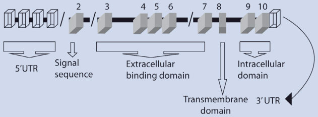

Unmatched source image; PDF page 58. Consult the original caption.

### Automatic table extraction — verify rendered original

|Genetic|Col2|Col3|Col4|Col5|Col6|
|---|---|---|---|---|---|
|GHR def recessive forms|Severe|Elevated|Absent-lowa|Very low|Very low|
|GHR def dom neg forms|Mild- moderate|Elevated|Increased|Very low|Low normal|
|STAT5b mutation|Severe|Elevated|Normal|Very low|Very low|
|ALS mutation|None- moderate|Normal|Normal|Very low|Very low|
|IGF-I gene mutation|Severe|Elevated|Normal|Absent/highb|Low/normal|
|IGF-I receptor mutation|Mild- moderate|Normal- elevated|Normal|Normal- elevated|Normal- elevated|

[Original table](../../tables/ch002_p0058_2.jpg)

### Automatic table extraction — verify rendered original

|Acquired|Col2|Col3|Col4|Col5|Col6|
|---|---|---|---|---|---|
|GH inhib antibodies|Severe|Absent|Normal|Very low|Low|
|Malnutrition|None to mild|Elevated|Decreased|Variable|Variable|
|Diabetes mellitus|None to mild|Elevated|Decreased|Decreased|Increased|
|Renal disease|Mild to severe|Normal|Decreased|Normal|Increased|
|Hepatic disease|Mild to severe|Elevated|Normal- increased|Decreased|Normal|

[Original table](../../tables/ch002_p0058_3.jpg)

## PDF page 59 | printed page 41

the 2 kb 3′-UTR [3]. More than 50 mutations in the GHR have been described in the approximately 300 known patients with GHRD (Laron syndrome), which result in a clinical picture identical to that of severe GHD, but with elevated serum GH concen trations. The report of the characterization of the complete GHR gene included the first description of a genetic defect of the GHR, a deletion of exons 3, 5, and 6 [2]. Recognition that the exon 3 deletion represented an alter natively spliced variant without functional significance resolved the dilemma of explain ing deletion of nonconsecutive exons. In addi tion to the original exon 5 and 6 deletion, another deletion of exon 5 has been described, along with numerous nonsense, missense, frame shift, and splice mutations, as well as a unique intronic mutation resulting in inser tion of a pseudo-exon. A number of other mutations have been described that are either polymorphisms or have not occurred in the homozygous or compound heterozygous state [1, 23, 24].

All but a few of the defects result in absent or extremely low levels of GH-binding protein (GHBP). Noteworthy is the D152H missense mutation that affects the dimerization site, thus permitting the production of the extra cellular domain in normal quantities but fail ure of dimerization at the cell surface, which is necessary for signal transduction and IGF-I production. Two defects that are close to (G223G) or within (R274T) of the transmem brane domain result in extremely high levels of GHBP. These defects interfere with the normal splicing of exon 8, which encodes the transmembrane domain, with the mature GHR transcript being translated into a trun cated protein that retains GH-binding activity but cannot be anchored to the cell surface.

All these homozygous and compound het erozygous defects, whether involving the extracellular domain or the transmembrane domain, whether associated with very low or unmeasurable GHBP, or with the less com mon transmembrane defects that can be asso

ciated with elevated GHBP levels, result in a typical phenotype of severe GH deficiency. In contrast, the intronic mutation present in the heterozygous state in a mother and daughter with relatively mild growth failure (both with standard deviation score (SDS) for height of—3.6 [3]) and resulting in a dominantnegative effect on GHR formation, is not associated with other phenotypic features of GHD [23]. This splice mutation preceding exon 9 results in an extensively attenuated, vir tually absent intracellular domain. Japanese siblings and their mother have a similar het erozygous point mutation of the donor splice site in intron 9, also resulting in mild growth failure compared to GHR deficiency but with definite, although mild, phenotypic features of GHD [25].

GHBP levels in the Caucasian patients with the dominant-negative mutation were at the upper limit of normal with a radiolabeled GH-binding assay and in Japanese patients twice the upper limit of normal, using a ligand immunofunction assay. These heterozygous GHR mutants transfected into permanent cell lines have demonstrated increased affinity for GH compared to the wild-type full-length GHR, with markedly increased production of GHBP. When co-transfected with full-length GHR, a dominant-negative effect results from overexpression of the mutant GHR and inhi bition of GH-induced tyrosine phosphoryla tion and transcription activation [26]; naturally occurring truncated isoforms have also shown this dominant-negative effect in vitro [27].

A novel intronic point mutation was dis covered in a highly consanguineous family with two pairs of affected cousins with GHBP-positive GHI and severe short stature, but without the facial features of severe GH deficiency or insensitivity. This mutation resulted in a 108-bp insertion of a pseudoexon between exons 6 and 7, predicting an inframe, 36-residue amino acid sequence, in a region critically involved in receptor dimeriza tion [24].

## PDF page 60 | printed page 42

### 2.2.2 Genetic Disorders Affecting

### GH-GHR Signal Transduction and Transcription

### 2

### 2.2.2.1 STAT5 Gene Mutations

There are seven members of the STAT family of proteins activated by multiple growth fac tors and cytokines, participating in a wide range of biological activities, particularly relating to growth and immunocompetence. While GH activates four members of this family, STAT5b is the most relevant for growth [28]. The GH-activated GHR recruits the STAT5b which docks to specific tyrosine residues on the receptor and undergoes tyro sine phosphorylation by the receptorassociated JAK2. The phosphorylated STAT dissociates rapidly from the receptor, forms a dimer, and translocates to the nucleus, where it binds to DNA, interacts with other nuclear factors, and initiates transcription.

As might be expected, because STAT5b is involved in intracellular signaling for other cytokine receptors besides the GHR, immu nodeficiency with serious complications has been described in all but one of the reported patients with STAT5b mutations. Reported abnormalities include T-cell functional defects, low numbers of NK and γδT-cells, and IL-2 signaling defects.

Ten patients have been described with seven autosomal recessively transmitted muta tions of STAT5b [29]. Similar to children with severe GHD and GHRD, but unlike those with IGF-I gene or IGF-I receptor mutations (below), birth size is normal, indicating GHindependent IGF-I production in utero. Also, as in GHD and GHRD, postnatal growth shows rapid decline in SDS ranging from −9.9 to −5.6 at the time of diagnosis. Serum con centrations of IGF-I, IGFBP-3, and ALS were markedly low; basal and stimulated GH concentrations were either normal or elevated. Except for GHBP, their phenotypic features, growth patterns, facial disproportion, and biochemistry, have been identical to those of subjects with severe GHRD. Additionally, three missense dominant-negative STAT5b mutations have been described with similar severe short stature as autosomal recessive

mutations, but without severe immunodefi ciency. These heterozygous mutations impact ing the DNA binding domain (DBD) and thus reducing dimeric STAT transcriptional activity [30]. Cases of STAT3 gain-of-function mutations have also been reported with simi lar phenotypes as that of STAT5b mutations, including autoimmune endocrinopathies and short stature with partial growth hormone insensitivity. This may result from competitive binding at shared STAT3 and STAT5 DNA binding sites, thereby inhibiting STAT5 tran scriptional activity [31].

### 2.2.2.2 PTPN11 Gene Mutations

Fifty percent of children with Noonan syn drome, characterized by short stature, cardiac defects, skeletal abnormalities, and facial dys morphia, have been found to carry a gain-offunction mutation of PTPN11. This gene encodes a nonreceptor-type tyrosine phos phatase (SHP-2) involved in intracellular sig naling for a variety of growth factors and cytokines. Activated SHP-2 is thought to serve as a negative regulator of GH signaling. Children with this syndrome and bearing the PTPN11 mutation have more severe statural deficit than those without this genetic abnor mality. They also have lower serum concentra tions of IGF-I and IGFBP-3 with higher GH concentrations and less robust growth response to rhGH treatment, all suggesting mild GH insensitivity [28].

### 2.2.2.3 Mutations of the IGF-I Gene

Failure of IGF-I synthesis due to a gene dele tion was described in a male subject with a homozygous partial deletion of the IGF-I gene [32]. His profound intrauterine growth failure (IUGR) persisted into adolescence; he also had sensorineural deafness, severe mental retardation, and micrognathia. A second indi vidual with the same clinical phenotype but a different mutation, also resulting in near absence of circulating IGF-I, was subse quently described [33]. A third similarly affected subject had a defect in IGF-I synthe sis, resulting in the production of a nonfunc tioning IGF-I molecule circulating at high concentrations [34]. Another mutation (p. Ser83Cys) led to interrupted IGF-1 bioactiv

## PDF page 61 | printed page 43

ity and disturbed insulin receptor signaling, causing short stature with severe insulin resis tance without hearing or neurological deficits in a 12-year-old girl [35].

The absence of the craniofacial phenotype of severe GHD or GHRD and the presence of normal IGFBP-3 in these individuals, despite the absent IGF-I function, indicate that the craniofacial features and low IGFBP-3 of GHD and GHRD are related to an absence of the direct effects of GH that do not act through the medium of IGF1 synthe sis. It is also noteworthy that profound IUGR and mental retardation are not characteristic of GHD or GHRD, but IGF-I knockout mice have defective neurological development and growth failure. Thus, IGF-I production in utero does not appear to be GH-GHR depen dent.

A milder molecular defect in IGF-I syn thesis due to a homozygous missense muta tion of the IGF-I gene has also been described. It results in IUGR and postnatal growth fail ure, microcephaly, and mild intellectual impairment, but with normal hearing, and undetectable IGF-I by a highly specific mono clonal assay but elevated levels with a poly clonal assay [34]. In summary, findings in these individuals highlight the importance of IGF-1 during intrauterine life [36].

### 2.2.2.4 Mutations of the Acid Labile

### Subunit (ALS) Gene

ALS is an 85 kDa glycoprotein that modu lates IGF-I bioavailability by stabilizing the binary complex of IGF-I and IGFBP-3. It is a member of a family of leucine rich repeat (LRR) proteins that can participate in pro tein–protein interactions; ~75% of the mature protein corresponds to the consensus motif for the LRR superfamily. ALS is a donutshaped molecule that binds readily to the binary complex of IGF-I and IGFBP-3 but does not interact directly with free IGF-I and has low affinity for IGFBP-3 that is not bound to IGF-I. Functional mutation of the ALS gene was first reported in 2004 and, by 2010, included 21 individuals from 16 families. They were proven to have 16 discrete mutations that induced homozygous or compound heterozy

gous states [37–43]. ALS is undetectable and serum IGF-I and IGFBP-3 concentrations are extremely low. Nonetheless, statural impairment is generally modest, with near adult or adult height available for 11 of the subjects, being better than target height in one individual, less than 1 SD below the mean in an adopted child with unknown target height, and within 1.5 SD of target height in 6 others. The modest, at worst, effect on growth despite circulating concentrations of IGF-I that are similar to those of severe GHI or GHD emphasizes the compensatory capability of local IGF-I production [14, 44].

### 2.2.2.5 Mutations of the IGF-I

### Receptor Gene

Mouse studies demonstrated that deletion of the IGF-I receptor resulted in intrauterine growth retardation and perinatal death. Thus, it is not surprising that only heterozygous mutations in the IGF-I receptor gene (IGF-IR) have been described in humans. The initial report of IGF-IR mutation followed system atic examination in two groups of children with intrauterine growth retardation (IUGR) who remained greater than 2 SD below nor mal for length after 18 months of age. This population was selected because IGF-I recep tor knockout mice have more severe IUGR than do IGF-I knockout mice. Among 42 U.S. subjects who did not have low IGF-I and IGFBP-3 concentrations, a single subject with compound heterozygosity for mutations of the IGF-I receptor resulting in amino acid substitutions was identified. She had severe IUGR (birth weight 1420 g at 38 weeks), poor postnatal growth, and elevated concentrations of IGF-I. Integrated GH concentration when prepubertal was consistent with IGF-I resis tance. In general, the location of the muta tions was within a putative ligand-binding domain, and the heterozygous parents were subnormal in stature and had also had low birth weight. In the same study, a European group of 50 IUGR subjects was selected who had elevated circulating IGF-I concentrations and a second subject identified. He had a het erozygous nonsense mutation reducing the number of IGF-I receptors on fibroblasts;

## PDF page 62 | printed page 44

two other affected first-degree relatives were also found [45]. In all, 17 cases in 7 families, each family with a unique mutation, were described from 2003 to 2009 with in vitro con firmation of failure of IGF-I binding and function [45–50]. IGF-1R mutations can also lead to altered glucose homeostasis with cases of both hypoglycemia and impaired glucose tolerance including type 2 diabetes [51, 52].

### 2

There is wide phenotypic variability among these individuals, with height SDS ranging from −1.6 to −5.7, substantial delay in osseous maturation to normal bone ages for chronologic age, normal timing of puberty, and normal to markedly increased serum con centrations of IGF-I and IGFBP-3. The effect of IGF-I gene mutations on intrauterine growth, however, is uniformly replicated in this less severe circumstance.

### 2.2.2.6 Mutations

### of the PAPP-A2 Gene

Pregnancy-associated plasma protein A2 (PAPP-A2) mutation is associated with short stature and elevated levels of IGF-I, IGFBP-3, and ALS. PAPP-A2 is a metalloproteinase that cleaves IGFBP-3 and IGFBP-5, thereby releasing IGF-I. The underlying mechanism in this syndrome appears to be diminished bioactivity of IGF-I due to low availability generated by the lack of the proteolytic activi ties of the PAPP-A2 enzyme, resulting in impaired release of IGF-I [53].

### 2.3 Epidemiology

### 2.3.1 Race/Nationality

Among the approximately 350 affected indi viduals identified worldwide with growth fail ure due to GHR mutations, about two-thirds are Semitic and half of the rest are of Mediterranean or South Asian origin. The Semitic group includes Arabs, Oriental, or Middle Eastern Jews, and the largest group, the genetically homogeneous 100+ Conversos in Ecuador (Jews who converted to Christianity during the Inquisition). The

identification of an Israeli patient of Moroccan origin with the E180 splice muta tion found in the Ecuadorian patients indi cated the Iberian provenance of this mutation, which readily recombined in the isolated com munities of these sixteenth-century immi grants established in the southern Ecuadorian Andes [54]. Recently, additional individuals with the E180 splice mutation on the same genetic background have been identified in Chile, Mexico, and Brazil, likely of the same origin. Among those who are not of Semitic, South Asian, or Mediterranean origin, there is wide ethnic representation, including Northern European, Eurasian, East Asian, African, and Anglo-Saxon (Bahamas) [19].

The individuals with STAT5b mutation include Kuwaiti siblings, two unrelated Argentinians, siblings from Brazil, one patient from Turkey, and one patient from the Caribbean [28].

ALS mutations were reported in three Kurdish brothers, three unrelated and three sibling Spanish subjects, three Norwegian/ German siblings, two unrelated Swedish patients, and individual patients of Turkish, Argentinian, Ashkenazi Jewish, Pakistani, mixed European, and Mayan origin. Families with heterozygous mutations of the IGF-I receptor were of Dagestani, European, and Japanese origin [37–43].

Subjects with IGF-I receptor mutations have been reported from the United States, Germany, Russia, Korea, Japan, and Netherlands [45–50].

### 2.3.2 Gender

Among individuals observed from the origi nal description of the GHR deficiency syn drome by Laron, Pertzelan, and Mannheimer in 1966 [55], and until 1990, a normal sex ratio was noted. The initial report of 20 cases from a single province in Ecuador included only one male [56] but subsequent observations from an adjacent province indicated a normal sex ratio, and a few more males were subse quently identified in the initial province [57–59].

## PDF page 63 | printed page 45

The abnormal sex ratio for that locus remains unexplained. All but 3 of the 21 indi viduals with IGFALS mutations are male, but this may reflect ascertainment bias because of the relatively modest effects on stature being of less concern in girls than in boys.

### 2.3.3 Morbidity and Mortality

The only available report on the effect of GHR deficiency on mortality comes from the Ecuadorian population [57, 58, 60–62]. Because families in the relatively small area from which the Ecuadorian patients originate had intensive experience with this condition, lay diagnosis was considered reliable. Of 79 affected individuals for whom information could be obtained, 15 (19%) died under 7 years of age, as opposed to 21 out of 216 of their unaffected siblings (9.7%, p < 0.05). The kinds of illnesses resulting in death, such as pneumonia, diarrhea, and meningitis, were no different for affected than for unaffected sib lings [63].

The complete lifespan in the Ecuadorian cohort provided an opportunity to look at adult mortality risk factors. Twenty-three adults with GHRD had elevated cholesterol levels, normal HDL-cholesterol levels, ele vated LDL-cholesterol levels, and normal tri glycerides compared to relatives and nonrelated community controls. It was postulated that the effect of IGF-I deficiency due to GHRD was to decrease hepatic clear ance of LDL-C, since the triglyceride and HDL-C levels were unaffected. This effect was independent of obesity or of IGFBP-1 levels, which were used as a surrogate for insu linemia. The key pathogenic factor was thought to be the absence of GH induction of LDL receptors in the liver [64].

### 2.3.4 Cancer Protection

### in Ecuadorian Laron Syndrome (ELS)

GH-induced IGF-I is the main determinant of human growth, and GH deficiency (GHD) is associated with a diminished incidence of

cancer [65, 66]. Subjects with congenital IGF-I deficiency (IGFD), which included subjects with GHD, have no malignancies, while their relatives displayed a 9–24% cancer incidence [67, 68]. In a similar observation, malignancy incidence in IGFD individuals appeared diminished when compared to their non-IGFD relatives [69]. It is also observed in subjects with a nonfunctional GH receptor (GHR) [67, 68, 70].

The Ecuadorian LS cohort (ELS), which represents one-third of the World’s popula tion with this condition, is the most geneti cally homogenous cohort on the planet since most subjects are homozygous for a splice-site mutation occurring at the 180 codons of exon 6 of the GHR (ss180/ss180 (ss180)). This abnormality renders the GHR an easily degradable peptide, incapable of proper intra cellular signaling [71]. In the first report on morbidity and mortality, there were no cancer cases in ELS subjects, while their age- and sexmatched relatives had a 17% malignancyassociated mortality [72]. Indeed, defective GHR signaling is associated with extremely low levels of insulin and IGF-I, two impor tant growth and mitogenic factors. However, in 2013, one woman did develop ovarian can cer and later died [73].

Cancer in humans has been linked to vari ous etiological causes, such as overexpression of pro-growth pathways, oxidative stress, genomic instability, DNA damage, and other cellular abnormalities [74]. IGF-I-dependent promotion of age-dependent mutations that allow transformation of healthy protoonco genes into oncogenes have been proposed as determinant influences in carcinogenic pro cesses [75]. Accordingly, while activation of stress resistance transcription factors and antioxidant enzymes contributes to protec tion against age-associated damage and chronic illnesses in men, activating mutations in RAS and AKT, two potent enzymes down stream the IGF-I/IGFIR signaling route, as well as those in the IGF-IR itself, are found in human cancers [76–78]. Furthermore, carci nogenesis might result from defective action or mutations of various enzymes in the IGF-I pathway, including mTOR, S6K, RAS, ade nylate cyclase, and PKA, which can induce

## PDF page 64 | printed page 46

DNA damage, by increasing superoxide pro duction, among other reasons [79].

As previously stated, mutations that impair GHR function are associated with a diminished incidence of human malignancies [67, 72]. Interestingly, partial loss-of-function IGFI-R gene mutations are found in Ashkenazi Jewish centenarians, suggesting an association of low IGF-IR action and enhanced life span [80]. In vitro studies dem onstrated that human mammary cells treated with hydrogen peroxide and incubated with the serum from the ELS relatives display expected DNA damage; however, those cells incubated with serum from ELS subjects had much less DNA breaks. Moreover, serum from the ELS subjects induced reduced expression of RAS, PKA, and mTOR, as well as upregulation of superoxide dismutase-2. Furthermore, pathway analysis of global gene expression of the IGF-I-deficient ELS sub jects showed that while downregulation of RAS, PKA, and mTOR occurs in these indi viduals, apoptosis-promoting genes are upreg ulated [72]. Contextually, the self-destruction of malignant cells is a well-known physiologic protective mechanism; however, IGF-I excess levels appear to diminish apoptosis and greatly contribute to carcinogenesis [81].

### 2

The diminished incidence of cancer in the ELS subjects, who were matched by age to their relatives, showed strong links between diminished IGF-I and GHR signaling and the low malignancy incidence observed. Indeed, ELS subjects exhibit low circulating concen trations of IGF-I, diminished DNA breaks, lower expression of RAS and PKA, increased expression of SOD2, augmented expression of pro-apoptotic genes, and enhanced apop tosis. These findings provide objective molec ular links between diminished GHR signaling and the cancer protection documented in this cohort.

When GHR signaling is absent, the GH counter-regulatory effects on carbohydrate metabolism are also abolished, insulin resis tance is diminished, and insulin levels decrease. In consequence, ELS subjects metabolize glucose and other nutrients more efficiently, accumulate body fat, and have an obese phenotype [82]. The most relevant effect

in carcinogenesis appears to be the lower serum levels of insulin, a potent growth factor that not only turns on PI3K/AKT, its meta bolic branch but also the RAS/MAPK cas cade, its proliferative route. The cancer protection seen in the ELS cohort may be due to dual low-IGF-I/low insulin serum levels. Moreover, since rapidly dividing cells need excess energy to maintain their elevated mito genic rate, the lower other energy-supplier metabolites (glucose, triglycerides, etc.) in LS should make cell division slower and high mitogenic rate-dependent neoplasia less pos sible. This occurs because the insulin/INSR is a central site for energy generation in the form of ATP and GDP, which are indispensable for cell division, especially for fast-dividing cells [83].

In summary, lesser levels of the growth peptides (insulin and IGF-I) and energy sources should make cell division slower and less prone to errors compared to those under going a faster mitotic rate. In consequence, diminished malignancy incidence should be expected [83].

### 2.4 Clinical Presentation

### 2.4.1 Clinical Features of Severe

### IGF-I Deficiency Due to GH Deficiency or GH Receptor Deficiency

Growth

5 Birth weight—normal; birth length—usu

ally normal 5 Growth failure, from birth, with velocity

1⁄2 normal 5 Height deviation correlates with (low)

serum levels of IGF-I, -II, and IGFBP-3 5 Delayed bone age, but advanced for height

age 5 Small hands or feet

Craniofacial Characteristics

5 Sparse hair before age 7; frontotemporal

hairline recession all ages 5 Prominent forehead

## PDF page 65 | printed page 47

5 Head size more normal than stature with

impression of large head 5 “Setting sun sign” (sclera visible above iris

at rest) 25% <10 years of age 5 Hypoplastic nasal bridge, shallow orbits

5 Decreased vertical dimension of face

5 Blue sclera

5 Prolonged retention of primary dentition

with decay; normal permanent teeth, may be crowded; absent third molars 5 Sculpted chin

5 Unilateral ptosis, facial asymmetry (15%)

Musculoskeletal/Body Composition

5 Hypomuscularity with delay in walking

5 Avascular necrosis of femoral head (25%)

5 High-pitched voices in all children, most

adults 5 Thin, prematurely aged skin

5 Limited elbow extensibility after 5 years of

age 5 Children underweight to normal for

height, most adults overweight for height; markedly decreased ratio of lean mass to fat mass at all ages 5 Osteopenia indicated by DEXA

Metabolic

5 Hypoglycemia (fasting)

5 Increased cholesterol and LDL-C

5 Decreased sweating

5 Increased insulin sensitivity

Sexual Development

5 Small penis in childhood; normal growth

with adolescence 5 Delayed puberty

5 Normal reproduction

5 Mild hyperprolactinemia

### 2.4.1.1 Growth

Individuals with GHI due to GHRD usually have normal intrauterine growth [84]. Nonetheless, IGF-I is required for normal intrauterine growth as demonstrated by patients with IUGR with a proven IGF-I gene defect or IGF receptor mutation [85]. It is thereby suggested that intrauterine IGF-I synthesis, which appears to not be GH-dependent, is necessary during intrauter

ine life for normal somatic and brain develop ment [36].

2.3

2.4

86 87 Despite normal sexual maturation, the pubertal growth spurt is minimal or absent in GHRD, as documented in the most extensive available data, from Israel and Ecuador [84, 88]. The adolescent growth spurt is GHdependent, reflected in significantly elevated circulating levels of GH and IGF-I compared to preadolescence and adulthood [89].

2.5 84

20

87

## PDF page 66 | printed page 48

### 2

Fig. 2.3 Length standard deviation scores of nine girls from Ecuador (open circles, solid lines) and two brothers from southern Russia (solid circles, dashed

Fig. 2.4 Growth velocities of 30 Ecuadorian patients (10 males) with GH receptor deficiency; repeated measures were at least 6 months apart. (From Rosenbloom et al. [84]. Reprinted with permission from Elsevier)

ing the hyperalimentation. In this patient, there was speculation that a nutritiondependent autocrine/paracrine increase in

lines) with known birth lengths, followed over the first 2–3 years of life. (From Rosenbloom et al. [84]. Reprinted with permission from Elsevier)

IGF-I concentration at the cartilage growth plate might have occurred, independent of the GHR. The importance of adequate nutrition

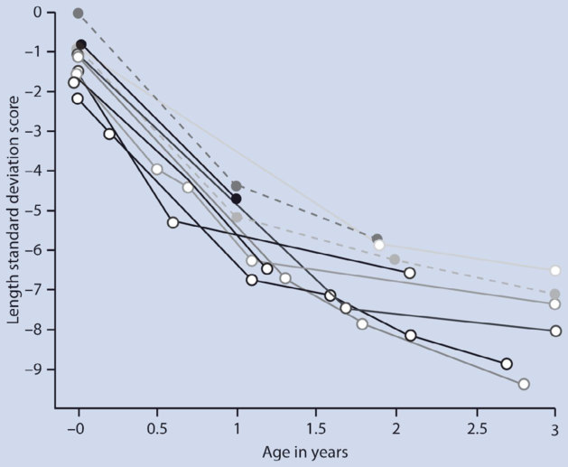

Unmatched source image; PDF page 66. Consult the original caption.

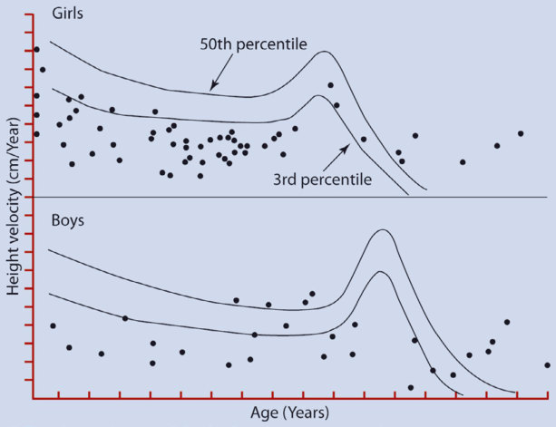

Unmatched source image; PDF page 66. Consult the original caption.

## PDF page 67 | printed page 49

Fig. 2.5 Correlation of annual changes in height age and differences between baseline and trough levels of serum IGF-I with rhIGF-I treatment in 22 children with GHRD. The dashed line represents the 1-year correla

for catch-up growth was emphasized by this study, which also reinforced the notion that normal periods of growth in subjects with GHRD without IGF-I replacement therapy, as noted in Fig. 2.4, might be explained by periods of improved nutrition alone [86, 87, 90].

### 2.4.1.2 Craniofacial Characteristics

Children with GHR deficiency are recognized by knowledgeable family members at birth because of craniofacial characteristics of frontal prominence, depressed nasal bridge, and sparse hair, as well as small hands or feet, increased lines of facial expression, and hypo plastic fingernails. Decreased vertical dimen sion of the face is demonstrable by computer analysis of the relationships between facial landmarks and is present in all patients when compared with their relatives including those without obviously abnormal facies [91]. Blue scleras, the result of decreased thickness of the scleral connective tissue, permitting visu alization of the underlying choroid, were orig

tion (r = 0.54, p = 0.009), and the solid line represents the 2-year correlation (r = 0.58, p = 0.005). (From Guevara-Aguirre et al. [120]. Reprinted with permission from Oxford University Press)

inally described in the Ecuadorian population, and subsequently recognized in other popula tions with GHRD, as well as in severe GHD [56, 57, 92].

Unilateral ptosis and facial asymmetry may reflect positional deformity due to decreased muscular activity in utero, although mothers do not recognize decreased fetal movement in pregnancies with affected infants [93].

As noted above, individuals with STAT5b mutations have growth impairment and facial dysmorphism indistinguishable from those with homozygous or compound heterozygous GHR gene abnormalities. IGF-I mutations result in micrognathia and microcephaly but no craniofacial abnormalities similar to those with GHR or STAT5b mutations.

### 2.4.1.3 Musculoskeletal and Body

### Composition

Hypomuscularity is apparent in radiographs of infants with GHRD and is thought to be responsible for delayed walking, despite nor

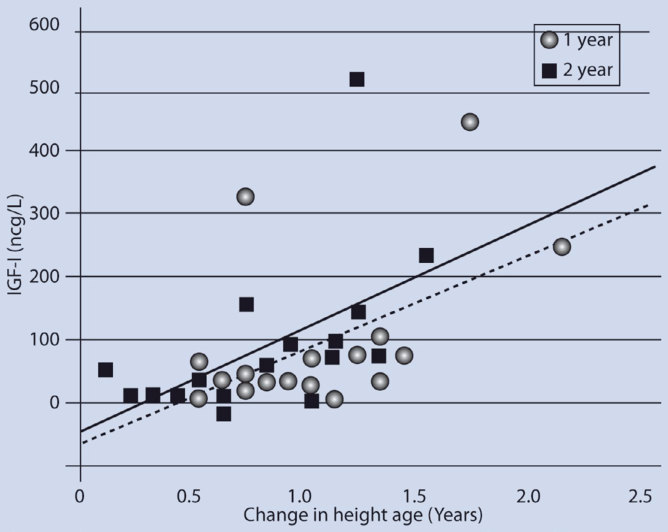

Unmatched source image; PDF page 67. Consult the original caption.

## PDF page 68 | printed page 50

mal intelligence and timing of speech onset [63, 93]. Radiographs of the children also sug gest osteopenia; dual photon absorptiometry and dual-energy X-ray absorptiometry in chil dren and adults confirm this. A study of dynamic bone histomorphometry in adults with GHRD, however, demonstrated normal bone volume and formation rate, with the only abnormality being the reduction in tra becular connectivity. This study suggested that some of the densitometry findings were artifactual, due to the small bone size [94].

### 2

Limited elbow extensibility, seen in most patients over 5 years of age in the Ecuadorian population, is an acquired characteristic absent in younger children and increasing in severity with age [56, 57, 93]. That this feature is not peculiar to the Ecuadorian population or to IGF-I deficiency due to GHRD has been confirmed by finding a Brazilian patient hav ing a different GHR mutation with limited elbow extension [95] and observing this find ing in all but the youngest patient in a family with eight individuals affected by multiple pituitary deficiencies [92].

The cause of this elbow contracture is unknown but poorly developed musculature of the fetus might contribute to it.

Although children appear overweight, they are actually underweight to normal weight-for-height, while most adults, espe cially females, are overweight with markedly decreased lean-to-fat ratios [12, 63, 93].

### 2.4.1.4 Metabolism

From 1929 through 1945 Bernardo Houssay, the 1947 Nobel Laureate and his team per formed various pituitary experiments in toads and dogs. They found improved insulin sensi tivity and hypoglycemia after hypophysec tomy and later documented insulin resistance in hypophysectomized toads treated with pituitary extracts. These findings led to the general concept that the administration of pituitary extract was diabetogenic [96]. In his famous 1947 lecture entitled “The role of the hypophysis in carbohydrate metabolism in diabetes,” Houssay described these exciting discoveries [97].

Moving from animal models to humans, clinical descriptions of the GH-insensitive

Ecuadorian cohort of subjects have included either frank obesity or excess body fat as a dis tinct feature in all affected individuals [56, 57, 63]. Nevertheless, no type 2 diabetes (T2D) or manifestations of metabolic syndrome have been observed in GHRD patients. Notably, metabolic abnormalities associated with T2D and insulin resistance have been observed in the leaner relatives of the GHRD population [61]. In a comparison of the Laron syndrome subjects to sex- and age-matched relatives, the most distinctive clinical finding was a major reduction in cancer and T2D incidence in obese subjects lacking GH receptor signaling.

2.6 12

12 61 98

The findings in the LS cohort demon strated that GH counter-regulation on insulin action and efficiency is one of the dominant influences in the physiologic functioning of carbohydrate metabolism in humans. Indeed, low concentrations of insulin are highly effi cient when GH counter-regulation is absent. Coincidentally, in 2012, another clinical syn dromic entity of severe short stature (SSS) was described but with normal GH and IGF-I serum concentrations and action [99]. Surprisingly, the main clinical characteristic of subjects belonging to this new SSS cohort was a form of early onset T2D, which is inde pendent of body weight and BMI. Later, it was discovered that most of these subjects hold a gain-of-function (gof) mutation in the paternally imprinted cyclin-dependent kinase N1c gene (gof-CDKN1c) [100]. Theoretically, this abnormality could induce beta-cell hypo plasia by inducing excess synthesis of p57/ KIP2, a cycle-dependent kinase tight-binding

## PDF page 69 | printed page 51

Fig. 2.6 Serum glucose and insulin concentrations in Laron Syndrome (LS) subjects during oral glucose tolerance testing (OGTT). Upper panel: 2-hour (h) OGTT after oral glucose administration (1.5 g/kg).

inhibitor of various G1 cyclin/CDK com plexes, which impairs proliferation and differ entiation of several cell types. This may lead to diminished beta-cell mass, contributing to DIS. It also explains the other syndromic fea tures seen in these individuals, namely IUGR, reduced stature, and organ size [99]. Moreover, since p57/KIP2 is expressed across several body tissues and induces functional changes in processes such as apoptosis, migration, and transcription, it is possible that the GRS mutation could affect the entire body’s carbo hydrate metabolism. This new clinical entity is now known as Guevara–Rosenbloom syn drome (GRS) [101–104].

The two genetic syndromes that have com parable severe short stature, LS and GRS, dis play opposing metabolic phenotypes of

Lower panel: 5 h-OGTT after a standard breakfast. (From Guevara-Aguirre et al. [12]. Reprinted with per mission from Oxford University Press)

diminished and increased incidence of T2D, respectively. As subjects with either diagnosis may have low insulin secretion and life-long DIS, their metabolic responses to a standard glucose load were compared.

## PDF page 70 | printed page 52

### 2

Fig. 2.7. 5-Hour islet amyloid polypeptide (IAPP) serum concentrations (a) and corresponding areas under the curve (AUC) (b), after glucose administration (1.5 g/kg). Study groups: Laron Syndrome (LS), Guevara-Rosenbloom

type not only depends on normal GH counterregulatory status on insulin action but also on glucose-induced IAPP secretion ( Fig. 2.7). In addition, since individuals in both cohorts have DIS along with either absent (LS) or normal (GRS) GH counter-regulation on insulin action, we hypothesized that the inher ently different GH counter-regulatory status in each cohort modulates the general DIS impact on CHO metabolism and T2D devel opment [103].

Isolated hormonal derangements can illus trate the physiologic or pathologic nature of an apparently isolated event. In the case of LS and GRS, highly consanguineous individuals are naturally occurring “knockout” models with DIS induced by highly specific hormonal deficiency. Nevertheless, these diagnoses result in opposing clinical metabolic phenotypes due to their distinct GH counter-regulatory backgrounds. Since these metabolic derange ments are present throughout the entire life cycle, we have been able to carefully study the isolated effects of GH counter-regulation on overall CHO metabolism. While the number of affected LS and GRS subjects and their families described might appear small for gen eral inferences, it should be noted that each is the largest and most genetically homogeneous cohort of its kind in the world. Moreover,

Syndrome (GRS), and normal subjects (GRS relatives). (From Guevara-Aguirre et al. [103]. Reprinted with permis sion from Elsevier)

they are compared to their relatives who not only share a similar genetic background but also identical environmental variables.

In summary, despite shared DIS, both syn dromic cohorts display opposing metabolic phenotypes: enhanced insulin sensitivity and diminished incidence of T2D in obese LS sub jects versus an early-onset form of T2D seen in nonobese GRS individuals. Despite DIS, LS subjects are vastly protected against T2D due to the absence of GH counter-regulation [12, 61, 98].

### 2.4.1.5 Reproduction

GHRD is associated with small penis size with normal penile growth at adolescence or with testosterone treatment in childhood. Although puberty may be delayed 3–7 years in some 50% of individuals, there is normal adult sexual function with documented repro duction by males and females [58, 63]. Mild hyperprolactinemia may occur due to cosecretion with increased GH production from somatolactotroph cells [105]. As hyperprolac tinemia can disrupt GnRH pulsatility and ovulation, women with GHRD and conse quent prolactin elevations may have disrupted fertility. However, treatment with cabergoline has been reported to restore ovulation and treat infertility in at least one case [106].

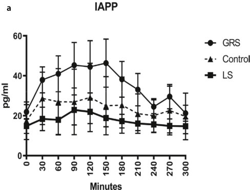

Unmatched source image; PDF page 70. Consult the original caption.

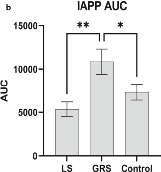

Unmatched source image; PDF page 70. Consult the original caption.

## PDF page 71 | printed page 53

Woman require delivery by cesarean section due to cephalopelvic disproportion.

### 2.4.1.6 Intellectual and Social

### Development GHRD

Intellectual impairment was originally consid ered a feature typical of Laron syndrome based upon uncontrolled observations [107]. Among 18 affected children and adolescents administered the Wechsler Intelligence Scale for Children, only 3 had IQs within the aver age range (90–110); of the remaining 15 sub jects, 3 were in the low average range (80–89), 3 in the borderline range (70–79), and 9 in the intellectually disabled range (<70). These studies were done without family controls, so that the possibility of other factors related to consanguinity that might affect intellectual development and the appropriateness of the testing materials in this Middle Eastern popu lation could not be addressed. In a follow-up study 25 years later, the investigators reexamined 8 of the original 18 patients and 4 new patients with GHRD, excluding 5 patients with mental disabilities who were in the origi nal study [108]. This group had mean verbal and performance IQs of 86 and 92 on the Wechsler scale without evidence of visual motor integration difficulties that had been noted in the earlier group, but there was a sug gestion of deficient short-term memory and attention. The investigators hypothesized that early and prolonged IGF deficiency might impair normal development of the central nervous system, or that hypoglycemia com mon in younger patients may have had a del eterious effect.

Sporadic anecdotal reports of patients with GHRD suggested a normal range of intelligence. The collective data from the European IGF-I treatment study group, which include a wider range of clinical abnor malities than either the Ecuadorian or Israeli population, note a mental retardation rate of 13.5% among 82 patients, but formal testing was not carried out [109]. Here again, the high rate of consanguinity was proposed as a pos sible explanation; hypoglycemia could not be correlated with these findings.

In the Ecuadorian population, exceptional school performance was reported among 51 affected individuals of school age or older who had attended school, with 44 typically in the top 3 places in their classes and most thought to be as bright or brighter than the smartest of their unaffected siblings [110]. The first controlled documentation of intel lectual function in a population with GHRD was in the Ecuadorian children, a study of school age individuals compared to their close relatives and to community controls. No sig nificant differences in intellectual ability could be detected among these groups, using non verbal tests with minimal cultural limitations. It was hypothesized that the outstanding school performance in this population might have been related to the lack of social oppor tunities due to extreme short stature, permit ting greater devotion to studies and superior achievement in school for IQ level [111]. In the above context, it has been shown that IGF1, IGFBP-1, and IGFBP-3 circulate in higher concentrations in the cerebrospinal fluid of young infants than later in life and that these peptides might be important for myelination and synapse formation in the developing brain [112].

However, in an apparent paradox, GHRD children who have lower endocrine IGF1 and IGFBP-3 also display normal to abovenormal intelligence than their age-matched relatives, despite common episodes of grand mal-type seizures [110, 111]. These apparently contradictory events might partially be explained and reconciled by the finding that very young GHRD children also have very high IGFBP-1 levels [11] and improved insu lin efficiency (as further indicated by their concomitant hypoglycemia), thereby indicat ing that insulin and IGFBP-1 action might be relevant determinants for the developing brain [12, 113].

### STAT5b Gene Mutation

Consistent with other evidence that the IGF-I importance for intrauterine brain develop ment is independent of the need for an intact GH activation pathway; individuals with STAT5b mutations do not have impaired brain development [28].

## PDF page 72 | printed page 54

### IGF-I Gene Mutation

There was marked intellectual impairment in the patients with severe IGF-I deficiency due to mutation of the IGF-I gene indicative of the dependence of intrauterine brain develop ment, as well as intrauterine growth, on IGF- I. That this intrauterine IGF-I production is not dependent on GH is suggested by the intellectual normality with severe GHD and GHRD, consistent with gene disruption stud ies in mice. The IGF-I deleted mouse is neuro logically impaired, while the GHRD mouse is behaviorally normal [114, 115]. Thus, GHdependent IGF-I production is not necessary for normal brain development and function.

### 2

### IGF-I Receptor Gene Mutation

The effect of heterozygous IGF-I receptor mutation on head growth and brain develop ment is less impressive than with IGF-I gene defects. Small head size was recorded fre quently, including in a proband with aboveaverage IQ and her daughter with a slight motor delay at 11⁄2 years of age. Except for one individual with a reported IQ of 60, intel lectual development of the other probands ranged from normal to mild retardation [45–50].

### IGF-ALS Gene Mutation

Normal neurological development with IGFALS mutation would be expected, consis tent with normal brain development in chil dren with severe GHD or GHRD who would not be stimulating the intrauterine synthesis of ALS. This would imply that the GHindependent IGF-I production necessary for normal intrauterine somatic and brain growth is local (paracrine or autocrine) rather than endocrine.

### 2.5 Diagnostic Evaluation

### 2.5.1 Growth Hormone (GH)

Affected children with GHRD have random GH levels that are greater than 10 ng/mL, and may be as high as 200 ng/mL, with enhanced

responsiveness to stimulation and paradoxical elevations following oral and intravenous glu cose, as is seen in acromegaly [63]. The GH levels show normal diurnal fluctuation [17]. Twenty-four-hour profiles demonstrate marked GH variability among adult patients with suppression by exogenous recombinant human IGF-I [17]. Thus, the normal sensitiv ity of the GH secretion is preserved, despite lifelong elevated GH levels and lack of feed back suppression from IGF-I.

Post-pubertal subjects with GHRD may have normal or elevated basal levels of GH but invariably demonstrate hyperresponsiveness to stimulation, which is even more impressive considering their obesity, which suppresses GH responses in normal individuals. This hyper-responsiveness might also be due to the enhanced insulin sensitivity seen in these subjects that could theoretically induce deeper hypoglycemia or, alternatively, that the higher insulin efficiency sensitizes GH release via other hypothalamic mechanisms. ALS mutations are associated with normal GH levels, despite very low circulating IGF-I concentrations. IGF-I receptor deficiency, which is an IGF-I rather than GH resistant state, can also be associated with normal GH levels.

### 2.5.2 Growth Hormone Binding

### Protein (GHBP)

Absence of GHBP in the circulation was ini tially considered a requirement for the diag nosis of GHRD, along with the clinical phenotype, very low concentrations of IGF-I and IGFBP-3, and elevated (in children) or normal to elevated (in adults) GH levels. Chromatographic analysis for serum GHBP, however, showed measurable though reduced levels in several subjects. The ligand-mediated immunofunction assay (LIFA) used to mea sure GHBP serum levels since 1990 uses an anti-GH monoclonal antibody to measure the amount of GH bound to GHBP. As a largely functional assay, this should not detect structurally abnormal though expressed GHBP.

## PDF page 73 | printed page 55

As noted above, certain genetic defects in the GHR, those affecting dimerization or anchoring of the GHBP to the cell membrane, as well as dominant-negative mutations of the cytoplasmic domain, can result in normal or markedly elevated GHBP levels. In the Ecuadorian population, despite in vitro evi dence for the failure of production of nor mally spliced receptor, 4 children and 4 adults out of 49 subjects had serum GHBP levels higher than 40% of the sex-specific lower limit for controls, and one adult male had a level in the lower portion of the normal adult male range.

There were no age-dependent changes, indicating that the difference in IGF values between children and adults was not related to the GHBP levels which did not correlate with stature or with serum IGF-I levels [93]. Although finding extremely low or undetect able levels of GHBP serves as an important diagnostic feature, it is not a sine qua non for the diagnosis of GHRD [116].

### 2.5.3 Insulin-Like Growth Factors

### (IGFs)

The lowest serum levels of IGF-I are seen in severe congenital defects in GH synthesis (GH gene deletion, GHRH-R deficiency), with deletion of the IGF-I gene, and with GHRD. IGF-II is not as severely suppressed, its reduction, is likely related to the diminu tion of IGFBP-3 rather than to decreased synthesis. In chronic disease states associated with acquired GHI, IGF-I levels are more likely to be reduced than concentrations of IGF-II and IGFBP-3.

Among 50 Ecuadorian patients homozy gous for the E180 splice-site mutation, IGF-I levels were significantly greater in adults 16–67 years of age (n = 31, 25 ± 19 mcg/L) than in the 19 subjects under 16 years of age (3 ± 2 mcg/L, p < 0.0001), although still mark edly below the normal range of 96–270 mcg/L. The children’s levels were too low to correlate with stature, but in adults, IGF-I lev els correlated inversely with statural SDS with a coefficient of 0.64 (p < 0.001). IGF-II levels

in adults were also significantly greater than in children (151 ± 75 mcg/L versus 70 ± 42 mcg/L, normal 388–792 mcg/L, p < 0.0001). The correlation between serum IGF-I and IGF-II levels was highly significant, r = 0.53, p < 0.001. With no indication of age differ ence in GHBP levels, the increased levels of IGF-I and -II with adulthood suggest effects on synthesis of these growth factors which are not mediated through the GHR and initially thought to be under the influence of sex ste roids. This hypothesis was challenged by find ings in patients with GHRH resistance due to mutation of the GHRH receptor. Sexually mature individuals with GHRH receptor mutation and affected children have compara bly very low IGF-I (and IGFBP-3) serum concentrations [117]. The correlation of IGF-I levels with stature in adults with GHRD indicates that, despite the markedly low levels, the influence of IGF-I on stature remains important in these subjects.

### 2.5.4 IGF Binding Proteins (IGFBPs)

In IGF deficiency states that are the result of GHD or GHRD, IGFBP-3 is reduced, and as noted above, in children and adults with GHRD, this reduction correlates with statural impairment [84]. In renal disease, elevated IGFBP-3, as well as IGFBP-1 and IGFBP-2, is thought to impair the delivery of normal levels of IGF-I [21].

Short term and extended treatment of GHI with rhIGF-I has failed to result in increases in IGFBP-3 [17, 86, 118–121], whereas treatment of GHD with rhGH restores levels to normal. This indicates that IGFBP-3 production is under the direct influ ence of GH.

IGFBP-1 is elevated in GHD and GHRD; in GHRD, it is the most abundant IGFBP and is strongly inversely related to insu linemia. IGFBP-2 is present at a mean 300% of control concentrations in children with GHRD and 175% of control in affected adults, a significant difference. The IGFBP-3 levels in adults with GHRD are significantly greater than those in affected children [122].

## PDF page 74 | printed page 56

In both children and adults, IGFBP-3 concen tration correlated significantly with height SDS (p = 0.06).

### 2

### 2.6 Diagnostic Issues

2.1

The demonstration of a homozygous mutation or a compound heterozygous muta tion affecting the GHR usually provides a definitive diagnosis. Thirty-one of the 82 patients reported by Woods et al. [109] had a genetic study of the GHR, of whom 27 had abnormalities affecting both alleles of the GHR gene, in association with clinically and biochemically unequivocal GHRD. Identification of heterozygous muta tions, however, is not necessarily helpful because, as noted earlier, polymorphisms have been described, which appear to have no phe notypic consequences.

### 2.6.1 Partial GH Resistance

GH resistance might be expected to occur in an incomplete form, analogous to insulin resistance, androgen insensitivity, or thyroid hormone resistance. Affected children might have growth failure with normal or slightly increased GH secretion, variable but usually decreased GHBP levels, decreased IGF-I con centrations, but not as severely reduced as in GHD or GHRD, and might respond to sup raphysiologic doses of GH. It might also be

expected, given the need for dimerization of the GHR for signal transduction, that certain mutations could have a dominant-negative effect in the heterozygous state.

Credibility for a heterozygous defect as a cause of short stature requires the demonstra tion of functional significance, not only by transfection of the mutant allele but also by co-transfection with wild-type GHR gene, to approximate the circumstance in vivo, Goddard et al. [123] identified 6 mutations in 8 children with short stature (SDS for height −5.1 to −2.0) and normal or increased stimulated GH levels. One patient had com pound heterozygosity involving a novel muta tion in exon 4 (E44K) and a mutation in exon 6 previously associated with GHRD in the homozygous state (R161C). Two other sub jects were heterozygous for this mutation. The other 5 individuals included 2 who were het erozygous for the same novel mutation in exon 7 (R211H), and one each with novel muta tions of exon 5 (C122X), exons 7 (E224D), and exon 10 (A478T). Expression in vitro of these four novel mutations involving the extracellular domain has shown functional effects, although co-transfection studies have not been reported. The defect involving exon 10 has not been expressed in vitro. Other defects without demonstrable significance have been described involving exon 10. None of these putative partial GHI patients had the clinical phenotype of GHD. Five of the 8 sub jects were treated with GH with variable improvement in growth velocity, from slight to dramatic, in the first year. This variable response is typical of that seen with rhGH treatment of idiopathic short stature (ISS).

The subjects studied by Goddard et al. [123] were selected from the large Genentech National Cooperative Growth Study database in pursuit of the question raised by the obser vation that GHBP concentrations are low in children with ISS, i.e., short children without a recognizable syndrome or GHD. Using a ligand-mediated immunofunction assay, Carlsson et al. [124] studied a large number of short children with known causes of growth failure such as GHD and Turner syndrome, or ISS, and compared their GHBP concentra tions in serum to those of normal controls.

## PDF page 75 | printed page 57

Ninety percent of the children with ISS had GHBP concentrations below the control mean and nearly 20% had concentrations that were 2 standard deviations or more below the normal mean for age and sex. In a further analysis of the ISS group in this database, Attie et al. [125] identified over 500 patients who had been treated with rhGH and had normal GH stimulation tests, of whom, as noted above, 20% had low GHBP concentra tions. While those with the low GHBP levels had significantly lower IGF-I concentrations and higher mean 12-h serum GH levels, the GH differences were numerically unimpres sive (2.8 ± 1.1 μg/L versus 2.3 ± 1.1 μg/L). Particularly relevant to the supposed GH resistance, there was no correlation of GHBP levels with the growth response to exogenous GH in these individuals. The search for defects in the GHR to explain ISS in the 100 subjects with low GHBP yielded 7 heterozygous muta tions, but in studies of the families of these children short stature did not segregate with the heterozygous state.

More recently, the Genentech database was analyzed for evidence of GH insensitivity among ~5000 patients entered between 1993 and 1996, with short stature (height standard deviation score <−2) being treated with GH. Over 40% were deemed IGF-I deficient, and half of these to have the novel diagnosis of “primary IGF-I deficiency,” i.e., normal GH responses with low IGF-I. Considered as a whole, the ISS group had a similar growth response to GH as did GH deficient patients during the first year of treatment, with growth response correlating inversely with IGF-I baseline levels, exactly the opposite of the cor relation that would be expected if they had GH insensitivity [126]. This evidence of GH sensitivity in the presence of low IGF-I con centrations is consistent with the observation that the growth response to rhGH in children with ISS who have low levels of IGF-I is greater than in those with more normal levels [127], and with the lack of correlation of growth response to GH in ISS relative to peak stimulated GH levels.

What cannot be appreciated from such a cross-sectional analysis of data from hun dreds of pediatric endocrinologists is the clin

ical context in which the biochemical measures were obtained. Decreased circulating IGF-I with normal or elevated GH levels occurs with chronic illness and undernutrition. Many of the children seen with what is termed ISS are poor eaters with decreased body mass index and may be receiving treatment for hyperac tivity, which can suppress appetite and growth.

IGF-I levels decline substantially with fasting, which is considered a means of pro tecting against potential insulin-like effects on circulating glucose levels. Clinical investiga tions of children with ISS and varying responses to GH stimulation tests or IGF-I generation tests (in which GH is given for sev eral days to stimulate IGF-I synthesis) have indicated that GH insensitivity is, at most, an uncommon finding [128].

Nonetheless, efforts and clinical investiga tions have been based on the hypotheses that much, if not most, ISS was due to IGF-I defi ciency as the result of GH insensitivity and that exogenous IGF-I was an appropriate growth-promoting therapy [128]. These hypotheses were not data-based and disproven by the manufacturers’ clinical trial data, in which subjects had dubious IGF-I deficiency, normal GH sensitivity, and responses to rhIGF-I in relation to bone age advance which were no different than in control untreated subjects [129, 130].

The possibility of an effect of heterozygos ity for a mutation that causes GHRD in the homozygous state was explored in the unique Ecuadorian cohort with a single mutation, permitting the genotyping of numerous firstdegree relatives. There was a minor difference in stature between carrier and homozygous normal relatives, and no difference in IGF-I or IGFBP-3 concentrations, indicating mini mal, if any influence of heterozygosity for the E180 splice mutation of the GHR [131]. A more general indication of the lack of influ ence of heterozygosity for GHR mutations involving the extracellular domain on growth comes from studies of the large multicenter European-based GHI study [109]. In both the European and Ecuadorian populations, the stature of parents and unaffected siblings does not correlate with the statural deviation of affected individuals, while an expected high

## PDF page 76 | printed page 58

correlation exists between parents and unaf fected offspring. If the mutations that cause growth failure in the homozygous state also affected growth in heterozygotes, heterozy gous parents and predominantly heterozy gous siblings would have height SDS values that correlated with those of affected family members. In the Ecuadorian families, there was no difference in height correlations with parents between carriers and homozygous normal offspring.

### 2

### 2.7 Treatment

Soon after the cloning of the human IGF-I cDNA, human IGF-I was synthesized by recombinant DNA engineering (rhIGF-I), and physiologic studies were undertaken with intravenously administered rhIGF-I. Side effects of the intravenous administration ter minated its further investigation, which awaited the development of a subcutaneous form [132].

### 2.7.1 rhIGF Treatment of GHRD

During administration of rhIGF-I at a dose of 40 mcg/kg subcutaneous (sc) every 12 h over 7 days to 6 Ecuadorian adults with GHRD, hypoglycemia was avoided by having the subjects eat meals after the injections [17].

Elevated 24-h GH levels typical of the condition were rapidly suppressed, as was clonidine-stimulated GH release. Mean peak serum IGF-I levels were 253 ± 11 ng/mL, reached between 2 and 6 h after injection, and mean trough levels were 137 ± 8 ng/mL before the next injection, values not different from those of normal control Ecuadorian adults. Although IGFBP-3 levels did not increase, elevated baseline IGFBP-2 levels (153% of control) increased by 45% (p < 0.01). The short-term studies demonstrated that there was an insignificant risk of hypoglycemia despite low levels of IGFBP-3. There remained, however, concern whether the low IGFBP-3 levels would result in more rapid clearance of IGF-I, with blunting of the ther apeutic effect.

The initial report of treatment for longer than 10 months was in 2 children with GHRD, who had height velocities of 4.3 and 3.8 cm/ year at 8.4 and 6.8 years of age. Their elevated serum GH levels were suppressed and serum procollagen-I levels increased shortly after starting treatment; 6-month height velocities increased to 7.8 and 8.4 cm/year, but in the second 6 months of treatment, the velocities decreased to 6.6 and 6.3 cm/year and in the subsequent 5 months returned to pretreat ment values. These patients were treated with a dose of 40 mcg/kg subcutaneously twice daily (bid) and the waning of their growth response after a year suggested that this dos age was not adequate for sustained effect [133].

The first IGF-I treatment report from the large Ecuadorian cohort was of growth and body composition changes in two adolescent patients treated with a combination of rhIGF- I (120 mcg/kg bid) and long-acting gonadotropin-releasing hormone analog to forestall puberty. A girl aged 18 and a boy aged 17 years, with bone ages of 13 1/2 and 13 years, experienced an approximate tripling of growth velocity, increased bone mineral density, and maturation of facial features with rhIGF-I treatment for 1 year. There was ini tial hair loss followed by the recovery of denser and curly hair with filling of the fron totemporal baldness, the appearance of axil lary sweating, loss of deciduous teeth, and the appearance of permanent dentition. They had a coarsening of their facial features. Submaxillary gland enlargement was noted in one patient and fading of premature facial wrinkles in the other patient. Serum IGF-I levels increased into the normal range for age during the 2–8 h following IGF-I sc injection [134].

rhIGF-1 pharamacokinetic/pharamaco dynamic profiles were done at doses of 40, 80, and 120 mcg/kg, and results suggested a pla teau effect between 80 and 120 mcg/kg per dose. It was considered that the carrying capacity of the IGFBPs was saturated at this level. Mean serum IGF-II levels decreased concurrently with the increase in IGF-I, and serum IGFBP-3 levels did not respond to pro longed rhIGF-I treatment. There was no

## PDF page 77 | printed page 59

apparent change in the half-life of IGF-I dur ing the treatment period, indicating no altera tion of IGF-I pharmacokinetics induced by prolonged treatment.

Seventeen prepubertal Ecuadorian patients entered a randomized double blind, placebo controlled trial of rhIGF-I at 120 mcg/kg sc bid for 6 months, following which all subjects received rhIGF-I. Such a study was considered necessary because of the observation of spontaneous periods of nor mal growth in these youngsters, the sugges tion that nutritional changes that might accompany intervention would be an inde pendent variable, and the need to control for side-effects, particularly hypoglycemia, which occurs in the untreated state. The 9 placebotreated patients had a modest but not signifi cant increase in height velocity from 2.8 + 0.3 to 4.4 + 0.7 cm/year, entirely attributable to 3 individuals with 6 month velocities of 6.6 to 8 cm/year [86]. Although this response was attributed to improved nutritional status, there was no accompanying increase in IGFBP-3 as noted with nutrition-induced

Table 2.2 Treatment with rhIGF-I for 1–2 years of children with GH insensitivity

Europe (64) Ecuador (63)

Number 26a 7 15

Age (years) 3.7–19.6 3.1–15.2 4.7–17.1

Dose (per kg) 40–120 μg bid 80 μg bid 120 μg bid

Ht velocity-cm/year (SD)

Pre-Rx N/A 3.0 (1.8) 3.4 (1.4)

Year 1 8.8 (1.9)c 9.1 (2.2) 8.8 (1.1)

Year 2 7 (1.4)c 5.6 (2.1) 6.4 (1.1)

Height SDS (SD)

Pre-Rx −6.5 (13)c −8.0 (1.8) −8.5 (1.3)

Year 1 −5.8 (1.5)c −7.2 (1.8) −7.5 (1.1)

Year 2 −5.4 (1.8)c −6.7 (1.4) −7.0 (1.2)

a Includes two patients with GH neutralizing antibodies b Includes eight patients with GH neutralizing antibodies c For 15 subjects treated for 4 years d For six of the nine subjects e 48 subjects

catch up growth in the French GHRD patient with anorexia [87].

86

2.2

Israel (78) International (79)

9 56b

0.5–14.6 1.7–17.5

150–200 μg/day 60–125 μg bid

4.7 (1.3) 2.8 (1.8)

8.2 (0.8) 8.0 (2.2)

6.0 (1.3)d 5.8 (1.5)e

−5.6 (1.5) −6.7 (1.8)

−5.2 (1.7) −5.9 (1.8)

−5.8 (1.2)d −5.6 (1.8)e

### Automatic table extraction — verify rendered original

|Col1|Europe (64)|Ecuador (63)|Col4|Israel (78)|International (79)|
|---|---|---|---|---|---|
|Number|26a|7|15|9|56b|
|Age (years)|3.7–19.6|3.1–15.2|4.7–17.1|0.5–14.6|1.7–17.5|
|Dose (per kg)|40–120μg bid|80μg bid|120μg bid|150–200μg/day|60–125μg bid|

[Original table](../../tables/ch002_p0077_1.jpg)

### Automatic table extraction — verify rendered original

|Pre-Rx|N/A|3.0 (1.8)|3.4 (1.4)|4.7 (1.3)|2.8 (1.8)|
|---|---|---|---|---|---|
|Year 1|8.8 (1.9)c|9.1 (2.2)|8.8 (1.1)|8.2 (0.8)|8.0 (2.2)|
|Year 2|7 (1.4)c|5.6 (2.1)|6.4 (1.1)|6.0 (1.3)d|5.8 (1.5)e|

[Original table](../../tables/ch002_p0077_2.jpg)

### Automatic table extraction — verify rendered original

|Pre-Rx|−6.5 (13)c|−8.0 (1.8)|−8.5 (1.3)|−5.6 (1.5)|−6.7 (1.8)|
|---|---|---|---|---|---|
|Year 1|−5.8 (1.5)c|−7.2 (1.8)|−7.5 (1.1)|−5.2 (1.7)|−5.9 (1.8)|
|Year 2|−5.4 (1.8)c|−6.7 (1.4)|−7.0 (1.2)|−5.8 (1.2)d|−5.6 (1.8)e|

[Original table](../../tables/ch002_p0077_3.jpg)

## PDF page 78 | printed page 60

growth velocities. The annual changes in height age in both the first and the second year of treatment correlated with IGF-I trough levels which tended to be in the low normal range despite a failure of serum IGFBP-3 levels to increase ( Fig. 2.8). The comparable growth responses to the two dos age levels and the similar IGF-I trough levels confirmed the plateau effect at or below 80 mcg/kg body weight twice daily observed in the first two patients [120, 134].

### 2

The Israeli report of 3 years’ treatment of nine patients is the only one in which patients were given rhIGF-I as a single daily dosage (150–200 mcg/kg) [135], and the Ecuadorian patients had an improvement of 1 SDS over 1 year and 1.5 over 2 years at the higher dose and 0.8 SDS over 1 year and 1.3 SDS over 2 years at the dosage of 80 mcg/kg twice daily. The Israeli patients had an improvement in height SDS of only 0.4 over 1 year, and for the

Fig. 2.8 The authors with the oldest subject of the Ecuadorian cohort with GH insensitivity. Height SDS from left to right: JGA −1.5 SDS; PRG −9.3 SDS (66 years old); ALR 0.3 SDS

six patients with 2-year data, 0.2 over 1 year and 0.4 over 2 years. The kinetic studies that originally formed the rationale for twice-daily administration were supported by these obser vations.

2.2

136

In the Israeli population given a single injection of a comparable total daily dose, the increment was only 3.6 cm/year. Height SDS improvement in the first year of treatment paralleled these increments at 0.7, 0.8, and 0.6 for the twice-daily rhIGF-I in the European, Ecuadorian, and International-mecasermin groups, respectively, and 0.2 for the Israeli population. The stimulatory effect on growth wanes rapidly after the first year, with only modest continued improvement. Among 76 patients treated for a mean of 4.4 years, over all height SDS improvement was 1.4, almost all of which was achieved in the first two years of treatment [136].

2.2

2.2

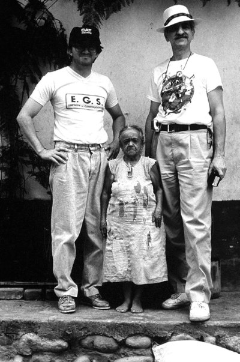

Unmatched source image; PDF page 78. Consult the original caption.

## PDF page 79 | printed page 61

[14]. Near total deletion of the GHR in liver only in the mouse model had no effect on total body or bone linear growth [137].

### 2.7.2 rhIGF-I Therapy of PAPP-A2

### Deficiency

Short-term treatment with rhIGF-I has been effective in other human autosomal recessive conditions such as PAPP-A2 deficiency, a condition in which serum levels of IGF-I, IGFBP-3 and ALS are elevated but the pro teolytic activity of PAPP-A2 is missing. rhGH administration was not considered since it would have induced a further elevation of the IGFBPs. rhIGF-I administration was initi ated attempting to bypass the diminished bio activity of the endogenous IGF-I [138].

### 2.7.3 Limitations of Endocrine

### rhIGF-I Replacement

The observation that growth failure due to GHRD cannot be adequately corrected with endocrine IGF-I replacement is not explained by concomitant IGFBP-3 deficiency. Substantial tissue delivery is reflected in pro found effects on adipose tissue, facies, and lymphoid tissue in treated patients (see below). This indicates that twice-daily injection pro vides more than adequate replacement of endocrine IGF-I, despite both IGFBP-3 and ALS deficiencies, which are not corrected by IGF-I treatment. The maintenance of circu lating levels of IGF-I despite severe IGFBP-3 and ALS deficiency may be the result of bind ing to other IGFBPs; IGFBP-2 is elevated in GHRD and increases further with rhIGF-I therapy [17].

If the tissue dose of IGF-I in patients with GHI treated with IGF-I is supraphysiologic, as indicated by increases in body fat and acro megalic facial changes, why then do we not see sustained growth acceleration as in GHtreated GHD? At this time, the dual effector hypothesis remains the most appropriate explanation for the inadequate growth response [14]. With a diminished ability to

stimulate prechondrocyte differentiation and local IGF-I production, children with GHI can expect only partial recovery of normal growth with IGF-I replacement. Thus, rhIGF- I replacement therapy of GHI may need to continue longer than GH treatment of GHD to achieve more normal height. This goal will likely require suppressing adolescence in most children with GHI, using GnRH analogues [134].

In addition to statural attainment, goals of replacement therapy with rhIGF-I in GHI include improvement in body composition, normalization of facial appearance, and pos sible reduction of risk factors for childhood and adult mortality. All studies that have monitored body composition have verified lean mass increases, including increased bone density. Unlike GH replacement therapy, however, which restores normal lipolysis, IGF-I therapy is lipotropic, increasing or sus taining the high percentage of body fat. Normalization of craniofacial features has also been apparent [139]. Voice change has not been remarked on, but can be expected.

The reduction of risk factors for higher mortality in infancy and childhood with GHRD is to be expected with rhIGF-I ther apy, but the reason for this increased risk is unknown. Leukocytes share in the general upregulation of IGF-I receptors in GHRD and appear to function normally in this con dition [140]. In a study of one affected infant (who died at 7 months with bronchitis) and 5 adults with GHRD from Ecuador, Diamond et al. [141] demonstrated a variety of immune disturbances in the infant and 3 of the adults. The pathologic significance of these findings remains uncertain [142].

### 2.7.4 Purported Partial GHI

The definition adopted by the FDA for “severe primary IGFD” was height SDS <−3, basal IGF-I SDS <−3, and normal or elevated GH concentration. Growth velocity, osseous mat uration, or projected height relative to mean parental stature, factors that are important in the clinical evaluation of short children, were not considered. Younger children may have

## PDF page 80 | printed page 62

quite low values for IGF-I that are not diag nostically useful, and at any age, a single mea surement may vary considerably from a subsequent determination. There is also inconsistency between laboratories, and nor mal ranges vary widely. In one analysis, 3 of 4 laboratories failed to identify 15–20% of Ecuadorian patients with molecularly proven GHRD using the FDA criterion for IGF-I concentration <−3 SD. Values may be spuri ously low because of the high susceptibility of IGF-I to post-sampling proteolysis [128]. Children, especially boys, with constitutional delay in growth and maturation (CDGM), who do not have biochemical markers of undernutrition, may be hypermetabolic and have mean IGF-I concentrations that are only 40% of those of normal age-mates, which could lead to an inappropriate diagnosis of IGFD [143]. This interpretation may be arti factual because of the comparison to norms for chronologic age rather than biologic (bone) age.

### 2

Further insight into the wide variability in IGF-I concentrations in the absence of endo crine deficiency comes from a study compar ing African and Italian children of comparable height, but with the African children having significantly lower weight and BMI and mean IGF-I and IGFBP-3 levels <1/3 those of the Italian children [144]. Wide fluctuations in IGF-I concentrations can be seen in normal prepubertal children, including levels <2 SDS [145].

Finally, IGF-I generation tests have poor reproducibility [59]. The off-label promotion of rhIGF-I has been based on two consider ations that are not evidence-based, that many children with ISS have partial GH insensitiv ity, and that appropriate therapy for these individuals is recombinant IGF-I. The absence of convincing evidence for this hypothesis, the limited ability of endocrine IGF-I to restore normal growth in those with unequivocal GH unresponsiveness, the sup pression of local GH effects on growth with IGF-I administration, the risk profile, and the absence of data on efficacy in other than proven severe GH insensitivity, led the Drug and Therapeutics Committee of the Pediatric Endocrine Society to conclude that rhIGF-I

use is only justified in conditions approved by the United States Food and Drug Administration (FDA) and that use for growth promotion in other children should only be investigational [62]. The manufacturer of rhIGF-I estimates that approximately 30,000 children in the United States are affected by primary IGFD, which is also simi lar to the estimated (European Union) EU market size [128]. Considering that fewer than 200 children with GHI due to GHRD, trans duction defects, or GH inhibiting antibodies had been identified worldwide in the previous 20 years, it is apparent that there was exuber ant anticipation and extensive promotion of off-label use. Indeed, current clinical trials demonstrate the loosening of criteria from those in the approval by FDA ( www. clinicaltrials.gov).

In January 2008, a pharmaceutical manu facturer of rhIGF-I announced that they had begun dosing the first patient in a phase II clinical trial evaluating the combination of GH and IGF-I in a study scheduled for com pletion at the end of 2011 to involve 100 sub jects over 5 years of age. This is a four-arm study involving rhGH alone in a dose of 45 mcg/kg daily and the same dose of GH with once-daily injections of either 50, 100, or 150 mcg/kg IGF-I. Inclusion requires height SDS ≤−2 (which is less stringent than the cri terion of SDS ≤−2.25 for GH treatment of ISS) and IGF-I SDS ≤1, along with a normal response to GH stimulation testing, and bone age ≤11 years for boys and ≤9 years for girls. There are no growth velocity criteria. This study is likely to include a substantial number of children, especially males, with constitu tional delay of growth and maturation (CDGM), the most common explanation for short stature in the growth clinic, and other normal short children. It is noteworthy that there is not an IGF-I monotherapy arm, and that the IGF-I is given as a single daily injec tion in contrast to the pharmacokinetic stud ies and clinical experience with this drug.

There is no reason to expect better growth response with IGF-I in patients who do not have proven insensitivity to GH than with recombinant GH, based on the absence of evidence of GH resistance as a cause of their

## PDF page 81 | printed page 63

short stature. In fact, monotherapy with rhIGF-I in individuals who have normal or even somewhat reduced GH production and action should result in the suppression of endogenous GH, which occurs rapidly with rhIGF-I administration in both normal and GHRD subjects [17]. This GH suppression will reduce IGFBP-3 and ALS production, and most importantly, decrease GH delivery to growing bone, with a reduction of chon drocyte proliferation and autocrine/paracrine IGF-I production, potentially decreasing growth velocity.

Data presented by the manufacturer of mecasermin in 2009 provided evidence that countered the notion that “primary IGFD” due to partial GHI was a valid diagnosis. In their clinical trial of individuals carrying this supposed diagnosis, supraphysiologic doses of IGF-I were required, resulting in circulat ing IGF-I levels of +2 SDS, to obtain a growth effect; thus, a pharmacologic rather than physiologic replacement therapy was required, which would be inconsistent with replacement therapy for primary IGFD. Also, inconsistent with the diagnosis of primary IGFD were the normal baseline growth velocities in these subjects. When these children underwent IGF-I generation tests (administration of GH for 5 days), there was a 76.5% increase in mean IGF-I level and a 34% increase in mean IGFBP-3 concentration [85]. Both are approx imately 50% greater responses than normal and indicative of better-than-normal GH sen sitivity. After a year, controls were growing at the same rate as IGF-I treated subjects. Furthermore, half of them now had IGF-I levels that would have disqualified them from the study.

### 2.7.5 Safety Concerns with rhIGF-I

### Treatment

Episodes of hypoglycemia, which may be severe, are common in infants and children with GHRD. In contrast to the far less com mon hypoglycemia of GHD which is cor rected by GH replacement therapy, IGF-I treatment increases the risk of hypoglycemia in children with GHRD. Hypoglycemia has

been the most common early adverse event, reported in 49% of subjects in the largest series, including 5% with seizures [136]. In the 6-month, placebo-controlled Ecuadorian study, hypoglycemia was reported in 67% of individuals receiving placebo and 86% of those treated with rhIGF-I, an insignificant difference [86]. Finger stick blood glucose measurements in 23 subjects residing at a research unit indicated frequent hypoglyce mia before breakfast and lunch, which did not increase in frequency with rhIGF-I administration [136]. Five of the subjects participated in a crossover, placebo-con trolled study for 6 months with a 3-month washout period with fasting glucose determi nations performed three times daily by care givers for the entire 15-month study. The percentage of glucose values <50 mg/dL was 2.6% with placebo and 5.5% with rhIGF-I, not a significant difference. In practice, hypo glycemia associated with IGF-I treatment appears reasonably controllable by adequate food intake.

Pain at the injection site is common. Injection site lipohypertrophy is frequent, affecting at least one-third of subjects; this is the result of failure to rotate injections and injection into the lumps, which can attenuate growth response. The inotropic effect of IGF-I results in asymptomatic tachycardia in all treated patients, which clears after several months of continued use [146]. Benign intra cranial hypertension or papilledema has been noted in approximately 5% of IGF-treated subjects. While headache is frequent, the placebo-controlled study found no difference in incidence between those receiving placebo injections and those receiving rhIGF- I. Parotid swelling and facial nerve palsy have been described. Lymphoid tissue hypertrophy occurs in over 25% of patients, with hypoacu sis, snoring, and tonsillar/adenoidal hypertro phy that required surgical intervention in over 10% of patients. Thymic hypertrophy was noted in 35% of subjects having regular chest radiographs. It is worth noting that some of these side effects may be more frequent than reported because they take time to develop; for example, snoring incidence in the first year for the 25 longest treated subjects in the

## PDF page 82 | printed page 64

mecasermin study was only 4%, but increased to 65% for the entire study period [136].

Anti-IGF-I antibodies have developed in approximately half of the rhIGF-I-treated patients during the first year of treatment, but these have had no effect on response [135, 136]. Urticaria has been noted in subjects participating in the trial of IGF-I in combina tion with GH. Transient elevation of liver enzymes has also been noted [135]. Coarsening of facial features with disproportionate growth of the jaw reminiscent of acromegaly has been common, particularly among those of pubertal age [134]. In contrast to the increase in lean body mass and decreasing percentage of body fat that occurs with GH treatment of GHD, both lean and fat mass increase with rhIGF-I therapy [94, 132].

### 2

Mean body mass index (BMI) increased from +0.6 SDS to +1.8 SDS during 4–7 years of treatment with rhIGF-I in the European multicenter trial and severe obesity has occa sionally occurred [90]. BMI measurement may not accurately reflect the degree of obe sity, which can be a doubling or tripling of body fat as demonstrated by dual-energy X-ray absorptiometry [113].

Hyperandrogenism with oligomenorrhea or amenorrhea, acne, and elevated serum androgens has been described in prepubertal and young adult patients given single daily injections of rhIGF-I [147]. There have been two instances of anaphylaxis from rhIGF-I treatment [130].

148

2.9

Fig. 2.9 Adolescent subject with GHRD due to the E180 splice mutation on the GH receptor gene. Left panel: 3 years before treatment. Right panel: the subject after 1-year treatment with 120 μg/kg bid of rhIGF-I and leuprolide acetate 7.5 mg sc monthly

2.10 149

### 2.7.6 rhGH Therapy of GHI

rhGH therapy has been used with limited suc cess in GHI; indeed, a moderate response to rhGH administration in children with GHI due to IGF-I receptor mutations (chromo some 15q26 deletion) has been reported; how ever, the catch-up growth seen with GH treatment of GHD was not observed and, despite improvement in height SDS during therapy, adult height remained reduced [150].

Moreover, a less robust growth response to rhGH administration has been observed in

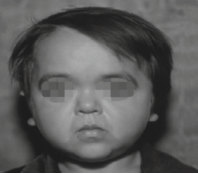

Unmatched source image; PDF page 82. Consult the original caption.

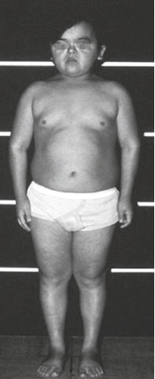

Unmatched source image; PDF page 82. Consult the original caption.

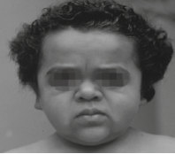

Unmatched source image; PDF page 82. Consult the original caption.

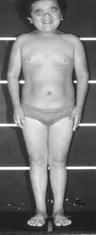

Unmatched source image; PDF page 82. Consult the original caption.

## PDF page 83 | printed page 65

mutations of a particular gene. Acquired GHI is relatively common as a complication of a variety of chronic problems associated with growth failure. Treatment of the genetic causes of GHI remains inadequate because of the inability of exogenous rhIGF-I to repli cate GH effects at the growth plate; however, the efficacy and effect of the rhIGF-1 dose schedule on final height need to be further explored [149].

Review Questions

1. Mutations of which of the following

Fig. 2.10 Four subjects with GH receptor deficiency due to the E180 splice mutation on the GH receptor gene. From left to right, the first woman, age 22, was treated from age 4 to 14 with rhIGF-I at a dose of 80 μg/ body weight bid. The other three women were treated for 3 years with 120 μg/kg bid and are 30, 23, and 27 years of age. Their heights are comparable to those treated by Chernausek et al. [136] for upward of 10 years (112, 121.2, and 120.8 cm). (From Guevara-Aguirre et al. [149]. Reprinted with permission from the Endo crine Society)

2. rhIGF-I has limited effects on growth

certain subjects with Noonan syndrome, a condition in which mild GHI has been sug gested. The decreased response to therapy occurs in those bearing PTNP11 mutations; however, in those without these genetic changes, an improvement in clinical and bio chemical growth parameters, including serum IGF-I levels, was seen when rhGH was administered. This might be explained by the hyperactivity of the RAS/MAPK system that has been described in this syndrome [151].

3. Partial GHI has been established in a

### 2.8 Conclusions

Genetic causes of GHI from the GHR to IGF-I action remain rare, but their identifica tion has greatly enhanced understanding of growth processes and introduced challenging questions, for example, about phenotypic variability between genetic defects at various sites with comparable biochemical effects and among individuals with the same or similar

v Answers

1. E 2. E 3. F

genes have been described with GHI in fewer than 50 children? A. GH receptor B. IGF-I receptor C. STAT5b D. A and B E. B and C

which may be attributable to the lack of a direct direct effect of GH on? A. Chondrocyte proliferation at the

growth plate B. Autocrine/paracrine IGF-I genera

tion at the growth plate C. ALS and IGFBP-3 production by

the liver D. Endogenous GH production E. All of the above F. None of the above

large number of short children by?

A. Measurement of serum GH con

centrations B. Measurement of serum IGF-1 con

centrations C. Growth response to high-dose rhGH

administration D. Response to rhIGF-1 administration E. All of the above F. None of the above

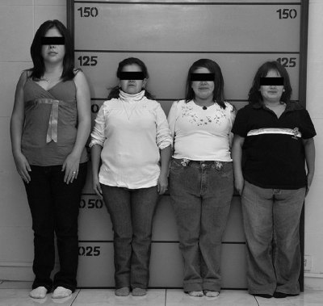

Unmatched source image; PDF page 83. Consult the original caption.

## PDF page 84 | printed page 66

### References

15. Andreassen TT, Oxlund H. The effects of growth

1. Rosenbloom AL. Physiology and disorders of the

growth hormone receptor (GHR) and GH-GHR signal transduction. Endocrine. 2000;12:107–19. 2. Godowski PJ, Leung DW, Meacham LR, et al.

### 2

16. Mrak E, Villa I, Lanzi R, Losa M, Guidobono F,

Characterization of the human growth hormone receptor gene and demonstration of a partial gene deletion in two patients with Laron-type dwarfism. Proc Natl Acad Sci USA. 1989;86:8083–7. 3. Postel-Vinay M-C, Kelly PA. Growth hormone

17. Vaccarello MA, Diamond FB Jr, Guevara-

receptor signaling. Bailliere Clin Endocrinol Metab. 1996;10:323–6. 4. de Vos AM, Ultsch M, Kossiakoff AA. Human

growth hormone and extracellular domain of its receptor: crystal structure of the complex. Science. 1992;255:306–12. 5. Rajaram S, Baylink DJ, Mohan S. Insulin-like

18. Guevara-Aguirre J, Rosenbloom AL. Obesity,

growth factor-binding proteins in serum and other biological fluids: regulation and functions. Endocr Rev. 1997;18:801–31. 6. Baxter RG, Binoux MA, Clemmons DR, Conover

19. Rosenbloom AL. Growth hormone insensitivity:

CA, Drop SLA, Holly JMP, et al. Recommendations for nomenclature of the insu lin-like growth factor binding proteins superfam ily. J Clin Endocrinol Metab. 1998;83:3213. 7. Bang P. Pediatric implications of normal insulin-

20. Rivarola MA, Phillips JA III, Migeon CJ,

GH-IGF-axis physiology [updated 2019 Jul 21]. In: Feingold KR, Anawalt B, Blackman MR, et al., editors. Endotext. South Dartmouth, MA: MDText.com, Inc.; 2000. Available from: https:// www.ncbi.nlm.nih.gov/books/NBK343487/. 8. Dai B, Ruan B, Wang J, Shang P, Sun W, Li X,

21. Powell DR. Effects of renal failure on the growth

22. Guevara-Aguirre J, Guevara-Aguirre M, Hwa V,

Dou K, Wang D, Li Y. Int J Clin Exp Pathol. 2014;7(9):5645–54. 9. Ferrara C, Patel P, Becker S, Stanley CA, Kelly

A. Biomarkers of insulin for the diagnosis of hyperinsulinemic hypoglycemia in infants and children. J Pediatr. 2016;168:212–9. 10. Lewit MS, Dent M, Hall K. The insulin-like

23. Ayling RM, Ross R, Towner P, et al. A dominant-

growth factor system in obesity, insulin resistance and T2DM. J Clin Med. 2014;3:1561–74. 11. Lee PDK, Durham S, Martínez V, Vásconez O,

24. Metherell LA, Akker SA, Munroe PB, et al.

Powell D, Guevara-Aguirre J. Kinetics of IGF and IGFBP responses to a single dose of GH. J Clin Endocrinol Metab. 1997;82:2266–74. 12. Guevara-Aguirre J, Rosenbloom A, Balasubramanian P, Teran E, Guevara-Aguirre M, Guevara C, Procel P, Alfara I, DeCabo R, Narvaez L, Saavedra J, Longo V. GH receptor deficiency in Ecuadorian adults is associated with obesity and enhanced insulin sensitivity. J Clin Endocrinol Metab. 2015;100:2589–96. 13. Yau S, Azar WJ, Sabin MA, Werther GA, Russo

25. Iida K, Takahashi Y, Kaji H, et al. Growth hor

26. Iida K, Takahashi Y, Kaji H, et al. Functional

VC. IGFBP-2—taking the lead in growth, metab olism and cancer. J Cell Commun Signal. 2015;9(2):125–42. 14. Daughaday WH, Rotwein P. Insulin-like growth

27. Dastot F, Sobrier ML, Duquesnoy P, Duriez B,

factors I and II: peptide, messenger ribonucleic

acid and gene structures, serum and tissue con centrations. Endocr Rev. 1989;10:68–91.

hormone on cortical and cancellous bone. J Musculoskelet Neuronal Interact. 2001;2(1):49–58.

Rubinacci A. Growth hormone stimulates osteo protegerin expression and secretion in human osteoblast-like cells. J Endocrinol. 2007;192(3):639–45.

Aguirre J, et al. Hormonal and metabolic effects and pharmacokinetics of recombinant human insulin-like growth factor-I in growth hormone receptor deficiency/Laron syndrome. J Clin Endocrinol Metab. 1993;77:273–80.

diabetes and cancer: insight into the relationship from a cohort with growth hormone receptor deficiency. Diabetologia. 2015:58–37. https://doi. org/10.1007/s00125-0143397-3.

physiologic and genetic basis, phenotype, and treatment. J Pediatr. 1999;135:280–9.

Heinrich JJ, Hjelle BJ. Phenotypic heterogeneity in familial isolated growth hormone deficiency type I-A. J Clin Endocrinol Metab. 1984;59:34–40.

hormone-insulin-like growth factor axis. J Pediatr. 1997;131:S13–516.

et al. Intrauterine and postnatal growth failure with normal GH/IGF1 axis and insulin-resistant diabetes in a consanguineous kinship. Eur J Endocrinol. 2012;166:521–9.

negative mutation of the growth hormone recep tor causes familial short stature. Nat Genet. 1997;16:13–4.

Pseudoexon activation as a novel mechanism for disease resulting in atypical growth hor mone insensitivity. Am J Hum Genet. 2001;69:641–6.

mone (GH) insensitivity syndrome with high serum GH binding protein levels caused by a het erozygous splice site mutation of the GH receptor gene producing a lack of intracellular domain. J Clin Endocrinol Metab. 1998;83:531–7.

characterization of truncated growth hormone (GH) receptor (1-277) causing partial GH insen sitivity syndrome with high GH-binding protein. J Clin Endocrinol Metab. 1999;84:1011–6.

Goosens M, Amselem S. Alternative spliced forms in the cytoplasmic domain of the human

## PDF page 85 | printed page 67

growth hormone (GH) receptor regulate its abil ity to generate a soluble GH binding protein. Proc Natl Acad Sci USA. 1996;93:10723–8. 28. Rosenfeld RG, Belgorosky A, Camacho-Hubner

39. Domené HM, Scaglia PA, Lteif A, et al.

C, Savage MO, Wit JM, Hwa V. Defects in growth hormone receptor major signaling. Trends Endocrinol Metab. 2007;18:134–41. 29. Cofanova-Gambetti OV, Hwa V, Jorge AAL,

40. Heath KE, Argente J, Barrios V, Pozo J, Díaz-

et al. Heterozygous STAT5b gene mutations: impact on clinical phenotype. In: Endocrine Society annual meeting, 19–22 Jun 2010, San Diego. Abstract P1-661. 30. Klammt J, Neumann D, Gevers EF, et al.

Dominant-negative STAT5B mutations cause growth hormone insensitivity with short stature and mild immune dysregulation. Nat Commun. 2018;9:2105. https://doi.org/10.1038/s41467-018- 04521-0. 31. Sediva H, Dusatkova P, Kanderova V, Obermannova B, Kayserova J, Sramkova L, Zemkova D, Elblova L, Svaton M, Zachova R, Kolouskova S, Fronkova E, Sumnik Z, Sediva A, Lebl J, Pruhova S. Short stature in a boy with multiple early-onset autoimmune conditions due to a STAT3 activating mutation: could intracel lular growth hormone signalling be compro mised? Horm Res Paediatr. 2017;88(2):160–6. https://doi.org/10.1159/000456544. Epub 2017 Mar 2. 32. Woods KA, Camacho-Hübner C, Savage MO,

41. van Duyvenvoorde HA, Kempers MJ, Twickler

42. Fofanova-Gambetti OV, Hwa V, Kirsch S,

43. Fofanova-Gambetti OV, Hwa V, Wit JM, et al.

Clark AJL. Intrauterine growth retardation and postnatal growth failure associated with deletion of the insulin-like growth factor I gene. N Engl J Med. 1996;335:1363–7. 33. Bonapace G, Concolino D, Formicola S,

44. Domené HM, Martínez AS, Frystyk J, et al.

Strisciuglio P. A novel mutation in a patient with insulin-like growth factor 1 (IGF1) deficiency. J Med Genet. 2003;40:913–7. 34. Walenkamp MJ, Karperien M, Pereira AM, et al.

45. Abuzzahab MJ, Schneider A, Goddard A,

Homozygous and heterozygous expression of a novel insulin-like growth factor-I mutation. J Clin Endocrinol Metab. 2005;90:2855–64. 35. Giacomozzi C, Martin A, Fernández MC,

46. Kawashima Y, Kanzaki S, Yang F, Kinoshita T,

Gutiérrez M, Iascone M, Domené HM, Dominici FP, Bergadá I, Cangiano B, Persani L, Pennisi PA. Novel insulin-like growth factor 1 gene muta tion: broadening of the phenotype and implica tions for insulin resistance. J Clin Endocrinol Metab. 2023;108(6):1355–69. https://doi. org/10.1210/clinem/dgac738. 36. Guevara-Aguirre J. IGF-I—an important intra

47. Walenkamp MJ, van der Kamp HJ, Pereira AM,

uterine growth factor. N Engl J Med. 1996;335:1389–91. 37. Domené HM, Bengolea SV, Martínez AS,

48. Inagaki K, Tiulpakov A, Rubtsov P, Sverdlova P,

Ropelato MG, Pennisi P, Scaglia P. Deficiency of the circulating insulin-like growth factor system associated with inactivation of the acid-labile subunit gene. N Engl J Med. 2004;350:570–7. 38. Hwa V, Haeusler G, Pratt KL, Little BM, Frisch

49. Walenkamp MJ, de Muinck Keizer-Schrama SM,

H, Koller D. Total absence of functional acid labile subunit, resulting in severe insulin-like growth fac

tor deficiency and moderate growth failure. J Clin Endocrinol Metab. 2006;91:1826–31.

Phenotypic effects of null and haploinsufficiency of acid-labile subunit in a family with two novel IGFALS gene mutations. J Clin Endocrinol Metab. 2007;92:4444–50.

González F, Martos-Moreno GA. Primary acidlabile subunit deficiency due to recessive IGFALS mutations results in postnatal growth deficit asso ciated with low circulating insulin growth factor (IGF)-I, IGF binding protein-3 levels, and hyper insulinemia. J Clin Endocrinol Metab. 2008;93:1616–24.

TB, van Doorn J, Gerver WJ, Noordam C. Homozygous and heterozygous expression of a novel mutation of the acid-labile subunit. Eur J Endocrinol. 2008;159:113–20.

Pihoker C, Chiu HK, Högler W. Three novel IGFALS gene mutations resulting in total ALS and severe circulating IGF-I/IGFBP-3 deficiency in children of different ethnic origins. Horm Res. 2009;71:100–10.

Impact of heterozygosity for acid-labile subunit (IGFALS) gene mutations on stature: results from the international acid-labile subunit consor tium. J Clin Endocrinol Metab. 2010;95:4184–91.

Normal growth spurt and final height despite low levels of all forms of circulating insulin-like growth factor-I in a patient with acid-labile sub unit deficiency. Horm Res. 2007;67:243–9.

Grigorescu F, Lautier C, Keller E. IGF-I receptor mutations resulting in intrauterine and postnatal growth retardation. N Engl J Med. 2003;349:2211–22.

Hanaki K, Nagaishi J. Mutation at cleavage site of insulin-like growth factor receptor in a shortstature child born with intrauterine growth retar dation. J Clin Endocrinol Metab. 2005;90:4679–87.

Kant SG, van Duyvenvoorde HA, Kruithof MF. A variable degree of intrauterine and post natal growth retardation in a family with a mis sense mutation in the insulin-like growth factor I receptor. J Clin Endocrinol Metab. 2006;91:3062–70.

Peterkova V, Yakar S. A familial insulin-like growth factor-I receptor mutant leads to short stature: clinical and biochemical characteriza tion. J Clin Endocrinol Metab. 2007;92:1542–8.

de Mos M, Kalf ME, van Duyvenvoorde HA, Boot AM. Successful long-term growth hormone

## PDF page 86 | printed page 68

therapy in a girl with haploinsufficiency of the insulin-like growth factor-I receptor due to a ter minal 15q26.2->qter deletion detected by multi plex ligation probe amplification. J Clin Endocrinol Metab. 2008;93:2421–5. 50. Fang P, Schwartz ID, Johnson BD, Derr MA,

60. Guevara-Aguirre 61. Guevara-Aguirre J, Balasubramanian P, Guevara-

### 2

Roberts CT Jr, Hwa V. Familial short stature caused by haploinsufficiency of the insulin-like growth factor i receptor due to nonsensemediated messenger ribonucleic acid decay. J Clin Endocrinol Metab. 2009;94:1740–7. 51. Shapiro MR, Foster TP, Perry DJ, Rosenfeld RG,

Dauber A, McNichols JA, Muir A, Hwa V, Brusko TM, Jacobsen LM. A novel mutation in insulin-like growth factor 1 receptor (c.641- 2A>G) is associated with impaired growth, hypo glycemia, and modified immune phenotypes. Horm Res Paediatr. 2020;93(5):322–34. https:// doi.org/10.1159/000510764. Epub 2020 Oct 28. 52. Burkhardt S, Gesing J, Kapellen TM, Kovacs P,

62. Collett-Solberg 63. Rosenfeld RG, Rosenbloom AL, Guevara-

Kratzsch J, Schlicke M, Stobbe H, Tönjes A, Klammt J, Pfäffle R. Novel heterozygous IGF1R mutation in two brothers with developing impaired glucose tolerance. J Pediatr Endocrinol Metab. 2015;28(1–2):217–25. https://doi. org/10.1515/jpem-2014-0132. 53. Dauber A, Munoz-Calvo MT, Barrios V, et al.

64. Rudling M, Norstedt G, Olivecrona H, Reihnér

Mutations in pregnancy-associated plasma pro tein A2 cause short stature due to low IGF-I availability. EMBO Mol Med. 2016;8:363–74. 54. Velez C, Palamara P, Guevara-Aguirre J, Hao L,

65. Gallagher EJ, LeRoith D. Is growth hormone

Parafet T, Guevara-Aguirre M, Pearlman A, Oddoux C, Hammer M, Burns E, Pe’er I, Atzmon G, Ostrer H. The impact of Converso Jews on the genome of modern Latin Americans. Human Genet. 2012;131(2):251–63. 55. Laron Z, Pertzelan A, Mannheimer S. Genetic

66. Boguszewski CL, Boguszewski MC. Growth hor

67. Shevah O, Laron Z. Patients with congenital defi

pituitary dwarfism with high serum concentration of growth hormone—a new inborn error of metabolism? Isr J Med Sci. 1966;2:152–5. 56. Rosenbloom AL, Guevara-Aguirre J, Rosenfeld

68. Steuerman R, Shevah O, Laron Z. Congenital

RG, Fielder PJ. The little women of Loja. Growth hormone receptor-deficiency in an inbred popula tion of southern Ecuador. N Engl J Med. 1990;323:1367–74. 57. Guevara-Aguirre J, Rosenbloom AL, Fielder PJ,

69. Marinho CG, Mermejo LM, Salvatori R, Junior JA,

Diamond FB Jr, Rosenfeld RG. Growth hormone receptor deficiency in Ecuador: clinical and bio chemical phenotype in two populations. J Clin Endocrinol Metab. 1993;76:417–23. 58. Rosenbloom AL, Francke U, Rosenfeld RG,

70. Werner H, Lapkina-Gendler L, Achlaug L,

Guevara-Aguirre J. Growth hormone receptor deficiency in Ecuador. J Clin Endocrinol Metab. 1999;84:4436–43. 59. Jorge AA, Souza SC, Arnhold IJ, Mendonca

BB. Poor reproducibility of IGF-I and IGF bind ing protein-3 generation test in children with short stature and normal coding region of the GH receptor gene. J Clin Endocrinol Metab. 2002;87:469–72.

71. Berg MA, Guevara-Aguirre J, Rosenbloom AL,

J, Guevara-Aguirre M, Saavedra J. Low serum levels of IGF-I, BP3 and ALS are associated to severe short stature, obe sity, premature aging, increased cardiovascular mortality and absence of cancer in the Ecuadorian cohort of Laron syndrome subjects. In: Pediatric Academic Societies annual meeting, Toronto, Canada; 2007. Abstract #327.

Aguirre M, Wei M, Madia F, Cheng C, Hwang D, Martín-Montalvo A, Saavedra J, Ingles S, Cohen P, Longo V. Growth hormone receptor deficiency is associated with a major reduction in pro-aging signaling, cancer and diabetes in humans. Sci Transl Med. 2011;3:70ra13. PF, Misra M, Drug and Therapeutics Committee of the Lawson Wilkins Pediatric Endocrine Society. The role of recombi nant human insulin-like growth factor-I in treat ing children with short stature. J Clin Endocrinol Metab. 2008;93:10–8.

Aguirre J. Growth hormone (GH) insensitivity due to primary GH receptor deficiency. Endocr Rev. 1994;15:369–90.

E, Gustafsson J-A, Angelin B. Importance of growth hormone for the induction of hepatic low density lipoprotein receptors. Proc Natl Acad Sci. 1992;89:6983–7.

resistance/IGF-1 reduction good for you? Cell Metab. 2011;13(4):355–6.

mone’s links to cancer. Endocr Rev. 2019;40(2):558–74.

ciency of IGF-I seem protected from the develop ment of malignancies: a preliminary report. Growth Horm IGF Res. 2007;17(1):54–7.

IGF1 deficiency tends to confer protection against post-natal development of malignancies. Eur J Endocrinol. 2011;164(4):485–9.

Oliveira CR, Santos EG, Leal ÂC, Barros-Oliveira CS, Damascena NP, Lima CA, Farias CT. Occurrence of neoplasms in individuals with congenital, severe GH deficiency from the Itabaianinha kindred. Growth Horm IGF Res. 2018;41:71–4.

Nagaraj K, Somri L, Yaron-Saminsky D, Pasmanik-Chor M, Sarfstein R, Laron Z, Yakar S. Genome-wide profiling of Laron syndrome patients identifies novel cancer protection path ways. Cells. 2019;8(6):596.

Rosenfeld RG, Francke U. Mutation creating a new splice site in the growth hormone receptor genes of 37 Ecuadorean patients with Laron syn drome. Hum Mutat. 1992;1(1):24–34.

## PDF page 87 | printed page 69

72. Guevarra-Aguirre J, Balasubramaniam P. Growth

hormone receptor deficiency is associated with a major reduction in pro-aging signaling, cancer, and diabetes in humans. Sci Transl Med. 2011;3:70ra13. 73. Guevara-Aguirre J, Bautista C, Torres C, Peña G,

86. Guevara-Aguirre J, Vasconez O, Martinez V,

Guevara C, Palacios C, Guevara A, Gavilanes AW. Insights from the clinical phenotype of sub jects with Laron syndrome in Ecuador. Rev Endocr Metab Disord. 2021;22:59–70. 74. Saha SK, Lee SB, Won J, Choi HY, Kim K, Yang

87. Crosnier H, Gourmelen M, Prëvot C, Rappaport

GM, Abdal Dayem A, Cho SG. Correlation between oxidative stress, nutrition, and cancer initiation. Int J Mol Sci. 2017;18(7):1544. 75. Werner H, Meisel-Sharon S, Bruchim I. Oncogenic fusion proteins adopt the insulinlike growth factor signaling pathway. Mol Cancer. 2018;17(1):28. 76. Longo VD, Finch CE. Evolutionary medicine:

88. Laron Z, Lilos P, Klinger B. Growth curves for

89. Rose SR, Municchi G, Barnes KM, Kamp GA,

from dwarf model systems to healthy centenari ans? Science. 2003;299(5611):1342–6. 77. Kim YM, Kim JH, Park JS, Baik SJ, Chun J,

Youn YH, Park H. Association between triglyceride-glucose index and gastric carcinogen esis: a health checkup cohort study. Gastric Cancer. 2022;25:33–41. 78. Yuan J, Hu Z, Mahal BA, Zhao SD, Kensler KH,

90. Ranke MB, Savage MO, Chatelain PG, Preece MA,

Pi J, Hu X, Zhang Y, Wang Y, Jiang J, Li C. Integrated analysis of genetic ancestry and genomic alterations across cancers. Cancer Cell. 2018;34(4):549–60. 79. Longo VD, Fontana L. Calorie restriction and

91. Schaefer GB, Rosenbloom AL, Guevara-Aguirre

cancer prevention: metabolic and molecular mechanisms. Trends Pharmacol Sci. 2010;31(2):89–98. 80. Suh Y, Atzmon G, Cho MO, Hwang D, Liu B,

92. Rosenbloom AL, Selman-Almonte A, Brown

Leahy DJ, Barzilai N, Cohen P. Functionally sig nificant insulin-like growth factor I receptor mutations in centenarians. Proc Natl Acad Sci. 2008;105(9):3438–42. 81. Pollak M. The insulin and insulin-like growth fac

93. Rosenbloom AL, Guevara-Aguirre J, Fielder PJ,

tor receptor family in neoplasia: an update. Nat Rev Cancer. 2012;12(3):159–69. 82. Guevara-Aguirre J, Rosenbloom AL. Obesity,

diabetes and cancer: insight into the relationship from a cohort with growth hormone receptor deficiency. Diabetologia. 2015;58:37–42. 83. Guevara-Aguirre J, Peña G, Pazmiño G, Acosta

94. Bachrach LB, Marcus R, Ott SM, Rosenbloom

W, Saavedra J, Lescano D, Guevara A, Gavilanes AW. Cancer in Ecuadorian subjects with Laron syndrome (ELS). Endocr Relat Cancer. 2023;30(6):e220389. 84. Rosenbloom AL, Guevara-Aguirre J, Rosenfeld

95. Bandeira F, Camargo K, Caldas G, Rosenbloom

RG, Pollock BH. Growth in growth hormone insensitivity. Trends Endocrinol Metab. 1994;5:296–303. 85. Rosenbloom AL. Recombinant human insulin

96. Houssay BA, Penhos JC. Diabetogenic action of

like factor-1 treatment: prime time or timeout? [Commentary on “Recombinant human insulin like growth factor-1 treatment: ready for prime time” by Bright GM, Mendoza JR, Rosenfeld

97. Houssay BA, Biasotti A. The hypophysis, carbo

RG. Endocrinol Metab Clin N Am 2009;38:625–38]. Int J Pediatr Endocrinol. 2009;2009:429684. https://doi. org/10.1155/2009/429684.

et al. A randomized, double blind, placebo con trolled trial on safety and efficacy of recombinant human insulin-like growth factor-I in children with growth hormone receptor deficiency. J Clin Endocrinol Metab. 1995;80:1393–8.

R. Effects of nutrient intake on growth, insulinlike growth factors, and their binding proteins in a Laron-type dwarf. J Clin Endocrinol Metab. 1993;76:248–50.

Laron syndrome. Arch Dis Child. 1993;68:768–70.

Uriarte MM, Ross JL, Cassorla F, Cutler GB Jr. Spontaneous growth hormone secretion increases during puberty in normal girls and boys. J Clin Endocrinol Metab. 1991;73:428–35.

Rosenfeld RG, Wilton P. Long-term treatment of growth hormone insensitivity syndrome with IGF- I. Results of the European Multicentre Study. The Working Group on Growth Hormone Insensitivity Syndromes. Horm Res. 1999;51:128–34.

J, et al. Facial morphometry of Ecuadorian patients with growth hormone receptor defi ciency/Laron syndrome. J Med Genet. 1994;31:635–9.

MR, Fisher DA, Baumbach L, Parks JS. Clinical and biochemical phenotype of familial anterior hypopituitarism from mutation of the PROP-1 gene. J Clin Endocrinol Metab. 1999;84:50–7.

Gargosky S, Rosenfeld RG, Diamond FB Jr, Vaccarello MA. Growth hormone receptor defi ciency/Laron syndrome in Ecuador: clinical and biochemical characteristics. Pediatr Adolesc Endocrinol. 1993;24:34–52.

AL, Vasconez O, Martinez V, Martinez AL, Rosenfeld RG, Guevara-Aguirre J. Bone mineral, histomorphometry, and body composition in adults with growth hormone receptor deficiency. J Bone Miner Res. 1998;13:415–21.

AL, Stabler B, Underwood LE. Primary growth hormone insensitivity: case report. Arq Bras Endocrinol Metab. 1997;41(198–200):3.

pituitary hormones on adrenalectomized hypoph ysectomized dogs. Endocrinology. 1956;59(6):637–41.

hydrate metabolism and diabetes. Endocrinology. 1931;15(6):511–23.

## PDF page 88 | printed page 70

98. Guevara-Aguirre J, Torres C, Peña G, Palacios

109. Woods KA, Dastot F, Preece MA, et al. Extensive

M, Bautista C, Guevara A, Gavilanes AW. IGF-I deficiency and enhanced insulin sen sitivity due to a mutated growth hormone receptor gene in humans. Mol Cell Endocrinol. 2021;519:111044. 99. Guevara-Aguirre J, Guevara-Aguirre M, Hwa V,

### 2

110. Guevara-Aguirre 111. Kranzler JH, Rosenbloom AL, Martinez V,

Prócel P, Saavedra J, Ostrer H, Fang P, Rosenfeld RG, Kerns S, Rosenbloom AL. Intrauterine and postnatal growth failure with normal GH/IGF1 axis and insulin-resistant diabetes in a consan guineous kinship. Eur J Endocrinol. 2012;166(3):521–9. 100. Kerns SL, Guevara-Aguirre J, Andrew S,

Geng J, Guevara C, Guevara-Aguirre M, Guo M, Oddoux C, Shen Y, Zurita A, Rosenfeld RG. A novel variant in CDKN1C is associ ated with intrauterine growth restriction, short stature, and early-adulthood-onset dia betes. J Clin Endocrinol Metabol. 2014;99(10):E2117–22. 101. Rubio V, Chamberlain C, Wasserfall C, Guevara-

112. Bunn RC, King WD, Winkler MK, Fowlkes

113. Laron Z, Ginsberg S, Lilos P, Arbiv M, Vaisman

Aguirre J, Atkinson M, Rosenbloom A, Guevara A, Yost R, Garrett T. Combined quantitation and profiling metabolomics to characterize Laron and Guevara-Rosenbloom syndromes. In: ASMS meeting. 102. Rubio V, Chamberlain C, Wasserfall C, Guevara-

114. Beck KD, Powell-Braxton L, Widmer H-R,

Aguirre J, Atkinson M, Rosenbloom A, Guevara A, Yost R, Garrett T. Metabolomic characteriza tion of Laron and Guevara-Rosenbloom syn dromes using UHPLC-HRMS. In: American Diabetes Association meeting. 103. Guevara-Aguirre J, Rosenbloom AL, Guevara A,

115. Zhou Y, Xu BC, Maheshwari HG, He H, et al. A

Atkinson MA, Williams MD, Terán E, Posgai AL, Guevara C, Rosado V, Gavilanes AW, Wasserfall CH. Divergent metabolic phenotypes in two genetic syndromes of low insulin secretion. Diabetes Res Clin Pract. 2023;196:110228. 104. Creff J, Besson A. Functional versatility of the

116. Buckway CK, Guevara-Aguirre J, Pratt KL,

CDK inhibitor p57Kip2. Front Cell Dev Biol. 2020;8:584590. 105. Silbergeld A, Klinger B, Schwartz H, Laron

117. Maheshwari HG, Silverman BI, Dupuis J,

Z. Serum prolactin in patients with Laron-type dwarfism: effect of insulin-like growth factor I. Horm Res. 1992;37(4–5):160–4. https://doi. org/10.1159/000182302. 106. Alhazidou E, Vlachadis N, Androulaki M,

118. Gargosky SE, Wilson KF, Fielder PJ, et al. The

Boudouvas D, Petrakos G. Treatment for infertil ity in Laron syndrome: a case report. Cureus. 2022;14(12):e33090. https://doi.org/10.7759/ cureus.33090. 107. Frankel JJ, Laron Z. Psychological aspects of

pituitary insufficiency in children and adolescents with special reference to growth hormone. Isr J Med Sci. 1968;4:953–61. 108. Galatzer A, Aran O, Nagelberg N, Rubitzek J,

119. Wilson KF, Fielder PJ, Guevara-Aguirre J, et al.

Laron Z. Cognitive and psychosocial functioning of young adults with Laron syndrome. Pediatr Adolesc Endocrinol. 1993;24:53–60.

120. Guevara-Aguirre J, Rosenbloom AL, Vasconez

personal experience. Phenotype: genotype rela tionships in growth hormone insensitivity syn drome. J Clin Endocrinol Metab. 1997;82:3529–35. J, Rosenbloom AL. Psychosocial adaptation of Ecuadorian patients with growth hormone receptor defi ciency/Laron syndrome. Pediat Adolesc Endocrinol. 1993;24:61–4.

Guevara-Aguirre J. Normal intelligence with severe IGF-I deficiency due to growth hormone receptor deficiency: a controlled study in geneti cally homogeneous population. J Clin Endocrinol Metab. 1998;83:1953–8.

JL. Early developmental changes in IGF1, IGFII, BP1, and BP3 in the CSF of children. Pedaitr Res. 2005;58:89–93.

N. Long-term IGF-I treatment of children with Laron syndrome increases adiposity. Growth Horm IGF Res. 2006;16:61–4.

Valverde J, Hofti F. IGF-I gene disruption results in reduced brain size, CNS hypomyelination, and loss of hippocampal granule and striatal parvalbumin-containing neurons. Neuron. 1995;14:717–30.

mammalian model for the Laron syndrome pro duced by targeted disruption of the mouse growth hormone receptor/binding protein gene (the Laron mouse). Proc Natl Acad Sci USA. 1997;94:13215–20.

Burren CP, Rosenfeld R. The IGF-I generation test revisited: a marker of GH sensitivity. J Clin Endocrinol Metab. 2001;86:5176–83.

Baumann G. Phenotype and genetic analysis of a syndrome caused by an inactivating mutation in the growth hormone-releasing hormone receptor: dwarfism of Sindh. J Clin Endocrinol Metab. 1998;83:4065–74.

composition and distribution of insulin-like growth factors (IGFs) and IGF-binding proteins (IGFBPs) in the serum of growth hormone receptor-deficient patients: effects of IGF-I ther apy on IGFBP-3. J Clin Endocrinol Metab. 1993;77:1683–168.

Long-term effects of insulin-like growth factor (IGF)-I treatment on serum IGFs and IGF bind ing proteins in adolescent patients with growth hormone receptor deficiency. Clin Endocrinol. 1995;42:399–407.

O, Martinez V, Gargosky SE, Rosenfeld

## PDF page 89 | printed page 71

RG. Two-year treatment of growth hormone receptor deficiency (GHRD) with recombinant insulin-like growth factor-I in 22 children: com parison of two dosage levels and to GH treated GH deficiency. J Clin Endocrinol Metab. 1997;82:629–33. 121. Ranke MB, Savage MO, Chatelain PG, et al.

132. Rosenbloom AL. IGF-I treatment of growth hor

Insulin-like growth factor I improves height in growth hormone insensitivity: two years’ results. Horm Res. 1995;44:253–64. 122. Rosenbloom AL, Guevara-Aguirre J, Fielder PJ,

133. Heinrichs C, Vis HL, Bergmann P, Wilton P,

Gargosky S, Cohen P, Rosenfeld RG. Insulin-like growth factor binding proteins-2 and -3 in Ecuadorian patients with growth hormone recep tor deficiency and their parents. Pediatr Adolesc Endocrinol. 1993;24:185–91. 123. Goddard AD, Covello R, Luoh S-M, et al.

134. Martinez V, Vasconez O, Martinez A, Moreno Z,

Mutations of the growth hormone receptor in children with idiopathic short stature. N Engl J Med. 1995;333:1093–8. 124. Carlsson LM, Attie KM, Compton PG, Vitangcol

RV, Merimee TJ. Reduced concentrations concen tration of serum growth hormone-binding pro tein in children with idiopathic short stature. National Cooperative Growth Study. J Clin Endocrinol Metab. 1994;78:1325–30. 125. Attie KM, Carlsson LMS, Rundle AC, Sherman

135. Klinger B, Laron Z. Three year IGF-I treatment

136. Chernausek SD, Backeljauw PF, Frane J, Kuntze

BM. Evidence for partial growth hormone insen sitivity among patients with idiopathic short stat ure. J Pediatr. 1995;127:244–50. 126. Park P, Cohen P. Insulin-like growth factor I

137. Fan Y, Menon RK, Cohen P, et al. Liver-specific

(IGF-I) measurements in growth hormone (GH) therapy of idiopathic short stature (ISS). Growth Horm IGF Res. 2005;15(Supp A):S13–20. 127. Moore WV, Dana K, Frane J, Lippe B. Growth

hormone responsiveness: peak stimulated growth hormone levels and other variables in idiopathic short stature (ISS): data from the National Cooperative Growth Study. Pediatr Endocrinol Rev. 2008;6:4–7. 128. Rosenbloom AL. Is there a role for recombinant

138. Munoz-Calvo M, Barrios V, Pozo J, Chowen J,

insulin-like growth factor-I (rhIGF-I) in the treat ment of idiopathic short stature? Lancet. 2006;368:612–6. 129. Midyett LK, Rogol AD, Van Meter QL, Frane J,

139. Leonard J, Samuels M, Cotterill AM, Savage

Bright GM, on behalf of the MS301 Study Group. Recombinant insulin-like growth factor (IGF)-I treatment in short children with low IGF-I levels: first year results from a randomized clinical trial. J Clin Endocrinol Metab. 2010;95:611–9. 130. Rosenbloom AL, Rivkees SA. Is off label use of

140. Bjerknes R, Vesterhus P, Aarskog D. Increased

recombinant human insulin like growth factor (IGF)-I for growth promotion appropriate? J Clin Endocrinol Metab. 2010;95:505–8. 131. Guevara-Aguirre J, Rosenbloom AL, Guevara-

141. Diamond F, Martinez V, Guevara-Aguirre J,

Aguirre M, et al. Effects of heterozygosity for the E180 splice mutation causing growth hormone receptor deficiency in Ecuador on IGF-I,

142. Le Roith D, Blakesley VA. The yin and the yang

IGFBP-3, and stature. Growth Horm IGF Res. 2007;17:261–4.

mone insensitivity. In: Rosenfeld RG, Roberts CT, editors. The IGF system: molecular biology, physiology, and clinical applications. Totowa, NJ: Humana Press; 1999. p. 739–69.

Bourguignon JP. Effects of 17-month treatment using recombinant insulin-like growth factor-I in two children with growth hormone insensitivity (Laron) syndrome. Clin Endocrinol. 1993;38:647–51.

Davila N, Rosenbloom A, Diamond F, Bachrach L, Rosenfeld R, Guevara-Aguirre J. Body changes in adolescent patients with growth hormone receptor deficiency receiving recombinant human insulin-like growth factor I and luteinizing hormone-releasing hormone analog: preliminary results. Acta Paediatr Suppl. 1994;399:133–6.

of children with Laron syndrome. J Pediatr Endocrinol Metab. 1995;8:149–58.

J, Underwood LE, GH Insensitivity Syndrome Collaborative Group. Long-term treatment with recombinant IGF-I in children with severe IGF-I deficiency due to growth hormone insensitivity. J Clin Endocrinol Metab. 2007;92:902–10.

deletion of the growth hormone receptor reveals essential role of growth hormone signaling in hepatic lipid metabolism. J Biol Chem. 2009;24(284):19937–44.

Martos-Moreno G, Hawkins F, Dauber A, Domene H, Yakar S, Rosenfeld R, Perez-Jurado L, Oxvig C, Frystyk J, Argente J. Treatment with recombinant human insulin growth factor-1 improves growth in patients with PAPP-A2 defi ciency. J Clin Endocrinol Metab. 2016;101:3879–993.

MO. Effects of recombinant insulin-like growth factor I on craniofacial morphology in growth hormone insensitivity. Acta Paediatr Suppl. 1994;399:140–1.

neutrophil insulin-like growth factor-I (IGF-I) receptor expression and IGF-I-induced func tional capacity in patients with untreated Laron syndrome. Eur J Endocrinol. 1997;136:92–5.

et al. Immune function in patients with growth hormone receptor deficiency (GHRD). In: Proceedings of the Endocrine Society 78th annual meeting, vol. 1; 1996. p. 276.

of the IGF system: immunological manifesta

## PDF page 90 | printed page 72

tions of GH resistance. Eur J Endocrinol. 1997;136:33–4. 143. Han JC, Balagopal P, Sweeten S, Darmaun D,

Mauras N. Evidence for hypermetabolism in boys with constitutional delay of growth and matura tion. J Clin Endocrinol Metab. 2006;91:2081–6. 144. Boschetti M, Larizza D, Calcaterra V, et al. Effect

148. Samani AA, Yakar S, LeRoith D, Brodt P. The

### 2

of environment on growth: auxological and hor monal parameters in African and Italian chil dren. Growth Horm IGF Res. 2009;19:238–41. 145. Gelander L, Blum WF, Larsson L, Rosberg S,

149. Guevara-Aguirre J, Rosenbloom AL, Guevara-

Albertsson-Wikland K. Monthly measurements of insulin-like growth factor I (IGF-I) and IGFbinding protein-3 in healthy prepubertal children: characterization and relationship with growth: the 1-year growth study. Pediatr Res. 1999;45:377–83. 146. Vasconez O, Martinez V, Martinez AL, Hidalgo

150. Ho SC, Clayton P, Vasudevan P, Greening J,

F, Diamond FB, Rosenbloom AL, Rosenfeld RG, Guevara-Aguirre J. Heart rate increase in patients with growth hormone receptor deficiency treated with insulin-like growth factor I. Acta Paediatr Suppl. 1994;399:137–9. 147. Klinger B, Anin S, Sibergeld A, Eshet R, Laron

151. Jeong I, Kang E, Cho JH, et al. Long-term effi

Z. Development of hyperandrogenism during

treatment with insulin-like growth factor-I (IGF- I) in female patients with Laron syndrome. Clin Endocrinol. 1998;48:81–7.

role of the IGF system in cancer growth and metastasis: overview and recent insights. Endocr Rev. 2007;28:20–47.

Aguirre M, Saavedra J, Procel P. Recommended IGF-I dosage causes greater fat accumulation and osseous maturation than lower dosage and may compromise long-term growth effects. J Clin Endocrinol Metab. 2013;98:839–45.

Wardhaugh B, Shawn N, Kelnar C, Kirk J, Hogler W. Recombinant human GH therapy in children with chromosome 15q26 deletion. Horm Res Paediatr. 2015;83:424–30.

cacy of recombinant human growth hormone therapy in short statured patients with Noonan’s syndrome. Ann Pediatr Endocrinol Metab. 2016;21:26–30.
