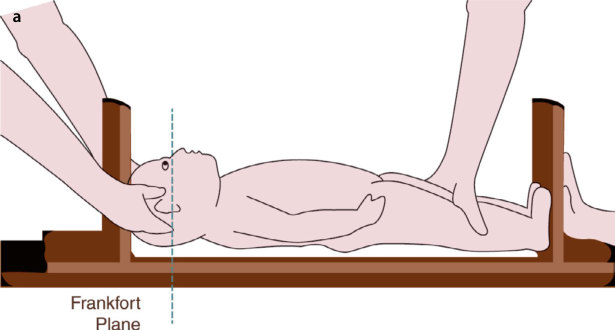
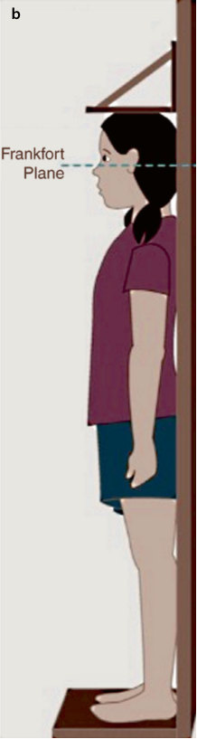
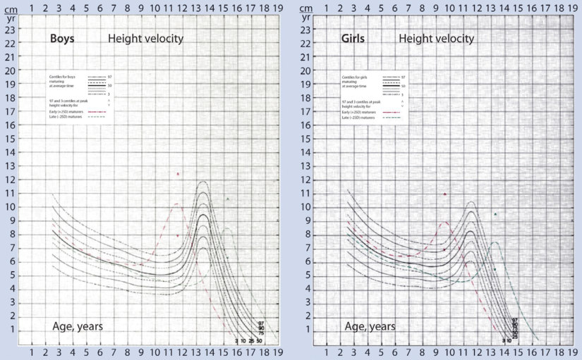
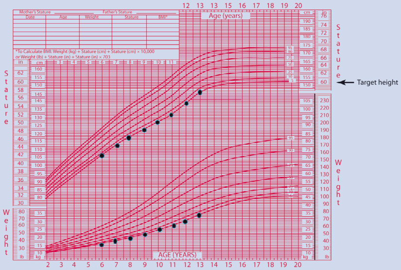
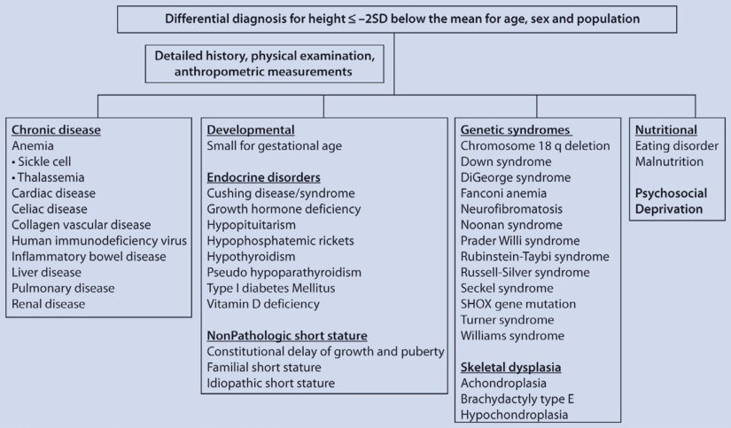
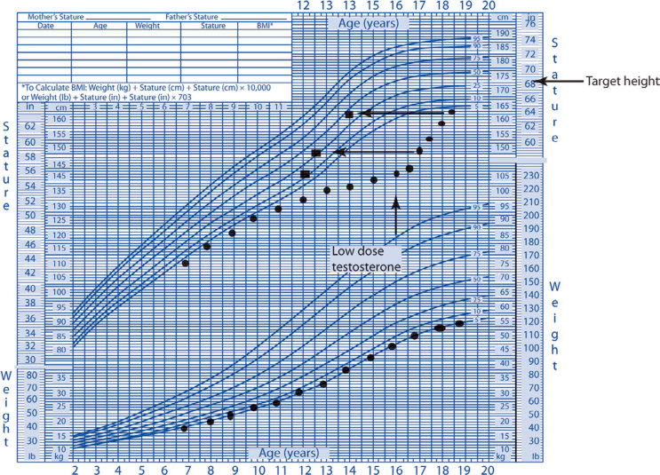

# 3. Normal Variant and Idiopathic Short Stature
> [Source credits](../../SOURCE_CREDITS.md).

## Study pillars

### Definitions and Categorization

Idiopathic Short Stature (ISS) describes children whose height is >2.25 SD below the population mean (<1.2th percentile) with normal birth weight/length, normal body proportions, no evidence of systemic, endocrine, nutritional, or chromosomal abnormalities, and normal growth hormone sufficiency. Normal variants include Familial Short Stature (FSS) and Constitutional Delay of Growth and Puberty (CDGP).

PDF p. 96

### Auxologic Differentiation

In FSS, bone age is consistent with chronological age, growth velocity is normal, and height tracks along or slightly below the target midparental height. In CDGP, bone age is delayed (typically 2-4 years), growth deceleration occurs during infancy and late childhood, onset of puberty is delayed, but growth continues for a longer duration, resulting in an adult height near midparental target.

PDF p. 96

### Diagnostic Evaluation

Evaluation includes serial auxology (height velocity over ≥6-12 months), target midparental height calculation, left hand/wrist bone age radiography, and exclusion of occult pathology (celiac serology, CBC, ESR, renal/hepatic panels, thyroid function, karyotype/microarray in girls to rule out Turner syndrome). GH testing shows normal peak GH (≥10 mcg/L).

PDF p. 98

### Management Options

For CDGP, reassurance and observation are first line; in boys ≥14 years with psychosocial distress, a short course of low-dose testosterone (50-100 mg IM monthly for 3-6 months) accelerates secondary sexual characteristics and linear growth without accelerating bone age disproportionately. For severe ISS (height SDS <-2.25 with predicted adult height <-2 SD), FDA-approved rhGH (somatropin) at 0.30-0.37 mg/kg/week (43-53 mcg/kg/day) produces an average adult height gain of 3.5-7.5 cm.

PDF p. 102

### Outcomes and Prognosis

Height gains with somatropin are variable; early age at initiation, higher dose, greater degree of short stature, and adherence predict superior response. Aromatase inhibitors (e.g., anastrozole, letrozole) can delay epiphyseal fusion in adolescent males, though bone health and long-term vertebral outcomes require cautious monitoring.

PDF p. 104

## Full source extraction

# 3. Normal Variant and Idiopathic Short Stature
> Source attribution: [Source credits](../../SOURCE_CREDITS.md).

## PDF page 91 | printed page 73

### Normal Variant and Idiopathic Short Stature

Evan Graber and Mary M. Lee

Contents

3.1 Introduction – 74

3.2 Auxologic Methods to Assess Growth – 74

3.2.1 Length and Height Measurement – 74 3.2.2 Growth Velocity – 76 3.2.3 Anthropometric Measurements – 76 3.2.4 Bone Age – 77 3.2.5 Dental Age – 77 3.2.6 Target Height – 77

3.3 Etiology and Clinical Presentation – 78

3.3.1 Normal Variant Short Stature – 78 3.3.2 Familial Short Stature – 79 3.3.3 Idiopathic Short Stature – 79

3.4 Diagnostic Evaluation – 80

3.5 Management of Normal Variant and Idiopathic Short Stature – 84

3.6 Outcomes and Possible Complications – 86

3.7 Summary – 88

References – 90

© The Author(s), under exclusive license to Springer Nature Switzerland AG 2024 S. Radovick, M. Misra (eds.), Pediatric Endocrinology, https://doi.org/10.1007/978-3-031-66296-6_3

## PDF page 92 | printed page 74

Key Points

5 Familial short stature and constitu

tional delay of growth and puberty are normal physiologic variants of growth. 5 Familial short stature, constitutional

### 3

delay of growth and puberty, and idio pathic short stature do not have a known organic etiology. Idiopathic short stature is distinguished from nor mal variant short stature in that pre dicted adult height is below the genetic target height range. 5 In 2003, the FDA approved GH for the

treatment of idiopathic short stature, a controversial decision. 5 Height outcome data for GH-treated

children with idiopathic short stature are variable with a mean gain height of 4–7 cm.

### 3.1 Introduction

Short stature is defined as a height ≤2 stan dard deviations (SD) below the mean for age, sex, and population. Height in a given popula tion follows a normal Gaussian distribution; therefore, it is expected that the height of 2.3% of a population will fall 2 SD below the mean for age and sex [1]. Among this 2.3% of the population, the majority will have a normal variant of short stature or idiopathic short stature, but some may have an underlying pathological etiology.

Normal variant short stature is comprised of familial short stature (FSS) and constitu tional delay of growth and puberty (CDGP). These individuals attain an adult height con sistent with their target genetic height, while individuals with idiopathic short stature have predicted adult heights below their familial target height range. Frequently, FSS and CDGP are considered subtypes of ISS. The growth patterns of individuals with FSS and/ or CDGP, however, are usually consistent with that of a first-degree relative and their adult height conforms with their target height. These diagnoses, therefore, most suitably rep resent “normal variants” of growth [2].

Normal variant and idiopathic short stat ure are considered nonpathological short stat ure, without an organic origin, such as intrauterine growth restriction, chronic dis ease, endocrinopathy, skeletal dysplasia, or genetic disorder.

### 3.2 Auxologic Methods to Assess

### Growth

### 3.2.1 Length and Height

### Measurement

3.1

3.1 3

4

## PDF page 93 | printed page 75

Fig. 3.1 Length and height measurements with an infant board and wall-mounted stadiometer. Note the position of both the infant’s a and child’s b heads in the

Frankfort plane. (From Foote et al. [3]. Reprinted with permission from Elsevier)

Unmatched source image; PDF page 93. Consult the original caption.

Unmatched source image; PDF page 93. Consult the original caption.

## PDF page 94 | printed page 76

mass index should be plotted on the CDC growth charts for children ages 2–20 years [5].

Because birth length reflects intrauterine factors, an infant’s weight and length may cross growth percentiles during the first 2 years of life, gravitating toward percentiles consistent with their genetic potential. Thereafter, significant shifts in length or height percentiles should not occur, except for children with CDGP, who may continue to exhibit a decline in length or height percentile until ages 3–4. At that time, they maintain a normal linear growth velocity and will grow at a consistent percentile. Height measurements tend to be 1 cm less than length measure ments; therefore, length measurements need to be adjusted when plotted on a height chart. This difference accounts for the apparent decline in growth rate when a child is transi tioned from a length measurement to a stand ing height.

### 3

Assessing a child’s pattern of weight gain, linear growth, and gain in head circumference is important for the evaluation of short stat ure and overall health. Pathological causes of poor growth secondary to nutritional causes or chronic disease typically affect weight gain, then linear growth, and finally head circum ference. However, disorders of malabsorp tion, such as celiac disease, may sometimes initially present with normal weight gain, but poor growth. In contrast, children with endo crine disorders typically present with normal or increased weight gain and poor linear growth.

### 3.2.2 Growth Velocity

3.2

6

### 3.2.3 Anthropometric

### Measurements

The evaluation of a child with a height 2 SD below the mean for age and sex should include anthropometric measurements of upper and lower segments, or sitting height, arm span, and occipitofrontal head circumference to assess for disproportion and possible skeletal dysplasia. Arm span is measured with the child standing in an erect position against a wall with outstretched arms. The distance between the tips of the middle phalanges is measured. In prepubertal children, the arm span is shorter than height, and after midpu berty the arm span exceeds height. In an adult male, arm span exceeds height by 5.2 cm and in an adult female by 1.2 cm. Ethnic differ ences exist as well, with longer arm spans noted in the African American population. Arm span can be measured in a sitting or supine position if the child is unable to stand. A sitting height (SH) is measured with the child seated on a chair flush against the stadi ometer. Subtracting the sitting height from the child’s standing height (HT) provides the value of their lower segment (LS). The SH/ HT ratio or SH/LS ratio can be plotted on their appropriate charts to determine whether these ratios are disproportionate and sugges tive of skeletal dysplasia. An alternative approach is to measure the child’s lower seg ment from the symphysis pubis to the floor and subtract this value from the child’s stand ing height for their truncal height. The upper to lower segment ratio decreases throughout childhood and adolescence. Due to an increased truncal length relative to limbs,

## PDF page 95 | printed page 77

Fig. 3.2 Height velocity charts for boys and girls. (From Tanner and Davies [6]. Reprinted with permission from Elsevier)

infants have an upper to lower segment ratio of 1.7. By age 3 the upper to lower segment ratio decreases to 1.3, by age 10 this ratio decreases to 1, and in pubertal children, the ratio is <1. Children with CDGP have increased leg length and shortened truncal height which accounts for their decreased upper to lower segment ratios of 0.8–0.9.

### 3.2.4 Bone Age

Skeletal maturation is evaluated by assessing epiphyseal maturation with bone age radio graphs, using the methods of either Greulich and Pyle or Tanner-Whitehouse. The former method compares a child’s left-hand radio graph to standard bone age radiographs of the left hands of mid-western boys and girls from birth through age 18 [7]. The Tanner- Whitehouse method assigns a value to each of the 27 epiphyses in the hand and wrist and sums these values for the skeletal maturity score, which correlates with specific bone ages as determined for select populations [8]. Bayley-Pinneau also provides a table for the

percent of adult height achieved at given bone ages, which can be used to calculate a child’s predicted adult height [9]. Variations in bone age readings among providers and inaccurate height measurements can limit the accuracy of a child’s height prediction.

### 3.2.5 Dental Age

Loss of the primary teeth and eruption of permanent teeth correlate with bone age but can vary due to environmental influences. Tooth calcification as determined on an orthopantomogram is less variable and corre sponds better with dental age [10, 11]. Growth hormone deficiency (GHD), hypothyroidism, and CDGP are associated with delayed dental age and bone age.

### 3.2.6 Target Height

In the 1970s, Tanner et al. defined target height as either the addition or subtraction of 6.5 cm from the mean parental height for a

Unmatched source image; PDF page 95. Consult the original caption.

## PDF page 96 | printed page 78

boy or girl, respectively. Two SD represents 11 cm above or below the calculated target height [12]. The target height is used to deter mine a child’s expected adult height based on their genetic potential. Measuring the parents’ heights at the child’s visit improves the accu racy of the target height calculation. Starting in the 1990s, researchers devised alternative formulas to calculate the target height because the method of Tanner either underestimated or overestimated the height of a child with short or tall parents, respectively. These for mulas also tried to account for population trends and secular height trends. The 2008 consensus statement from the Growth Hormone Research Society, the Lawson Wilkins Pediatric Endocrine Society, and the European Society for Paediatric Endocrinology Workshop recommended using a corrected target height SD in lieu of the Tanner method. The corrected target height is calculated as 0.72 × the average of the father’s and mother’s height SD with the lower limit of the target height as the cor rected target height minus 1.6 SD [13].

### 3

The evaluation of a child with short stat ure requires a review of their previous growth data, accurate length and/or height measure ments, a calculated target height, bone age, predicted adult height, and possibly arm span and upper to lower segment ratio. Analyzing auxologic data in conjunction with a detailed history and physical examination is essential for determining whether a child’s short stature is a normal variant or due to an underlying disorder.

### 3.3 Etiology and Clinical

### Presentation

### 3.3.1 Normal Variant Short Stature

### 3.3.1.1 Constitutional Delay

### of Growth and Puberty

In CDGP, the growth rate declines and crosses percentiles in the first 2–3 years of life. Usually, by age 3–4 years, growth resumes

normal rate and the bone age is delayed (often 2–3 SD delay). Other features of CDGP include delayed pubertal onset and eventual attainment of an adult height consistent with midparental target range. Most children with CDGP exhibit a pattern of weight gain that mirrors their linear growth at less than 2 SD below the mean for age, sex, and population or at a lower percentile than their target growth percentile. Individuals with CDGP are frequently referred to as “late bloomers” and often have a first- or second-degree relative(s) with a history of delayed onset of puberty (defined as the onset of puberty for males as >13 years of age and for females as >12 years of age) and a similar growth pattern.

6

3.2

Forty percent of children with constitu tional delay of growth and puberty also have familial short stature [14]. Even with a strong family history of CDGP, as with FSS, other identifiable causes of short stature and delayed puberty should be excluded, which is dis cussed in Sect. 3.4.

Several studies report a 2:1–5:1 male to female predominance of CDGP [15, 16]. Wehkalampi et al.’s retrospective study evalu ated the prevalence of a positive family his tory in children with CDGP. The findings in this study challenge this male predominance because CDGP was equally prevalent in mothers and fathers. The authors suggest that referral bias may account for the reported male predominance in CDGP. The published data support an autosomal dominant pattern of inheritance for CDGP [15–17]. Heterozygous mutations in the GH secreta gogue receptor gene (GSHR), a ghrelin recep

## PDF page 97 | printed page 79

tor gene, were identified in two females with CDGP, suggesting an autosomal dominant mode of inheritance with incomplete pene trance. Further studies are needed to better define the association of mutations in this gene with CDGP [18]. Researchers have not found mutations in the acid labile subunit, leptin, or the leptin receptor in individuals with CDGP [19, 20].

### 3.3.2 Familial Short Stature

Children with FSS have normal linear growth with height measurements ≤−2 SD below the mean for age, sex, and population and a pre dicted adult height consistent with their target height. They also have a bone age consistent with their chronologic age, a normal growth velocity and timing of pubertal, and short stature in at least one of the parents.

Fig. 3.3 Weight and height data for a girl with familial short stature plotted on the CDC growth chart [5]. Note the normal growth velocity along the 5th percentile

3.4

3.3

### 3.3.3 Idiopathic Short Stature

Idiopathic short stature is defined is a height ≤−2.25 SD below the mean for age, sex, and population. ISS is distinguished from the normal variant short stature by a pre dicted adult height more than 2 SD below the child’s target height range. The term “idio

Unmatched source image; PDF page 97. Consult the original caption.

## PDF page 98 | printed page 80

pathic” implies that the etiology of the short stature is unknown and is not due to FSS, CDGP, or another identifiable cause as dis cussed in detail in Sect. 3.4.

Since the FDA approved the use of GH for the treatment of ISS in 2003, genetic technol ogy has advanced in such a way as to be able to identify defects that had previously been unknown causes of short stature, blurring the line between what is now considered “idio pathic” short stature and genetic short stature. Alterations in the GH receptor gene, STAT 5b, acid labile subunit, and IGF-1 gene have been described in patients with a diagnosis of ISS [21]. One study utilized whole exome sequencing leading to the identification of genetic causes of short stature in 5 of 14 chil dren with prior diagnoses of ISS with a height ≤−3 SD below the mean for age and sex. Prior to whole exome testing, these chil dren had extensive evaluations, including standard genetic testing, that did not identify a cause for their short stature. Two of the five patients had the progeroid form of Ehlers- Danlos syndrome, and the other diagnoses included 3-M syndrome (overlapping features with Russell-Silver syndrome), Floating- Harbor syndrome, and a variant of the Kenny-Caffey syndrome with eucalcemia. However, in addition to short stature, these patients had dysmorphic features and/or other medical conditions that suggested a syn dromic cause of short stature [22].

### 3

Several other genetic etiologies have since been identified in which the only significant finding has been short stature. The most well known is the SHOX gene, which now has its own indication for use of GH. Mutations in NPR2, ACAN, IGF1, IGF1R, and FGFR3 have all been found to be associated with iso lated short stature [23]. Prior to the identifica tion of genes such as these, patients may have been classified as having ISS. As more altera tions in genes involved in stature are identi fied, the definition of ISS or criteria for treatment of ISS may need to evolve.

In summary, ISS is a diagnosis of exclu sion, determined after a comprehensive evalu ation fails to find an identifiable etiology for

the short stature. Rare genetic disorders should be considered as a cause for short stat ure in children with a height ≤−3 SD below the mean for age and sex, especially in the presence of dysmorphic features and/or other medical diagnoses. Debate remains about whether treatment of short stature should be offered to those previously classified as ISS who are now known to have a genetic cause of their short stature.

### 3.4 Diagnostic Evaluation

The evaluation of a child with a height ≤−2 SD below the mean for age, sex, and popula tion should include a comprehensive history and physical examination with anthropomet ric measurements. A detailed history should assess for risk factors for hypopituitarism, such as traumatic birth, postnatal hypoglyce mia, jaundice, and/or microphallus in male infants. A low birth weight and length may suggest short stature secondary to small for gestational age or Russell-Silver syndrome. A history of lymphedema, pedal edema, and/or cardiac anomalies may suggest Turner or Noonan syndrome. In girls with short stature, it is well established that Turner syndrome should be excluded even in the absence of overt clinical findings. A karyotype is not rou tinely done in boys but could be considered when the predicted adult height is below tar get height because 45X/46XY mosaicism may present with short stature and an otherwise normal phenotype. GH treatment can be con sidered for this condition [24]. Determining whether to test for a SHOX gene mutation is best determined by the established clinical scoring system for this condition. Rappold et al. found that an increased body mass index, decreased arm span/height ratio, Madelung deformity, short, bowed forearms, dislocation of the ulna at the elbow, and muscular hyper trophy were most predictive of this gene muta tion [25]. Children with a history of developmental delay and findings suggestive of a chromosomal disorder warrant further evaluation by a geneticist. Furthermore, the

## PDF page 99 | printed page 81

evaluation should include an assessment for endocrine disorders such as hypothyroidism, isolated GH deficiency, and in some cases, Cushing disease/syndrome. Other causes of short stature to consider are chronic diseases, eating disorders, and psychosocial depriva tion.

26

3.4

If the comprehensive history, physical examination, and auxologic data are not sug gestive of a specific disorder, then screening

Fig. 3.4 Diagnoses to consider when evaluating a child with short stature

studies to exclude an identifiable etiology are indicated [13]. The diagnostic studies to con sider when evaluating a child with short stat ure are listed below. A retrospective chart review of 235 asymptomatic patients (defined as normal history, review of systems, and physical examination) referred to a large aca demic pediatric endocrinology center for short stature (height ≤−2 SD below the mean for age, sex, and population) demonstrated that these screening studies had a low yield for organic disease and were not cost-effective. Only 37% of the patients had prior growth records available as part of their evaluation. The authors suggest monitoring growth veloc ity over a 6-month period in asymptomatic children and then considering screening stud ies if growth is suboptimal. This differs from the earlier recommendations in the 2008 Consensus Statement on the Diagnosis and Treatment of Children with Idiopathic Short Stature (ISS) [27]. The most recent Pediatric Endocrine Society Guideline regarding GH treatment recommends shared decisionmaking with families when considering whether or not to treat a child with idiopathic short stature [28].

Unmatched source image; PDF page 99. Consult the original caption.

## PDF page 100 | printed page 82

Assessing children for GHD is an impor tant part of the evaluation when growth veloc ity is lower than expected. Since GH is secreted in a pulsatile fashion throughout the day with more frequent pulses overnight, random GH levels are typically nondiagnostic. GH medi ates the production of IGF-1 and IGF BP-3 from the liver; these levels are stable through out the day, serving as a better screening test for GHD. Normal ranges for IGF-1 and IGF BP-3 are based on age, sex, and the Tanner stage in prepubertal and pubertal children, respectively. Low or low/normal IGF-1 and IGF BP-3 levels should prompt further evalu ation with provocative GH stimulation test ing. Isolated low IGF-1 can be seen in children with undernutrition and may warrant delay ing GH stimulation testing until weight is improved. GH is measured at several time points following the administration of a GH secretagogue, such as clonidine, arginine,

### 3

l-Dopa, propranolol, glucagon, or insulin. A single GH value of ≥10 ng/mL on two pro vocative GH stimulation tests indicates GH sufficiency. Debate exists as to whether a lower GH peak should be used to indicate a normal stimulation test. In peripubertal and early pubertal children, priming with sex steroids (testosterone or estradiol), prior to the testing is indicated to prevent misdiagnosis of GHD [29–31]. An increase in GH amplitude and mean 24 h GH levels occurs between Tanner stages 2–4 and 3–5 in girls and boys, respec tively. Girls exhibit increased mean nocturnal GH levels and GH amplitude prior to the onset of breast development which coincides with the start of their pubertal growth spurt. In contrast, boys in the early stages of puberty have lower mean nocturnal GH levels and amplitude that are comparable to that of a prepubertal boy [32]. These data support the role of sex steroids on GH secretion and explain the decline in growth rate exhibited in boys prior to the onset of puberty. Saggese et al. showed that lower growth hormonereleasing hormone (GHRH) levels in children with delayed puberty may explain their sub normal GH response to stimulation tests. When retested in mid- to late puberty, these

adolescents had a normal GH response, and their GHRH levels were comparable to the control group [33]. A prospective study in Turkey evaluated the adult height of boys with a history of delayed growth and normal testosterone-primed GH stimulation studies. These boys had normal adult heights, consis tent with their mid-parental heights [34]. Müeller et al. and others showed that children with true GHD have an abnormal GH response to sex steroid-primed provocative GH stimulation tests [35, 36].

Adolescents with delayed puberty should have additional labs (gonadotropin levels, serum prolactin, estradiol, and/or testoster one) to assess for causes of pubertal delay. A girl with hypergonadotropic hypogonadism requires further evaluation with a karyotype for Turner syndrome, a common cause of pri mary ovarian failure and short stature with an incidence of 1 in 2500 live births. Fragile X testing should also be performed as girls with premutations can also have primary gonadal failure. Often, boys and girls with Noonan syndrome manifest delayed puberty, but boys more frequently have primary gonadal failure [37]. 46 XX SRY-positive males present with normal male external genitalia, short stature, and primary gonadal failure [38].

## PDF page 101 | printed page 83

and Cushing disease/syndrome). Genetic syn dromes associated with HH and short stature include Prader-Willi syndrome and Werner syndrome. Table 3.1 shows the differential diagnosis and evaluation for delayed puberty.

Distinguishing idiopathic IHH from CDGP is often a challenge because basal and stimulated levels of gonadotropins are low in both conditions until the activation of the hypothalamic–pituitary–gonadal axis. Many studies, limited by a small number of study subjects, were conducted to determine whether basal and GnRH-stimulated FSH and LH levels, basal inhibin B levels, HCG-stimulated testosterone, and/or combinations of these tests can most effectively diagnose IHH. Binder et al.’s retrospective study showed that a combination of basal LH <0.3 IU/L and inhibin B <111 pg/mL had a specificity of 100% and sensitivity of 98% in establishing a diagnosis of IHH [39]. Another retrospective study determined that a peakstimulated LH of 2.8 U/L and 4-day and 19-day HCG-stimulated testosterone cutoff peaks of 1.04 mcg/L and 2.75 mcg/L, respec tively, had 100% sensitivity and specificity for diagnosing IHH [40]. Two prospective studies of basal inhibin B as a diagnostic test for IHH reported discrepant cutoff values. A meta-

Table 3.1 Diagnoses to consider in the evaluation of a child for delayed puberty

Differential diagnosis for delayed puberty Hypergonadotropic hypogonadism Hypogonadotropic hypogonadism

Short stature

Short stature

Turner syndrome

Brain malformations (e.g., hydrocephalus)

Noonan syndrome

Brain tumor (craniopharyngioma and prolactinoma)

Normal male phenotype of 45 X/46XY

Craniospinal irradiation

46XX SRY-positive male

Head trauma

Gonadal radiation/chemotherapy for cancer

Hypothyroidism

(e.g., cyclophosphamide, ifosfamide, and procarbazine)

Neurosurgical treatment

Pituitary transcription factor mutations (Prop-1,

Short stature (GH deficiency excluded)

Constitutional delay of growth and puberty

Isolated hypogonadotropic hypogonadism

Normal/tall stature

Normal/tall stature

Primary ovarian failure

Kallmann syndrome

Triple X syndrome

Klinefelter’s syndrome

analysis demonstrated a pooled sensitivity and specificity of 92% for inhibin B as a test to distinguish IHH from CDGP. However, the included studies were heterogeneous in meth odology and study size, making the results dif ficult to interpret. FSH-stimulated inhibin B levels have shown promise in distinguishing these two conditions [41]. A study examining kisspeptin-stimulated LH levels suggested that a stimulated level of 0.8 mIU/mL or greater accurately predicted puberty in all participants, whereas, in all participants with a stimulated level less than or equal to 0.4 mIU/mL, puberty did not occur by age 18. However, the study only had eight patients in each study group [42]. Further studies are needed to determine which set of tests, if any, can accurately distinguish between delayed puberty and hypogonadism [43–46].

Diagnostic Screening Studies for Evaluation of Short Stature and/or Delayed Puberty

Screening studies for height ≤−2 SD mean for age, sex, and population

5 CBC

5 Electrolytes

5 Calcium, phosphorous, alkaline phospha

tase

HESX-1, LHX-3 SOX-3)

### Automatic table extraction — verify rendered original

|Hypergonadotropic hypogonadism|Hypogonadotropic hypogonadism|
|---|---|
|_Short stature_  Turner syndrome  Noonan syndrome  Normal male phenotype of 45 X/46XY  46XX SRY-positive male  Gonadal radiation/chemotherapy for cancer (e.g., cyclophosphamide, ifosfamide, and procarbazine)|_Short stature_  Brain malformations (e.g., hydrocephalus)  Brain tumor (craniopharyngioma and prolactinoma)  Craniospinal irradiation  Head trauma  Hypothyroidism  Neurosurgical treatment  Pituitary transcription factor mutations (Prop-1, HESX-1, LHX-3 SOX-3)|
||_Short stature (GH defciency excluded)_  Constitutional delay of growth and puberty  Isolated hypogonadotropic hypogonadism|
|_Normal/tall stature_  Primary ovarian failure  Triple X syndrome  Klinefelter’s syndrome|_Normal/tall stature_  Kallmann syndrome|

[Original table](../../tables/ch003_p0101_1.jpg)

## PDF page 102 | printed page 84

5 ESR

5 Celiac panel (total IgA and tissue trans

glutaminase IgA) 5 TSH, Free T4

5 IGF-1, IGF BP-3

5 Karyotype for girls (consider for boys)

### 3

5 Bone age

5 Consider skeletal survey based on anthro

pometric measurements and/or growth rate

Screening studies for delayed puberty

5 Gonadotropins (pedi-LH and pedi-FSH,

recommend third-generation assay) 5 Testosterone or estradiol

5 Prolactin

5 Depending on the above results, a karyo

type or head MRI may be indicated

### 3.5 Management of Normal

### Variant and Idiopathic Short Stature

Children with normal variant short stature and ISS are healthy and do not have an iden tifiable cause for their short stature. Management should include reassurance and follow-up to monitor growth, pubertal devel opment, and other auxologic growth parame ters to confirm that the child follows the anticipated pattern of growth. Ongoing sur veillance of the child’s growth pattern is important because, despite an extensive evalu ation, a diagnosis such as mild hypochondro plasia or pseudohypoparathyroidism may not be clinically and diagnostically evident until the child is older [47–49]. In certain cases, the option to treat may be considered and is an individualized decision that needs to be clearly discussed with the family. As peers progress through puberty and differences in pubertal development and stature become more appar ent, despite reassurance, many boys with CDGP have a difficult time coping with this discrepancy. The short stature and/or delay in puberty from CDGP can significantly impact the psychological and emotional well-being of

an adolescent, causing poor school perfor mance and self-esteem, withdrawal from social activities, and even depression and anx iety [50]. Treatment with low-dose testoster one is an option for boys with difficulty coping with their short stature and delayed puberty [51]. Depot-testosterone enanthate or cypio nate 50 mg IM every 4 weeks for 3–6 months will frequently invoke an increase in growth rate and pubertal onset without bone age advancement. Testosterone enanthate con tains a sesame seed oil and testosterone cypi onate, a cotton seed oil, and should be avoided in individuals with allergies to these oils. The response to treatment should be evaluated within 4–6 months following the last testoster one dose. If the response is inadequate, then an additional 3- to 6-month course of testos terone at an equal or higher dose may be administered [52, 53]. Recently, other prepa rations of testosterone have been used for pubertal induction, including testosterone gel 10 mg every other day. Studies examining the use of subcutaneous testosterone enanthate and oral testosterone undecanoate are ongo ing [54].

In contrast to boys, girls have a growth spurt in early puberty. Therefore, girls infre quently seek treatment for CDGP because their onset of puberty is accompanied by a pubertal growth spurt. In extreme cases of CDGP, a girl can be treated with either, oral ethinyl estradiol 5 mcg daily, or low-dose estradiol transdermal patch, 3.1–6.2 mcg/24 h (1/8 to 1/4 of a 25 mcg patch), to initiate puberty and stimulate linear growth.

Oxandrolone , a weak, synthetic, and non aromatizing anabolic steroid derivative of tes tosterone is an oral treatment option for CDGP. Oxandrolone 0.1 mg/kg/day for 3–4 months can be considered for pubertal initiation and acceleration of growth. Crowne and colleagues’ double-blind, placebocontrolled trial showed comparable increases in growth velocity and testicular development in boys treated with either a 3-month course of oxandrolone 2.5 mg daily or testosterone 50 mg every 4 weeks [55].

## PDF page 103 | printed page 85

Increased interest in aromatase inhibitors as a potential treatment option for boys with CDGP and ISS stems from their inhibition of the conversion of androgens to estrogens. Cessation of growth depends on estrogenmediated fusion of the epiphyses; therefore, lower estrogen levels may delay epiphyseal closure, improving adult height prognosis. Mauras et al. performed a 2–3-year random ized controlled trial in 76 pubertal boys with ISS and a bone age <14.5 years comparing three different treatment arms, an aromatase inhibitor (letrozole or anastrozole) vs. GH alone (0.3 mg/kg/week) vs. combination ther apy (aromatase inhibitor and GH). Outcome measures included changes in predicted adult height, bone density, bone markers, IGF-1, lean body mass, and the degree of estradiol suppression by the individual aromatase inhibitors. The best height gain outcomes were seen in the group receiving both GH and aromatase inhibition, followed by the GH alone and aromatase inhibitor alone groups, respectively. This report did not note any adverse effect on bone, which had been previ ously suggested by another study examining boys with ISS treated with letrozole [56].

Karmazin et al. reported that 25% of study subjects treated with letrozole developed adre nal suppression determined by a low-dose ACTH stimulation test [57]. The aromatase inhibitor, anastrozole, increases sperm count in males with infertility, yet concern exists as to whether it can affect sperm production in adolescent males. Mauras et al. analyzed sperm counts in 11 young adults, age 18, with GH deficiency treated with anastrozole for 29 months. No difference was found in the sperm counts between the treated and untreated cohorts, but low sperm counts were found in both groups [58]. Currently, due to conflicting data on adult height gain and the lack of long-term studies, a formal recom mendation on the use of aromatase inhibitors for ISS or CDGP cannot be made.

In 2003, the Food and Drug Administration (FDA) approved GH treatment (0.3–0.37 mg/ kg/week) for children with ISS defined as a

height of ≤−2.25 SDS (1.2 percentile) below the mean for age and sex “and associated with growth rates unlikely to permit attainment of adult height in the normal range, in pediatric patients whose epiphyses are not closed and for whom diagnostic evaluation excludes other causes associated with short stature that should be observed or treated by other means” [59]. The lower cutoff for the normal range adult height is defined as 160 cm (63 in.) for a male and 150 cm (59 in.) for a female. This statement issued by the FDA does not clearly exclude GH treatment for children with FSS and CDGP.

Prior to the FDA approval of GH treat ment for ISS, several nonrandomized, longi tudinal studies were published that used variable dosing regimens of GH. Metaanalyses of randomized and nonrandomized controlled studies indicated a variable response to treatment with gains in height ranging from 2.3 to 8.7 cm [60–65]. The GH adverse effect profile reported in these studies did not differ from that of children treated with GH for other conditions. Some studies suggest that adult height outcomes are opti mized with earlier initiation of GH treatment and with higher doses [66, 67].

GH treatment requires monitoring of growth velocity and adjustment of GH dose to achieve an adequate response. The 2008 International Consensus Meeting on ISS rec ommended monitoring IGF-1 levels to assess dosing, adherence, and to prevent overtreat ment, with a goal of a level above 0 SDS and within the normal limits for age [68]. Dosing is usually started at the upper end of the dos ing range used for GHD (0.24 mg/kg/week) but may need to be titrated to as high as 0.47 mg/kg/week. There are no data that sup port doses higher than this and lack of response at this highest dose should prompt a discussion of discontinuing therapy [28].

Lee et al. calculated a cost analysis of treating a 10-year-old child with GH 0.37 mg/ kg/week with an endpoint of a 1.9 in. gain in height over 5 years. The gain in height and GH dose used for this analysis were derived

## PDF page 104 | printed page 86

from the two studies that the FDA used to approve GH treatment for ISS. The analysis revealed a cost of approximately $52,000 per in. of height gain [69]. An estimated 400,000 children would qualify for GH treatment based on the FDA’s criteria for GH treatment of children with a height of <1.2nd percentile. Although the FDA statement that children with a “form of short stature that can be observed or otherwise managed by other means” refers to children with FSS and CDGP, these diagnoses are not clearly excluded from the FDA indications for GH treatment for short stature. The exorbitant cost of GH weighed against treating an other wise healthy child has generated controversy over the use of GH as a “lifestyle drug,” a term used to refer to a “pharmaceutical prod uct characterized as improving quality of life rather than alleviating disease” [70]. Debate also exists regarding whether having short stature should be considered a “medically necessary” intervention given the lack of data with respect to whether being taller improves psychological or physical outcomes. Additionally, the goals of treatment are unclear with respect to whether to treat to “normal” height or “maximal height” [71, 72].

### 3

Conflicting study outcomes have been reported on the efficacy of a combination treatment with GH and a GnRH agonist for pubertal children with ISS and SGA. Many of the studies are small and nonrandomized and do not include control groups. Kamp and colleague’s randomized controlled study of combination treatment in pubertal children with ISS and SGA showed that predicted adult height in the treated groups improved by 8 cm in girls and 10.4 cm in boys [73]. These researchers also analyzed the adult height and bone mineralization of 32 of the 40 partici pants who participated in the original 3-year study and found that the treated group had a net gain of 4.9 cm above their predicted adult and target heights compared to the control group. The bone mineralization was similar between the treated and control groups except for a lower lumbar spine bone mineralization SD score in the treated boys (n = 6) compared to the control group (n = 2) [74].

### 3.6 Outcomes and Possible

### Complications

Adult height outcome data in children with CDGP vary, with some studies showing impaired adult height and in others, an adult height consistent with target height. These studies found that the Bayley-Pinneau method as opposed to the Tanner-Whitehouse method of height prediction correlated best with the child’s adult height. Factors negatively impacting the adult height prognosis in chil dren with CDGP included a shorter period between the onset of puberty and peak height velocity, a lower peak height velocity, a shorter sitting height, and a faster tempo of puberty [75].

Proponents of treatment advocate that short stature negatively impacts a child’s psy chosocial development [76, 77]. In contrast, others have shown that GH does not improve psychosocial health. The Wessex study, a lon gitudinal controlled study, evaluated whether short stature impacts a child’s academic, social, and behavioral development. The study and control groups consisted of 5-yearolds recruited from two school districts in the South of England. The study group had a height at or below the 3rd percentile and was matched with a control group of peers of the same sex, age, and grade with normal stature (10–90th percentile). These cohorts had test ing at ages 7–9, 11–13, and 18–20 years to determine whether their short stature affected their academic and psychosocial develop ment. After adjusting for socioeconomic sta tus, the two groups did not differ with respect to intelligence quotient, self-esteem, or behav ior [78–80]. Other studies that examined pedi atric endocrinology patients evaluated for short stature showed no effect on psychoso cial function [81, 82].

In contrast, an observational study by González Briceno examined 74 short children with a median age of 10.2 years who were treated with GH for 1 year. This group, as well as their parents, filled out questionnaires regarding quality of life prior to treatment versus after 1 year of treatment. The study found that both parents and the treated chil

## PDF page 105 | printed page 87

dren reported an increase in social and emo tional quality of life after GH treatment. The study was limited in that there was no control group and although the results were statisti cally significant, it is unclear if they translate to being clinically relevant. The placebo effect could also be responsible for the increased scores as opposed to a true improvement based on GH treatment and an increase in height [83]. More studies are needed to deter mine if GH treatment increases the quality of life in children with ISS.

The Sante Adulte GH Enfant (SAGhE) study led by French investigators reported on the long-term mortality of approximately 7000 GH-treated patients for diagnoses of isolated GH deficiency, ISS, and SGA. Mortality was evaluated 16.9 years fol lowing the cessation of GH treatment and compared to that in the general French popu lation. This study found an increase in mor tality due to cerebrovascular events and bone tumors among individuals treated with GH,

Case Study

LA was referred at age 16 to a pediatric endo crinologist for evaluation of short stature and delayed puberty. His growth chart (below) shows a normal linear growth trajectory but parallel to the 3rd percentile before the age of 12. Between ages 12 and 16, his growth velocity declined to 3 cm/year. A comprehensive history revealed no significant past medical history, and a complete review of the systems was unre markable. Family history was significant for CDGP; both the patient’s father and brother completed their growth in their early to mid- 20s. LA was doing well in school but was upset by the lack of secondary sexual development. His physical examination revealed Tanner 2 pubic hair and genitalia with testicles measur ing 4 mL. LA had a delayed bone age of 12 years. An extensive workup revealed a nor

particularly in those treated with higher doses of GH, exceeding 50 mcg/kg/day [84]. The SAGhE study design had several shortcom ings that may have influenced these findings. Mortality in the treated group was compared to the general French population as opposed to an identically matched, untreated control group. Also, the reported association between the higher dose of GH and increased mortal ity was in a small number of subjects, many of whom had a diagnosis of SGA [85]. A pre liminary report from the EU SAGhE Study conducted in Belgium, the Netherlands, and Sweden did not show an association between adult mortality in 2543 patients treated with GH during childhood for isolated GH defi ciency, ISS, or SGA [86]. Due to limitations of the SAGhe study design, the FDA, Endocrine Society, Pediatric Endocrine Society, and Hormone Research Society con cluded that it is safe to continue to treat chil dren with ISS, isolated GH deficiency, and SGA with GH [85].

mal CBC, complete metabolic panel, ESR, IGA 110 mg/dL, negative tissue transglutamin ase antibody titer, TSH 1 uIU/mL, free T4 1.2 ng/dL, IGF-1 201 ng/mL (normal Tanner 2: 56–432 ng/mL), IGF BP-3 4.4 mg/L (normal Tanner 2: 2.3–6.3 mg/L), normal prolactin 9 ng/mL, and gonadotropins consistent with early puberty (FSH 3.9 uIU/mL, LH 0.94 uIU/ mL, and testosterone 22 ng/mL).

How Should LA Be Managed?

3.5

## PDF page 106 | printed page 88

### 3

Fig. 3.5 Weight and height data for a boy with constitutional delay of growth and puberty treated with a 6-month course of low-dose testosterone.

### 3.7 Summary

A comprehensive history, physical examina tion, current and past auxologic data, and diagnostic studies are essential for evaluating children with short stature to exclude an organic etiology. The growth patterns of chil dren with normal variant short stature typi cally reflect a familial pattern of growth in that there is at least one parent with short stat ure. Children with CDGP frequently have a family history of a first- or second-degree rel ative with a similar pattern of late puberty and growth. Often, children with CDGP also have FSS as the cause of their short stature. Children with normal variant short stature require reassurance and follow-up to ascer tain that they follow the expected course of growth and pubertal development for these normal physiologic variants of growth. Low-

Data points are plotted on the CDC growth chart [5]. ● represents height and ■ represents bone age

dose testosterone treatment effectively initi ates puberty in boys with CDGP without advancing their bone age and compromising their adult height.

ISS is differentiated from the normal vari ant short stature in that the predicted adult height falls below the target height range for that child. These children are GH sufficient and do not have an identifiable cause for their short stature. Treatment of ISS with GH remains controversial in the medical commu nity because of the costs, variable responses to treatment, and lack of data regarding the effect on quality of life. GH treatment for ISS should be individualized and the growth expectations explained to families. Children who are treated with GH should be closely monitored for side effects and assessed for an adequate response by monitoring growth velocity.

Unmatched source image; PDF page 106. Consult the original caption.

## PDF page 107 | printed page 89

Although the SAGhE study initially raised concern regarding a potential increase in long-term mortality from GH treatment of isolated GH deficiency, SGA, and ISS, the limitations of this study created an awareness that well-designed controlled studies are needed to effectively determine the long-term safety of GH and did not alter current guide lines on the use of GH.

Review Questions

1. Which of the following findings distin

guish ISS from CDGP and FSS? A. Bone age B. Predicted adult height is less than

v Answers

the target height range C. Family medical history D. Height ≤−2 SD below the mean

1. B. Individuals with ISS have a pre

for age, sex, and population

2. Based on the FDA 2003 approval of GH

for the treatment of children with short stature, which diagnoses could poten tially qualify for treatment with GH? A. ISS B. FSS C. CDGP D. All of the above

2. D. In 2003 the FDA approved GH for

3. Which of the following provisions were

included in the FDA approval state ment for GH treatment for children with short stature? A. Height at or below 1.2nd percentile

for age and sex B. Predicted adult height is below

150 cm (4′11′′) for a woman and 160 cm (5′3′′) for a man C. The short stature is not due to an

3. D. All of the above statements are

identifiable cause D. All of the above

4. D. Bone density is not an auxologic

4. Which of the following is not an auxo

logic measure of growth? A. Growth velocity B. Head circumference C. Arm span D. Bone density

5. A. All three of these parameters pro

5. You are asked to evaluate a 5-year-old

boy with both height and weight at the

1st percentile. Your evaluation includes a comprehensive history and physical examination. Which of the following data are essential for evaluating the child’s short stature?

A. Prior growth data, target height,

and bone age B. Bone age, target height, and head

circumference C. Target height, bone density, and

growth velocity D. Sitting height, arm span, and

upper to lower segment ratio

dicted adult height more than 2 SD below their target height. Individuals with CDGP and FSS have a predicted adult height within 2 SD of their target height.

the treatment of children with a height less than 2.25 SD below the mean for age, sex, and population “and associ ated with growth rates unlikely to per mit attainment of adult height in the normal range, in pediatric patients whose epiphyses are not closed and for whom diagnostic evaluation excludes other causes associated with short stat ure that should be observed or treated by other means.” Based on this state ment, children with ISS, FSS, and CDGP may qualify for treatment with GH.

included in the FDA 2003 criteria for growth hormone treatment of children with short stature.

measure of growth. Choices A, B, and C are all auxologic measures of growth.

vide essential information for the initial assessment of this child’s short stature. Prior growth data provide information about growth velocity. Target height is an auxologic growth measure utilized

## PDF page 108 | printed page 90

to determine whether a child’s growth potential falls within the expected range for their genetic potential and should be utilized cautiously as certain growth disorders are genetic. Lastly, bone age provides information about skeletal maturity and potential adult height. The auxologic growth parame ters in the other choices would not be essential for the initial assessment.

12. Tanner 13. Cohen P, Rogol AD, Deal C, Saenger P, Reiter EO,

### 3

14. Soliman AT, De Sanctis V. An approach to consti

### References

15. Wehkalampi K, Widén E, Laine T, Palotie A,

1. Wit JM, Clayton PE, Rogol AD, Savage MO,

Saenger PH, Cohen P. Idiopathic short stature: definition, epidemiology and diagnostic evalua tion. Growth Horm IGF Res. 2008;18(2):89–110. 2. Pedicelli S, Peschiaroli E, Violi E, Cianfarani

16. Palmert MR, Sedlmeyer IL. Delayed puberty:

S. Controversies in the definition and treatment of idiopathic short stature (ISS). J Clin Res Pediatr Endocrinol. 2009;1(3):105–15. 3. Foote JM, Brady LH, Burke AL, et al.

17. Sedlmeyer 18. Pugliese-Pires PN, Fortin JP, Arthur T, Latronico

Development of an evidence-based clinical prac tice guideline on linear growth measurement of children. J Pediatr Nurs. 2011;26:320–1. 4. Centers for Disease Control and Prevention. Use

of World Health Organization and CDC growth charts for children aged 0–59 months in the United States. MMWR. 2010;59(RR-9):1–15. 5. Centers for Disease Control and Prevention,

National Center for Health Statistics. Clinical growth charts. 16 Jun 2017. http://www.cdc.gov/ growthcharts/clinical_charts.htm. 6. Tanner JM, Davies PSW. Clinical longitudinal

19. Banerjee I, Hanson D, Perveen R, Whatmore A,

standards for height and height velocity for North American children. J Pediatr. 1985;107(3):317–29. 7. Greulich WW, Pyle SI. Radiograph atlas of skele

20. Banerjee I, Trueman JA, Hall CM, Price DA, Patel

tal development of the hand and wrist. 2nd ed. Stanford: Stanford University Press; 1959. 8. Thodberg HH, Juul A, Lomholt J, Martin DD,

et al. Adult height prediction models. In: The handbook of growth and growth monitoring in health and disease. New York: Springer; 2009. p. 1–14. 9. Bayley N, Pinneau SR. Tables for predicting adult

21. Bhangoo A, Anhalt H, Rosenfeld R. Idiopathic

height from skeletal age: revised for use with the Greulich-Pyle hand standards. J Pediatr. 1952;40(4):423–41. 10. Kumar V, Sundeep Hegde K, Bhat SS. The rela

22. Guo MH, Shen Y, Walvoord EC, Miller TC, Moon

tionship between dental age, bone age and chrono logical age in children with short stature. Int J Contemp Dent. 2011;2(4):6–11. 11. Vallejo-Bolaños E, España-López AJ. The rela

23. Jee YH, Andrade AC, Baron J, Nilsson O. Genetics

24. Richter-Unruh A, Knauer-Fischer S, Kaspers S,

tionship between dental age, bone age and chrono logical age in 54 children with short familial stature. Int J Paediatr Dent. 1997;7(1):15–7.

JM, Goldstein H, Whitehouse RH. Standards for children’s height at ages 2–9 years allowing for heights of parents. Arch Dis Child. 1970;45:755–62.

et al. Consensus statement on the diagnosis and treatment of children with idiopathic short stature: a summary of the Growth Hormone Research Society, the Lawson Wilkins Pediatric Endocrine Society, and the European Society for Paediatric Endocrinology Workshop. J Clin Endocrinol Metab. 2008;93(11):4210–7.

tutional delay of growth and puberty. Indian J Endocrinol Metab. 2012;16(5):698–705.

Dunkel L. Patterns of inheritance of constitu tional delay of growth and puberty in families of adolescent girls and boys referred to specialist pediatric care. J Clin Endocrinol Metab. 2008;93(3):723–8.

analysis of a large case series from an academic center. J Clin Endocrinol Metab. 2002;87(4):1613–20. IL, Hirschhorn JN, Palmert MR. Pedigree analysis of constitutional delay of growth and maturation: determination of familial aggregation and inheritance patterns. J Clin Endocrinol Metab. 2002;87(12):5581–6.

AC, Mendonca BB, et al. Novel inactivating muta tions in the GH secretagogue receptor gene in patients with constitutional delay of growth and puberty. Eur J Endocrinol. 2011;165:233–41.

Black GC, Clayton PE. Constitutional delay of growth and puberty is not commonly associated with mutations in the acid labile subnunit. Eur J Endocrinol. 2008;158:473–7.

L, et al. Phenotypic variation in constitutional delay of growth and puberty: relationship to spe cific leptin and leptin receptor gene polymor phisms. Eur J Endocrinol. 2006;155:121–6.

short stature. In: Lifshitz F, editor. Pediatric endo crinology, vol. 2. New York: Informa Health Care; 2007. p. 51–64.

JE, Hirschhorn JN, Dauber A. Whole exome sequencing to identify genetic causes of short stat ure. Horm Res Paediatr. 2014;82:44–52.

of short stature. Endocrinol Metab Clin North Am. 2017;46(2):259–81.

Albrecht B, Gillessen-Kaesbach G, Hauffa BP. Short stature in children with an apparently normal male phenotype can be caused by 45, X/46,

## PDF page 109 | printed page 91

XY mosaicism and is susceptible to growth hor mone treatment. Eur J Pediatr. 2004;163:251–6. 25. Rappold G, Blum WF, Shavrikova EP, et al.

37. Kelnar CJ. Noonan syndrome: the hypothalamo-

Genotypes and phenotypes in children with short stature: clinical indicators of SHOX haploinsuffi ciency. J Med Genet. 2007;44(5):306–13. 26. Pereda A, Garin I, Garcia-Barcina M, et al.

38. Anik A, Catli G, Abaci A, Böber E. 46 XX, male

39. Binder G, Schweizer R, Blumenstock G, Braun

Brachydactyly E: isolated or as a feature of a syn drome. Orphanet J Rare Dis. 2013;8:141. 27. Sisley S, Trujillo MV, Khoury J, Backeljauw P. Low

incidence of pathology detection and high cost of screening in the evaluation of asymptomatic short children. J Pediatr. 2013;163(4):1045–51. 28. Grimberg A, DiVall SA, Polychronakos C, Allen

40. Segal TY, Mehta A, Anazodo A, Hindmarsh PC,

DB, Cohen LE, Quintos JB, et al. Guidelines for growth hormone and insulin-like growth factor-I treatment in children and adolescents: growth hor mone deficiency, idiopathic short stature, and pri mary insulin-like growth factor-I deficiency. Horm Res Paediatr. 2016;86:361–97. 29. Rosenbloom A. Sex hormone priming for growth

41. Chaudhary S, Walia R, Bhansali A, Dayal D,

hormone stimulation testing pre- and early adoles cent children is evidence based. Horm Res Paediatr. 2011;75(1):75–80. 30. Lazar L, Philip M. Is sex hormone priming in peri

42. Chan YM, Lippincott MF, Barroso PS, Alleyn C,

pubertal children prior to growth hormone stimu lation tests still appropriate? Horm Res Paediatr. 2010;73:299–302. 31. Wyatt DT, Mark D, Slyper A. Survey of growth

43. Coutrant R, Biette-Demeneix E, Bouvattier C,

hormone treatment practices by 251 pediatric endocrinologists. J Clin Endocrinol Metab. 1995;80(11):3292–7. 32. Rose SR, Municchi G, Barnes KM, Kamp GA,

et al. Spontaneous growth hormone secretion increases during puberty in normal girls and boys. J Clin Endocrinol Metab. 1991;73:428–35. 33. Saggese G, Cesaretti G, Giannessi N, Bracaloni

44. Adan L, Lechevalier P, Couto-Silva AC, Boissan

C, Cinquanta L, Cioni C. Stimulated growth hormone secretion (GH) in children with delays in pubertal development before and after the onset of puberty: relationship with peripheral plasma GH-releasing hormone and somatosta tin levels. J Clin Endocrinol Metab. 1992;74:272–8. 34. Gonc EN, Kandemir N, Ozon A, Alikasifoglu

45. Kaissi AA, Farr S, Ganger R, Hofstaetter JG,

A. Final heights of boys with normal growth hor mone responses to provocative tests following priming. J Pediatr Endocrinol Metab. 2008;21(10):963–71. 35. Müeller GA, Keller A, Reich A, Hoepffner W,

46. Gao Y, Du Q, Liu L, Liao Z. Serum inhibin B for

et al. Priming with testosterone enhances stimu lated growth hormone secretion in boys with delayed puberty. J Pediatr Endocrinol Metab. 2004;17:77–83. 36. Martínez AS, Domené HM, Ropelato MG, Jasper

47. Rutter MM, Smith EP. Pseudohypoparathyroidism

48. Donghi V, Mora S, Zamproni I, Chiumello G,

HG, Pennisi PA, Escobar ME, Heinrich JJ. Estrogen priming effect on growth hormone (GH) provocative test: a useful tool for the diagno sis of GH deficiency. J Clin Endocrinol Metab. 2000;85(11):4168–72.

49. Harrington J, Palmert M. Distinguishing constitu

adrenal and hypothalamo-gonadal axes. Horm Res. 2009;72(Suppl 2):24–30.

disorder of sexual development: a case report. J Clin Res Pediatr Endocrinol. 2013;5(4):258–60.

R. Inhibin B plus LH vs GnRH agonist test for distinguishing constitutional delay of growth and puberty from isolated hypogonadotropic hypogo nadism in boys. Clin Endocrinol. 2015;82(1):100–5.

Dattani MT. Role of gonadotropin-releasing hor mone and human chorionic gonadotropin stimula tion tests in differentiating patients with hypogonadotropic hypogonadism from those with constitutional delay of growth and puberty. J Clin Endocrinol Metab. 2009;94(3):780–5.

Sachdeva N, Singh T, Bhadada SK. FSHstimulated inhibin B (FSH-iB): a novel marker for the accurate prediction of pubertal outcome in delayed puberty. J Clin Endocrinol Metab. 2021;106(9):e3495–505.

Brodsky J, Granados H, et al. J Clin Endocrinol Metab. 2020;105(8):e2717–25.

Bouhours-Nouet N, Gatelais F, Dufresne S, Rouleau S, Lahlou N. Baseline inhibin B and antimullerian hormone measurements for diagnosis of hypogonadotropic hypogonadism (HH) in boys with delayed puberty. J Clin Endocrinol Metab. 2010;95(12):5225–32.

M, Trivin C, Brailly-Tabard S, Brauner R. Plasma inhibin B and antimüllerian hormone concentra tions in boys: discriminating between congenital hypogonadotropic hypogonadism and constitu tional pubertal delay. Med Sci Monit. 2010;16(11):CR511–7.

Klaushofer K, Grill F. Treatment of varus defor mities of the lower limbs in patients with achon droplasia and hypochondroplasia. Open Orthop J. 2013;7:33–9.

differentiating between congenital hypogonado tropic hypogonadism and constitutional delay of growth and puberty: a systematic review and metaanalysis. Endocrine. 2021;72:633–43.

type Ia: late presentation with intact mental devel opment. J Bone Miner Res. 1998;13(7):1208–9.

Weber G. Pseudohypoparathyroidism, an often delayed diagnosis: a case series. Cases J. 2009;2:6734.

tional delay of growth and puberty from isolated

## PDF page 110 | printed page 92

hypogonadotropic hypogonadism: critical appraisal of available diagnostic tests. J Clin Endocrinol Metab. 2012;97:3056–67. 50. Rosenfeld RG, Northcraft GB, Hintz RL. A pro

62. Bryant J, Baxter L, Cave CB, Milne R. Recombinant

spective, randomized study of testosterone treat ment of constitutional delay of growth and development in male adolescents. Pediatrics. 1982;69(6):681–7. 51. Richman RA, Kirsch LR. Testosterone treatment

63. Leschek EW, Rose SR, Yanovski JA, Troendle JF,

### 3

in adolescent boys with constitutional delay in growth and development. N Engl J Med. 1988;319:1563–7. 52. Palmert MR, Dunkel L. Delayed puberty. N Engl J

64. Finkelstein BS, Imperiale TF, Speroff T, et al.

Med. 2012;366:443–53. 53. Crowne EC, Wallace WH, Moore C, Mitchell R,

65. Deodati A, Cianfarani S. Impact of growth hor

et al. Effect of low dose oxandrolone and testoster one treatment on the pituitary-testicular and GH axes in boys with constitutional delay of growth and puberty. Clin Endocrinol. 1997;46(2):209–16. 54. Federici S, Goggi G, Quinton R, Giovanelli L,

66. Albertsson-Wikland K, Aronson AS, Gustafsson

Persani L, Cangiano B, et al. New and conolidated therapeutic options for pubertal induction in hypogonadism: in-depth review of the literature. Endocr Rev. 2022;43(5):824–51. 55. Salehpour S, Alipour P, Razzaghy-Azar M,

67. Wit JM, Rekers-Mombarg LT, Cutler GB, et al.

Ardeshirpour L, et al. A double-blind, placebocontrolled comparison of letrozole to oxandrolone effects upon growth and puberty of children with constitutional delay of puberty and idiopathic short stature. Horm Res Paediatr. 2010;74(6):428–35. 56. Mauras N, Ross JL, Gagliardi P, Yu YM, Hossain

68. Cohen P, Rogol AD, Deal CL, Saenger P, Reiter O,

J, Permuy J, et al. Randomized trial of aromatase inhibitors, growth hormone, or combination in pubertal boys with idiopathic, short stature. J Clin Endocriol Metab. 2016;101(12):4984–93. 57. Karmazin A, Moore WV, Popovic J, Jacobson

69. Lee JM, Davis MM, Clark SJ, Hofer TP, Kemper

JD. The effect of letrozole on bone age progres sion, predicted adult height, and adrenal gland function. J Pediatr Endocrinol Metab. 2005;18(3):285–93. 58. Maurus N, Bell J, Snow BG, Winslow KL. Sperm

70. Ashworth M, Clement S, Wright M. Demand,

analysis in growth hormone-deficient adolescents treated with aromatase inhibitor: comparison with normal controls. Fertil Steril. 2005;84(1):239–42. 59. U.S. Food and Drug Administration. 25 Jul 2003.

71. Arnhold IJP, Sandberg DE. Additional consider

https://www.accessdata.fda.gov/scripts/cder/daf/ i n d e x . c f m ? e v e n t = o v e r v i e w . process&ApplNo=019640. 60. Hintz RL, Attie KM, Baptista J, Roche A, for the

72. Allen DB. Growth promotion ethics and the chal

Genentech Collaborative Group. Effect of growth hormone treatment on adult height of children with idiopathic short stature. N Engl J Med. 1999;340(7):502–7. 61. MacGillivray MH, Baptista J, Johanson A. Outcome of a four-year randomized study of daily versus three times weekly somatropin treat ment in prepubertal naive growth hormone-defi cient children. J Clin Endocrinol Metab. 1996;81(5):1806–9.

73. Kamp GA, Mul D, Waelkens JJ, et al. A random

74. van Gool SA, Kamp GA, Visser-van Balen H, Mul

growth hormone for idiopathic short stature in children and adolescents. Cochrane Database Syst Rev. 2007;18(3):CD004440.

et al. Effect of growth hormone treatment on adult height in peripubertal children with idiopathic short stature: a randomized, double-blind, placebo-controlled trial. J Clin Endocrinol Metab. 2004;89(7):3140–8.

Effect of growth hormone therapy on height in children with idiopathic short stature: a metanaly sis. Arch Pediatr Adolesc Med. 2002;156:230–40.

mone therapy on adult height of children with idiopathic short stature: systematic review. BMJ. 2011;342(11):c7157.

J, et al. Dose-dependent effect of growth hormone on final height in children with short stature with out growth hormone deficiency. J Clin Endocrinol Metab. 2008;93(11):4342–50.

Growth hormone(GH) treatment to final height in children with idiopathic short stature: evidence for a dose effect. J Pediatr. 2005;146(11):45–53.

et al. Consensus statement on the diagnosis and treatment of children with idiopathic short stature: a summary of the Growth Hormone Research Society, the Lawson Wilkins Pediatric Endocrine Society, and the European Society for Paediatric Endocrinology Workshop. J Clin Endocrinol Metab. 2008;93:4210–7.

AR. Estimated cost-effectivenss of growth hor mone therapy for idiopathic short stature. Arch Pediatr Adolesc Med. 2006;160(3):263–9.

appropriateness and prescribing of ‘lifestyle drugs’: a consultation survey in general practice. Fam Pract. 2002;19(3):236–41.

ations to the ethics of growth promotion and chal lenges to human growth hormone (hGH)-for-height therapy. Horm Res Paediatr. 2017;88:305–6.

lenge to resist cosmetic endocrinology. Horm Res Paediatr. 2017;87:145–52.

ized controlled trial of three years of growth hor mone and gonadotropin-releasing hormone agonist treatment in children with idiopathic short stature and intrauterine growth retardation. J Clin Endocrinol Metab. 2001;86(7):2969–75.

D, Waelkens JJJ, et al. Final height outcome after three years of growth hormone and gonadotropinreleasing hormone agonist treatment in short ado

## PDF page 111 | printed page 93

lescents with relatively early puberty. J Clin Endocrinol Metab. 1997;92(4):1402–8. 75. Poyrazoğlu S, Günöz H, Darendeliler F, Saka N,

Bundak R, Bas F. Constitutional delay of growth and puberty: from presentation to final height. J Pediatr Endocrinol Metab. 2005;18(2):171–9. 76. Stabler B. Impact of growth hormone therapy on

83. González Briceño LG, Viaud M, Beltrand J,

quality of life along the lifespan of GH-treated patients. Horm Res. 2001;56(Suppl 1):55–8. 77. Stabler B, Siegel PT, Clopper RR, Stoppani CE,

Compton PG, Underwood LE. Behavior change after growth hormone treatment of children with short stature. J Pediatr. 1998;133:366–73. 78. Voss L, Walker J, Lunt H, Wilkin T, Betts P. The

84. Carel JC, Ecosse E, Landier F, Meguellati-Hakkas

Wessex growth study: first report. Acta Paediatr Scand. 1989;340(Suppl):65–72. 79. Downie AB, Mulligan J, Stratford RJ, Betts PR,

85. Rosenfeld RG, Cohen P, Robison LL, Bercu BB,

Voss LD. Are short normal children at a disadvan tage? The Wessex growth study. BMJ. 1997;314:97–100. 80. Ulph F, Betts P, Mulligan J, Stratford RJ. Personality functioning: the influence of stat ure. Arch Dis Child. 2004;89(11):17–21. 81. Sandberg DE, Brook AE, Campos SP. Short stat

86. Savendahl L, Maes M, Albertsson-Wikland K,

ure: a psychosocial burden requiring growth hor mone therapy? Pediatrics. 1994;94:832–40. 82. Kranzler JH, Rosenbloom AL, Proctor B,

Diamond F, Watson M. Is short stature a handi

cap? A comparison of the psychosocial function ing of referred and nonreferred children with normal short stature and children with normal stature. J Pediatr. 2000;136(1):96–102.

Flechtner I, Dassa Y, Samara-Boustani D, et al. Improved general and height-specific quality of life in children with short stature after 1 year on growth hormone. J Clin Endocrinol Metab. 2019;104:2103–11.

D, et al. Long-term mortality after recombinant growth hormone treatment for isolated growth hormone deficiency or childhood short stature: preliminary report of the French SAGhE study. J Clin Endocrinol Metab. 2012;97(2):416–25.

Clayton P, et al. Long-term surveillance of growth hormone therapy. J Clin Endocrinol Metab. 2012;97(1):68–72.

Borgström B, et al. Long-term mortality and causes of death in isolated GHD, ISS and SGA patients treated with recombinant growth hor mone during childhood in Belgium, The Netherlands, and Sweden: preliminary report of 3 countries participating in the EU SAGhE study. J Clin Endocrinol Metab. 2012;97(2):E213–7.
