# 5. Growth Hormone Therapy in Children with Prader–Willi Syndrome
> [Source credits](../../SOURCE_CREDITS.md).

## Study pillars

### Genetics and Pathophysiology

Prader-Willi Syndrome (PWS) is a complex neurogenetic disorder resulting from loss of expression of paternal genes in the 15q11.2-q13 imprinted region, caused by paternal deletion (65-75%), maternal uniparental disomy 15 (20-30%), or imprinting defects (1-3%). Pathophysiology is characterized by hypothalamic dysfunction producing severe neonatal hypotonia, infantile feeding failure, followed by insatiable hyperphagia, morbid obesity, hypogonadism, and growth hormone deficiency.

PDF p. 137

### Body Composition Abnormalities

Individuals with PWS have a distinct body composition phenotype characterized by high fat mass and reduced lean muscle mass, even in infancy prior to the onset of obesity. Decreased spontaneous physical activity, resting energy expenditure, and motor strength are driven by intrinsic somatotroph hyposecretion and central neuromuscular alterations.

PDF p. 139

### Benefits of rhGH Therapy

Somatropin therapy substantially alters the natural history of PWS: it accelerates linear growth, normalizes adult height, increases lean muscle mass, reduces body fat percentage, elevates resting energy expenditure, and improves motor strength, physical agility, and cognitive developmental scores.

PDF p. 140

### Safety and Respiratory Precautions

Reports of sudden death following rhGH initiation in severely obese infants with PWS led to stringent safety guidelines. Potential mechanisms include upper airway lymphoid hypertrophy in children with preexisting hypotonia, sleep-disordered breathing, and undiagnosed respiratory tract infections. Mandatory pre-treatment polysomnography (sleep study) and ENT evaluation are required.

PDF p. 147

### Contraindications and Monitoring

Absolute contraindications to initiating rhGH in PWS include severe untreated obesity, uncontrolled obstructive sleep apnea, severe active respiratory infection, and active psychosis. Recommended starting dose is 0.5 mg/m2/day (approx 0.015-0.020 mg/kg/day), titrating to 1.0 mg/m2/day. Polysomnography should be repeated 6-12 weeks after treatment initiation.

PDF p. 148

## Full source extraction

# 5. Growth Hormone Therapy in Children with Prader–Willi Syndrome
> Source attribution: [Source credits](../../SOURCE_CREDITS.md).

## PDF page 136 | printed page 119

### Growth Hormone Therapy in Children with Prader– Willi Syndrome

Aaron L. Carrel and David B. Allen

Contents

5.1 Introduction – 120

5.2 Growth and Growth Hormone in PWS – 121

5.3 Body Composition in PWS – 122

5.4 Effects of hGH Treatment on Body Composition – 123

5.5 Effect of hGH Treatment on Energy Expenditure – 123

5.6 Effects of hGH on Strength and Agility – 123

5.7 Does hGH Significantly Change the “Natural History” of Prader–Willi Syndrome During Childhood? – 124

5.7.1 Body Composition and Growth (See Fig. 5.1) – 125 5.7.2 Carbohydrate and Lipid Metabolism (See Fig. 5.2) – 125 5.7.3 Motor Strength (See Fig. 5.3) – 127

5.8 Effect of GH on Cognition – 128

5.9 Safety of GH Treatment in PWS – 130

5.10 Summary – 133

References – 134

© The Author(s), under exclusive license to Springer Nature Switzerland AG 2024 S. Radovick, M. Misra (eds.), Pediatric Endocrinology, https://doi.org/10.1007/978-3-031-66296-6_5

## PDF page 137 | printed page 120

Key Points In infants and children with PWS, GH ther apy:

5 Increases linear growth and improves

body composition (specifically increased lean body mass and decreased fat mass), markers of metabolic health, and bone density in children with PWS. 5 Enhances early life motor skills and

### 5

possibly cognitive skill development. 5 Requires concomitant screening for and

correction of sleep-related breathing disorders. 5 Has efficacy and risk that is not signifi

cantly influenced by PWS genotype.

### 5.1 Introduction

Prader–Willi syndrome (PWS) is a neuroge netic developmental disorder caused by the loss of expression of the paternal chromo some 15q11–13. This was initially described by Prader, Labhart, and Willi in 1956 and is characterized by obesity, hypotonia, hyper phagia, short stature, cognitive delays, delayed motor skill acquisition, hypothalamic dys function, and hypogonadism [1]. This posi tion on chromosome 15(q11–13) is a critical region active only in the paternally inherited chromosome. PWS occurs due to the deletion of the paternal allele (approximately 70–75% of cases) or the presence of maternal unipa rental disomy (UPD, approximately 25% of cases). Thus, PWS was the first human disor der associated with imprinting [2, 3]. Rare genetic causes of PWS involve translocations, molecular defects, or errors of the imprinting center. Although several genes and gene prod ucts of the PWS region of chromosome 15q11–13 have been identified, the specific genes involved in the pathogenesis are not completely understood [4–6]. With an inci dence of 1 in every 12,000 births, PWS is the most common syndrome causing marked obe sity.

Many features of PWS suggest hypotha lamic dysfunction, some with endocrine implications including, but not limited to: short stature, hyperphagia, sleep disorders, deficient growth hormone (GH) secretion, central hypothyroidism, and hypogonadism [7]. Other fundamental defining features in children with PWS include abnormal body composition with increased fat mass and decreased lean body mass [8]. Infants with PWS typically demonstrate poor weight gain and hypotonia that precede hyperphagia and obesity. However, even at this young age, the percent body fat measurements are increased [9]. Early abnormalities in body composition in PWS, therefore, are present prior to the onset of characteristic hyperphagia and pro gressive obesity and are qualitatively similar to that observed in patients with GH defi ciency (increased percent body fat and decreased muscle mass). Supporting these clinical findings, diminished GH secretion in children with PWS is well documented [10] and distinguished from reduced GH secretion observed in nutritional obesity by relatively low IGF-1 (insulin-like growth factor-1) levels in addition to the aforementioned distinct abnormalities in body composition.

To alleviate abnormalities in linear growth and body composition, and because most children with PWS show evidence for subnor mal GH secretion, recombinant human GH (hGH) therapy for children with PWS has been actively investigated. Several studies show that hGH treatment increases growth and improves (but does not normalize) body composition, energy expenditure, and strength and agility in children with PWS [11–15], and increases growth and enhances the gain of motor skills in infants and toddlers with PWS [16–18].

This chapter reviews the causes of and potential treatments for impaired growth, body composition, and physical function observed in children with PWS. Growth fail ure due to PWS is an approved indication for hGH therapy in the US (with disordered body composition being an additional hGH indica

## PDF page 138 | printed page 121

tion in Europe). However, treatment of these children has illuminated other benefits of hGH therapy (improvements in body compo sition, physical strength and function, and increased energy expenditure)—which may exceed linear growth promotion in health and quality of life importance to children with PWS.

### 5.2 Growth and Growth Hormone

### in PWS

Linear growth of children with PWS is char acterized by mild to moderate intrauterine (average −1 SDS) as well as postnatal growth delay. Between ages 2 and 4, when caloric intake increases and obesity begins to develop, growth rates typically normalize, but true catch-up in length/height relation ship is unusual. The hands and feet tend to be particularly small. Growth rates during childhood are close to normal, but the lack of normal pubertal growth frequently results in reduced adult stature (mean 152 cm for adult PWS male, 146 cm for adult PWS female) [19, 20]. Growth impairment in PWS cannot be attributed to any known intrinsic bone or cartilage abnormality. Consequently, attention has focused on possible defective hypothalamic regulation of the growth pro cess. Growth hormone responses to insulin, arginine, clonidine, l-dopa, or GH-releasing hormone (GHRH) are low-normal or blunted in PWS, as are sleep-induced GH secretion and 24-h integrated GH concentra tions. One study of 54 consecutive children with PWS revealed GH-deficient levels (<10 ng/mL following clonidine provocation) in all patients [11].

Analysis of these results is complicated by the fact that GH secretion is often suppressed in non-GHD obese individuals and partially returns toward normal with weight loss [21]. The reason for this effect of obesity on GH secretion remains unclear, although negative feedback by IGF-1 levels sustained by a state

of overnutrition has been proposed [22]. Nevertheless, substantial evidence supports the existence of a true GH-deficient state in PWS. Children with PWS display borderline normal or diminished growth rates and delayed skeletal maturation, in contrast to normal or accelerated growth and bone age advancement typically seen in healthy non- PWS obese children. It is possible that over nutrition and its effects on insulin and IGF-1 production in children with PWS ameliorate growth retardation and skeletal maturation delay normally associated with severe GH deficiency, as it does in some children follow ing craniopharyngioma surgery. Insulin levels are lower in children with PWS than in “healthy obese” children, suggesting relatively heightened insulin sensitivity compatible with reduced GH secretion and action [23].

Levels of IGF-1 are relatively low in chil dren with PWS (mean −1.5 SDS) compared to normal-weight age-matched children but not as low as in those with severe GHD, a dif ference likely attributable to the responsive ness of IGF-1 levels to nutritional excess even in the presence of GHD [24]. That nutritionstimulated IGF-1 production sustains nearnormal growth in children with PWS is supported by the observation that strict caloric restriction curtails growth more severely in PWS patients than in obese chil dren. Additionally, IGF-1 levels tend to be slightly higher in PWS children treated with hGH compared to non-PWS children treated with hGH [24].

Finally, even children with PWS with nor mal weight/height ratios show low GH responses to provocation [25]. While a normal weight/height does not indicate normal body composition in PWS (which could theoreti cally affect GH secretion), important differ ences in body composition between PWS patients and individuals with “simple” obesity constitute a strong indication of abnormal GH secretion in PWS. The role of GH insuf ficiency during early development is discussed below as this relates to the accretion of lean body mass and fat mass.

## PDF page 139 | printed page 122

Early studies of the effect of exogenous hGH treatment of children with PWS focused on growth rate acceleration and improvement in stature as primary therapeutic goals. Multiple groups demonstrated an increase in average growth in hGH-treated children with PWS; average growth rate increased from −1.9 to +6.0 SDS during the first year of hGH administration (0.1 IU/kg/day) compared to a decrease from −0.1 to −1.4 SDS in nontreated PWS children.

### 5

While studies have consistently shown that hGH increases short-term growth velocity in children with PWS, questions regarding long-term changes in height have remained. Longer-term studies (5 years) provide addi tional evidence supporting a significant and sustained growth response to daily hGH administration [15, 26, 27]. In a comparison of the linear growth in 21 children with PWS treated with hGH for 6 years to that of 27 ageand gender-matched children with PWS naïve to hGH, the hGH-treated children exhibited significantly greater height (131 ± 2 cm vs. 114 ± 2 cm; p < 0.001) [28]. Similarly, 36 chil dren with PWS demonstrated a significant increase in mean height of 1.2 standard devia tions during 2–3 years of hGH therapy, and the increment of improvement did not differ significantly by subtype (deletion vs. UPD of 15q11–13 region). In addition, response to GH in 56 other children with PWS also did not differ by genetic subtype (p = 0.14) during the first year of therapy [29]. With regard to eventual height attainment, PWS children receiving long-term hGH therapy reached a mean adult height standard deviation score (SDS) of −0.3 (compared to −3.1 SDS in untreated controls, p < 0.0001). Together, these findings indicate that hGH is effective at increasing growth rate and adult height attain ment in children with PWS regardless of genetic subtype [19, 30].

### 5.3 Body Composition in PWS

Children with PWS display markedly abnor mal body composition characterized by very high (predominantly subcutaneous) fat mass

and very low lean body mass. Combined with short stature, relatively low IGF-1 compared to BMI-matched peers, and low GH responses to provocation, this phenotype strongly resembles other GH deficiency (GHD) states. The recognition of GHD as a possible com ponent of PWS sparked interest in trials of hGH therapy in children with PWS to improve body composition as well as height.

Infants with PWS demonstrate hypotonia and often have failure to thrive due to poor sucking and swallowing reflexes. Elevated body fat determined by skinfold measure ments in underweight infants with PWS sug gests early alterations in their body composition prior to the development of obe sity [31], confirmed by the determination of reduced lean body mass and energy expendi ture [9]. Between the second and fourth year of life, progressive obesity occurs primarily as a consequence of excessive caloric intake but also due to decreased energy expenditure and reduced physical movement. The inherent body composition abnormality of childhood PWS persists during caloric restriction so that even if excess weight gain is minimized, the ratio between lean body mass and fat remains abnormal. Since resting energy expenditure (REE) is largely determined by the metabolic activity of lean body mass, REE is signifi cantly reduced in individuals with PWS (∼60% of predicted caloric utilization for non-PWS individuals with similar body sur face area) [9]. This extremely low “caloric tol erance” accounts for progressive weight gain in PWS children even when caloric restriction has been successfully maintained.

The body composition seen in PWS [9, 32] is clearly distinguishable from the parallel increase in lean body and fat mass observed in over-nourished obese non-PWS individuals. The distinctive replacement of lean body mass by fat mass in PWS further supports that diminished GH secretion is secondary to hypothalamic dysfunction rather than obesity and that abnormal body composition and reduced energy expenditure, linear growth, muscle strength, and pulmonary function might be improved in PWS by hGH therapy [13, 33–35].

## PDF page 140 | printed page 123

### 5.4 Effects of hGH Treatment

### on Body Composition

Growth hormone is an anabolic hormone that promotes the development of lean muscle mass and stimulates lipolysis of fat for energy usage. The administration of hGH to GHdeficient children not only restores linear growth but also promotes the growth of lean body mass, decreases fat mass by increasing fat oxidation and total body energy expendi ture, increases bone mineral density following an initial period of increased bone resorption, and improves cardiovascular risk factors [36]. Evidence shows that hGH therapy for 12–48 months in children with PWS decreases fat mass, increases lean body mass, increases linear growth [13, 24, 37], and in one study, increased fat utilization [11]. In these children, these “nonheight” clinical effects, which impact physical function (see later section), are arguably more valuable than changes in growth velocity [3, 38–41].

Like effects on the growth rate, long-term effects of hGH upon body composition are also dose dependent. Response of children with PWS to hGH is greatest during the first 12 months. Beyond that, in one study, persis tent changes in body composition (lack of increase in fat mass and increase in lean body mass), growth velocity, and REE occurred with administration of either 1 or 1.5 mg/m2/ day of hGH, but not with 0.3 mg/m2/day [12]. Prior improvements in BMD and strength and agility, which occurred during an initial 24 months, were sustained during these addi tional 24 months (48 months total) regardless of dose. The rate of change in body composi tion slowed but did not regress during more prolonged hGH therapy at doses ≥1.0 mg/m2/ day. It is important to note that changes in BMD and body composition normally occur with growth and advancing age. Nevertheless, changes in hGH-treated children with PWS exceed those reported over a 24-month period in healthy non-PWS late-childhood subjects based on reference data for BMD and fat-free mass. In summary, a diminution in response to hGH during prolonged hGH therapy,

observed in virtually all growth studies of hGH therapy, applies to other GH metabolic effects in children with PWS.

### 5.5 Effect of hGH Treatment

### on Energy Expenditure

Deficiency of GH is associated with lipogen esis and fat storage predominating over the accretion of lean mass, even in the absence of overt obesity. Preference for fat utilization as an energy source is reflected in a reduction of respiratory quotient (RQ). RQ normally ranges from 0.7 (strong predominance of fatty acid oxidation) to 1.0 (exclusive oxidation of carbohydrate) to <1.0 (indicating lipogenesis from carbohydrate). Two years of hGH treat ment in PWS children was associated with a decrease in RQ values (0.81 + 0.07 at baseline to 0.75 + 0.06 at 24 months, p < 0.05), indicat ing increased utilization of fat for energy. Thus, compared with non-hGH-treated PWS controls, hGH-treated PWS patients demon strated a positive shift in energy derived from oxidation of fat, coinciding with reductions in fat mass. Clinically, reduced body fat can be seen, consistent with an increase in fat utiliza tion.

### 5.6 Effects of hGH on Strength

### and Agility

Specific changes in increased muscle mass and decreased body fat are seen with hGH therapy compared to nontreated PWS children. Documented changes in physical function (strength and agility testing) in PWS children treated with GH, accompanied by the acquisi tion of new gross motor skills, appear to be important “real-life” benefits for these chil dren. One of the most debilitating aspects of PWS is related to hypotonia, so that increases in motor strength and function are an extremely important area of assessment. One study utilized a modified Bruininks–Oseretsky test to test strength and agility, with four sub

## PDF page 141 | printed page 124

tests for different muscle groups of the body. Children with PWS who received early hGH treatment demonstrated improved functional motor strength of increased standing broad jump with an adjusted-least-squares mean of 22.9 ± 2.1 in. vs. 14.6 ± 1.9 in. (p = 0.01) and sit-ups 12.4 ± 0.9 vs. 7.1 ± 0.7 (p < 0.001). Trends were seen in the two other areas of the Bruininks–Oseretsky testing, including improved agility run (8.9 ± 1.3 s vs. 11.6 ± 1.1 s; p = 0.1) and weight-lifting (63.9 ± 6.6 vs. 49.6 ± 5.7; p = 0.09), although these did not reach statistical significance [11]. While these findings suggest that hGH therapy may poten tially lessen some disabilities associated with PWS, determining the long-term value of this intervention requires a demonstration of sus tained benefits during more prolonged ther apy.

### 5

Substantial documentation has accumu lated to support the beneficial effects of hGH therapy on improving body composition and linear growth in children with PWS. However, perhaps of greatest importance to patients and their families is the hope that hGH ther apy would improve the child’s physical strength, activity, and ability. Early reports included anecdotal reports of dramatic gains in physical activity abilities, and many parents of subjects described striking improvements in physical stamina, strength, and agility. Specifically, these included new gross motor skills (e.g., independently climbing up the school bus steps, carrying a gallon carton of milk at the grocery store, participating in a normal gym class without restrictions, being able to join a karate class). These findings have been supported in controlled studies [11, 12, 15, 26, 34, 37].

Research has demonstrated objective measures of changes in physical function during hGH treatment, including a timed run, sit-ups, weight lifting, and respiratory muscle forces [42]. Following 48 months of hGH treatment, improvements in broad jumping and sit-ups were maintained, while further improvement was found in running speed and arm curls. Nevertheless, despite

these gains in physical function, PWS chil dren still scored well below 2 SDS compared to non-PWS children for all parameters stud ied.

### 5.7 Does hGH Significantly Change

### the “Natural History” of Prader–Willi Syndrome During Childhood?

5.1

37 The following figures illustrate the differ ences between children with PWS who received hGH from an early age to agematched hGH-naïve PWS children.

## PDF page 142 | printed page 125

Table 5.1 The least squares means (±SE) adjusted (for age and gender) of body composition, motor function, and lipid profile parameters for the two cohorts

hGH-naïve cohort (N = 27)

Meanb ± SE

% Body fat 44.6 ± 1.8

Fat-free mass (kg) 16.7 ± 0.9

Height (cm) 114.5 ± 1.8

Height z-score −1.6 ± 0.3

Weight (kg) 32 ± 2.3

Standing broad jump (in.) 14.6 ± 2.0

Sit-ups 7.1 ± 0.7

20-yard agility run (s) 11.6 ± 1.1

Weight-lift repetitions 63.9 ± 6.6

IGF-1 (ng/mL) 112 ± 18

IGF-1 SDS −1.45 ± 0.30

HDL cholesterol (mg/dL) 44.9 ± 2.3

LDL cholesterol (mg/dL) 131.3 ± 7.1

Total cholesterol (mg/dL) 189.9 ± 7.3

Triglycerides (mg/dL) 68.4 ± 10.6

Fasting insulin 7.1 ± 1.3

HOMA-IR 1.4 ± 0.3

a Based on the two-sided t-test b Least squares mean, adjusted for age and gender

### 5.7.1

### 5.1

Percent body fat and muscle mass (lean body mass) were assessed by DXA. Lower percent body fat was evident in early hGH treatment children with PWS when compared to the hGH-naïve PWS subjects (adjusted least squares means of 36.1 ± 2.1% vs. 44.6 ± 1.8%; p = 0.006). Fat-free mass (muscle mass) was greater in the children with PWS who received early hGH treatment-treatment

Early treatment cohort (N = 21) p-Valuea

Meanb ± SE

36.1 ± 2.1 0.006

24.1 ± 1.1 <0.0001

131.4 ± 2.1 <0.0001

1.2 ± 0.2 <0.0001

38 ± 2.6 0.062

22.9 ± 2.1 0.012

12.4 ± 1.0 0.0003

8.9 ± 1.3 0.17

49.6 ± 5.7 0.09

346 ± 20 0.001

1.39 ± 0.34 0.0001

58.9 ± 2.6 0.0005

100.2 ± 8.0 0.0099

177.3 ± 8.2 0.29

94.2 ± 11.9 0.14

10.2 ± 1.5 0.14

2.1 ± 0.3 0.1

group compared to the hGH-naïve PWS sub jects (24.1 ± 1.1 kg vs. 16.7 ± 0.9 kg; p = <0.001).

### 5.7.2

### 5.2

Effects on metabolic health have typically focused on carbohydrate and lipid metabo lism. Carbohydrate and lipid metabolism were evaluated using fasting AM blood samples.

### Automatic table extraction — verify rendered original

|Col1|hGH-naïve cohort (N = 27)|Early treatment cohort (N = 21)|p-Valuea|
|---|---|---|---|
||**Meanb ± SE**|**Meanb ± SE**|**Meanb ± SE**|
|% Body fat|44.6 ± 1.8|36.1 ± 2.1|0.006|
|Fat-free mass (kg)|16.7 ± 0.9|24.1 ± 1.1|<0.0001|
|Height (cm)|114.5 ± 1.8|131.4 ± 2.1|<0.0001|
|Height z-score|−1.6 ± 0.3|1.2 ± 0.2|<0.0001|
|Weight (kg)|32 ± 2.3|38 ± 2.6|0.062|
|Standing broad jump (in.)|14.6 ± 2.0|22.9 ± 2.1|0.012|
|Sit-ups|7.1 ± 0.7|12.4 ± 1.0|0.0003|
|20-yard agility run (s)|11.6 ± 1.1|8.9 ± 1.3|0.17|
|Weight-lift repetitions|63.9 ± 6.6|49.6 ± 5.7|0.09|
|IGF-1 (ng/mL)|112 ± 18|346 ± 20|0.001|
|IGF-1 SDS|−1.45 ± 0.30|1.39 ± 0.34|0.0001|
|HDL cholesterol (mg/dL)|44.9 ± 2.3|58.9 ± 2.6|0.0005|
|LDL cholesterol (mg/dL)|131.3 ± 7.1|100.2 ± 8.0|0.0099|
|Total cholesterol (mg/dL)|189.9 ± 7.3|177.3 ± 8.2|0.29|
|Triglycerides (mg/dL)|68.4 ± 10.6|94.2 ± 11.9|0.14|
|Fasting insulin|7.1 ± 1.3|10.2 ± 1.5|0.14|
|HOMA-IR|1.4 ± 0.3|2.1 ± 0.3|0.1|

[Original table](../../tables/ch005_p0142_1.jpg)

## PDF page 143 | printed page 126

### 5

Fig. 5.1 Effect of growth hormone on anthropomet rics in PWS (hGH treated (shaded) vs. untreated). a Demonstrates % body fat, b demonstrates lean mass

Fig. 5.2 Effect of growth hormone on lipids in PWS (hGH treated (shaded) vs. untreated). a Demonstrates HDL and b demonstrates LDL. *Age and gender-matched analysis using ANCOVA

(muscle mass), and c demonstrates height. *Age and gender-matched analysis using ANCOVA

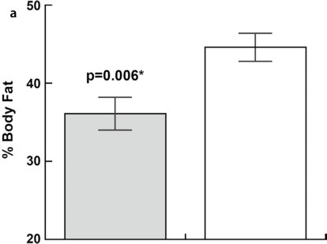

Unmatched source image; PDF page 143. Consult the original caption.

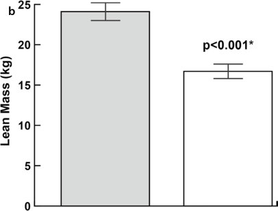

Unmatched source image; PDF page 143. Consult the original caption.

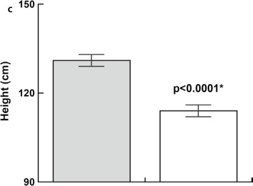

Unmatched source image; PDF page 143. Consult the original caption.

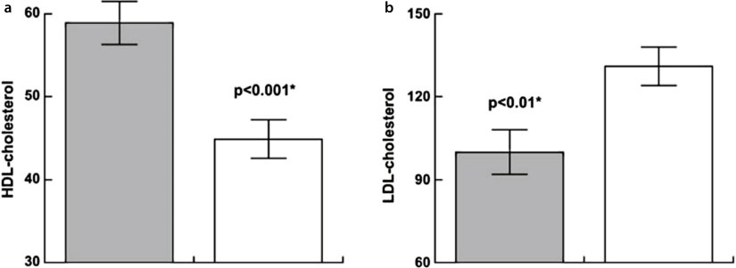

Unmatched source image; PDF page 143. Consult the original caption.

## PDF page 144 | printed page 127

Fig. 5.3 Effect of growth hormone on strength in PWS (hGH treated (shaded) vs. untreated). a Demon strates repetitions in 30 s, b demonstrates broad jump,

### 5.7.3

### 5.3

This analysis of similar-aged children with PWS, one group treated with hGH for 6 years and the other naïve to hGH therapy, offers a unique assessment of the degree to which early-in-life hGH treatment alters the clinical course of this disorder. It also extends and tests the validity of findings of previous stud

and c demonstrates agility. *Age and gender-matched analysis using ANCOVA

ies of hGH therapy in children under age 3 with PWS, none of which had a control group for longer than 12 months.

5.4 18

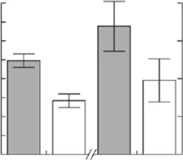

Unmatched source image; PDF page 144. Consult the original caption.

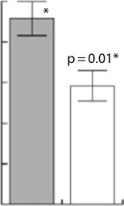

Unmatched source image; PDF page 144. Consult the original caption.

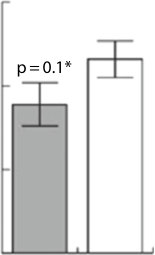

Unmatched source image; PDF page 144. Consult the original caption.

## PDF page 145 | printed page 128

### 5

Fig. 5.4 Longitudinal changes in estimated mar ginal means with SEM in FM% a and LBM index b in group A (27 children with PWS, age start GH treatment <1.05 years) and group C (27 children with PWS, age start GH treatment between 2.27 and 5.00 years) during 8 years of GH treatment. FM% and LBMI are corrected for sex and pubertal stage. *p-Value <0.001, #p-value

### 5.8 Effect of GH on Cognition

43

<0.01, **p-value <0.05. All these p-values are compared to baseline, p-values indicated by the brackets are refer ring to the difference between the subgroups after 8 years. (Grootjen LN, Hokken-Koelega ACS. J Clin Med. 2022 May; 11(9): 2496. Published online 2022 Apr 29. https://doi.org/10.3390/jcm11092496)

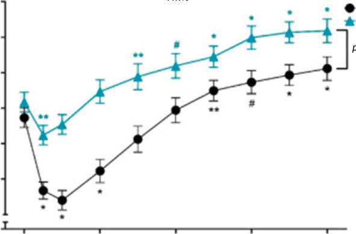

Unmatched source image; PDF page 145. Consult the original caption.

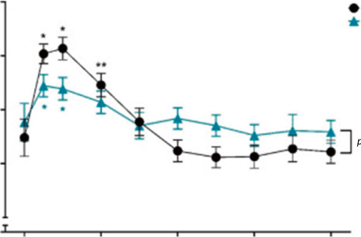

Unmatched source image; PDF page 145. Consult the original caption.

## PDF page 146 | printed page 129

receive either 2 years of hGH or no treatment. During the study period, hGH-treated sub jects maintained consistent (albeit below nor mal) standard deviation scores (SDS) on tests of cognitive function (i.e., kept pace with non- PWS peers but did not catch up) while untreated children demonstrated deteriora tion in SDS in certain cognitive areas (abstract verbal reasoning −0.7 SDS [CI −1.3 to 0.03 SDS, p = 0.04] and vocabulary −0.7 SDS [CI −1.3 to 0.07 SDS, p = 0.03]) [44]. All study subjects were then enrolled in a longitudinal study of 4 more years of hGH therapy. When subjects were compared to their own baseline function, all children with PWS treated with GH for 4 years showed significant improve ment in verbal abstract reasoning +0.4 SDS

Table 5.2 Results after 8 years of GH treatment compared to GH-untreated controls

GH-treated children (n = 82)

Age (years) 9.88 (1.19)

Puberty (N, %)

Prepubertal 55 (67.1)

Early pubertal 18 (22.0)

Mid pubertal 9 (11.1)

Late pubertal 0

Fat mass % SDSa 1.90 (0.07)

Fat mass percentageb 38.0 (0.89)

Trunk fat vs. peripheral fat ratiob 0.82 (0.01)

Lean body mass SDSa −1.51 (0.10)

Height SDS 0.29 (1.19)

Head circumference SDS 0.60 (1.09)

BMI SDS 1.10 (1.50)

Cognitive functioning (SS)

Block design 4.29 (3.18)

Vocabulary 4.94 (2.82)

Similarities 6.16 (2.78)

Estimated total IQ 70.4 (14.1)

a Corrected for age and sex b Corrected for sex and pubertal stage

(CI −0.1 to 0.7 SDS, p = 0.01) and visual–spa tial skills +0.3 SDS (CI −0.07 to 0.6 SDS, p = 0.01); however, mean vocabulary and total IQ testing results did not change significantly with hGH [44]. Recent findings supported that 8 years of hGH therapy started in early life was associated with no difference in total IQ. These investigators evaluated up to 8 years of GH therapy on young children with PWS for changes in cognitive functioning. Whether GH was started prior to 1 year of age, or between 2 and 5 years, no significant changes in cognitive function were detected, for block design or similarity testing, however, there was a slight improvement in vocabulary sub test scores in children with PWS who began under 1 year of age ( Table 5.2) [18, 45].

GH-untreated controls (n = 22)

p-Value

10.35 (1.37) 0.117

0.216

18 (81.8)

4 (18.2)

0

0

2.25 (0.15) 0.036

46.1 (1.76) <0.001

0.91 (0.02) <0.001

−1.92 (0.20) 0.033

−2.01 (1.49) <0.001

−0.59 (0.75) <0.001

1.63 (1.01) 0.055

3.19 (2.66) 0.217

4.81 (2.07) 0.871

5.06 (2.93) 0.179

67.3 (10.1) 0.417

### Automatic table extraction — verify rendered original

|Col1|GH-­treated children (n = 82)|GH-­untreated controls (n = 22)|p-Value|
|---|---|---|---|
|Age (years)|9.88 (1.19)|10.35 (1.37)|0.117|
|Puberty (_N_, %)|||0.216|
|Prepubertal|55 (67.1)|18 (81.8)||
|Early pubertal|18 (22.0)|4 (18.2)||
|Mid pubertal|9 (11.1)|0||
|Late pubertal|0|0||
|Fat mass % SDSa|1.90 (0.07)|2.25 (0.15)|0.036|
|Fat mass percentageb|38.0 (0.89)|46.1 (1.76)|<0.001|
|Trunk fat vs. peripheral fat ratiob|0.82 (0.01)|0.91 (0.02)|<0.001|
|Lean body mass SDSa|−1.51 (0.10)|−1.92 (0.20)|0.033|
|Height SDS|0.29 (1.19)|−2.01 (1.49)|<0.001|
|Head circumference SDS|0.60 (1.09)|−0.59 (0.75)|<0.001|
|BMI SDS|1.10 (1.50)|1.63 (1.01)|0.055|

[Original table](../../tables/ch005_p0146_1.jpg)

### Automatic table extraction — verify rendered original

|Cognitive functioning (SS)|Col2|Col3|Col4|
|---|---|---|---|
|Block design|4.29 (3.18)|3.19 (2.66)|0.217|
|Vocabulary|4.94 (2.82)|4.81 (2.07)|0.871|
|Similarities|6.16 (2.78)|5.06 (2.93)|0.179|
|Estimated total IQ|70.4 (14.1)|67.3 (10.1)|0.417|

[Original table](../../tables/ch005_p0146_2.jpg)

## PDF page 147 | printed page 130

The important role of GH in cognitive function, brain plasticity, and learning merits further investigation. Presently, evidence suggests that hGH treatment does not nor malize the cognitive abilities of children with PWS but may reduce the disparity in cognitive disability compared to non-PWS peers that otherwise would increase over time.

### 5

### 5.9 Safety of GH Treatment in PWS

Scoliosis: Scoliosis is common in patients with PWS, prompting concern whether the hGHinduced acceleration of linear growth might influence the incidence or progression of sco liosis in PWS patients [46]. Noncontrolled studies report that scoliosis frequency increases during long-term treatment with hGH, an expected finding in a group of grow ing children at high risk. In contrast, con trolled studies comparing hGH-treated and nontreated children with PWS over a 6-year time frame, there was no difference in the rate of development or severity of scoliosis between groups. In addition, when early evi dence for scoliosis is carefully screened for at the time of hGH initiation, the new develop ment of scoliosis in children with PWS appears unlikely. Interestingly, the progres sion of scoliosis during hGH therapy has been associated with lower increases in para vertebral muscle volume measured by CT, suggesting muscle growth may prevent scolio sis progression [47]. While this raises the ques tion of whether the hGH-mediated increase in muscle mass and strength might decrease the occurrence or progression of scoliosis, there are no data yet to support this effect in PWS patients. Taken together, studies indicate that (1) monitoring for scoliosis in this at-risk pop ulation, whether treated with hGH or not, is important and (2) hGH does not significantly increase the risk of scoliosis development.

Glucose intolerance: Compared to simi larly obese children without PWS, hGH naïve children and adolescents with PWS are rela tively insulin sensitive. This may be attributed to the predominantly subcutaneous (rather than visceral) deposition of fat, but also to

reduced counter-regulation by endogenous GH. As a result, there has been concern that hGH therapy could unmask and/or exacer bate glucose intolerance in PWS recipients. However, a comparison of long-term hGHtreated and nontreated school-aged children with PWS showed no evidence of significantly higher fasting insulin, glucose, or HOMA-IR levels attributable to hGH treatment. Although hGH treatment has the theoretical potential to increase insulin resistance, clini cally significant changes in measures of insu lin resistance (e.g. fasting insulin) or more frequent development of impaired glucose tolerance has not been found in children with PWS receiving hGH.

Cardiorespiratory compromise and sud den death: In 2002, the sudden death of a 6-year-old boy with PWS following 4 months of hGH therapy was reported [48]. This was followed by several cases of sudden unex pected death temporally associated with the institution of hGH treatment in children with PWS being reported, including a larger review of 64 deaths of youth with PWS [48–53]. Importantly, the rate and causes of death in the 64 cases did not differ significantly between hGH-treated and -untreated patients, and it was found obese youth with PWS and those with respiratory insufficiency or illnesses were at increased risk of death. Interestingly, the review demonstrated that 75% (21/28) of deaths in PWS youth treated with hGH occurred within 8 months of starting hGH, a pattern of clustering not seen in youth not treated with hGH. Concern regarding the temporal association of more frequent unex pected sudden death in PWS patients on hGH therapy has continued to drive investigation into whether a causal relationship may exist. A causative relationship between exposure to hGH and sudden death remains uncertain. Answering this question is made extremely complex by the tendency for individuals with PWS to demonstrate morbid obesity, obstruc tive sleep apnea (OSA), autonomic instability, reduced ventilator sensitivity to hypoxia and hypercarbia, and increased baseline rates of sudden unexplained death—all likely related to underlying hypothalamic dysfunction and its complications [54]. Factors supporting a

## PDF page 148 | printed page 131

causative relationship include the occurrence of most deaths in the first 3–8 months of hGH treatment and the known stimulatory effect of hGH on lymphoid tissue growth, which could increase airway obstruction. Factors arguing against such a relationship include likely prior underestimation of spontaneous mortality in PWS and the observation that hGH therapy for 6–12 months improves respiratory func tion and carbon dioxide sensitivity in treated subjects. Further, children with PWS treated with hGH have demonstrated improvement in respiratory muscle strength response to car bon dioxide concentration, and nocturnal coupling of heart rate and blood pressure, all of which suggest improved cardiovascular and/or autonomic function [55, 56]. Nevertheless, evaluation for central and/or obstructive sleep apnea is recommended for all children with PWS prior to hGH treat ment. While it is uncertain whether such eval uation is responsible, in recent years there have not been new reports of sudden death after initiating hGH therapy in children with PWS.

It has also been suggested that partial cen tral adrenal insufficiency could be a contribut ing factor [57], although there remains uncertainty about the clinical consistency of these findings. The difficult question remains: how to incorporate awareness of the possibil ity of central adrenal insufficiency into clini cal recommendations?

Case Study

A 4-month-old boy with Prader–Willi Syndrome (PWS) is referred for endocrine eval uation.

History and Physical Examination

The child was born full-term but spent 10 days in the NICU for low muscle tone and poor feeding. His mother reports that she has spent many hours trying to get him to nurse and has used multiple styles of nipples to bottle-feed. Testing for PWS was performed by methyla tion-specific PCR in the NICU and confirmed

Taken together, these observations allow for the possibility of early risk for hGHtreatment-associated sudden death (particu larly, in early childhood when lymphoid tissue growth is pronounced) followed by long-term benefit. At the same time, cardiorespiratory complications from hGH do not develop in most PWS children receiving hGH, and it remains unresolved whether observed cases of sudden death are related to hGH therapy. Given this uncertainty, recommendations include: (1) pre-GH-treatment clinical and polysomnographic evaluation for sleeprelated disordered breathing; (2) withholding of GH until surgical and/or CPAP interven tion and, if needed, weight reduction has cor rected significant abnormalities detected; (3) ongoing clinical monitoring for breathing changes or sleep disturbances during GH therapy.

Even though the number of cases reported in excess of expected deaths remains small, these occurrences have prompted the inclu sion of cautionary language in the drug pre scribing information and altered the risk/ benefit analysis for hGH therapy in a way dis tinctly different from other hGH treatment indications. In light of this potential rare by serious risk of GH therapy, data supporting that such treatment changes the “natural his tory” of PWS in both statistically and clini cally significant ways is critical for an informed assent discussion.

PWS. Family history is noncontributory. Vital signs are within normal limits. Length is 62 cm (15%), weight 5.3 kg (5%), and BP 76/45. The physical exam is pertinent for a quiet infant with diffuse low muscle tone lying on the exam ination table. His head showed slight bitempo ral narrowing, almond-shaped eyes, a slightly down-turned mouth, and soft anterior fonta nelle. The genitalia showed a very shallow scro tum, with testes palpable but high in the scrotum, and a phallus measuring 2 cm in length. The remainder of the exam was normal.

## PDF page 149 | printed page 132

What Endocrine Concerns Exist for This Patient? Infants with PWS can demonstrate multiple hypothalamic abnormalities including central hypothyroidism, GnRH deficiency with possi ble hypogonadism, and growth hormone defi ciency (GHD). For this reason, the determination of free T4 levels must be evalu ated, as many newborn screening programs only evaluate for primary hypothyroidism (TSH only). GnRH deficiency can play a role in the undervirilization of boys with PWS, including micropenis or undescended testicles. The pres ence of a very shallow scrotum in this child sup ports some duration or history of undescended testicles. During early infancy, the role of GH also plays a role in the growth of the penis, as well as maintaining euglycemia, as a counterregulatory hormone, but plays less of a role in linear growth. Monitoring of linear growth over time will provide important information about GH sufficiency. GH also plays an impor tant role in the accumulation of lean mass and adipose tissue. As stated previously, substantial evidence indicates that variable degrees of GH deficiency contribute to the body composition and growth phenotype in PWS.

### 5

Should hGH Therapy Be Considered at This Time? The decision to initiate hGH therapy very early in life is often a difficult one. Whether the evi dence supports early initiation of GH therapy is an important question as well. Infants and tod dlers with PWS commonly demonstrate hypo tonia, with poor suck and feeding, early failure to thrive, and delay in attainment of develop mental milestones. Early abnormalities in body composition are present before the onset of characteristic hyperphagia and progressive obesity. Impaired physical function in PWS during childhood is related to body composi tion abnormalities (increased percent body fat and decreased muscle mass) and hypotonia, rather than to linear growth deficits. Multiple studies indicate that hGH therapy improves, but does not normalize, body composition and physical function. Treatment prior to 18 months of age increases mobility skill acquisition and

may lessen deterioration of body composition and accelerate motor development. Additionally, comparisons between 6- and 9-year-old children with PWS treated with hGH for 6 and 8 years and similar-aged chil dren with PWS naïve to hGH show that hGH treatment changes the natural history of PWS by improving body composition, motor func tion, height, and lipid profiles. Importantly, however, benefits shown to be statistically sig nificant in large studies do not always translate to each individual.

Is hGH Therapy Safe in Children with PWS? To justify GH therapy more clearly considering potential rare but serious risk, it is important to critically assess whether the anticipated clini cally significant benefits of such treatment out weigh potential risks. As a precaution, we recommend screening for central or peripheral apnea by performing a sleep study interpreted by a pediatric sleep specialist [52]. While a nor mal sleep study does not rule out the possibility of respiratory compromise, it can reveal highrisk situations that need to be factored into the risk-benefit discussion and parental consent. We recommend hGH for children with PWS based on body surface area (rather than weight), beginning with 1 mg/m2 body surface area. The monitoring of IGF-1 and IGFBP-3 levels is important, as children with PWS have shown higher levels of IGF-1 on hGH treat ment compared to non-PWS children [24].

What Other Therapies Should Be Considered? hGH therapy should be part of a multidisci pline approach to the treatment of PWS, including nutrition therapy and exercise/physi cal therapy [58]. Children with PWS may develop hyperphagia with increased food seek ing in early childhood around 3–5 years of age. Without intervention, hyperphagia can lead to marked obesity and an increased risk of associ ated complications, including diabetes, heart disease, decreased exercise tolerance, sleep apnea, and other problems [59]. Food must be closely monitored, or inaccessible between

## PDF page 150 | printed page 133

meals to decrease temptation. A child with PWS may always feel hungry, regardless of how much food they have eaten. Anecdotally, children whose parents adhere to a diet and exercise recommendations early on are less likely to become obese, and better cope with their constant hunger. There is no evidence that hGH curbs appetite or prevents obesity, although it does influence to what degree weight gain represents accretion of lean mass (muscle) or adipose tissue [60].

When Should hGH Therapy Be Discontin ued? While every patient is unique, and clinical deci sions should be individualized, hGH therapy

### 5.10 Summary

Fig. 5.5 Photographs of a child with PWS as a toddler, and over a few years of hGH therapy demonstrating changes in body composition

throughout the linear growth years has signifi cant clinical benefits. Studies of metabolic ben efits after cessation of linear growth have focused on changes in lipid metabolism and body com position [61]. Similar to evaluating whether chil dren with childhood GHD still require adult replacement of hGH, after cessation of linear growth and the onset of spontaneous or induced puberty, we recommend a trial off hGH for 6–9 months to determine if changes in lipid metabolism or body composition suggest persis tent GH deficiency and merit resumption of hGH treatment. During this period of off-treat ment observation, it remains important to coun sel patients and families about the importance of healthy nutrition and exercise practices.

5.5

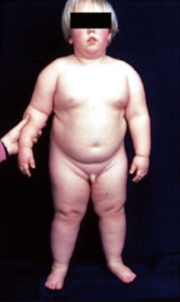

Unmatched source image; PDF page 150. Consult the original caption.

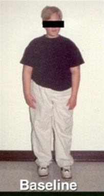

Unmatched source image; PDF page 150. Consult the original caption.

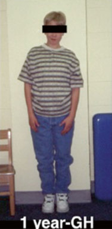

Unmatched source image; PDF page 150. Consult the original caption.

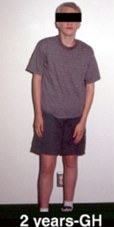

Unmatched source image; PDF page 150. Consult the original caption.

## PDF page 151 | printed page 134

### References

tinuing hGH therapy into adulthood. Whether treated with hGH or not, all indi viduals with PWS, given their complexities, deserve expert care to maximize health out comes and quality of life, and hGH therapy should only be one part of a multidiscipline therapeutic approach.

1. Prader A, Labhart A, Willi H. Ein syndrom von

2. Butler MG, Thompson T. Prader-Willi syndrome:

### Review Questions

3. Goldstone AP, Holland AJ, Hauffa BP, Hokken-

1. Which of the following is not a clinical

### 5

feature that suggests the possible diag nosis of Prader-Willi syndrome (PWS)? A. Neonatal hypotonia B. Hypogonadism C. Micrognathia D. Bitemporal narrowing E. Obesity with low IGF-1 levels

4. Colmers WF, Wevrick R. Leptin signaling defects

5. Mercer RE, Michaelson SD, Chee MJ, Atallah TA,

2. Which of the following is not an effect

of hGH therapy in children with PWS? A. Stimulation of lipolysis B. Reduced resting energy expendi

6. Butler MG, Miller JL, Foster JL. Prader-Willi syn

7. Angulo M, Castro-Magana M, Uy J. Pituitary

ture C. Increased bone mineral density D. Increased physical strength E. Increase in HDL cholesterol

8. Brambilla P, Bosio L, Manzoni P. Peculiar body

3. Which of the following is a potential

9. Bekx MT, Carrel AL, Shriver TC, Zhanhai L,

adverse effect of hGH therapy in chil dren with PWS? A. Increased scoliosis B. Increase in hemoglobin A1c levels C. Respiratory tract obstruction D. Increased skin-picking behaviors E. Increased food-seeking behaviors

10. Corrias A, Bellone J, Beccaria L, Bosio L. GH/

11. Carrel AL, Myers SE, Whitman BY, Allen

### v Answers

1. C 2. B 3. C

12. Carrel AL, Myers SE, Whitman BY, Allen

### Acknowledgements The authors wish to

thank the important research collaboration of Drs. Susan Meyers and Barbara Whitman, as well as the invaluable help of our study coor dinator, Heidi Luebke MS. This work was supported in part by NIH grant M01 RR03186-13S1 as well as funding from Phar macia, Genentech Foundation for Growth and Development, and Pfizer.

13. Haqq AM, Stadler DD, Jackson RH, Rosenfeld

14. Eiholzer U, Gisin R, Weinmann C, et al. Treatment

adipositas, kleinwuchs, kryptorchismus and oligo phrenie. Schweiz Med Wochenschr. 1956;86:1260–1.

clinical and genetic findings. Endocrinologist. 2000;10(Supp 1):3S–16S.

Koelega A, Tauber M. Recommendations for the diagnosis and management of Prader-Willi syn drome. J Clin Endocrinol Metab. 2008;93(11):4183–97.

in a mouse model of Prader-Willi syndrome: an orphan genetic obesity syndrome no more? Rare Dis (Austin, TX). 2013;1:e24421.

Wevrick R, Colmers WF. Magel2 is required for leptin-mediated depolarization of POMC neurons in the hypothalamic arcuate nucleus in mice. PLoS Genet. 2013;9(1):e1003207.

drome—clinical genetics, diagnosis and treatment update. Curr Pediatr Rev. 2019;15(4):207–44.

evaluation and growth hormone treatment in Prader-Willi syndrome. J Pediatr Endocrinol. 1991;4:167–73.

composition in patients with Prader-Labhart-Willi syndrome. Am J Clin Nutr. 1997;65:1369–74.

Allen DB. Decreased energy expenditure is caused by abnormal body composition in infants with Prader-Willi syndrome. J Pediatr. 2003;143:372–6.

IGF-I axis in Prader-Willi syndrome: evaluation of IGF-I levels and of the somatotroph respon siveness to various provocative stimuli. J Endocri nol Investig. 2000;23(2):84–9.

DB. Growth hormone improves body composi tion, fat utilization, physical strength and agility, and growth in Prader-Willi syndrome: a controlled study. J Pediatr. 1999;134(2):215–21.

DB. Benefits of long-term GH therapy in Prader- Willi syndrome: a 4-year study. J Clin Endocrinol Metab. 2002;87:1581–5.

RG, Purnell JQ, LaFranchi SH. Effects of growth hormone on pulmonary function, sleep quality, behavior, cognition, growth velocity, body compo sition, and resting energy expenditure in Prader- Willi syndrome. J Clin Endocrinol Metab. 2003;88(5):2206–12.

with human growth hormone in patients with Prader-Labhart-Willi syndrome reduces body fat

## PDF page 152 | printed page 135

and increases muscle mass and physical perfor mance. Eur J Pediatr. 1998;157(5):368–77. 15. Bakker NE, Kuppens RJ, Siemensma EP, et al.

28. Takeda A, Cooper K, Bird A. Recombinant

Eight years of growth hormone treatment in chil dren with Prader-Willi syndrome: maintaining the positive effects. J Clin Endocrinol Metab. 2013;98(10):4013–22. 16. Carrel AL, Moerchen V, Myers SE, Bekx MT,

29. Colmenares A, Pinto G, Taupin P, Giuseppe A,

Whitman BY, Allen DB. Growth hormone improves mobility and body composition in infants and toddlers with Prader-Willi syndrome. J Pedi atr. 2004;145:744–9. 17. Eiholzer U, L’Allemand D, Schlumpf M, Rousson

30. Oto Y, Obata K, Matsubara K, Kozu Y, Tsuchiya

V, Gasser T, Fusch C. Growth hormone and body composition in children younger than 2 years with Prader-Willi syndrome. J Pediatr. 2004;144(6):753–8. 18. Grootjen LN, Hokken-Koelega ACS. Long-term

31. Eiholzer U, Blum WF, Molinari L. Body fat deter

growth hormone treatment of children with PWS: the earlier the start, the better the outcomes? J Clin Med. 2022;11(9):2496. 19. Butler MG, Lee J, Cox DM, et al. Growth charts

32. van Mil EG, Westerterp KR, Gerver WJ, et al.

for Prader-Willi syndrome during growth hormone treatment. Clin Pediatr (Phila). 2016;55:957. 20. Butler MG, Lee J, Manzardo AM, et al. Growth

33. Davies PS. Growth hormone therapy in Prader-

charts for non-growth hormone treated Prader- Willi syndrome. Pediatrics. 2015;135(1):e126–35. 21. Williams T, Berelowitz M, Joffe SN, et al. Impaired

34. Festen DA, de Lind van Wijngaarden R, van

growth hormone response to growth-hormone releasing factor in obesity. N Engl J Med. 1984;311:1403–7. 22. Dieguez C, Casanueva FF. Influence of metabolic

substrates and obesity on growth hormone secre tion. Trends Endocrinol Metab. 1995;6(2):55–9. 23. Lindgren AC, Hagenas L, Ritzen EM. Growth

35. Gondoni LA, Vismara L, Marzullo P, Vettor R,

hormone treatment of children with Prader-Willi syndrome: effects on glucose and insulin homeo stasis. Swedish National Growth Hormone Advi sory Group. Horm Res. 1999;51(4):157–61. 24. Bakker NE, van Doorn J, Renes JS, Donker

36. Bakker NE, Kuppens RJ, Siemensma EP, et al.

GH, Hokken-Koelega AC. IGF-1 levels, com plex formation, and IGF bioactivity in growth hormone-treated children with Prader-Willi syndrome. J Clin Endocrinol Metab. 2015;100(8):3041–9. 25. Angulo M, Castro-Magana M, Mazur BCJ,

37. Carrel AL, Myers S, Whitman BY, Eickhoff JE,

Vitollo PM, Sarrantonio M. Growth hormone secretion and effects of growth hormone therapy on growth velocity and weight gain in children with Prader-Willi syndrome. J Pediatr Endocrinol Metab. 1996;9:393–400. 26. de Lind van Wijngaarden RF, Siemensma EP,

38. Reus L, van Vlimmeren LA, Staal JB, Otten BJ,

Festen DA, et al. Efficacy and safety of long-term continuous growth hormone treatment in children with Prader-Willi syndrome. J Clin Endocrinol Metab. 2009;94(11):4205–15. 27. Tauber M, Hokken-Koelega AC, Hauffa BP,

39. Whitman BY, Myers SE. Prader-Willi syndrome

Goldstone AP. About the benefits of growth hor mone treatment in children with Prader-Willi syn drome. J Pediatr. 2009;154(5):778; author reply 779.

40. Wolfgram PM, Carrel AL, Allen DB. Long-term

human growth hormone for the treatment of growth disorders in children: a sytematic review and economic evaluation. Health Technol Assess. 2010;14:1–209.

Odent T, Trivin C. Effects on growth and metabo lism of growth hormone treatment for 3 years in 36 children with Prader-Willi syndrome. Horm Res Paediatr. 2011;75:123–30.

T, Sakazume S. Growth hormone secretion and its effect on height in pediatric patients with different genotypes of Prader-Willi syndrome. Am J Med Genet. 2012;6(Part A):14.

mined by skinfold measurements is elevated despite underweight in infants with Prader-Labhart-Willi syndrome. J Pediatr. 1999;134:222–5.

Energy expenditure at rest and during sleep in chil dren with Prader-Willi syndrome is explained by body composition. Am J Clin Nutr. 2000;71(3):752–6.

Willi syndrome. Int J Obes. 2001;25(1):2–7.

Eekelen M, et al. Randomized controlled GH trial: effects on anthropometry, body composition and body proportions in a large group of children with Prader-Willi syndrome. Clin Endocrinol (Oxf). 2008;69(3):443–51.

Liuzzi A, Grugni G. Growth hormone therapy improves exercise capacity in adult patients with Prader-Willi syndrome. J Endocrinol Investig. 2008;31(9):765–72.

Bone mineral density in children and adolescents with Prader-Willi syndrome: a longitudinal study during puberty and 9 years of growth hormone treatment. J Clin Endocrinol Metab. 2015;100(4):1609–18.

Allen DB. Long-term growth hormone therapy changes the natural history of body composition and motor function in children with Prader-Willi syndrome. J Clin Endocrinol Metab. 2010;95:1131.

Nijhuis-van der Sanden MW. The effect of growth hormone treatment or physical training on motor performance in Prader-Willi syndrome: a system atic review. Neurosci Biobehav Rev. 2012;36(8):1817–38.

and growth hormone therapy: take a deep breath and weigh the data. J Pediatr. 2013;162(2):224–6.

effects of recombinant human growth hormone therapy in children with Prader-Willi syndrome. Curr Opin Pediatr. 2013;25(4):509–14.

## PDF page 153 | printed page 136

41. Haqq AM, DeLorey DS, Sharma AM, et al.

51. Fillion M, Deal C, Van Vliet G. Retrospective

Autonomic nervous system dysfunction in obesity and Prader-Willi syndrome: current evidence and implications for future obesity therapies. Clin Obes. 2011;1(4–6):175–83. 42. Bruininks RH. Bruininks-Oseretsky test of motor

52. Deal CL, Tony M, Hoybye C, Allen DB, Tauber

proficiency. Circle Pines, MN: American Guidance Service; 1978. 43. Lo ST, Siemensma EP, Festen DA, Collin PJ,

Hokken-Koelega AC. Behavior in children with Prader-Willi syndrome before and during growth hormone treatment: a randomized controlled trial and 8-year longitudinal study. Eur Child Adolesc Psychiatry. 2015;24(9):1091–101. 44. Siemensma EP, Tummers-de Lind van Wijngaarden

53. Tauber M, Diene G, Molinas C, Hebert M. Review

### 5

54. Schaefer J, Davey MJ, Nixon GM. Sleep-

RF, Festen DA, et al. Beneficial effects of growth hormone treatment on cognition in children with Prader-Willi syndrome: a randomized controlled trial and longitudinal study. J Clin Endocrinol Metab. 2012;97:2307–14. 45. Donze SH, Damen L, Mahabier EF, Hokken-

55. Al-Saleh S, Al-Naimi A, Hamilton J, Zweerink A,

Koelega ACS. Cognitive functioning in children with Prader-Willi syndrome during 8 years of growth hormone treatment. Eur J Endocrinol. 2020;182(4):405–11. 46. Crinò A, Armando M, Crostelli M, et al. High

56. Katz-Salamon M, Lindgren AC, Cohen G. The

prevalence of scoliosis in a large cohort of patients with Prader-Willi syndrome. J Clin Med. 2022;11(6):1574. 47. Murakami N, Obata K, Abe Y, Oto Y, Kido Y,

57. de Lind van Wijngaarden RF, Otten BJ, Festen

Nagai T. Scoliosis in Prader-Willi syndrome: effect of growth hormone therapy and value of paraver tebral muscle volume by CT in predicting scoliosis progression. Am J Med Genet A. 2012;158(7):1628–32. 48. Eiholzer U, Nordmann Y, l’Allemand D. Fatal

58. Pellikaan K, Rosenberg AGW, Davidse K, et al.

outcome of sleep apnoea in PWS during the initial phase of growth hormone treatment: a case report. Horm Res. 2002;2002(58 Suppl 3):24–6. 49. Bakker B, Maneatis T, Lippe B. Sudden death in

59. Tan Q, Orsso CE, Deehan EC, et al. Current and

Prader-Willi syndrome: brief review of five addi tional cases. Concerning the article by U. Eiholzer et al.: Deaths in children with Prader-Willi syn drome. A contribution to the debate about the safety of growth hormone treatment in children with PWS (Horm Res 2005;63:33–39). Horm Res. 2007;67(4):203–4. 50. Van Vliet G, Deal CL, Crock PA, Robitaille Y,

60. Reinehr T, Lindberg A, Koltowska-Haggstrom M,

61. Höybye C, Tauber M. Approach to the patient

Oligny LL. Sudden death in growth hormone treated children with Prader-Willi syndrome. J Pediatr. 2004;144:129–31.

study of the potential benefits and adverse events during growth hormone treatment in children with Prader-Willi. J Pediatr. 2009;154(2):230–3.

M, Christiansen JS. Growth Hormone Research Society workshop summary: consensus guidelines for recombinant human growth hormone therapy in Prader-Willi syndrome. J Clin Endocrinol Metab. 2013;98(6):E1072–87.

of 64 cases of death in children with Prader-Willi syndrome (PWS). Am J Med Genet. 2008;146:881–7.

disordered breathing in school-aged children with Prader-Willi syndrome. J Clin Sleep Med. 2022;18(4):1055–61.

Iaboni A, Narang I. Longitudinal evaluation of sleep-disordered breathing in children with Prader- Willi syndrome during 2 years of growth hormone therapy. J Pediatr. 2013;162(e1):263–8.

effect of growth hormone on sleep-related cardiorespiratory control in Prader-Willi syndrome. Acta Paediatr (Oslo, Norway: 1992). 2012;101:643–8.

DA, et al. High prevalence of central adrenal insufficiency in patients with Prader-Willi syn drome. J Clin Endocrinol Metab. 2008;93(5):1649–54.

Effects of childhood multidisciplinary care and growth hormone treatment on health problems in adults with Prader-Willi syndrome. J Clin Med. 2021;10(15):3250.

emerging therapies for managing hyperphagia and obesity in Prader-Willi syndrome: a narrative review. Obes Rev. 2020;21(5):e12992.

Ranke M. Is growth hormone treatment in chil dren associated with weight gain?—longitudinal analysis of KIGS data. Clin Endocrinol. 2014;81(5):721–6.

with Prader-Willi syndrome. J Clin Endocrinol Metab. 2022;107:1698.
