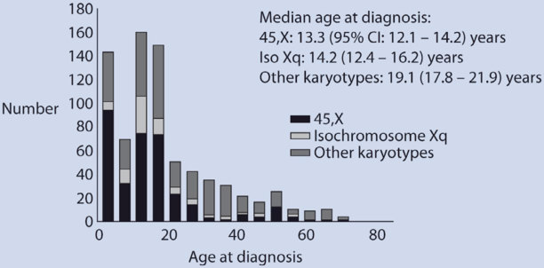
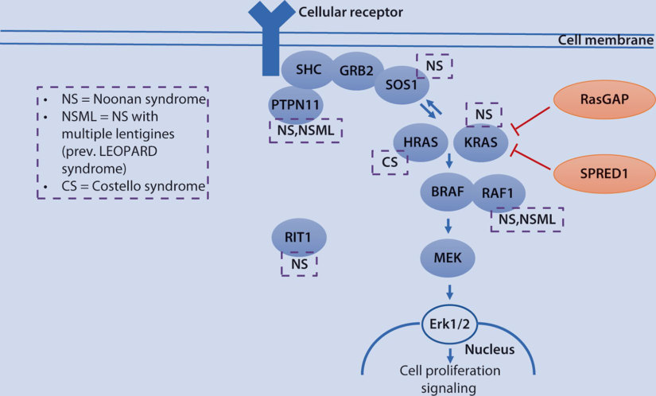
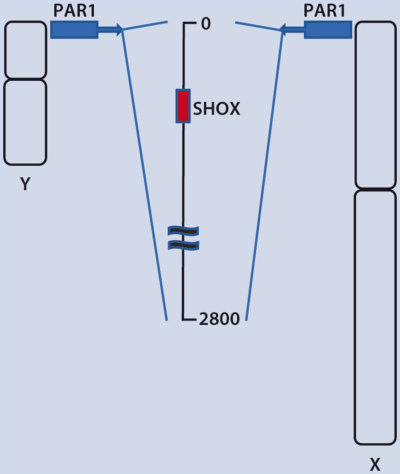
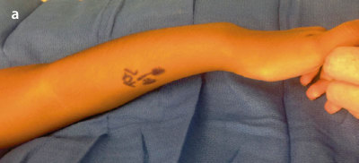
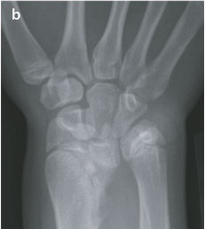
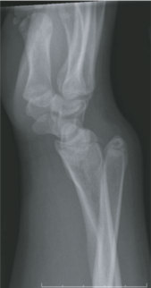

# 6. Growth Hormone Therapy in Children with Turner Syndrome, Noonan Syndrome, and SHOX Gene Mutations
> [Source credits](../../SOURCE_CREDITS.md).

## Study pillars

### Genetics and Pathophysiology

Turner Syndrome (TS) results from complete or partial absence of one X chromosome (45,X in 50%, mosaicism or structural X anomalies in 50%). Short stature is largely caused by haploinsufficiency of the SHOX gene in the pseudoautosomal region (PAR1). Noonan Syndrome (NS) is an autosomal dominant RASopathy caused by gain-of-function mutations in PTPN11 (50%), SOS1, RAF1, RIT1, or KRAS, altering the MAPK signaling cascade and producing post-receptor GH resistance. Isolated SHOX haploinsufficiency causes Léri-Weill dyschondrosteosis or variable idiopathic short stature.

PDF p. 156

### Clinical Recognition

TS features growth failure, gonadal dysgenesis (streak ovaries), webbed neck (pterygium colli), low posterior hairline, cubitus valgus, broad chest with widely spaced nipples, lymphedema, and left-sided congenital cardiac defects (bicuspid aortic valve, coarctation). NS features short stature, pectus excavatum/carinatum, hypertelorism, low-set posteriorly rotated ears, bleeding diathesis, and right-sided cardiac defects (pulmonary valve stenosis, hypertrophic cardiomyopathy). SHOX deficiency features mesomelia, Madelung wrist deformity, and muscular hypertrophy.

PDF p. 157

### Diagnostic Protocol

Diagnosis of TS requires standard 30-cell karyotype or chromosomal microarray. Cardiovascular evaluation with echocardiogram and cardiac MRI is critical for assessing aortic dilation and coarctation. NS is diagnosed by multigene RASopathy panel. SHOX deficiency is evaluated by MLPA (to detect PAR1 deletions) and Sanger/NGS sequencing of the SHOX coding region.

PDF p. 162

### Somatropin Therapy in TS, NS, and SHOX

Somatropin is FDA-approved for all three conditions: TS dose is 0.35 to 0.375 mg/kg/week (50 mcg/kg/day); SHOX deficiency dose is 0.35 mg/kg/week (50 mcg/kg/day); Noonan syndrome dose is up to 0.46 mg/kg/week (66 mcg/kg/day). Early initiation in TS (by age 4-6 years) optimizes height gain. In TS girls ≥9-10 years with severe height deficit, the non-aromatizable anabolic steroid oxandrolone (0.03-0.05 mg/kg/day) can be added to augment final adult height.

PDF p. 165

### Safety and Multidisciplinary Management

In TS, surveillance includes annual screening for autoimmune thyroiditis (anti-TPO antibodies), celiac disease, sensorineural hearing loss, and serial aortic root dimension monitoring by echocardiogram/cardiac MRI to prevent aortic dissection. In NS, serial echocardiograms monitor pulmonary valve stenosis and progression of hypertrophic cardiomyopathy.

PDF p. 168

## Full source extraction

# 6. Growth Hormone Therapy in Children with Turner Syndrome, Noonan Syndrome, and SHOX Gene Mutations
> Source attribution: [Source credits](../../SOURCE_CREDITS.md).

## PDF page 154 | printed page 137

### Growth Hormone Therapy in Children with Turner Syndrome, Noonan Syndrome, and SHOX Gene Mutations

Iris Gutmark-Little, Gajanthan Muthuvel, and Philippe F. Backeljauw

### Contents

### 6.1 Introduction and Background – 139

### 6.2 Etiology, Clinical Presentation, and Diagnostic Evaluation of Turner Syndrome – 139

6.2.1 Etiology – 139 6.2.2 Clinical Presentation – 140 6.2.3 Diagnostic Evaluation – 145

### 6.3 Outcomes and Possible Complications of Turner Syndrome – 146

### 6.4 Growth Hormone Therapy in Turner Syndrome – 148

6.4.1 Effects of GH on Linear Growth – 148 6.4.2 Effect of GH on Body Proportions – 150 6.4.3 Effect of GH on Bone Mineral Density and Craniofacial Development – 150 6.4.4 Effect of GH on Psychosocial Function – 150 6.4.5 Safety of GH Therapy – 151 6.4.6 General Recommendations for Growth-Promoting Therapies – 152

© The Author(s), under exclusive license to Springer Nature Switzerland AG 2024 S. Radovick, M. Misra (eds.), Pediatric Endocrinology, https://doi.org/10.1007/978-3-031-66296-6_6

## PDF page 155 | printed page 138

### 6.5 Etiology, Clinical Presentation, and Diagnostic Evaluation of Noonan Syndrome – 152

6.5.1 Etiology – 152 6.5.2 Clinical Presentation – 154 6.5.3 Diagnostic Evaluation – 156

### 6.6 Outcomes and Possible Complications of Noonan Syndrome – 156

### 6.7 Growth Hormone Therapy in Noonan Syndrome – 157

6.7.1 Effects of GH on Linear Growth – 157 6.7.2 Effect of GH on Body Proportions – 157 6.7.3 Safety of GH Therapy – 157 6.7.4 General Recommendations for Growth-Promoting Therapy – 158

### 6.8 Etiology, Clinical Presentation, and Diagnostic Evaluation of SHOX Deficiency – 158

6.8.1 Etiology – 158 6.8.2 Clinical Presentation – 159 6.8.3 Diagnostic Evaluation – 160

### 6.9 Outcomes and Possible Complications of SHOX Deficiency – 160

### 6.10 Growth Hormone Therapy in SHOX Deficiency – 161

6.10.1 Effects of GH on Linear Growth – 161 6.10.2 Effect of GH on Body Proportions – 161 6.10.3 Safety of GH Therapy – 161 6.10.4 General Recommendations for Growth-Promoting Therapy – 161

### 6.11 Summary – 162

### References – 164

## PDF page 156 | printed page 139

Key Points

5 Turner syndrome, one of the most com

mon chromosome anomalies in humans, represents an important cause of short stature and ovarian insuffi ciency in females. 5 Turner syndrome is caused by the loss

of part or all of an X chromosome. 5 Turner syndrome must be suspected in

any female with short stature. 5 Individuals with Turner syndrome are

at increased risk for long-term cardio vascular morbidity, due to their predi lection for congenital cardiovascular malformations. 5 Noonan syndrome is part of a group of

disorders known as RASopathies, caused by mutations in the RAS- MAPK signal transduction pathway. 5 The most common mutation leading to

Noonan syndrome is in the gene PTPN11. 5 Cardiovascular abnormalities are also

observed commonly in Noonan syn drome, with pulmonic stenosis the most common, followed by hypertrophic car diomyopathy. 5 Disorders caused by defects in the

short-stature homeobox-containing gene on the X chromosome (SHOX) result in short stature and growth fail ure. 5 Haploinsufficiency of SHOX results in

nonsyndromic short stature and Leri– Weill dyschondrosteosis and is also the cause of short stature in Turner syn drome. 5 Homozygous loss of SHOX expression

leads to Langer mesomelic dysplasia, a rare condition characterized by severe short stature and skeletal dysplasia. 5 Growth hormone therapy is approved

for and improves growth in patients with Turner syndrome, Noonan syn drome, and SHOX haploinsufficiency.

### 6.1 Introduction and Background

In this chapter, we will discuss three relatively common disorders all associated with varying degrees of growth failure and short stature. Turner syndrome, Noonan syndrome, and SHOX gene deficiency will be reviewed sequentially, including a general description of each condition’s clinical features and most important comorbidities. The remainder of the discussion will then focus on the treatment with recombinant human growth hormone of the varying degrees of growth failure in all three conditions.

### 6.2 Etiology, Clinical Presentation,

### and Diagnostic Evaluation of Turner Syndrome

### 6.2.1 Etiology

Turner syndrome (TS) is one of the most com mon sex chromosome anomalies in humans. It occurs in approximately 1 in 2000 female live births, irrespective of ethnic background [1]. Girls with TS have an abnormal or miss ing X chromosome, which may result in short stature, ovarian failure, cardiovascular abnor malities, neurocognitive problems, as well as an array of potential other health issues [2, 3].

4

5

6.1

## PDF page 157 | printed page 140

Table 6.1 Prevalence of TS karyotypes based on data from the Danish Cytogenetic Central Register

Karyotype

45,X

45,X/46,XX

45,X/46,X,i(Xq); 46,X,i(Xq); 45,X/46,X,i(Xq)/47,X,i(Xq),i(Xq)

45,X/46,X,del(X); 46,X,del(X)

45,X/46,XX/47,XXX; 45,X/47,XXX; 45,X/46,XX/47,XXX/48,XXXX

### 6

45,X/46,X,r(X)

45,X/46,XY and other karyotypes with Y chromosome material

Data from Mortensen et al. [6] Prenatal prevalence information was derived from amniocentesis and chorionic villus sampling

Most of the TS phenotype is caused by haploinsufficiency of certain genes normally expressed on both X chromosomes. To date, one such gene has been decisively identified: short-stature homeobox-containing gene on the X chromosome or SHOX [7]. The short stature observed in TS is caused, in large part, by haploinsufficiency of SHOX gene expres sion in chondrocytes. Haploinsufficiency of certain pseudoautosomal genes (found on dis tal Xp) has been postulated to lead to the absence or hypoplasia of the peripheral lym phatics, resulting in generalized lymphedema, and/or a cystic hygroma (posterior cervical region mesenchyme lymph collection). A webbed neck, low upward sweeping hairline, and low-set prominent ears all result from a resolving cystic hygroma. Structural abnor malities of the heart and vascular system such as a bicuspid aortic valve and coarctation of the aorta are more common in TS girls with coexistent cystic hygroma, linking large dilated lymphatics with impaired cardiac out flow or aberrant intramyocardial lymphatic development [8]. Additional genes have been proposed as causative for specific TS charac teristics: another pseudoautosomal gene may be involved in the neurodevelopmental prob lems of TS, because a small 8.3 Mb interval on distal Xp (Xp22.33) appears to be linked to the expression of the TS neurocognitive phe

Prenatally diagnosed

Postnatally diagnosed

66% 40%

23% 24%

3% 10%

3% 6%

3% 11%

<1% 3%

5%

notype, with STS and NLGN4X the most likely candidates [9]. Genes on both Xp (such as BMP15) and Xq (such as FMR1 and FMR2) are important for the maintenance of ovarian function and may very well be involved in the development of gonadal dys genesis in TS [10].

### 6.2.2 Clinical Presentation

6.1

6.1 12 13

14

### Automatic table extraction — verify rendered original

|Karyotype|Prenatally diagnosed|Postnatally diagnosed|
|---|---|---|
|45,X|66%|40%|
|45,X/46,XX|23%|24%|
|45,X/46,X,i(Xq); 46,X,i(Xq); 45,X/46,X,i(Xq)/47,X,i(Xq),i(Xq)|3%|10%|
|45,X/46,X,del(X); 46,X,del(X)|3%|6%|
|45,X/46,XX/47,XXX; 45,X/47,XXX; 45,X/46,XX/47,XXX/48,XXXX|3%|11%|
|45,X/46,X,r(X)|<1%|3%|
|45,X/46,XY and other karyotypes with Y chromosome material||5%|

[Original table](../../tables/ch006_p0157_1.jpg)

## PDF page 158 | printed page 141

11

Box 6.1 Clinical Characteristics of Turner Syndrome (with Approximate Prevalence)

5 Growth failure and short stature—

height below the fifth percentile (95–100%) 5 Delayed puberty and ovarian failure

(~90%) 5 Congenital heart disease, including

bicuspid aortic valve (~30%), coarcta tion of the aorta (13%), partial anoma lous venous return (10–18%), and aorta dilatation (≥20%) 5 Renal malformations and hyperten

sion (35–40% and 30%, respectively) 5 Recurrent otitis media (>60%) and

sensorineural hearing loss (25–50%; increasing numbers as patients age) 5 Lymphedema at birth (>40%), which

usually improves with age 5 Dysmorphic phenotype, including short neck, low posterior hairline, neck webbing, micrognathia and retrogna thia, broad chest, high arch to the pal ate, cubitus valgus, short fourth metacarpal and metatarsal bones, nail dystrophy, and multiple nevi (with get ting older) 5 Neurocognitive deficits (nonverbal learning disorder, difficulty with execu tive function), anxiety, attention-deficit disorder (20–30%)

### 6.2.2.1 Growth Failure and Short

### Stature

Short stature is the most common physical abnormality seen in TS, and poor linear growth/growth failure affects virtually all patients. Untreated TS women end up about 20 cm shorter than their peers (adult height about 3 standard deviations (SDs) below the mean) [15, 16]. Growth failure is due to (1) mild-to-moderate growth retardation in utero, (2) slow growth during infancy, (3) slow growth during childhood, and (4) failure to experience a pubertal growth spurt (growth can be prolonged into the early 20s) [17–19]. Girls with TS are also, on average, −0.5 to −1.2 SDs below the mean for birth weight. Poor growth and weight gain in infancy may be exacerbated by poor feeding [20]. Patients with TS tend to be “stocky” because they have a greater relative reduction in body height than in body width and are often overweight. Developmental abnormalities of individual bones are responsible for many common find ings such as short neck (cervical vertebral hypoplasia), cubitus valgus (radial head devel opmental abnormality), genu valgum, and short fourth metacarpals. Between 5 and 18 years of age, 20% have scoliosis (lateral curvature >10°), and 40% develop kyphosis [21]. A delayed bone age is found in the major ity of patients with TS—although the degree of delay is not uniform among bones, a find ing that could be due to the estrogen defi

Unmatched source image; PDF page 158. Consult the original caption.

## PDF page 159 | printed page 142

ciency present in many patients early in childhood [22].

Osteoporosis and fractures are more fre quent among women with TS [23]. Many girls have radiographic osteopenia and a coarse trabecular bone pattern, even in the prepuber tal years. Although interpretation of studies of bone mineral density (BMD) in TS is diffi cult due to the measurement of areal instead of volumetric BMD, prepubertal girls with TS have decreased markers of bone formation, consistent with a low-bone turnover state and decreased bone deposition. There is a deficit in radial BMD, at largely cortical sites [24]. Demineralization at predominantly trabecu lar sites develops during adolescence and pro gresses in adulthood. The pathogenesis of demineralization is unclear but is most likely an intrinsic bone defect exacerbated by sub optimal replacement of the estrogen defi ciency in many patients [25].

### 6

### 6.2.2.2 Gonadal Failure

Although the majority of TS girls have gonadal failure and pubertal delay, some will enter puberty at the typical age. In a retro spective study of 522 TS patients 12 years and older, 32% of the girls with cell lines contain ing more than one X and 14% of classic 45,X patients had spontaneous breast development [26]. Sixteen percent further had spontaneous menarche occurring at a mean age of 13.2 ± 1.5 years. Although a number of patients developed secondary amenorrhea, some had regular menses for many years. Therefore, the diagnosis of TS should still be entertained in adolescents with unexplained short stature, even if they are menstruating, and should also be considered in the differen tial diagnosis for women experiencing prema ture ovarian failure [27]. Because there is a broad range of gonadal dysfunction in TS, it is difficult to predict which patient will enter puberty spontaneously and who will not. Follicle-stimulating hormone (FSH) has been used as a marker of ovarian integrity because it follows a biphasic pattern in normal girls, with increased concentrations in infancy, decreased concentrations in childhood, and increased concentrations again early in

puberty. This pattern is exaggerated in TS girls with ovarian dysfunction. The FSH val ues are increased in the first 2 years of life, decline gradually to reach lower values (often indistinguishable from those in normal girls) between 5 and 10 years of age, and rise again to castrate concentrations around the usual age for puberty [28, 29]. Serum inhibin B and estradiol levels follow a similar biphasic age pattern with high values at 3 months of age, low values during the prepubertal years [30, 31], and increasing concentrations at puberty [32, 33]. Although all these measurements can be helpful in determining if a particular patient has ovarian failure, there exists a lot of overlap with normal female values, irrespec tive of the karyotype. Measurement of gonad otropins such as FSH may have more limited diagnostic utility than previously considered. The measurement of anti-Müllerian hormone (AMH) may be more helpful. Serum AMH is detectable in 22% of all TS patients (10% in 45,X vs. 77% in 45,X/46,XX). Measurable AMH increases the likelihood of spontaneous puberty (odds ratio, 19.3) and menarche (odds ratio, 47.6) and is now considered a more sen sitive marker of prepubertal follicular devel opment than FSH [34, 35].

Girls with karyotypes containing Y chro mosome material, such as in 45,X/46,XY, are at increased risk for developing gonadoblas toma [36], a gonadal tumor in which normal components of the ovary are present in vary ing amounts within circumscribed nests. A gonadoblastoma may produce sex steroids, which may lead to virilization or (occasion ally) feminization, depending on the sex ste roid produced. Although it is not a malignant tumor, the germ cell component may invade the ovarian stroma, resulting in a potentially malignant germinoma [37]. Rarely, a more malignant tumor, such as embryonal carci noma or choriocarcinoma, may also develop in a gonadoblastoma. Using standard cytoge netic techniques, approximately 5% of patients with TS have Y chromosomal mate rial, and of those, gonadoblastoma develops in 15–25% [38].

Fertility is an area of great concern for women with TS [39]. Traditionally, assisted

## PDF page 160 | printed page 143

pregnancies using donor eggs have been the principal means by which women with TS achieved pregnancy. More recently the options for fertility preservation have included cryo preservation of ovarian tissue in young girls and oocyte freezing in adolescents or young women [40]. Studies have demonstrated a high risk of spontaneous abortion (25–40%), chro mosomal abnormalities in the offspring (20%), and perinatal death (7%) [41]. When considering pregnancy outcome, spontaneous pregnancies are probably less associated with complications than pregnancies obtained after oocyte donation in TS patients, but the risk of fetal chromosomal abnormalities remains still high. When unassisted pregnan cies occur, they are generally in patients with structural anomalies of the X chromosome, in which the Xq13-q26 region is spared, or in patients with a mosaic karyotype containing a 46, XX cell line.

### 6.2.2.3 Cardiovascular Abnormalities

Cardiovascular abnormalities are recognized as the most clinically significant pathology of TS patients. Some individuals with TS are diagnosed in the neonatal period or infancy secondary to cardiac lesions, such as coarcta tion of the aorta or hypoplastic left heart. It has long been recognized that individuals with TS are at increased risk for left-sided cardiac abnormalities, especially bicuspid aortic valve and coarctation of the aorta [42]. A study of 99 Danish women with TS (mean age = 37 ± 10 years) using both MRI and echocardiography revealed that common car diovascular findings are an elongated trans verse aortic arch (47%), bicuspid aortic valve (27%), dilation of the ascending aorta (20%), aortic coarctation (13%), aortic arch hypopla sia (2%), and aortic aneurysm (2%) [43]. A bicuspid aortic valve was functionally abnor mal in many patients, causing aortic stenosis in 16% and regurgitation in 18%. This study and others have demonstrated that the arterial pathology is not limited to the aorta but also affects other intrathoracic arteries [44]. Another common structural cardiac abnor mality is partial anomalous pulmonary venous return (PAPVR). In 1998, Mazzanti

et al. detected PAPVR in 2.9% of TS patients, giving it the highest relative risk compared to heart defects in the general population [45]. Using cardiac MRI technology that percent age appears to be much higher, and Kim et al. studied 51 patients with TS (median age, 18.4 years; range, 6–36 years) and detected PAPVR in 15.7% of that population [44]. Aortic dissection is estimated to occur in 1.4% of the TS population [46]. This devastating complication of TS usually occurs in adult hood but has occurred in girls as young as 7 years. Although most cases have been asso ciated with coarctation of the aorta, bicuspid aortic valve, hypertension, and/or aortic root dilatation, 10% does not have any of these risk factors [47–49]. Nonstructural abnormalities such as hypertension, conduction defects, or mitral valve prolapse are also more common than in the general population, occurring in approximately 16% [42]. In a study of 62 TS patients, aged 5.4–22.4 years, more than 30% were mildly hypertensive, and over 50% had an abnormal diurnal blood pressure profile. The investigators were unable to correlate the presence of renal or cardiac abnormalities with hypertension. This may indicate the pres ence of an underlying vasculopathy inherent to the diagnosis of TS [50].

### 6.2.2.4 Neurocognitive

### and Psychosocial Problems

Individuals with TS are at increased risk for specific neurocognitive deficits and problems in psychosocial functioning. These include deficits in visual-spatial/perceptual abilities, nonverbal memory function, motor function, executive function, attention, and social skills [51, 52]. Abnormalities in cognitive function in TS are accompanied by structural differ ences in the brains of older children and adults. For example, parietal lobes, parietal– occipital areas, and prefrontal areas, areas known to be associated with visual-spatial processing, are small compared with controls [53]. Although their distribution of verbal IQs is relatively normal, lower full-scale IQs are more prevalent in this population due to lower scores on performance than verbal tasks [54]. These neurocognitive deficits put TS patients

## PDF page 161 | printed page 144

at a higher risk for educational problems. Rovet found that 48.2% of girls with TS ver sus only 20% of controls were recognized by their parents as having problems at school [55]. Mathematics is particularly problematic, and girls with TS score significantly lower than controls in overall arithmetic achieve ment [55, 56]. Although math is a consistent problem for girls with TS, hyperactivity, inat tention, distractibility, and slowness may impair achievement in all educational disci plines. Many girls with TS repeat grades because of lagging cognitive and psychosocial skills. Although individuals with TS do not appear to be at an overall higher risk for psy chiatric problems, there is evidence for a higher prevalence of obsessive-compulsive tendencies and autism [57, 58].

### 6

### 6.2.2.5 Hearing Loss

Ear and hearing disorders are very common problems among girls and women with TS. The majority of patients suffer from con ductive hearing loss secondary to recurrent otitis media during infancy and childhood. The high incidence of otitis media in this pop ulation (60–80%) seems to result from an abnormal anatomical relationship between the middle ear and the Eustachian tube [59, 60]. A short, more horizontally oriented Eustachian tube likely results in poor drain age and ventilation of the middle ear space and predisposes to more nasopharyngeal microorganisms invading the middle ear. Many girls therefore require tympanostomy tube placement, and some patients develop complications such as mastoiditis and choles teatoma. In a study in which 56 girls with TS between the ages of 4 and 15 years were exam ined, 57% had eardrum pathology, such as effusion, myringosclerosis, atrophic scars, retraction pockets, and perforations. A con ductive hearing loss was found in 43% of patients. In addition, a mid-frequency senso rineural hearing loss (SNHL) between 500 and 2000 Hz was present in 58% of the girls, four of whom already required hearing aids [60]. The presence of such a mid-frequency dip appears to be a strong predictor for future rapid hearing decline with potential social

consequences [61]. The particular SNHL has been reported as early as age 5 years and appears to be progressive [62]. By their mid- 40s, more than 90% of women with TS have a hearing loss of >20 dB, with greater than 25% requiring hearing aids.

### 6.2.2.6 Renal Abnormalities

Renal malformations occur in approximately 35–40% of individuals with TS [63, 64]. Of those with malformations, about half have abnormalities of the renal collecting system, and half have positional abnormalities, the most common being horseshoe kidney. Horseshoe kidney is more commonly associ ated with a 45,X karyotype, while collecting system malformations are more frequently associated with mosaic/structural X chromo some abnormalities [63]. Developmental abnormalities of the kidneys and collecting system predispose to urinary tract infections and possibly hypertension [64]. Vascular sup ply anomalies are observed with higher fre quency [64].

### 6.2.2.7 Hypothyroidism and Other

### Autoimmune Disorders

Autoantibodies and autoimmune diseases are more common in individuals with TS than in the general population [65]. The most com mon autoimmune disorders in TS are Hashimoto thyroiditis, celiac disease, and inflammatory bowel disease (IBD) [66]. In a study that evaluated 71 children with TS younger than 20 years of age, 15.5% were hypothyroid, 17% were positive for thyroid peroxidase and/or thyroglobulin antibodies, and 33.8% had thyromegaly [67]. The fre quency of thyroid abnormalities increased with age, and no abnormalities were observed before 4 years of age.

A survey of 15,000 JRA patients from pediatric rheumatology centers in the USA, Europe, and Canada revealed 18 girls with a diagnosis of TS. This represents a prevalence at least six times greater than would be expected if the two conditions were only ran domly associated. Patients had either polyar ticular disease with early onset and progressive disabilities or oligoarticular arthritis with a

## PDF page 162 | printed page 145

benign course [68]. The TS population may also be at increased risk for type 1 diabetes mellitus [23].

### 6.2.2.8 Gastrointestinal Disorders

Elevated liver enzymes are observed in patients with TS, who often remain asymp tomatic. In a study of 218 adults with TS (mean age = 33 years), 36% had one or more liver enzyme concentrations higher than the reference level, the most prevalent being gamma-glutamyltransferase (GGT) [69]. After 5 years of follow-up, that percentage had risen to 59%. In a study of 27 individuals with TS who were biopsied for persistently elevated liver enzymes, 10 had marked archi tectural changes, including cirrhosis, nodular regenerative hyperplasia, and focal nodular hyperplasia, postulated to be caused by con genital abnormalities of the blood vessels. The remaining 17 individuals had nonalco holic liver disease with steatosis, steatohepati tis, and steatofibrosis, most likely related to increased adiposity [70]. An autoimmune pathogenesis may also be operative in some cases because many have elevated antinuclear and/or anti-smooth muscle antibodies [71].

Celiac disease occurs in about 6% of those with TS, a prevalence nearly ten times that of the general population [72]. In another study, 18% of TS patients were noted to have celiac autoantibodies, and 26% of the antibodypositive patients had developed celiac disease (4.5% prevalence) [73]. Inflammatory bowel disease occurs in about 3% of females with TS [74], with Crohn’s disease being as common as ulcerative colitis. Gastric and intestinal hem angiomas, telangiectasias, and phlebectasias are rare but can produce massive gastrointes tinal bleeding when present [75, 76].

### 6.2.2.9 Obesity, Lipids, and Glucose

### Homeostasis

Individuals with TS have a modestly decreased life span. In a study of the Danish TS popula tion, approximately 50% of all deaths were caused by cardiovascular disease, and these occurred 6–13 years earlier than expected [23]. Patients with TS were at increased risk for abnormalities constituting the metabolic syn

drome including hypertension, dyslipidemia, type 2 diabetes, obesity, hyperinsulinemia, and hyperuricemia [23]. Body mass index (BMI) SDs begin to increase around the age of 9 years [77] and may exacerbate a tendency toward type 2 diabetes [78]. In one study of adult TS women (mean age 42.5 years), vis ceral fat mass was increased, while trunk lean body mass (LBM), appendicular LBM, and skeletal muscle mass were decreased com pared to age-matched controls. Although this phenotype is associated with insulin resis tance, glucose intolerance, and type 2 diabetes mellitus, studies in adults have pointed toward beta cell failure rather than insulin resistance as the primary defect in glucose homeostasis in TS [79, 80].

### 6.2.2.10 Lymphedema

Lymphedema is common in TS and begins in utero. Fetuses with 45,X TS may present with increased nuchal thickness alone on ultra sound or more generalized lymphedema [81]. Virtually all girls diagnosed during infancy have lymphedema secondary to maldevelop ment of the lymphatic system. Lymphedema usually improves over the first few months of life but may worsen again with puberty or hormonal therapy. Older children and adults initially without clinically apparent lymph edema have been demonstrated to have hypo plastic superficial lymphatic vessels, explaining the first appearance of lymphedema in some individuals after infancy [82].

### 6.2.3 Diagnostic Evaluation

The diagnosis of TS requires that the patient has both the phenotypic characteristics and genotype consistent with TS. They must there fore have one or more clinical features (e.g., short stature, bicuspid aortic valve), as well as a deletion of the distal end of Xp (Xp11.2-p22) where the majority of genes associated with the TS phenotype appear to reside.

Most prenatal diagnoses of TS are made when karyotypes on amniotic fluid (less com monly by chorionic villous biopsy) are obtained for either an advanced maternal age,

## PDF page 163 | printed page 146

an abnormal maternal serum screen, or an abnormal fetal ultrasound. In the latter sce nario, a karyotype is obtained to find an increased nuchal thickness, a cystic hygroma, or a hypoplastic left heart. For fetuses diag nosed “incidentally,” most will have a mosaic karyotype. Although those with 45,X/46,XX mosaicism can still have a more severe pheno type, many will be phenotypically quite nor mal at birth. All girls diagnosed prenatally should have a repeat karyotype performed after birth.

For those children diagnosed postnatally with a 45,X karyotype, at least 30 cells should be counted to explore the possibility of mosa icism. This will allow for the identification of at least 10% mosaicism with a 95% confidence interval. If the 30-cell analysis fails to reveal mosaicism, fluorescent in situ hybridization (FISH) with X and Y centromere probes on at least 200 cells should be used to look further. FISH studies using specific DNA probes to the Y chromosome should also be performed when a small marker chromosome (a piece of chromosome material not otherwise identi fied) is identified, to determine if Y chromo some material is present. Polymerase chain reaction (PCR) has been used to detect Y chromosome material, but the false-positive rate is high. Therefore, if PCR is used, the finding should be confirmed with FISH. Genomic copy number microarray studies can be used to characterize genetic abnormalities but should not be used as a frontline screen for TS as low levels of mosaicism may be missed. In most cases, cytogenetic testing on blood lymphocytes is sufficient, but if TS can not be confirmed on such testing and TS is still being considered, cytogenetic testing of skin fibroblasts should be considered.

### 6

A delay in diagnosis of TS is often the greatest obstacle to healthcare for girls with TS. In one study, the delay in diagnosis for those diagnosed in childhood or adolescence averaged more than 7 years (based on the presence of dysmorphic features and/or short stature). At the time of diagnosis, patients averaged 2.9 SD below the mean in height and had fallen below the fifth percentile for height an average of 5.3 years earlier [14]. In many girls with TS who have a delayed diagnosis,

the TS phenotype is either absent or mild. This was the case when a systematic search for TS in 375 female children referred with growth retardation (less than −2 SD) and/or decreased height velocity identified 18 cases of TS, an incidence of 4.8% [83]. To facilitate timely diagnoses, Savendahl and Davenport have suggested guidelines for screening girls for TS [14]. These guidelines are presented and modified in Box 6.2.

Box 6.2 Screening Guidelines for Girls with Pos sible Turner Syndrome

1

5 Unexplained growth failure/short stat

ure 5 Webbed neck

5 Peripheral lymphedema

5 Coarctation of the aorta

5 Unexplained delayed puberty

Karyotype analysis for any girl with at least two or more of the following (see footnote 1):

5 Nail dysplasia

5 High-arched palate

5 Short fourth metacarpal

5 Strabismus

Data from Savendahl and Davenport [14]

### 6.3 Outcomes and Possible

### Complications of Turner Syndrome

The clinical outcome of any TS patient strongly depends on the presence of associ ated comorbidities. Because these develop sometimes gradually or do not present with overt symptoms, all patients with TS are rec ommended to undergo screening tests at diag

1 Other suggestive features include a nonverbal learn ing disability, epicanthal folds, ptosis, cubitus val gus, multiple nevi, renal malformations, bicuspid aortic valve, recurrent otitis media, and need for eyeglasses.

## PDF page 164 | printed page 147

nosis, to avoid the development of complications and institute early interven tion/treatment. For example, upon diagnosis, all patients should be referred for detailed car diovascular evaluation (including electrocar diogram (ECG) and echocardiogram) by a cardiologist. Patients should be assessed for growth and pubertal development, undergo renal ultrasonography and a hearing test, and, after infancy, also be seen by ophthalmology. In childhood, screening for autoimmune thy roid disease (thyroid-stimulating hormone, TSH; thyroxine, T4) and celiac disease (tissue transglutaminase, TTG; immunoglobulin A, IgA) and educational/psychosocial evaluation and orthodontic assessment (after age 7 years) are recommended. When the diagnosis is made in the second decade of life, assessment of liver enzyme status, fasting glucose, insulin, and lipids, BMD measurement, and evalua tion of ovarian function are added to the screening tests.

6.2 2

Table 6.2 Ongoing monitoring of Turner syndrome for the prevention/detection of comorbidities

All ages Cardiology evaluationa (every 5–10 years) Blood pressure annually (consider 24-h Holter monitoring) Audiology and ENT (every 1–5 years)

School-age Thyroid and liver screening (annually) Celiac screen (every 2–5 years) Dental/orthodontic evaluation (as needed) Neurocognitive/educational and social evaluation (follow annual progress)

Older patients/adults Fasting lipids, glucose, insulin (annually) Thyroid and liver screening (annually) Celiac screen (as needed) Pubertal development/HRT/counseling regarding (in)fertility Educational/vocational/psychosexual assessment

a Exam by cardiologist with expertise in congenital heart disease; blood pressure in all extremities; ECG; MRI and echocardiogram for older girls and adults; echocardiogram may suffice for younger patients

### Automatic table extraction — verify rendered original

|All ages|Cardiology evaluationa (every 5–10 years) Blood pressure annually (consider 24-h Holter monitoring) Audiology and ENT (every 1–5 years)|
|---|---|
|School-age|Thyroid and liver screening (annually) Celiac screen (every 2–5years) Dental/orthodontic evaluation (as needed) Neurocognitive/educational and social evaluation (follow annual progress)|
|Older patients/adults|Fasting lipids, glucose, insulin (annually) Thyroid and liver screening (annually) Celiac screen (as needed) Pubertal development/HRT/counseling regarding (in)fertility Educational/vocational/psychosexual assessment|

[Original table](../../tables/ch006_p0164_1.jpg)

## PDF page 165 | printed page 148

### 6.4 Growth Hormone Therapy

### in Turner Syndrome

Once the diagnosis of TS is made, growth should be assessed regularly. The use of a TSspecific growth chart will facilitate the detec tion of concurrent problems that affect growth, such as hypothyroidism, and aid in the deci sion-making process for growth-promoting therapies. Growth charts for American girls [84] and Northern European girls [85] ages 0–3 years are available as well as growth charts for girls ages 2–18 years [86]. These growth data are applicable to girls with TS from the USA. As is the case for the normal population, there is a strong genetic component to each TS individual’s growth pattern, and untreated TS girls are expected to follow a percentile on the TS curves throughout childhood and adoles cence that is more or less commensurate with their midparental target percentile.

### 6

The objectives of hormonal therapies to promote growth in TS are to (1) attain a nor mal height for age early in childhood, (2) progress through puberty at a normal age, (3) attain a normal adult height to avoid stigmati zation and physical restriction, and (4) avoid the adverse effects of therapy [87]. Clinical observation has suggested, although not unequivocally proven, that TS women treated with GH during childhood and achieving a height near or within the normal range face fewer obstacles, have higher self-esteem, and are more successful in social life and their careers [88].

The timing and administration of hor monal therapies for girls with TS are still evolving as experience is gained in their use. Growth hormone (GH) is the agent of choice. Clinical trials have demonstrated that GH improves adult height in girls with TS [89, 90]. When given in conjunction with GH therapy, anabolic steroids (such as oxandrolone) appear to have an additional beneficial effect [91–95]. However, when used alone, anabolic steroids increase short-term height velocity but do not appear to improve adult height. Recent studies also suggest synergistic effects on the growth of GH in combination with very low doses of estrogen [90].

### 6.4.1 Effects of GH on Linear

### Growth

Growth hormone therapy is considered the standard of care for girls with TS who have growth failure [2]. Girls with TS are not GH deficient, but supraphysiological GH doses improve statural growth. The demonstration that GH is effective in increasing adult height in TS was established in 2005 with the publi cation of the first randomized, controlled study of GH therapy to adult height, even though TS had been an approved indication for GH therapy many years before [89]. In that study, girls in the treatment group received GH (0.3 milligram per kilogram per week (mg/kg/week) divided into six doses/ week). After a mean of 5.7 years, these girls averaged 7.2 cm taller than those in the con trol group. This improvement in adult height is roughly average for many studies in which height gain achieved by GH therapy was com pared with the growth response of historical controls. Factors that determine the effect of GH on growth response include age at initia tion of therapy (the earlier, the better), GH dose (the higher, the better), use of anabolic steroids (additive effect), and age at initiation of feminizing doses of estrogen (the later, the better) [96], with young age at GH initiation being the most important [89, 97]. A random ized, controlled 2-year “Toddler Turner” study of GH therapy in 89 girls with TS had GH therapy initiated between the ages of 9 months and 4 years (mean age, 2.0 ± 1.0 year) and showed that GH therapy is effective when commenced in early childhood [98]. After 2 years of therapy, the height of the GHtreated group was very close to the average for the general population (±0.3 SD), and there was a between-group difference in height gain of 1.6 SDS (6.8 cm) with the TS girls who were not treated during that time. The girls who received GH therapy beginning at age 2 years ended up somewhat taller at nearadult height (NAH) than those who started GH therapy 2 years later (height SDs, −1.37 vs. −1.60, respectively; p = 0.590), and both attained a NAH approximately 10 cm above untreated historical controls ([99] = reference

## PDF page 166 | printed page 149

from ENDO 2016]). Early normalization of height has a number of potential benefits for girls with TS: negating the physical limitations of short stature, prevention of short staturerelated underachievement, improvement in peer-group integration, and the opportunity to initiate estrogen replacement at a physio logically appropriate age [98–100]. It is there fore recommended that GH treatment begins as soon as growth failure is demonstrated, even if this occurs before the patient falls below the fifth percentile [2].

GH therapy should be optimized for each individual, given its high cost and potential risk. In one study, TS patients were treated initially with a GH dose of 0.23 mg/kg/week, which was then doubled or tripled when the height velocity (HV) declined to less than twice the pretreatment HV. The estimated adult height benefit was 10.6 ± 3.8 cm com pared to 5.2 ± 3.7 cm in the group who received a fixed dose of 0.3 mg/kg/week. In the group receiving incremental increases in GH dose, 83% attained heights in the normal range compared to only 29% in the fixed-dose group [101]. Early work by Rosenfeld et al. demonstrated an additive effect of oxandro lone, an anabolic steroid that cannot be aro matized to estrogen, on adult height when compared with historic controls [102]. In a multicenter, prospective, randomized trial in which patients began therapy at a mean age of 7–8 years and received treatment for a mean of 6 years, therapy with GH alone (n = 17) resulted in a height that was 8.4 ± 4.5 cm taller than the mean projected adult height at enroll ment. Subjects receiving GH plus oxandro lone at a dose of 0.0625 mg/kg/day (n = 43) attained a mean height of 152.1 ± 5.9 or 10.3 ± 4.7 cm taller than their mean projected adult height [102]. Menke et al. examined the effect of oxandrolone in a randomized, placebo-controlled, double-blind, doseresponse study in the Netherlands [91]. One hundred and thirty-three girls with TS were treated with GH combined with placebo, GH combined with oxandrolone at a low dose (0.03 mg/kg/day), or GH combined with oxandrolone at a conventional dose (0.06 mg/ kg/day) from the age of 8 years. GH plus lowdose oxandrolone resulted in a greater height

gain than the GH plus placebo group (9.5 ± 4.7 versus 7.2 ± 4.0 cm (p = 0.02)). However, height gain in the GH plus conventional-dose oxandrolone group was not significantly different from the placebo group. A recently published meta-analysis confirmed that oxandrolone has a positive effect on adult height in TS when combined with GH therapy. It is recommended that oxandrolone treatment be started around 8–10 years of age at doses ranging between 0.03 and 0.05 mg/kg/day [103].

It has long been thought that adult stature is improved by delaying estrogen therapy as long as possible [104]. Chernausek et al. con ducted a multicenter study in which 60 girls receiving GH therapy were randomized to ini tiate estrogen therapy (conjugated estrogens at a dose of 0.3 mg po q day) at either 12 or 15 years of age. The patients were all less than 11 years of age at study entry (mean, 9.5 years) and received 0.375 mg/kg/week of GH for approximately 6 years. Patients in whom estrogen treatment was delayed until age 15 years gained an average of 8.4 ± 4.3 cm over their projected height, whereas those starting estrogen at 12 years gained only 5.1 ± 3.6 cm. Growth was stimulated for approximately 2 years after the initiation of estrogen but then declined as bone age advanced. Against these data, several studies now confirm that GH treatment leads to a normalization of adult height in most girls, even when puberty is induced at a normal pubertal age. The Dutch dose-response trial, for example, shows adult height in 60 TS girls who were treated via a randomized doseresponse protocol. In this study, GH treat ment was combined with low-dose estrogens at a relatively young mean age of 12.7 ± 0.7 years. Girls were randomly assigned to either receive (1) approximately 0.045 mg GH/kg/day or (2) this dose for 1 year followed by an increase to about 0.0675 mg GH/kg/day. A third cohort (3) then received the same amount of GH as the second group for the first 2 years of GH therapy, but was further increased to about 0.090 mg GH/kg/day, thereafter. After a mean duration of GH treatment of 8.6 ± 1.9 years, adult height was reached at a mean age of 15.8 ± 0.9 years.

## PDF page 167 | printed page 150

Adult height, expressed in centimeters or SD score, was 157.6 ± 6.5 or −1.6 ± 1.0 in the low est dosage group, 162.9 ± 6.1 or −0.7 ± 1.0 in the second cohort, and 163.6 ± 6.0 or −0.6 ± 1.0 in those girls receiving the high est GH doses. The difference in adult height in centimeters, corrected for height SD score and age at the start of treatment, was significant between groups 1 and 2 and groups 1 and 3, but not between groups 2 and 3. Fifty of the 60 girls (83%) reached a normal adult height (adult SD score >−2) [105]. In the USA, the dose approved for treatment of short stature in TS is as high as 67 mcg/kg/day, although most patients are treated with a dose much below this. More recent studies also indicate that better height results can be obtained by starting estrogen therapy at 12 years of age than at ages 14 years and above [105, 106]. Most reassuring is a recently published ran domized, placebo-controlled study to adult height of girls with TS ages 5–12.5 years who were randomized to four groups: double pla cebo, estrogen alone, GH alone, or GH and estrogen. Very low-dose ethinyl estradiol (or placebo) was given prior to age 12 years, after which all treatment groups received escalating feminizing estrogen doses. Growth hormone treatment (0.3 mg/kg/week divided into only three doses per week) alone increased adult height by approximately 5.0 cm over an aver age period of 7.2 years. Adult height was greater in the GH-estrogen group than in the GH group by 0.32 + 0.17 SDS (2.1 cm) [107]. This modest growth benefit observed with the combination of ultralow-dose childhood estrogen replacement and GH, in addition to the above-noted studies, indicates that the practice of delaying estrogen therapy should be abandoned for most TS patients.

### 6

### 6.4.2 Effect of GH on Body

### Proportions

As expected, there are differences in the response of specific bones to GH treatment. On average, untreated girls with TS have rela tively large trunks, hands, and feet and broad shoulders and pelvis compared to height. It is

the authors’ impression that GH treatment can exacerbate this disproportionate growth of hands and feet but especially so in patients treated from early childhood onward until adult height is reached. On the other hand, GH modestly improves the disproportion between standing height and sitting height. There is no significant effect on the relative width of the shoulders and pelvis [108].

### 6.4.3 Effect of GH on Bone Mineral

### Density and Craniofacial Development

Growth hormone therapy is likely to help sup port bone mineral accretion in TS girls and maintain prepubertal bone mineral density (BMD) [109]. Preliminary BMD data on patients after long-term GH therapy show normal BMD [110].

Growth hormone therapy in TS girls has not been demonstrated to have a significant effect on craniofacial growth [111], with the exception, perhaps, of an increase in the length of the mandible [112]. However, in these relatively short-term studies, the mean ages at initiation of GH therapy were 9 and 14 years. The growth of the cranial base is largely completed by age 6, whereas the synchondrosis of the mandible does not close until late adolescence. The effect of early onset, prolonged, and/or high-dose GH ther apy on craniofacial development is unknown. GH therapy also does not appear to affect the cadence of dental maturation.

### 6.4.4 Effect of GH on Psychosocial

### Function

There is abundant anecdotal evidence that GH therapy improves psychosocial function, one of the principal goals of this therapy. Unfortunately, few studies have formally addressed this important question, and con trolled studies are unlikely to be done in the future. However, there are some data confirm ing the observations of physicians, families, and girls with TS that certain aspects of social

## PDF page 168 | printed page 151

interactions and behavior, but not cognition [113], are improved with GH therapy. In a study of 38 girls with TS treated for 2 years with GH, improvements were demonstrated in social and emotional functioning. The investigators reported that a quarter of the patients became more independent, happier, and socially involved [114]. In a study in which girls with TS were evaluated after 3 years of GH therapy, attention, social prob lems, and withdrawal were reported as improved [115]. In a Canadian study in which girls were randomized to either a GH or con trol group, analysis after 2 years revealed that there was a correlation between higher growth rate and the girls’ perceptions of themselves as more intelligent, more attractive, having more friends and greater popularity, and experiencing less teasing than the untreated group [116]. However, the effect of GH ther apy on adult quality of life (QoL) has been more difficult to demonstrate. A recent study of QoL compared 58 women with TS who had been treated with GH with 53 women with TS who had not been treated with GH. Except for less pain, no significant impact on QoL attributable to GH treatment could be found, despite the mean 5.1 cm increase in their adult height [117].

### 6.4.5 Safety of GH Therapy

Extensive postmarketing surveillance pro grams have documented that side effects of GH therapy in children are relatively rare. However, families should be fully informed about the potential risks associated with GH therapy, which may be more common in girls with TS than in other patient groups receiving GH. In the most extensive report to date, a study of 5220 girls with TS who received GH revealed higher incidences of disorders for which they are known or expected to be at higher baseline risk, scoliosis (0.39%), slipped capital femoral epiphysis (0.24%), diabetes mellitus (0.19%), and serious cardiovascular events (0.32%), than for non-TS patients receiving GH [118]. However, incidences were also increased for intracranial hypertension (0.23%), pancreatitis (0.06%), and new malig

nancies (0.11%). Other problems potentially caused or exacerbated by GH therapy but not captured in this report include lymphedema, carpal tunnel syndrome, and an increase in the number, size, and pigmentation degree of pigmented nevi. Limited reports have not shown obvious adverse effects of GH on car diac or aortic size or cardiovascular function [119, 120]. Of course, studies on the cardio vascular impact of GH in TS are going to be limited by a lack of pre-GH therapy pheno type characterization. Nevertheless, current evidence suggests that long-term GH therapy in TS does not induce an exaggerated trophic stimulus on cardiomyocytes, nor does it appear to increase aortic diameter compared with nontreated TS females [6].

Increased insulin resistance has been of considerable concern in this population already at higher risk for diabetes. Insulin sen sitivity decreases, but there is generally no effect on glucose concentrations per se [121, 122]. In a study in which girls with TS were treated with GH for 7 years, the prevalence of impaired glucose tolerance was low; all hemo globin A1c levels were normal, and none of the girls developed diabetes mellitus. Insulin concentrations decreased to values close to or equal to pretreatment values after discontinu ation of GH treatment [123]. Although insulin resistance is increased during GH therapy, it may actually be improved after discontinua tion due to the beneficial effects of GH ther apy on body composition [124].

### 6.4.5.1 Safety of Anabolic Steroids

Side effects of anabolic steroids, used as adjunctive therapy to further improve growth, may include (a) virilization with the develop ment of acne, deepening of the voice, and growth of facial hair (and rarely clitoromeg aly); (b) transient elevation of liver transami nases; (c) insulin resistance; and (d) premature skeletal maturation. It is known that mild vir ilization can occur when oxandrolone is used at a dose of 0.125 mg/kg/day [125]. Recently, virilizing effects were documented at a dose of 0.0625 mg/kg/day, a dose commonly used in clinical practice. In addition, slower breast development was reported at this dose, as well as the lower dose of 0.03 mg/kg/day [91].

## PDF page 169 | printed page 152

### 6.4.6 General Recommendations

### for Growth-Promoting Therapies

It is now clear that with early diagnosis and initiation of treatment, a normal adult height is a reasonable goal for most girls with TS. GH should be offered as a therapy for all girls with TS who are predicted to have a subnormal height. The predicted response to GH should be carefully reviewed with patients and their families to help limit unrealistic expectations of future height. Routine evaluation of GH secretory status in girls with TS is not war ranted, because GH secretion in this group is similar to that of the normal population and GH secretory responses do not correlate with responses to exogenous GH [126]. Growth hormone therapy for this population requires somewhat higher dosing than used for GHdeficient patients. Standard GH therapy in the USA for TS is 0.375 mg/kg/week divided into seven doses (53–54 mcg GH/kg/day). Certain GH preparations have been approved by the USFDA to be administered up to 67 mcg/kg/ day, and some patients will benefit from a dose titration toward that range. Although GH has been initiated at a mean age of 9–11 years in most studies, it is becoming clear that girls who begin GH therapy at an earlier age and receive GH for a longer period of time will experience a greater increment in height. Therefore, it is suggested that GH therapy be initiated once growth failure (decreasing height percentiles on the normal growth curve) is documented. Therapy should be continued until the individual reaches a satisfactory adult height or it is no longer ben eficial (growth rate below 2–2.5 cm/year).

### 6

One of the issues to consider when dosing TS girls with GH is the potential for overdos ing. This can be observed in certain patients who are overweight because GH is dosed based on body weight. Therefore, an alterna tive approach would be to dose GH using the patient’s body surface area (BSA)—which is, at least in theory, for a variety of reasons more physiologic. Investigators analyzed serum IGF-I and adult height gain in two Dutch

clinical trials in girls with TS that used BSAbased dosing and five Swedish clinical trials in girls with TS that used body weight (BW)- based dosing [127]. They found that (1) BSAbased dosing leads to stable serum IGF-I SDS over a period of 8–10 years, (2) BSA-based dosing leads to higher nominal doses in young girls (<9 years) and lower doses in adolescents than BW-based dosing, (3) adult height gain was greater on a BSA-based regimen than on a BW-based regimen in patients who start GH treatment before 8 years of age, and (4) the cumulative dose and cost were lower on a BSA-based regimen. Because of this, BSAbased dosing could be more cost-effective than body weight-based dosing [127]. A dose of 0.048 mg GH/kg/day (0.34 mg GH/kg/ week) is approximately equivalent to 1.33 mg GH/m2/day.

Adjunctive therapy with oxandrolone at a dose of approximately 0.03 mg/kg/week can be considered at the age of 8 years and above. Ultralow-estrogen replacement in early child hood may improve growth but remains exper imental at this point. Initiation of feminizing doses of estradiol should be begun during the time of normal puberty (approximately 12 years of age).

### 6.5 Etiology, Clinical Presentation,

### and Diagnostic Evaluation of Noonan Syndrome

### 6.5.1 Etiology

Noonan syndrome (NS) is an autosomal dominant disorder with a prevalence of 1 in 1000–2500. It is the second most common syndromic cause of congenital heart disease, second only to trisomy 21 [128]. The manifes tations affect multiple organ systems, although the presentation is variable. Salient features include short stature, congenital heart defects, facial dysmorphisms, and mild intellectual disabilities.

## PDF page 170 | printed page 153

because they are caused by mutations in the RAS-MAPK (mitogen-activated protein kinase) signal transduction pathway ( Fig. 6.2). The RASopathies, which have overlapping clinical characteristics, include NS, cardiofaciocutaneous syndrome, Noonan syndrome with multiple lentigines (NSML) (previously known as LEOPARD syndrome), Costello syndrome, and neurofibromatosis- Noonan syndrome. Mutations in different parts of this signal transduction cascade usu ally, although not in all cases, lead to a par ticular RASopathy.

130

131 132

6.4

129

129

Table 6.3 Frequency of gene mutations causing Noonan syndrome

Affected gene Chromosome locus Frequency

PTPN11 12q24.13 50%

SOS1 2p22.1 10–13%

RAF1 3p25.1 3–17%

KRAS 12p12.1 <5%

RIT1 1q21.2 4–9%

MAP2K1 15q22.31 <2%

BRAF 7q34 <2%

NRAS 1p13.2 <1%

Data from Bezniakow et al. [130]

6.3

Unmatched source image; PDF page 170. Consult the original caption.

### Automatic table extraction — verify rendered original

|Affected gene|Chromosome locus|Frequency|
|---|---|---|
|_PTPN11_|12q24.13|50%|
|_SOS1_|2p22.1|10–13%|
|_RAF1_|3p25.1|3–17%|
|_KRAS_|12p12.1|<5%|
|_RIT1_|1q21.2|4–9%|
|_MAP2K1_|15q22.31|<2%|
|_BRAF_|7q34|<2%|
|_NRAS_|1p13.2|<1%|

[Original table](../../tables/ch006_p0170_1.jpg)

## PDF page 171 | printed page 154

Table 6.4 Genotype and phenotype associations in Noonan syndrome for the four most commonly affected genes

Affected gene

Cardiovascular Growth

PTPN11 Pulmonary stenosis more common

Short stature more severe; lower IGF-1

SOS1 Pulmonic stenosis more common; ASD less common

Short stature less severe

RAF1 Hypertrophic cardiomyopathy more common

### 6

KRAS

Data from Roberts et al. [128]

### 6.5.2 Clinical Presentation

### 6.5.2.1 Growth Failure and Short

### Stature

Mild-to-moderate postnatal growth failure is typical for NS patients, affecting upward of 70%, particularly in those with PTPN11 mutations. Birth weight and length are usually normal, but growth failure can be observed shortly after birth. Although feeding difficul ties are common in the first year of life, this does not seem to account for early growth failure [133–135]. Starting at 2–4 years of age, height typically follows the third percentile, with 83% of prepubertal NS children being affected by short stature. Thereafter, short stature is most common during the pubertal years, as a result of pubertal growth delay or attenuation. There is roughly a 2-year delay in the pubertal growth spurt, and the peak height velocity is lower than that of the general pop ulation, as can be seen in individuals with nonsyndromic pubertal delay. Disproportionality is typically not observed. Mean adult height for men with NS is in the range of 161.0–169.8 cm and for NS women

Development Other

Bleeding diathesis, JMML, specific CNS tumors, and cryptorchidism more common

Fewer delays

More severe cognitive delay

between 150.1 and 153.3 cm [134, 136–138]. Attainment of adult height may be later than typical, given the frequent occurrence of pubertal (and bone age) delay. Therefore, short stature is common in prepubertal NS children, but in NS adults, short stature prev alence falls to 60% in males and 50% in females due to a late pubertal catch-up growth.

Several growth factors [growth hormone (GH), fibroblast growth factors, and epider mal growth factor] stimulate the RAS- MAPK pathway, and the downstream targets include those involved in cellular prolifera tion, differentiation, survival, and metabo lism. In those NS patients with PTPN11/SHP2 mutations, insulin-like growth factor 1 (IGF-1) release may be nega tively affected via decreased signaling through the JAK2/STAT5B pathway and contribute to short stature. These patients often exhibit a relative GH resistance pat tern, with elevated GH and lower IGF-I con centrations. Patients with mutations in genes further downstream in the RAS-MAPK pathway may have abnormal growth directly related to this abnormal signaling [135].

### Automatic table extraction — verify rendered original

|Affected gene|Cardiovascular|Growth|Development|Other|
|---|---|---|---|---|
|_PTPN11_|Pulmonary stenosis more common|Short stature more severe; lower IGF-1||Bleeding diathesis, JMML, specifc CNS tumors, and cryptorchidism more common|
|_SOS1_|Pulmonic stenosis more common; ASD less common|Short stature less severe|Fewer delays||
|_RAF1_|Hypertrophic cardiomyopathy more common||||
|_KRAS_|||More severe cognitive delay||

[Original table](../../tables/ch006_p0171_1.jpg)

## PDF page 172 | printed page 155

### 6.5.2.2 Cryptorchidism, Pubertal

### Delay, and Fertility

Undescended testes are found in 70–80% of boys with NS and are especially common in those boys with PTPN11 mutations [139]. Delay in the age of onset of puberty in both boys and girls is seen in a significant number of patients. Thirty-three percent of boys with NS enter puberty after the age of 13.5 years, and 44% of girls enter puberty after the age of 13 years [134]. Female fertility is thought to be normal. However, both Sertoli and Leydig cell dysfunction are common in adult males with NS, related to the role of PTPN11 in normal testicular function and to damage to the testes by a lack of descent [140]. Reproductive hor mone concentrations differ in adulthood, but not in puberty, as compared to the general pop ulation, with higher luteinizing hormone (LH), follicle-stimulating hormone (FSH), testoster one, and estradiol and lower anti-Müllerian hormone (AMH) and inhibin B [141].

### 6.5.2.3 Cardiovascular Abnormalities

Fifty-to-ninety percent of NS patients have cardiovascular anomalies, thought to be pathogenically related to increased extracellu lar signal-regulated kinase ERK1 within the RAS-MAPK signaling pathway [129]. The spectrum of disease is wide. Pulmonic stenosis is the most frequent lesion, affecting 20–50% of patients, and disproportionately affects those with SOS1 and PTPN11 mutations, when the frequency is as high as 70%, but is also seen quite commonly with RIT1 muta tions [142]. Hypertrophic cardiomyopathy is the next most common lesion (20–30%), fol lowed by secundum atrial septal defects (6–10%) [128]. Hypertrophic cardiomyopathy, which can be either congenital or acquired, tends to more frequently affect NS individuals with RAF1 mutations and may also be more common in those individuals with RIT1 muta tions (75–85% and 50–70%, respectively) [142–145]. Most of these patients are diag nosed quite early, typically within the first 6 months of life [146, 147]. The likelihood of congestive heart failure in these patients is higher than in children with hypertrophic car

diomyopathy due to other causes, and mortal ity is high [148].

Electrocardiographic anomalies are detected in 90% of patients with NS, even in the context of an otherwise structurally nor mal heart. Common findings include right axis deviation with superior counterclockwise frontal QRS loop, superior or left axis devia tion, or left anterior hemiblock or RSR pat tern in lead V1 [139].

### 6.5.2.4 Bleeding Diathesis

Coagulation defects are common in NS, with 50–89% having either a history of abnormal bleeding or abnormal hemostatic laboratory results and with 10–42% having both [149]. Bleeding diathesis and PTPN11 mutations seem to be especially correlated, though indi viduals with other mutations (KRAS, SOS1, RAF1) have been reported to have coagula tion defects as well.

### 6.5.2.5 Renal Abnormalities

Roughly 10% of NS patients have kidney anomalies, which typically do not require intervention. Dilatation of the renal pelvis is most common. More significant congenital anomalies are rare but reported, including duplex collecting systems, rotational anoma lies, distal ureteric stenosis, renal hypoplasia, unilateral agenesis or ectopia, or bilateral cysts with scarring [128, 139].

### 6.5.2.6 Neurocognitive

### and Psychomotor Development

Intelligence quotient (IQ) scores below 70 are uncommon (6–23%), and most NS individu als will have IQ scores within the normal range [150, 151]. However, learning disabili ties are common in NS children, and many require special education assistance [137, 150, 152]. These cognitive deficits may be related directly to deficiencies in the RAS-MAPK pathway, the integrity of which is important for normal neurodevelopment [153]. Gross motor milestones may be delayed in NS, pos sibly related to joint hyperextensibility and hypotonia [139].

## PDF page 173 | printed page 156

Articulation problems are also common, as are language delay, attention difficulties, and executive functioning problems [154, 155]. These are associated with reading and spelling difficulties. Hearing loss may underlie part of the language delay.

Psychopathology data in NS are scarce, and some studies have suggested higher rates of depression, but this is not a consistent find ing among all reports [156–158].

### 6.5.2.7 Ocular and Otologic

### Manifestations

Ocular anomalies are almost universal in NS patients (>95%). The most common abnor malities are strabismus, nystagmus, myopia, or hypermetropia [159]. Corneal changes, such as prominence of nerves and cataracts, are often observed [160]. Orbital and lid anomalies include ptosis, epicanthal folds, sloping palpebral fissures, and hypertelorism.

### 6

External ear malformations affect the majority of NS patients, most commonly low set or posteriorly rotated. Hearing impair ment can be congenital or acquired and affects about a third of NS patients and is mainly sensorineural in nature [161].

### 6.5.2.8 Malignancy

Somatic mutations in the RAS-MAPK path way have been implicated in a variety of neo plasms. RASopathies are thought to increase the risk for neoplasia, and certain cancers occur more commonly. RASopathies have an estimated standardized incidence ratio of can cer 10.5 times that of the general population, with an NS-specific ratio of 8.1 [162]. A juve nile myelomonocytic leukemia (JMML)-like hematomalignancy has a higher incidence in NS (10%). This condition develops in early infancy (<2 months of age), but spontaneous remission has been reported [163]. There is likely also an association between having the PTPN11 mutations and a higher risk for acute lymphoblastic leukemia [164]. A specific type of rare central nervous system tumor (dysem bryoplastic neuroepithelial tumor) seems to be more common in NS, particularly in those patients with PTPN11 mutations [165].

Multiple giant cell tumors of the bone have been described in individuals with PTPN11 or SOS1 mutations [128].

### 6.5.2.9 Lymphatic System

As in TS, lymphatic anomalies are common in NS. Many infants have evidence of this on prenatal ultrasound in the form of nuchal lucency, increased nuchal folds, cystic hygroma, and fetal edema. At birth, the majority have persistent evidence of lym phatic problems [166]. Neck webbing may be a remnant observed postnatally of such nuchal lymphedema in utero.

### 6.5.3 Diagnostic Evaluation

6.3

### 6.6 Outcomes and Possible

### Complications of Noonan Syndrome

A higher mortality, lower educational rate, and lower partnership have been reported in NS individuals when compared to the general population [137, 167]. The standardized mor tality ratio is 3.00 (95% CI, 1.44–5.52). The majority of deaths are due to cardiac causes. Long-term data on the outcomes of cardiac disease in NS are scarce. Mild pulmonary ste nosis is generally nonprogressive. Hypertrophic cardiomyopathy, which tends to present early in infancy, rarely develops

## PDF page 174 | printed page 157

beyond this age. However, mortality is higher in individuals with hypertrophic cardiomyop athy, with 22% of those children affected dying by 1 year of age [147, 168].

### 6.7 Growth Hormone Therapy

### in Noonan Syndrome

### 6.7.1 Effects of GH on Linear

### Growth

Starting in the 1980s, several small studies and case reports prompted advocacy for the use of recombinant human GH therapy in NS, with subsequent approval by the US Food and Drug Administration in 2007. Data regarding its efficacy and safety in this patient popula tion have been limited and mixed.

Controlled trials regarding the use of GH in NS are scarce. The bulk of evidence for its use comes from case reports or case series and retrospective or uncontrolled studies. The majority of these do not report on adult height attainment. One controlled trial stud ied 32 NS children (23 treated, 9 untreated), in which GH therapy was started at a mean age of 7.4 ± 1.6 years (range, 4.8–13.7), while untreated children were 9.0 ± 4.1 years old (range, 4.1–14.8). Growth hormone dose was 0.047 mg/kg/day, and 19 of the study subjects completed 3 years of therapy. Baseline height was comparable between groups (−2.7 ± 0.4 standard deviation score (SDS) for the GH treated, −2.7 ± 0.6 SDS if untreated). After 3 years, height SDS increased to −1.9 ± 0.9 in the treated group versus −2.4 ± 0.7 in the con trol group. Height velocity in the treated group was higher than in the untreated patients in the first year of therapy, but in years two and three, the differences were not significant [169].

Few studies have followed children with NS to adult height. Osio et al. treated 18 NS subjects with a GH dose ranging from 0.03 to 0.06 mg/kg/day from an average age of 8.2 ± 3.0 years. The duration of therapy was 7.5 years. Patients were at a height SDS of −2.9 ± 0.4 at the start of therapy and gained

1.7 ± 0.9 SDS at the end of the study. Males had a slightly greater height gain than females, and the overall increase in height SDS corre sponded to an absolute gain of 11 ± 6 cm [170]. Another study to follow NS children to adult height included 29 children (mean age, 11.0 ± 2.7 at the start of therapy) for a mean of 6.4 ± 2.3 years with a dose of 0.05 mg/kg/ day. Height SDS went from a baseline of −2.8 ± 0.7 to an end of study SDS of −1.5 ± 0.8 (gain of +1.3 ± 0.75). Absolute mean gain was 8.6 ± 5 cm [171]. A third study reported near-adult height in 24 individuals with NS starting GH therapy at a median age of 10.17 years and with a baseline mean height SDS of −3.24, GH dose of 0.025–0.11 mg/kg/ day. Mean duration of therapy was 7.6 years, and mean height SDS at adult height attain ment was −2.41. Patients were noted to have an early response to GH therapy followed by attenuation in the response [172].

### 6.7.2 Effect of GH on Body

### Proportions

Disproportionality is not a typical feature of NS, and data suggest that GH therapy does not alter patients’ body proportions [173].

### 6.7.3 Safety of GH Therapy

No studies reported major adverse events, including detrimental cardiovascular effects or an increase in or worsening of comorbidi ties. In the context of the cardiac hypertrophy and heart failure observed in acromegaly patients as a result of long-standing GH and IGF-I excess, concern was raised about the effect of GH therapy on cardiac health in NS. This has not been shown in studies that followed ventricular thickness in NS children on GH [169, 171, 174]. However, data regard ing use in children with NS and existing hypertrophic cardiomyopathy are not avail able.

Neoplasia remains a concern in this patient group. There are no studies that allow a caus ative link to be established. However, there is a

## PDF page 175 | printed page 158

report of brain tumor growth during GH therapy after several years of treatment [165]. Caution is therefore recommended with the use of GH in this patient population until additional information is reported.

### 6.7.4 General Recommendations

### for Growth-Promoting Therapy

Noonan syndrome patients are not univer sally short, and short stature, when present, is most pronounced in late childhood and in the early part of the second decade of life. This is important because few studies have assessed the effect of GH therapy in NS on adult height. There is also a lack of consistency in terms of the effect of GH dose, timing of GH therapy, and GH responsiveness on the attain ment of adult height [132]. Many individuals with NS will have a delayed catch-up growth period that leads to a relatively normal adult height. Therefore, although GH is approved for use in NS by the USFDA, the recommen dation to start NS patients on long-term GH therapy should be individualized. Should the practitioner recommend GH therapy, families should be counseled on the benefits, which may be limited, and potential risks. They should also be counseled on the lack of robust adult height data in this area, so that consent may be as complete as possible. Although no serious adverse events have been reported in terms of the effects of GH therapy on cardio vascular health and malignancy risk and GH therapy seems to be well-tolerated in the NS patient population, no conclusions about the long-term safety of GH in this patient group can be made. Long-term surveillance is neces sary for those who have received GH therapy.

### 6

Growth hormone therapy should be con sidered in those NS patients not expected to reach a normal or near-normal adult height, keeping in mind the above caveats. As in girls with TS, GH therapy for this population often requires higher dosing than used for GHdeficient patients. In the USA, GH doses up to 66 mcg/kg/day (0.46 mg/kg/week) are rec ommended. However, patients are often

started on doses ranging between 35 and 50 mcg/kg/day, followed by individualization of dosing. This can be done while targeting cer tain IGF-I concentration ranges (e.g., between +1 and + 2 SDS), as well as based on treat ment response age. Therapy should be contin ued until the individual reaches a satisfactory adult height and experiences near closure of the growth plates or GH is no longer benefi cial (growth rate below 2.5 cm/year).

### 6.8 Etiology, Clinical Presentation,

### and Diagnostic Evaluation of SHOX Deficiency

### 6.8.1 Etiology

SHOX deficiency disorders are a frequent cause of short stature. These disorders are caused by defects in the short-stature homeobox-containing gene on the X chromo some (SHOX). The protein product of the SHOX gene is thought to control chondrocyte apoptosis. Haploinsufficiency of SHOX results in either nonsyndromic short stature or Leri–Weill dyschondrosteosis (LWD) and is also the underlying etiology of the short stature noted in TS. Homozygous loss of SHOX expression leads to Langer mesomelic dysplasia, a rare disorder characterized by severe short stature and skeletal deformities [175].

6.3 176

## PDF page 176 | printed page 159

the context of short stature, thought to cause abnormal transactivation of SHOX gene expression [177–179].

SHOX haploinsufficiency underlies a spec trum of clinical severity. Individuals may be affected with varying degrees of isolated short stature or may have the full clinical picture of LWD, which is characterized by short stature and typical skeletal deformities. SHOX haplo insufficiency accounts for 2–3% of nonsyn dromic short stature and 50–90% of LWD cases [176, 180, 181].

### 6.8.2 Clinical Presentation

### 6.8.2.1 Growth Failure and Short

### Stature

Reduced birth length is reported in children with SHOX deficiency, with height SDS rang ing from −0.59 to −1.8 in a few small series [182–185]. In one of these series, 41% were noted to be small for gestational age. Thereafter, early childhood growth failure is noted. Middle childhood is characterized by a lack of catch-up growth, although severe growth failure is not described [58, 61, 62].

Pubertal growth was blunted in one small series, although other studies have not con firmed this [182]. Mean adult height is esti mated to be −2.2 SD for LWD individuals [186, 187]. However, the variability around published estimates for adult height is large. Ascertainment bias of the studies may account for this, in addition to the inherent phenotypic variability. Individuals with the same muta tion, even within the same family, have been noted to have any of nonsyndromic short stat ure, LWD, and normal stature.

Langer mesomelic dysplasia results from SHOX nullizygosity and is predictably more severe in phenotype than LWD. Extreme short stature, with adult heights of −5.5 to 8.9 SDS below the mean, is typical. Bony anoma lies include proximal tubular bone shortening, aplasia or hypoplasia of the ulna and fibula, and curvature and thickening of the radius and ulna. Madelung deformity is not typically seen.

### 6.8.2.2 Skeletal Deformities

### and Body Proportions

Mesomelia is often seen in individuals with SHOX deficiency, although this dispropor tionality may be absent in early childhood. However, as patients age, body proportions deviate from age-appropriate norms. Reduced arm span and increased sitting height-toheight ratio are the most reliable clinical indi cators of SHOX deficiency (apart from increased BMI) and can aid in distinguishing SHOX deficiency from idiopathic short stat ure [180, 186, 188]. Disproportionality is noted to be less for those individuals with mutations affecting their SHOX enhancer region rather than a deletion or point muta tion of the SHOX gene itself [189].

185 187

6.4

Unmatched source image; PDF page 176. Consult the original caption.

## PDF page 177 | printed page 160

### 6

develops in mid-to-late childhood. Subtle radiographic signs may be seen in early child hood despite a lack of symptomatology and include lucency of the distal radius. Madelung deformity may evolve over time, resulting in limitations in forearm motion and pain [187].

Other skeletal anomalies have been described in individuals with SHOX defi ciency, including scoliosis, high-arched palate, short fourth metacarpals, cubitus valgus, tib ial bowing, and micrognathia [180].

Bone mineralization has been investigated in prepubertal subjects with SHOX deficiency. Total bone area was significantly increased with a relative decrease in cortical bone area and thinning of the cortex. These findings are of unclear significance but are also seen in patients with TS [190]. Increased body mass index has been noted in individuals with SHOX deficiency [191]. Segmental dispropor tionality is thought to underlie this finding, and in fact, a relative increase in limb circum

ference is described in this group, suggesting possible muscular hypertrophy [180].

### 6.8.3 Diagnostic Evaluation

Clinical suspicion of SHOX deficiency disor ders should be high in the presence of meso melic short stature, particularly if the family history supports an autosomal dominant mode of transmission. The presence of Madelung deformity or other previously dis cussed skeletal features is also suggestive.

Because deletions of 10 kb–2.5 Mb are the most likely underlying etiology of SHOX hap loinsufficiency, the initial diagnostic approach should assess copy number. Multiplex ligation-dependent probe amplification (MPLA) can detect copy number gains or losses of SHOX including its enhancer regions and is often used as the first line of testing. Often, this testing is confirmed and further characterized with an array of comparative genomic hybridization (CGH). Sequence analysis of the SHOX region should be employed if no deletion or duplication is iden tified with the previous method and suspicion for SHOX deficiency remains high.

### 6.9 Outcomes and Possible

### Complications of SHOX Deficiency

In addition to the main clinical features and outcomes of SHOX deficiency previously described, data from a small study yielded a greater proportion of these patients have abnormal responses on GH stimulation test ing: 37.5% of SHOX deficiency patients (n = 16) were noted to have impaired GH secretion (GH peak of <10 mcg/L in response to two separate stimuli). The significance of this finding is not clear, particularly given that short-term response to GH therapy was not different comparing those with normal and impaired GH secretion [192].

Unmatched source image; PDF page 177. Consult the original caption.

Unmatched source image; PDF page 177. Consult the original caption.

Unmatched source image; PDF page 177. Consult the original caption.

## PDF page 178 | printed page 161

### 6.10 Growth Hormone Therapy

### in SHOX Deficiency

### 6.10.1 Effects of GH on Linear

### Growth

Patients with SHOX haploinsufficiency seem to respond to GH therapy similarly to TS individuals [193]. In a randomized prospective trial in which almost 2/3 of subjects attained adult height, patients with SHOX haploinsuf ficiency received GH for an average duration of 6 years. The patients attained a height SDS gain of +1.25 with an average GH dose of 0.37 mg/kg/week. In this same study, TS sub jects treated with the same GH dose gained a comparable +1.46 SDS over a 7.4-year dura tion of therapy. It was noted that subjects with SHOX deficiency had a pattern of a steady increase in height SDS over the treat ment duration, whereas TS subjects showed a rapid height SDS increase in the first 2 years of GH therapy, with plateauing thereafter [193].

Data comparing GH responsiveness for various mutations resulting in SHOX haplo insufficiency are sparse. However, it has been reported that individuals with SHOX enhancer defects have a growth response to GH therapy that is greater than in those with an SHOX gene defect. First-year height veloc ity and increase in height SDS were greater in the former group. Nevertheless, these param eters did not differ in the second through fourth years of GH between groups [64].

The effect on linear growth in peripubertal SHOX deficiency of the combination of GH and GnRH analog has been reported in one small study. Those who received this combina tion (for a duration of between 2 and 4.9 years) saw a height SDS gain of +0.6. This is in con trast to those who did not receive either medi cation or who lost height (−1.2 SDS). It should be noted that, at baseline, those who did not receive treatment were similarly aged but taller than those who did receive treat ment [194].

### 6.10.2 Effect of GH on Body

### Proportions

In a study following changes in radiographic findings, patients with SHOX deficiency who were treated with GH for 2 years were not found to have a greater degree of bony changes than those not treated with GH. Measures included hand/wrist, forearm, and lower leg indices (including fourth and fifth metacarpal shortening; radial, ulnar, and tibial bowing; elbow deformities; ulnar variance; tibial tuberosity anomalies; and hypertrophy of the medial femoral condyle) [195].

### 6.10.3 Safety of GH Therapy

Although there is a relative paucity of data, no significant adverse events have been reported with the use of GH treatment in SHOX deficiency patients. Enlargement of hands and feet and worsening of scoliosis were noted as GH-related effects in a random ized, controlled study. The authors also noted several potentially GH-related adverse events, including arthralgias, hypothyroidism, and benign neoplasias [193].

This same study followed bone age changes, which were described as advancing slightly more rapidly than chronologic age during the first 3 years of GH therapy, with subsequent stabilization.

### 6.10.4 General Recommendations

### for Growth-Promoting Therapy

As can be expected from the paucity of data regarding the use of GH in patients with SHOX deficiency, fully developed guidelines have not been proposed. Current evidence supports that GH is safe for most patients with short stature related to SHOX deficiency. As previously discussed, efficacy may vary for differing mutations, but in general, GH is thought to increase adult height in these

## PDF page 179 | printed page 162

patients. Given the similarity in response to GH of SHOX deficiency patients to TS patients, a similar approach may be taken. Therefore, a longer duration of therapy is likely beneficial to augmenting adult height. Dosing is typically recommended at 50 mcg/ kg/day (0.35 mg/kg/week) and should be

Case Study

A 7-year-old boy is referred to a pediatric endo crinology clinic for the evaluation of short stat ure. Upon review of his medical history, it is noted that he was born full-term with an appro priate birth weight and length. He had feeding difficulties in the first year of life, thought to be contributory to his early failure to thrive and poor linear growth. However, by age 3, growth failure was noted to be less severe, and he main tained a height at −2.5 SDS. Otherwise, his health history had been notable for a mild degree of pulmonic stenosis not necessitating surgical intervention. He also had early inter vention for speech delays but was believed to have normal intelligence. Family history yielded that his father was 165 cm tall. Paternal grandparents were noted to be 180 cm (grand father) and 167 cm (grandmother) tall. Mother was noted to be 165 cm tall.

### 6

He was followed for several years after the initial screening evaluation and showed normal growth hormone secretion, thyroid status, no generalized inflammation, and a normal karyo type. However, between the ages of 10 and 11 years, he had further growth failure to a height SDS of −3. Examination at that time revealed proportionate short stature in a prepu bertal male. Mild hypertelorism was noted,

### 6.11 Summary

In this chapter, we discussed three common disorders associated with varying degrees of growth failure and short stature: TS, NS, and SHOX gene deficiency. Each of these condi

titrated for individual growth response and radiographic (bone age) and biochemical (IGF-I) data. For short peripubertal children with SHOX deficiency, the addition of an agent for pubertal suppression could be con sidered, although data for this combination of therapy are not very strong.

along with mildly low-set ears. Bone age at 11 years of age was delayed to 9 years. Noonan syndrome was suspected, and genetic testing confirmed a mutation in the PTPN11 gene. He was followed over the next several years, and testicular growth began at age 13.5 years, fol lowed by attenuated pubertal growth with a peak growth velocity of 6 cm/year, after which he attained an adult height of 166 cm at age 20 years.

This case illustrates a couple of key points regarding Noonan syndrome, its growth pat tern, and the decision to intervene with GH therapy. First, the classic growth pattern seen in children with Noonan syndrome is described (normal birth weight, early growth failure fol lowed by height velocity stabilization, then fur ther failure due to pubertal delay, and catch-up growth with attenuated growth spurt). Second, short stature is most prominent in the late pre pubertal years, but patients may not always require intervention to reach a normal adult height. A referral to pediatric endocrinology is recommended, however, to help with the deci sion-making regarding growth hormone ther apy in these patients, as several studies have shown improvements in statural growth in patients with Noonan syndrome [196].

tions is associated with a variety of comor bidities. Growth hormone therapy is beneficial for improving the growth deficiency in each disorder, with the evidence for improving adult height being the strongest for patients with TS. However, patients with NS and

## PDF page 180 | printed page 163

SHOX haploinsufficiency also improve their growth with GH therapy, although there exists significant variability in the treatment response. Recommendations for GH therapy, monitoring, and treatment individualization vary for each disorder.

3. A newborn boy is noted to have unde

Review Questions

1. A 12-year-old girl’s height plots out

significantly below the 3rd percentile. A review of her prior growth pattern shows a decrease over the last 3 years from the 25th percentile, which she followed throughout childhood, to where she is now. Her midparental height is at the 75th percentile curve. She is otherwise healthy but has some learning issues since third grade, espe cially reporting difficulties with math ematics. She had pubarche 2 years ago.

4. A 9-year-old girl is noted to have

Her physical exam shows propor tionate short stature and Tanner stage I breast development.

Of the following laboratory evalua tions, which will most likely abnormal in this patient? A. Tissue transglutaminase IgA B. Complete blood count C. Urinalysis D. Insulin-like growth factor 1 E. Growth hormone

2. A 13-year-old girl is being evaluated

for lower abdominal pain. Pelvic ultra sonography revealed a relatively small left ovary and a right-sided adnexal mass. Her exam shows facial acne and Tanner stage III pubic hair growth, and she has dark hairs on all her extremities. As part of her work-up, karyotype analysis reveals this girl has a 45,X genotype plus a marker chro mosome.

Of the following statements, which one is correct? A. She is at an increased risk for viril

ization B. She is unlikely to develop gonadal

failure

C. She cannot feminize because she

has a gonadoblastoma D. She will respond less well when

treated with GH therapy E. She has an increased risk for breast

cancer

scended testes and pulmonic stenosis, along with a wide neck and low-set ears. Over the next several months, he is noted to have growth failure. Noonan syndrome is suspected, and genetic testing is sent. Which is most likely to be the underlying genetic eti ology and mechanism? A. RAF1, maternal transmission B. SOS1, paternal transmission C. SOS1, de novo mutation D. PTPN11, de novo mutation

growth failure over several years, hav ing been born at a normal length. Weight is preserved. Her father is of normal height, but her mother is noted to be short at 4′8′′ and did not attain an adult height appropriate for her genetic background. On exam, she has dental crowding and has a stocky appearance. The patient is noted to have a shorter than expected arm span and an increased sitting height-to-height ratio. Testing showed:

Normal blood count and electro lytes

Karyotype = 46,XX IGF-I = 220 ng/mL T4 = 8.7 mcg/dL TSH = 4.5 mcIU/mL Skeletal age = 8.5 years Spine X-ray = 10° thoracic levosco liosis

SHOX haploinsufficiency is sus pected. Which feature on this girls’ exam is the most reliable indicator of a defects in the SHOX gene? A. Scoliosis B. Micrognathia C. Disproportionate growth D. Lower limb muscular hypertrophy

## PDF page 181 | printed page 164

### v Answers

1. A 2. A 3. D 4. C

14. Savendahl L, Davenport ML. Delayed diagnoses

15. Sybert VP. Adult height in turner syndrome with

16. Ranke MB, Pfluger H, Rosendahl W, et al. Turner

### References

17. Even L, Cohen A, Marbach N, et al. Longitudinal

1. Nielsen J, Wohlert M. Chromosome abnormali

18. Davenport ML, Punyasavatsut N, Gunther D,

ties found among 34,910 newborn children: results from a 13-year incidence study in Arhus, Denmark. Hum Genet. 1991;87:81–3. 2. Bondy CA. Care of girls and women with turner

### 6

19. Karlberg J, Albertsson-Wikland K, Nilsson KO,

syndrome: a guideline of the turner syndrome study group. J Clin Endocrinol Metab. 2007;92:10–25. 3. Sybert VP, McCauley E. Turner’s syndrome. N

20. Mathisen B, Reilly S, Skuse D. Oral-motor dys

Engl J Med. 2004;351:1227–38. 4. Kajii T, Ferrier A, Niikawa N, et al. Anatomic

and chromosomal anomalies in 639 spontaneous abortuses. Hum Genet. 1980;55:87–98. 5. Hook EB, Warburton D. The distribution of

21. Elder DA, Roper MG, Henderson RC, Davenport

chromosomal genotypes associated with Turner’s syndrome: livebirth prevalence rates and evidence for diminished fetal mortality and severity in gen otypes associated with structural X abnormalities or mosaicism. Hum Genet. 1983;64:24–7. 6. Mortensen KH, Andersen NH, Gravholt CH. Cardiovascular phenotype in turner syn drome—integrating cardiology, genetics, and endocrinology. Endocr Rev. 2012;33(5):677–714. 7. Clement-Jones M, Schiller S, Rao E, et al. The

22. Even L, Bronstein V, Hochberg Z. Bone matura

23. Gravholt CH, Juul S, Naeraa RW, Hansen

24. Bakalov VK, Axelrod L, Baron J, et al. Selective

short stature homeobox gene SHOX is involved in skeletal abnormalities in turner syndrome. Hum Mol Genet. 2000;9:695–702. 8. Urbach A, Benvenisty N. Studying early lethality

25. Bakalov VK, Bondy CA. Fracture risk and bone

of 45, XO (Turner’s syndrome) embryos using human embryonic stem cells. PLoS One. 2009;4:e4175. 9. Zinn AR, Roeltgen D, Stefanatos G, et al. A

26. Pasquino AM, Passeri F, Pucarelli I, Segni M,

turner syndrome neurocognitive phenotype maps to Xp22.3. J Soc Gynecol Investig. 2001;8:S34–6. 10. Simpson JL, Rajkovic A. Ovarian differentiation

27. Crosignani PG, Rubin BL. Optimal use of infer

and gonadal failure. Am J Med Genet. 1999;89:186–200. 11. Stochholm K, et al. Prevalence, incidence, diag

nostic delay, and mortality in Turner syndrome. J Clin Endocrinol Metab. 2006;91(10):3897–902. 12. Lippe BM, Saenger PH. Turner syndrome. In:

28. Conte 29. Chrysis D, Spiliotis BE, Stene M, Cacciari E,

Sperling MA, editor. Pediatric endocrinology. 2nd ed. Philadelphia, PA: Saunders; 2002. p. 519–64. 13. Massa GG, Vanderschueren-Lodeweyckx M. Age

and height at diagnosis in turner syndrome: influ ence of parental height. Pediatrics. 1991;88:1148–52.

of Turner’s syndrome: proposed guidelines for change. J Pediatr. 2000;137:455–9.

and without androgen therapy. J Pediatr. 1984;104:365–9.

syndrome: spontaneous growth in 150 cases and review of the literature. Eur J Pediatr. 1983;141:81–8.

analysis of growth over the first 3 years of life in Turner’s syndrome. J Pediatr. 2000;137:460–4.

Savendahl L, Stewart PW. Turner syndrome: a pattern of early growth failure. Acta Paediatr Suppl. 1999;88:118–21.

Ritzen EM, Westphal O. Growth in infancy and childhood in girls with Turner’s syndrome. Acta Paediatr Scand. 1991;80:1158–65.

function and feeding disorders of infants with turner syndrome. Dev Med Child Neurol. 1992;34:141–9.

ML. Kyphosis in a turner syndrome population. Pediatrics. 2002;109:e93.

tion in girls with Turner’s syndrome. Eur J Endocrinol. 1998;138:59–62.

J. Morbidity in turner syndrome. J Clin Epidemiol. 1998;51:147–58.

reduction in cortical bone mineral density in turner syndrome independent of ovarian hor mone deficiency. J Clin Endocrinol Metab. 2003;88:5717–22.

mineral density in turner syndrome. Rev Endocr Metab Disord. 2008;9:145–51.

Municchi G. Spontaneous pubertal development in Turner’s syndrome. Italian Study Group for Turner’s Syndrome. J Clin Endocrinol Metab. 1997;82:1810–3.

tility diagnostic tests and treatments. The ESHRE Capri Workshop Group. Hum Reprod. 2000;15:723–32. FA, Grumbach MM, Kaplan SLA. Diphasic pattern of gonadotropin secretion in patients with the syndrome of gonadal dysgen esis. J Clin Endocrinol Metab. 1975;40:670–4.

Davenport ML. Gonadotropin secretion in girls with turner syndrome measured by an ultrasensi tive immunochemiluminometric assay. Horm Res. 2006;65:261–6.

## PDF page 182 | printed page 165

30. Gravholt CH, Naeraa RW, Andersson AM,

41. Tarani L, Lampariello S, Raguso G, et al.

Christiansen JS, Skakkebaek NE, Inhibin A. B in adolescents and young adults with Turner’s syn drome and no sign of spontaneous puberty. Hum Reprod. 2002;17:2049–53. 31. Wilson CA, Heinrichs C, Larmore KA, et al.

42. Sybert VP. Cardiovascular malformations and

Estradiol levels in girls with Turner’s syndrome compared to normal prepubertal girls as deter mined by an ultrasensitive assay. J Pediatr Endocrinol Metab. 2003;16:91–6. 32. Sehested A, Juul AA, Andersson AM, et al.

43. Mortensen KH, Hjerrild BE, Andersen NH, et al.

Serum inhibin a and inhibin B in healthy prepu bertal, pubertal, and adolescent girls and adult women: relation to age, stage of puberty, men strual cycle, follicle-stimulating hormone, lutein izing hormone, and estradiol levels. J Clin Endocrinol Metab. 2000;85:1634–40. 33. Chellakooty M, Schmidt IM, Haavisto AM, et al.

44. Kim HK, Gottliebson W, Hor K, et al.

45. Mazzanti L, Cacciari E. Congenital heart disease

Inhibin a, inhibin B, follicle-stimulating hor mone, luteinizing hormone, estradiol, and sex hormone-binding globulin levels in 473 healthy infant girls. J Clin Endocrinol Metab. 2003;88:3515–20. 34. Hagen CP, Aksglaede L, Sørensen K, Main

46. Gravholt CH, Landin-Wilhelmsen K, Stochholm

KM, Boas M, Cleemann L, Holm K, Gravholt CH, Andersson AM, Pedersen AT, Petersen JH, Linneberg A, Kjaergaard S, Juul A. Serum lev els of anti-Müllerian hormone as a marker of ovarian function in 926 healthy females from birth to adulthood and in 172 turner syndrome patients. J Clin Endocrinol Metab. 2010;95(11):5003–10. https://doi.org/10.1210/ jc.2010-0930. 35. Visser JA, Hokken-Koelega AC, Zandwijken GR,

47. Bordeleau L, Cwinn A, Turek M, Barron-

48. Lin AE, Lippe B, Rosenfeld RG. Further delinea

49. Elsheikh M, Casadei B, Conway GS, Wass

Limacher A, Ranke MB, Flück CE. Anti- Müllerian hormone levels in girls and adolescents with turner syndrome are related to karyotype, pubertal development and growth hormone treat ment. Hum Reprod. 2013;28(7):1899–907. 36. Brant WO, Rajimwale A, Lovell MA, et al.

50. Nathwani NC, Unwin R, Brook CG, Hindmarsh

51. Rovet J. Turner syndrome: a review of genetic and

Gonadoblastoma and turner syndrome. J Urol. 2006;175:1858–60. 37. Cools M, Drop SL, Wolffenbuttel KP, Oosterhuis

52. Ross J, Roeltgen D, Zinn A. Cognition and the

JW, Looijenga LH. Germ cell tumors in the inter sex gonad: old paths, new directions, moving frontiers. Endocr Rev. 2006;27:468–84. 38. Zelaya G, López Marti JM, Marino R, Garcia de

53. Kesler SR. Turner syndrome. Child Adolesc

Dávila MT, Gallego MS. Gonadoblastoma in patients with Ullrich-turner syndrome. Pediatr Dev Pathol. 2015;18(2):117–21. 39. Sutton EJ, McInerney-Leo A, Bondy CA, Gollust

54. Rovet JF. The cognitive and neuropsychological

SE, King D, Biesecker B. Turner syndrome: four challenges across the lifespan. Am J Med Genet A. 2005;139A:57–66. 40. Oktay K, Rodriguez-Wallberg KA, Sahin G. Fertility preservation by ovarian stimulation and oocyte cryopreservation in a 14-year-old ado lescent with turner syndrome mosaicism and impending premature ovarian failure. Fertil Steril. 2010;94:753–9.

55. Rovet JF. The psychoeducational characteristics

56. Mazzocco MMA. Process approach to describing

57. El Abd S, Patton MA, Turk J, Hoey H, Howlin

Pregnancy in patients with Turner’s syndrome: six new cases and review of literature. Gynecol Endocrinol. 1998;12:83–7.

complications in turner syndrome. Pediatrics. 1998;101:E11.

Abnormalities of the major intrathoracic arteries in turner syndrome as revealed by magnetic reso nance imaging. Cardiol Young. 2010;20:191–200.

Cardiovascular anomalies in turner syndrome: spectrum, prevalence, and cardiac MRI findings in a pediatric and young adult population. AJR Am J Roentgenol. 2011;196:454–60.

in patients with Turner’s syndrome. Italian study Group for Turner Syndrome (ISGTS). J Pediatr. 1998;133:688–92.

K, et al. Clinical and epidemiological description of aortic dissection in Turner’s syndrome. Cardiol Young. 2006;16:430–6.

Klauninger K, Victor G. Aortic dissection and Turner’s syndrome: case report and review of the literature. J Emerg Med. 1998;16:593–6.

tion of aortic dilation, dissection, and rupture in patients with turner syndrome. Pediatrics. 1998;102:e12.

JA. Hypertension is a major risk factor for aortic root dilatation in women with Turner’s syndrome. Clin Endocrinol. 2001;54:69–73.

PC. Blood pressure and turner syndrome. Clin Endocrinol. 2000;52:363–70.

hormonal influences on neuropsychological func tioning. Child Neuropsychol. 2004;10:262–79.

sex chromosomes: studies in turner syndrome. Horm Res. 2006;65:47–56.

Psychiatr Clin N Am. 2007;16:709–22.

characteristics of females with turner syndrome. In: Berch DB, Berger BG, editors. Sex chromo some abnormalities and human behavior. Boulder, CO: Western Press; 1990. p. 38–77.

of children with turner syndrome. J Learn Disabil. 1993;26:333–41.

mathematics difficulties in girls with turner syn drome. Pediatrics. 1998;102:492–6.

P. Social, communicational, and behavioral defi

## PDF page 183 | printed page 166

cits associated with ring X turner syndrome. Am J Med Genet. 1999;88:510–6. 58. Donnelly SL, Wolpert CM, Menold MM, et al.

73. Mortensen KH, Cleemann L, Hjerrild BE, et al.

Female with autistic disorder and monosomy X (turner syndrome): parent-of-origin effect of the X chromosome. Am J Med Genet. 2000;96:312–6. 59. Sculerati N, Ledesma-Medina J, Finegold DN,

74. Keating JP, Ternberg JL, Packman R. Association

75. Weiss SW. Pedal hemangioma (venous malforma

Stool SE. Otitis media and hearing loss in turner syndrome. Arch Otolaryngol Head Neck Surg. 1990;116:704–7. 60. Stenberg AE, Nylen O, Windh M, Hultcrantz

76. Eroglu Y, Emerick KM, Chou PM, Reynolds

M. Otological problems in children with Turner’s syndrome. Hear Res. 1998;124:85–90. 61. Hederstierna C, Hultcrantz M, Rosenhall UA. Longitudinal study of hearing decline in women with turner syndrome. Acta Otolaryngol. 2009;129:1434–41. 62. Roush J, Davenport ML, Carlson-Smith C. Early-

### 6

77. Blackett PR, Rundle AC, Frane J, Blethen

onset sensorineural hearing loss in a child with turner syndrome. J Am Acad Audiol. 2000;11:446–53. 63. Bilge I, Kayserili H, Emre S, et al. Frequency of

78. Caprio S, Boulware S, Diamond M, et al. Insulin

renal malformations in turner syndrome: analysis of 82 Turkish children. Pediatr Nephrol. 2000;14:1111–4. 64. Lippe B, Geffner ME, Dietrich RB, Boechat MI,

79. Gravholt CH, Naeraa RW, Nyholm B, et al.

Kangarloo H. Renal malformations in patients with turner syndrome: imaging in 141 patients. Pediatrics. 1988;82:852–6. 65. Larizza D, Calcaterra V, Martinetti M. Autoimmune stigmata in turner syndrome: when lacks an X chromosome. J Autoimmun. 2009;33:25–30. 66. Hayward PA, Satsangi J, Jewell DP. Inflammatory

80. Bakalov VK, Cooley MM, Quon MJ, et al.

81. Bekker MN, van den Akker NM, de Mooij YM,

bowel disease and the X chromosome. QJM. 1996;89:713–8. 67. Medeiros CC, Marini SH, Baptista MT, Guerra

G Jr, Maciel-Guerra AT. Turner’s syndrome and thyroid disease: a transverse study of pediatric patients in Brazil. J Pediatr Endocrinol Metab. 2000;13:357–62. 68. Zulian F, Schumacher HR, Calore A, Goldsmith

82. Bellini C, Di BE, Boccardo F, et al. The role of

83. Gicquel C, Gaston V, Cabrol S, Le BY. Assessment

DP, Athreya BH. Juvenile arthritis in Turner’s syndrome: a multicenter study. Clin Exp Rheumatol. 1998;16:489–94. 69. El-Mansoury M, Berntorp K, Bryman I, et al.

84. Davenport ML, Punyasavatsut N, Stewart PW,

Elevated liver enzymes in turner syndrome during a 5-year follow-up study. Clin Endocrinol. 2008;68:485–90. 70. Roulot D, Degott C, Chazouilleres O, et al.

85. Rongen-Westerlaken C, Corel L, Van den Broeck

Vascular involvement of the liver in Turner’s syn drome. Hepatology. 2004;39:239–47. 71. Larizza D, Locatelli M, Vitali L, et al. Serum liver

enzymes in Turner syndrome. Eur J Pediatr. 2000;159:143–8. 72. Bonamico M, Pasquino AM, Mariani P, Danesi

86. Lyon AJ, Preece MA, Grant DB. Growth curve

HM, Culasso F, Mazzanti L, Petri A, Bona G. Prevalence and clinical picture of celiac dis ease in turner syndrome. J Clin Endocrinol Metab. 2002;87:5495–8.

87. Saenger P. Growth-promoting strategies in

Increased prevalence of autoimmunity in turner syndrome—influence of age. Clin Exp Immunol. 2009;156:205–10.

of Crohn disease and turner syndrome. J Pediatr. 1978;92:160–1.

tion) occurring in Turner’s syndrome: an addi tional manifestation of the syndrome. Hum Pathol. 1988;19:1015–8.

M. Gastrointestinal bleeding in Turner’s syn drome: a case report and literature review. J Pediatr Gastroenterol Nutr. 2002;35:84–7.

SL. Body mass index (BMI) in turner syndrome before and during growth hormone (GH) therapy. Int J Obes Relat Metab Disord. 2000;24:232–5.

resistance: an early metabolic defect of Turner’s syndrome. J Clin Endocrinol Metab. 1991;72:832–6.

Glucose metabolism, lipid metabolism, and car diovascular risk factors in adult Turner’s syn drome. The impact of sex hormone replacement. Diabetes Care. 1998;21:1062–70.

Impaired insulin secretion in the turner metabolic syndrome. J Clin Endocrinol Metab. 2004;89:3516–20.

Bartelings MM, van Vugt JM, Gittenberger-de Groot AC. Jugular lymphatic maldevelopment in turner syndrome and trisomy 21: different anom alies leading to nuchal edema. Reprod Sci. 2008;15:295–304.

lymphoscintigraphy in the diagnosis of lymph edema in turner syndrome. Lymphology. 2009;42:123–9.

of Turner’s syndrome by molecular analysis of the X chromosome in growth-retarded girls. J Clin Endocrinol Metab. 1998;83:1472–6.

Gunther DF, Savendahl L, Sybert VP. Growth failure in early life: an important manifestation of turner syndrome. Horm Res. 2002;57:157–64.

J, et al. Reference values for height, height veloc ity and weight in Turner’s syndrome. Swedish study group for GH treatment. Acta Paediatr. 1997;86:937–42.

for girls with turner syndrome. Arch Dis Child. 1985;60:932–5.

Turner’s syndrome. J Clin Endocrinol Metab. 1999;84:4345–8.

## PDF page 184 | printed page 167

88. van Pareren YK, Duivenvoorden HJ, Slijper FM,

Koot HM, Drop SL, De Muinck Keizer-Schrama SM. Psychosocial functioning after discontinua tion of long-term growth hormone treatment in girls with turner syndrome. Horm Res. 2005;63:238–44. 89. Stephure DK. Canadian growth hormone advi

100. Carel JC, Ecosse E, Bastie-Sigeac I, et al. Quality

sory committee. Impact of growth hormone sup plementation on adult height in turner syndrome: results of the Canadian randomized controlled trial. J Clin Endocrinol Metab. 2005;90:3360–6. 90. Ross JL, Quigley CA, Cao D, et al. Growth hor

101. Carel JC, Mathivon L, Gendrel C, Ducret JP,

mone plus childhood low-dose estrogen in Turner’s syndrome. N Engl J Med. 2011;364:1230–42. 91. Menke LA, Sas TC, De Muinck Keizer-Schrama

102. Rosenfeld RG, Frane J, Attie KM, et al. Six-year

SM, et al. Efficacy and safety of oxandrolone in growth hormone-treated girls with turner syn drome. J Clin Endocrinol Metab. 2010;95:1151–60. 92. Zeger MP, Shah K, Kowal K, Cutler GB Jr,

103. Sheanon NM, Backeljauw PF. Effect of oxandro

Kushner H, Ross JL. Prospective study confirms oxandrolone-associated improvement in height in growth hormone-treated adolescent girls with turner syndrome. Horm Res Paediatr. 2011;75:38–46. 93. Carel JC, Mathivon L, Gendrel C, Chaussain

104. Chernausek SD, Attie KM, Cara JF, Rosenfeld

JL. Growth hormone therapy for turner syn drome: evidence for benefit. Horm Res. 1997;48(Suppl 5):31–4. 94. Donaldson MD. Growth hormone therapy in

105. van Pareren YK, De Muinck Keizer-Schrama

turner syndrome—current uncertainties and future strategies. Horm Res. 1997;48(Suppl 5):35–44. 95. Haeusler G, Schmitt K, Blumel P, Plochl E,

106. Rosenfield RL, Devine N, Hunold JJ, Mauras N,

Waldhor T, Frisch H. Growth hormone in combi nation with anabolic steroids in patients with turner syndrome: effect on bone maturation and final height. Acta Paediatr. 1996;85:1408–14. 96. Ranke MB, Lindberg A, Ferrandez LA, et al.

Major determinants of height development in turner syndrome (TS) patients treated with GH: analysis of 987 patients from KIGS. Pediatr Res. 2007;61:105–10. 97. Sas TC, De Muinck Keizer-Schrama SM, Stijnen

107. Ross JL, Quigley CA, Cao D, Feuillan P, Kowal

108. Sas TC, Gerver WJ, de Bruin R, et al. Body pro

T, et al. Normalization of height in girls with turner syndrome after long-term growth hor mone treatment: results of a randomized doseresponse trial. J Clin Endocrinol Metab. 1999;84:4607–12. 98. Davenport ML, Crowe BJ, Travers SH, et al.

109. Sato N, Nimura A, Horikawa R, Katumata N,

Growth hormone treatment of early growth fail ure in toddlers with turner syndrome: a random ized, controlled, multicenter trial. J Clin Endocrinol Metab. 2007;92:3406–16. 99. Davenport ML, Fechner PY, Ross JL, Eugster

110. Rubin K. Turner syndrome and osteoporosis:

EA, Jia N, Patel HN, Zagar AJ, Quigley CA. Effect of very early growth hormone (GH) treatment on long-term growth in girls with Turner Syndrome (TS): a multicenter, open-label, extension study. In: Poster at the Endocrine

111. Hass AD, Simmons KE, Davenport ML, Proffit

Society’s 98th annual meeting. https://doi. org/10.1210/endo-meetings.2016.PE.6.LBSat-01.

of life determinants in young women with Turner’s syndrome after growth hormone treat ment: results of the StaTur population-based cohort study. J Clin Endocrinol Metab. 2005;90:1992–7.

Chaussain JL. Near normalization of final height with adapted doses of growth hormone in Turner’s syndrome. J Clin Endocrinol Metab. 1998;83:1462–6.

results of a randomized, prospective trial of human growth hormone and oxandrolone in turner syndrome. J Pediatr. 1992;121:49–55.

lone therapy on adult height in turner syndrome patients treated with growth hormone: a metaanalysis. Int J Pediatr Endocrinol. 2015;2015(1):18.

RG, Frane J. Growth hormone therapy of turner syndrome: the impact of age of estrogen replace ment on final height. Genentech, Inc., Collaborative Study Group. J Clin Endocrinol Metab. 2000;85:2439–45.

SM, Stijnen T, et al. Final height in girls with turner syndrome after long-term growth hor mone treatment in three dosages and low dose estrogens. J Clin Endocrinol Metab. 2003;88:1119–25.

Moshang T Jr, Root AW. Salutary effects of com bining early very low-dose systemic estradiol with growth hormone therapy in girls with turner syn drome. J Clin Endocrinol Metab. 2005;90:6424–30.

K, Chipman JJ, Cutler GB Jr. Growth hormone plus childhood low-dose estrogen in Turner’s syn drome. N Engl J Med. 2011;364(13):1230–42.

portions during long-term growth hormone treat ment in girls with turner syndrome participating in a randomized dose-response trial. J Clin Endocrinol Metab. 1999;84:4622–8.

Tanae A, Tanaka T. Bone mineral density in turner syndrome: relation to GH treatment and estrogen treatment. Endocr J. 2000;47(Suppl):S115–9.

mechanisms and prognosis. Pediatrics. 1998;102(2 Pt 3):481–5.

WR. The effect of growth hormone on craniofa cial growth and dental maturation in turner syn drome. Angle Orthod. 2001;71:50–9.

## PDF page 185 | printed page 168

112. Rongen-Westerlaken C, Van den Born E, Prahl-

125. Rosenfeld RG, Hintz RL, Johanson AJ, et al.

Andersen B, et al. Effect of growth hormone treatment on craniofacial growth in Turner’s syn drome. Acta Paediatr. 1993;82:364–8. 113. Ross JL, Feuillan P, Kushner H, Roeltgen D,

Cutler GB Jr. Absence of growth hormone effects on cognitive function in girls with turner syn drome. J Clin Endocrinol Metab. 1997;82:1814–7. 114. Huisman J, Slijper FM, Sinnema G, et al.

126. Cavallo L, Gurrado R. Endogenous growth hor

Psychosocial effects of two years of human growth hormone treatment in turner syndrome. The Dutch Working Group: psychologists and growth hormone. Horm Res. 1993;39(Suppl 2):56–9. 115. Siegel PT, Clopper R, Stabler B. The psycho

127. Schrier L, de Kam ML, McKinnon R, Che Bakri

### 6

logical consequences of turner syndrome and review of the National Cooperative Growth Study psychological substudy. Pediatrics. 1998;102:488–91. 116. Rovet J, Holland J. Psychological aspects of the

128. Roberts AE, Allanson JE, Tartaglia M, Gelb

Canadian randomized controlled trial of human growth hormone and low-dose ethinyl oestradiol in children with turner syndrome. The Canadian growth hormone advisory group. Horm Res. 1993;39(Suppl 2):60–4. 117. Amundson E, Boman UW, Barrenas ML,

129. Zenker M. Genetic and pathogenetic aspects of

130. Bezniakow N, Gos M, Obersztyn E. The

Bryman I, Landin-Wilhelmsen K. Impact of growth hormone therapy on quality of life in adults with turner syndrome. J Clin Endocrinol Metab. 2010;95:1355–9. 118. Bolar K, Hoffman AR, Maneatis T, Lippe

131. Tartaglia M, Cordeddu V, Chang H, Shaw A,

B. Long-term safety of recombinant human growth hormone in turner syndrome. J Clin Endocrinol Metab. 2008;93:344–51. 119. Matura LA, Sachdev V, Bakalov VK, Rosing DR,

132. Giacomozzi C, Deodati A, Shaikh MG, Ahmed

Bondy CA. Growth hormone treatment and left ventricular dimensions in turner syndrome. J Pediatr. 2007;150:587–91. 120. van den Berg J, Bannink EM, Wielopolski PA,

et al. Cardiac status after childhood growth hor mone treatment of turner syndrome. J Clin Endocrinol Metab. 2008;93:2553–8. 121. Joss EE, Zurbrugg RP, Tonz O, Mullis PE. Effect

133. Otten BJ, Noordam C. Growth in Noonan syn

134. Ranke MB, Heidemann P, Knupfer C, Enders H,

of growth hormone and oxandrolone treatment on glucose metabolism in turner syndrome. A longitudinal study. Horm Res. 2000;53:1–8. 122. Saenger P. Metabolic consequences of growth

135. Wit JM, de Luca F. Atypical defects resulting in

hormone treatment in paediatric practice. Horm Res. 2000;53(Suppl 1):60–9. 123. De Muinck ST, Keizer-Schrama S, Aanstoot HJ,

136. Noonan JA, Raaijmakers R, Hall BD. Adult

Stijnen T, drop S. Carbohydrate metabolism dur ing growth hormone treatment and after discon tinuation of growth hormone treatment in girls with turner syndrome treated with once or twice daily growth hormone injections. Clin Endocrinol. 2000;52:741–7. 124. Wooten N, Bakalov VK, Hill S, Bondy

137. Shaw AC, Kalidas K, Crosby AH, Jeffery S,

138. Witt DR, Keena BA, Hall JG, Allanson

CA. Reduced abdominal adiposity and improved glucose tolerance in growth hormone-treated girls with turner syndrome. J Clin Endocrinol Metab. 2008;93:2109–14.

139. Sharland M, Burch M, McKenna WM, Paton

Three-year results of a randomized prospective trial of methionyl human growth hormone and oxandrolone in turner syndrome. J Pediatr. 1988;113:393–400.

mone secretion does not correlate with growth in patients with Turner’s syndrome. Italian study Group for Turner Syndrome. J Pediatr Endocrinol Metab. 1999;12:623–7.

A, Oostdijk W, Sas TC, Menke LA, Otten BJ, De Muinck Keizer-Schrama SM, Kristrom B, Ankarberg-Lindgren C, Burggraaf J, Albertsson- Wikland K, wit JM. Comparison of body surface area versus weight-based growth hormone dosing for girls with turner syndrome. Horm Res Paediatr. 2014;81(5):319–30.

BD. Noonan syndrome. Lancet. 2013;381(9863):333–42.

Noonan syndrome and related disorders. Horm Res. 2009;72(Suppl 2):57–63.

RASopathies as an example of RAS/MAPK pathway disturbances—clinical presentation and molecular pathogenesis of selected syndromes. Dev Period Med. 2014;18(3):285–96.

Kalidas K, Crosby A, et al. Paternal germline ori gin and sex-ratio distortion in transmission of PTPN11 mutations in Noonan syndrome. Am J Hum Genet. 2004;75(3):492–7.

SF, Cianfarani S. The impact of growth hormone therapy on adult height in Noonan syndrome: a systematic review. Horm Res Paediatr. 2015;83(3):167–76.

drome. Horm Res. 2009;72(Suppl 2):31–5.

Schmaltz AA, Bierich JR. Noonan syndrome: growth and clinical manifestations in 144 cases. Eur J Pediatr. 1988;148(3):220–7.

growth hormone insensitivity. Growth Hormon IGF Res. 2016;28:57–61.

height in Noonan syndrome. Am J Med Genet A. 2003;123A(1):68–71.

Patton MA. The natural history of Noonan syn drome: a long-term follow-up study. Arch Dis Child. 2007;92(2):128–32.

JE. Growth curves for height in Noonan syn drome. Clin Genet. 1986;30(3):150–3.

MAA. Clinical study of Noonan syndrome. Arch Dis Child. 1992;67(2):178–83.

## PDF page 186 | printed page 169

140. Puri P, Walker WH. The regulation of male fertil

ity by the PTPN11 tyrosine phosphatase. Semin Cell Dev Biol. 2016;59:27–34. 141. Ankarberg-Lindgren C, Westphal O, Dahlgren

154. Pierpont EI, Pierpont ME, Mendelsohn NJ,

J. Testicular size development and reproductive hormones in boys and adult males with Noonan syndrome: a longitudinal study. Eur J Endocrinol. 2011;165(1):137–44. 142. Yaoita M, Niihori T, Mizuno S, Okamoto N,

Hayashi S, Watanabe A, et al. Spectrum of muta tions and genotype-phenotype analysis in Noonan syndrome patients with RIT1 mutations. Hum Genet. 2016;135(2):209–22. 143. Pandit B, Sarkozy A, Pennacchio LA, Carta C,

155. Pierpont 156. Verhoeven W, Wingbermuhle E, Egger J, Van der

Oishi K, Martinelli S, et al. Gain-of-function RAF1 mutations cause Noonan and LEOPARD syndromes with hypertrophic cardiomyopathy. Nat Genet. 2007;39(8):1007–12. 144. Razzaque MA, Nishizawa T, Komoike Y, Yagi H,

157. Smpokou P, Tworog-Dube E, Kucherlapati RS,

Furutani M, Amo R, et al. Germline gain-offunction mutations in RAF1 cause Noonan syn drome. Nat Genet. 2007;39(8):1013–7. 145. Aoki Y, Niihori T, Banjo T, Okamoto N, Mizuno

S, Kurosawa K, et al. Gain-of-function mutations in RIT1 cause Noonan syndrome, a RAS/MAPK pathway syndrome. Am J Hum Genet. 2013;93(1):173–80. 146. Hickey EJ, Mehta R, Elmi M, Asoh K, McCrindle

158. Wingbermuehle E, Egger J, van der Burgt I,

159. Lee NB, Kelly L, Sharland M. Ocular manifesta

BW, Williams WG, et al. Survival implications: hypertrophic cardiomyopathy in Noonan syn drome. Congenit Heart Dis. 2011;6(1):41–7. 147. Wilkinson JD, Lowe AM, Salbert BA, Sleeper

160. Guerin A, So J, Mireskandari K, Jougeh-Doust S,

LA, Colan SD, Cox GF, et al. Outcomes in chil dren with Noonan syndrome and hypertrophic cardiomyopathy: a study from the pediatric car diomyopathy registry. Am Heart J. 2012;164(3):442–8. 148. Gelb BD, Roberts AE, Tartaglia M. Cardiomyopathies in Noonan syndrome and the other RASopathies. Prog Pediatr Cardiol. 2015;39(1):13–9. 149. Briggs BJ, Dickerman JD. Bleeding disorders in

161. van Trier DC, van Nierop J, Draaisma JM, van

162. Kratz CP, Franke L, Peters H, Kohlschmidt N,

Noonan syndrome. Pediatr Blood Cancer. 2012;58(2):167–72. 150. van der Burgt I, Thoonen G, Roosenboom N,

Assman-Hulsmans C, Gabreels F, Otten B, et al. Patterns of cognitive functioning in school-aged children with Noonan syndrome associated with variability in phenotypic expression. J Pediatr. 1999;135(6):707–13. 151. Pierpont EI, Pierpont ME, Mendelsohn NJ,

163. Strullu M, Caye A, Lachenaud J, Cassinat B,

164. Hasle H. Malignant diseases in Noonan syn

Roberts AE, Tworog-Dube E, Seidenberg MS. Genotype differences in cognitive function ing in Noonan syndrome. Genes Brain Behav. 2009;8(3):275–82. 152. Lee DA, Portnoy S, Hill P, Gillberg C, Patton

165. McWilliams 166. Myers A, Bernstein JA, Brennan ML, Curry C,

MA. Psychological profile of children with Noonan syndrome. Dev Med Child Neurol. 2005;47(1):35–8. 153. Ryu HH, Lee YS. Cell type-specific roles of RAS-

MAPK signaling in learning and memory: impli

cations in neurodevelopmental disorders. Neurobiol Learn Mem. 2016;135:13–21.

Roberts AE, Tworog-Dube E, Rauen KA, et al. Effects of germline mutations in the Ras/MAPK signaling pathway on adaptive behavior: cardio faciocutaneous syndrome and Noonan syn drome. Am J Med Genet A. 2010;152A(3):591–600. EI, Tworog-Dube E, Roberts AE. Attention skills and executive functioning in children with Noonan syndrome and their unaf fected siblings. Dev Med Child Neurol. 2015;57(4):385–92.

Burgt I, Tuinier S. Noonan syndrome: psycho logical and psychiatric aspects. Am J Med Genet A. 2008;146A(2):191–6.

Roberts AE. Medical complications, clinical find ings, and educational outcomes in adults with Noonan syndrome. Am J Med Genet A. 2012;158A(12):3106–11.

Verhoeven W. Neuropsychological and behav ioral aspects of Noonan syndrome. Horm Res. 2009;72(Suppl 2):15–23.

tions of Noonan syndrome. Eye (Lond). 1992;6(Pt 3):328–34.

Chisholm C, Klatt R, et al. Expanding the clinical spectrum of ocular anomalies in Noonan syn drome: Axenfeld-anomaly in a child with PTPN11 mutation. Am J Med Genet A. 2015;167A(2):403–6.

der Burgt I, Kunst H, Croonen EA, et al. External ear anomalies and hearing impairment in Noonan syndrome. Int J Pediatr Otorhinolaryngol. 2015;79(6):874–8.

Kazmierczak B, Finckh U, et al. Cancer Spectrum and frequency among children with Noonan, Costello, and cardio-facio-cutaneous syndromes. Br J Cancer. 2015;112(8):1392–7.

Gazal S, Fenneteau O, et al. Juvenile myelomono cytic leukaemia and Noonan syndrome. J Med Genet. 2014;51(10):689–97.

drome and related disorders. Horm Res. 2009;72(Suppl 2):8–14. GD, SantaCruz K, Hart B, Clericuzio C. Occurrence of DNET and other brain tumors in Noonan syndrome warrants cau tion with growth hormone therapy. Am J Med Genet A. 2016;170A(1):195–201.

Esplin ED, Fisher J, et al. Perinatal features of the RASopathies: Noonan syndrome, cardiofa

## PDF page 187 | printed page 170

ciocutaneous syndrome and Costello syndrome. Am J Med Genet A. 2014;164A(11):2814–21. 167. Binder G, Grathwol S, von Loeper K, Blumenstock G, Kaulitz R, Freiberg C, et al. Health and quality of life in adults with Noonan syndrome. J Pediatr. 2012;161(3):501–5.e1. 168. Colquitt JL, Noonan JA. Cardiac findings in

179. Iughetti L, Capone L, Elsedfy H, Bertorelli R,

180. Rappold G, Blum WF, Shavrikova EP, Crowe BJ,

Noonan syndrome on long-term follow-up. Congenit Heart Dis. 2014;9(2):144–50. 169. MacFarlane CE, Brown DC, Johnston LB,

Patton MA, Dunger DB, Savage MO, et al. Growth hormone therapy and growth in children with Noonan’s syndrome: results of 3 years’ fol low-up. J Clin Endocrinol Metab. 2001;86(5):1953–6. 170. Osio D, Dahlgren J, Wikland KA, Westphal

181. Rappold GA, Fukami M, Niesler B, Schiller S,

### 6

O. Improved final height with long-term growth hormone treatment in Noonan syndrome. Acta Paediatr. 2005;94(9):1232–7. 171. Noordam C, Peer PG, Francois I, De Schepper J,

182. Kosho T, Muroya K, Nagai T, Fujimoto M,

van den Burgt I, Otten BJ. Long-term GH treat ment improves adult height in children with Noonan syndrome with and without mutations in protein tyrosine phosphatase, non-receptor-type 11. Eur J Endocrinol. 2008;159(3):203–8. 172. Raaijmakers R, Noordam C, Karagiannis G,

183. Munns CF, Glass IA, Flanagan S, Hayes M,

Gregory JW, Hertel NT, Sipila I, et al. Response to growth hormone treatment and final height in Noonan syndrome in a large cohort of patients in the KIGS database. J Pediatr Endocrinol Metab. 2008;21(3):267–73. 173. Tamburrino F, Gibertoni D, Rossi C, Scarano E,

184. Binder G, Renz A, Martinez A, Keselman A,

Perri A, Montanari F, et al. Response to longterm growth hormone therapy in patients affected by RASopathies and growth hormone deficiency: patterns of growth, puberty and final height data. Am J Med Genet A. 2015;167A(11):2786–94. 174. Noordam C, Draaisma JM, van den Nieuwenhof

185. Salmon-Musial AS, Rosilio M, David M, Huber

J, van der Burgt I, Otten BJ, Daniels O. Effects of growth hormone treatment on left ventricular dimensions in children with Noonan’s syndrome. Horm Res. 2001;56(3–4):110–3. 175. Fukami M, Seki A, Ogata TSHOX. Haploinsufficiency as a cause of syn dromic and nonsyndromic short stature. Mol Syndromol. 2016;7(1):3–11. 176. Binder G. Short stature due to SHOX deficiency:

186. Binder G, Ranke MB, Martin DD. Auxology is a

187. Ross JL, Scott C Jr, Marttila P, Kowal K, Nass A,

genotype, phenotype, and therapy. Horm Res Paediatr. 2011;75(2):81–9. 177. Benito-Sanz S, Barroso E, Heine-Suner D,

188. Donze SH, Meijer CR, Kant SG, Zandwijken

Hisado-Oliva A, Romanelli V, Rosell J, et al. Clinical and molecular evaluation of SHOX/ PAR1 duplications in Leri-Weill dyschondroste osis (LWD) and idiopathic short stature (ISS). J Clin Endocrinol Metab. 2011;96(2):E404–12. 178. Fukami M, Naiki Y, Muroya K, Hamajima T,

189. Ross JL, Kowal K, Quigley CA, Blum WF, Cutler

Soneda S, Horikawa R, et al. Rare pseudoautoso mal copy-number variations involving SHOX and/or its flanking regions in individuals with and

without short stature. J Hum Genet. 2015;60(9):553–6.

Predieri B, Bruzzi P, et al. Unexpected phenotype in a boy with trisomy of the SHOX gene. J Pediatr Endocrinol Metab. 2010;23(1–2):159–69.

Roeth R, Quigley CA, et al. Genotypes and phe notypes in children with short stature: clinical indicators of SHOX haploinsufficiency. J Med Genet. 2007;44(5):306–13.

Zumkeller W, Bettendorf M, et al. Deletions of the homeobox gene SHOX (short stature homeo box) are an important cause of growth failure in children with short stature. J Clin Endocrinol Metab. 2002;87(3):1402–6.

Yokoya S, Sakamoto H, et al. Skeletal features and growth patterns in 14 patients with haploin sufficiency of SHOX: implications for the devel opment of turner syndrome. J Clin Endocrinol Metab. 1999;84(12):4613–21.

Williams B, Berry M, et al. Familial growth and skeletal features associated with SHOX haploin sufficiency. J Pediatr Endocrinol Metab. 2003;16(7):987–96.

Hesse V, Riedl SW, et al. SHOX haploinsuffi ciency and Leri-Weill dyschondrosteosis: preva lence and growth failure in relation to mutation, sex, and degree of wrist deformity. J Clin Endocrinol Metab. 2004;89(9):4403–8.

C, Pichot E, Cormier-Daire V, et al. Clinical and radiological characteristics of 22 children with SHOX anomalies and familial short stature sug gestive of Leri-Weill dyschondrosteosis. Horm Res Paediatr. 2011;76(3):178–85.

valuable instrument for the clinical diagnosis of SHOX haploinsufficiency in school-age children with unexplained short stature. J Clin Endocrinol Metab. 2003;88(10):4891–6.

Papenhausen P, et al. Phenotypes associated with SHOX deficiency. J Clin Endocrinol Metab. 2001;86(12):5674–80.

GR, van der Hout AH, van Spaendonk RM, et al. The growth response to GH treatment is greater in patients with SHOX enhancer deletions compared to SHOX defects. Eur J Endocrinol. 2015;173(5):611–21.

GB Jr, Crowe B, et al. The phenotype of short stature homeobox gene (SHOX) deficiency in childhood: contrasting children with Leri-Weill

## PDF page 188 | printed page 171

dyschondrosteosis and turner syndrome. J Pediatr. 2005;147(4):499–507. 190. Soucek O, Zapletalova J, Zemkova D, Snajderova

M, Novotna D, Hirschfeldova K, et al. Prepubertal girls with turner syndrome and chil dren with isolated SHOX deficiency have similar bone geometry at the radius. J Clin Endocrinol Metab. 2013;98(7):E1241–7. 191. Rosilio M, Huber-Lequesne C, Sapin H, Carel

194. Scalco RC, Melo SS, Pugliese-Pires PN, Funari

JC, Blum WF, Cormier-Daire V. Genotypes and phenotypes of children with SHOX deficiency in France. J Clin Endocrinol Metab. 2012;97(7):E1257–65. 192. Iughetti L, Vannelli S, Street ME, Pirazzoli P,

195. Child CJ, Kalifa G, Jones C, Ross JL, Rappold

Bertelloni S, Radetti G, et al. Impaired GH secre tion in patients with SHOX deficiency and efficacy of recombinant human GH therapy. Horm Res Paediatr. 2012;78(5–6):279–87. 193. Blum WF, Ross JL, Zimmermann AG, Quigley

196. Kirk JM, Betts PR, Butler GE, Donaldson MD,

CA, Child CJ, Kalifa G, et al. GH treatment to final height produces similar height gains in

patients with SHOX deficiency and turner syn drome: results of a multicenter trial. J Clin Endocrinol Metab. 2013;98(8):E1383–92.

MF, Nishi MY, Arnhold IJ, et al. Effectiveness of the combined recombinant human growth hor mone and gonadotropin-releasing hormone ana log therapy in pubertal patients with short stature due to SHOX deficiency. J Clin Endocrinol Metab. 2010;95(1):328–32.

GA, Quigley CA, et al. Radiological features in patients with short stature Homeobox-containing (SHOX) gene deficiency and turner syndrome before and after 2 years of GH treatment. Horm Res Paediatr. 2015;84(1):14–25.

Dunger DB, Johnston DI, et al. Short stature in Noonan syndrome: response to growth hormone therapy. Arch Dis Child. 2001;84(5):440–3.
