# 8. Skeletal Dysplasias
> [Source credits](../../SOURCE_CREDITS.md).

## Study pillars

### Molecular Classification

Skeletal dysplasias comprise over 450 distinct genetic disorders of bone and cartilage development. Common categories include FGFR3-related chondrodysplasias (achondroplasia, hypochondroplasia, thanatophoric dysplasia), type II collagenopathies (COL2A1; achondrogenesis, spondyloepiphyseal dysplasia), type I collagenopathies (COL1A1, COL1A2; osteogenesis imperfecta), and pseudoautosomal SHOX defects (Léri-Weill dyschondrosteosis).

PDF p. 230

### Achondroplasia Pathophysiology

Achondroplasia is the most common disproportionate short stature dysplasia, caused by heterozygous gain-of-function mutations in FGFR3 (most commonly c.1138G>A, p.Gly380Arg). Constitutive activation of the FGFR3 tyrosine kinase hyperactivates the downstream MAPK/ERK pathway, which constitutively inhibits endochondral chondrocyte proliferation and terminal differentiation in the cartilaginous growth plate.

PDF p. 234

### Clinical and Radiographic Presentation

Features include severe rhizomelic limb shortening (proximal segments shortest), macrocephaly with frontal bossing and midface hypoplasia, depressed nasal bridge, trident hand configuration, thoracolumbar kyphosis in infancy, exaggerated lumbar lordosis, and foramen magnum stenosis. Radiographs show narrowed interpedicular distances in the lumbar spine, square iliac wings, horizontal acetabular roofs, and metaphyseal flare.

PDF p. 234

### Targeted Molecular Therapies

Historically, surgical limb lengthening or palliative decompression were the primary options. In 2021, the C-type natriuretic peptide (CNP) analog vosoritide was approved for achondroplasia in growing children (open epiphyses). Vosoritide binds the NPR-B receptor, generating intracellular cGMP which inhibits the MAPK/ERK cascade, counteracting constitutive FGFR3 signaling and significantly improving annual growth velocity (mean gain ~1.5 cm/year).

PDF p. 236

### Complications and Surveillance

Major clinical complications include foramen magnum stenosis causing cervical medullary compression, central sleep apnea, and sudden infant death; thoracolumbar kyphosis; spinal canal stenosis in adulthood causing neurogenic claudication; chronic otitis media and conductive hearing loss; and genu varum. Somatropin produces only modest transient gains and does not alter underlying disproportion.

PDF p. 236

## Full source extraction

# 8. Skeletal Dysplasias
> Source attribution: [Source credits](../../SOURCE_CREDITS.md).

## PDF page 227 | printed page 211

### Skeletal Dysplasias

Robert C. Olney, Ricki S. Carroll, and Michael B. Bober

Contents

8.1 Introduction and Background Information – 212

8.2 Etiology – 214

8.3 Clinical Presentation – 214

8.4 Diagnostic Evaluation – 217

8.5 Common Syndromes – 218

8.5.1 Achondroplasia – 218 8.5.2 Hypochondroplasia – 221 8.5.3 Multiple Epiphyseal Dysplasia – 222 8.5.4 Léri-Weill Dyschondrosteosis – 223 8.5.5 Osteogenesis Imperfecta – 225

8.6 Uncommon Syndromes; What They Teach Us About Growth – 228

8.6.1 Jansen-Type Metaphyseal Chondrodysplasia and Blomstrand Chondrodysplasia – 228 8.6.2 Acromesomelic Dysplasia, Type Maroteaux – 229

8.7 Growth Plate-Specific Biomarkers – 230

8.8 Summary – 234

References – 235

© The Author(s), under exclusive license to Springer Nature Switzerland AG 2024 S. Radovick, M. Misra (eds.), Pediatric Endocrinology, https://doi.org/10.1007/978-3-031-66296-6_8

## PDF page 228 | printed page 212

Key Points

5 Skeletal dysplasias are genetic disor

ders that affect the development of the skeletal system. There are currently 461 described skeletal dysplasia syn dromes. 5 The presence of skeletal dysplasia

should be considered in any child pre senting with short stature, particularly if skeletal disproportion is identified. 5 A hormonal treatment for growth in

children with achondroplasia, vosorit ide, is available. 5 Bisphosphonate treatment of osteogen

esis imperfect often falls to the pediatric endocrinologist. 5 Growth plate-specific biomarkers may

### 8

prove useful in the clinical evaluation of linear growth. 5 Study of skeletal dysplasias will help us

to better understand the mechanisms that regulate linear growth.

### 8.1 Introduction and Background

### Information

The skeletal dysplasias (or more appropri ately, the osteochondrodysplasias) are genetic disorders that affect the development of the skeletal and cartilaginous tissues. They are of interest to pediatric endocrinologists not only because most have an impact on linear growth causing short stature (and occasionally tall stature) but also for what these disorders teach

us about the mechanisms and regulation of growth.

As of 2019, there were 461 described skel etal dysplasias, associated with one of 437 dif ferent genes [1], with more associations being made routinely [2]. Although each individual disorder is relatively rare, as a group, the inci dence of any skeletal dysplasia is roughly 1 in 5000 births [3, 4]. Making the definitive diag nosis in a child with skeletal dysplasia is important in order to screen for and treat the problems particular to each condition. Diagnosis and management generally require a multidisciplinary team approach; yet, it is often to pediatric endocrinology that these patients are first referred, due to the growth abnormalities. It is therefore incumbent upon the endocrinologist to understand the basics of this field and to recognize when a skeletal dysplasia may be present.

Beyond recognizing and diagnosing skele tal dysplasias, there are now therapies avail able for a number of skeletal dysplasias to increase linear growth or bone mineral den sity and the management of these treatments increasingly falls to the endocrinologist.

8.1

8.1

## PDF page 229 | printed page 213

Table 8.1 The vocabulary of skeletal dysplasias

Acromelia Shortening of the terminal parts of the limbs (hands and feet) in relation to the upper and middle limb segments

Atlantoaxial instability Abnormal extra motion occurring between the first and second cervical vertebrae (C1 and C2)

Cervical Relating to the vertebrae found at the level of the neck

Chondro- Relating to cartilage

Cubitus valgus Deformity of the elbow in which it cannot be fully extended; also called “increase carrying angle”

Diaphysis The middle or shaft part of a long bone

Diaphyseal Relating to the diaphysis

Dysplasia An abnormality of development of a body tissue or organ

Endochondral bone formation

The type of bone formation that occurs at the growth plates of the long bones

Epiphysis The ends of the bone of the long bones; the part of the bone that is beyond the growth plate

Epiphyseal Relating to the epiphysis

Genu valgus Bowing of the leg inward, also called knock-knee

Genu varus Bowing of the leg outward, also called bow-legged

Growth plate The cartilage layer at the ends of the long bones where linear bone growth occurs

Hypoplasia Underdevelopment of body tissue or organ

Kyphosis An outward curvature of the spine in the sagittal plane

Lordosis An inward curvature of the spine in the sagittal plane

Lumbar Relating to the vertebrae found at the level of the lower back

Membranous bone formation

The type of bone formation that occurs within a membrane of connective tissue, resulting in bones shaped like plates such as in the skull or the scapulae

Mesomelia Shortening of the middle parts of the limbs (forearm and foreleg) in relation to the upper and terminal segments

Metaphysis The widening region of the long bone in which the epiphysis and diaphysis meet; the part of the middle of the bone that is adjacent to the growth plate

Metaphyseal Relating to the metaphysis

Micromelia A symmetric shortness of the limbs

Odontoid process Normal bony peg of the second cervical vertebrae that allows the neck to rotate

Ossification Process by which cartilage calcifies and changes into bone

Osteo- Relating to bone

Osteotomy Surgical cutting of bone as a realignment procedure

Physis The growth plate

(continued)

### Automatic table extraction — verify rendered original

|Acromelia|Shortening of the terminal parts of the limbs (hands and feet) in relation to the upper and middle limb segments|
|---|---|
|Atlantoaxial instability|Abnormal extra motion occurring between the frst and second cervical vertebrae (C1 and C2)|
|Cervical|Relating to the vertebrae found at the level of the neck|
|Chondro-|Relating to cartilage|
|Cubitus valgus|Deformity of the elbow in which it cannot be fully extended; also called “increase carrying angle”|
|Diaphysis|The middle or shaft part of a long bone|
|Diaphyseal|Relating to the diaphysis|
|Dysplasia|An abnormality of development of a body tissue or organ|
|Endochondral bone formation|The type of bone formation that occurs at the growth plates of the long bones|
|Epiphysis|The ends of the bone of the long bones; the part of the bone that is beyond the growth plate|
|Epiphyseal|Relating to the epiphysis|
|Genu valgus|Bowing of the leg inward, also called knock-knee|
|Genu varus|Bowing of the leg outward, also called bow-legged|
|Growth plate|The cartilage layer at the ends of the long bones where linear bone growth occurs|
|Hypoplasia|Underdevelopment of body tissue or organ|
|Kyphosis|An outward curvature of the spine in the sagittal plane|
|Lordosis|An inward curvature of the spine in the sagittal plane|
|Lumbar|Relating to the vertebrae found at the level of the lower back|
|Membranous bone formation|The type of bone formation that occurs within a membrane of connective tissue, resulting in bones shaped like plates such as in the skull or the scapulae|
|Mesomelia|Shortening of the middle parts of the limbs (forearm and foreleg) in relation to the upper and terminal segments|
|Metaphysis|The widening region of the long bone in which the epiphysis and diaphysis meet; the part of the middle of the bone that is adjacent to the growth plate|
|Metaphyseal|Relating to the metaphysis|
|Micromelia|A symmetric shortness of the limbs|
|Odontoid process|Normal bony peg of the second cervical vertebrae that allows the neck to rotate|
|Ossifcation|Process by which cartilage calcifes and changes into bone|
|Osteo-|Relating to bone|
|Osteotomy|Surgical cutting of bone as a realignment procedure|
|Physis|The growth plate|

[Original table](../../tables/ch008_p0229_1.jpg)

## PDF page 230 | printed page 214

Table 8.1 (continued)

Physeal Relating to the growth plate

-Plasia Relating to the form or structure of a body tissue or organ

Rhizomelia Shortening of the upper parts of the limbs (upper arm and thigh) in relation to the middle and terminal segments

Scoliosis A lateral curvature of the normally straight vertical line of the spine

Spondylo- Relating to the spine

Thoracic Relating to the vertebrae found at the level of the ribs and chest

-Trophy Relating to growth

### 8

### 8.2 Etiology

Skeletal dysplasias are caused by abnormali ties in genes that are important in the regula tion of skeletal tissues. As such, they are congenital and many syndromes can be diag nosed prenatally or in the neonatal period. However, some genes have subtle effects or play a role only in later development and/or growth and the phenotypic features appear later in life. The past two decades have seen great advancement in identifying the causative gene in skeletal dysplasias [1]. This has aided greatly in the classification of skeletal dyspla sias and our understanding of the regulation of skeletal tissues.

### 8.3 Clinical Presentation

When a child presents for evaluation of short (or tall) stature, the possibility of skeletal dys plasia should always be a consideration. It is unusual for patients with more significant phenotypes (such as achondroplasia) to be referred to the endocrinologist as the presence of skeletal dysplasia is obvious clinically and these patients are generally referred first to the geneticist for an evaluation. However, there are a number of skeletal dysplasias where the primary clinical feature is short stature while other features are absent or subtle. Tall stature can also be a symptom of skeletal dysplasia where the evaluation starts with the endocri nologist. A family history, anthropometric measurements, a careful physical exam, and the knowledge of what to look for are the basis for detecting skeletal dysplasia in these situations.

The skeletal dysplasias are of genetic ori gin and the majority are caused by single gene abnormalities; a thorough family history may provide valuable information regarding these syndromes. The most common syndromes have a dominant mode of inheritance, includ ing achondroplasia, hypochondroplasia, Léri- Weill dyschondrosteosis, and osteogenesis imperfecta. Except in cases of de novo muta tions, children with these syndromes will have a parent with the same condition. It is not

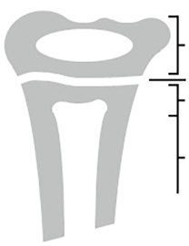

Unmatched source image; PDF page 230. Consult the original caption.

### Automatic table extraction — verify rendered original

|Physeal|Relating to the growth plate|
|---|---|
|-Plasia|Relating to the form or structure of a body tissue or organ|
|Rhizomelia|Shortening of the upper parts of the limbs (upper arm and thigh) in relation to the middle and terminal segments|
|Scoliosis|A lateral curvature of the normally straight vertical line of the spine|
|Spondylo-|Relating to the spine|
|Thoracic|Relating to the vertebrae found at the level of the ribs and chest|
|-Trophy|Relating to growth|

[Original table](../../tables/ch008_p0230_1.jpg)

## PDF page 231 | printed page 215

uncommon that an affected parent has never been diagnosed with the syndrome as the clin ical features may be subtle, such as in hypo chondroplasia, Léri-Weill dyschondrosteosis, or mild forms of osteogenesis imperfecta. With the newly available genetic tools, it is now routine that a diagnosis made in a child leads to the diagnosis being made in a parent and grandparent. Obtaining parental heights can assist with the evaluation. Reported parental heights are notoriously inaccurate; it is recommended that parents’ heights be mea sured by the provider whenever possible.

5

8.2

## PDF page 232 | printed page 216

portionately short legs which suggests the presence of short-limbed skeletal dysplasia. A patient with short stature and an upper-tolower segment ratio less than the 3rd percen tile suggests a disproportionately short spine, possibly due to spondylodysplasia and/or sco liosis. Conversely, a patient with tall stature and ratio that is less than the 3rd percentile has disproportionately long legs, suggesting an overgrowth syndrome such as Marfan syn drome. A related measurement is the sitting height and the sitting-to-standing height ratio. For this measurement, the child is placed on a flat stool with his or her back against the wall. The child’s thighs should be parallel to the floor. A mark is made at the top of the head. The distance from the floor to the mark minus the height of the stool gives the seated height. Reference ranges are available [6].

### 8

7

8.3

6

8.2

## PDF page 233 | printed page 217

Table 8.2 Guidelines for arm span-height difference

Arm span-height difference Caucasian and Hispanic Prepubertal (cm) Pubertala (cm)

3rd percentile −8.2 −7.0

Median −2.5 0.4

97th percentile 2.7 8.1

a For girls, breast Tanner stage 2 or higher; for boys genitalia Tanner stage 2 or higher

suggests disproportionately short arms while a difference greater than the 97th percentile suggests a short spine. Either suggests the presence of skeletal dysplasia. Children with an excessive arm span-height difference should also be evaluated for scoliosis. An arm-span-to-height ratio of >1.05 is used in the revised Ghent nosology for the diagnosis of Marfan syndrome [8].

A head circumference (occipital-frontal circumference, OFC) is also important for detecting body disproportion. An OFC within the expected range in a child with severe short stature could suggest a skeletal dysplasia, although other diagnoses must also be consid ered.

A thorough physical examination focused on the skeletal system is important. Observation of the child while standing will give the clinician an idea of body proportion. As a rule of thumb, the fingertips should rest level with the mid-thigh. Examination of the skull should note the presence and position of the fontanelles, and the presence of asymme try, frontal bossing, and hypo- or hyper telorism. A highly arched palate is common in a number of skeletal dysplasias. The presence of a short neck, kyphosis, or scoliosis may suggest an abnormality of the spine. Examination of the arms and legs may show disproportionate shortening of the upper or lower arm or leg. Limb segment measure ments can be done. A guide such as that by Gripp et al. [6] provides measurement tech niques and reference ranges. Bowing of a limb is an important finding, as is a limitation in joint mobility. Prominent radial and/or ulnar

African American Prepubertal (cm) Pubertala (cm)

−2.8 1.6

1.6 6.3

10 16.1

heads at the wrist may indicate Madelung deformity, seen in SHOX haploinsufficiency disorders (Léri-Weil dyschondrosteosis or Turner syndrome). A close examination of the hands and feet for shortening of some or all of the metatarsals, metacarpals, and phalan ges should also be done. Extra or missing dig its, syndactyly, and/or camptodactyly (inability to fully straighten a digit) are also important potential findings.

### 8.4 Diagnostic Evaluation

Once skeletal dysplasia is suspected, more indepth evaluation is called for. The diagnostic evaluation of a child suspected of having skel etal dysplasia requires a thorough history including a three-generation family history. Attention should be paid to signs and symp toms such as early onset arthritis or joint pain, fractures, joint replacement surgeries, dental problems, and hearing or vision abnormali ties. The physical examination should include specific measurements as discussed above to assess for disproportion, including signs of disproportion within the limb. Ranges of motion throughout are important to assess as both increased and decreased flexibilities are associated with various dysplasias. Lastly, skeletal imaging should be undertaken to look for diagnostic clues. There is not a standard dysplasia survey, as various experts and insti tutions do things differently. Our preferred evaluation includes the following: an AP image from the pelvis to the floor, standing if possible, otherwise supine (this image allows

### Automatic table extraction — verify rendered original

|Col1|Arm span-height difference|Col3|Col4|Col5|
|---|---|---|---|---|
||**Caucasian and Hispanic**|**Caucasian and Hispanic**|**African American**|**African American**|
||**Prepubertal(cm)**|**Pubertala (cm)**|**Prepubertal(cm)**|**Pubertala (cm)**|
|3rd percentile|−8.2|−7.0|−2.8|1.6|
|Median|−2.5|0.4|1.6|6.3|
|97th percentile|2.7|8.1|10|16.1|

[Original table](../../tables/ch008_p0233_1.jpg)

## PDF page 234 | printed page 218

for the assessment of anatomical alignment of the lower extremities and disproportion within the limb); AP and lateral images of the tho raco-lumbar spine (to assess for scoliosis and any vertebral body abnormalities); an AP image of the arm from shoulder to wrist; and an AP image of the hands. If osteogenesis imperfecta or another fragility condition is being entertained, AP and lateral skull images are done to assess mineralization and for wor mian bones. If any spine abnormalities are present either on clinical examination or radiograph, lateral flexion and extension views are recommended to assess for cervical spine instability. Important consideration should be given to having these images reviewed by a radiologist familiar with skeletal dysplasias in children. If no such radiologist is available locally, assistance should be available through regional skeletal dysplasia programs. Assistance is also available at the University of California, Los Angeles International Skeletal Dysplasia Registry ( www.ortho. ucla.edu/isdr) [9] and the European Skeletal Dysplasia Network ( www.esdn.org) [10], which can review patient images and provide diagnostic possibilities.

### 8

Once the evaluation is completed, the information gathered from the history, physi cal, and radiographic examinations can be reviewed to try and reach a specific diagnosis. If a specific or limited differential diagnosis can be reached, molecular testing is likely available to confirm a diagnosis. Advances in genetic diagnostic techniques including thirdgeneration sequencing, multiple gene panel sequencing, and whole exome sequencing have diagnosis confirmation now possible in the majority of skeletal dysplasia syndromes [2].

### 8.5 Common Syndromes

### 8.5.1 Achondroplasia

Achondroplasia (MIM 100800) is the most common skeletal dysplasia with incidence estimates ranging from 1 in 15,000 to 1 in 27,000 births [11–13]. The average adult

height for men is 131 cm, with a range of 118–144 cm (3′10′′–4′9′′, height SD score −8.3 to −4.6), and for women, 123 cm with a range of 113–137 cm (3′8′′–4′6′′, height SD score −7.7 to −4.0) [14]. The clinical features of achondroplasia are distinctive enough that diagnosis can be made through clinical and radiographic means, and historically, the diag nosis was usually made at birth or shortly thereafter [15]. Due to advances in late-term prenatal ultrasound and the detection of limb shortening, achondroplasia is now commonly diagnosed prenatally [11, 13].

8.4

Achondroplasia is caused by a mutation in the fibroblast growth factor receptor-3 gene (FGFR3) [16]. Mutations that change the amino acid glycine to arginine at position 380 (Gly380Arg) of the FGFR-3 protein account for greater than 98% of all reported cases of achondroplasia. This typical G380R gain-offunction mutation results in the constitutive activation of the receptor. In growth plate chondrocytes, this receptor activates the sig nal transducers and activators of the tran scription (STAT1) pathway, which inhibits chondrocyte proliferation, and the mitogen-

## PDF page 235 | printed page 219

activated protein kinase (MAPK) pathway, which inhibits both chondrocyte proliferation and differentiation. The net result of inhibited chondrocyte proliferation and differentiation is slowed bone growth [17–19]. Achondroplasia is inherited in an autosomal dominant man ner, but about 80% of patients with achondro plasia represent new mutations [13]. Given this high rate of new mutations and the inci dence of achondroplasia, the base pair of codon 380 in FGFR3 has the highest known rate of mutation in man. New mutations typi cally arise from the father during sperm for mation and paternal age greater than 35 years has been found to be a risk factor [20]. A recent hypothesis is that sperms containing a FGFR3 mutation have a selective advantage

and as men age, more FGFR3 mutant sperms are present [20].

Routine care for children with achondro plasia consists of monitoring for and the management of concerns such as genu varum, hydrocephalus, foramen magnum stenosis, obstructive sleep apnea, and ear infections from Eustachian tube abnormalities [21, 22]. A number of small studies have reported on the use of recombinant human growth hor mone (rhGH) in achondroplasia for up to 6 years [23–25]. Studies generally show an increase in height velocity during the first year of treatment, but this increase is reduced and then lost in subsequent years of treatment. There is an average net gain in height SD score of 1.0–1.6 (8–14 cm) [26]. The body dispro

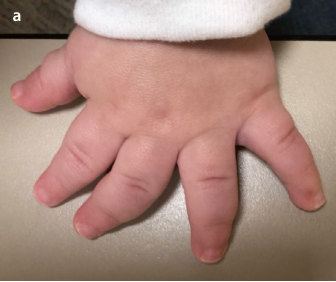

Unmatched source image; PDF page 235. Consult the original caption.

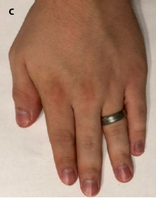

Unmatched source image; PDF page 235. Consult the original caption.

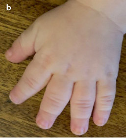

Unmatched source image; PDF page 235. Consult the original caption.

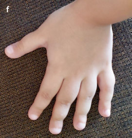

Unmatched source image; PDF page 235. Consult the original caption.

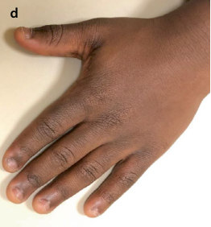

Unmatched source image; PDF page 235. Consult the original caption.

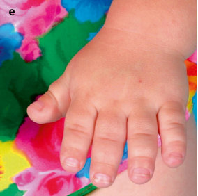

Unmatched source image; PDF page 235. Consult the original caption.

## PDF page 236 | printed page 220

portion is reported to be worsened [24] or unchanged [23, 25] by treatment and no unusual adverse effects have been reported. Because of the small gains relative to the pro found short stature, rhGH treatment is gener ally not recommended for the treatment of achondroplasia.

C-type natriuretic peptide (CNP) is a small peptide that acts in a paracrine manner in the growth plate to regulate growth (see acrome somelic dysplasia and type Maroteaux, later in the text). One mechanism of this is through the inhibition of intracellular signaling of the MAPK pathway [27]. In mice carrying the achondroplastic mutation, over-expression of CNP [28], as well as exogenous administration of CNP [29], rescues the skeletal abnormali ties, and leads to the possibility of using CNP as a growth-promoting treatment in children with achondroplasia [19, 29]. Vosoritide (pre viously named BMN111) is a peptide analog of a 39-amino acid version of CNP with a two-amino acid substitution at the aminoterminal end. This substitution reduces CNP cleavage by a specific neutral endopeptidase, prolonging its half-life in circulation, while not affecting binding with its primary recep tor, natriuretic peptide receptor-B (NPR-B) [30]. Vosoritide, given as a daily subcutaneous injection, has been shown to increase growth velocity in children with achondroplasia [31–33]. A randomized, double-blind, placebo-controlled study involving 119 chil dren with achondroplasia has been reported [32]. Subjects were monitored for 6 months for baseline growth data, then randomized to receive a placebo (n = 61) or vosoritide (n = 60) at 15 μg/kg daily for 1 year. The pri mary endpoint was the change in annualized height velocity from baseline. Treatment and control groups were well matched for sex, age, height, height SD score, and the upper-tolower body segment ratio. Treated subjects had an average age of 8.4 ± 2.4 (SD) years and showed a change in height velocity of 1.71 (1.40–2.01, 95% confidence interval) cm/year. This is compared to controls with an average age of 9.1 ± 2.5 years, with a change in height velocity of 0.13 (−0.18 to 0.45) cm/year (p < 0.0001). The change from baseline height

### 8

SD score was 0.27 (0.18–0.36) for treated sub jects compared to −0.01 (−0.1 to 0.09) for controls (p < 0.0001). There was no difference in change from the baseline of the upper-tolower segment ratio. Following this study, an uncontrolled, 2-year extension study of the same cohort was performed [33]. All control subjects were started on vosoritide at 15 μg/ mL daily and treated subjects were continued on treatment. The study showed the increase in height velocity during vosoritide treatment was maintained for 2 or 3 years, with no new adverse effects emerging. A clinical study of children from birth to 5 years of age [34] has been completed, but the results have not yet been published. No studies have yet been car ried out on final adult height. The most sig nificant adverse effect noted in these studies was a decrease in blood pressure 18–120 min following the injection. The decrease was transient and only occasionally was the sub ject symptomatic. The most common adverse effect was local injection site reactions, occur ring in 85% of the subjects. After 2 years of treatment, antibodies against vosoritide (antidrug antibodies, ADA) were detected in 35% of treated subjects. No drug-neutralizing anti bodies were detected and the clinical response was no different in the subjects who developed anti-drug antibodies. Based on these studies, vosoritide (VoxzogoTM, BioMarin Pharmaceutical Inc., San Rafael, CA) was approved for use in children with achondro plasia older than 2 years of age by the European Medicines Agency in August 2021, and for children older than 5 years by the Federal Drug Administration in November 2021. The Japanese Ministry of Health, Labor and Welfare approved its use in children with achondroplasia of any age in June 2022. In the United States, the current average annual cost of treatment is $320,000.

There are currently no consensus guide lines on pretreatment evaluation and moni toring for patients who are being initiated or maintained on vosoritide. Prior to initiation, we recommend that a patient have a full evalu ation, including an in-depth review of past medical history, medications, allergies, and subspecialist evaluations. A clinical examina

## PDF page 237 | printed page 221

tion, including detailed anthropometric mea surements, is also recommended. Radiographs to confirm open growth plates should also be obtained if a patient is undergoing puberty. A discussion that focuses on managing expecta tions as well as the impact and possible chal lenges of a daily injection for a child should be addressed. Families should be made aware of possible side effects, including injection site reactions and hypotension, and preventative tactics recommended including rotating injec tion sites and proper cleaning techniques. Having the child eat a small snack and drink at least 240 mL of fluid 30 min prior to admin istration is recommended to prevent hypoten sion [35]. Patients should be monitored at 3- to 6-month intervals, collecting anthropo metric measurements, monitoring for side effects, and discussing any challenges that may have arisen with the injections.

A second CNP-based drug (TransConTM CNP, Ascendis Pharma A/S, Denmark) has been developed where CNP is linked to an inert carrier to prolong half-life in vivo. TransConTM CNP is currently in a phase two clinical trial.

Other potential biochemical treatments for increasing linear growth in children with achondroplasia are in development. Infigratinib (previously named BGJ-398) is an FGFR 1–3 selective tyrosine kinase inhibitor that has been developed as an antineoplastic drug. In transgenic mice with the achondro plasia mutation, it promoted linear growth [36] and is currently in a phase two clinical trial [37] in children with achondroplasia. A soluble recombinant human FGFR3 decoy (Recifercept, previously named TA-46) was also effective in achondroplastic mice [38], but a phase two clinical trial [39] is currently on temporary hold due to unclear efficacy in chil dren with achondroplasia. Other drugs that show potential for increasing growth in achondroplastic mice models include the existing drugs of meclizine [40] and lovastatin [41] and using a FGFR3 monoclonal anti body that downregulates FGFR3 signaling, including FGFR3 with achondroplasia muta tion.

### 8.5.2 Hypochondroplasia

42

43

8.4

44

Like achondroplasia, hypochondroplasia is caused by gain of function mutations in FGFR3 [42]. While the mutation in achondro plasia is essentially always caused by the same

## PDF page 238 | printed page 222

mutation, there is greater variability in the mutations causing hypochondroplasia. The lysine-for-asparagine substitution at codon 540 (Asn540Lys) is the most common muta tion to cause hypochondroplasia, but several others have been described. A second gene has been implicated but has not yet been identi fied [45]. When there is an established clinical and radiographic diagnosis of hypochondro plasia, FGFR3 mutations can be identified in about 90% of individuals [45]. Because there is a phenotypical overlap between achondro plasia and hypochondroplasia, and between hypochondroplasia and “idiopathic” short stature, genetic confirmation of the diagnosis is recommended [45].

As with achondroplasia, rhGH seems to have some effect on hypochondroplasia, although studies are small and short-term [46–50]. The largest and longest-term study [46] showed that, while improving growth velocity and height SD score, rhGH also worsened the skeletal disproportion. A metaanalysis of published studies concluded there was a positive effect of rhGH on height [51]. Surgical limb lengthening procedures (distrac tion osteogenesis) have been reported in adults with hypochondroplasia [52, 53] to increase height and decrease skeletal disproportion, but are very invasive with a high complication rate and are by no means routine practice at this time. Since gain of function mutations of FGFR3 cause most cases of hypochondropla sia, we predict that the drug interventions being explored for achondroplasia will also prove effective in hypochondroplasia. One such clinical trial using vosoritide is currently underway.

### 8

### 8.5.3 Multiple Epiphyseal

### Dysplasia

Multiple epiphyseal dysplasia (MED) is a rel atively common disorder with a prevalence of at least 1 in 20,000 [54]. MED is a heteroge neous disorder of bone and cartilage develop ment that results in small irregular epiphyses. Proportionate short or average stature is pres ent, as are frequently painful joints, and pos sibly a mild myopathy. MED is not

recognizable at birth and is typically recog nized after 2 years of age and in some cases not until adulthood. Typically, adults will grow to be between 145 and 168 cm (4′9′′ and 5′6′′). MED may present as a delay in walking or gait differences in a young child. Initial complaints usually include joint stiffness, pain, contractures, or limping. In some forms of MED, the fingers and toes are short and stubby, especially the thumb. Minor flexion contractures of the knees and elbows can be present. Joint pain, which could be fluctuating or episodic in childhood, tends to advance in adolescence or early adulthood. Genu valgus or varus may develop.

Key radiographic characteristics of MED include irregular epiphyses usually at the hips, knees, ankles, wrists, and hands. Bones of the pelvis, spinal column, and skull are typically normal. In middle to late childhood, the epiphyses are either flat or small. An important diagnostic sign is the epiphyses of distal tibias which are malformed laterally to produce a sloping wedge-shaped articular surface. This may be more apparent later in life. A bipartite (split) patella can be seen and if present, shortening of the long bones is mild.

Multiple epiphyseal dysplasia is a geneti cally heterogeneous condition that can be inherited in either an autosomal dominant or autosomal recessive manner. Dominant forms of MED are more common. The most com mon dominant genetic cause of MED is mutations in the gene encoding the cartilage oligomeric matrix protein (COMP) (type 1, MIM 132400). Other dominant forms are caused by mutations in any three of the type IX collagen genes (COL9A1, type 6, MIM 120210; COL9A2, type 2, MIM 600204; COL9A3, type 3, MIM 600969) or the matri lin-3 gene (MATN3, type 5, MIM 607078). These proteins are extracellular matrix com ponents found in growth plate cartilage. The autosomal recessive form of MED is caused by mutations in the diastrophic dysplasia sul fate transporter (DTDST, type 4, MIM 226900). The precise percentage of MED patients with identifiable mutations varies, but it is clear that mutations cannot be found in all patients.

## PDF page 239 | printed page 223

There are no published studies of the use of rhGH in MED. Its effectiveness on height growth and body disproportion is unknown.

### 8.5.4 Léri-Weill Dyschondrosteosis

55

56

55

56

57

8.5

56

56 55

The majority of cases of LWD result from heterozygous deletion or inactivating muta

tions of the “short-stature homeoboxcontaining gene” or SHOX [58–60]. Genetic variances in noncoding regions both upstream and downstream of SHOX have also been implicated [61]. The SHOX protein is a tran scription factor that is expressed in epiphyseal growth plates [62], but its precise role is still being elucidated [63]. The SHOX protein has been shown to negatively regulate FGFR3 [64], raising the intriguing possibility of a common pathway disruption between SHOX haploinsufficiency and achondroplasia/hypo chondroplasia. SHOX is located on the distal ends of the short arms of both the X and Y chromosomes, in the pseudoautosomal regions. Although SHOX is located on the X chromosome, LWD is not transmitted in an X-linked inheritance pattern, but in an auto somal dominant-like pattern. Variable pene trance is seen, resulting in a wide spectrum of severity. Because of the variability of the phe notype, the prevalence of LWD is unknown. Homozygous mutations or deletions of SHOX are the cause of Langer mesomelic dysplasia (MIM 249700), a profoundly severe form of short-limbed dwarfism. Genetic test ing for SHOX mutations and deletions is now available through several commercial labora tories.

Large-scale deletions of the X chromo some can result in loss of SHOX, giving rise to LWD as part of a contiguous gene syn drome that may (in boys) include a number of X-linked syndromes, including ichthyosis, learning/behavioral difficulties, Kallman syn drome, chondrodysplasia punctata, and skel etal deformities with short stature [65]. By virtue of a missing X chromosome, girls with Turner syndrome have only a single SHOX gene. Although not traditionally diagnosed as having LWD, these girls phenotypically often have the findings of LWD and it is believed that the loss of the SHOX copy explains all or almost all of the short stature associated with Turner syndrome. Madelung deformity is seen in Turner syndrome but at a lower prevalence than in LWD (25% vs. 53%) [56].

In a recent study of prepubertal children with “idiopathic” short stature (a height less than the 3rd percentile or a height less than the 10th percentile with a height velocity less

## PDF page 240 | printed page 224

### 8

57

than the 25th percentile) of 740 unrelated sub jects, 23 had a SHOX deletion, 5 had an intra genic SHOX mutation, and 8 had deletions proximal to SHOX [66]. This represents an incidence of 4.9% of SHOX-related abnor malities in children with “idiopathic” short stature. In the absence of other features, these children are not generally diagnosed with LWD, but rather with “SHOX haploinsuffi

55 58

ciency,” a designation that includes LWD and Turner syndrome.

Recombinant human growth hormone has been shown to be effective in SHOX haploin sufficiency disorders. Use of rhGH in girls with Turner syndrome is now routine care and one study demonstrated a near-final final adult-height increase over the predicted height SD score of 1.3 ± 0.6 [67]. Trials in LWD are

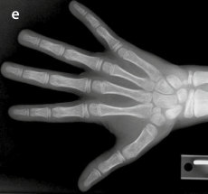

Unmatched source image; PDF page 240. Consult the original caption.

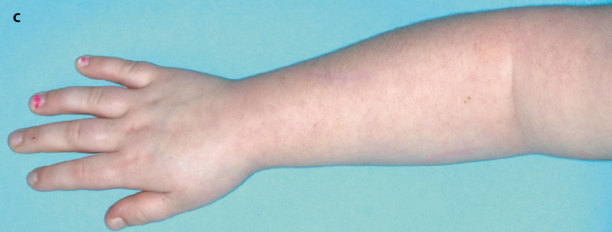

Unmatched source image; PDF page 240. Consult the original caption.

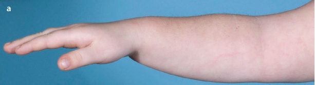

Unmatched source image; PDF page 240. Consult the original caption.

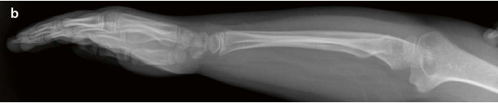

Unmatched source image; PDF page 240. Consult the original caption.

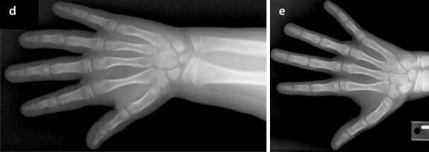

Unmatched source image; PDF page 240. Consult the original caption.

## PDF page 241 | printed page 225

more limited but suggest an equally good response [68]. Both Turner syndrome and SHOX haploinsufficiency are FDA-approved indications for rhGH treatment [69].

### 8.5.5 Osteogenesis Imperfecta

Table 8.3 Classification of osteogenesis imperfecta types

Type Gene

### MIM

Locus

Non-deforming

I COL1A1 166200 17q21.33

COL1A2 166200 7q21.3

PLS3 300910 Xq23

Perinatal lethal

II COL1A1 166220 17q21.33

COL1A2 166220 7q21.3

CRTAP 610682 3p22.3

P3H1 610915 1p34.2

PPIB 259440 15q22.31

70

71

72 73

8.3

Protein product Inheritance

Collagen, type I, alpha-1 chain AD

Collagen, type I, alpha-2 chain AD

Plastin 3 XL

Collagen, type I, alpha-1 chain AD

Collagen, type I, alpha-2 chain AD

Cartilage-associated protein AR

Prolyl 3-hydroxylase 1 AR

Peptidyl-prolyl isomerase B (Cyclophilin B) AR

(continued)

### Automatic table extraction — verify rendered original

|I|COL1A1|166200|17q21.33|Collagen, type I, alpha-1 chain|AD|
|---|---|---|---|---|---|
|I|_COL1A2_|166200|7q21.3|Collagen, type I, alpha-2 chain|AD|
|I|_PLS3_|300910|Xq23|Plastin 3|XL|

[Original table](../../tables/ch008_p0241_2.jpg)

### Automatic table extraction — verify rendered original

|II|COL1A1|166220|17q21.33|Collagen, type I, alpha-1 chain|AD|
|---|---|---|---|---|---|
|II|_COL1A2_|166220|7q21.3|Collagen, type I, alpha-2 chain|AD|
|II|_CRTAP_|610682|3p22.3|Cartilage-associated protein|AR|
|II|_P3H1_|610915|1p34.2|Prolyl 3-hydroxylase 1|AR|
|II|_PPIB_|259440|15q22.31|Peptidyl-prolyl isomerase B (Cyclophilin B)|AR|

[Original table](../../tables/ch008_p0241_3.jpg)

## PDF page 242 | printed page 226

Table 8.3 (continued)

Type Gene

### MIM

Locus

Progressively deforming

III COL1A1 259420 17q21.33

COL1A2 259420 7q21.3

CRTAP 610682 3p22.3

P3H1 610915 1p34.2

PPIB 259440 15q22.31

SERPINH1 613848 11q13.5

BMP1 614856 8p21.3

FKBP10 610968 17q21.2

PLOD2 609220 3q24

### 8

SERPINF1 613982 17p13.3

SP7 613849 12q13.13

WNT1 615220 12q13.12

TMEM38B 615066 9q31.1

CREB3L1 11q11.2

SEC24D 4q26

Moderate form

IV COL1A1 166220 17q21.33

COL1A2 166220 7q21.3

CRTAP 610682 3p22.3

PPIB 259440 15q22.31

FKBP10 610968 17q21.2

SERPINF1 613982 17p13.3

WNT1 615220 12q13.12

SP7 613849 12q13.13

Calcification of the interosseous membrane and/or hyperplastic callus

V IFITM5 610967 11p15.5

Table modified from Van Dijk and Sillence [73]

imperfecta (~10%) and hearing loss (~15%) are less common [74]. In a large cohort of 598 individuals with a clinical diagnosis of OI, pathogenic mutations were identified in 97–98% of affected individuals [75]. Of the 256 patients with a diagnosis of OI type I,

Protein product Inheritance

Collagen, type I, alpha-1 chain AD

Collagen, type I, alpha-2 chain AD

Cartilage-associated protein AR

Prolyl 3-hydroxylase 1 AR

Peptidyl-prolyl isomerase B (Cyclophilin B) AR

Serpin peptidase inhibitor, clade H, member 1 AR

Bone morphogenetic protein 1 AR

FK506-binding protein 10 AR

Procollagen-lysine, 2-oxoglutarate 5-dioxygen ase 2

AR

Serpin peptidase inhibitor, clade F, member 1 AR

Transcription Factor Sp7 (Osterix) AR

Wingless-type MMTV integration site family, 1 AR

Transmembrane protein 38B AR

cAMP response element-binding protein 3-like 1 AR

SEC24-related gene family, Member D

Collagen, type I, alpha-1 chain AD

Collagen, type I, alpha-2 chain AD

Cartilage-associated protein AR

Peptidyl-prolyl isomerase B (Cyclophilin B) AR

FK506-binding protein 10 AR

Serpin peptidase inhibitor, clade F, member 1 AR

Wingless-type MMTV integration site family, 1 AD

Transcription Factor Sp7 (Osterix) AR

Interferon-induced transmembrane protein 5 AD

disease-causing variants were detected in 248 (97%). All mutations found in OI type I were dominant and exclusively affected type I col lagen genes (COL1A1 or COL1A2). In the 342 patients with a diagnosis of moderate and severe OI (types II, III, and IV), disease-

### Automatic table extraction — verify rendered original

|III|COL1A1|259420|17q21.33|Collagen, type I, alpha-1 chain|AD|
|---|---|---|---|---|---|
|III|_COL1A2_|259420|7q21.3|Collagen, type I, alpha-2 chain|AD|
|III|_CRTAP_|610682|3p22.3|Cartilage-associated protein|AR|
|III|_P3H1_|610915|1p34.2|Prolyl 3-hydroxylase 1|AR|
|III|_PPIB_|259440|15q22.31|Peptidyl-prolyl isomerase B (Cyclophilin B)|AR|
|III|_SERPINH1_|613848|11q13.5|Serpin peptidase inhibitor, clade H, member 1|AR|
|III|_BMP1_|614856|8p21.3|Bone morphogenetic protein 1|AR|
|III|_FKBP10_|610968|17q21.2|FK506-binding protein 10|AR|
|III|_PLOD2_|609220|3q24|Procollagen-lysine, 2-oxoglutarate 5-dioxygen­ ase 2|AR|
|III|_SERPINF1_|613982|17p13.3|Serpin peptidase inhibitor, clade F, member 1|AR|
|III|_SP7_|613849|12q13.13|Transcription Factor Sp7 (Osterix)|AR|
|III|_WNT1_|615220|12q13.12|Wingless-type MMTV integration site family, 1|AR|
|III|_TMEM38B_|615066|9q31.1|Transmembrane protein 38B|AR|
|III|_CREB3L1_||11q11.2|cAMP response element-binding protein 3-like 1|AR|
|III|_SEC24D_||4q26|SEC24-related gene family, Member D||

[Original table](../../tables/ch008_p0242_2.jpg)

### Automatic table extraction — verify rendered original

|IV|COL1A1|166220|17q21.33|Collagen, type I, alpha-1 chain|AD|
|---|---|---|---|---|---|
|IV|_COL1A2_|166220|7q21.3|Collagen, type I, alpha-2 chain|AD|
|IV|_CRTAP_|610682|3p22.3|Cartilage-associated protein|AR|
|IV|_PPIB_|259440|15q22.31|Peptidyl-prolyl isomerase B (Cyclophilin B)|AR|
|IV|_FKBP10_|610968|17q21.2|FK506-binding protein 10|AR|
|IV|_SERPINF1_|613982|17p13.3|Serpin peptidase inhibitor, clade F, member 1|AR|
|IV|_WNT1_|615220|12q13.12|Wingless-type MMTV integration site family, 1|AD|
|IV|_SP7_|613849|12q13.13|Transcription Factor Sp7 (Osterix)|AR|

[Original table](../../tables/ch008_p0242_3.jpg)

## PDF page 243 | printed page 227

causing variants were detected in 337 (99%). Dominant mutations were found in COL1A1 or COL1A2 (77%), or IFITM5 (9%). Recessive mutations were observed in 12% of individu als with moderate to severe OI, most com monly, SERPINF1 and CRTAP. Thus, about 20% of individuals with moderate to severe OI had mutations in genes other than COL1A1 or COL1A2 [75]. Patients with type I OI tend to have quantitative defects in their type I collagen protein arising from largescale deletions or nonsense mutations (“func tional null” alleles) in COL1A1 or COL1A2. Patients with OI types II, III, and IV often have missense mutations that alter glycine residues in either COL1A1 or COL1A2 or mutations in genes that affect collagen pro duction and processing [72].

The clinical diagnosis of OI is based on history and clinical examination, bone min eral density determination by dual-energy x-ray absorptiometry (DEXA or DXA), find ings on radiographs, and bone and mineral biochemistry. Once OI is suspected, it is rec ommended that genetic testing be done not only to confirm the diagnosis but also to determine the recurrence risks. Identifying the type of OI is important for predicting the course of the disease as well as identifying other problems that are specific to certain types. For instance, patients with OI type V are at risk for hyperplastic callus formation, radial head dislocation, and abnormalities in the cranio-cervical junction [76]. Several com mercial laboratories now offer OI sequencing panels.

The most effective treatment strategies for OI are multidisciplinary: general medical management to maximize bone health by optimizing vitamin D status and calcium intake while minimizing the morbidity of fractures and pain; orthopedic management of fractures and skeletal deformities; and physical/occupational therapy to maximize strength and function. Other important healthcare providers are dentists for the treat ment of the complications of dentinogenesis imperfecta, and otolaryngologists for the monitoring of hearing loss [77, 78]. The last three decades have seen an increasing use of bisphosphonates in the treatment of OI and is

now routinely utilized for moderate to severe forms. It often falls to the pediatric endocri nologist to manage this treatment. Bisphosphonates are analogs of pyrophos phate that bind to bone minerals and inhibit osteoclast function, reducing bone resorption. Glorieaux et al. [79] reported on the use of pamidronate (a bisphosphonate given intrave nously) in OI in an uncontrolled study and noted a decrease in fracture frequency, improvement in bone mineral density, and improvement of chronic bone pain. A longerterm study [80] confirmed the results and in addition showed an improvement in linear growth and weight gain in more severely affected individuals (OI types III and IV). Other studies describe similar improvement, but also reported a case of nonunion of a tib ial fracture [81] and delayed fracture healing [82]. Two larger review studies including a Cochran review have been completed. In the first review, 10 trials (519 children) [83] and in the second, 14 trials (819 participants) [84] were included. The studies were, for the most part, at a low risk of bias. The Cochran review [84] found that for oral bisphosphonates, data versus placebo could not be aggregated. They reported that in two studies there appeared to be a reduction in fractures, but no differences were reported in the remaining three trials which commented on fracture incidence. Both reviews state that all studies investigating lum bar spine bone mineral density indicated a statistically significant increase in at least one time point as a result of bisphosphonate ther apy. There was general agreement that treat ment with oral or intravenous bisphosphonates in children with OI results in an increase in bone mineral density. Although most studies observed a significant decrease in fracture incidence and bone pain, the varied study designs did not allow this to be shown conclu sively. A number of studies suggest bisphos phonates also help alleviate pain in children with osteogenesis imperfecta, although a sys temic review concluded there was a high risk for bias in most studies [85]. The medications in general do appear to be safe and well toler ated [83, 84].

At our center, we use the protocol reported by Glorieaux et al. [79], namely, pamidronate

## PDF page 244 | printed page 228

diluted in normal saline (0.1 mg: 1 cc NS at maximum concentration), infused over 4 h, 0.5–1 mg/kg (depending upon patient age) each day for three consecutive days, cycled every 8–16 weeks (depending upon patient age). Some centers delay infusions after oste otomies [86], although this is somewhat con troversial. Infusions are generally not delayed after fractures. The primary adverse effect is a febrile acute phase reaction that is common after the first dose. On the first day of the first infusion, we decrease the dose to one-quarter of the typical dose (0.125 mg/kg) and half of the typical dose (0.25 mg/kg) on days two and three to decreases this effect. Premedication with acetaminophen or ibuprofen before each dose during this first cycle can also be helpful. Transient hypocalcemia after an infusion is seen on occasion, especially in infants, but is rarely of clinical significance with pamidro nate in children. We perform pretreatment assessment and normalization of vitamin D status and calcium intake to lessen this poten tial effect. For infants with moderate to severe OI, we recommend pamidronate be initiated as soon as able, following stabilization of respiratory status and advancement to full feeds. Osteonecrosis of the jaw following den tal procedures is a rare but serious complica tion of bisphosphonate therapy in adults. This is of particular concern in children with OI associated with dentinogenesis imperfecta, who may require multiple dental procedures. However, no cases have been reported in chil dren with OI [87, 88].

### 8

Zoledronic acid is another IV bisphospho nate that is increasingly being used for the treatment of OI. The advantage of zoledronic acid over pamidronate is that the infusion is given over 30 min (vs. 4 h for pamidronate) and is given as a single infusion (vs. daily for 3 days for pamidronate). Small, randomized clinical trials have shown results are compa rable for both drugs [89, 90], although larger and long-term studies have not been pub lished. Our experience is that zoledronic acid more frequently causes significant hypocalce mia and acute phase reactions than pamidro nate. Until longer-term data are available, our center will continue to use pamidronate.

There is debate in the field on how long to treat OI patients with bisphosphonates. Bisphosphonates remain bound to bone for decades after administration and, although long-term studies to date do not suggest any very long-term adverse effects, there remains some uncertainty. It seems prudent to limit the exposure of these children as much as pos sible to these drugs. An observational study of 23 children with OI where pamidronate was stopped after at least 3 years of treatment showed a rapid decrease in bone mineral den sity in the radial diaphysis [91]. It has been suggested that this might create regions of localized bone weakness at the junction of the bone laid down during the treatment and bone laid down after the treatment [91]. Some centers are now decreasing the bisphospho nate dose by half once the bone mineral den sity SD score by DXA has improved to >−2.0 [76], although this approach has not been rig orously tested.

There is interest in the use of rhGH in patients with OI, both to treat growth failure associated with the more severe forms and also because of its anabolic effect on bone. Growth hormone deficiency is not part of OI, although there may be a blunted IGF-I release in response to rhGH [92]. In short-term trials, rhGH increased both linear growth and bone mineral density [93, 94]. Long-term studies have not been reported.

### 8.6 Uncommon Syndromes; What

### They Teach Us About Growth

### 8.6.1 Jansen-Type Metaphyseal

### Chondrodysplasia and Blomstrand Chondrodysplasia

8.4

## PDF page 245 | printed page 229

respiratory support. However, for some, there are no signs of dysplasia at birth. Postnatal growth failure becomes obvious within 1–2 years of age. Radiographs show a rachitictype picture with normally appearing epiphy ses, widened growth plates, and severely disordered metaphyses with splaying, cup ping, and fraying. They also show osteopenia and subperiosteal bone resorption suggestive of hyperparathyroidism. About half of the patients with this syndrome have hypercalce mia, along with hypercalciuria, hypophospha temia, hyperphosphaturia, and increased 1,25(OH)2 vitamin D levels, a pattern strongly suggestive of hyperparathyroidism. However, parathyroid hormone (PTH) and PTH-related protein (PTHrP) levels are low normal or sup pressed [95]. In 1995, it was reported that Jansen-type metaphyseal chondrodysplasia was caused by gain of function mutations of the parathyroid hormone receptor (PTH1R) [96].

In 1985, Blomstrand et al. [97] described a neonate that died within hours of birth with a form of short-limbed dwarfism with features of advanced skeletal maturation (Blomstrand chondrodysplasia, MIM 215045). This is a very rare autosomal recessive form of dwarf ism that is generally perinatally lethal, although milder forms have since been described [98]. The fetuses/neonates showed severely shortened limbs, polyhydramnios, hydrops fetalis, coarctation of the aorta, and hypoplastic lungs. Radiographs consistently showed dense bones with premature mineral ization of the teeth and all of the bones in the hands and feet [99]. In many ways, Blomstrand chondrodysplasia showed the opposite fea tures of Jansen-type metaphyseal chondro dysplasia, despite both being short-limbed forms of dwarfism. This symmetry was con firmed when Blomstrand chondrodysplasia was found to be caused by inactivating muta tions of the parathyroid hormone receptor [100].

The parathyroid hormone receptor (para thyroid hormone 1 receptor, PTH1R, gene PTH1R) is a G-protein coupled receptor whose ligands are both PTH and PTHrP. In renal tubular cells, osteoblasts, and osteo clasts, PTH1R mediates the calcium-

regulatory properties of PTH and is the source of the hypercalcemia found in Jansentype metaphyseal chondrodysplasia. However, in growth plate chondrocytes, PTH1R medi ates the growth-regulatory properties of PTHrP and gives rise to the dwarfism features of both syndromes.

In the 1990s, through an elegant series of experiments conducted in a number of labo ratories in chicks and rodents, a major regula tory mechanism of the growth plate was described involving Indian hedgehog and PTHrP [101]. Briefly, differentiated chondro cytes within the hypertrophic zone of the growth plate produce a paracrine signaling peptide called Indian hedgehog, which dif fuses through the growth plate. Indian hedge hog is detected by perichondrium and periarticular cells, as well as chondrocytes in the proliferative and pre-hypertrophic zone. In response, these cells produce PTHrP, which inhibits the differentiation of pre-hypertrophic chondrocytes and prevents their entry into the hypertrophic phase. The reduced number of hypertrophic chondrocytes results in reduced Indian hedgehog production, closing the feed back loop. Through this feedback mechanism, the number of chondrocytes entering the hypertrophic phase of differentiation is regu lated. Several other signaling pathways, including transforming growth factor-β (TGF-β) [102] and bone morphogenetic proteins (BMP) [103], are intermediates in, and modulators of, this feedback loop. The discovery of the disruption of this feedback loop as the cause of Jansen-type metaphyseal chondrodysplasia and Blomstrand chondro dysplasia confirmed the presence and impor tance of this regulatory mechanism in human growth.

### 8.6.2 Acromesomelic Dysplasia,

### Type Maroteaux

8.6

## PDF page 246 | printed page 230

### 8

( Fig. 8.4) and feet [104]. Infants with AMDM usually have limited findings at birth, although the short birth length and subtle dis proportion have been observed [105]. Generally, these children are identified after their linear growth slows at 1–2 years of age. Adults with this syndrome have height SD scores ranging from −5 to −10 [106]. It is a rare syndrome, with a prevalence of roughly 1:2,000,000 [107]. In 2004, the cause of AMDM was found to be homozygous inacti vating mutations in the gene that encodes for the natriuretic peptide receptor B (NPR-B, gene NPR2) [106]. The ligand for NPR-B is a C-type natriuretic peptide (CNP). This obser vation was the first to identify CNP as an important regulator of human growth [108].

Both CNP and NPR-B are synthesized in the growth plate; CNP acts through a paracrineregulatory mechanism. Rodent and in vitro studies have now shown that CNP stimulates growth plate chondrocyte differentiation and hypertrophy, in part through inhibiting MAPK pathway signaling [27]. As such, CNP is a counter-regulatory mechanism to the FGFR3 and Indian hedgehog/PTHrP path ways. This effect has led to the exploration of CNP as a specific treatment for achondropla sia [19] (see discussion above).

It was observed that the parents and het erozygous carrier siblings of patients with AMDM were shorter than the general popu lation [106, 107, 109]. Heterozygous carriers of NPR2 mutations have on average height SD scores that are 1.4 lower than noncarrier family members but with no body dispropor tion or other detectable abnormalities [107]. Heterozygous inactivating mutations in NPR2 have been identified in 1–3% of children with “idiopathic” short stature [110, 111].

Interestingly, gain of function mutations of NPR2 have been found to be a cause of tall stature [112, 113], often associated with a Marfanoid body habitus.

### 8.7 Growth Plate-Specific

### Biomarkers

Clinically relevant biomarkers of linear growth have long been sought. The gold stan dard for measuring height velocity is serial height measurements taken 6–12 months apart. This approach, however, depends on accurate height measurements and takes a long time to obtain a result. A biomarker that correlates with height velocity would allow for the assessment of growth at a single time point. This would be useful in the clini cal evaluation of children with short stature, distinguishing between a short child who is growing as expected and a short child who is growing slowly. Such a biomarker would also be useful during times of changing height velocity, such as when starting growth-pro moting treatment such as rhGH or vosorit ide, or starting potentially growth-inhibiting

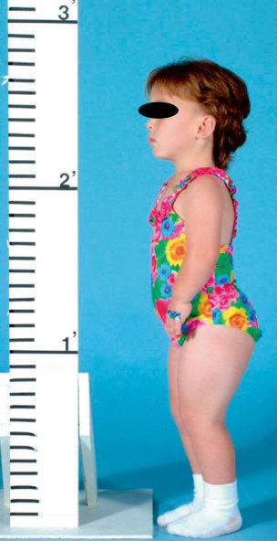

Unmatched source image; PDF page 246. Consult the original caption.

## PDF page 247 | printed page 231

treatment such as systemic glucocorticoids. A number of peptides have been proposed as potential biomarkers, including bone-for mation markers such as bone-specific alka line phosphatase and collagen-type I markers [114]; bone resorption markers such as uri nary deoxypyridinoline/creatinine [115]; tissue expansion markers such as procollagen-type III N-terminal propeptide (PIIINP) [114]; and unrelated markers such as leptin [116]. Blood levels of all of the mentioned potential biomarkers have been shown (at least in some studies) to correlate with increased height velocity in children starting rhGH therapy. However, none correlate with height velocity in healthy, normally growing children. With a better understanding of growth plate regula tion, two peptides have emerged that are spe cific to the growth plate and show significant promise as biomarkers of linear growth.

119

117

118 119

8.7

120

8.8

## PDF page 248 | printed page 232

121

### 8

both NTproCNP [122] and CXM (unpub lished observation) correlate highly with height velocity in children with short stature after the initiation of rhGH treatment.

Besides being markers for growth, these biomarkers also provide us with new tools for studying growth plate function in syndromes of skeletal dysplasia. In children with achon droplasia, NTproCNP levels are higher than age- and sex-matched controls, despite their reduced height velocity [123]. In the same cohort, CXM levels were consistently reduced [124]. This pattern demonstrates that these children have resistance to CNP, as discussed

Case Studies

in the achondroplasia section above. Levels of both biomarkers still correlated with height velocity in these children. Conversely, in osteogenesis imperfecta, NTproCNP levels are reduced (unpublished observation), while CXM [125] levels are elevated compared to the general population. In this study, elevated CXM levels may be related to fractures or fracture healing at the time of sampling as we could not confirm this finding in this popula tion (unpublished observation). If true, how ever, it would suggest that the growth impairment in OI may be due to hypertrophic chondrocyte dysfunction.

## PDF page 249 | printed page 233

Her mother is 155 cm (SD score of −1.3, 10th percentile) and her father is 165 cm (SD score −1.7, 4th percentile) and has quite short arms. Her physical exam shows a height of 127.0 cm (SD score −1.9, 3rd percentile), a weight of 38.0 kg (SD score 0.5, 68th percen tile), and a BMI of 23.5 (SD score 1.7, 95th percentile). She has obvious short arms, with an arm span of 119.0 cm and an arm spanheight difference of 8.0 cm (SD score of −2.0, 3rd percentile). Her upper-to-lower segment ratio is 1.02 (SD score of 1.8, 4th percentile). Her physical exam is significant for cubitus val gus, slight genu valgus, prominent radial heads with a step off at the wrists, and brachydactyly. She does not have neck webbing, lymphedema, shield chest, or a heart murmur. A left hand/ wrist radiograph ( Fig. 8.9) shows a bone age that is concordant with her chronologic age, but also tilting of the radial and ulnar heads, with abnormal distal radial and ulnar physes,

consistent with Madelung deformity. A full skeletal survey shows the cubitus valgus and is otherwise unremarkable. Laboratories are remarkable for a normal female karyotype (46XX). Sequencing of SHOX shows a hetero zygous mutation of c.3G>A, p,Met1Ile. This case illustrates the need for pediatric endo crinologist’s understanding of skeletal dyspla sias. This is a girl who presents with the common complaint of short stature. The patient has skeletal disproportion that is not severe and has some characteristic skeletal find ings, including cubitus valgus and Madelung deformity. The first consideration should be the diagnosis of Turner syndrome. However, this girl has none of the nonskeletal features of Turner syndrome, and finding that her father has very similar findings makes Turner syn drome unlikely. Léri-Weill dyschondrosteosis then becomes the leading diagnostic possibility, either from a SHOX mutation or deletion

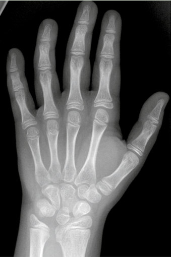

Unmatched source image; PDF page 249. Consult the original caption.

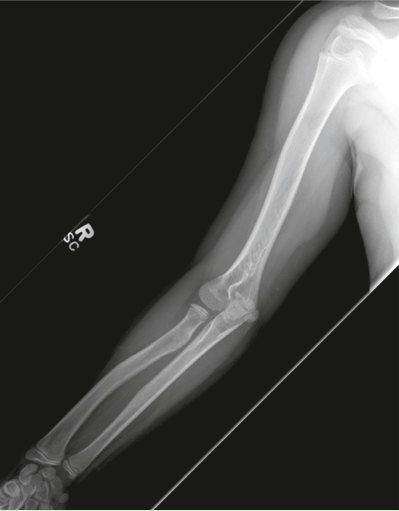

Unmatched source image; PDF page 249. Consult the original caption.

## PDF page 250 | printed page 234

inherited from her father. This family proved to have a point mutation that eliminated the start codon of the SHOX gene, eliminating all trans lation from the mRNA, and confirming the diagnosis. This patient is currently on human growth hormone treatment.

Case 2 is a 15-year, 9-month-old boy, referred for short stature. Previous growth charts are unavailable but he has always been the shortest boy in his class and the difference between him and his peers had increased in the previous 1–2 years. He is otherwise healthy with no other medical problems. Past medical history showed he was the product of an uncomplicated pregnancy and was born at 40 weeks gestation with a birth weight of 4.48 kg (SD score of 2.0, 98th percentile). Birth length is unknown. His mother is 163 cm (SD score of −0.1, 48th percentile) and his father is 157 cm (SD score of −2.8, 0.3rd per centile). The paternal grandfather is also short. The physical exam shows a height of 156.1 cm (SD score −2.1, 2nd percentile), a weight of 67.1 kg (SD score 0.6, 73rd percen tile), and a BMI of 27.5 (SD score 1.7, 95th percentile). He has an arm span of 155.8 cm and an arm span-height difference of −0.3 cm

### 8

### 8.8 Summary

There are 461 syndromes of skeletal dyspla sia. Most are readily recognized as such, but in a number, the effect on height is relatively minor, and other signs and/or symptoms are absent or subtle. It is not uncommon for these children to present to the pediatric endocri nologist for the evaluation of short stature. It is incumbent that the pediatric endocrinolo gist be able to recognize when a child might have skeletal dysplasia, to be able to diagnose the most common syndromes, and to under stand what treatment options are available.

In the words of William Harvey (1578–1657), “Nature is nowhere accustomed more openly to display her secret mysteries than in cases where she shows traces of her workings apart from the beaten path; nor is

(SD score of −0.4, 35th percentile). His upperto-lower segment ratio is 1.09 (SD score of 3.5, >99.9th percentile). His physical exam shows skeletal disproportion, with his finger tips falling to the level of his hips when stand ing. His upper arms and thighs are clearly short compared to his forearms and lower leg. His forehead is prominent, but he has no other dysmorphic facial features. His hands and fin gers are short and broad. A left hand/wrist x-ray showed a bone age of 16–9/12 at a chronologic age of 15–8/12 (SD score 0.9) and no bone abnormalities. Laboratories were unremarkable. Sequencing of FGFR3 showed a heterozygous mutation of c.1620C>A, p. Asn540Lys.

This young man has hypochondroplasia. As in case 1, the skeletal disproportion is the key in recognizing the presence of skeletal dys plasia, leading to prompt diagnosis. In both cases, there is a significant family history of short stature (three generations in case 2), but the correct diagnosis had not been previously recognized. For case 2, his advanced bone age suggested that human growth hormone treat ment would not be effective and was not attempted.

there any better way to advance the proper practice of medicine than to give our minds to the discovery of the usual law of nature by careful investigation of cases of rarer forms of disease” [126]. Children with skeletal dys plasias on occasion require the diagnostic and therapeutic skills of a pediatric endocrinolo gist. In return, these patients give us the opportunity to learn more about human growth and the human skeleton through “careful investigation” of these rare forms of disease.

Review Questions

1. You have been asked to see an adopted

18-month-old boy with a recent tibia fracture that occurred following a lowenergy fall. He is noted to have blue sclera and you have a clinical suspicion

## PDF page 251 | printed page 235

that he has a mild form of OI. You would like to proceed with molecular testing to confirm the diagnosis. The most effective genetic testing should be A. CRTAP, P3H1, and PPIB panel B. COL1A1 and COL1A2 sequencing C. IFITM5 sequencing D. Whole exome sequencing

### References

1. Mortier GR, Cohn DH, Cormier-Daire V, Hall

2. A 7-year-old girl presents with short

stature, with a height on the 2nd per centile. She has no dysmorphic fea tures and a normal upper-to-lower segment ratio and arm span-height dif ference. A karyotype is normal, 46XX. Has SHOX haploinsufficiency been ruled out? A. Yes B. No

2. Falardeau 3. Orioli IM, Castilla EE, Barbosa-Neto JG. The

4. Superti-Furga A, Unger S. Nosology and classifi

3. A 12-year-old boy presents with short

stature, with a height on the fourth percentile. He has skeletal dispropor tion with a high upper-to-lower seg ment ratio and low arm span-height difference. His mother also has short stature, also with short-appearing arms. You suspect he has a skeletal dysplasia. The most appropriate next step in the evaluation is

5. McKusick VA. The Marfan syndrome. In:

6. Gripp KW, Slavotinek AM, Hall JG, Allanson

7. Cole TJ. The LMS method for constructing nor

A. Radiographic skeletal survey B. Referral to genetics C. Send genetic testing for SHOX and

8. Loeys BL, Dietz HC, Braverman AC, Callewaert

FGFR3 D. Whole exome sequencing

9. Rimoin DL, Cohn D, Krakow D, Wilcox W,

### v Answers

1. B. For mild osteogenesis imperfecta,

the most common causes by far are mutations or deletions of one of the type I collagen genes. 2. B. In children with “idiopathic” short

10. Zankl A, Jackson GC, Crettol LM, Taylor J, Elles

stature, as many as 5% will have a SHOX microdeletion, point mutation, or mutation in a regulatory region. 3. A. A skeletal survey should be able to

11. Coi A, Santoro M, Garne E, Pierini A, Addor

differentiate the types of skeletal dys plasias by looking for characteristic features such as Madelung deformity

and cubitus valgus for Léri-Weill dys chondrosteosis or rhizomelic shorten ing, and spinal and pelvic changes for hypochondroplasia.

C, Krakow D, Mundlos S, et al. Nosology and classification of genetic skeletal disorders: 2019 revision. Am J Med Genet A. 2019;179:2393–419. https://doi.org/10.1002/ajmg.a.61366. F, Camurri MV, Campeau PM. Genomic approaches to diagnose rare bone disorders. Bone. 2017;102:5–14. https://doi. org/10.1016/j.bone.2016.07.020.

birth prevalence rates for the skeletal dysplasias. J Med Genet. 1986;23:328–32. https://doi. org/10.1136/jmg.23.4.328.

cation of genetic skeletal disorders: 2006 revision. Am J Med Genet A. 2007;143:1–18. https://doi. org/10.1002/ajmg.a.31483.

McKusick VA, editor. Heritable disorders of con nective tissue. 4th ed. Saint Louis: The C.V. Mosby Company; 1972. p. 73–4.

JE. Handbook of physical measurements. 3rd ed. Oxford University Press; 2013.

malized growth standards. Eur J Clin Nutr. 1990;44:45–60.

BL, De Backer J, Devereux RB, et al. The revised Ghent nosology for the Marfan syndrome. J Med Genet. 2010;47:476–85. https://doi.org/10.1136/ jmg.2009.072785.

Lachman RS, Alanay Y. The skeletal dysplasias: clinical-molecular correlations. Ann N Y Acad Sci. 2007;1117:302–9. https://doi.org/10.1196/ annals.1402.072.

R, Mortier GR, et al. Preselection of cases through expert clinical and radiological review significantly increases mutation detection rate in multiple epiphyseal dysplasia. Eur J Hum Genet. 2007;15:150–4. https://doi.org/10.1038/sj. ejhg.5201744.

MC, Alessandri JL, et al. Epidemiology of achondroplasia: a population-based study in Europe. Am J Med Genet A. 2019;179:1791–8. https://doi.org/10.1002/ajmg.a.61289.

## PDF page 252 | printed page 236

12. Jones KL, Jones MC, del Campo M. Smith’s rec

ognizable patterns of human malformation. 8th ed. Philadelphia, PA: Elsevier Saunders; 2021. 13. Hoover-Fong JE, Alade AY, Hashmi SS, Hecht

24. Ramaswami U, Rumsby G, Spoudeas HA,

JT, Legare JM, Little ME, et al. Achondroplasia Natural History Study (CLARITY): a multi center retrospective cohort study of achondropla sia in the United States. Genet Med. 2021;23:1498–505. https://doi.org/10.1038/ s41436-021-01165-2. 14. Horton WA, Rotter JI, Rimoin DL, Scott CI,

25. Hertel NT, Eklof O, Ivarsson S, Aronson S,

Hall JG. Standard growth curves for achondro plasia. J Pediatr. 1978;93:435–8. https://doi. org/10.1016/S0022-3476(78)81152-4. 15. Horton WA, Hall JG, Hecht JT. Achondroplasia.

26. Miccoli M, Bertelloni S, Massart F. Height out

Lancet. 2007;370:162–72. https://doi.org/10.1016/ S0140-6736(07)61090-3. 16. Shiang R, Thompson LM, Zhu YZ, Church DM,

Fielder TJ, Bocian M, et al. Mutations in the transmembrane domain of FGFR3 cause the most common genetic form of dwarfism, achon droplasia. Cell. 1994;78:335–42. https://doi. org/10.1016/0092-8674(94)90302-6. 17. Zhou ZQ, Ota S, Deng C, Akiyama H, Hurlin

27. Ozasa A, Komatsu Y, Yasoda A, Miura M,

### 8

PJ. Mutant activated FGFR3 impairs endochon dral bone growth by preventing SOX9 downregu lation in differentiating chondrocytes. Hum Mol Genet. 2015;24:1764–73. https://doi.org/10.1093/ hmg/ddu594. 18. Martinez-Frias ML, de Frutos CA, Bermejo E,

28. Yasoda A, Komatsu Y, Chusho H, Miyazawa T,

Nieto MA. Review of the recently defined molec ular mechanisms underlying thanatophoric dys plasia and their potential therapeutic implications for achondroplasia. Am J Med Genet A. 2010;152A:245–55. https://doi.org/10.1002/ ajmg.a.33188. 19. Laederich MB, Horton WA. Achondroplasia:

29. Yasoda A, Kitamura H, Fujii T, Kondo E, Murao

30. Wendt DJ, Dvorak-Ewell M, Bullens S, Lorget F,

pathogenesis and implications for future treat ment. Curr Opin Pediatr. 2010;22(4):516–23. https://doi.org/10.1097/MOP.0b013e32833b7a69. 20. Wilkin DJ, Szabo JK, Cameron R, Henderson S,

Bellus GA, Mack ML, et al. Mutations in fibro blast growth-factor receptor 3 in sporadic cases of achondroplasia occur exclusively on the pater nally derived chromosome. Am J Hum Genet. 1998;63:711–6. https://doi.org/10.1086/302000. 21. Hoover-Fong J, Scott CI, Jones MC, Committee

31. Savarirayan R, Irving M, Bacino CA, Bostwick

on Genetics. Health supervision for people with achondroplasia. Pediatrics. 2020;145:e20201010. https://doi.org/10.1542/peds.2020-1010. 22. Savarirayan R, Ireland P, Irving M, Thompson D,

32. Savarirayan R, Tofts L, Irving M, Wilcox W,

Alves I, Baratela WAR, et al. International Consensus Statement on the diagnosis, multidis ciplinary management and lifelong care of indi viduals with achondroplasia. Nat Rev Endocrinol. 2022;18:173–89. https://doi.org/10.1038/s41574- 021-00595-x. 23. Tanaka H, Kubo T, Yamate T, Ono T, Kanzaki S,

33. Savarirayan R, Tofts L, Irving M, Wilcox WR,

Seino Y. Effect of growth hormone therapy in children with achondroplasia: growth pattern,

hypothalamic-pituitary function, and genotype. Eur J Endocrinol. 1998;138:275–80. https://doi. org/10.1530/eje.0.1380275.

Hindmarsh PC, Brook CG. Treatment of achon droplasia with growth hormone: six years of experience. Pediatr Res. 1999;46:435–9. https:// doi.org/10.1203/00006450-199910000-00012.

Westphal O, Sipila I, et al. Growth hormone treatment in 35 prepubertal children with achon droplasia: a five-year dose-response trial. Acta Paediatr. 2005;94:1402–10. https://doi. org/10.1111/j.1651-2227.2005.tb01811.x.

come of recombinant human growth hormone treatment in achondroplasia children: a metaanalysis. Horm Res Paediatr. 2016;86:27–34. https://doi.org/10.1159/000446958.

Sakuma Y, Nakatsuru Y, et al. Complementary antagonistic actions between C-type natriuretic peptide and the MAPK pathway through FGFR-3 in ATDC5 cells. Bone. 2005;36:1056–64. https://doi.org/10.1016/j.bone.2005.03.006.

Ozasa A, Miura M, et al. Overexpression of CNP in chondrocytes rescues achondroplasia through a MAPK-dependent pathway. Nat Med. 2004;10:80–6. https://doi.org/10.1038/nm971.

N, Miura M, et al. Systemic administration of C-type natriuretic peptide as a novel therapeutic strategy for skeletal dysplasias. Endocrinology. 2009;150:3138–44. https://doi.org/10.1210/ en.2008-1676.

Bell SM, Peng J, et al. Neutral endopeptidaseresistant C-type natriuretic peptide variant repre sents a new therapeutic approach for treatment of fibroblast growth factor receptor 3-related dwarf ism. J Pharmacol Exp Ther. 2015;353:132–49. https://doi.org/10.1124/jpet.114.218560.

B, Charrow J, Cormier-Daire V, et al. C-type natriuretic peptide analogue therapy in children with achondroplasia. N Engl J Med. 2019;381:25–35. https://doi.org/10.1056/nej moa1813446.

Bacino CA, Hoover-Fong J, et al. Once-daily, subcutaneous vosoritide therapy in children with achondroplasia: a randomised, double-blind, phase 3, placebo-controlled, multicentre trial. Lancet. 2020;396:684–92. https://doi.org/10.1016/ s0140-6736(20)31541-5.

Bacino CA, Hoover-Fong J, et al. Safe and persis tent growth-promoting effects of vosoritide in children with achondroplasia: 2-year results from

## PDF page 253 | printed page 237

an open-label, phase 3 extension study. Genet Med. 2021;23:2443–7. https://doi.org/10.1038/ s41436-021-01287-7. 34. Savarirayan R, Irving M, Maixner W, Thompson

44. Newman DE, Dunbar JC. Hypochondroplasia. J

D, Offiah AC, Connolly DJ, et al. Rationale, design, and methods of a randomized, controlled, open-label clinical trial with open-label extension to investigate the safety of vosoritide in infants, and young children with achondroplasia at risk of requiring cervicomedullary decompression surgery. Sci Prog. 2021;104:368504211003782. https://doi.org/10.1177/00368504211003782. 35. VoxzogoTM (vosoritide) [package insert]. San

45. Xue Y, Sun A, Mekikian PB, Martin J, Rimoin

46. Appan S, Laurent S, Chapman M, Hindmarsh

Rafael, CA: BioMarin Pharmaceutical Inc.; 2021. 36. Komla-Ebri D, Dambroise E, Kramer I, Benoist-

Lasselin C, Kaci N, Le Gall C, et al. Tyrosine kinase inhibitor NVP-BGJ398 functionally improves FGFR3-related dwarfism in mouse model. J Clin Invest. 2016;126:1871–84. https:// doi.org/10.1172/jci83926. 37. Savarirayan R, De Bergua JM, Arundel P,

47. Key LL Jr, Gross AJ. Response to growth hor

48. Kanazawa H, Tanaka H, Inoue M, Yamanaka Y,

McDevitt H, Cormier-Daire V, Saraff V, et al. Infigratinib in children with achondroplasia: the PROPEL and PROPEL 2 studies. Ther Adv Musculoskelet Dis. 2022;14:1759720X221084848. https://doi.org/10.1177/1759720x221084848. 38. Garcia S, Dirat B, Tognacci T, Rochet N, Mouska

49. Tanaka N, Katsumata N, Horikawa R, Tanaka

X, Bonnafous S, et al. Postnatal soluble FGFR3 therapy rescues achondroplasia symptoms and restores bone growth in mice. Sci Transl Med. 2013;5(203):203ra124. https://doi.org/10.1126/ scitranslmed.3006247. 39. Gonçalves D, Rignol G, Dellugat P, Hartmann G,

50. Pinto G, Cormier-Daire V, Le Merrer M, Samara-

Sarrazy Garcia S, et al. In vitro and in vivo charac terization of Recifercept, a soluble fibroblast growth factor receptor 3, as treatment for achon droplasia. PLoS One. 2020;15:e0244368. https:// doi.org/10.1371/journal.pone.0244368. 40. Matsushita M, Hasegawa S, Kitoh H, Mori K,

51. Massart F, Miccoli M, Baggiani A, Bertelloni

Ohkawara B, Yasoda A, et al. Meclozine pro motes longitudinal skeletal growth in transgenic mice with achondroplasia carrying a gain-offunction mutation in the FGFR3 gene. Endocrinology. 2015;156:548–54. https://doi. org/10.1210/en.2014-1914. 41. Yamashita A, Morioka M, Kishi H, Kimura T,

52. Yasui N, Kawabata H, Kojimoto H, Ohno H,

Yahara Y, Okada M, et al. Statin treatment res cues FGFR3 skeletal dysplasia phenotypes. Nature. 2014;513:507–11. https://doi.org/10.1038/ nature13775. 42. Bellus GA, McIntosh I, Smith EA, Aylsworth AS,

53. Kitoh H, Kitakoji T, Tsuchiya H, Katoh M,

Kaitila I, Horton WA, et al. A recurrent mutation in the tyrosine kinase domain of fibroblast growth factor receptor 3 causes hypochondroplasia. Nat Genet. 1995;10:357–9. https://doi.org/10.1038/ ng0795-357. 43. Fredriks AM, van Buuren S, van Heel WJ,

54. Unger S, Bonafe L, Superti-Furga A. Multiple

Dijkman-Neerincx RH, Verloove-Vanhorick SP, Wit JM. Nationwide age references for sitting height, leg length, and sitting height/height ratio, and their diagnostic value for disproportionate

growth disorders. Arch Dis Child. 2005;90:807–12. https://doi.org/10.1136/adc.2004.050799.

Can Assoc Radiol. 1975;26:95–103.

DL, Lachman RS, et al. FGFR3 mutation fre quency in 324 cases from the International Skeletal Dysplasia Registry. Mol Genet Genomic Med. 2014;2:497–503. https://doi.org/10.1002/ mgg3.96.

PC, Brook CG. Growth and growth hormone therapy in hypochondroplasia. Acta Paediatr Scand. 1990;79:796–803. https://doi. org/10.1111/j.1651-2227.1990.tb11557.x.

mone in children with chondrodysplasia. J Pediatr. 1996;128:S14–7. https://doi.org/10.1016/ s0022-3476(96)70004-5.

Namba N, Seino Y. Efficacy of growth hormone therapy for patients with skeletal dysplasia. J Bone Miner Metab. 2003;21:307–10. https://doi. org/10.1007/s00774-003-0425-7.

T. The comparison of the effects of short-term growth hormone treatment in patients with achondroplasia and with hypochondroplasia. Endocr J. 2003;50:69–75. https://doi.org/10.1507/ endocrj.50.69.

Boustani D, Baujat G, Fresneau L, et al. Efficacy and safety of growth hormone treatment in chil dren with hypochondroplasia: comparison with an historical cohort. Horm Res Paediatr. 2014;82:355–63. https://doi. org/10.1159/000364807.

S. Height outcome of short children with hypo chondroplasia after recombinant human growth hormone treatment: a meta-analysis. Pharmacogenomics. 2015;16:1965–73. https:// doi.org/10.2217/pgs.15.129.

Matsuda S, Araki N, et al. Lengthening of the lower limbs in patients with achondroplasia and hypochondroplasia. Clin Orthop Relat Res. 1997;344:298–306.

Ishiguro N. Distraction osteogenesis of the lower extremity in patients with achondroplasia/hypo chondroplasia treated with transplantation of culture-expanded bone marrow cells and plateletrich plasma. J Pediatr Orthop. 2007;27:629–34. https://doi.org/10.1097/bpo.0b013e318093f523.

epiphyseal dysplasia: clinical and radiographic features, differential diagnosis and molecular basis. Best Pract Res Clin Rheumatol. 2008;22:19–32. https://doi.org/10.1016/j. berh.2007.11.009.

## PDF page 254 | printed page 238

55. Ross JL, Scott C Jr, Marttila P, Kowal K, Nass A,

66. Chen J, Wildhardt G, Zhong Z, Roth R, Weiss B,

Papenhausen P, et al. Phenotypes associated with SHOX deficiency. J Clin Endocrinol Metab. 2001;86:5674–80. https://doi.org/10.1210/ jcem.86.12.8125. 56. Ross JL, Kowal K, Quigley CA, Blum WF, Cutler

GB Jr, Crowe B, et al. The phenotype of short stature homeobox gene (SHOX) deficiency in childhood: contrasting children with Leri-Weill dyschondrosteosis and Turner syndrome. J Pediatr. 2005;147:499–507. https://doi. org/10.1016/j.jpeds.2005.04.069. 57. Cook PA, Yu JS, Wiand W, Lubbers L, Coleman

67. Quigley CA, Crowe BJ, Anglin DG, Chipman

68. Blum WF, Cao D, Hesse V, Fricke-Otto S, Ross

CR, Cook AJ, et al. Madelung deformity in skel etally immature patients: morphologic assess ment using radiography, CT, and MRI. J Comput Assist Tomogr. 1996;20:505–11. https://doi. org/10.1097/00004728-199607000-00001. 58. Blanco ME, Perez-Cabrera A, Kofman-Alfaro S,

69. Richmond E, Rogol AD. Current indications for

Zenteno JC. Clinical and cytogenetic findings in 14 patients with madelung anomaly. Orthopedics. 2005;28:315–9. https://doi.org/10.3928/0147- 7447-20050301-18. 59. Rao E, Weiss B, Fukami M, Rump A, Niesler B,

### 8

70. Sillence DO, Senn A, Danks DM. Genetic hetero

Mertz A, et al. Pseudoautosomal deletions encompassing a novel homeobox gene cause growth failure in idiopathic short stature and Turner syndrome. Nat Genet. 1997;16:54–63. https://doi.org/10.1038/ng0597-54. 60. Ellison JW, Wardak Z, Young MF, Gehron RP,

71. Steiner RD, Basel D. COL1A1/2 osteogenesis

Laig-Webster M, Chiong W. PHOG, a candidate gene for involvement in the short stature of Turner syndrome. Hum Mol Genet. 1997;6:1341–7. https://doi.org/10.1093/ hmg/6.8.1341. 61. Spurna Z, Capkova P, Srovnal J, Duchoslavova J,

72. Rohrbach M, Giunta C. Recessive osteogenesis

Punova L, Aleksijevic D, Vrtel R. Clinical impact of variants in non-coding regions of SHOX— current knowledge. Gene. 2022;818:146238. https://doi.org/10.1016/j.gene.2022.146238. 62. Munns CJ, Haase HR, Crowther LM, Hayes MT,

73. Van Dijk FS, Sillence DO. Osteogenesis imper

Blaschke R, Rappold G, et al. Expression of SHOX in human fetal and childhood growth plate. J Clin Endocrinol Metab. 2004;89:4130–5. https://doi.org/10.1210/jc.2003-032230. 63. Marchini A, Ogata T, Rappold GA. A track

74. Patel RM, Nagamani SC, Cuthbertson D,

record on SHOX: from basic research to complex models and therapy. Endocr Rev. 2016;37:417–48. https://doi.org/10.1210/er.2016-1036. 64. Decker E, Durand C, Bender S, Rödelsperger C,

75. Bardai G, Moffatt P, Glorieux FH, Rauch

Glaser A, Hecht J, et al. FGFR3 is a target of the homeobox transcription factor SHOX in limb development. Hum Mol Genet. 2011;20:1524–35. https://doi.org/10.1093/hmg/ddr030. 65. Spranger S, Schiller S, Jauch A, Wolff K,

Rauterberg-Ruland I, Hager D, et al. Leri-Weill syndrome as part of a contiguous gene syndrome at Xp22.3. Am J Med Genet. 1999;83:367–71. h t t p s : / / d o i . o r g / 1 0 . 1 0 0 2 / ( s i c i ) 1 0 9 6 - 8628(19990423)83:5<367::aid-ajmg5>3.0.co;2-k.

76. Trejo P, Rauch F. Osteogenesis imperfecta in

Steinberger D, et al. Enhancer deletions of the SHOX gene as a frequent cause of short stature: the essential role of a 250 kb downstream regula tory domain. J Med Genet. 2009;46:834–9. https://doi.org/10.1136/jmg.2009.067785.

JJ. Growth hormone and low dose estrogen in Turner syndrome: results of a United States multi-center trial to near-final height. J Clin Endocrinol Metab. 2002;87:2033–41. https://doi. org/10.1210/jcem.87.5.8477.

JL, Jones C, et al. Height gains in response to growth hormone treatment to final height are similar in patients with SHOX deficiency and Turner syndrome. Horm Res. 2009;71:167–72. https://doi.org/10.1159/000197874.

growth hormone therapy for children and adoles cents. Endocr Dev. 2010;18:92–108. https://doi. org/10.1159/000316130.

geneity in osteogenesis imperfecta. J Med Genet. 1979;16:101–16. https://doi.org/10.1136/ jmg.16.2.101.

imperfecta. 2005 Jan 28 [Updated 2021 May 6]. In: Adam MP, Everman DB, Mirzaa GM, Pagon RA, Wallace SE, editors. GeneReviews. Seattle, WA: University of Washington; 1993–2022. https://www.ncbi.nlm.nih.gov/books/NBK1295/

imperfecta: clinical, radiological, and molecular findings. Am J Med Genet C Semin Med Genet. 2012;160C:175–89. https://doi.org/10.1002/ ajmg.c.31334.

fecta: clinical diagnosis, nomenclature and sever ity assessment. Am J Med Genet A. 2014;164A:1470–81. https://doi.org/10.1002/ ajmg.a.36545.

Campeau PM, Krischer JP, Shapiro JR, et al. A cross-sectional multicenter study of osteogenesis imperfecta in North America—results from the linked clinical research centers. Clin Genet. 2015;87:133–40. https://doi.org/10.1111/ cge.12409.

F. DNA sequence analysis in 598 individuals with a clinical diagnosis of osteogenesis imperfecta: diagnostic yield and mutation spectrum. Osteoporos Int. 2016;27:3607–13. https://doi. org/10.1007/s00198-016-3709-1.

children and adolescents-new developments in diagnosis and treatment. Osteoporos Int. 2016;27:3427–37. https://doi.org/10.1007/ s00198-016-3723-3.

## PDF page 255 | printed page 239

77. Thomas IH, DiMeglio LA. Advances in the clas

88. Neal TW, Schlieve T. Medication-related osteone

sification and treatment of osteogenesis imper fecta. Curr Osteoporos Rep. 2016;14:1–9. https:// doi.org/10.1007/s11914-016-0299-y. 78. Montpetit K, Palomo T, Glorieux FH, Fassier F,

89. Barros ER, Saraiva GL, de Oliveira TP, Lazaretti-

Rauch F. Multidisciplinary treatment of severe osteogenesis imperfecta: functional outcomes at skeletal maturity. Arch Phys Med Rehabil. 2015;96:1834–9. https://doi.org/10.1016/j. apmr.2015.06.006. 79. Glorieux FH, Bishop NJ, Plotkin H, Chabot G,

Lanoue G, Travers R. Cyclic administration of pamidronate in children with severe osteogenesis imperfecta. N Engl J Med. 1998;339:947–52. https://doi.org/10.1056/nejm199810013391402. 80. Zeitlin L, Rauch F, Plotkin H, Glorieux

90. Vuorimies I, Toiviainen-Salo S, Hero M, Makitie

FH. Height and weight development during four years of therapy with cyclical intravenous pami dronate in children and adolescents with osteo genesis imperfecta types I, III, and IV. Pediatrics. 2003;111:1030–6. https://doi.org/10.1542/ peds.111.5.1030. 81. Falk MJ, Heeger S, Lynch KA, DeCaro KR,

91. Rauch F, Cornibert S, Cheung M, Glorieux

92. Marini JC, Bordenick S, Heavner G, Rose S,

Bohach D, Gibson KS, et al. Intravenous bisphos phonate therapy in children with osteogenesis imperfecta. Pediatrics. 2003;111:573–8. https:// doi.org/10.1542/peds.111.3.573. 82. Alharbi M, Pinto G, Finidori G, Souberbielle JC,

93. Antoniazzi F, Monti E, Venturi G, Franceschi R,

Guillou F, Gaubicher S, et al. Pamidronate treat ment of children with moderate-to-severe osteo genesis imperfecta: a note of caution. Horm Res. 2009;71:38–44. https://doi. org/10.1159/000173740. 83. Rijks EB, Bongers BC, Vlemmix MJ, Boot AM,

94. Marini JC, Hopkins E, Glorieux FH, Chrousos

van Dijk AT, Sakkers RJ, et al. Efficacy and safety of bisphosphonate therapy in children with osteogenesis imperfecta: a systematic review. Horm Res Paediatr. 2015;84:26–42. https://doi. org/10.1159/000381713. 84. Dwan K, Phillipi CA, Steiner RD, Basel

D. Bisphosphonate therapy for osteogenesis imperfecta. Cochrane Database Syst Rev. 2016;10:CD005088. https://doi. org/10.1002/14651858.CD005088.pub4. 85. Celin MR, Simon JC, Krzak JJ, Fial AV, Kruger

95. Kruse K, Schutz C. Calcium metabolism in the

KM, Smith PA, et al. Do bisphosphonates allevi ate pain in children? A systematic review. Curr Osteoporos Rep. 2020;18:486–504. https://doi. org/10.1007/s11914-020-00621-3. 86. Rauch F. Bisphosphonate treatment and related

96. Schipani E, Kruse K, Juppner H. A constitutively

agents in children. In: Shapiro JR, Byers PH, Glorieux FH, Sponsellor PD, editors. Osteogenesis imperfecta: a translational approach to brittle bone disease. New York: Academic Press; 2014. p. 501–7. 87. Hennedige AA, Jayasinghe J, Khajeh J, Macfarlane TV. Systematic review on the inci dence of bisphosphonate related osteonecrosis of the jaw in children diagnosed with osteogenesis imperfecta. J Oral Maxillofac Res. 2014;4:e1. https://doi.org/10.5037/jomr.2013.4401.

97. Blomstrand S, Claesson I, Save-Soderbergh J. A

98. Oostra RJ, van der Harten JJ, Rijnders WP, Scott

crosis of the jaws in the pediatric population. J Oral Maxillofac Surg. 2022;80:1686–90. https:// doi.org/10.1016/j.joms.2022.06.026.

Castro M. Safety and efficacy of a 1-year treat ment with zoledronic acid compared with pamidronate in children with osteogenesis imper fecta. J Pediatr Endocrinol Metab. 2012;25:485–91. https://doi.org/10.1515/jpem- 2012-0016.

O. Zoledronic acid treatment in children with osteogenesis imperfecta. Horm Res Paediatr. 2011;75:346–53. https://doi. org/10.1159/000323368.

FH. Long-bone changes after pamidronate dis continuation in children and adolescents with osteogenesis imperfecta. Bone. 2007;40:821–7. https://doi.org/10.1016/j.bone.2006.11.020.

Hintz R, Rosenfeld R, et al. The growth hormone and somatomedin axis in short children with osteogenesis imperfecta. J Clin Endocrinol Metab. 1993;76:251–6. https://doi.org/10.1210/ jcem.76.1.8421094.

Doro F, Gatti D, et al. GH in combination with bisphosphonate treatment in osteogenesis imper fecta. Eur J Endocrinol. 2010;163:479–87. https:// doi.org/10.1530/eje-10-0208.

GP, Reynolds JC, Gundberg CM, et al. Positive linear growth and bone responses to growth hormone treatment in children with types III and IV osteogenesis imperfecta: high predictive value of the carboxyterminal propeptide of type I procollagen. J Bone Miner Res. 2003;18:237–43. https://doi.org/10.1359/ jbmr.2003.18.2.237.

Jansen type of metaphyseal dysplasia. Eur J Pediatr. 1993;152:912–5. https://doi.org/10.1007/ bf01957529.

active mutant PTH-PTHrP receptor in Jansentype metaphyseal chondrodysplasia. Science. 1995;268:98–100. https://doi.org/10.1126/sci ence.7701349.

case of lethal congenital dwarfism with acceler ated skeletal maturation. Pediatr Radiol. 1985;15:141–3. https://doi.org/10.1007/ bf02388725.

RJ, Young MP, Trump D. Blomstrand osteochon drodysplasia: three novel cases and histological evidence for heterogeneity. Virchows Arch. 2000;436:28–35. https://doi.org/10.1007/ pl00008195.

## PDF page 256 | printed page 240

99. Loshkajian A, Roume J, Stanescu V, Delezoide

AL, Stampf F, Maroteaux P. Familial Blomstrand chondrodysplasia with advanced skeletal matura tion: further delineation. Am J Med Genet. 1997;71:283–8. https://doi.org/10.1002/(sici)1096- 8628(19970822)71:3<283::aid-ajmg7>3.0.co;2-v. 100. Jobert AS, Zhang P, Couvineau A, Bonaventure J,

111. Wang SR, Jacobsen CM, Carmichael H, Edmund

Roume J, Le Merrer M, et al. Absence of func tional receptors for parathyroid hormone and parathyroid hormone-related peptide in Blomstrand chondrodysplasia. J Clin Invest. 1998;102:34–40. https://doi.org/10.1172/jci2918. 101. Kronenberg HM. PTHrP and skeletal develop

112. Miura K, Namba N, Fujiwara M, Ohata Y, Ishida

ment. Ann N Y Acad Sci. 2006;1068:1–13. 102. Alvarez J, Sohn P, Zeng X, Doetschman T,

113. Hannema SE, van Duyvenvoorde HA, Premsler

Robbins DJ, Serra R. TGFbeta2 mediates the effects of hedgehog on hypertrophic differentia tion and PTHrP expression. Development. 2002;129:1913–24. https://doi.org/10.1242/ dev.129.8.1913. 103. Minina E, Wenzel HM, Kreschel C, Karp S,

### 8

Gaffield W, McMahon AP, et al. BMP and Ihh/ PTHrP signaling interact to coordinate chondro cyte proliferation and differentiation. Development. 2001;128:4523–34. https://doi. org/10.1242/dev.128.22.4523. 104. Maroteaux P, Martinelli B, Campailla E. Acromesomelic dwarfism. Presse Med. 1971;79:1839–42. 105. Langer LO Jr, Beals RK, Solomon IL, Bard PA,

114. Crofton PM, Stirling HF, Schönau E, Kelnar

115. Branca F, Spagnoli A, Cianfarani S, Spadoni G,

Bard LA, Rissman EM, et al. Acromesomelic dwarfism: manifestations in childhood. Am J Med Genet. 1977;1:87–100. https://doi. org/10.1002/ajmg.1320010110. 106. Bartels CF, Bukulmez H, Padayatti P, Rhee DK,

Ravenswaaij-Arts C, Pauli RM, et al. Mutations in the transmembrane natriuretic peptide recep tor NPR-B impair skeletal growth and cause acromesomelic dysplasia, type maroteaux. Am J Hum Genet. 2004;75:27–34. https://doi. org/10.1086/422013. 107. Olney RC, Bukulmez H, Bartels CF, Prickett TC,

116. López-Siguero JP, López-Canti LF, Espino R,

Espiner EA, Potter LR, et al. Heterozygous muta tions in natriuretic peptide receptor-B (NPR2) are associated with short stature. J Clin Endocrinol Metab. 2006;91:1229–32. https://doi. org/10.1210/jc.2005-1949. 108. Olney RC. C-type natriuretic peptide in growth: a

117. Espiner E, Prickett T, Olney R. Plasma C-type

new paradigm. Growth Horm IGF Res. 2006;16(Suppl A):S6–14. https://doi. org/10.1016/j.ghir.2006.03.016. 109. Borrelli P, Fasanelli S, Marini R. Acromesomelic

118. Prickett TC, Lynn AM, Barrell GK, Darlow BA,

dwarfism in a child with an interesting family his tory. Pediatr Radiol. 1983;13:165–8. https://doi. org/10.1007/bf01624409. 110. Hisado-Oliva A, Garre-Vazquez AI, Santaolalla-

119. Olney RC, Permuy JW, Prickett TC, Han JC,

Caballero F, Belinchon A, Barreda-Bonis AC, Vasques GA, et al. Heterozygous NPR2 muta tions cause disproportionate short stature, similar to Leri-Weill dyschondrosteosis. J Clin

Endocrinol Metab. 2015;100:E1133–42. https:// doi.org/10.1210/jc.2015-1612.

AB, Robinson JW, Olney RC, et al. Heterozygous mutations in natriuretic peptide receptor-B (NPR2) gene as a cause of short stature. Hum Mutat. 2015;36:474–81. https://doi.org/10.1002/ humu.22773.

H, Kitaoka T, et al. An overgrowth disorder asso ciated with excessive production of cGMP due to a gain-of-function mutation of the natriuretic peptide receptor 2 gene. PLoS One. 2012;7:e42180. https://doi.org/10.1371/journal.pone.0042180.

T, Yang RB, Mueller TD, Gassner B, et al. An activating mutation in the kinase homology domain of the natriuretic peptide receptor-2 causes extremely tall stature without skeletal deformities. J Clin Endocrinol Metab. 2013;98:E1988–98. https://doi.org/10.1210/ jc.2013-2358.

CJ. Bone alkaline phosphatase and collagen markers as early predictors of height velocity response to growth-promoting treatments in short normal children. Clin Endocrinol (Oxf). 1996;44:385–94. https://doi. org/10.1046/j.1365-2265.1996.706cn527.x.

Golden MH, Boscherini B, et al. Urinary excre tion of pyridinium crosslinks in short children treated with growth hormone. J Pediatr Endocrinol Metab. 2002;15:27–34. https://doi. org/10.1515/jpem.2002.15.1.27.

Caro E, Fernández-García JM, Gutiérrez-Macías A, et al. Effect of recombinant growth hormone on leptin, adiponectin, resistin, interleukin-6, tumor necrosis factor-α and ghrelin levels in growth hormone-deficient children. J Endocrinol Investig. 2011;34:300–6. https://doi.org/10.1007/ bf03347090.

natriuretic peptide: emerging applications in dis orders of skeletal growth. Horm Res Paediatr. 2018;90:345–57. https://doi. org/10.1159/000496544.

Cameron VA, Espiner EA, et al. Amino-terminal proCNP: a putative marker of cartilage activity in postnatal growth. Pediatr Res. 2005;58:334–40. h t t p s : / / d o i . o r g / 1 0 . 1 2 0 3 / 0 1 . pdr.0000169964.66260.4b.

Espiner EA. Amino-terminal propeptide of C-type natriuretic peptide (NTproCNP) predicts height velocity in healthy children. Clin Endocrinol (Oxf). 2012;77:416–22. https://doi. org/10.1111/j.1365-2265.2012.04392.x.

## PDF page 257 | printed page 241

120. Coghlan RF, Oberdorf JA, Sienko S, Aiona MD,

Boston BA, Connelly KJ, et al. A degradation fragment of type X collagen is a real-time marker for bone growth velocity. Sci Transl Med. 2017;9:eaan4669. https://doi.org/10.1126/sci translmed.aan4669. 121. Coghlan RF, Olney RC, Boston BA, Coleman

124. Carroll RS, Olney RC, Duker AL, Coghlan RF,

DT, Johnstone B, Horton WA. Norms for clinical use of CXM, a real-time marker of height veloc ity. J Clin Endocrinol Metab. 2021;106:e255–64. https://doi.org/10.1210/clinem/dgaa721. 122. Olney RC, Salehi P, Prickett TC, Lima JJ, Espiner

125. Nicol 126. Harvey W, Willis R, Sydenham Society. The

EA, Sikes KM, et al. Dynamic response of C-type natriuretic peptide and its aminoterminal propep tide (NTproCNP) to growth hormone treatment in children with short stature. Clin Endocrinol (Oxf). 2016;85:561–8. https://doi.org/10.1111/ cen.13103. 123. Olney RC, Prickett TC, Espiner EA, Mackenzie

WG, Duker AL, Ditro C, et al. C-type natriuretic peptide plasma levels are elevated in subjects with

achondroplasia, hypochondroplasia, and thana tophoric dysplasia. J Clin Endocrinol Metab. 2015;100:E355–9. https://doi.org/10.1210/ jc.2014-2814.

Mackenzie WG, Ditro CP, et al. Collagen X marker levels are decreased in individuals with achondroplasia. Calcif Tissue Int. 2022;111:66–72. https://doi.org/10.1007/s00223- 022-00966-0. LE, Coghlan RF, Cuthbertson D, Nagamani SCS, Lee B, Olney RC, Horton W, Members of the Brittle Bone Disease Consortium, Orwoll E. Alterations of a serum marker of col lagen X in growing children with osteogenesis imperfecta. Bone. 2021;149:115990. https://doi. org/10.1016/j.bone.2021.115990.

works of William Harvey. London: Printed for the Sydenham Society; 1847.
