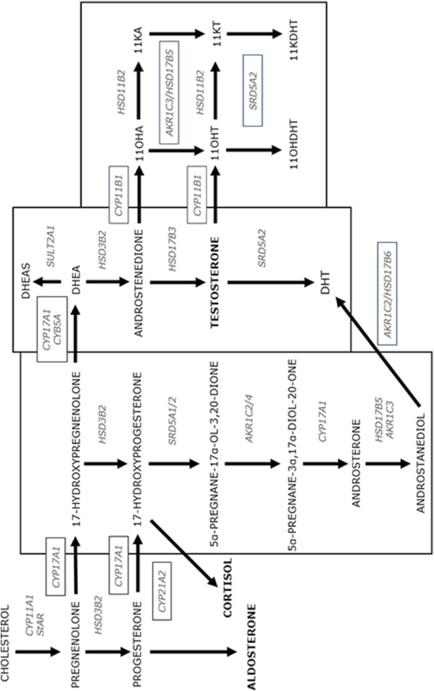

# 11. Congenital Adrenal Hyperplasia
> [Source credits](../../SOURCE_CREDITS.md).

## Study pillars

### Steroidogenic Pathways and Genetics

Congenital Adrenal Hyperplasia (CAH) is a group of autosomal recessive disorders of cortisol biosynthesis. More than 90-95% of cases are caused by mutations in CYP21A2 encoding 21-hydroxylase. Deficiency impairs conversion of 17-hydroxyprogesterone (17-OHP) to 11-deoxycortisol and progesterone to 11-deoxycorticosterone, shunting steroid precursors into the adrenal androgen pathway.

PDF p. 311

### Clinical Phenotypes

Classic salt-wasting (SW) CAH presents at 1-3 weeks of life with life-threatening salt-wasting crisis (hyponatremia, hyperkalemia, hypovolemia, shock) and prenatal virilization in 46,XX females (clitoromegaly, labial fusion, urogenital sinus; Prader stages I-V). Classic simple-virilizing (SV) CAH retains sufficient aldosterone synthesis (~1-2%) to prevent salt crisis but causes prenatal virilization in females and rapid post-natal somatic growth with premature epiphyseal fusion in both sexes. Non-classic (NC) CAH presents in childhood or adolescence with premature pubarche, hirsutism, severe acne, and menstrual irregularities.

PDF p. 313

### Newborn Screening and Diagnostics

Universal newborn screening measures 17-OHP on dried blood spots via immunoassay, with gestational age- and birthweight-adjusted cutoffs, followed by second-tier LC-MS/MS steroid profiling. Confirmation requires elevated baseline and cosyntropin-stimulated 17-OHP (>1,000 ng/dL in classic CAH; >1,500 ng/dL post-ACTH in NC-CAH), elevated 21-deoxycortisol, high androstenedione, and CYP21A2 gene deletion/mutation analysis.

PDF p. 314

### Medical Replacement Protocols

Classic CAH requires lifelong dual hormone replacement: hydrocortisone (10-15 mg/m2/day in growing children, divided 3 times daily) to suppress excess ACTH-driven androgens while preserving growth, and fludrocortisone (0.05-0.2 mg/day) to restore sodium balance. Infants also require oral sodium chloride supplementation (1-2 g/day, approx 17-34 mEq/day) due to immature renal tubular sodium reabsorption. Stress dosing (2-3x maintenance hydrocortisone) is mandatory during intercurrent illness.

PDF p. 321

### Monitoring and Novel Therapies

Therapeutic monitoring balances androgen suppression against hypercortisolemia (growth suppression, cushingoid weight gain, osteopenia). Parameters monitored include serial linear height velocity, bone age radiographs, and mid-morning/pre-dose 17-OHP and androstenedione. In post-pubertal males, regular testicular ultrasound screens for Testicular Adrenal Rest Tumors (TART). Novel therapies include modified-release hydrocortisone formulations (Chronocort/Efmody) and oral ACTH receptor (MC2R) antagonists (crinecerfont).

PDF p. 322

## Full source extraction

# 11. Congenital Adrenal Hyperplasia
> Source attribution: [Source credits](../../SOURCE_CREDITS.md).

## PDF page 308 | printed page 295

### Congenital Adrenal Hyperplasia

Selma Feldman Witchel, Sharon E. Oberfield, Anna Sonnett Fisher, and Christine Trapp

### Contents

### 11.1 Introduction – 297

### 11.2 Adrenal Steroidogenesis – 298

### 11.3 Specific Enzyme Deficiencies – 300

11.3.1 21-Hydroxylase Deficiency – 300 11.3.2 Lipoid Adrenal Hyperplasia – 302 11.3.3 Cholesterol Side-Chain Cleavage Deficiency – 302 11.3.4 3-Beta-Hydroxysteroid Dehydrogenase Deficiency – 303 11.3.5 17-Hydroxylase/17,20-Lyase Deficiency – 303 11.3.6 11-Beta-Hydroxylase Deficiency – 303 11.3.7 Aldosterone Synthase Deficiency – 304 11.3.8 P450 Oxidoreductase Deficiency – 304 11.3.9 Aromatase Deficiency (CYP19A1) – 304

### 11.4 Other Steroidogenic Pathways – 304

11.4.1 “Alternative Backdoor Pathway” – 304 11.4.2 11-Oxo-Androgens – 305

### 11.5 Diagnosis – 305

11.5.1 Infants – 305 11.5.2 Children and Adolescents – 307 11.5.3 Genetic Testing – 308

### 11.6 Therapy and Monitoring – 308

11.6.1 Treatment – 308

### 11.7 Reproductive Concerns – 311

11.7.1 Pregnancy – 311 11.7.2 Prenatal Treatment – 312

© The Author(s), under exclusive license to Springer Nature Switzerland AG 2024 S. Radovick, M. Misra (eds.), Pediatric Endocrinology, https://doi.org/10.1007/978-3-031-66296-6_11

## PDF page 309 | printed page 296

11.7.3 Gonadal Function in Boys and Men – 313 11.7.4 Contraception – 313 11.7.5 Delayed Puberty – 313 11.7.6 Urogenital Surgery – 314 11.7.7 Quality of Life – 314

### 11.8 Conclusion – 315

### References – 315

## PDF page 310 | printed page 297

### 11.1 Introduction

The congenital adrenal hyperplasias (CAH) are a group of autosomal recessive disorders associated with decreased function of the enzymes necessary for cortisol synthesis [1]. Abnormalities in each of the steroidogenic enzymes have been described. Decreased enzyme activity impairs cortisol synthesis with subsequent increased ACTH secretion due to loss of negative feedback inhibition. This results in overproduction of the hor mone precursors proximal to the faulty enzyme and deficiencies of the hormones dis tal to the aberrant enzyme [2]. In addition to adrenocortical expression, several steroido genic enzymes are also expressed in the gonads where they are involved in sex steroid biosyn thesis and, hence, associated with sex steroid hormone deficiencies.

The specific clinical and hormonal fea tures depend upon the particular genetic vari ant and the consequences of decreased enzyme activity, specifically which hormones are overproduced, and which are deficient. The virilizing forms of CAH present with

Table 11.1 Enzymes and genes involved in the different forms of congenital adrenal hyperplasia (CAH)

Enzymatic deficiency Enzyme Gene

21-Hydroxylase deficiency P450c21 CYP21A2

Lipoid CAH P450scca StAR

Cholesterol side chain cleavage deficiency

P450scc CYP11A1

3-Beta-HSD deficiency 3β(Beta)HSD HSD3B2

17-Hydroxylase/17,20-lyase deficiency

P450c17 CYP171

11-Beta-hydroxylase deficiency P450c11 CYP11B1

Aldosterone synthase deficiency P450c18 CYP11B2

P450 oxidoreductase deficiency P450 oxidoreduc tase

POR

a Although some patients with lipoid CAH have been found to have mutations in P450scc, the majority of patients with lipoid CAH have mutations mainly in the steroidogenic acute regulatory protein (StAR), which promotes entry of cholesterol into mitochondria

symptoms ranging from virilization of an affected female infant, premature virilization in boys and girls, or signs of androgen excess in adolescent and young adult women. Genetic variants involved in gonadal sex ste roid synthesis may present with atypical geni tal development and delayed puberty.

In the past, the terms “sex” and “gender” have been used interchangeably. However, these terms refer to different concepts. “Sex” refers to aspects of sexual development biol ogy, which can be subcategorized into karyo type, gonadal, hormonal, and anatomic categories. In contrast, “gender” refers to one’s psychological sense of self that only the individual can appreciate. For most individu als, biological sex and gender identity are con gruent. That some individuals experience incongruity between their biological sex and gender identity is increasingly recognized. Awareness regarding nonbinary gender iden tities has increased.

11.1

Chromosomal location

Cellular location

6p21.3 Endoplasmic reticulum

8p11.2 Mitochondrion

15q23-24 Mitochondrion

1p13.1 Endoplasmic reticulum and mitochondrion

10q24.3 Endoplasmic reticulum

8q21-22 Mitochondrion

8q22 Mitochondrion

7q11.2 Microsome

### Automatic table extraction — verify rendered original

|Enzymatic deficiency|Enzyme|Gene|Chromosomal location|Cellular location|
|---|---|---|---|---|
|21-Hydroxylase defciency|P450c21|_CYP21A2_|6p21.3|Endoplasmic reticulum|
|Lipoid CAH|7 P450scca|_StAR_|8p11.2|Mitochondrion|
|Cholesterol side chain cleavage defciency|P450scc|_CYP11A1_|15q23-24|Mitochondrion|
|3-Beta-HSD defciency|3β(Beta)HSD|_HSD3B2_|1p13.1|Endoplasmic reticulum and mitochondrion|
|17-Hydroxylase/17,20-lyase defciency|P450c17|_CYP171_|10q24.3|Endoplasmic reticulum|
|11-Beta-hydroxylase defciency|P450c11|_CYP11B1_|8q21-22|Mitochondrion|
|Aldosterone synthase defciency|P450c18|_CYP11B2_|8q22|Mitochondrion|
|P450 oxidoreductase defciency|P450 oxidoreduc­ tase|_POR_|7q11.2|Microsome|

[Original table](../../tables/ch011_p0310_1.jpg)

## PDF page 311 | printed page 298

provides an overview of all of the enzymatic deficiencies resulting in CAH, initially focus ing on 21-hydroxylase deficiency, which is the most common, first described, and most stud ied of the enzymatic disorders.

### 11.2 Adrenal Steroidogenesis

The adrenal cortex consists of three distinct concentric zones with each zone primarily responsible for the synthesis of specific adre nocortical hormones. The outer zone, the zona glomerulosa, synthesizes mineralocorti coids and is principally regulated by the reninangiotensin pathway and serum potassium concentrations. The middle zone, the zona fasciculata, synthesizes cortisol and is regu lated by pituitary adrenocorticotrophin (ACTH) secretion. The inner zone, the zona reticularis, secretes C19 steroids including DHEA, DHEAS, and androstenedione, which are collectively labeled as the “adrenal androgens.”

The hypothalamic–pituitary–adrenal (HPA) axis is an essential neurohormonal sys tem that regulates cortisol concentrations within the physiologic range to maintain homeostasis for daily activities and in response to internal and external stressors. ACTH and cortisol manifest diurnal variation with the highest concentrations in the early morning. Acutely, ACTH stimulates cortisol secretion. Tonic ACTH secretion promotes transcrip tion and translation of the adrenal steroido genic enzymes in all three zones of the adrenal cortex. Through negative feedback inhibition of ACTH secretion, the HPA axis governs cortisol secretion.

### 11

Within the hypothalamus, the parvocellu lar neurons of the paraventricular nucleus (PVN) send projections to the median emi nence where they secrete corticotropinreleasing hormone (CRH) and arginine vasopressin (AVP) to regulate ACTH secre tion [3]. In the setting of stress, increases in

pro-inflammatory cytokines such as interleu kin (IL)-1 and IL-6 stimulate increased CRH secretion, leading to increased cortisol secre tion [4]. These factors also act directly on the adrenal cortex to increase cortisol secretion [5].

Acting via the ACTH receptor, the Gα-protein-coupled ACTH receptor (MC2R), ACTH stimulates cortisol secretion. Due to its lipophilic nature, cortisol is not prestored in vesicles and must be rapidly synthesized following ACTH stimulation [6]. Hence, unlike other endocrine tissues, such as the thy roid gland, the adrenal cortex does not store cortisol. Aldosterone secretion is primarily regulated by serum potassium concentrations and the renin-angiotensin system with angio tensin II acting through the Gq-proteincoupled angiotensin 2 receptor [7]. ACTH also contributes to aldosterone secretion.

8

9

10

11.1

## PDF page 312 | printed page 299

Unmatched source image; PDF page 312. Consult the original caption.

## PDF page 313 | printed page 300

### 11.3 Specific Enzyme Deficiencies

### 11.3.1 21-Hydroxylase Deficiency

An anonymous case report published in the Lancet in 1833 is likely the earliest description of a person conjectured to be an XX individ ual with simple virilizing CAH [11]. Luigi de Crecchio published the first detailed case report regarding CAH in 1865 [12]. He described an individual baptized as a girl who transitioned to a boy at age 4 years. This patient lived as a man and likely died second ary to an acute adrenal crisis. In the 1950s, Jayle and colleagues described women with nonclassic 21-hydroxylase deficiency [13].

The most common form of CAH is 21-Hydroxylase deficiency, which accounts for approximately 95% of affected individuals [14]. Reported worldwide frequency is approxi mately 1:14,000 to 1:18,000 liveborn infants based on newborn screening. The frequency is higher among certain ethnic groups [15]. In this autosomal recessive disorder, deficient 21-hydroxylase activity leads to decreased cor tisol secretion, subsequent increased ACTH, and overproduction of steroids before the 21-hydroxylation step. Specifically, the decreased 21-hydroxylase activity decreases the conversion of progesterone and 17-hydroxy progesterone (17OHP) to deoxycorticosterone (DOC) and 11-deoxycortisol (S), respectively.

### 11

Although CAH due to 21-hydroxylase deficiency reflects a spectrum of enzyme dys function, three categories have been arbi trarily defined: salt-losing, simple virilizing, and nonclassic. Affected XX infants with saltlosing and simple virilizing forms typically present with virilization of the external geni tal structures; normally developed ovaries, uterus, cervix, and Fallopian tubes are pres ent. Aldosterone synthesis in the zona glo merulosa is usually 100–1000 times less than cortisol synthesis; hence, the most dysfunc tional enzyme variants are associated with salt-losing CAH, whereas milder variants are associated with simple virilizing or nonclassic forms [16].

Virilized XX individuals often have a vagina that opens into a common urogenital sinus with enlarged clitoris and single perineal opening. Affected XY infants show normal external genital development but may mani fest hyperpigmentation of their genitalia. Infants with mineralocorticoid deficiency dis play poor weight gain, hyponatremia, hyper kalemia, and acidosis beginning around 5 days of age. The advent of nearly universal newborn screening programs has greatly decreased the number of affected infants pre senting with adrenal insufficiency during the first few weeks of life.

The diagnosis of 21-hydroxylase defi ciency should be considered when evaluat ing an infant with atypical genital appearance and nonpalpable gonads. Elevated 17OHP concentrations, the sub strate for 21-hydroxylase, are found in patients with CAH due to 21-hydroxylase deficiency. Individuals with simple viriliz ing CAH may present with premature pubarche, tall stature, accelerated linear growth velocity, and advanced skeletal mat uration. The mildest form, nonclassic CAH, typically presents in adolescent and young adult women with irregular menses, hirsut ism, acne, and subfertility.

This form of CAH is due to mutations in the 21-hydroxylase gene (CYP21A2), which is located at chromosome 6p21.3, in a complex genetic locus within the major histocompati bility complex (MHC) class III region [17]. The functional gene lies in close proximity (~30 kb) to a nonfunctional highly homolo gous pseudogene (CYP21A1P). These genes are arranged in tandem with the genes for the fourth component of complement, C4A and C4B. On the telomeric side, the C4/CYP21 unit is flanked by the serine-threonine kinase-19 (STK19) gene. The tenascin-X gene (TNXB) is located on the centromeric side; this gene encodes an extracellular matrix pro tein on the opposite DNA strand [18]. Detailed discussion regarding this locus and CYP21A2 expression is beyond the scope of this chapter [1, 19].

To date, over 200 CYP21A2 variants have been described; variants are listed in the

## PDF page 314 | printed page 301

Human Gene Mutation Database (HGMD, http://www.hgmd.cf.ac.uk) and the Pharmacogene Variation Consortium ( https://www.phar mvar.org/gene/ CYP21A2). Approximately, ten singlenucleotide variants derived from the pseudo gene account for over 90% of cases. Variants have been categorized according to their con sequences on protein function. Deletions, large gene conversions, nonsense mutations, frameshift mutations, and missense variants that abolish enzyme activity are typically associated with salt-losing forms. Some mis sense variants significantly reduce but do not abolish enzyme activity. One common variant is a single-nucleotide variant located in intron 2 that alters the splice site acceptor for exon 3; this variant is associated with both salt-losing and simple virilizing forms. Missense variants that reduce enzyme activity by 30–50% are usually associated with nonclassic CAH. The estimated prevalence of nonclassic CAH is 1 in 200 in the USA [20]. Reported carrier prevalence rates in Europe are 4.0–7.5% [21, 22]. Most affected individuals are compound heterozygotes with different deleterious vari ants located on each allele. An individual’s phenotype typically corresponds to the milder variant.

Ehlers-Danlos syndrome (EDS) is charac terized by joint hypermobility, skin hyperex tensibility, and tissue fragility. Typically, EDS is an autosomal dominant disorder associated with variants in collagen-associated genes. One type of Ehlers-Danlos syndrome is asso ciated with tenascin X deficiency and variants in the tenascin B (TNXB) gene. When this autosomal recessive EDS is associated with a CYP21A2 deletion extending into the TNXB gene, it is labeled “CAH-X” and represents a contiguous gene deletion disorder. Approximately 10–12% of patients with CAH have CAH-X [23–25]. In addition to the usual features associated with CAH, clinical fea tures of CAH-X include generalized joint hypermobility, subluxation, and chronic arthralgia; cardiac valve abnormalities are identified in roughly 25%.

### 11.3.1.1 Newborn Screening

### for 21-Hydroxylase Deficiency

In the mid-1970s, a microfilter paper method with dried blood spots to measure 17-OHP by immunoassay was developed to screen for 21-hydroxylase deficiency [26]. Now, 50 years later, newborn screening for 21-hydroxylase is mandatory in all 50 states and is performed in many countries [27]. The primary goal of newborn screening is the detection of infants with classic CAH, particularly male infants who have normal external genitalia, to pre vent adrenal crises and deaths. Additional benefits of screening include less severe hypo natremia, shorter hospitalizations, and earlier recognition of virilized affected XX infants [28, 29].

For the initial screen, an automated timeresolved dissociation-enhanced lanthanide fluoroimmunoassay (DELFIA) without ste roid extraction is generally used to measure 17OHP. Subsequently, using the screening lab’s testing paradigm, a second-tier test is performed as recommended by the 2018 Endocrine Society Clinical Practice Guidelines [30]. The second tier may involve a steroid extraction phase or the use of LC/MS-MS methodology. Most screening labs use gesta tional age and birth weight to establish spe cific cut points. Immunoassays for 17-OHP determination continue to be used due to low cost, sensitivity, and technical ease.

Both false-positive and false-negative screening results occur [31]. To limit the num ber of false-positive cases, cut points have been established such that individuals with nonclassic CAH are not typically identified by newborn screening. False-positive results occur in preterm infants, infants heterozygous for CYP21A2 variants, stressed infants, and infants with other steroidogenic enzyme defi ciencies [32]. False-negative screening results have been reported [33, 34]. The effects of multiple courses of antenatal steroids are apparently inconsistent and may be associ ated with false-negative results [35, 36]. Specific testing for 21-hydroxylase deficiency

## PDF page 315 | printed page 302

should be performed in suspicious clinical sce narios, even if screening results were reported to be negative.

Second-tier testing with LC-MS/MS avoids the concerns of cross-reactivity associ ated with immunoassays. Screening for 21-deoxycortisol in 21-hydroxylase deficiency may improve diagnostic specificity because of its specificity for 21-hydroxylase deficiency; 21-deoxycortisol concentrations are not ele vated in preterm infants [37].

### 11.3.2 Lipoid Adrenal Hyperplasia

Congenital lipoid adrenal hyperplasia is due to loss-of-function variants in the steroidogenic acute regulatory protein (StAR) gene located at chromosome 8p11.2. The StAR protein is a mitochondrial protein that facilitates choles terol transport from the outer to the inner mitochondrial membrane. In this form of CAH, synthesis of all adrenal and gonadal ste roids is impaired resulting in glucocorticoid, mineralocorticoid, and sex steroid deficiencies [38]. Decreased StAR protein activity results in the accumulation of cholesterol esters and sterol auto-oxidation products in the cytosol of the adrenal and gonadal steroidogenic cells, ultimately damaging the cell and disrupting StAR-independent basal steroidogenesis.

### 11

Affected infants typically present early in life with cardiovascular collapse, hyponatre mia, and hyperkalemia due to mineralocorti coid and glucocorticoid deficiencies. Since this enzyme is necessary for gonadal sex hor mone synthesis, in utero testosterone synthe sis is impaired leading to undervirilization of male fetuses. At birth, XY infants present with atypical external genitalia; labial masses may be palpable. External genital develop ment appears female in affected XX infants. Importantly, internal and external female genital structures are normal in affected XX individuals. Affected XX individuals may have sufficient gonadal function at puberty to feminize and experience menarche as individ ual follicles are stimulated and recruited [39]. However, over time, cholesterol esters accu

mulate in ovarian steroidogenic cells causing cell damage and, ultimately, premature ovar ian insufficiency (POI) [40, 41].

Congenital lipoid adrenal hyperplasia is more common in Korea and other countries in Eastern Asia which is attributed to a founder effect with a specific variant, Gln258* [42]. Individuals with nonclassic lipoid adre nal hyperplasia may present with adrenal insufficiency [43]. Laboratory evaluation in patients with lipoid adrenal hyperplasia reveals low levels of all steroid hormones with no response to ACTH or human chorionic gonadotropin (hCG) stimulation. ACTH and plasma renin activity (PRA) are very elevated. Adrenal sonography typically reveals mas sively enlarged adrenal glands due to choles terol ester accumulation. However, adrenal enlargement can also be found in patients with cholesterol side-change cleavage enzyme deficiency due to CYP11A1 variants [44]. Congenital lipoid adrenal hyperplasia also needs to be distinguished from familial gluco corticoid deficiency, which is due to ACTH receptor (MC2R) mutations and from P450 oxidoreductase deficiency [45].

### 11.3.3 Cholesterol Side-Chain

### Cleavage Deficiency

Cholesterol side-chain cleavage deficiency is an autosomal recessive disorder due to lossof-function variants in the CYP11A1 gene located at chromosome 15q23-q24. This enzyme converts cholesterol to pregnenolone by performing three serial reactions including 20-hydroxylation, 22-hydroxylation, and scis sion of the C20–C22 bond. This enzyme is essential for adrenal and gonadal steroid syn thesis. Initially, this enzyme deficiency was believed to be incompatible with life due to the importance of fetal placental progester one synthesis. However, biallelic mutations are compatible with survival to term.

Affected individuals typically present in the newborn period with hyperkalemia, hypo natremia, and hypotension. Due to impaired testosterone biosynthesis, infant males are

## PDF page 316 | printed page 303

undervirilized. Individuals with milder or nonclassic CYP11A1 variants have been described [46]. CYP11A1 variants have been reported among patients diagnosed with pri mary adrenal insufficiency [47].

### 11.3.4 3-Beta-Hydroxysteroid

### Dehydrogenase Deficiency

Following the conversion of cholesterol to pregnenolone, the enzyme 3β-hydroxysteroid dehydrogenase converts pregnenolone to pro gesterone. Two isomers exist, type 1 and type 2. The type 1 isomer is expressed in the pla centa, brain, and liver. The 3β-hydroxysteroid dehydrogenase type 2, encoded by HSD3B2, is expressed in the adrenal cortex and the gonads where it converts the Δ5 steroids (preg nenolone, 17-hydroxypregnenolone, DHEA, and androstenediol) to the corresponding Δ4 steroids (progesterone, 17OHP, androstenedi one, and testosterone). The genes encoding both enzymes are mapped to chromosome 1p13. Loss-of-function variants in HSD3B2 are characterized by glucocorticoid, miner alocorticoid, and sex steroid deficiencies [48]. Affected XY infants are typically underviril ized, whereas XX infants may exhibit mild virilization attributed to excessive in utero androgen exposure [49].

### 11.3.5 17-Hydroxylase/17,20-Lyase

### Deficiency

The 17-hydroxylase/17,20-lyase enzyme, encoded by a single gene, CYP17A1, catalyzes two distinct steroidogenic steps. The 17-hydroxylase activity converts pregneno lone to 17-hydroxypregnenolone and proges terone to 17-OHP. The other enzyme activity, 17,20-lyase, which is limited to the zona retic ularis, converts 17-hydroxypregnenolone to DHEA. In the zona reticularis, factors influ encing 17,20-lyase activity include P450 oxi doreductase and cytochrome b5. In human, 17-OHP is poorly converted to androstenedi one under usual circumstances.

Deleterious variants in this gene, mapped to chromosome 10q24.3, are associated with glucocorticoid and sex steroid defi ciencies. Geographic localization of some variants presumably reflects ancestral founder variants [50, 51]. Affected XY infants are typically undervirilized due to in utero testosterone deficiency; female sex of rearing has been typical in the past. Sex ste roid hormone deficiency results in sexual infantilism and delayed puberty in both XX and XY individuals. Glucocorticoid defi ciency leads to increased ACTH secretion with the overproduction of adrenal cortical metabolites with mineralocorticoid activity such as 11-deoxycorticosterone and 18-hydroxycorticosterone. Affected individ uals may have low renin hypertension, hypokalemia, and hypergonadotropic hypo gonadism [52]. Individuals with nonclassic forms have been described [53].

### 11.3.6 11-Beta-Hydroxylase

### Deficiency

The enzyme, 11β-hydroxylase, encoded by CYP11B1 and located at chromosome 8q24.3, is expressed in the zona fasciculata and the zona reticularis. This enzyme is abundantly expressed in the zona fasciculata where it converts 11-deoxycortisol to cortisol and DOC to corticosterone. It is also expressed in the zona reticularis. Deleterious variants impair cortisol production resulting in increased ACTH secretion and conse quently increased production of 11-deoxy cortisol, progesterone, 17OHP, and DOC. Excessive DOC secretion can cause low renin mineralocorticoid-induced hyper tension and hypokalemia. Similar to 21-hydroxylase deficiency, precursors are shunted toward adrenal C19 steroids. Hence, prenatal virilization of the XX fetus occurs. Postnatally, both XY and XX individuals can develop premature pubarche, tall stature, and advanced skeletal maturation [54]. Individuals with mild variants have been reported [55].

## PDF page 317 | printed page 304

### 11.3.7 Aldosterone Synthase

### Deficiency

Aldosterone synthase is a closely related enzyme encoded by CYP11B2, which is located at chromosome 8q24.3 and expressed only in the zona glomerulosa. This enzyme catalyzes 11β-hydroxylase, 18-hydroxylase, and 18-methyloxidase activities to convert DOC to aldosterone. Loss-of-function CYP11B2 variants are associated with miner alocorticoid deficiency, leading to hyponatre mia and hyperkalemia. Glucocorticoid secretion is unaffected.

### 11.3.8 P450 Oxidoreductase

### Deficiency

P450 oxidoreductase protein is a flavoprotein that transfers electrons from NADPH to microsomal cytochrome P450 enzymes, including CYP21A2, CYP17A1, and CYP19A1. P450 oxidoreductase deficiency shows autosomal recessive inheritance. Lossof-function variants in the P450 oxidoreduc tase gene (POR) are associated with a spectrum of clinical phenotypes, depending on the specific POR variant [56]. In most cases, CYP17A1 activity, especially 17,20lyase activity, is affected leading to decreased sex steroid synthesis. The phenotype ranges from infants presenting with atypical genitalia to women with hyperandrogenism and men with gonadal insufficiency. In XY fetuses, POR deficiency impairs testicular testoster one secretion. In the XX fetus, the POR defi ciency causes steroid precursors to be diverted into the backdoor pathway with increased dihydrotesterone (DHT) production. In addi tion, POR deficiency impairs placental aro matase activity leading to increased fetal and maternal androgens. Mothers of affected fetuses may show progressive virilization.

### 11

Glucocorticoid deficiency typically occurs but is usually mild often requiring only addi tional glucocorticoid supplementation for physiologic stress. Some patients manifest the

Antley-Bixler skeletal syndrome character ized by choanal atresia, craniosynostosis, midface hypoplasia, radiohumeral and/or radioulnar synostosis, and femoral bowing. The skeletal phenotype is attributed to decreased CYP26B1 activity, an enzyme that degrades retinoic acid.

### 11.3.9 Aromatase Deficiency

### (CYP19A1)

The aromatase enzyme, encoded by the CYP19A1 gene located at chromosome 15q21.2, converts C19 androgens to C18 estrogens. This enzyme is expressed in ovarian granulosa cells, placenta, adipose tissue, brain, and testes. Due to alternative first exons and different transcriptional start sites with individual promoter elements, CYP19A1 expression is tissue-specific [57]. The pheno type of deleterious CYP19A1 variants includes maternal virilization during preg nancy and virilization of XX fetuses [58]. With the onset of puberty, affected girls typi cally present with delayed breast develop ment. They may develop ovarian cysts due to impaired estrogen synthesis with loss of nega tive feedback inhibition. Affected males pres ent with tall stature due to unfused epiphyses and low bone mass. Inheritance is autosomal recessive.

### 11.4 Other Steroidogenic Pathways

### 11.4.1 “Alternative Backdoor

### Pathway”

59 60

61

11.1

## PDF page 318 | printed page 305

### 11.4.2 11-Oxo-Androgens

Due to chronic ACTH stimulation in patients with CAH, precursor steroids accumulate providing substrates for 11β-hydroxylase. Androstenedione is converted to 11-hydroxyandrostenedione. Circulating 11-hydroxyandrostenedione is peripherally converted to 11-ketotestosterone through the sequential activities of 11β-hydroxysteroid dehydrogenase type 2 and aldo-keto reductase family 1 member C3 (AKR1C3, also known as 17β-hydroxysteroid dehydrogenase type 5) [62]. In women with CAH, 11-ketotestosterone concentrations are directly proportional to testosterone concentrations. In men, 11-ketotestosterone concentrations are inversely proportional to testosterone concen trations because the 11-KT suppresses the HPG axis resulting in lower testicular testos terone secretion [1].

### 11.5 Diagnosis

Specific clinical features such as atypical external genital development, androgen excess, or delayed puberty suggest a defect in adrenal or gonadal steroidogenesis. A thor ough medical history is the first step in the diagnostic process. In some instances, nonin vasive prenatal screening (NIPS) results and/ or prenatal ultrasound findings are available. Discrepancy between these prenatal tests often prompts further evaluation.

Specific questioning should ascertain fam ily history, maternal virilization during preg nancy, and fetal or neonatal losses. The family history regarding pubertal development should be established. After examination for other physical anomalies, careful examination of the external genitalia is necessary to answer the following questions. Are the external geni talia and gonadal structures symmetrical or asymmetrical? Are the gonads palpable? What is the size of the phallus? Where is the urethral meatus and vaginal orifice? Is there a single perineal orifice? The physical examination provides preliminary information regarding

the possible diagnostic category and the most appropriate laboratory studies.

When conflicting results from NIPS/ genetic testing are obtained and/or atypical genital findings are evident on the infant’s exam, consultation with a multidisciplinary Differences in Sex Development (DSD) team should be promptly arranged. Members of this team should include pediatric endocri nologists, pediatric urologists/surgeons, genet icists, neonatologists, radiologists, behavioral health specialists, and pediatric nurse educa tors. Some pediatric hospitals have standing DSD committees to discuss and facilitate the decision-making and management of children with atypical genital development, including infants with CAH [63].

### 11.5.1 Infants

For the virilizing forms of CAH, affected XX infants are usually identified due to atypical external genital structures. The subsequent diagnostic evaluation identifies the etiology and discovers potentially life-threatening con ditions such as mineralocorticoid deficiency. The infant should be referred to as “your baby” to avoid terms conveying a sex assign ment. Guessing the infant’s sex is inappropri ate.

The parents need to be congratulated on the birth of their child and involved in the infant’s evaluation, especially when ques tions regarding whether the infant will be raised as a girl or a boy need to be addressed. Conversations with the parents should assess the parents’ health literacy and their level of understanding. Understanding and acknowledging the parents’ cultural back ground and religious views facilitates their full participation in this shared decisionmaking process. Members of the healthcare team can explain that it may take several days to obtain laboratory results. Parents can be informed that registration of the infant’s birth and naming of their baby can be deferred until conclusive laboratory results are available.

## PDF page 319 | printed page 306

A thorough physical examination of the infant is essential to assess for additional anomalies such as the skeletal anomalies asso ciated with P450 oxidoreductase deficiency. The length and width of the phallus need to be measured (both a clitoris and a penis repre sent phalluses). The mean stretched penile length is 3.5 ± 0.4 cm for full-term infant boys and 2.5 ± 0.4 cm for males at 30 weeks gesta tion [64]. Symmetry, pigmentation, and ruga tion of the labioscrotal structures should be noted. Posterior labial fusion can be estimated by measurement of the anogenital ratio. In normal XX infants, the distance from the base of the phallus to the posterior fourchette should be 2/3 of the distance from the base of the phallus to the anus [65]. Careful examina tion for palpable gonads should be performed because gonads may be located in the inguinal canal or the labioscrotal folds. The external genitalia score (EGS) can be a useful tool to convey the appearance of external genital development in preterm and term infants [66].

Infants with symmetrical atypical genital appearance and nonpalpable gonads suggest the possibility of a steroidogenic defect asso ciated with virilization. The most common etiology is 21-hydroxylase deficiency. Rarer disorders to consider include P450 oxidore ductase deficiency, aromatase deficiency, and 11β-hydroxylase deficiency, which are para doxically associated with salt loss in the new born. XY infants with 21-hydroxylase and 11β-hydroxylase deficiencies show normal male genital development with hyperpigmen tation of the scrotum, whereas XY infants with P450 oxidoreductase deficiency are typi cally undervirilized. Variants in HSD3B2 are associated with virilization of XX fetuses and undervirilization of XY fetuses. Disorders affecting mineralocorticoid synthesis are associated with a risk for acute adrenal insuf ficiency, necessitating prompt evaluation. Discordance between XY karyotype on NIPS and appearance of the fetal external genitalia on ultrasound may identify XY infants with StAR, CYP17A1, and CYP11A1 variants, whereas XX infants with these disorders of steroidogenesis have normal female external genitalia and typically present with acute adrenal insufficiency [67].

### 11

Regardless of NIPS results, the infant’s karyotype needs to be immediately ordered. Chromosome studies should be supplemented with Y and X chromosome-specific FISH (fluorescence in situ hybridization) probes. In some institutions, results of Y and X chromosome-specific FISH tests may be avail able sooner than the full karyotype. Typically, infants with mineralocorticoid deficiency have normal electrolytes for several days after birth; hyperkalemia, hyponatremia, and ele vated plasma renin activity are usually evident 7–10 days after birth. Since 21-hydroxylase deficiency is the most likely diagnosis due to its higher prevalence, initial bloodwork should include 17-OHP, androstenedione, testoster one, LH, FSH, AMH, electrolytes, and plasma renin activity. Measurement of 21-deoxycortisol provides a reliable diagnos tic analyte to identify 21-hydroxylase defi ciency [37].

Elevated 17-OHP concentrations occur with both 11β-hydroxylase and P450 oxidore ductase deficiencies. Thus, if the 17-OHP value is not diagnostic for 21-hydroxylase deficiency, ACTH stimulation testing includ ing measurement of all steroids in the gluco corticoid and androgen pathways needs to be performed. For 11β-hydroxylase deficiency, 11-deoxycortisol concentrations are elevated [68]. Testing should be performed after 24–36 h of age to permit clearance of fetal ste roids.

With P450 oxidoreductase deficiency, 17-OHP values may be mildly to moderately elevated with normal plasma renin activity. Progesterone, corticosterone, 18-hydroxycor ticosterone, 11-deoxycorticosterone (DOC), and 18-hydroxy-DOC may be elevated. ACTH stimulation tests typically reveal normal basal cortisol concentrations with insufficient ACTH-stimulated cortisol concentrations [69]. Progesterone, 11-deoxycorticosterone, and corticosterone concentrations are usually elevated in 17α-hydroxylase/17,20-lyase defi ciency.

Clinical radioimmunoassays should be avoided because fetal adrenal steroids can cross-react interfering with assay reliability [70]. Specifically, 17-hydroxypregnenolone sulfate and 15β-hydroxylated compounds can

## PDF page 320 | printed page 307

cross-react in the clinical radioimmunoassay [71, 72]. Rather, blood samples, especially for 17OHP, should be sent to a reference lab equipped for small assay volumes that utilize liquid chromatography/tandem mass spec trometry (LC-MS/MS) for steroid hormone determinations.

Ultrasound studies are helpful to ascertain the presence or absence of a uterus. Gonads may be visualized. Importantly, the inability to visualize gonads on ultrasound imaging of the fetus and neonate does not indicate gonadal absence. Gonadal structure, i.e., ovary versus testis, cannot be accurately resolved by ultrasound imaging.

### 11.5.2 Children and Adolescents

### 11.5.2.1 Hyperandrogenism

The spectrum of congenital virilizing adrenal hyperplasias includes milder or nonclassic forms that present during childhood, adoles cence, and young adulthood. Typical features in childhood include premature pubic/axillary hair development, early onset of apocrine odor, increased linear growth velocity, and accelerated skeletal maturation. Adolescent and young adult women present with hirsut ism, irregular menses, and subfertility. Due to the nature of the symptoms of hyperan drogenism, an ascertainment bias favors the diagnosis of affected XX individuals whereas XY individuals are typically diagnosed through family studies.

In some instances, random steroid hor mone concentrations are diagnostic. For children with premature pubarche, early morning 17OHP concentrations, whether measured by radioimmunoassay or LC-MS/ MS, greater than 200 ng/dL have greater than 96% sensitivity and 96% specificity to detect children with nonclassic 21-hydroxy lase deficiency [73, 74]. Nonetheless, when symptoms suggest CAH, ACTH stimula tion tests should be performed regardless of morning 17-OHP concentrations [75]. Thus, ACTH stimulation tests, including the determination of all steroids in the gluco corticoid and androgen pathways, may be

indicated to confirm the specific diagnosis for most individuals. A novel approach using a machine-learning algorithm, single blood sample, and LC-MS/MS to obtain a quantitative assay of the circulating steroids has been reported to have good sensitivity and specificity to diagnose 21-hydroxylase deficiency in children with premature pubarche [76].

The Endocrine Society Guidelines sug gest that an ACTH-stimulated 17OHP above 1000 ng/dL is consistent with 21-hydroxylase deficiency [30]. ACTH stimulation tests may be helpful to assess the adequacy of cortisol response and determine when hydrocorti sone treatment can be limited to only stress dosing (see below). Using LC-MS/MS, ACTH-stimulated cortisol concentrations greater than >14 mcg/dL can be considered normal [77].

### 11.5.2.2 Pubertal Delay

As noted above, individuals with deleterious variants in genes involved in sex steroid syn thesis may present with pubertal delay. When evaluating a child, adolescent, or young adult, cognizance of the individual’s emotions and privacy needs is fundamental because the dis covery of a DSD may shatter the individual’s self-esteem and self-identity.

Family history for pubertal delay and infertility should be sought. For individuals raised as girls, has any virilization or clitoro megaly occurred? A thorough physical exami nation including blood pressure, height, weight, and assessment of any dysmorphic features is essential, followed by a complete examination of external genital structures. As in the infant, are the external genital struc tures symmetric or asymmetric? Can gonads be palpated?

Loss-of-function variants in CYP17A1 impair sex steroid synthesis, resulting in delayed or absent pubertal development in both XX and XY individuals. Partial or non classic variants for several steroidogenic enzyme genes are increasingly recognized [78, 79].

Evaluation for nonclassic steroidogenic defects such as P450 oxidoreductase defi ciency warrants consideration in women with

## PDF page 321 | printed page 308

infertility, ovarian cysts, and chronically ele vated progesterone and 17-OHP concentra tions [80].

### 11.5.3 Genetic Testing

Genetic testing has become an important diagnostic tool due to the increased availabil ity of next-generation sequencing. Genetic testing panels for DSD and whole-genome sequencing are increasingly available. The complexity of the CYP21A2 locus compli cates CYP21A2 genetic analysis [81]. At the present time, direct sequencing with CYP21A2-specific primers is usually needed to fully interrogate for CYP21A2 variants. Ascertaining parental genotypes can be help ful to confirm the parental origin of the spe cific mutations because some alleles can carry multiple deleterious variants.

### 11.6 Therapy and Monitoring

### 11

The paramount clinical objectives are to assure normal growth and development, including appropriate timing of pubertal mat uration. For patients with mineralocorticoid deficiency, avoiding acute adrenal insuffi ciency is a critical goal. To achieve these goals, the guiding therapeutic principle for CAH is replacement of deficient hormones and reduc tion of the overproduced proximal precursors. Much information related below pertains to the virilizing CAHs, especially 21-hydroxylase deficiency.

### 11.6.1 Treatment

### 11.6.1.1 Glucocorticoid Replacement

### Therapy

Glucocorticoids have been the mainstay of treatment since the 1950s [82]. Despite numer ous therapeutic paradigms, it is important to acknowledge the caveat that current gluco corticoid replacement regimens fail to fully

mimic the ACTH-cortisol circadian rhythm, as well as the HPA response to stress. Adequate suppression of adrenal C19 steroid secretion typically necessitates supra-physio logic glucocorticoid dosing and thus intro duces risks associated with excessive glucocorticoid exposure. These include adverse effects on linear growth, metabolism, and bone health.

Hydrocortisone (Cortef®) is the most com monly used glucocorticoid in childhood. Due to its short half-life, hydrocortisone is typi cally dosed three to four times per day in doses ranging between 8 and 15 mg/m2/day. With a median hydrocortisone elimination half-life of 58 min (range 41–105 min), dosing less than three times daily is not recommended [83]. Reverse dosing with provision of the highest dose at night has been utilized. However, recent data fail to support the use of reverse dosing [84]. One pharmacokinetic/ pharmacodynamic model suggested that changing daily hydrocortisone administration to four times per day dividing doses as 38% at 06:00, 22% at 12:00, 17% at 18:00, and 22% at 24:00 resembles the circadian rhythm of corti sol and achieves better cortisol concentrations throughout a 24-h period [85].

In the United States, hydrocortisone is commercially available in 5 and 10 mg tablets. For infants and young children, the tablets can be crushed and mixed with food. For infants, crushed tablets can be suspended in tiny amounts of liquids such as breast milk or formula; the crushed tablets should never be mixed with formula in a bottle. Inconsistent dosing has been reported for compounded preparations [86, 87]. One newer hydrocorti sone formulation consists of granules covered with a flavoring to mask hydrocortisone’s bit ter taste which can be administered by placing on top of a spoonful of food. These immediate-release granules are available in packets containing 0.5, 1, 2, and 5 mg (Infacort®/Alkindi®, Diurnal Ltd.). Both preparations have been approved for use in the EU and the United States [88, 89].

## PDF page 322 | printed page 309

11β-hydroxysteroid dehydrogenase activity, which means less cortisone is converted to cortisol. Hence, higher hydrocortisone dosing may be necessary during puberty [90]. Once linear growth has been completed, some adults prefer to switch to prednisone/prednis olone with twice daily dosing or dexametha sone with once-daily dosing. However, patients should be counseled that continued hydrocortisone treatment is associated with better bone mineral density and better meta bolic and cardiovascular outcomes than dexa methasone, prednisone, and prednisolone [91, 92] ( Table 11.2).

### 11.6.1.2 Mineralocorticoid

### Replacement Therapy

Mineralocorticoid replacement therapy, fludrocortisone, is added for salt-wasting dis orders. Fludrocortisone (9α-fluorocortisol) is a synthetic mineralocorticoid that is structur ally similar to cortisol with the addition of a fluorine atom at the 9-position of the steroid structure. Its duration of action is approxi mately 18–36 h. Fludrocortisone is available in tablets which, similar to hydrocortisone tablets, can be crushed for administration in infants and young children.

Mineralocorticoid therapy is recom mended for all infants with classic 21-hydroxylase deficiency. Due to relative mineralocorticoid resistance, antimineralo corticoid activity of elevated 17OHP concen trations, and a low sodium diet, neonates often require higher fludrocortisone doses. In addition, salt supplementation may be needed for some; recommended doses of a standard ized saline solution are approximately 4–8 mEq/kg/day in divided doses [93, 94]. The saline solution should be made by a pharma cist to assure accurate salt concentration. Frequent monitoring of blood pressure, elec trolytes, and plasma renin activity is essential for subsequent tapering of the fludrocortisone dose to avoid iatrogenic hypertension. Typical fludrocortisone doses for older children and adults range between 0.05 and 0.2 mg daily, divided into one or two oral doses.

### 11.6.1.3 Novel Glucocorticoid

### Therapies

Multiparticulate technology was utilized to develop a modified-release capsule prepara tion consisting of an inert microcrystalline core coated with hydrocortisone and covered with an enteric coat layer (Chronocort®, Diurnal Limited, UK) [95, 96]. Although bed time dosing successfully blunted the excessive ACTH surge in the early morning, once-daily dosing was insufficient to prevent excessive androgen secretion during the late afternoon in adults [97]. A phase III multicenter clinical trial involving adults with CAH in which the Chronocort capsules (Efmody®) were taken before bed (11 PM) and upon awakening (7 AM) showed that the capsules were not superior to hydrocortisone when judged by 24-h 17OHP profiling. Nevertheless, individu als taking Chronocort had lower 17OHP and androstenedione concentrations during the morning and early afternoon [98]. In May 2021, the European Medicines Agency (EMA) approved Efmody® for patients with CAH 12 years of age and older.

To better mimic HPA axis diurnal varia tion, continuous subcutaneous hydrocorti sone infusion therapy (CSHI) has been attempted. A phase II, open-label clinical trial involving eight adults with classic CAH showed improved androgen concentrations and quality of life compared to oral glucocor ticoid therapy [99, 100]. Yet, despite the attractiveness of CSHI in replicating physio logic glucocorticoid diurnal rhythm, this approach is complicated, labor-intensive, costly, and encumbered with numerous tech nical issues [101].

Corticotropin-releasing hormone type 1 receptor (CRHR1) antagonists are agents that interfere with ACTH secretion. These medications include the CRHR1 antagonists, tildacerfont (SPR001; LY2371712), and crinecerfont (NBI-74788). These medications do not obviate the need for glucocorticoid replacement and, if needed, mineralocorti coid treatment. Initial studies are promising that these medications could eventually be

## PDF page 323 | printed page 310

acetate Aldosterone

sone 9α-Fluorocortisol Deoxycorticosterone

lone Dexametha

sone Triamcino

### 11

nisolone Betametha

Cortisol Prednisone Prednisolone Methylpred

Table 11.2 Relative potency of cortisol to other therapeutic steroids

Steroids

Salt-retaining effect 1.0 0.25 0.25 0.4 0 0 0 200 20 200–1000

effect 1.0 4 4 5 25 5 30 15 0 0.3

effect 1.0 5 7.5 80

Anti-inflammatory

Growth-retarding

### Automatic table extraction — verify rendered original

|Col1|Steroids|Col3|Col4|Col5|Col6|Col7|Col8|Col9|Col10|Col11|
|---|---|---|---|---|---|---|---|---|---|---|
||**Cortisol**|** Prednisone**|**Prednisolone**|**Methylpred-** **nisolone**|**Betametha-** **sone**|**Triamcino-** **lone**|**Dexametha-** **sone**|**9α-Fluorocortisol**|**Deoxycorticosterone** **acetate**|**Aldosterone**|
|Anti-infammatory effect|1.0|4|4|5|25|5|30|15|0|0.3|
|Growth-retarding effect|1.0|5||7.5|||80||||
|Salt-retaining effect|1.0|0.25|0.25|0.4|0|0|0|200|20|200–1000|

[Original table](../../tables/ch011_p0323_1.jpg)

## PDF page 324 | printed page 311

added to the CAH “toolbox” [102, 103]. Other novel therapies include inhibitors of adrenal steroidogenesis, gene-based therapies, ACTH receptor antagonists, and potential cell-based therapies; discussion of these therapies is beyond the scope of this chapter [101].

### 11.6.1.4 Clinical Management

### and Monitoring

Upon confirmation of the diagnosis, discus sions with the parents should include patho physiology, genetics, treatments, and the need for regular follow-up evaluations. Themes from these conversations often warrant repeti tion and, ultimately, need to be discussed with the patient using age-appropriate terminol ogy. Teaching parents how to administer daily hydrocortisone and the indications for stress dosing are essential. Parents need to be capa ble of administering parental hydrocortisone sodium succinate (Solu-Cortef®). Kits for parental hydrocortisone administration should be kept at home and wherever the child spends a lot of time, e.g., grandparents’ home. All patients taking glucocorticoids need to wear Medic Alert Identification tags ( www. medicalert.org). Parents need to educate fam ily members and school personnel regarding their child’s medical needs. Children with CAH should participate in all school events and activities.

Regular follow-up evaluations to assess general health, linear growth, pubertal status, salt craving, BMI, and blood pressure are essential. Pertinent biochemical monitoring is important to assess hormone replacement therapy. For patients with classic 21-hydroxylase deficiency, regular monitoring of androstenedione, 17-OHP, testosterone, and plasma renin activity is necessary. Bone age X-rays are essential to monitor the rate of bone maturation. The goal is to titrate hor mone replacement to avoid features of Cushing syndrome due to overtreatment and signs of androgen excess due to undertreat ment.

In some instances, children develop sec ondary GnRH-dependent precocious puberty. Treatment with a GnRH agonist may be help ful in this situation [104].

### 11.7 Reproductive Concerns

### 11.7.1 Pregnancy

This formidable topic warrants extensive dis cussion with adolescent and young adult women with CAH because many women with CAH have limited knowledge regarding their fertility potential [105]. Typically, women with 21-hydroxylase deficiency encounter difficulty achieving pregnancy and experiencing live births. Factors interfering with reproductive success include elevated progesterone concen trations, variations in urogenital anatomy, and decreased interest in procreation. Importantly, however, women with 21-hydroxylase deficiency need to be informed that they can deliver healthy infants with appropriate medical care before conception, throughout pregnancy, and during delivery.

Elevated progesterone concentrations interfere with several aspects of female repro ductive function. Progesterone thickens cervi cal mucus hindering sperm motility, disrupting endometrium maturation, and impairing embryo implantation. At the level of the hypothalamus, a unified explanation for the consequences of increased progesterone and C19 steroid concentrations remains to be clar ified due to apparent opposing effects. Elevated progesterone concentrations disrupt pulsatile GnRH secretion leading to decreased LH pulse frequency and LH pulse amplitude, culminating in anovulation [106]. Yet, andro gens also impair the ability of progesterone to decrease GnRH/LH pulses resulting in increased LH pulse frequency and pulse amplitude, increased ovarian theca cell andro gen secretion, and polycystic ovary morphol ogy [107]. Other factors potentially contributing to the increased GnRH and LH pulsatility include the consequences of prena tal androgen programming on the hypothala mus and interference with neuroendocrine feedback due to persistently elevated postna tal C19 steroids [108, 109].

Vaginal and urogenital sinus anatomy with a smaller vaginal introitus often contributes to dyspareunia and decreased sexual satisfac

## PDF page 325 | printed page 312

tion [110]. Women with more severe genotypes are reported to be less interested in sexual activity and experience less satisfaction with their surgical interventions [111]. Selfperceived body image, self-gender identity, sexual intimacy preferences, and quality of life impact sexual activity. Despite these fac tors, the pregnancy rate in women with classic 21-hydroxylase deficiency who wished to con ceive is over 90% [112]. Most women with classic 21-hydroxylase deficiency are delivered by Caesarian section due to prior urogenital sinus surgery.

Women with nonclassic 21-hydroxylase deficiency may benefit from glucocorticoid replacement before conception and during pregnancy to improve the likelihood of con ception and decrease the risk of miscarriage [113]. Using assisted reproductive technology, a limited number of pregnancies have been reported in other forms of adrenal hyperpla sia including 17α-hydroxylase deficiency, iso lated 17,20-lyase deficiency, P450 oxidoreductase deficiency, and congenital lipoid adrenal hyperplasia [114–117].

### 11

### 11.7.2 Prenatal Treatment

In the 1980s, prenatal high-dose dexametha sone treatment was introduced to decrease virilization of the external genital structures of XX fetuses with virilizing forms of CAH. Dexamethasone was used because it “crosses the placenta” and was not inactivated by placental 11β-hydroxysteroid dehydrogenase type 2. The usual dexametha sone dose is comparable to 60 times physio logic cortisol concentrations at that timepoint in gestation [118]. To effectively decrease pre natal virilization, dexamethasone therapy must be initiated by 6–7 weeks of gestation. Hence, all “at-risk” fetuses must be treated until prenatal diagnosis can be performed. At that point, treatment was continued only in affected XX fetuses [119–121]. Nonetheless, eight fetuses are exposed to prenatal dexa methasone early in gestation to treat one affected XX fetus.

However, dexamethasone is a potent gene transcription factor that influences many

developmental processes in the developing fetus, raising concerns about the safety of pre natal dexamethasone exposure. In humans, early gestation dexamethasone treatment has been associated with a slightly increased risk for cleft palate and lip [122]. In rodent models, prenatal dexamethasone exposure is associ ated with decreased birth weight and aberrant fetal programming effects on brain, thyroid, cardiovascular, metabolic, and reproductive functions [123].

Swedish pediatric endocrinologists and colleagues have provided the most extensive human follow-up data regarding prenatal dexamethasone treatment. Their initial studies showed negative cognitive effects, especially related to working memory in a cohort of exposed unaffected XX fetuses [124]. Adverse effects on pancreatic beta cell function and higher cholesterol and LDL-cholesterol were reported among CAH unaffected dexamethasone-exposed individuals [125]. Structural brain altera tions were observed in dexamethasonetreated unaffected adults; this finding was associated with increased methylation of the promotor region of the FKBP5 gene. Though no apparent cognitive changes were detected, potential explanations included a small sample size and brain plasticity enabling compensatory mechanisms [126]. These researchers also described changes in DNA methylation after prenatal DEX treat ment [127].

During early gestation, neurogenesis is an active complex process with neurons migrat ing to their cortical locations. Prenatal dexa methasone appears to alter this developmental trajectory. In a mouse model, even a single dexamethasone dose-administered midgestation led to changes in brain architecture, neurite complexity in the prefrontal cortex and hippocampus, and anxiety and depressivelike behaviors in the adult mice [128]. Returning to the Swedish experience, based on their findings including a large change in amygdala size, increased size of the superior prefrontal gyrus, widespread alterations in white-matter microstructure, and epigenetic changes, these researchers reinforce ongoing safety concerns regarding first-trimester dexa

## PDF page 326 | printed page 313

methasone treatment in CAH [126]. At pres ent, the Endocrine Society Guidelines state that prenatal dexamethasone treatment should be considered experimental and should only be performed through Institutional Review Board-approved research protocols [30].

### 11.7.3 Gonadal Function in Boys

### and Men

Boys and men with CAH may develop tes ticular adrenal rest tissue (TART) in their testes. TARTs are benign lesions that com press the surrounding testicular tissue. Typically, TARTs are painless, bilateral, and generally detected near the testicular medi astinum on imaging studies such as ultra sound [129]. Reported prevalence is approximately 25% in adolescents and 46% in men [130]. Elevated ACTH concentra tions are believed to contribute to the devel opment of TARTs. However, TARTs have been identified in men with well-controlled CAH and men with nonclassic CAH [131]. TARTs are not restricted to boys and men with 21-hydroxylase deficiency; they have been identified in individuals with CYP11A1, CYP11B2, and HSD3B2 variants [132]. Although this section is focused on TARTS, ovarian adrenal rest tumors can occur in ovaries [133].

TARTs can cause mechanical obstruction of the seminiferous tubules, as well as injury to Sertoli and germ cells. Azoospermia can occur. Treatments include optimization of glucocorticoid treatment. Testis-sparing surgery has been described, but gonadal func tion generally does not improve. Semen analy sis and sperm cryopreservation should be offered. Poorly controlled CAH is character ized by elevated adrenal C19 steroids, which suppress gonadotropin secretion, contribut ing to a secondary hypogonadotropic hypogo nadism. Boys with CAH and their families should be counseled about TARTs and the risks of infertility [134]. Screening for TARTs should begin in early adolescence for boys with CAH and be repeated every other year unless clinical concerns arise.

Expression of adrenal-specific genes such as CYP11B1, CYP11B2, CYP21A2, and MC2R within this tissue supports the hypoth esis that TARTs are ectopic adrenal-like cells that migrate to the testes during gestation [135]. Recent detailed transcriptome studies of TARTs showed the greatest similarity to adult adrenal tissue followed by adult testis tissue with little resemblance to fetal adrenal and fetal testis. These findings suggest that TARTs may represent a mature adrenal-like cell exhibiting features of both adrenal and testicular cells [136].

TARTs need to be differentiated from Leydig cell tumors which can become malig nant. Unlike Leydig cell tumors which tend to be unilateral, TARTs are generally bilateral. TARTs tend to decrease in size with increased glucocorticoid dosing.

### 11.7.4 Contraception

The discussion regarding pregnancy should be expanded to inform both women and men that CAH is not an effective form of birth control. Hence, contraception needs should be discussed. Effective options for women include combined hormonal contraceptives (pills, patches, or contraceptive rings). Progestin-only methods such as progesterone pills, Depo-Provera, and Nexplanon can be used despite the typically elevated circulating progesterone concentrations [137]. Adolescent and young adult men should be counseled that CAH does not typically cause infertility in men. All should be counseled to use barrier methods (condoms) to prevent pregnancy and STI transmission.

### 11.7.5 Delayed Puberty

Defects in sex steroid biosynthesis may pres ent at birth due to atypical genitalia. Other affected individuals present with delayed puberty due to impaired sex steroid biosyn thesis. Laboratory studies typically showed hypergonadotropic hypogonadism due to sex steroid hormone deficiency. Individuals with CYP17A1 variants may have hypertension.

## PDF page 327 | printed page 314

For girls, estrogen replacement therapy can be initiated with transdermal estradiol patches. Commercially available matrix patches may need to be cut into halves or quarters to provide an initial low estradiol dose to mimic physiologic pubertal estrogen secretion. Over 12–24 months, the estradiol dose can be gradually increased. After 12–24 months, cyclic progesterone treatment should be initiated. Regimens for hormone replacement therapy include transdermal estradiol with cyclic oral progesterone, com bined estradiol-progesterone patches, or com bined oral contraceptives [138].

For boys with impaired sex steroid synthe sis and micropenis, low-dose short-term tes tosterone replacement therapy has been used to promote phallic growth [139]. Testosterone can be initiated to induce pubertal develop ment and maintain masculine features. Typically, testosterone esters are used and administered subcutaneously or intramuscu larly. Initially, low testosterone doses are used with a gradual increase in adult male replace ment dosages [140].

### 11

### 11.7.6 Urogenital Surgery

During the early years of pediatric endocri nology in the 1950s, contemporaneous phi losophy specified that the appearance of the external genital structures needed to be con sistent with the sex of rearing. It was pre sumed that sex/gender identity was fluid at birth and was established by 18 months of age through interactions with the postnatal envi ronment. Thus, sex/gender assignment was typically based on the appearance of the external genital structures regardless of karyotype, gonadal histology, or internal gen ital structures. However, subsequent clinical experiences indicated that many factors such as prenatal hormone exposures and postnatal environment contributed to the development of gender identity obliging reexamination of the medical approach to individuals with atypical genital structures [141].

To address these concerns about the lack of patient/family involvement in medical

decision-making, nondisclosure of diagnostic details, repeated medical examinations, and questions about urogenital surgery, the 2005 DSD Consensus Conference was organized. At this conference, DSDs were defined as con genital disorders associated with atypical development of chromosomal, gonadal, and/ or anatomic sex. Specific recommendations included: (1) postponing medically unneces sary interventions until the child is competent to participate in decision-making; (2) promot ing open and ongoing communication with families; and (3) providing holistic openminded multidisciplinary care [142]. In 2016, an expert panel including clinicians and repre sentatives from patient advocacy and support groups reassessed and updated the 2006 rec ommendations [143].

Most girls with classic virilizing CAH are born with virilized external genital structures characterized by an enlarged phallus (clito ris), fused labioscrotal folds, a single perineal opening, and a urogenital sinus. Feminizing genitoplasty involves clitoroplasty, the open ing of the vaginal introitus, and labioplasty. Current surgical techniques attempt to pre serve clitoral sensitivity. In the past, these operations were performed during the first years of life. More recently, the need and tim ing for these operations have been questioned due to the inability of the person to consent to surgery, unfavorable outcomes, and greater acceptance of human variation. Potential sur gical interventions should be discussed with families and affected individuals using a shared decision-making process [144].

### 11.7.7 Quality of Life

Individuals with CAH and other conditions affecting steroidogenesis can impact selfesteem. Parents often experience distress when their child is born with atypical genitalia or other chronic health problems. Parents should be encouraged to share the details of their health situation with children positively to reinforce the message that the child’s DSD is a part of who they are and should not be a source of shame.

## PDF page 328 | printed page 315

### 11.8 Conclusion

2. A. The lack of cortisol production in

Over the past 70+ years, the pathophysiology of disorders affecting steroidogenesis has been elucidated. This knowledge led to the development of therapeutic interventions. An individualized approach to care is essential accompanied by full disclosure and shared decision-making between patients, families, and the health care team. With this approach, the goal of the best life possible for patients with disorders of steroidogenesis should be achievable.

3. C. 3-Beta-Hydroxysteroid dehydroge

Review Questions

1. Hypertension may be present in which

type(s) of CAH: A. 21-Hydroxylase deficiency B. 11-Beta-hydroxylase deficiency C. 17-Hydroxylase/17,20-lyase defi ciency D. Both A and B E. Both B and C

2. Hyperpigmentation may occur in

CAH patients secondary to: A. Increased MSH from POMC cleavage B. Direct effects of ACTH on melanocytes C. Overproduction of adrenal andro

### References

1. Claahsen-van der Grinten HL, Speiser PW,

gens

3. 17-Hydroxypregnenolone is the diagnostic hormone for which type of CAH:

A. P450 oxidoreductase deficiency B. 11-Beta-hydroxylase deficiency C. 3 - B e t a - H y d r o x y s t e r o i d

2. Rege J, Turcu AF, Else T, et al. Steroid biomark

Dehydrogenase deficiency D. 21-Hydroxylase deficiency

3. Lightman SL, Birnie MT, Conway-Campbell

v Answers

1. E. Excessive 11-deoxycorticosterone

(DOC) secretion in both 11-Betahydroxylase deficiency and 17-hydroxylase/17,20-lyase deficiency results in sodium and water retention with plasma volume expansion. Hypertension occurs as a result and hypokalemia may also be present.

4. Chrousos 5. Tkachenko IV, Jääskeläinen T, Jääskeläinen J,

CAH results in increased production of ACTH by the pituitary gland. ACTH is derived from a precursor molecule called proopiomelanocortin (POMC). POMC is also a precursor for melanocyte-stimulating hormone (MSH). MSH stimulates melanocytes and can cause skin darkening. In sec ondary and tertiary forms of adrenal insufficiency, skin darkening does not occur since ACTH is not overpro duced.

nase is necessary for the conversion of pregnenolone to progesterone, 17-hydroxypregnenolone to 17-hydroxyprogesterone, and dehydro epiandrosterone (DHEA) to andro stenedione. Laboratory evaluation reveals elevation of the Δ5 steroids, specifically the diagnostic hormone 17-hydroxypregnenolone as well as DHEA.

Ahmed SF, Arlt W, Auchus RJ, Falhammar H, Flück CE, Guasti L, Huebner A, Kortmann BBM, Krone N, Merke DP, Miller WL, Nordenström A, Reisch N, Sandberg DE, Stikkelbroeck NMML, Touraine P, Utari A, Wudy SA, White PC. Congenital adrenal hyper plasia—current insights in pathophysiology, diag nostics, and management. Endocr Rev. 2022;43(1):91–159. https://doi.org/10.1210/ endrev/bnab016.

ers in human adrenal disease. J Steroid Biochem Mol Biol. 2019;190:273–80.

BL. Dynamics of ACTH and cortisol secretion and implications for disease. Endocr Rev. 2020;41(3):bnaa002. https://doi.org/10.1210/ endrev/bnaa002. GP. The hypothalamic-pituitaryadrenal axis and immune-mediated inflamma tion. N Engl J Med. 1995;332(20):1351–62. https://doi.org/10.1056/NEJM199505183322008.

Palvimo JJ, Voutilainen R. Interleukins 1α and 1β as regulators of steroidogenesis in human NCI-

## PDF page 329 | printed page 316

H295R adrenocortical cells. Steroids. 2011;76(10–11):1103–15. https://doi. org/10.1016/j.steroids.2011.04.018. Epub 2011 May 8. 6. Spiga F, Zavala E, Walker JJ, Zhao Z, Terry JR,

18. Bristow J, Tee MK, Gitelman SE, Mellon SH,

Lightman SL. Dynamic responses of the adrenal steroidogenic regulatory network. Proc Natl Acad Sci U S A. 2017;114(31):E6466–74. https:// doi.org/10.1073/pnas.1703779114. Epub 2017 Jul 17. 7. Bird IM, Mason JI, Rainey WE. Protein kinase

19. Chen W, Xu Z, Nishitani M, Van Ryzin C,

A, protein kinase C, and Ca(2+)-regulated expres sion of 21-hydroxylase cytochrome P450 in H295R human adrenocortical cells. J Clin Endocrinol Metab. 1998;83(5):1592–7. https:// doi.org/10.1210/jcem.83.5.4825. 8. Miller WL, Auchus RJ. The molecular biology,

20. Hannah-Shmouni F, Morissette R, Sinaii N,

biochemistry, and physiology of human steroido genesis and its disorders. Endocr Rev. 2011;32(1):81–151. https://doi.org/10.1210/ er.2010-0013. Epub 2010 Nov 4. Erratum in: Endocr Rev. 2011 Aug;32(4):579. 9. O’Shaughnessy PJ, Antignac JP, Le Bizec B, et al.

21. Baumgartner-Parzer SM, Nowotny P, Heinze G,

Alternative (backdoor) androgen production and masculinization in the human fetus. PLoS Biol. 2019;17(2):e3000002. 10. Turcu AF, Rege J, Auchus RJ, Rainey WE.

11-Oxygenated androgens in health and disease. Nat Rev Endocrinol. 2020;16(5):284–96. 11. Anonymous. Extraordinary case of hemaphro

22. Phedonos AA, Shammas C, Skordis N, Kyriakides

### 11

dism. Lancet. 1833;20(501):60–2. 12. Delle Piane L, Rinaudo PF, Miller WL. 150 Years

of congenital adrenal hyperplasia: translation and commentary of De Crecchio’s classic paper from 1865. Endocrinology. 2015;156(4):1210–7. https://doi.org/10.1210/en.2014-1879. Epub 2015 Jan 30. 13. Decourt J, Jayle MF, Baulieu E. Virilisme cli

23. Morissette R, Chen W, Perritt AF, Dreiling JL,

niquement tardif avec excrétion de prégnanetriol et insuffisance de la production du cortisol [Clinically late virilism with excretion of preg nanetriol and insufficiency of cortisol produc tion]. Ann Endocrinol (Paris). 1957;18(3):416–22. French. 14. Merke DP, Auchus RJ. Congenital adrenal hyper

24. Gao Y, Lu L, Yu B, Mao J, Wang X, Nie M, Wu

plasia due to 21-hydroxylase deficiency. N Engl J Med. 2020;383(13):1248–61. https://doi. org/10.1056/NEJMra1909786. 15. Navarro-Zambrana AN, Sheets LR. Ethnic and

25. Marino R, Garrido NP, Ramirez P, Notaristéfano

national differences in congenital adrenal hyper plasia incidence: a systematic review and metaanalysis. Horm Res Paediatr. 2022; https://doi. org/10.1159/000526401. 16. Auer MK, Nordenström A, Lajic S, Reisch

N. Congenital adrenal hyperplasia. Lancet. 2022; https://doi.org/10.1016/S0140-6736(22)01330-7. 17. Carrozza C, Foca L, De Paolis E, Concolino

26. Pang S, Hotchkiss J, Drash AL, Levine LS, New

P. Genes and pseudogenes: complexity of the RCCX locus and disease. Front Endocrinol (Lausanne). 2021;12:709758. https://doi. org/10.3389/fendo.2021.709758.

Miller WL. Tenascin-X: a novel extracellular matrix protein encoded by the human XB gene overlapping P450c21B. J Cell Biol. 1993;122(1):265–78. https://doi.org/10.1083/ jcb.122.1.265.

McDonnell NB, Merke DP. Complement compo nent 4 copy number variation and CYP21A2 genotype associations in patients with congenital adrenal hyperplasia due to 21-hydroxylase defi ciency. Hum Genet. 2012;131(12):1889–94. https://doi.org/10.1007/s00439-012-1217-8. Epub 2012 Aug 12.

Elman M, Prezant TR, Chen W, Pulver A, Merke DP. Revisiting the prevalence of nonclassic con genital adrenal hyperplasia in US Ashkenazi Jews and Caucasians. Genet Med. 2017;19(11):1276–9. https://doi.org/10.1038/gim.2017.46. Epub 2017 May 25.

Waldhäusl W, Vierhapper H. Carrier frequency of congenital adrenal hyperplasia (21-hydroxylase deficiency) in a middle European population. J Clin Endocrinol Metab. 2005;90(2):775–8. https:// doi.org/10.1210/jc.2004-1728. Epub 2004 Nov 30.

TC, Neocleous V, Phylactou LA. High carrier fre quency of 21-hydroxylase deficiency in Cyprus. Clin Genet. 2013;84(6):585–8. https://doi. org/10.1111/cge.12153. Epub 2013 Apr 22.

Arai AE, Sachdev V, Hannoush H, Mallappa A, Xu Z, McDonnell NB, Quezado M, Merke DP. Broadening the spectrum of Ehlers Danlos syndrome in patients with congenital adrenal hyperplasia. J Clin Endocrinol Metab. 2015;100(8):E1143–52. https://doi.org/10.1210/ jc.2015-2232. Epub 2015 Jun 15.

X. The prevalence of the chimeric TNXA/TNXB gene and clinical symptoms of Ehlers-Danlos syndrome with 21-hydroxylase deficiency. J Clin Endocrinol Metab. 2020;105(7):dgaa199. https:// doi.org/10.1210/clinem/dgaa199.

G, Moresco A, Touzon MS, Vaiani E, Finkielstain G, Obregón MG, Balbi V, Soria I, Belgorosky A. Ehlers-Danlos syndrome: molecular and clini cal characterization of TNXA/TNXB chimeras in congenital adrenal hyperplasia. J Clin Endocrinol Metab. 2021;106(7):e2789–802. https://doi.org/10.1210/clinem/dgab033.

MI. Microfilter paper method for 17 alphahydroxyprogesterone radioimmunoassay: its application for rapid screening for congenital adrenal hyperplasia. J Clin Endocrinol Metab. 1977;45(5):1003–8. https://doi.org/10.1210/jcem- 45-5-1003.

## PDF page 330 | printed page 317

27. Loeber JG, Platis D, Zetterström RH, Almashanu

S, Boemer F, Bonham JR, Borde P, Brincat I, Cheillan D, Dekkers E, Dimitrov D, Fingerhut R, Franzson L, Groselj U, Hougaard D, Knapkova M, Kocova M, Kotori V, Kozich V, Kremezna A, Kurkijärvi R, La Marca G, Mikelsaar R, Milenkovic T, Mitkin V, Moldovanu F, Ceglarek U, O’Grady L, Oltarzewski M, Pettersen RD, Ramadza D, Salimbayeva D, Samardzic M, Shamsiddinova M, Songailiené J, Szatmari I, Tabatadze N, Tezel B, Toromanovic A, Tovmasyan I, Usurelu N, Vevere P, Vilarinho L, Vogazianos M, Yahyaoui R, Zeyda M, Schielen PCJI. Neonatal screening in Europe revisited: an ISNS perspective on the current state and devel opments since 2010. Int J Neonatal Screen. 2021;7(1):15. https://doi.org/10.3390/ijns7010015. 28. Fox DA, Ronsley R, Khowaja AR, Haim A,

36. Gatelais F, Berthelot J, Beringue F, Descamps P,

37. Miller WL. Congenital adrenal hyperplasia: time

38. Bose HS, Sugawara T, Strauss JF III, Miller

Vallance H, Sinclair G, Amed S. Clinical impact and cost efficacy of newborn screening for con genital adrenal hyperplasia. J Pediatr. 2020;220:101–108.e2. https://doi.org/10.1016/j. jpeds.2019.12.057. Epub 2020 Feb 7. Erratum in: J Pediatr 2020 Jun;221:267. 29. White PC. Neonatal screening for congenital

39. Bose HS, Pescovitz OH, Miller WL. Spontaneous

adrenal hyperplasia. Nat Rev Endocrinol. 2009;5(9):490–8. https://doi.org/10.1038/ nrendo.2009.148. 30. Speiser PW, Arlt W, Auchus RJ, Baskin LS,

40. Kaku U, Kameyama K, Izawa M, Yamada M,

Conway GS, Merke DP, Meyer-Bahlburg HFL, Miller WL, Murad MH, Oberfield SE, White PC. Congenital adrenal hyperplasia due to steroid 21-hydroxylase deficiency: an endocrine society clinical practice guideline. J Clin Endocrinol Metab. 2018;103(11):4043–88. https://doi. org/10.1210/jc.2018-01865. Erratum in: J Clin Endocrinol Metab 2019 Jan 1;104(1):39–40. 31. Held PK, Bird IM, Heather NL. Newborn screen

41. Fujieda K, Tajima T, Nakae J, Sageshima S,

ing for congenital adrenal hyperplasia: review of factors affecting screening accuracy. Int J Neonatal Screen. 2020;6(3):67. https://doi. org/10.3390/ijns6030067. 32. Tsuji-Hosokawa A, Kashimada K. Thirty-year

42. Kang E, Kim YM, Kim GH, Lee BH, Yoo HW,

lessons from the newborn screening for congeni tal adrenal hyperplasia (CAH) in Japan. Int J Neonatal Screen. 2021;7(3):36. https://doi. org/10.3390/ijns7030036. 33. Varness TS, Allen DB, Hoffman GL. Newborn

screening for congenital adrenal hyperplasia has reduced sensitivity in girls. J Pediatr. 2005;147(4):493–8. https://doi.org/10.1016/j. jpeds.2005.04.035. 34. Sarafoglou K, Banks K, Kyllo J, Pittock S,

43. Flück CE, Pandey AV, Dick B, Camats N,

Thomas W. Cases of congenital adrenal hyperpla sia missed by newborn screening in Minnesota. JAMA. 2012;307(22):2371–4. https://doi. org/10.1001/jama.2012.5281. 35. King JL, Naber JM, Hopkin RJ, Repaske DR,

44. Gucev ZS, Tee MK, Chitayat D, Wherrett DK,

Bailey L, Leslie ND. Antenatal corticosteroids and newborn screening for congenital adrenal hyperplasia. Arch Pediatr Adolesc Med.

2001;155(9):1038–42. https://doi.org/10.1001/ archpedi.155.9.1038.

Bonneau D, Limal JM, Coutant R. Effect of sin gle and multiple courses of prenatal corticoste roids on 17-hydroxyprogesterone levels: implication for neonatal screening of congenital adrenal hyperplasia. Pediatr Res. 2004;56(5):701–5. https://doi.org/10.1203/01. PDR.0000142733.50918.6E. Epub 2004 Sep 15.

to replace 17OHP with 21-deoxycortisol. Horm Res Paediatr. 2019;91(6):416–20. https://doi. org/10.1159/000501396. Epub 2019 Aug 26.

WL. The pathophysiology and genetics of con genital lipoid adrenal hyperplasia. N Engl J Med. 1996;335:1870–8.

feminization in a 46,XX female patient with con genital lipoid adrenal hyperplasia due to a homo zygous frameshift mutation in the steroidogenic acute regulatory protein. J Clin Endocrinol Metab. 1997;82(5):1511–5. https://doi. org/10.1210/jcem.82.5.3962.

Miyamoto J, Suzuki T, Sasano H, Hasegawa Y. Ovarian histological findings in an adult patient with the steroidogenic acute regulatory protein (StAR) deficiency reveal the impairment of steroidogenesis by lipoid deposition. Endocr J. 2008;55(6):1043–9. https://doi.org/10.1507/ endocrj.k08e-102. Epub 2008 Aug 23.

Tachibana K, Suwa S, Sugawara T, Strauss JF III. Spontaneous puberty in 46,XX subjects with congenital lipoid adrenal hyperplasia. Ovarian steroidogenesis is spared to some extent despite inactivating mutations in the steroidogenic acute regulatory protein (StAR) gene. J Clin Invest. 1997;99(6):1265–71. https://doi.org/10.1172/ JCI119284.

Choi JH. Mutation spectrum of STAR and a founder effect of the p.Q258* in Korean patients with congenital lipoid adrenal hyperplasia. Mol Med. 2017;23:149–54. https://doi.org/10.2119/ molmed.2017.00023. Epub 2017 May 2.

Fernández-Cancio M, Clemente M, Gussinyé M, Carrascosa A, Mullis PE, Audi L. Characterization of novel StAR (steroidogenic acute regulatory protein) mutations causing nonclassic lipoid adrenal hyperplasia. PLoS One. 2011;6(5):e20178. https://doi.org/10.1371/jour nal.pone.0020178. Epub 2011 May 27.

Miller WL. Distinguishing deficiencies in the ste roidogenic acute regulatory protein and the cho lesterol side chain cleavage enzyme causing neonatal adrenal failure. J Pediatr.

## PDF page 331 | printed page 318

2013;162(4):819–22. https://doi.org/10.1016/j. jpeds.2012.10.012. Epub 2012 Nov 15. 45. Luo Y, Bai R, Wang Z, Zhu X, Xing J, Li

52. Maheshwari M, Arya S, Lila AR, Sarathi V,

X. STAR mutations causing non-classical lipoid adrenal hyperplasia manifested as familial gluco corticoid deficiency. Mol Med Rep. 2020;22(2):681–6. https://doi.org/10.3892/ mmr.2020.11140. Epub 2020 May 7. 46. Sahakitrungruang T, Tee MK, Blackett PR,

Miller WL. Partial defect in the cholesterol sidechain cleavage enzyme P450scc (CYP11A1) resembling nonclassic congenital lipoid adrenal hyperplasia. J Clin Endocrinol Metab. 2011;96(3):792–8. https://doi.org/10.1210/ jc.2010-1828. Epub 2010 Dec 15. 47. Maharaj A, Buonocore F, Meimaridou E, Ruiz-

53. Xu Y, Jiang S, Yan Z, Niu Y, Du W, Liu B, Han B,

54. Baş F, Toksoy G, Ergun-Longmire B, Uyguner

Babot G, Guasti L, Peng HM, Capper CP, Burgos-Tirado N, Prasad R, Hughes CR, Maudhoo A, Crowne E, Cheetham TD, Brain CE, Suntharalingham JP, Striglioni N, Yuksel B, Gurbuz F, Gupta S, Lindsay R, Couch R, Spoudeas HA, Guran T, Johnson S, Fowler DJ, Conwell LS, McInerney-Leo AM, Drui D, Cariou B, Lopez-Siguero JP, Harris M, Duncan EL, Hindmarsh PC, Auchus RJ, Donaldson MD, Achermann JC, Metherell LA. Predicted benign and synonymous variants in CYP11A1 cause pri mary adrenal insufficiency through missplicing. J Endocr Soc. 2018;3(1):201–21. https://doi. org/10.1210/js.2018-00130. 48. Guran T, Kara C, Yildiz M, Bitkin EC, Haklar G,

55. Mooij CF, Parajes S, Rose IT, Taylor AE,

### 11

Lin JC, Keskin M, Barnard L, Anik A, Catli G, Guven A, Kirel B, Tutunculer F, Onal H, Turan S, Akcay T, Atay Z, Yilmaz GC, Mamadova J, Akbarzade A, Sirikci O, Storbeck KH, Baris T, Chung BC, Bereket A. Revisiting classical 3β-hydroxysteroid dehydrogenase 2 deficiency: lessons from 31 pediatric cases. J Clin Endocrinol Metab. 2020;105(3):dgaa022. https://doi. org/10.1210/clinem/dgaa022. 49. Ladjouze A, Donaldson M, Plotton I, Djenane

56. Dean B, Chrisp GL, Quartararo M, Maguire

N, Mohammedi K, Tardy-Guidollet V, Mallet D, Boulesnane K, Bouzerar Z, Morel Y, Roucher- Boulez F. Genotype, mortality, morbidity, and outcomes of 3β-hydroxysteroid dehydrogenase deficiency in Algeria. Front Endocrinol (Lausanne). 2022;13:867073. https://doi. org/10.3389/fendo.2022.867073. 50. Imai T, Yanase T, Waterman MR, Simpson ER,

57. Stocco C. Tissue physiology and pathology of

58. Praveen VP, Ladjouze A, Sauter KS, Pulickal A,

Pratt JJ. Canadian Mennonites and individuals residing in the Friesland region of The Netherlands share the same molecular basis of 17 alpha-hydroxylase deficiency. Hum Genet. 1992;89(1):95–6. https://doi.org/10.1007/ BF00207050. 51. Takeda Y, Yoneda T, Demura M, Furukawa K,

59. Wilson JD, Auchus RJ, Leihy MW, Guryev OL,

Koshida H, Miyamori I, Mabuchi H. Genetic analysis of the cytochrome P-450c17alpha (CYP17) and aldosterone synthase (CYP11B2) in Japanese patients with 17alpha-hydroxylase defi

ciency. Clin Endocrinol. 2001;54(6):751–8. https://doi.org/10.1046/j.1365-2265.2001.01272.x.

Barnabas R, Rai K, Bhandare VV, Memon SS, Karlekar MP, Patil V, Shah NS, Kunwar A, Bandgar T. 17α-Hydroxylase/17,20-lyase defi ciency in 46,XY: our experience and review of literature. J Endocr Soc. 2022;6(3):bvac011. https://doi.org/10.1210/jendso/bvac011.

Liu X, Zhao S, Song H, Kuang Y, Qiao J. Phenotypic heterogeneity and fertility potential of patients with 17-hydroxylase/17,20-lyase defi ciency. J Clin Endocrinol Metab. 2022;107(6):e2610–8. https://doi.org/10.1210/cli nem/dgac029.

ZO, Abalı ZY, Poyrazoğlu Ş, Karaman V, Avcı Ş, Altunoğlu U, Bundak R, Karaman B, Başaran S, Darendeliler F. Prevalence, clinical characteristics and long-term outcomes of classical 11β-hydroxylase deficiency (11BOHD) in Turkish population and novel mutations in CYP11B1 gene. J Steroid Biochem Mol Biol. 2018;181:88–97. https://doi.org/10.1016/j.jsbmb.2018.04.001. Epub 2018 Apr 4.

Bayraktaroglu T, Wass JA, Connell JM, Ray DW, Arlt W, Krone N. Characterization of the molec ular genetic pathology in patients with 11β-hydroxylase deficiency. Clin Endocrinol. 2015;83(5):629–35. https://doi.org/10.1111/ cen.12834. Epub 2015 Jul 14.

AM, Hameed S, King BR, Munns CF, Torpy DJ, Falhammar H, Rushworth RL. P450 oxidoreduc tase deficiency: a systematic review and metaanalysis of genotypes, phenotypes, and their relationships. J Clin Endocrinol Metab. 2020;105(3):dgz255. https://doi.org/10.1210/cli nem/dgz255.

aromatase. Steroids. 2012;77(1–2):27–35. https:// doi.org/10.1016/j.steroids.2011.10.013. Epub 2011 Nov 13.

Katharopoulos E, Trippel M, Perren A, Pandey AV, Flück CE. Novel CYP19A1 mutations extend the genotype-phenotype correlation and reveal the impact on ovarian function. J Endocr Soc. 2020;4(4):bvaa030. https://doi.org/10.1210/jen dso/bvaa030.

Estabrook RW, Osborn SM, Shaw G, Renfree MB. 5alpha-androstane-3alpha,17beta-diol is formed in tammar wallaby pouch young testes by a pathway involving 5alpha-pregnane- 3alpha,17alpha-diol-20-one as a key intermedi ate. Endocrinology. 2003;144(2):575–80. https:// doi.org/10.1210/en.2002-220721.

## PDF page 332 | printed page 319

60. Auchus RJ. The backdoor pathway to dihydrotes

69. Flück CE, Tajima T, Pandey AV, Arlt W, Okuhara

tosterone. Trends Endocrinol Metab. 2004;15(9):432–8. https://doi.org/10.1016/j. tem.2004.09.004. 61. Kamrath C, Hochberg Z, Hartmann MF, Remer

T, Wudy SA. Increased activation of the alterna tive “backdoor” pathway in patients with 21-hydroxylase deficiency: evidence from urinary steroid hormone analysis. J Clin Endocrinol Metab. 2012;97(3):E367–75. https://doi. org/10.1210/jc.2011-1997. Epub 2011 Dec 14. 62. Turcu AF, Nanba AT, Chomic R, Upadhyay SK,

70. Shackleton CH. Clinical steroid mass spectrome

Giordano TJ, Shields JJ, Merke DP, Rainey WE, Auchus RJ. Adrenal-derived 11-oxygenated 19-carbon steroids are the dominant androgens in classic 21-hydroxylase deficiency. Eur J Endocrinol. 2016;174(5):601–9. https://doi. org/10.1530/EJE-15-1181. Epub 2016 Feb 10. 63. Witchel SF, Miller WL. Ambiguous genitalia in

71. Wong T, Shackleton CH, Covey TR, Ellis

72. Lange-Kubini K, Zachmann M, Kempken B,

the newborn. In: Loriaux L, Vanek C, editors. Endocrine emergencies. Contemporary endocri nology. Springer Nature Switzerland AG; 2021. 64. Feldman KW, Smith DW. Fetal phallic growth

and penile standards for newborn male infants. J Pediatr. 1975;86(3):395–8. 65. Callegari C, Everett S, Ross M, Brasel JA. Anogenital ratio: measure of fetal virilization in premature and full-term newborn infants. J Pediatr. 1987;111:240–3. 66. van der Straaten S, Springer A, Zecic A,

73. Armengaud JB, Charkaluk ML, Trivin C, et al.

74. Chesover AD, Millar H, Sepiashvili L, et al.

Hebenstreit D, Tonnhofer U, Gawlik A, Baumert M, Szeliga K, Debulpaep S, Desloovere A, Tack L, Smets K, Wasniewska M, Corica D, Calafiore M, Ljubicic ML, Busch AS, Juul A, Nordenström A, Sigurdsson J, Flück CE, Haamberg T, Graf S, Hannema SE, Wolffenbuttel KP, Hiort O, Ahmed SF, Cools M. The external genitalia score (EGS): a European multicenter validation study. J Clin Endocrinol Metab. 2020;105(3):dgz142. https:// doi.org/10.1210/clinem/dgz142. 67. Balsamo A, Baronio F, Ortolano R, Menabo S,

75. Baranowski ES, Arlt W, Idkowiak J. Monogenic

76. Agnani H, Bachelot G, Eguether T, Ribault B,

Baldazzi L, Di Natale V, Vissani S, Cassio A. Congenital adrenal hyperplasias presenting in the newborn and young infant. Front Pediatr. 2020;8:593315. https://doi.org/10.3389/ fped.2020.593315. 68. Khattab A, Haider S, Kumar A, Dhawan S, Alam

77. Stoupa A, González-Briceño L, Pinto G, Samara-

D, Romero R, Burns J, Li D, Estatico J, Rahi S, Fatima S, Alzahrani A, Hafez M, Musa N, Razzghy Azar M, Khaloul N, Gribaa M, Saad A, Charfeddine IB, Bilharinho de Mendonça B, Belgorosky A, Dumic K, Dumic M, Aisenberg J, Kandemir N, Alikasifoglu A, Ozon A, Gonc N, Cheng T, Kuhnle-Krahl U, Cappa M, Holterhus PM, Nour MA, Pacaud D, Holtzman A, Li S, Zaidi M, Yuen T, New MI. Clinical, genetic, and structural basis of congenital adrenal hyperplasia due to 11β-hydroxylase deficiency. Proc Natl Acad Sci USA. 2017;114(10):E1933–40. https:// doi.org/10.1073/pnas.1621082114. Epub 2017 Feb 22.

78. Ishii T, Tajima T, Kashimada K, Mukai T,

K, Verge CF, Jabs EW, Mendonça BB, Fujieda K, Miller WL. Mutant P450 oxidoreductase causes disordered steroidogenesis with and without Antley-Bixler syndrome. Nat Genet. 2004;36(3):228–30. https://doi.org/10.1038/ ng1300. Epub 2004 Feb 1.

try: a 45-year history culminating in HPLC-MS/ MS becoming an essential tool for patient diag nosis. J Steroid Biochem Mol Biol. 2010;121(3–5):481–90.

G. Identification of the steroids in neonatal plasma that interfere with 17 alphahydroxyprogesterone radioimmunoassays. Clin Chem. 1992;38(9):1830–7.

Torresani T. 15 Beta-hydroxylated steroids may be diagnostically misleading in confirming con genital adrenal hyperplasia suspected by a new born screening programme. Eur J Pediatr. 1996;155(11):928–31. https://doi.org/10.1007/ BF02282880.

Precocious pubarche: distinguishing late-onset congenital adrenal hyperplasia from premature adrenarche. J Clin Endocrinol Metab. 2009;94:2835–40.

Screening for nonclassic congenital adrenal hyperplasia in the era of liquid chromatographytandem mass spectrometry. J Endocr Soc. 2019;4:bvz030.

disorders of adrenal steroidogenesis. Horm Res Paediatr. 2018;89:292–310.

Fiet J, Le Bouc Y, Netchine I, Houang M, Lamazière A. A proof of concept of a machine learning algorithm to predict late-onset 21-hydroxylase deficiency in children with prema ture pubic hair. J Steroid Biochem Mol Biol. 2022;220:106085. https://doi.org/10.1016/j. jsbmb.2022.106085. Epub 2022 Mar 12.

Boustani D, Thalassinos C, Flechtner I, Beltrand J, Bidet M, Simon A, Piketty M, Laborde K, Morel Y, Bellanné-Chantelot C, Touraine P, Polak M. Inadequate cortisol response to the tet racosactide (Synacthen®) test in non-classic con genital adrenal hyperplasia: an exception to the rule? Horm Res Paediatr. 2015;83(4):262–7. https://doi.org/10.1159/000369901. Epub 2015 Feb 7.

Tanahashi Y, Katsumata N, Kanno J, Hamajima T, Miyako K, Ida S, Hasegawa T. Clinical features of 57 patients with lipoid congenital adrenal hyperplasia: criteria for nonclassic form revisited.

## PDF page 333 | printed page 320

J Clin Endocrinol Metab. 2020;105(11):dgaa557. https://doi.org/10.1210/clinem/dgaa557. 79. Lu W, Zhang T, Zhang L, Wang X, Lv S, Wang J,

Ye L, Xiao Y, Dong Z, Wang W, Sun S, Li C, Hu R, Ning G, Ma X. Clinical characteristics of a male child with non-classic lipoid congenital adrenal hyperplasia and literature review. Front Endocrinol (Lausanne). 2022;13:947762. https:// doi.org/10.3389/fendo.2022.947762. 80. Papadakis GE, Dumont A, Bouligand J,

89. Neumann U, Whitaker MJ, Wiegand S, Krude H,

Chasseloup F, Raggi A, Catteau-Jonard S, Boute- Benejean O, Pitteloud N, Young J, Dewailly D. Non-classic cytochrome P450 oxidoreductase deficiency strongly linked with menstrual cycle disorders and female infertility as primary mani festations. Hum Reprod. 2020;35(4):939–49. https://doi.org/10.1093/humrep/deaa020. 81. Arriba M, Ezquieta B. Molecular diagnosis of

90. Charmandari E, Hindmarsh PC, Johnston A,

steroid 21-hydroxylase deficiency: a practical approach. Front Endocrinol (Lausanne). 2022;13:834549. https://doi.org/10.3389/ fendo.2022.834549. 82. Wilkins L, Lewis RA, Klein R, Rosemberg E. The

91. Auer MK, Paizoni L, Hofbauer LC, Rauner M,

suppression of androgen secretion by cortisone in a case of congenital adrenal hyperplasia. Bull Johns Hopkins Hosp. 1950;86(4):249–52. 83. Sarafoglou K, Addo OY, Hodges JS, Brundage

92. Whittle E, Falhammar H. Glucocorticoid regi

RC, Lightman SL, Hindmarsh PC, Miller BS. The evidence for twice-daily hydrocortisone dosing in children with congenital adrenal hyperplasia is lacking. Horm Res Paediatr. 2022;95(5):499–504. https://doi.org/10.1159/000525990. Epub 2022 Jul 11. 84. Dubinski I, Bechtold Dalla-Pozza S, Bidlingmaier

### 11

93. Mullis PE, Hindmarsh PC, Brook CG. Sodium

M, Reisch N, Schmidt H. Reverse circadian glu cocorticoid treatment in prepubertal children with congenital adrenal hyperplasia. J Pediatr Endocrinol Metab. 2021;34(12):1543–8. https:// doi.org/10.1515/jpem-2021-0540. 85. Melin J, Parra-Guillen ZP, Michelet R, Truong T,

94. Bonfig W, Roehl F, Riedl S, Brämswig J, Richter-

Huisinga W, Hartung N, Hindmarsh P, Kloft C. Pharmacokinetic/pharmacodynamic evalua tion of hydrocortisone therapy in pediatric patients with congenital adrenal hyperplasia. J Clin Endocrinol Metab. 2020;105(3):dgaa071. https://doi.org/10.1210/clinem/dgaa071. 86. Neumann U, Burau D, Spielmann S, Whitaker

MJ, Ross RJ, Kloft C, Blankenstein O. Quality of compounded hydrocortisone capsules used in the treatment of children. Eur J Endocrinol. 2017;177(2):239–42. https://doi.org/10.1530/EJE- 17-0248. Epub 2017 May 16. 87. Barillas JE, Eichner D, Van Wagoner R, Speiser

95. Whitaker M, Debono M, Huatan H, Merke D,

PW. Iatrogenic Cushing syndrome in a child with congenital adrenal hyperplasia: erroneous com pounding of hydrocortisone. J Clin Endocrinol Metab. 2018;103(1):7–11. https://doi.org/10.1210/ jc.2017-01595. 88. Porter J, Withe M, Ross RJ. Immediate-release

96. Whitaker MJ, Huatan H, Ross RJ. Chronotherapy

granule formulation of hydrocortisone, Alkindi®, for treatment of paediatric adrenal insufficiency

(Infacort development programme). Expert Rev Endocrinol Metab. 2018;13(3):119–24. https:// doi.org/10.1080/17446651.2018.1455496. Epub 2018 Mar 26.

Porter J, Davies M, Digweed D, Voet B, Ross RJ, Blankenstein O. Absorption and tolerability of taste-masked hydrocortisone granules in neo nates, infants and children under 6 years of age with adrenal insufficiency. Clin Endocrinol. 2018;88(1):21–9. https://doi.org/10.1111/ cen.13447. Epub 2017 Sep 7.

Brook CG. Congenital adrenal hyperplasia due to 21-hydroxylase deficiency: alterations in cortisol pharmacokinetics at puberty. J Clin Endocrinol Metab. 2001;86(6):2701–8. https://doi. org/10.1210/jcem.86.6.7522.

Chen Y, Schmidt H, Huebner A, Bidlingmaier M, Reisch N. Effects of androgen excess and gluco corticoid exposure on bone health in adult patients with 21-hydroxylase deficiency. J Steroid Biochem Mol Biol. 2020;204:105734. https://doi. org/10.1016/j.jsbmb.2020.105734. Epub 2020 Aug 9.

mens in the treatment of congenital adrenal hyperplasia: a systematic review and metaanalysis. J Endocr Soc. 2019;3(6):1227–45. https://doi.org/10.1210/js.2019-00136.

chloride supplement at diagnosis and during infancy in children with salt-losing 21-hydroxylase deficiency. Eur J Pediatr. 1990;150(1):22–5. https://doi.org/10.1007/BF01959473.

Unruh A, Fricke-Otto S, Hübner A, Bettendorf M, Schönau E, Dörr H, Holl RW, Mohnike K. Sodium chloride supplementation is not rou tinely performed in the majority of German and Austrian infants with classic salt-wasting congen ital adrenal hyperplasia and has no effect on lin ear growth and hydrocortisone or fludrocortisone dose. Horm Res Paediatr. 2018;89(1):7–12. https://doi.org/10.1159/000481775. Epub 2017 Oct 26.

Arlt W, Ross RJ. An oral multiparticulate, modified-release, hydrocortisone replacement therapy that provides physiological cortisol expo sure. Clin Endocrinol (Oxf). 2014;80(4):554–61. https://doi.org/10.1111/cen.12316. Epub 2013 Sep 20.

based on modified-release hydrocortisone to restore the physiological cortisol diurnal rhythm. Drug Deliv Transl Res. 2023;13(1):1–8. https:// doi.org/10.1007/s13346-022-01183-w. Epub 2022 May 26.

## PDF page 334 | printed page 321

97. Verma S, Vanryzin C, Sinaii N, Kim MS, Nieman

LK, Ravindran S, Calis KA, Arlt W, Ross RJ, Merke DP. A pharmacokinetic and pharmacody namic study of delayed- and extended-release hydrocortisone (Chronocort) vs. conventional hydrocortisone (Cortef) in the treatment of con genital adrenal hyperplasia. Clin Endocrinol (Oxf). 2010;72(4):441–7. https://doi.org/10.1111/ j.1365-2265.2009.03636.x. Epub 2009 May 25. 98. Merke DP, Mallappa A, Arlt W, et al. Modified-

106. Bachelot A, Chakhtoura Z, Plu-Bureau G,

release hydrocortisone in congenital adrenal hyperplasia. J Clin Endocrinol Metab. 2021;106:e2063–77. 99. Nella AA, Mallappa A, Perritt AF, Gounden V,

107. Pielecka J, Quaynor SD, Moenter SM. Androgens

Kumar P, Sinaii N, Daley LA, Ling A, Liu CY, Soldin SJ, Merke DP. A phase 2 study of continu ous subcutaneous hydrocortisone infusion in adults with congenital adrenal hyperplasia. J Clin Endocrinol Metab. 2016;101(12):4690–8. https:// doi.org/10.1210/jc.2016-1916. Epub 2016 Sep 28. 100. Mallappa A, Nella AA, Sinaii N, Rao H,

108. Barnes RB, Rosenfield RL, Ehrmann DA, Cara

Gounden V, Perritt AF, Kumar P, Ling A, Liu CY, Soldin SJ, Merke DP. Long-term use of con tinuous subcutaneous hydrocortisone infusion therapy in patients with congenital adrenal hyper plasia. Clin Endocrinol. 2018;89(4):399–407. https://doi.org/10.1111/cen.13813. Epub 2018 Aug 8. 101. Mallappa A, Merke DP. Management challenges

109. Witchel SF, Plant TM. Intertwined reproductive

and therapeutic advances in congenital adrenal hyperplasia. Nat Rev Endocrinol. 2022;18(6):337–52. https://doi.org/10.1038/ s41574-022-00655-w. Epub 2022 Apr 11. 102. Sarafoglou K, Barnes CN, Huang M, Imel EA,

110. Dwiggins 111. Nordenström A, Frisén L, Falhammar H,

Madu IJ, Merke DP, Moriarty D, Nakhle S, Newfield RS, Vogiatzi MG, Auchus RJ. Tildacerfont in adults with classic congenital adrenal hyperplasia: results from two phase 2 studies. J Clin Endocrinol Metab. 2021;106(11):e4666–79. https://doi.org/10.1210/ clinem/dgab438. Erratum in: J Clin Endocrinol Metab 2022 Jul 14;107(8):e3546. 103. Auchus RJ, Sarafoglou K, Fechner PY, Vogiatzi

MG, Imel EA, Davis SM, Giri N, Sturgeon J, Roberts E, Chan JL, Farber RH. Crinecerfont lowers elevated hormone markers in adults with 21-hydroxylase deficiency congenital adrenal hyperplasia. J Clin Endocrinol Metab. 2022;107(3):801–12. https://doi.org/10.1210/cli nem/dgab749. 104. Pescovitz OH, Comite F, Cassorla F, Dwyer AJ,

112. Casteràs A, De Silva P, Rumsby G, Conway

Poth MA, Sperling MA, Hench K, McNemar A, Skerda M, Loriaux DL, et al. True precocious puberty complicating congenital adrenal hyper plasia: treatment with a luteinizing hormone-releasing hormone analog. J Clin Endocrinol Metab. 1984;58(5):857–61. https:// doi.org/10.1210/jcem-58-5-857. 105. Gomes LG, Bachega TASS, Mendonca BB. Classic congenital adrenal hyperplasia and its impact on reproduction. Fertil Steril.

113. Moran C, Azziz R, Weintrob N, Witchel SF,

2019;111(1):7–12. https://doi.org/10.1016/j.fertn stert.2018.11.037.

Coudert M, Coussieu C, Badachi Y, Dulon J, Charbit B, Touraine P, CAHLH study group. Influence of hormonal control on LH pulsatility and secretion in women with classical congenital adrenal hyperplasia. Eur J Endocrinol. 2012;167(4):499–505. https://doi.org/10.1530/ EJE-12-0454. Epub 2012 Aug 14. Erratum in: Eur J Endocrinol. 2012 Nov;167(5):731.

increase gonadotropin-releasing hormone neuron firing activity in females and interfere with pro gesterone negative feedback. Endocrinology. 2006;147(3):1474–9. https://doi.org/10.1210/ en.2005-1029. Epub 2005 Dec 8.

JF, Cuttler L, Levitsky LL, Rosenthal IM. Ovarian hyperandrogynism as a result of congenital adrenal virilizing disorders: evidence for perinatal masculinization of neuroendocrine function in women. J Clin Endocrinol Metab. 1994;79(5):1328–33. https://doi.org/10.1210/ jcem.79.5.7962325.

endocrinology: puberty and polycystic ovary syn drome. Curr Opin Endocr Metab Res. 2020;14:127–36. https://doi.org/10.1016/j. coemr.2020.07.004. Epub 2020 Jul 16. M, Brookner B, Fowler K, Veeraraghavan P, Gomez-Lobo V, Merke DP. Multidimensional aspects of female sexual function in congenital adrenal hyperplasia: a case-control study. J Endocr Soc. 2020;4(11):bvaa131. https://doi.org/10.1210/jen dso/bvaa131.

Filipsson H, Holmdahl G, Janson PO, Thorén M, Hagenfeldt K, Nordenskjöld A. Sexual function and surgical outcome in women with congenital adrenal hyperplasia due to CYP21A2 deficiency: clinical perspective and the patients’ perception. J Clin Endocrinol Metab. 2010;95(8):3633–40. https://doi.org/10.1210/jc.2009-2639. Epub 2010 May 13.

GS. Reassessing fecundity in women with classi cal congenital adrenal hyperplasia (CAH): nor mal pregnancy rate but reduced fertility rate. Clin Endocrinol. 2009;70(6):833–7. https://doi. org/10.1111/j.1365-2265.2009.03563.x. Epub 2009 Feb 25.

Rohmer V, Dewailly D, Marcondes JA, Pugeat M, Speiser PW, Pignatelli D, Mendonca BB, Bachega TA, Escobar-Morreale HF, Carmina E, Fruzzetti F, Kelestimur F. Reproductive outcome of women with 21-hydroxylase-deficient nonclas sic adrenal hyperplasia. J Clin Endocrinol Metab.

## PDF page 335 | printed page 322

2006;91(9):3451–6. https://doi.org/10.1210/ jc.2006-0062. Epub 2006 Jul 5. 114. Bianchi PH, Gouveia GR, Costa EM, Domenice

124. Hirvikoski T, Nordenström A, Lindholm T,

S, Martin RM, de Carvalho LC, Pelaes T, Inacio M, Codarin RR, Sator de Faria MB, Francisco RP, Baracat EC, Serafini PC, Mendonca BB. Successful live birth in a woman with 17α-hydroxylase deficiency through IVF frozenthawed embryo transfer. J Clin Endocrinol Metab. 2016;101(2):345–8. https://doi. org/10.1210/jc.2015-3201. Epub 2015 Dec 8. 115. Blumenfeld Z, Koren I. Successful delivery in

125. Wallensteen 126. Van’t Westeinde A, Karlsson L, Nordenström A,

17,20-lyase deficiency. J Clin Endocrinol Metab. 2021;106(7):1882–6. https://doi.org/10.1210/cli nem/dgab222. 116. Pan P, Zheng L, Chen X, Huang J, Yang D, Li

Y. Successful live birth in a Chinese woman with P450 oxidoreductase deficiency through frozenthawed embryo transfer: a case report with review of the literature. J Ovarian Res. 2021;14(1):22. https://doi.org/10.1186/s13048-021-00778-0. 117. Sertedaki A, Pantos K, Vrettou C, Kokkali G,

127. Karlsson L, Barbaro M, Ewing E, Gomez-

Christofidou C, Kanavakis E, Dacou-Voutetakis C. Conception and pregnancy outcome in a patient with 11-bp deletion of the steroidogenic acute regulatory protein gene. Fertil Steril. 2009;91(3):934.e15–8. https://doi.org/10.1016/j. fertnstert.2008.07.1770. Epub 2008 Sep 30. 118. Miller WL. Fetal endocrine therapy for congeni

128. Tsiarli MA, Rudine A, Kendall N, Pratt MO,

### 11

tal adrenal hyperplasia should not be done. Best Pract Res Clin Endocrinol Metab. 2015;29(3):469–83. https://doi.org/10.1016/j. beem.2015.01.005. Epub 2015 Jan 24. 119. Forest MG, David M, Morel Y. Prenatal diagno

129. Ma L, Xia Y, Wang L, Liu R, Huang X, Ye T,

sis and treatment of 21-hydroxylase deficiency. J Steroid Biochem Mol Biol. 1993;45(1–3):75–82. https://doi.org/10.1016/0960-0760(93)90125-g. 120. Cerame BI, Newfield RS, Pascoe L, Curnow KM,

Nimkarn S, Roe TF, New MI, Wilson RC. Prenatal diagnosis and treatment of 11betahydroxylase deficiency congenital adrenal hyper plasia resulting in normal female genitalia. J Clin Endocrinol Metab. 1999;84(9):3129–34. https:// doi.org/10.1210/jcem.84.9.5976. 121. New MI, Carlson A, Obeid J, Marshall I, Cabrera

130. Engels M, Span PN, van Herwaarden AE, Sweep

MS, Goseco A, Lin-Su K, Putnam AS, Wei JQ, Wilson RC. Prenatal diagnosis for congenital adrenal hyperplasia in 532 pregnancies. J Clin Endocrinol Metab. 2001;86(12):5651–7. https:// doi.org/10.1210/jcem.86.12.8072. 122. Xiao WL, Liu XY, Liu YS, Zhang DZ, Xue

131. Reisch N, Rottenkolber M, Greifenstein A, Krone

LF. The relationship between maternal cortico steroid use and orofacial clefts—a meta-analysis. Reprod Toxicol. 2017;69:99–105. https://doi. org/10.1016/j.reprotox.2017.02.006. Epub 2017 Feb 13. 123. Miller WL, Witchel SF. Prenatal treatment of

132. Kallali W, Gray E, Mehdi MZ, Lindsay R,

congenital adrenal hyperplasia: risks outweigh benefits. Am J Obstet Gynecol. 2013;208(5):354–9. https://doi.org/10.1016/j.ajog.2012.10.885. Epub 2012 Oct 31.

Lindblad F, Ritzén EM, Wedell A, Lajic S. Cognitive functions in children at risk for con genital adrenal hyperplasia treated prenatally with dexamethasone. J Clin Endocrinol Metab. 2007;92(2):542–8. https://doi.org/10.1210/ jc.2006-1340. Epub 2006 Dec 5. L, Karlsson L, Messina V, Nordenström A, Lajic S. Perturbed beta-cell function and lipid profile after early prenatal dexamethasone exposure in individuals without CAH. J Clin Endocrinol Metab. 2020;105(7):e2439–48. https://doi.org/10.1210/ clinem/dgaa280.

Padilla N, Lajic S. First-trimester prenatal dexa methasone treatment is associated with altera tions in brain structure at adult age. J Clin Endocrinol Metab. 2020;105(8):2575–86. https:// doi.org/10.1210/clinem/dgaa340.

Cabrero D, Lajic S. Epigenetic alterations associ ated with early prenatal dexamethasone treatment. J Endocr Soc. 2018;3(1):250–63. https://doi.org/10.1210/js.2018-00377.

Krall R, Thiels E, DeFranco DB, Monaghan AP. Antenatal dexamethasone exposure differen tially affects distinct cortical neural progenitor cells and triggers long-term changes in murine cerebral architecture and behavior. Transl Psychiatry. 2017;7(6):e1153. https://doi. org/10.1038/tp.2017.65.

Zhang L, Zhu Q, Li J, Jiang Y. Sonographic fea tures of the testicular adrenal rests tumors in patients with congenital adrenal hyperplasia: a single-center experience and literature review. Orphanet J Rare Dis. 2019;14(1):242. https://doi. org/10.1186/s13023-019-1231-1.

FCGJ, Stikkelbroeck NMML, Claahsen-van der Grinten HL. Testicular adrenal rest tumors: cur rent insights on prevalence, characteristics, ori gin, and treatment. Endocr Rev. 2019;40(4):973–87. https://doi.org/10.1210/ er.2018-00258.

N, Schmidt H, Reincke M, Schwarz HP, Beuschlein F. Testicular adrenal rest tumors develop independently of long-term disease con trol: a longitudinal analysis of 50 adult men with congenital adrenal hyperplasia due to classic 21-hydroxylase deficiency. J Clin Endocrinol Metab. 2013;98(11):E1820–6. https://doi. org/10.1210/jc.2012-3181. Epub 2013 Aug 22.

Metherell LA, Buonocore F, Suntharalingham JP, Achermann JC, Donaldson M. Long-term outcome of partial P450 side-chain cleavage enzyme deficiency in three brothers: the impor

## PDF page 336 | printed page 323

tance of early diagnosis. Eur J Endocrinol. 2020;182(3):K15–24. https://doi.org/10.1530/ EJE-19-0696. 133. Yildiz M, Bayram A, Bas F, Karaman V, Toksoy

G, Poyrazoglu S, Soysal FG, Onder S, Uyguner ZO, Darendeliler F. Ovarian and paraovarian adrenal rest tumors are not uncommon in gonad ectomy materials of historical congenital adrenal hyperplasia cases in childhood. Eur J Endocrinol. 2022;187(1):K13–8. https://doi.org/10.1530/EJE- 21-0913. 134. Chaudhari M, Johnson EK, DaJusta D, Nahata

140. Mason KA, Schoelwer MJ, Rogol AD. Androgens

141. Witchel SF, Mazur T, Houk CP, Lee PA. The long

L. Testicular adrenal rest tumor screening and fertility counseling among males with congenital adrenal hyperplasia. J Pediatr Urol. 2018;14(2):155.e1–6. https://doi.org/10.1016/j. jpurol.2017.11.011. Epub 2017 Dec 21. 135. Lottrup G, Nielsen JE, Skakkebæk NE, Juul A,

142. Lee PA, Houk CP, Ahmed SF, Hughes IA,

Rajpert-De Meyts E. Abundance of DLK1, dif ferential expression of CYP11B1, CYP21A2 and MC2R, and lack of INSL3 distinguish testicular adrenal rest tumours from Leydig cell tumours. Eur J Endocrinol. 2015;172(4):491–9. https://doi. org/10.1530/EJE-14-0810. Epub 2015 Jan 21. 136. Schröder MAM, Sweep FCGJ, van Herwaarden

143. Lee PA, Nordenström A, Houk CP, Ahmed SF,

AE, Mitchell RT, Eliveld J, van Pelt AMM, Rowan AE, Korbie D, Stikkelbroeck NMML, Claahsen-van der Grinten HL, Span PN. Transcriptional comparison of testicular adrenal rest tumors with fetal and adult tissues. Eur J Endocrinol. 2022;187(5):607–15. https:// doi.org/10.1530/EJE-22-0143. 137. Maher JY, Gomez-Lobo V, Merke DP. The man

agement of congenital adrenal hyperplasia during preconception, pregnancy, and postpartum. Rev Endocr Metab Disord. 2023;24(1):71–83. https:// doi.org/10.1007/s11154-022-09770-5. Epub 2022 Nov 18. 138. Klein KO, Phillips SA. Review of hormone

144. Krege S, Falhammar H, Lax H, Roehle R,

replacement therapy in girls and adolescents with hypogonadism. J Pediatr Adolesc Gynecol. 2019;32(5):460–8. https://doi.org/10.1016/j. jpag.2019.04.010. Epub 2019 May 3. 139. Bin-Abbas B, Conte FA, Grumbach MM, Kaplan

SL. Congenital hypogonadotropic hypogonadism

and micropenis: effect of testosterone treatment on adult penile size why sex reversal is not indi cated. J Pediatr. 1999;134(5):579–83. https://doi. org/10.1016/s0022-3476(99)70244-1.

during infancy, childhood, and adolescence: physiology and use in clinical practice. Endocr Rev. 2020;41(3):bnaa003. https://doi.org/10.1210/ endrev/bnaa003.

path to our current understanding regarding care of children with differences/disorders of sexual development. Horm Res Paediatr. 2022;95(6):608–18. https://doi. org/10.1159/000527042. Epub 2022 Nov 29.

International Consensus Conference on Intersex organized by the Lawson Wilkins Pediatric Endocrine Society and the European Society for Paediatric Endocrinology. Consensus statement on management of intersex disorders. International Consensus Conference on Intersex. Pediatrics. 2006;118(2):e488–500. https://doi. org/10.1542/peds.2006-0738.

Auchus R, Baratz A, Baratz Dalke K, Liao LM, Lin-Su K, Looijenga LH III, Mazur T, Meyer- Bahlburg HF, Mouriquand P, Quigley CA, Sandberg DE, Vilain E, Witchel S, Global DSD Update Consortium. Global disorders of sex development update since 2006: perceptions, approach and care. Horm Res Paediatr. 2016;85(3):158–80. https://doi. org/10.1159/000442975. Epub 2016 Jan 28. Erratum in: Horm Res Paediatr. 2016;85(3):180. Koopman, Peter [added]. Erratum in: Horm Res Paediatr. 2016;86(1):70.

Claahsen-van der Grinten H, Kortmann B, Duranteau L, Nordenskjöld A, dsd-LIFE group. Long-term results of surgical treatment and patient-reported outcomes in congenital adrenal hyperplasia—a multicenter European Registry Study. J Clin Med. 2022;11(15):4629. https://doi. org/10.3390/jcm11154629.
