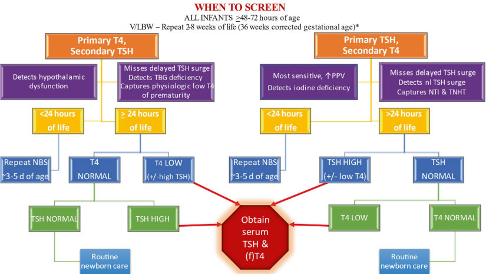
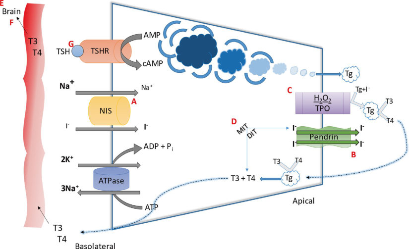

# 14. Congenital Hypothyroidism
> [Source credits](../../SOURCE_CREDITS.md).

## Study pillars

### Etiology and Molecular Classification

Congenital hypothyroidism (CH) occurs in approximately 1 in 2000 to 1 in 3000 live births and is categorized as primary permanent (85%), primary transient (10-15%), or central/secondary (1 in 25,000 to 1 in 100,000). Primary CH is subdivided into thyroid dysgenesis (80-85%; ectopic thyroid [lingual/sublingual], athyreosis/aplasia, or hypoplasia due to mutations in PAX8, NKX2-1, FOXE1, TSHR) and dyshormonogenesis (10-15%; autosomal recessive defects in hormone biosynthesis including TPO, SLC5A5/NIS, SLC26A4/pendrin, TG, DUOX2, DUOXA2, and IYD). Transient CH results from maternal TSH-receptor-blocking antibodies (TRBAb), maternal antithyroid drug exposure, extreme prematurity, or iodine deficiency/excess.

PDF p. 383

### Newborn Screening and Early Recognition

Because maternal thyroxine (T4) crosses the placenta in modest amounts (~30-50% of fetal levels at delivery), >95% of affected newborns appear clinically normal at birth. Clinical signs emerge subtly over weeks and include prolonged unconjugated hyperbilirubinemia (>2 weeks), wide posterior fontanel (>0.5 cm), umbilical hernia, macroglossia, abdominal distension, hypothermia, hoarse cry, cold/mottled skin, and delayed passage of meconium. Newborn screening (NBS) utilizing primary TSH or primary T4 with reflex TSH detects infants before neurocognitive injury occurs.

PDF p. 384

### Confirmatory Diagnostics and Imaging

Any abnormal screening result requires an immediate confirmatory venous serum free T4 and TSH. Severe primary CH presents with venous TSH >40-100 mIU/L and markedly depressed free T4. Scintigraphy using technetium-99m pertechnetate (99mTc) or iodine-123 (123I) coupled with high-resolution thyroid ultrasound distinguishes athyreosis (absent uptake/tissue), ectopia (uptake along the thyroglossal duct tract, typically base of tongue), and in situ goitrous dyshormonogenesis (enlarged gland with high or absent uptake). Knee radiographs demonstrating absent distal femoral epiphyses indicate severe prenatal intra-uterine hypothyroidism.

PDF p. 386

### Immediate Levothyroxine Replacement

Treatment must be initiated immediately upon confirmation, ideally within the first 14 days of life, to prevent permanent loss of neurodevelopmental IQ potential. The recommended starting dose of oral levothyroxine (L-T4) is 10-15 mcg/kg/day (typically 37.5 to 50 mcg daily for term infants). Tablets should be crushed in a small volume (a few milliliters) of water or breastmilk and administered orally on an empty stomach; co-administration with soy formulas, concentrated iron, calcium supplements, or fiber binders must be avoided due to significant chelation and impaired gastrointestinal absorption.

PDF p. 389

### Biochemical Goals and Surveillance

The primary biochemical objective is rapid normalization of serum free T4 within 3-7 days into the upper half of the age-specific reference interval (e.g., 1.4-2.3 ng/dL) and normalization of serum TSH within 2-4 weeks (<5 mIU/L). Serum TSH and free T4 should be monitored every 1-2 months during the first 6 months of life, every 2-3 months from 6 to 36 months, and every 3-12 months thereafter until linear growth is completed. If an in situ gland was present and permanent etiology was not established molecularly, a formal trial off therapy is conducted at age 3 years for 30 days to differentiate transient from permanent hypothyroidism.

PDF p. 390

## Full source extraction

# 14. Congenital Hypothyroidism
> Source attribution: [Source credits](../../SOURCE_CREDITS.md).

## PDF page 382 | printed page 371

### Congenital Hypothyroidism

Nana-Hawa Yayah Jones and Susan R. Rose

Contents

14.1 Introduction and Background Information – 372

14.1.1 Newborn Screening – 372 14.1.2 Primary T4, Secondary TSH NBS Method – 372 14.1.3 Primary TSH with and Without T4 NBS Method – 373 14.1.4 Dual TSH and T4 NBS Method – 374 14.1.5 Confirmatory Results – 374

14.2 Etiology – 375

14.3 Clinical Presentation – 378

14.4 Diagnostic Evaluation – 378

14.5 Treatment – 379

14.6 Case Studies – 380

14.7 Summary – 382

References – 382

© The Author(s), under exclusive license to Springer Nature Switzerland AG 2024 S. Radovick, M. Misra (eds.), Pediatric Endocrinology, https://doi.org/10.1007/978-3-031-66296-6_14

## PDF page 383 | printed page 372

Key Points

5 Congenital hypothyroidism is a devas

tating yet preventable cause of intellec tual disability. 5 Newborn screening for congenital

hypothyroidism is crucial for the pre vention of long-term impairments in child development. 5 Interpretation of laboratory results

requires an understanding of newborn screening methodologies and the timing of data collection. 5 Optimal treatment of congenital hypo

thyroidism requires timely confirmation of diagnosis and adequate medication administration.

### 14.1 Introduction and Background

### Information

### 14.1.1 Newborn Screening

Most infants born with CH have no appre ciable physical stigmata of the disease; there fore, screening to detect which newborns are at risk for thyroid disease is paramount. The introduction of NBS in the 1970s has decreased the incidence of untreated CH although prevalence rates have increased [1]. Prevalence of CH ranges from 1:1404 to 1:4149 depending on region and ethnicity [2]. Before screening, only one-third of hypothy roid infants were clinically detected before 3 months of age, leading children to suffer from severe intellectual disability, including language, learning, and coordination delays. With the introduction of screening, the age of detection has steadily declined. In the early phases of NBS, the target was to identify and initiate treatment by 2 months of life. Currently, with rapid specimen transport of newborn specimens collected on average day of life 2, and advances in technology which allow rapid thyroxine (T4) and thyrotropin (TSH) analysis, many screening programs detect and initiate treatment within 1–2 weeks

### 14

of age, allowing more normal developmental outcomes [3]. NBS can be implemented in sev eral ways, some more sensitive than others. In general, an appropriate interpretation of TSH and/or T4 values, be it total T4 or free T4 (fT4), is required to appropriately diagnose CH.

### 14.1.2 Primary T4, Secondary TSH

### NBS Method

A common method for screening newborns for CH consists of collecting blood spots on filter paper for the whole blood total T4. Subsequently, TSH screening occurs only in a select group, based on low T4 values, often the lowest 3rd to 10th percentiles [4]. Using this methodology, the specific numeric cutoff may vary from week to week. The benefits of pri mary T4 screening are its sensitivity for the detection of newborns with hypothalamicpituitary hypothyroidism. Known as central hypothyroidism, delayed detection of this form of hypothyroidism also results in devel opmental deficits. In this form of pituitary dysfunction, TSH is not elevated, often nor mal; therefore, primary TSH screening would not detect this abnormality. Even more pro found is the high prevalence of coexistent pituitary hormone deficiencies such as adre nocorticotropic (ACTH) and growth hor mone deficiency. Isolated central hypothyroidism is rare (incidence 1:65,000); therefore, if central hypothyroidism is detected, consequences such as hypoglycemia and adrenal crisis can be averted [5]. Primary T4 assays offer a significant benefit in detect ing a rare but high-risk thyroid disease.

Unfortunately, primary T4 NBS is non specific in other high-risk populations such as low and very low birth weight infants (V/ LBW). Prematurity also lowers the efficacy of the primary T4 assay. Low T4 concentrations in V/LBW and premature infants increase the number of TSH assays by 10% [6]. Low total T4 concentrations may result from deficient protein binding of thyroid hormones, the pri mary cause of transient neonatal hypothy roidism in premature infants and in infants

## PDF page 384 | printed page 373

with T4-binding globulin (TBG) deficiency. Transient hypothyroidism also occurs as a result of maternal TSH receptor-blocking antibodies, exposure to antithyroid medica tions during pregnancy, and iodine deficiency or excess [4]. T4 screening in these infants leads to unnecessary testing and possible treatment in children who require no interven tion.

### 14.1.3 Primary TSH

### with and Without T4 NBS Method

Used in most developed countries, the pri mary TSH screening is overall a better screen ing test than the T4/TSH screening [7]. TSH is a suitable indicator of iodine deficiency [8] and a sensitive marker of pituitary triiodothy ronine (T3) concentrations. Intraneural con centration of T3 (derived from the intracellular conversion of T4 to T3) is essential for neuro genesis, neuronal migration, neuronal and glial cell differentiation, as well as myelination in the developing fetus [9]. Given that pitu

Table 14.1 Medications that alter thyroid function testing

Laboratory results

### ↓TSH ↑TSH

Medications Amphetamines Biotina

Amiodarone Biotina

Bromocriptine Dopamine GCC Octreotide

Iodinated contrast media Metoclopramide

↓ deceased, ↑ increased, TSH thyroid-stimulating hormone (thyrotropin), fT4 free thyroxine, T4 total thyrox ine, IV intravenous, Al(OH)3 aluminum hydroxide, β beta, Ca+ calcium, FeSO4 ferrous sulfate, GCC gluco corticoids (dexamethasone, hydrocortisone), PPI proton pump inhibitors (omeprazole, lansoprazole), NSAIDS nonsteroidal anti-inflammatory drugs a Biotin has both positive and negative interference with streptavidin/biotin-based immunoassays [13]

itary T3 levels cannot be measured, TSH is the most sensitive surrogate.

10

11

14.1

10 12

↑(f)T4 ↓(f)T4

Amiodarone Biotina

Al(OH)3 β-Blockers Biotina

Iodinated contrast media IV furosemide (↑fT4) IV heparin (↑↑↑fT4) Methadone (↑T4) NSAIDS Salicylates (↑fT4)

Ca+ carbonate/ citrate/acetate Carbamazepine Cimetidine FeSO4 GCC IV furosemide (↓T4) Phenobarbital Phenytoin Phosphate binders PPI Salicylates (↓T4)

### Automatic table extraction — verify rendered original

|.  Table 14.1|Medications that alter thyroid function testing|Col3|Col4|Col5|
|---|---|---|---|---|
||**Laboratory results**|**Laboratory results**|**Laboratory results**|**Laboratory results**|
||**↓TSH**|**↑TSH**|**↑(f)T4**|**↓(f)T4**|
|Medications|Amphetamines Biotina Bromocriptine Dopamine GCC Octreotide|Amiodarone Biotina Iodinated contrast media Metoclopramide|Amiodarone Biotina Iodinated contrast media IV furosemide (↑fT4) IV heparin (↑↑↑fT4) Methadone (↑T4) NSAIDS Salicylates (↑fT4)|Al(OH)3 β-Blockers Biotina Ca+ carbonate/ citrate/acetate Carbamazepine Cimetidine FeSO4 GCC IV furosemide (↓T4) Phenobarbital Phenytoin Phosphate binders PPI Salicylates (↓T4)|

[Original table](../../tables/ch014_p0384_1.jpg)

## PDF page 385 | printed page 374

of illness, including higher TSH values. These higher TSH values can mislead clinicians to diagnose thyroid disease in euthyroid patients. In a TSH/T4 program, T4 assays increase by 6% given the higher number of TSH eleva tions [6].

Also problematic is the hospital manage ment systems’ implementation of early dis charge. Infants discharged from the hospital before 48 h of life often undergo screening on day of life 1, leading to a high rate of false positives in those infants who have a physiologic postnatal rise in TSH [14]. After birth, as a physiological response to temper ature change, TSH concentration increases in order to stimulate neonatal rise in T4 and T3. TSH values peak between 70 and 100 mIU/L within 1 h of life. Thyrotropin values progressively decline over the follow ing 48 h of life, while T4 and T3 values nor malize by 3–5 days [15]. As noted in the discussion of primary T4 assays, TSH surge is blunted in the preterm and V/LBW infants. In term infants, early hospital dis charge has increased the ratio of false-posi tive TSH elevations from 3:1 to 5:1. Recommendations suggest that NBS be per formed at 48 h of age; however, the optimal time to obtain a primary TSH NBS is around 3–5 days of life [4].

### 14

### 14.1.4 Dual TSH and T4 NBS

### Method

Recent data show that primary TSH screening is more cost-effective in reducing false-positive and false-negative cases for mass screening despite the dual TSH and T4 approach theo retically being the ideal method of screening [16]. Dual TSH and T4 screening is expensive and not practical in most countries. As with any screening, the value of identifying an infant with CH must be balanced against the cost of screening normal newborns. NBS is expensive and not weighed in the costs are the psychosocial burdens created by screening for

nondisease [17]. Given recall rates of 0.05%, over 1000 children will undergo further diag nostic testing with negative results for each child with true-positive results. Even more costly are children without true hypothyroid ism who undergo therapeutic intervention. Not limited to monetary disadvantages are the psychosocial burdens associated with non disease, including, but not limited to, parental anxiety, aversion of the child to repeat intrave nous catheters, and risks of therapeutic side effects.

### 14.1.5 Confirmatory Results

14.1

NBS test results must be communicated rapidly back to the physician or hospital iden tified on the screening filter paper card. The responsibility for transmission of these results rests with the authority or agency that per formed the test. In general, when an abnormal screening result is found, the responsible phy sician is notified immediately so that he or she can arrange for follow-up testing. Screening test results should be entered into the patient’s record. If the informed physician is no longer caring for or cannot locate the infant, he or she should notify the NBS laboratory imme diately. In such situations, the local health department is often helpful in locating these infants to ensure that they are not lost to fol low-up [14, 18, 19].

## PDF page 386 | printed page 375

### 14.2 Etiology

14.2

20

Genetic predisposition to thyroid dysgen esis may in part explain the observed higher incidence of CH among certain ethnic groups [21]. Mutations in developmental genes, which play important roles in embryogenesis and developmental cell migrations, contribute to genetic predisposition to thyroid dysgenesis. Mutations in genes (such as TTF-1, TTF-2, and PAX8) have been associated with devel opmental anomalies including thyroid dys genesis and likely account for the higher incidence of CH in Hispanic patients [3].

14.2

Unmatched source image; PDF page 386. Consult the original caption.

## PDF page 387 | printed page 376

Table 14.2 Etiology, genotype, and phenotype of congenital hypothyroidism [21]

Thyroid dysgenesis Thyroid dyshormonogenesis Defects in thyroid anatomy

Defects in thyroid hormone production

Causes

Ectopy Aplasia Hypoplasia Hemiagenesis

Sodium-iodide symporter defect (NIS) Thyroid peroxidase defects (TPO) Hydrogen peroxide generation defects Pendrin defect Thyroglobulin defect Iodotyrosine deiodinase defect

Mutations

TTF-1, TTF-2, PAX8, NKX1–5, GLIS3, FOXE1, JAG1, NTN1, BORELIN, TUBB1, TRPC4AP, GBP1

SECISBP2, SLC5A5, SLC26A4/PDS DUOX1/DUOX2, DUOXA2 TPO TG, IYD/DEHAL1, SLC26A7

Testing

Aplasia TSH >100a

TSH >20a

T4 <8b

Hypoplasia TSH >20 Hemiagenesis TSH >6

Imaging

Ultrasound Aplasia = absent Hypoplasia = small or normal Hemiagenesis = small

Large gland

↑Uptake in eutopic location

Scintigraphy Aplasia no uptake Hypoplasia ↓uptake Ectopia ↓uptake

### 14

↓ decreased, ↑ increased, TSH thyroid-stimulating hormone (thyrotropin), T4 total thyroxine, TSHR TSH receptor, TRβ thyroid receptor beta a mIU/L b mcg/dL

the path of thyroid hormone production ( Fig. 14.2). Dyshormonogenesis results from insufficient intake of iodine or a number of mostly autosomal recessive mutations. These mutations include but are not limited to defects in: 1. Sodium-iodide symporter (NIS) : NIS is

3. Dual oxidase 2 (DUOX) and dual oxidase

responsible for actively transporting iodine into thyroid follicular cells. 2. Pendrin (Pendred gene SLC26A4, also

termed PDS): PDS is a sodiumindependent chloride/iodide transporter found on the apical membrane of thyroid

Thyroid receptor mutations

Defects in thyroid action

TSH receptor (TSHR) defect Thyroid receptor β (TRβ) mutation

TSHR, TRβ

Variable depending on the degree of resistance

Variable depending on the degree of resistance

Variable depending on the degree of resistance

follicular cells. Its role is to transport iodide from the cytoplasm into the follicu lar lumen. PDS is also found in the inner ear; hence, the association with sensori neural hearing loss is noted in Pendred syndrome.

maturation factor 2 (DUOXA2): Within follicular cells, DUOX2 proteins are essen tial for thyroid hormone biosynthesis. The presence of hydrogen peroxide (H2O2) is required for organification of iodine. Duox2 proteins, glycosylated and bound

### Automatic table extraction — verify rendered original

|Col1|Thyroid dysgenesis|Thyroid dyshormonogenesis|Thyroid receptor mutations Defects in thyroid action|
|---|---|---|---|
||**Defects in thyroid** **anatomy**|**Defects in thyroid hormone production**|**Defects in thyroid hormone production**|

[Original table](../../tables/ch014_p0387_1.jpg)

### Automatic table extraction — verify rendered original

|Imaging|Col2|Col3|Col4|
|---|---|---|---|
|Ultrasound|Aplasia=absent Hypoplasia=small or normal Hemiagenesis=small|Large gland|Variable depending on the degree of resistance|
|Scintigraphy|Aplasia no uptake Hypoplasia↓uptake Ectopia↓uptake|↑Uptake in eutopic location|Variable depending on the degree of resistance|

[Original table](../../tables/ch014_p0387_5.jpg)

## PDF page 388 | printed page 377

at the apical membrane, catalyze the for mation of H2O2. DUOXA2 is required for DUOX2 maturation and activation [22]. 4. Iodotyrosine dehalogenase (DEHAL1):

6. Selenocysteine insertion sequence-binding

Homozygous mutations of DEHAL1 pre vent the recycling of iodide at the apical membrane of the follicular cell. Iodotyrosine accounts for almost 70% of iodine in thyroglobulin and hence is the rate-limiting step in T4 and T3 production [23]. 5. Monocarboxylate transporter 8 (MCT8) :

Allan-Herndon-Dudley syndrome results from a mutation of the thyroid hormone transporter MCT8 (also referred to as SLC16A2). Located on the X chromo some, the MCT8 gene is responsible for the transport of T3 across the blood–brain barrier, resulting in the uptake of T3 into neuronal cells [24]. This X-linked hypothy roidism is associated with intellectual dis ability and several neurologic problems.

27

protein 2 (SECISBP2): Deiodinases are selenoenzymes responsible for the conver sion of T4 to the biologically active form, T3. Deiodinases possess enzymatic activ ity, requiring selenocysteine for its action. SECISBP2 aids in the recognition of sele nocysteine binding. As a cell membrane transporter element, SECISBP2 regulates intracellular thyroid metabolism by regu lating the influx and efflux of T4 and T3 within the neuron [25, 26].

14.2A–G

Unmatched source image; PDF page 388. Consult the original caption.

## PDF page 389 | printed page 378

RTH are rarely diagnosed in the newborn period, given the propensity for normal TSH values and elevated T4 values. The thyrotro pin receptor (TSHR) is also involved in thy roid organogenesis. Thus, mutations in the TSHR gene can cause CH as well.

### 14.3 Clinical Presentation

Except in geographic regions of iodine defi ciency, the diagnosis of CH is rarely made on physical examination. In industrialized coun tries with a high emphasis on prenatal care, signs and symptoms of CH are rarely appar ent. Unfortunately, it is within this newborn period when missing clinical features of hypo thyroidism lend to irreversible brain damage, thus the importance of newborn screening [7, 18, 19].

Symptoms and signs suggestive of CH include the following, with additional signs evident as infants become older:

0 days of life

5 Cardiac malformations

5 Delay in skeletal maturation (absence of

femoral and tibial epiphyses) 5 Hypothermia

5 Jaundice

5 Lethargy/decreased activity

5 Macroglossia

### 14

5 Macrosomia

5 Mottled and dry skin

5 Open and wide posterior fontanelle

(>2 cm) 5 Poor feeding

5 Umbilical hernia

5 Wide anterior fontanelle

Early infancy (0–2 months of life)

5 Constipation

5 Decreased muscle tone

5 Failure to thrive

5 Hoarse cry

5 Linear growth deceleration

5 Poor feeding

5 Prolonged jaundice

Late infancy (>2 months of life)

5 Delayed tooth eruption

5 Growth failure

5 Pseudomuscular hypertrophy

5 Psychomotor retardation

Infants with CH are often described as “good babies” as they sleep well and cry infre quently. As with any newborn, a complete history, including maternal thyroid status and family history, should be obtained, and careful physical examination must be per formed.

### 14.4 Diagnostic Evaluation

Laboratory assessment of thyroid function provides a sensitive and specific methodology for diagnosing CH. The most significant con founder in the confirmation of CH is its tran sient form. The most common form of transient hypothyroidism worldwide is iodine deficiency. Iodine deficiency must be consid ered in high-risk populations such as those from underdeveloped countries, infants of mothers whose diets are limited in meats (vegans) or iodinated salts (sea salt consum ers), and infants whose condition limits gas tric intake of nutrients (total parenteral nutrition-dependence). Even in infants with transient neonatal hypothyroidism, treat ment is recommended if certain diagnostic criteria are met. If newborns continue to exhibit persistent TSH elevation with normal f/T4 after 4–6 weeks of life, treatment is rec ommended [19].

A common cause of transient neonatal hypothyroidism in developed countries is pre maturity (gestational age <37 weeks). Temporary thyroid dysfunction also occurs in infants who are born 10% below expected body weight (i.e., V/LBW), ill neonates admit ted to the neonatal intensive care unit, neo nates who are discharged within the first 24 h of life, and cohorts of multiple births, includ ing monozygotic twins. In these special popu lations, a repeat NBS specimen should be

## PDF page 390 | printed page 379

collected at about 2 weeks of age or 2 weeks after the first screening test was carried out [7], at 4 weeks later [18, 19], and at 36 weeks corrected gestational age [10].

To confirm the diagnosis of permanent CH, the European Society for Pediatric Endocrinology (ESPE) recommends perform ing imaging studies to determine its specific etiology [7]. The American Academy of Pediatrics denotes that imaging before the age of 3 years is unlikely to change clinical man agement [18, 19]. Diagnostic imaging may be helpful in cases in which CH diagnosis is not clear [18, 19]. Treatment may be altered based on results, especially if clinical evaluation is also consistent with CH. The option to initi ate, hold, and potentially stop treatment may be based on imaging results as well. When the cause of abnormal thyroid studies cannot be determined as either transient or permanent, both scintigraphy and ultrasound can be con sidered in neonates with abnormal TSH val ues. Of course, the time interval to imaging should not delay treatment in any circum stance in which there is a high degree of suspi cion of thyroid disease. Even in circumstances in which differentiation between transient and permanent CH is blurred, imaging can always be deferred until the child reaches the age of 3 years. At 3 years, neuronal migration and myelination are fairly advanced; thus risk of neurocognitive dysfunction as a result of thy roid hormone withdrawal at age 3 years is lower than what would have been expected in the first 3 years of life [9].

In the era of genetic testing, several muta tions have been discovered which account for some cases of CH. Genetic studies for muta tions in thyroid hormone synthesis can con firm inborn errors of thyroid hormone biosynthesis [28]. Despite the importance of confirming CH in permanent cases, the costs of genetic testing do not yet outweigh the ben efits. The exceptions include families in which multiple siblings are affected. In these cases, genetic counseling is suggested to ensure fam ilies are aware of potential risks in future pregnancies.

### 14.5 Treatment

Once the diagnosis of CH is confirmed, levo thyroxine replacement is recommended as the treatment of choice. There is no place in pediatric thyroid disease for formularies including T3 treatment or desiccated animal product. Treatment with levothyroxine (crushed tablets or branded liquid) should be started as soon as possible. Goal for initia tion of treatment is within the first 2 weeks of life. However, given that some abnormal screenings require repeated measurements or further diagnostic testing, treatment should begin once testing confirms the disease. Initial treatment is with levothyroxine 10–15 mg/kg/day; however, several factors interfere with thyroid hormone absorption. Severity of the disease also affects the choice of replacement dose. More severe disease, such as athyreosis, indicates the use of doses at the upper end of the treatment scale (15 mg/kg/day), while the same dose in infants affected by defects in thyroid hor mone synthesis may lead to overtreatment. Goal of all therapy is to normalize thyroid hormone function [7, 18, 19].

Based on TSH concentration, the dosage of levothyroxine is adjusted. Use of serum fT4 can be adjunctive in ensuring an appro priate clinical response. In the first 3 years, serum total T4 and/or fT4 values should be in the upper half of the reference range, and serum TSH levels should be between 0.5 and 2.0 mIU/L [14, 18, 19]. Relative pituitary resistance may delay the normalization of serum TSH, resulting in a normal or increased serum T4 concentration with an inappropri ately high TSH level. In these cases, the dose should be titrated based on the TSH value, after first ruling out nonadherence to treat ment.

Normalizing thyroid function may be challenging in the first year of life. Despite tightened Federal Drug Administration regu lations, levothyroxine preparations can vary by up to 12% in the amount of active hor mone, even within the brand [29]. Guidelines

## PDF page 391 | printed page 380

recommend brand name levothyroxine; how ever, the cost can be prohibitive for most fam ilies whose formularies require generic prescriptions [7]. Children initiated on generic formulations should remain on generic, and those started on brand name formulations should remain on brand. If there is any change in the thyroid hormone manufacturer, followup laboratory testing should be ordered to ensure euthyroidism [18, 19].

Other factors affecting thyroid hormone dosing include absorption in the gastrointesti nal tract, ranging from 70% to 80%, hence the pharmaceutical company’s recommendations for consuming levothyroxine on an empty stomach [30]. Practically, however, infants are in a perpetual postprandial state. Adhering to specific preprandial timing of medication administration has been associated with lower medication adherence [31]. Therefore, medica tion can be given with or without food as long as there remains consistency with each dose. Dosing can be adjusted based on the most realistic mode of consumption.

Several other factors can also interfere with thyroid hormone absorption, some to such a degree that the medication and inter fering substance should be separated by at

### 14.6 Case Studies

### 14

Case Study #1

A 9-day-old former 36-week twin B born to 25-year-old gravida 4, para 3 mother is admit ted to NICU for poor oral intake. NBS obtained on postnatal day 2 revealed TSH 302 (normal, <34 mIU/L) and T4 5.9 mcg/dL (nor mal, 7.6–16 mcg/dL). Serum confirmation was significant for TSH 435 mIU/L (normal, 0.5–5 mIU/L). He was started on levothyroxine 50 mcg, followed by 37.5 mcg on day 2, then 25 mcg daily. At 23 days of life, he was dis charged from the NICU on 25 mcg of daily levothyroxine replacement. He subsequently missed his first outpatient endocrinology

least 3–4 h. These products include those listed below as “BASIC” acronym:

5 B = Bile acid-binding resins (i.e., chole

styramine) 5 A = Aluminum-containing antacids (i.e.,

Rolaids®) 5 S = Sucralfate/soy

5 I = Iron

5 C = Calcium/caffeine

Rapid normalization of thyroid hormone lev els (within the first 2 weeks after treatment initiation) and maintenance of relatively higher fT4 concentrations during the first year of life lead to better intellectual outcomes. However, overtreatment has also been associ ated with lower intelligence quotients in chil dren with CH [32].

Thyroid function testing should be per formed every 1–2 months for the first 6 months of life, 2–3 months in the latter half of the first year of life, and subsequently every 3–4 months until the age of 3 years. Perform thyroid function testing approximately 4–6 weeks after dose changes or changes in brand or administration route. If clinical symptoms of thyroid disease develop, repeat testing is indicated even if normal previously.

appointment; however, repeat labs obtained by his pediatrician revealed elevated TSH 100 mIU/L and low fT4 0.4 ng/dL (normal, 0.8–2 ng/dL). Levothyroxine was increased to 37.5 mcg. At his first ambulatory endocrinol ogy visit at 3 months of age, elevated TSH 488 mIU/L persisted, and the exam revealed dry skin and macroglossia. Thus, levothyroxine was increased further to 50 mcg daily. Thyroid studies did not normalize until 12–14 months of age after home health and child protective services involvement. At 14 months of age, he exhibited normal growth and development

## PDF page 392 | printed page 381

with laboratory results confirming his euthy roid state. He did not return for any clinical care until age 8. At 8 years of age, he exhibited symptoms including fatigue, sluggish move ments, cold sensitivity, dry skin, hoarse voice, joint stiffness, and difficulty arousing from sleep. He lacked toilet-training skills and was unable to speak in full sentences. Growth parameters showed severe abnormalities with weight 13.7 kg [−6.1 standard deviations (SD)],

Case Study #2

A 2-month-old male presents for the evaluation of abnormal thyroid studies. He was a full-term baby born by Cesarean section delivery, after in vitro fertilization. His NBS returned abnor mal with the following results: TSH 35.2 mIU/L (normal, <34 mIU/L) and T4 14.4 (normal, >8 ng/dL). Repeated serum thyroid studies at 1 week of life revealed TSH 9.8 (normal, 1.0–5.6) and T4 9.4 mcg/dL (normal, 8.1–16.5). Repeat thyroid function testing 2 weeks later revealed TSH of 9.8 (normal, 1.0–5.6) and fT4

Normal range Day 0

TSH 0.6–4.0 mIU/L 3.2

T4 free by direct dialysis 1.0–2.8 ng/dL 2.0

One month after discontinuing thyroid hor mone replacement, the mother called with con cerns about behavior change including refusing to take naps and irritability. This was thought to be a viral illness, so TSH elevation was attrib uted to nonthyroidal illness. Two months after the trial off medication, the patient was noted to be back to normal behavior but constipated and more tired than usual. Since TSH was nor malizing, labs were repeated a third time. The patient continued to have worsening constipa

height 83.5 cm (−8.7 SD), and BMI 19.7 kg/m2 (93rd percentile).

This case clearly demonstrates that NBS works to diagnose severe CH but is not enough to prevent the debilitating effects of thyroid hormone deficiency. CH patients require daily administration of medication, frequent clinical examination, dosage adjustments, laboratory assessments, and evaluation for potential barri ers to care.

1.4 (normal, 1–2 ng/dL). Due to consistent TSH elevation beyond 1 month of age, he was started on levothyroxine 25 mcg daily. He was adherent to therapy and follow-up, remaining on 25 mcg of levothyroxine until 2.8 years of age when his parents agreed to trial off medica tion. At that time, he was receiving less than 10 mcg/kg/day of thyroid hormone replace ment. The following is a summary of thyroid function testing once levothyroxine therapy was discontinued.

+1-month +2 months +3 months

6.8 (A) 5.9 (A) 4.4 (A)

1.3 1.5 1.4

tion, fatigue, and reported weight gain. Ultrasonography of the thyroid gland revealed the absence of the left thyroid lobe and isthmus. Right thyroid lobe was normal but ectopic thy mic tissue was noted between the right common carotid artery and internal jugular vein. Thyroid hormone was restarted, after which constipa tion, fatigue, and excess weight gain resolved.

This case illustrates how thyroid imaging can aid in differentiating permanent versus transient CH.

## PDF page 393 | printed page 382

### 14.7 Summary

Neurocognitive development and growth are dependent on sufficient serum thyroid hor mone concentration in fetal and early child development. Iodine is essential for thyroid hormone production, and deficiency (hypo thyroidism) can affect maternal, fetal, and postnatal thyroid function. Hypothyroidism remains the leading cause worldwide of treat able intellectual disability. At birth, there may be few signs or symptoms of hypothyroidism, making NBS for thyroid function a critical step in detecting CH. Interpretation of NBS in various clinical settings may alter diagnosis and treatment. Once identified early and treated appropriately. CH becomes a treatable condition with normal or near-normal devel opmental outcomes [3].

2. FALSE. NBS programs screen for

3. FALSE. A primary T4 assay is adven

Review Questions

1. Given the physiologic TSH surge of

the newborn, when is the optimal tim ing for CH screening? 2. If NBS TSH values exceed 100 mIU/L,

4. Technetium 99m scan showing uptake

serum laboratory testing is not required to confirm the diagnosis. TRUE or FALSE? 3. A primary T4 assay is performed in a

36-week EGA (estimated gestational age) infant at 2 days of life. Further testing returns a normal serum TSH. No further workup is required. TRUE or FALSE? 4. A 7-day-old presents with abnormal

5. Overtreatment. Although higher doses

### 14

newborn screening and serum confir matory screening suggestive of CH. The most likely abnormality to be described on scintigraphy would be? 5. An infant is started on 15 mcg/kg/day

### References

of levothyroxine replacement. Four weeks later, TSH is <0.01 mIU/L, and fT4 is elevated at 3 ng/dL. What is the most likely cause of biochemical hyperthyroidism?

1. Harris K, Pass K. Increase in congenital hypothy

roidism in New York State and in the United States. Mol Genet Metab. 2007;91(3):268–77. 2. Park KS. Analysis of worldwide carrier frequency

and predicted genetic prevalence of autosomal recessive congenital hypothyroidism based on a general population database. Genes (Basel). 2021;12(6):863. genes12060863.

v Answers

14.1

high-risk diseases and attempt to cap ture all infants with the disease. As such, infants without disease are also captured lending to high false-positive rates. This is quite prevalent in vulner able populations such as preterm infants. Screening should always be followed by serum confirmation. Confirmatory venous results must be obtained within 1–2 days of NBS. However, the results of serum confirmation need not delay treatment.

titious in detecting hypothalamic-pitu itary hypothyroidism. A normal TSH with concurrent low (f)T4 should be further investigated to rule out central hypothyroidism.

in ectopic location, i.e., ectopic gland. Dysgenesis is the most common cause of congenital hypothyroidism, occur ring in 85% of cases. Ectopia accounts for almost 70% of dysgenic CH, fol lowed by athyreosis and hypoplasia.

of levothyroxine lead to better overall developmental outcomes, higher doses have also been associated with decre ments in cognitive outcomes. Goal of all treatment is to ensure the normal ization of thyroid function.

https://doi.org/10.3390/

## PDF page 394 | printed page 383

3. Larson C. Congenital hypothyroidism. In: Radovick S, MacGillivray M, editors. Pediatric endocrinology. 2nd ed. New York: Humana; 2013. p. 261–73. 4. Büyükgebiz A. Newborn screening for congenital

18. Rose SR, Wassner AJ, Wintergerst K, Yayah Jones

hypothyroidism. J Clin Res Pediatr Endocrinol. 2013;5(Suppl 1):8–12. 5. Schoenmakers N, Alatzoglou K, Chatterjee V,

19. Rose SR, Wassner AJ, Wintergerst K, Yayah Jones

Dattani M. Recent advances in central congenital hypothyroidism. J Endocrinol. 2015;227(3):R51–71. 6. Frank J, Faix J, Hermos R, Mullaney D, Rojan D,

Mitchell M, et al. Thyroid function in very low birth weight infants: effects on neonatal hypothy roidism screening. J Pediatr. 1996;128(4):548–54. 7. van Trotsenburg AS, Stoupa A, Léger J, et al.

20. Polak M, Van Liet G. Disorders of the thyroid

Congenital hypothyroidism: a 2020–2021 consen sus guidelines update—an ENDO-European Reference Network Initiative endorsed by the European Society for Pediatric Endocrinology and the European Society for Endocrinology. Thyroid. 2021;31(3):387–419. 8. Vandevijvere S, Coucke W, Vanderpas J, Trumpff

21. Stoupa A, Kariyawasam D, Polak M, Carré

22. Yi RH, Zhu WB, Yang LY, Lan L, Chen Y, Zhou

C, Fauvart M, Meulemans A, et al. Neonatal thyroid-stimulating hormone concentrations in Belgium: a useful indicator for detecting mild iodine deficiency. PLoS One. 2012;7(10):e47770. 9. Bernal J, Nunez J. Thyroid hormones and brain

23. Gnidehou S, Caillou B, Talbot M, Ohayon R,

development. Eur J Endocrinol. 1995;133(4):390–8. 10. Rose SR, Blunden C, Jarrett OO, Kaplan K,

Caravantes R, Akinbi HT. Utility of repeat testing for congenital hypothyroidism in very low birth weight infants. J Pediatr. 2022;242:152–8. 11. Larson C, Hermos R, Delaney A, Daley D,

24. Friesema EC, Jansen J, Heuer H, Trajkovic M,

Mitchell M. Risk factors associated with delayed thyrotropin elevations in congenital hypothyroid ism. J Pediatr. 2003;143(5):587–91. 12. Hemmati F, Pishva N. Evaluation of thyroid status

of infants in the intensive care setting. Singapore Med J. 2009;50(9):875–8. 13. Liwanpo L, Hershman JM. Conditions and drugs

25. Fu J, Dumitrescu AM. Inherited defects in thyroid

interfering with thyroxine absorption. Best Pract Res Clin Endocrinol Metab. 2009;23:781–92. 14. American Academy of Pediatrics, Rose SR,

26. Ramos JC, Lacerda Filho L, DeMartini Ade A,

Section on Endocrinology and Committee on Genetics, American Thyroid Association, Brown RS, Lawson Wilkins Pediatric Endocrine Society, et al. Update of newborn screening and therapy for congenital hypothyroidism. Pediatrics. 2006;117(6):2290–303. 15. Fisher D. Thyroid system immaturities in very low

27. Larsen PR, Davies TF, Schlumberger M, Hay

birth weight premature infants. Semin Perinatol. 2008;32(6):387–97. 16. Korzeniewski S, Grigorescu V, Kleyn M, Young W,

Birbeck G, Todem D, et al. Performance metrics after changes in screening protocol for congenital hypothyroidism. Pediatrics. 2012;130(5):e1252–60. 17. Tu W, He J, Chen H, Shi XD, Li Y. Psychological

28. Rastogi MV, LaFranchi SH. Congenital hypothy

29. Eisenberg M, Distefano JJ. TSH-based protocol,

effects of false-positive results in expanded new born screening in China [Internet]. PLoS One. 2012;7(4):e36235.

NH, Hopkin RJ, Chuang J, Smith JR, Abell K, LaFranchi SH. Clinical report: Congenital hypo thyroidism: screening and management. Pediatrics. 2023;151(1):e2022060419. https://doi.org/10.1542/ peds.2022-0604192023.

NH, Hopkin RJ, Chuang J, Smith JR, Abell K, LaFranchi SH. Technical report: Congenital hypo thyroidism: screening and management. Pediatrics. 2023;151(1):e2022060420. https://doi.org/10.1542/ peds.2022-060420.

gland. In: Sarafoglou K, Hoffman GF, Roth KS, editors. Pediatric endocrinology and inborn errors of metabolism. 1st ed. New York: McGraw-Hill; 2008. p. 355–82.

A. Genetics of congenital hypothyroidism: mod ern concepts. Pediatr Investig. 2022;6(2):123–34. https://doi.org/10.1002/ped4.12324. eCollection 2022 Jun.

JF, et al. A novel dual oxidase maturation factor 2 gene mutation for congenital hypothyroidism. Int J Mol Med. 2013;31(2):467–70.

Kaniewski J, Noël-Hudson MS, et al. Iodotyrosine dehalogenase 1 (DEHAL1) is a transmembrane protein involved in the recycling of iodide close to the thyroglobulin iodination site. FASEB J. 2004;18(13):1574–6.

Bauer K, Visser TJ. Mechanisms of disease: psy chomotor retardation and high T3 levels caused by mutations in monocarboxylate transporter 8. Nat Clin Pract Endocrinol Metab. 2006;2(9):512–23.

hormone cell-membrane transport and metabo lism. Best Pract Res Clin Endocrinol Metab. 2014;28(2):189–201.

Silveira RB, Pereira RM, Sandrini Neto R, et al. Clinical and laboratory features of chil dren and adolescents with congenital hypothy roidism due to dyshormonogenesis in southern Brazil. Arq Bras Endocrinol Metabol. 2012;56(3):201–8.

I. Thyroid physiology and diagnostic evaluation of patients with thyroid disorders. In: Kronenberg HM, Melmed S, Polonsky K, editors. William’s textbook of endocrinology. 10th ed. Philadelphia: Saunders/Elsevier; 2008. p. 421.

roidism. Orphanet J Rare Dis. 2010;10(5):17–39.

tablet instability, and absorption effects on L-T4 bioequivalence. Thyroid. 2009;19(2):103–10.

## PDF page 395 | printed page 384

30. Colucci P, Yue CS, Ducharme M, Benvenga S. A

32. Bongers-Schokking JJ, Resing WC, de Rijke YB,

review of the pharmacokinetics of levothyroxine for the treatment of hypothyroidism. Eur Endocrinol. 2013;9(1):40–7. 31. Jimmy B, Jose J. Patient medication adherence:

measures in daily practice. Oman Med J. 2011;26(3):155–9.

### 14

de Ridder MA, de Muinck Keizer-Schrama SM. Cognitive development in congenital hypo thyroidism: is overtreatment a greater threat than undertreatment? J Clin Endocrinol Metab. 2013;98(11):4499–506.
