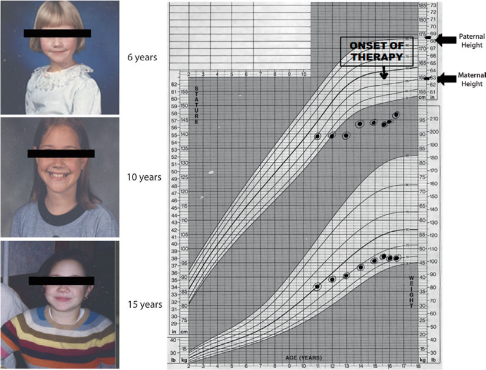

# 15. Autoimmune Thyroid Disease
> [Source credits](../../SOURCE_CREDITS.md).

## Study pillars

### Pathophysiology and Autoimmunity

Autoimmune thyroid disease (AITD) encompasses Hashimoto thyroiditis (chronic lymphocytic thyroiditis) and Graves' disease. Both are characterized by lymphocytic infiltration of the thyroid gland, breakdown of self-tolerance, and production of thyroid-specific autoantibodies. Hashimoto thyroiditis features predominant CD4+ and CD8+ T-cell infiltration, follicular cell apoptosis, and autoantibodies directed against thyroid peroxidase (anti-TPO) and thyroglobulin (anti-TG). Graves' disease is driven by stimulating autoantibodies directed against the TSH receptor (thyroid-stimulating immunoglobulins, TSI / TRAb), which constitutively activate cAMP signaling, promoting autonomous thyroid hypertrophy, hyperplasia, and excessive thyroxine (T4) and triiodothyronine (T3) synthesis.

PDF p. 397

### Hashimoto Thyroiditis Clinical Spectrum

Hashimoto thyroiditis is the leading cause of acquired hypothyroidism and sporadic goiter in children and adolescents, displaying a 4:1 to 7:1 female predominance with peak incidence in early adolescence. Clinical manifestations include painless, non-tender, firm goiter (with a pebbly or lobulated surface), linear growth deceleration with progressive weight gain (declining height velocity with increasing BMI), fatigue, cold intolerance, dry skin, constipation, and delayed puberty. Severe juvenile primary hypothyroidism can occasionally present paradoxically with pseudoprecocious puberty (Van Wyk-Grumbach syndrome: breast development and vaginal bleeding in girls, testicular enlargement without virilization in boys) mediated by TSH cross-activation of FSH receptors.

PDF p. 398

### Management of Hashimoto Hypothyroidism

Overt hypothyroidism (elevated TSH, low free T4) mandates daily oral levothyroxine (L-T4) replacement. Age-adjusted starting dosages are: 1-5 years: 4-6 mcg/kg/day; 6-12 years: 2.5-3.5 mcg/kg/day; adolescents (>12 years): 1.6-1.8 mcg/kg/day (typically 75-125 mcg daily). Levothyroxine should be ingested once daily in the morning 30-60 minutes before breakfast or at bedtime on an empty stomach. The clinical goal is normalization of TSH into the lower half of the normal reference range (0.5-2.5 mIU/L) with normal free T4 and complete restoration of normal linear growth velocity.

PDF p. 401

### Graves' Disease Presentation and Pharmacotherapy

Graves' disease causes >90% of pediatric thyrotoxicosis, presenting with emotional lability, declining school performance, heat intolerance, diaphoresis, resting tachycardia, widened pulse pressure, accelerated linear growth, advanced bone age, and diffuse smooth vascular goiter (often with an audible bruit). First-line medical therapy is methimazole (MMI) dosed at 0.2-0.5 mg/kg/day (up to 1.0 mg/kg/day; maximum 30-40 mg daily) divided once or twice daily. Propylthiouracil (PTU) is black-box contraindicated in pediatric patients due to unacceptable risks of fulminant fatal hepatic failure. Beta-adrenergic blockers (atenolol 1-2 mg/kg/day or propranolol 1-2 mg/kg/day) are used acutely to control adrenergic hyperactivation.

PDF p. 403

### Definitive Therapies and Neonatal Graves'

Pediatric Graves' remits medically in only 25-30% of patients after 2 years of methimazole. Definitive modalities include radioactive iodine (131I; targeted dose 200-300 mcg/g of tissue or fixed 10-15 mCi; generally reserved for children >5-10 years) or total/near-total thyroidectomy performed by an experienced pediatric thyroid surgeon. Neonatal Graves' disease occurs in 1-2% of infants born to mothers with active or past Graves' disease due to transplacental transfer of maternal TSI. Symptoms appear within the first 2-7 days of life (irritability, tachycardia, failure to thrive, goiter, craniosynostosis) and require prompt treatment with methimazole, beta-blockers, and occasionally Lugol's iodine until maternal antibodies clear over 2-4 months.

PDF p. 407

## Full source extraction

# 15. Autoimmune Thyroid Disease
> Source attribution: [Source credits](../../SOURCE_CREDITS.md).

## PDF page 396 | printed page 385

### Autoimmune Thyroid Disease

Christine E. Cherella and Jessica R. Smith

### Contents

### 15.1 Introduction – 386

### 15.2 Chronic Autoimmune Thyroiditis – 386

15.2.1 Terminology and Definitions – 386 15.2.2 Pathophysiology – 387 15.2.3 Clinical Presentation – 387 15.2.4 Diagnosis – 388 15.2.5 Therapy – 390

### 15.3 Graves’ Disease – 391

15.3.1 Pathophysiology – 391 15.3.2 Clinical Presentation – 392 15.3.3 Diagnosis – 392

### 15.4 Differential Diagnosis of Thyrotoxicosis in Children – 393

15.4.1 Antithyroid Medications – 394 15.4.2 Definitive Therapy – 395 15.4.3 Monitoring of Graves’ Disease and the Transition to Adult Care – 395

### 15.5 Neonatal Graves’ Disease – 395

### 15.6 Summary – 396

### References – 399

© The Author(s), under exclusive license to Springer Nature Switzerland AG 2024 S. Radovick, M. Misra (eds.), Pediatric Endocrinology, https://doi.org/10.1007/978-3-031-66296-6_15

## PDF page 397 | printed page 386

Key Points

5 The most common cause of goiter in

the pediatric population is autoimmune (Hashimoto’s) thyroiditis. 5 Typical symptoms of thyroid dysfunc

tion may be present, and growth and puberty may be deranged. 5 There may be a prolonged period of

euthyroidism until overt hypothyroid ism develops; therefore, the decision to treat children with subclinical hypothy roidism remains controversial. 5 Graves’ disease is due to (thyroid-

stimulating hormone) TSH receptor binding antibodies that stimulate the thyroid gland and result in production of excess thyroid hormone. 5 Initial treatment includes the use of the

antithyroid drug (methimazole); how ever, patients should be monitored for serious side effects of methimazole, which include agranulocytosis, hepati tis, arthritis, vasculitis, and Stevens- Johnson syndrome. 5 More prolonged use of antithyroid

medications may be required to achieve remission in children relative to adults. 5 If remission does not occur or an

adverse reaction develops, then perma nent therapy with either radioactive iodine or surgical thyroidectomy can be considered. 5 Neonatal Graves’ disease has a high

### 15

morbidity and mortality rate; thus, prompt diagnosis and treatment are necessary. 5 Most cases of neonatal Graves’ disease

will spontaneously remit after 3–12 weeks as the maternal TSH receptor binding antibodies clear the infant’s cir culation.

### 15.1 Introduction

Autoimmune thyroid disease affects approxi mately 2% of females and 0.2% of males [1]. Although its prevalence peaks in adulthood,

it is the most common cause of acquired thy roid dysfunction in children and adolescents [2, 3]. Normal thyroid hormone levels are critical to neurodevelopment and growth, and by maintaining an appropriate index of suspicion, the clinician can often recognize thyroid dysfunction in its early stages. This chapter presents a summary of autoimmune thyroid diseases, discussing chronic autoim mune thyroiditis and Graves’ disease in detail, emphasizing their clinical manage ment.

### 15.2 Chronic Autoimmune

### Thyroiditis

The childhood prevalence of chronic autoim mune thyroiditis peaks in early to midpuberty, and a female preponderance of 2:1 has been reported [4]. Presentation is rare under the age of 3 years, but cases have been described in infancy [5, 6].

### 15.2.1 Terminology and Definitions

In 1912, Hashimoto described four women with thyromegaly and transformation of the thyroid into lymphoid tissue (“struma lym phomatosa”). These patients comprise the first report of Hashimoto’s disease, which is now recognized as chronic autoimmune thy roiditis. The term thyroiditis is pathologically defined as evidence of “intrathyroidal lym phocytic infiltration” with or without follicu lar damage; clinically, it implies inflammation of the thyroid gland. Improvements in the measurement of circulating autoantibodies have obviated the need for biopsy to diagnose autoimmune thyroid disease. There have been proposals to redefine nomenclature based on pathological and clinical criteria—i.e., based on the presence or absence of goiter and vary ing degrees of thyroid dysfunction in the con text of circulating thyroid autoantibodies ( Box 15.1) [6, 7].

## PDF page 398 | printed page 387

Box 15.1 Classification of Autoimmune Thyroiditis

5 Type 1 autoimmune thyroiditis (Hashi

moto’s disease type 1)

–– 1A Goitrous. –– 1B Nongoitrous. –– Status: Euthyroid with normal thyroid-stimulating hormone (TSH); autoantibodies to thyro globulin (Tg) and thyroid peroxi dase (TPO) are typically present. 5 Type 2 autoimmune thyroiditis (Hashi

moto’s disease type 2)

–– 2A Goitrous (classic Hashimoto’s disease). –– 2B Nongoitrous (primary myx edema, atrophic thyroiditis). –– Status: Persistent hypothyroidism with increased TSH; autoantibod ies to Tg and TPO are typically present. –– 2C Transient thyroiditis (e.g., post partum thyroiditis). –– Status: May start as transient, low radioactive iodine uptake (RAIU) thyrotoxicosis, followed by tran sient hypothyroidism; autoanti bodies to Tg and TPO are typically present. 5 Type 3 autoimmune thyroiditis (Graves’ disease)

–– 3A Hyperthyroid Graves’ disease. –– 3B Euthyroid Graves’ disease. –– Status: Hyperthyroid or euthyroid with suppressed TSH. Stimulatory autoantibodies to the TSH recep tor are present (autoantibodies to thyroglobulin (Tg) and TPO are also usually present). –– 3C Hypothyroid Graves’ disease. –– Status: Orbitopathy with hypothy roidism. Diagnostic levels of auto antibodies to the TSH receptor (blocking or stimulating) may be detected (autoantibodies to Tg and TPO are also usually present).

Data from Davies [6].

### 15.2.2 Pathophysiology

The first step in the pathogenesis of chronic autoimmune thyroiditis is the activation of CD4 (helper) T lymphocytes specific for thy roid antigens. These activated CD4 T cells recruit cytotoxic CD8 T cells and autoreactive B cells into the thyroid, which leads to the generation of an autoantibody response and intrathyroidal inflammation [8]. The three main targets of thyroid antibodies are thyro globulin (Tg), thyroperoxidase (TPO), and thyrotropin receptor (TSHR). While anti- TPO antibodies have been shown to inhibit the activity of thyroid peroxidase in vitro, the primary mechanism of hypothyroidism in vivo is likely via thyroid follicular cell destruction by the CD8 T cells [8]. Anti-TSH receptor antibodies (TRAbs) may also con tribute to hypothyroidism in a minority of patients with the atrophic form of chronic autoimmune thyroiditis [8–10].

Histologically, goitrous autoimmune thy roiditis is characterized by diffuse lympho cytic infiltration with occasional germinal centers. Thyroid follicles may be reduced in size and contain sparse colloid. Individual thyroid cells are often enlarged with oxyphilic cytoplasm (Hurthle cells). In contrast, the gland in atrophic autoimmune thyroiditis is small, with lymphocytic infiltration and fibrous replacement of the parenchyma.

### 15.2.3 Clinical Presentation

The presentation of chronic autoimmune thyroiditis includes either hypothyroidism, goiter/thyromegaly, or both. A goiter (enlarged thyroid gland) is usually the first physical sign of chronic autoimmune thy roiditis. Thyromegaly is typically diffuse with a “pebbly” or “seedy” surface that evolves into a firm and nodular consistency [11]. As the disease progresses, subclinical and then overt hypothyroidism develops. Subclinical hypothyroidism is defined as a TSH concen tration above the upper limit of the normal range, with a free T4 within the normal range.

## PDF page 399 | printed page 388

In contrast, overt hypothyroidism is defined as an elevated TSH with a low free T4 level. Typically, the TSH concentration in subclini cal hypothyroidism is only mildly elevated, between 5 and 10 μU/mL, though it occa sionally rises higher. In adults, the natural history of subclinical hypothyroidism is fairly well-described, with progression to overt hypothyroidism in up to 20% of cases. Symptoms of hypothyroidism may be subtle, even with significant biochemical derange ment ( Box 15.2).

The initial history should include inquiries into energy level, sleep pattern, menses, cold intolerance, bowel patterns, and school per formance. In addition to palpation of the thy roid, assessment of extraocular movements, fluid status, and deep tendon reflexes are important components of the physical exami nation. Chronic autoimmune thyroiditis may be the initial presentation of an autoimmune polyglandular syndrome, and the possibility of coexisting autoimmune diseases such as type 1 diabetes, Addison’s disease, and perni cious anemia should be addressed in the med ical history.

15.1 12 13

### 15

14 15

15.2

Box 15.2 Symptoms and Signs of Hypo thyroidism

5 Goiter/thyromegaly

5 Slowing of linear growth

5 Skeletal maturational delay

5 Pubertal disorders (delay or pseudo

precocity) 5 Slowed mentation (lethargy and impaired school performance) 5 Fatigue

5 Constipation

5 Increased cold sensitivity

5 Depression

5 Irregular and/or heavy menstrual peri

ods 5 Bradycardia (decreased cardiac out

put) 5 Hypothermia

5 Weight gain

5 Dry, sallow, coarse skin

5 Brittle hair

5 Delayed deep tendon reflexes

### 15.2.4 Diagnosis

In the absence of hypothalamic or pituitary disease, the serum TSH concentration is the most sensitive screen for thyroid function. TSH levels are elevated in primary hypothy roidism. If the differential diagnosis includes central hypothyroidism or the overall suspi cion for hypothyroidism is high, a free T4 (or calculated free T4 index) should be included on the initial screen. In mild hypothyroidism, serum T3 concentrations can remain in the normal range due to increased conversion of T4 to T3 by type 2 deiodinase and the prefer ential secretion of T3 by residual thyroid tis sue under the influence of hyperthyrotropinemia [16]. For these reasons, measuring the serum T3 concentration is not useful in diagnosing or monitoring patients with primary hypothyroidism.

## PDF page 400 | printed page 389

The presence of goiter or hyperthyrotro pinemia should prompt the measurement of anti-TPO antibodies. Anti-TPO antibodies are the most sensitive screen for chronic auto immune thyroiditis; up to 90% of patients with hypothyroidism secondary to autoim mune thyroiditis are anti-TPO antibody posi tive [17]. The additional measurement of antithyroglobulin antibodies gains little fur ther benefit, although they may be added if anti-TPO titers are negative. It should be noted that 10–15% of the general population are positive for anti-TPO antibodies and 5–15% for anti-thyroglobulin antibodies, and low titers are not very specific for autoim mune thyroid disease [1]. If anti-TPO anti bodies are absent, less common etiologies of

primary hypothyroidism, such as transient hypothyroidism, subacute thyroiditis, external irradiation, consumptive hypothyroidism, or iodine deficiency should be considered [18–20].

The typical patient with hypothyroidism secondary to chronic autoimmune thyroiditis will have an elevated TSH (over 10 μU/mL), a low free T4, and positive anti-TPO antibodies. In the early stages of the disease (type 1A), anti-TPO antibodies may be positive with goi ter, though TSH may be normal. Later, TSH elevation becomes modest (between 5 and 10 μU/mL) with normal circulating free T4 (sub clinical hypothyroidism).

The log-linear relationship between serum TSH and free T4 explains how small reduc

Unmatched source image; PDF page 400. Consult the original caption.

## PDF page 401 | printed page 390

tions in serum free T4 lead to large deviations in TSH. Most patients with subclinical hypo thyroidism are asymptomatic. However, indi viduals with the combined risk factors of hyperthyrotropinemia and positive thyroid antibodies (anti-thyroglobulin or anti-TPO) are at high risk for progression to overt hypo thyroidism [20]. Therefore, typical recommen dations are for patients with TSH values greater than 10 μU/mL, goiter, and/or thyroid autoantibodies, to be started on thyroid hor mone replacement [21, 22].

Given the critical importance of thyroid hormone in neurodevelopment, persistent hyperthyrotropinemia in infancy is often empirically treated, and a trial off therapy or with reduced doses may be considered after the age of 2–3 years. Similarly, the presence of growth failure may lower the threshold to ini tiate replacement therapy in children with per sistent hyperthyrotropinemia. Euthyroid children with autoimmune thyroiditis (type 1A or type 1B) can be observed without treat ment and monitored carefully with TSH mea surements every 6–12 months, as a significant fraction will progress to overt hypothyroidism [23].

### 15.2.5 Therapy

Levothyroxine (l-T4) is the recommended treatment for children with hypothyroidism. There are minimal adverse reactions, and its long half-life of 5–7 days allows the conve nience of daily administration. Of note, while desiccated thyroid extracts and liothyronine (T3) are commercially available as replace ment options, current consensus guidelines recommend against the routine use of these preparations in children due to the lack of long-term outcome data and their risk of iat rogenic hypertriiodothyronemia [24].

### 15

25 26

26

15.1 4

4 TSH normalization (typical range 0.5–5 μU/mL) is the goal of replacement therapy. This will usually be associated with a free T4 concentration in the upper half of the normal range. Thyroid function tests should be obtained 6 weeks after initiating or adjusting the levothyroxine dosage. Growth and sexual development should be followed systemati cally. Most children achieve adequate catchup growth and a normal adult stature after initiating levothyroxine replacement. However, catch-up growth may be compro mised and target height may not be achieved if treatment has been started after a prolonged duration of severe hypothyroidism. Once bio chemical euthyroidism has been achieved, TSH can be monitored every 4–6 months in the growing child and yearly once final height has been attained.

Table 15.1 Levothyroxine replacement doses

Recommended l-T4 treatment doses Age l-T4 dose (mcg/kg)

0–3 months 10–15

3–6 months 8–10

6–12 months 6–8

1–3 years 4–6

3–10 years 3–4

10–15 years 2–4

>15 years 2–3

Adult 1.6

Data from LaFranchi [4]

### Automatic table extraction — verify rendered original

|Age|l-T4 dose (mcg/kg)|
|---|---|
|0–3 months|10–15|
|3–6 months|8–10|
|6–12 months|6–8|
|1–3 years|4–6|
|3–10 years|3–4|
|10–15 years|2–4|
|>15 years|2–3|
|Adult|1.6|

[Original table](../../tables/ch015_p0401_1.jpg)

## PDF page 402 | printed page 391

15.2

Table 15.2 Conditions that alter levothyrox ine requirements

Increased levothyroxine requirements

Pregnancy

Gastrointestinal disease

Mucosal diseases of the small bowel (celiac disease)

Helicobacter pylori-related gastritis

Atrophic gastritis

Drugs/foods that impair l-T4 absorption

Cholestyramine

Sucralfate

Proton pump inhibitors

Calcium carbonate

Ferrous sulfate

Soy

Drugs which may enhance CYP3A4 and thereby accelerate levothyroxine clearance

Rifampin

Carbamazepine

Phenytoin

Estrogen-containing oral contraceptive pills

SSRIs

Drugs that impair T4-to-T3 conversion

Amiodarone

Conditions that may block type 1 deiodinase

Selenium deficiency

Cirrhosis

27 28

### 15.3 Graves’ Disease

Robert Graves first reported the clinical syn drome of goiter, palpitations, and exophthal mos in 1835 [29]. Graves’ disease is relatively rare, with a yearly incidence of 8–9 per 1,000,000 children less than 15 years old and 1 per 1,000,000 children less than 4 years old [30–32]. Girls are affected four to five times more frequently than boys, although no gen der difference is noted under 4 years of age [31–33]. The term thyrotoxicosis refers to the clinical state resulting from any condition that leads to elevated serum thyroid hormone level; whereas hyperthyroidism refers specifically to increased thyroid hormone production from the gland. Graves’ disease is the most com mon etiology of hyperthyroidism in children [34], and it is important to accurately diag nose this condition as the choice of therapy depends on the etiology of the thyrotoxicosis. For example, antithyroid drugs, which are the mainstay in the management of Graves’ dis ease, play no role in treating thyrotoxicosis secondary to chronic autoimmune thyroiditis or subacute thyroiditis.

### 15.3.1 Pathophysiology

Graves’ hyperthyroidism results from the overproduction of thyroid-stimulating anti bodies that bind to and activate the G-proteincoupled thyrotropin receptor (TSHR), leading to follicular cell hyperplasia and hypersecre tion of thyroid hormone [35]. Graves’ disease shares many features with chronic autoim mune thyroiditis, including autoantibodies directed against thyroglobulin, thyroperoxi dase, and the sodium-iodine symporter. Lymphocytic infiltration of the thyroid paren chyma is present, and germinal centers consti tute a significant source of intrathyroidal autoantibodies. The gland is often highly vas

### Automatic table extraction — verify rendered original

|Gastrointestinal disease|Mucosal diseases of the small bowel (celiac disease)|
|---|---|
|Gastrointestinal disease|_Helicobacter pylori_-related gastritis|
|Gastrointestinal disease|Atrophic gastritis|
|Drugs/foods that impairl-T4 absorption|Cholestyramine|
|Drugs/foods that impairl-T4 absorption|Sucralfate|
|Drugs/foods that impairl-T4 absorption|Proton pump inhibitors|
|Drugs/foods that impairl-T4 absorption|Calcium carbonate|
|Drugs/foods that impairl-T4 absorption|Ferrous sulfate|
|Drugs/foods that impairl-T4 absorption|Soy|
|Drugs which may enhance CYP3A4 and thereby accelerate levothyroxine clearance|Rifampin|
|Drugs which may enhance CYP3A4 and thereby accelerate levothyroxine clearance|Carbamazepine|
|Drugs which may enhance CYP3A4 and thereby accelerate levothyroxine clearance|Phenytoin|
|Drugs which may enhance CYP3A4 and thereby accelerate levothyroxine clearance|Estrogen-containing oral contraceptive pills|
|Drugs which may enhance CYP3A4 and thereby accelerate levothyroxine clearance|SSRIs|
|Drugs that impair T4-to-T3 conversion|Amiodarone|
|Conditions that may block type 1 deiodinase|Selenium defciency|
|Conditions that may block type 1 deiodinase|Cirrhosis|

[Original table](../../tables/ch015_p0402_1.jpg)

## PDF page 403 | printed page 392

cular by ultrasound doppler. For unclear rea sons, lymphocytic infiltration and the accumulation of glycosaminoglycans can also be found in orbital connective tissue and skin, which results in the extrathyroidal manifesta tions of Graves’ ophthalmopathy and der mopathy [36, 37].

### 15.3.2 Clinical Presentation

The clinical presentation of Graves’ disease in childhood is variable and can be insidious. A careful history will often reveal a severalmonth history of progressive symptoms. Common signs and symptoms of Graves’ disease are listed in Box 15.3. In contrast to children with hypothyroidism, those with hyperthyroidism can show a linear growth acceleration and advanced skeletal matura tion. Goiter is present in most cases, charac terized by diffuse, nontender, spongiform enlargement of the gland. The pyramidal lobe is often palpable, and a bruit may be audible secondary to increased blood flow through the gland. Extrathyroidal manifesta tions such as ophthalmopathy and dermopa thy are rare and tend to be less severe than in adults [36–38]. While the pediatric literature indicates that 50–70% of children have ocu lar manifestations, the majority of such cases are a consequence of increased sympathetic tone and not true ophthalmopathy. Periorbital edema, proptosis, lid retraction, erythema, and pain are often mild and responsive to improvement in thyroid func tion. Even children with infiltrative disease of the orbital structures typically improve with restoration of euthyroidism. Therefore, conservative management is generally rec ommended, as long as vision is not threat ened [36].

### 15

Box 15.3 Symptoms and Signs of Hyper thyroidism in Children

Signs Symptoms

Goiter Exophthalmos Lid lag Stare Accelerated linear growth Advanced bone age Tachycardia Hypertension Widened pulse pressure Tremors Brisk deep tendon reflexes Thyroid bruit

Heat intolerance/ diaphoresis Weight loss or gain Polyphagia Fatigue Palpitations Decreased concentra tion/hyperactivity Nervousness/ irritability Insomnia Headaches Increased frequency of bowel movements Polyuria

### 15.3.3 Diagnosis

Thyrotoxicosis is biochemically defined by an elevation of serum free thyroxine (FT4) with suppressed serum thyrotropin (TSH) concen trations to <0.1 μU/mL. A determination of total triiodothyronine (T3) concentration is warranted if TSH is suppressed and serum FT4 is normal. In patients with early disease or iodine-deficient patients, serum FT4 con centrations may be normal or reduced despite elevated levels of T3. This is due to increased peripheral conversion of T4 to T3 and is the only situation in which a serum T3 measure ment is required to confirm the diagnosis [39]. The triad of thyrotoxicosis, goiter, and orbitopathy is diagnostic for Graves’ disease [39], and no other laboratory tests or imaging studies are typically necessary. However, addi tional diagnostic tools can confirm the diag nosis and distinguish Graves’ disease from other forms of thyrotoxicosis.

## PDF page 404 | printed page 393

Most patients with Graves’ disease have measurable serum thyrotropin receptor bind ing antibody titers (TRAbs). TRAbs can be measured by either a bioassay (thyroid stimu lating immunoglobulin, TSI) or competitive binding assay (thyrotropin binding inhibitory immunoglobulin, TBII). In the functional TSI assay, a patient’s serum antibodies directly stimulate the TSH receptor in vitro and increase cAMP production. In the TBII assay, all antibodies that compete with the TSH receptor are measured regardless of their activity (stimulating, blocking, or neu tral to the TSHR). Both assays are highly sen sitive and specific for diagnosing Graves’ disease [40].

In most cases of thyrotoxicosis, the pres ence of TRAbs is a helpful adjunctive test to confirm the diagnosis. However, if antibody titers are equivocal, measurement of radioio dine uptake (RAIU) with 123I or 99Tc can be used [41]. RAI uptake is elevated and diffusely distributed in Graves’ disease. In hyperthy roidism from a toxic nodule(s), there is focal uptake at the site of the nodule(s) with sup pression of the remainder of the gland. RAI uptake is low in other causes of thyrotoxico sis, such as thyroiditis or exogenous thyroid hormone ingestion.

There is a subgroup of patients with sub clinical hyperthyroidism characterized by a low but not overtly suppressed TSH (0.1–0.3 μU/mL) and normal serum concentrations of thyroid hormone [42]. In adults over 60 years, a low serum TSH concentration has been associated with an increased risk of atrial fibrillation [43]. Some studies suggest that postmenopausal women are also at risk of bone loss [44]. However, these risks have not been identified in children. Several studies indicate that a significant fraction of patients with subclinical thyrotoxicosis experience spontaneous remission [44, 45]. Accordingly, the initial detection of a suppressed TSH con centration without elevated thyroid hormone levels or associated symptoms should be man aged conservatively by repeating thyroid func tion tests in 4–8 weeks. Asymptomatic children with subclinical hyperthyroidism and no specific cardiac risk factors can be followed

with the expectation that TSH suppression due to transient thyroiditis will resolve spon taneously, while that due to Graves’ disease or an autonomous nodule will persist.

### 15.4 Differential Diagnosis

### of Thyrotoxicosis in Children

The duration of symptoms is an important factor to consider in the differential diagnosis of thyrotoxicosis. If thyrotoxicosis has been present for less than 8 weeks, transient thyro toxicosis secondary to thyroiditis (autoim mune, viral, postpartum, drug-induced) should be considered. These forms of thy roiditis are self-limited and refractory to ther apy with thionamides. For thyrotoxicosis present for more than 8 weeks, the diagnosis of Graves’ disease is more likely [34, 46] ( Box 15.4).

Box 15.4 Differential Diagnosis of Thy rotoxicosis in Children

Thyrotoxicosis with high RAIUa

Thyrotoxicosis with low RAIU

Graves’ disease Toxic nodule/ toxic multi nodular goiter Gain of function mutation in TSH receptor McCune- Albright syndrome Pregnancy Hydatidiform mole

Subacute thyroiditis Autoimmune thyroiditis Acute suppurative thyroiditis Post-infectious thyroiditis Postpartum thyroiditis Medication-induced thyroiditis Riedel’s thyroiditis (IgG4-related disease) Ectopic thyroid tissue (struma ovarii, functioning metastatic thyroid cancer) Factitious

a Increased RAIU is observed in conditions where hyperthyroidism is from increased stim ulation of the TSH receptor (by stimulating antibodies or high concentrations of hCG) or its signaling pathway (activating mutations of the TSH receptor, McCune-Albright syn drome)

## PDF page 405 | printed page 394

### 15.4.1 Antithyroid Medications

The treatment of thyrotoxicosis is based on addressing the increased levels of thyroid hor mone from the gland and managing periph eral effects. Beta-adrenergic antagonists, atenolol (0.8–1.0 mg/kg/day divided once or twice daily) or propranolol (10–40 mg every 6–8 h), should be offered in all patients to help control the increased sympathetic tone (tachy cardia, hypertension, anxiety, tremors), pend ing no contraindications (bronchospastic asthma) [46]. Treatment of Graves’ hyperthy roidism is divided into two categories: (1) Antithyroid drugs or (2) Definitive therapy with radioiodine ablation or surgical thyroid ectomy.

The antithyroid drugs (ATDs, thionamide derivatives), methimazole (MMI), and pro pylthiouracil (PTU) block the organification of iodine and thyroid hormone synthesis. PTU also inhibits the conversion of T4 to T3, and both have some immunosuppressive effects. Methimazole (MMI) is the first-line treatment for children with Graves’ disease and is preferred due to its longer half-life and more favorable safety profile. The recom mended starting dose for methimazole is 0.5–1.0 mg/kg/day administered once or twice daily [34, 45]. PTU is no longer used in chil dren due to the risk of liver failure [47, 48]. However, PTU can be reserved for use in firsttrimester pregnancy (due to concerns of MMI-associated birth defects), lifethreatening thyroid storm (to inhibit T4-to-T3 conversion), and allergic reactions to MMI as a short bridge to definitive therapy.

### 15

After initiation of ATD, thyroid function tests should be monitored every 2 weeks ini tially and then every 4 weeks after any dose adjustment. Once the free T4 concertation has fallen to the upper end of the normal range, the MMI dose should be decreased by 50%. Further dose adjustments are guided by serial thyroid function tests, initially relying upon the FT4 concentration and later the TSH con centration to guide adjustments to the MMI dose. After TSH secretion recovers from its chronic suppression, which can take up to 6

months, the goal of maintenance therapy is TSH normalization [46]. The first clinical response to medications is 2–4 weeks into therapy. Weight loss subsides, and weight gain may occur. Long-term remission rates in chil dren have been reported at 25% after 2 years of ATD and 50% after 4 years [49]. However, based on more recent studies, long-term treat ment with ATDs of up to 120 months is con sidered efficacious and safe [50–52].

Antithyroid drugs are usually well toler ated but can cause side effects. Minor adverse reactions, such as hives, rash, and myalgias/ arthralgias, occur approximately 5–25% of the time and within the first weeks to months of therapy. Hives can be treated with antihis tamines, but they can also be severe enough to require discontinuation of the drug. The more severe adverse effects include agranulocytosis (absolute neutrophil count (ANC) <500) and hepatotoxicity. Agranulocytosis occurs with both methimazole and PTU. It is more com mon with methimazole, dose-dependent, and typically develops within the first 90 days. It can also be idiosyncratic and occur upon reexposure to the drug after several years. Patients should be counseled that if fever, sore throat, or unexplained mouth sores develop, they should discontinue the drug and seek medical attention. Because leukopenia can also be a manifestation of Graves’ disease, a white blood cell count and differential should be performed before starting antithyroid drug therapy and if the patient develops any con cerning symptoms [53, 54].

Methimazole induced hepatotoxicity is typically cholestatic, whereas PTU has been associated with hepatocellular injury. Routine monitoring of liver function tests has not been found to reduce the severity of hepato toxicity. However, ATDs should be avoided when aminotransferases are greater than 3–5 times the upper limit of normal and discon tinued with jaundice, extreme pruritus, anorexia, or acholic stools [53, 54]. In addi tion, antineutrophil cytoplasmic antibodyassociated vasculitis occurs more frequently with PTU and can present after months to years of therapy.

## PDF page 406 | printed page 395

### 15.4.2 Definitive Therapy

The options for the definitive treatment of Graves’ disease are radioactive iodine ablation and surgical thyroidectomy; both, if success ful, result in permanent hypothyroidism. Candidates for radioiodine include those who fail to remit on ATD, develop severe side effects of ATDs, are nonadherent, or personal preference [55, 56]. Before radioiodine abla tion, euthyroidism should be restored to mini mize the development of severe radiation induced thyroiditis. Methimazole should be stopped 3–5 days before radioiodine adminis tration. The goal is to administer a sufficient dose of radioiodine to ablate thyroid tissue and develop hypothyroidism [57]. Some cen ters measure radioiodine uptake before treat ment and calculate an 131I dose that delivers an absorbed thyroid dose of >150 μCi/g thy roid. Alternatively, an empiric fixed dose of 131I (usually 10–15 mCi) can be offered [58]. The theoretical advantage of calculated doses is that it defines the lowest administered dose for each patient to achieve the therapeutic effect. This benefit is most important in small children because the absorbed radiation dose to bone marrow and other normal tissues is inversely proportional to body size. Based on this concept and theoretical modeling of radi ation exposure, 131I therapy should be avoided in children younger than 5 years [57]. It may be used cautiously in children between 5 and 10 years of age as long as the administered dose is <10 mCi. Radioiodine ablation has a low failure rate (5–20%), and patients with persistent hyperthyroidism more than 6 months after their first 131I therapy can be offered retreatment [57].

Thyroidectomy is typically used as defini tive therapy for those patients with a massive goiter (>4 times normal), severe orbitopathy, coexisting nodules or carcinoma, children less than 5 years of age, and those with contrain dications for radioactive iodine (pregnancy) [59]. Thyroidectomy is a safe procedure when performed by an experienced surgeon, and a referral to a surgeon with a low complication rate minimizes postoperative risks. Ideally, thyroid surgery should be performed after the

patient has been rendered euthyroid with methimazole and pretreated for 7–14 days with saturated potassium iodide (SSKI; 1–3 drops, 2–3 times per day) [59]. The latter helps decrease the vascularity of the gland. Complications of surgical treatment include hypoparathyroidism (transient or permanent) and paralysis of the vocal cords, but such complications are reduced substantially in a high-volume center [59, 60]. Patients immedi ately become hypothyroid and require lifelong thyroid hormone replacement. Recurrence of hyperthyroidism is rare.

### 15.4.3 Monitoring of Graves’

### Disease and the Transition to Adult Care

Given the documented risks of surgery and the theoretical risks of radioiodine, a pro longed course of antithyroid medication is now more accepted in treating pediatric Graves’ disease. Monitoring of thyroid func tion tests every 3–4 months in the growing child and 4 weeks after any medication adjust ment to normalize the TSH is recommended [61]. Physical examination should focus on heart rate, blood pressure, pubertal status, lin ear growth, goiter size, and orbitopathy (vision, and ocular movements). The transi tion to adulthood should prompt a rediscussion of therapy. For young adults with persistent hyperthyroidism, 131I is the defini tive treatment of choice [62]. Definitive ther apy allows for a more straightforward regimen of medication and laboratory monitoring. Additionally, prior definitive therapy simpli fies the management of patients during preg nancy.

### 15.5 Neonatal Graves’ Disease

Approximately 0.6% of infants born to moth ers with a history of Graves’ disease will develop neonatal hyperthyroidism due to the transplacental passage of maternal TRAbs. While the development of neonatal Graves’

## PDF page 407 | printed page 396

disease is more common in mothers with active Graves’ disease, it can also occur after those who have previously received definitive therapy with radioiodine or thyroidectomy [63, 64]. These infants are at risk for neonatal Graves’ disease as well as congenital hypothy roidism due to the transplacental passage of TSH receptor blocking (rather than stimulat ing) antibodies. The signs can be immediate or delayed by 3–10 days due to the time required for clearance of maternal antithyroid drugs. Typically, neonatal Graves’ disease spontane ously remits by 12 weeks of life following clearance of maternal TRAbs from the infant’s circulation, but the condition has been reported to persist for as long as 6 months. Prenatal ultrasounds should monitor fetal heart rate, growth, and glandular size. The measurement of TRAbs between 20 and 24 weeks of gestation is recommended as a predictor for the development of fetal and neo natal Graves’ disease. Mothers with TSI >3×, TBII >5 IU/L, or those with a prior infant with neonatal Graves’ disease are at highest risk [65]. In utero, the presence of goiter, tachycardia, and intrauterine growth restric tion suggests fetal hyperthyroidism. In some circumstances, antithyroid drugs can be administered to the mother to control fetal hyperthyroidism. For high-risk infants, such as those born to mothers with high levels of thyrotropin-stimulating antibodies or those with a history of an affected sibling, thyroid function tests and TRAbs should be obtained at birth. Thereafter, thyroid function tests should be monitored at 3–5 days of life, and 10–14 days of life, and clinically followed closely through 3 months [65].

### 15

Affected infants with Graves’ disease are often growth restricted, diaphoretic, and hyperkinetic. Goiter can occur and, when severe, can compress the infant’s airway. Diarrhea, vomiting, poor weight gain, exoph thalmos, arrhythmias, and congestive heart failure can develop. Confirmatory thyroid function tests (TSH, free T4, T3) and TRAbs should be obtained, and treatment initiated immediately. In cases of acute neona tal thyrotoxicosis, MMI (0.25–1.0 mg/kg/day) or PTU (5–10 mg/kg/day) may be adminis

tered orally, or through a nasogastric tube in divided doses every 8–12 h. Inorganic iodine will speed the decrease in circulating thyroid hormone, and is administered as SSKI (48 mg iodide/drop) at the dose of one drop per day. Supportive therapy with intravenous flu ids, beta-blockers (propranolol 2 mg/kg/day), and glucocorticoids (prednisone 2 mg/kg/day) may be helpful in severe cases [66]. Thyroid function tests should be monitored weekly, and treatment can be gradually weaned weekly to prevent the development of iatro genic hypothyroidism. After the clearance of TSH-receptor antibodies, therapy can be dis continued. The cumulative mortality of neo natal Graves’ disease is estimated to be as high as 25% [65]. Potential long-term morbidity includes growth restriction, craniosynostosis, impaired intellectual function, and central hypothyroidism [67, 68]. Since the half-life of maternal immunoglobulin is approximately 14 days, most cases of neonatal Graves’ dis ease will resolve after 3–12 weeks. The differ ential diagnosis of neonatal thyrotoxicosis also includes McCune-Albright syndrome and activating mutations of the TSH receptor. These non-autoimmune etiologies are exceed ingly rare but should be considered if thyro toxicosis persists beyond 3 months.

### 15.6 Summary

Autoimmune thyroid diseases, both Hashimoto’s thyroiditis and Graves’ disease, are due to dysregulation of the immune sys tem and potential development of overt thy roid dysfunction. In a genetically predisposed individual, activated T cells infiltrate the thy roid gland, leading to B cell dysregulation and antibody production with the loss of toler ance to multiple thyroid antigens, including thyroglobulin, thyroperoxidase, sodiumiodine symporter, and the TSH receptor. In Hashimoto’s thyroiditis, there may be a wax ing and waning of thyroid function with pro longed periods of euthyroidism before progression to hypothyroidism. In general, treating subclinical hypothyroidism is not beneficial in the pediatric population, unless

## PDF page 408 | printed page 397

TSH concentrations exceed 10 μU/mL and the patient has goiter and/or anti-TPO or anti-Tg antibodies. In Graves’ disease, TSH receptor antibodies stimulate the gland result ing in excessive thyroid hormone production and development of symptoms of thyrotoxi cosis. It is essential to differentiate between thyroiditis and Graves’ disease because the use of antithyroid drugs is not indicated in the former. Treatment for Graves’ disease is always individualized. Antithyroid drugs are the first line of therapy in children, with defin itive therapy reserved for refractory cases or serious adverse effects. Side effects of antithy roid drugs occur in up to 25% of patients with rash and hives being the most common. Educating families about the risks of serious side effects such as agranulocytosis, hepatitis, arthritis, vasculitis, and Stevens-Johnson syn drome is paramount. While adults have a more favorable remission rate, children often require a more prolonged course of antithy roid drug to achieve remission. For those that do not remit, permanent therapy with either radioiodine ablation or surgical thyroidec tomy in a high-volume center can be pursued. Thyroidectomy is typically reserved for patients with a very large gland, severe orbi topathy, coexisting nodules or carcinoma, children less than 5 years of age, and those with contraindications for radioactive iodine. Finally, neonatal Graves’ disease is a rare dis order that results from the transplacental pas sage of TSH receptor antibodies from a mother with active or a prior history of treated Graves’ disease. It has a high morbid ity rate, so prompt recognition and treatment are critical. Therapy consists of beta-block ade, antithyroid drugs, inorganic iodine, and glucocorticoids depending on the severity of presentation. Fortunately, neonatal Graves’ disease typically resolves within 3 months once maternal TSH receptor antibodies clear the infant’s circulation.

2. A 14-year-old boy presents with

Review Questions

1. A 12-year-old girl reports a 3-month

history of fatigue, weight loss, and poor school performance. On physical examination, she is noted to have

tachycardia, enlarged thyroid gland, and mild proptosis. Her thyroid func tion tests are as follows:

TSH 0.003 μIU/mL, free T4 6.4 ng/ dL, and T3 550 ng/dL.

TRAbs >40 U/L (ref <1.75). The most appropriate action is: A. Observation with follow-up labora

tory testing in 4–6 weeks. B. Initiation of methimazole therapy. C. Initiation of propylthiouracil ther

apy. D. Pursue radioactive iodine ablation. E. Consultation for surgical thyroid

ectomy.

fatigue, 10-pound weight gain, and constipation. He denies skin changes, cold intolerance, or muscle aching. He has been growing well and progressing appropriately through puberty. His family history is significant for a maternal aunt with hypothyroidism and a maternal grandfather with celiac disease. His physical examination is notable for a BMI at the 85th percen tile. He has Tanner stage III genital and pubic hair development. His thy roid gland is firm and minimally enlarged, and there are no palpable nodules or abnormal lymph nodes. His thyroid function tests are as follows:

TSH 6.5 μIU/mL, free T4 1.2 ng/ dL, Tg Abs <1 U/mL, TPOAbs 250 U/ mL.

The most appropriate next step would be: A. Recommend dietary and lifestyle

modifications and return to pedia trician’s care. B. Begin therapy with levothyroxine 2

mcg/kg/day and repeat thyroid function tests in 6–8 weeks. C. Observe clinically and repeat thy

roid function tests in 4–6 months. D. Check a spot urine iodine level and

encourage increasing dietary iodized salt. E. Obtain an I-123 uptake and scan.

## PDF page 409 | printed page 398

3. A 21-year-old woman with a history of

Graves’ disease and post-ablative hypothyroidism gives birth to a fullterm neonate. The pregnancy was uncomplicated, and maternal thyroid function was maintained on thyroid hormone replacement therapy. TSH receptor antibodies were not obtained during the pregnancy. At 3 days of life, the neonate presents with tachy cardia, difficulty feeding, and diapho resis.

Newborn screening reported at 48 hours of life: TSH <0.01 μIU/mL and total T4 25 mcg/dL.

Serum thyroid function tests are: TSH <0.005 μIU/mL, free T4 6.61 ng/dL, and T3 585 ng/dL.

2. C. The patient has subclinical hypothy

The next step in medical manage ment would be: A. Measure thyroperoxidase antibod

ies (TPO Ab) and begin therapy with a beta-blocker. B. Begin therapy with a beta-blocker

and methimazole and consider inorganic iodine. C. Observe with close monitoring of

thyroid function. D. Measure TSH receptor antibodies

(TRAb) and begin methimazole. E. Begin an exchange transfusion,

PTU, and glucocorticoids.

v Answers

### 15

1. B. Treatment options for children and

adolescents with Graves’ disease include antithyroid drugs or definitive therapy with thyroidectomy or radio active iodine. In children, the antithy roid drug is recommended as the initial treatment. Antithyroid drugs inhibit thyroid hormone synthesis by interfering with the thyroperoxidase (TPO) enzyme. Methimazole (MMI) is favorable to propylthiouracil (PTU) in children due to the potentially adverse hepatotoxicity associated with PTU. Indications for definitive treat ment in children (RAI or thyroidec tomy) include relapse after a prolonged trial of antithyroid drug, nonadher

3. B. Neonatal Graves’ disease is a rare

ence, or adverse side effect. Radioactive iodine ablation (RAI) is effective in children and adolescents with hyper thyroidism caused by Graves’ disease, and most patients can be successfully treated with a single ablative dose. RAI is contraindicated during pregnancy and is generally avoided in chil dren under 5 years because of an increased potential risk of neoplasia. Evidence of reproductive dysfunction or higher frequencies of secondary malignancies in treated patients is con troversial. Surgery is commonly reserved for patients with a large goi ter, nodules, or severe ophthalmopa thy.

roidism with a mildly elevated TSH and normal free T4. In the setting of positive thyroperoxidase antibodies, the most likely etiology of his goiter and abnormal laboratory tests is auto immune thyroiditis. Subclinical hypo thyroidism is defined as a TSH concentration above the upper limit of the normal range, with a normal free T4 concentration. Typically, TSH in subclinical hypothyroidism is only mildly elevated, usually between 5 and 10 μU/mL. Evidence-based data regarding whether to treat subclinical hypothyroidism in children is limited. In most studies, the rate of progression to overt hypothyroidism ranges from 15% to 30%. In addition, the effect of treatment with levothyroxine on growth and thyroid gland size is some what variable. In pediatrics, the general recommendation is observation with TSH levels less than 10 μU/mL with serial monitoring of thyroid function.

complication of neonates born to mothers who have or have had a his tory of Graves’ disease. Affected neo nates can be symptomatic at diagnosis; however, it may also take several days until antithyroid drugs clear the circu lation for symptoms to present. Treatment should begin promptly after

## PDF page 410 | printed page 399

confirmatory serum studies have been obtained. The use of antithyroid drug, methimazole, and beta-blockers are the primary therapeutic options. Morbidity can be high if not recognized. However, typically neonatal Graves’ disease is time limited as it resolves after mater nal TSH receptor-stimulating antibod ies clear the infant’s circulation within approximately 3 months.

13. Chiesa A, de Papendieck LG, Keselman A,

14. Jannini 15. Anasti JN, Flack MR, Froehlich J, Nelson LM,

16. Bianco AC, Salvatore D, Gereben B, Berry MJ,

### References

17. Nordyke RA, Gilbert FI, Miyamoto LA, Fleury

1. Saravanan P, Dayan CM. Thyroid autoantibodies.

Endocrinol Metab Clin N Am. 2001;30:315–37. 2. Hunter I, Greene SA, MacDonald TM, Morris

AD. Prevalence and aetiology of hypothyroidism in the young. Arch Dis Child. 2000;83:207–10. 3. Segni M, Leonardi E, Mazzoncini B, Pucarelli I,

18. Gereben B, Zavacki AM, Ribich S, Kim BW,

Pasquino AM. Special features of Graves’ disease in early childhood. Thyroid. 1999;9:871–7. 4. Lafranchi S. Thyroiditis and acquired hypothy

19. Maynard MA, Marino-Enriquez A, Fletcher JA,

roidism. Pediatr Ann. 1992;21:29. https://doi. org/10.3928/0090-4481-19920101-07. 5. Østergaard GZ, Jacobsen BB. Atrophic, autoim

mune thyroiditis in infancy. A case report. Horm Res. 1989;31:190–2. 6. Davies TF, Amino N. A new classification for

20. Lazarus J, Brown RS, Daumerie C, Hubalewska-

human autoimmune thyroid disease. Thyroid. 1993;3:331–3. 7. Dayan CM, Daniels GH. Chronic autoimmune

21. Salerno M, Capalbo D, Cerbone M, de Luca

thyroiditis. N Engl J Med. 1996;335:99–107. 8. Takasu N, Yamada T, Takasu M, Komiya I,

Nagasawa Y, Asawa T, Shinoda T, Aizawa T, Koizumi Y. Disappearance of thyrotropin-block ing antibodies and spontaneous recovery from hypothyroidism in autoimmune thyroiditis. N Engl J Med. 1992;326:513–8. 9. Matsuura N, Konishi J, Yuri K, et al. Comparison

22. Mandel SJ, Brent GA, Larsen PR. Review of anti

23. Radetti G, Gottardi E, Bona G, Corrias A, Salardi

of atrophic and goitrous auto-immune thyroiditis in children: clinical, laboratory and TSHreceptor antibody studies. Eur J Pediatr. 1990;149:529–33. 10. Feingold SB, Smith J, Houtz J, Popovsky E, Brown

24. Jonklaas J, Bianco AC, Bauer AJ, et al. Guidelines

RS. Prevalence and functional significance of thyrotropin receptor blocking antibodies in chil dren and adolescents with chronic lymphocytic thyroiditis. J Clin Endocrinol Metab. 2009;94:4742–8. 11. Foley T. Disorders of the thyroid in children. In:

25. van Dop C, Conte FA, Koch TK, Clark SJ, Wilson-

Sperling MA, editor. Pediatric endocrinology. Philadelphia: Saunders Company; 1996. 12. Boersma B, Otten BJ, Stoelinga GBA, Wit

26. Slyper AH, Swenerton P. Experience with low-dose

JM. Catch-up growth after prolonged hypothy roidism. Eur J Pediatr. 1996;155:362–7.

Heinrich JJ, Bergadá C. Final height in long-term primary hypothyroid children. J Pediatr Endocrinol Metab. 1998;11:51–8. EA, Ulisse S, D’Armiento M. Macroorchidism in juvenile hypothyroidism. J Clin Endocrinol Metab. 1995;80:2543–4.

Nisula BC. A potential novel mechanism for pre cocious puberty in juvenile hypothyroidism. J Clin Endocrinol Metab. 1995;80:276–9.

Larsen PR. Biochemistry, cellular and molec ular biology, and physiological roles of the iodothyronine selenodeiodinases. Endocr Rev. 2002;23:38–89.

KA. The superiority of antimicrosomal over anti thyroglobulin antibodies for detecting Hashimoto’s thyroiditis. Arch Intern Med. 1993;153:862–5.

Huang SA, Simonides WS, Zeöld A, Bianco AC. Cellular and molecular basis of deiodinaseregulated thyroid hormone signaling. Endocr Rev. 2008;29:898–938.

et al. Thyroid hormone inactivation in gastrointes tinal stromal tumors. N Engl J Med. 2014;370:1327–34.

Dydejczyk A, Negro R, Vaidya B. 2014 European Thyroid Association Guidelines for the manage ment of subclinical hypothyroidism in pregnancy and in children. Eur Thyroid J. 2014;3:76–94.

F. Subclinical hypothyroidism in childhoodcurrent knowledge and open issues. Nat Rev Endocrinol. 2016;12:734–46.

thyroid drug use during pregnancy and report of a case of aplasia cutis. Thyroid. 1994;4:129–33.

S, Loche S. The natural history of euthyroid Hashimoto’s thyroiditis in children. J Pediatr. 2006;149:827–32.

for the treatment of hypothyroidism: prepared by the American Thyroid Association Task Force on Thyroid Hormone Replacement. Thyroid. 2014;24:1670–751.

Davis SL, Grumbach MM. Pseudotumor cerebri associated with initiation of levothyroxine therapy for juvenile hypothyroidism. N Engl J Med. 1983;308:1076–80.

replacement therapy in the initial management of severe pediatric acquired primary hypothyroidism. J Pediatr Endocrinol Metab. 1998;11:543–7.

## PDF page 411 | printed page 400

27. Sklar CA, Qazi R, David R. Juvenile autoimmune

44. Utiger RD. Subclinical hyperthyroidism—just a

thyroiditis. Hormonal status at presentation and after long-term follow-up. Am J Dis Child. 1986;140:877–80. 28. Mäenpää J, Raatikka M, Räsänen J, Taskinen E,

45. Marqusee E, Haden ST, Utiger RD. Subclinical

Wager O. Natural course of juvenile autoimmune thyroiditis. J Pediatr. 1985;107:898–904. 29. Weetman AP. Graves’ disease. N Engl J Med.

46. Mooij CF, Cheetham TD, Verburg FA, Eckstein A,

2000;343:1236–48. 30. Havgaard Kjær R, Smedegård Andersen M, Hansen

D. Increasing incidence of juvenile thyrotoxicosis in Denmark: a Nationwide study, 1998–2012. Horm Res Paediatr. 2015;84:102–7. 31. Lavard L, Ranlov I, Perrild H, Anderson O, Brock

47. Cooper DS. Antithyroid drugs. N Engl J Med.

Jacobsen B. Incidence of juvenile thyrotoxicosis in Denmark, 1982–1988. A nationwide study. Eur J Endocrinol. 1994;130:565–8. 32. Williamson S, Greene SA. Incidence of thyrotoxi

48. Kahaly GJ, Bartalena L, Hegedüs L, Leenhardt L,

cosis in childhood: a national population based study in the UK and Ireland. Clin Endocrinol. 2010;72:358–63. 33. Zimmerman D, Lteif AN. Thyrotoxicosis in chil

49. Lippe 50. Azizi F, Abdi H, Amouzegar A. Control of Graves’

dren. Endocrinol Metab Clin N Am. 1998;27:109–26. 34. Léger J, Oliver I, Rodrigue D, Lambert AS,

Coutant R. Graves’ disease in children. Ann Endocrinol (Paris). 2018;79:647–55. 35. Graves’ disease. N Engl J Med. 2017;376:184–5. 36. Bartalena L, Baldeschi L, Dickinson AJ, et al.

Consensus statement of the European group on Graves’ orbitopathy (EUGOGO) on management of Graves’ orbitopathy. Thyroid. 2008;18:333–46. 37. Marcocci C, Bartalena L, Bogazzi F, Bruno-Bossio

51. Azizi F, Takyar M, Madreseh E, Amouzegar

G, Pinchera A. Relationship between Graves’ oph thalmopathy and type of treatment of Graves’ hyperthyroidism. Thyroid. 1992;2:171–8. 38. Grüters A. Ocular manifestations in children and

52. Azizi F, Amouzegar A, Tohidi M, Hedayati M,

adolescents with thyrotoxicosis. Exp Clin Endocrinol Diabetes. 1999;107:S172. https://doi. org/10.1055/S-0029-1212178. 39. Ross DS, Burch HB, Cooper DS, et al. 2016

53. Abdi H, Amouzegar A, Azizi F. Antithyroid drugs.

### 15

American Thyroid Association Guidelines for diagnosis and management of hyperthyroidism and other causes of thyrotoxicosis. Thyroid. 2016;26:1343–421. 40. Diana T, Brown RS, Bossowski A, et al. Clinical

54. Cooper DS, Goldminz D, Levin AA, Ladenson

relevance of thyroid-stimulating autoantibodies in pediatric Graves’ disease—a multicenter study. J Clin Endocrinol Metab. 2014;99:1648–55. 41. Okawa ER, Grant FD, Smith JR. Pediatric Graves’

55. Levy WJ, Schumacher OP, Gupta M. Treatment of

56. Król A, Czarniecka A, Jarząb B. Definitive treat

disease: decisions regarding therapy. Curr Opin Pediatr. 2015;27:442–7. 42. Biondi B, Cooper DS. Subclinical hyperthyroid

ism. N Engl J Med. 2018;378:2411–9. 43. Sawin CT, Geller A, Wolf PA, Belanger AJ, Baker

57. Bauer AJ. Approach to the pediatric patient

E, Bacharach P, Wilson P, Benjamin EJ, D’Agostino RB. Low serum thyrotropin concentrations as a risk factor for atrial fibrillation in older persons. N Engl J Med. 1994;331:1249–52.

58. Alexander EK, Larsen PR. High dose 131 I ther

low serum thyrotropin concentration, or some thing more? N Engl J Med. 1994;331:1302–3.

thyrotoxicosis. Endocrinol Metab Clin N Am. 1998;27:37–49.

Pearce SH, Léger J, van Trotsenburg ASP. 2022 European Thyroid Association Guideline for the management of pediatric Graves’ disease. Eur Thyroid J. 2022; https://doi.org/10.1530/ETJ- 21-0073.

1984;311:1353–62.

Poppe K, Pearce SH. 2018 European Thyroid Association Guideline for the management of Graves’ hyperthyroidism. Eur Thyroid J. 2018;7:167–86. BM, Landaw EM, Kaplan SA. Hyperthyroidism in children treated with long term medical therapy: twenty-five percent remis sion every two years. J Clin Endocrinol Metab. 1987;64:1241–5.

hyperthyroidism with very long-term methimazole treatment: a clinical trial. BMC Endocr Disord. 2021;21:16. https://doi.org/10.1186/s12902-020- 00670-w.

A. Long-term methimazole therapy in juvenile Graves’ disease: a randomized trial. Pediatrics. 2019; https://doi.org/10.1542/peds.2018-3034.

Khalili D, Cheraghi L, Mehrabi Y, Takyar M. Increased remission rates after long-term methimazole therapy in patients with Graves’ dis ease: results of a randomized clinical trial. Thyroid. 2019;29:1192–200.

Iran J Pharm Res. 2019;18:1–12.

PW, Daniels GH, Molitch ME, Ridgway EC. Agranulocytosis associated with antithyroid drugs. Effects of patient age and drug dose. Ann Intern Med. 1983;98:26–9.

childhood Graves’ disease. A review with emphasis on radioiodine treatment. Cleve Clin J Med. 1988;55:373–82.

ment of Graves’ disease in children and adoles cents. Endokrynol Pol. 2021;72:661–5.

with Graves’ disease: when is definitive therapy warranted? J Clin Endocrinol Metab. 2011;96:580–8.

apy for the treatment of hyperthyroidism caused

## PDF page 412 | printed page 401

by Graves’ disease. J Clin Endocrinol Metab. 2002;87:1073–7. 59. Lee JA, Grumbach MM, Clark OH. Controversy

64. Chan GW, Mandel SJ. Therapy insight: manage

in clinical endocrinology: the optimal treatment for pediatric Graves’ disease is surgery. J Clin Endocrinol Metab. 2007;92:801–3. 60. Scholz S, Smith JR, Chaignaud B, Shamberger

65. Léger J, Delcour C, Carel JC. Fetal and neonatal

RC, Huang SA. Thyroid surgery at Children’s Hospital Boston: a 35-year single-institution expe rience. J Pediatr Surg. 2011;46:437–42. 61. Léger J, Carel JC. Diagnosis and management of

66. LaFranchi SH, Hanna CE. Graves’ disease in the

hyperthyroidism from prenatal life to adolescence. Best Pract Res Clin Endocrinol Metab. 2018;32:373–86. 62. Bartalena L, Piantanida E, Gallo D, Ippolito S,

67. Mandel 68. Hashimoto H, Maruyama H, Koshida R, Okuda

Tanda ML. Management of Graves’ hyperthyroid ism: present and future. Expert Rev Endocrinol Metab. 2022;17:153–66. 63. Abalovich M, Amino N, Barbour LA, Cobin RH,

de Groot LJ, Glinoer D, Mandel SJ, Stagnaro- Green A, Edwards H. Management of thyroid dys function during pregnancy and postpartum: an Endocrine Society clinical practice guideline. J

Clin Endocrinol Metab. 2007;92:s1. https://doi. org/10.1210/jc.2007-0141.

ment of Graves’ disease during pregnancy. Nat Clin Pract Endocrinol Metab. 2007;3:470–8.

thyroid dysfunction. J Clin Endocrinol Metab. 2022;107:836–46.

neonatal period and childhood. In: Braverman LE, Utiger RD, editors. Werner & Ingbar’s the thyroid: a fundamental and clinical text. 9th ed. New York: Lippincott Williams & Wilkins; 2005. SH, Hanna CE, LaFranchi SH. Diminished thyroid-stimulating hormone secretion associated with neonatal thyrotoxicosis. J Pediatr. 1986;109:662–5.

N, Sato T. Central hypothyroidism resulting from pituitary suppression and peripheral thyrotoxico sis in a premature infant born to a mother with Graves’ disease. J Pediatr. 1995;127:809–11.
