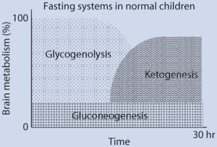
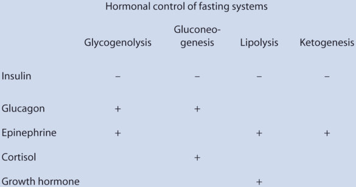
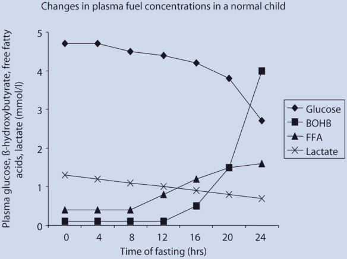
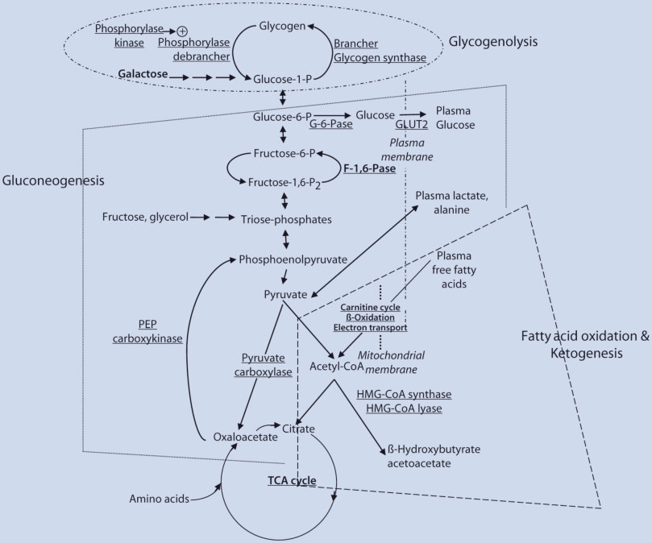
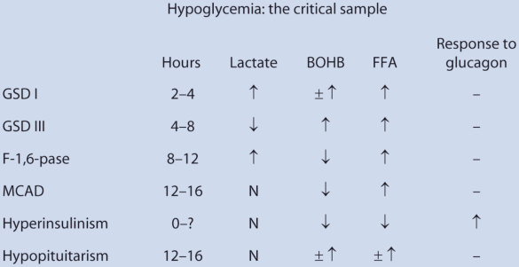

# 29. Hypoglycemia
> [Source credits](../../SOURCE_CREDITS.md).

## Study pillars

### Definition and Whipple Triad

Hypoglycemia in infants and children is defined clinically by Whipple's triad: (1) Symptoms and neuroglycopenic signs consistent with low blood glucose; (2) Concomitantly documented subnormal plasma glucose concentration (<50-55 mg/dL [2.8-3.1 mmol/L]; <60 mg/dL in neonates with suspected congenital hyperinsulinism); and (3) Rapid relief of clinical symptoms upon glucose administration. In neonates, transitional physiological glucose nadirs occur in the first 24-48 hours of life, after which plasma glucose must be maintained >60 mg/dL in infants and >70 mg/dL in older children to prevent irreversible neurocognitive injury.

PDF p. 793

### Critical Sample Collection Protocol

The diagnostic cornerstone of pediatric hypoglycemia is obtaining a 'critical blood sample' at the exact moment of documented spontaneous or fasting-induced hypoglycemia (plasma glucose <50 mg/dL) BEFORE administering rescue dextrose. Essential critical analytes include: plasma glucose, insulin, C-peptide, beta-hydroxybutyrate (BOHB), free fatty acids (FFA), lactate, total and free carnitine, acylcarnitine profile, cortisol, and growth hormone, accompanied by the first post-hypoglycemic urine sample for organic acids and ketones. A glucagon challenge (1 mg IV or IM at the time of hypoglycemia) is performed: a glycemic rise >30 mg/dL confirms inappropriate hepatic glycogen retention driven by hyperinsulinism.

PDF p. 794

### Congenital Hyperinsulinism (CHI)

Congenital Hyperinsulinism (CHI) is the leading cause of persistent, severe hypoglycemia in neonates and infants. Insulin inhibits glycogenolysis, gluconeogenesis, lipolysis, and ketogenesis, causing severe hypoketotic, hypo-fatty acidemic hypoglycemia with brain fuel starvation. The most common and severe forms result from inactivating mutations in ABCC8 and KCNJ11 (encoding SUR1 and Kir6.2 subunits of the beta-cell K-ATP channel). Recessive mutations cause diffuse CHI throughout the pancreas, whereas paternal mutations combined with somatic maternal loss of heterozygosity (LOH) at 11p15 cause focal CHI (adenomatous hyperplasia localized preoperatively with 18F-DOPA PET/CT and cured by partial pancreatectomy).

PDF p. 795

### Fatty Acid Oxidation and Glycogen Storage Disorders

Fatty acid oxidation disorders (FAOD, e.g., Medium-Chain Acyl-CoA Dehydrogenase [MCAD] deficiency) present during fasting or intercurrent illness with hypoketotic hypoglycemia, elevated FFA-to-BOHB ratio, hepatomegaly, hyperammonemia, and abnormal acylcarnitine profiles (elevated octanoylcarnitine C8 in MCAD). Ketotic hypoglycemia (elevated BOHB >2.5-3.0 mmol/L and FFA with suppressed insulin <2 mcU/mL) occurs in idiopathic ketotic hypoglycemia (accelerated starvation in lean toddlers aged 18 months to 5 years) and counter-regulatory hormone deficiencies (GH and cortisol deficiency). Glycogen storage diseases (GSD-I, G6Pase deficiency) feature severe fasting hypoglycemia with massive hepatomegaly, lactic acidosis, hypertriglyceridemia, and hyperuricemia.

PDF p. 798

### Acute and Chronic Pharmacotherapy

Acute symptomatic hypoglycemia requires immediate IV bolus of 10% dextrose (D10W) at 2 mL/kg (200 mg/kg), followed by a continuous glucose infusion rate (GIR) of 6-8 mg/kg/min (titrated up to 15-25 mg/kg/min in severe hyperinsulinism). For CHI, first-line medical therapy is diazoxide (K-ATP channel opener; 5-15 mg/kg/day orally divided TID); diazoxide MUST be co-administered with a thiazide diuretic (chlorothiazide 7-10 mg/kg/day) to prevent severe fluid retention, congestive heart failure, and pulmonary hypertension. Second-line medical therapy for diazoxide-unresponsive CHI is octreotide (somatostatin analog; 5-25 mcg/kg/day SC divided Q6-8H or continuous infusion).

PDF p. 803

## Full source extraction

# 29. Hypoglycemia
> Source attribution: [Source credits](../../SOURCE_CREDITS.md).

## PDF page 792 | printed page 791

### Hypoglycemia

Katherine Lord, Diva D. De León, and Charles A. Stanley

### Contents

### 29.1 Introduction and Background – 792

### 29.2 Etiology – 792

### 29.3 Specific Disorders – 794

29.3.1 Insulin-Mediated Hypoglycemia – 794 29.3.2 Hormone Deficiencies (Isolated Cortisol and Growth Hormone Deficiencies) and Panhypopituitarism – 797 29.3.3 Disorders of Gluconeogenesis – 797 29.3.4 Glycogen Storage Disorders (GSD) – 797 29.3.5 Fatty Acid Oxidation Defects – 798 29.3.6 Ketotic Hypoglycemia – 798 29.3.7 Post-fundoplication Hyperinsulinemic Hypoglycemia – 799

### 29.4 Clinical Presentation – 799

### 29.5 Diagnostic Evaluation – 799

29.5.1 Formal Fasting Test Protocol – 800 29.5.2 Other Tests – 801

### 29.6 Outcomes – 801

### 29.7 Treatment – 802

29.7.1 Selected Drugs for Hypoglycemic Disorders – 802

### 29.8 Summary – 804

### References – 805

© The Author(s), under exclusive license to Springer Nature Switzerland AG 2024 S. Radovick, M. Misra (eds.), Pediatric Endocrinology, https://doi.org/10.1007/978-3-031-66296-6_29

## PDF page 793 | printed page 792

Key Points

5 Hypoglycemia disorders in children are

rare but may have severe consequences if they are unrecognized or inappropri ately managed. 5 Evaluation for hypoglycemia disorders

is recommended for:

–– Neonates with plasma glucose

<60 mg/dL after the first 48 h of life –– Infants and young children if

plasma glucose concentrations are documented to be <60 mg/dL on laboratory quality assays –– Older children and adolescents

### 29

with documented Whipple’s triad (symptoms/signs of hypoglycemia, a documented low plasma glucose, and relief of signs/symptoms when plasma glucose is restored to nor mal) 5 The therapeutic plasma glucose goal for

neonates, infants, and children with a hypoglycemia disorder is >70 mg/dL

### 29.1 Introduction and Background

Hypoglycemia is a medical emergency that may result in seizures, permanent brain dam age, or even sudden death. Hypoglycemia can be the presenting sign of a large list of pathol ogies, and therefore, it is necessary to have a comprehensive and systematic strategy for diagnosis and therapy. This chapter presents an approach to disorders of hypoglycemia based on the metabolic and endocrine systems involved in successful adaptation to fasting. This “fasting systems” approach takes advan tage of the fact that almost all of the hypogly cemia problems in infants and children involve fasting. Since the integrity of these fasting systems is reflected in plasma levels of major fuels and counter-regulatory hormones at the time of hypoglycemia, the most important specimens for diagnosis are the ones obtained at the time of hypoglycemia, which is known as the “critical sample.”

Within 1–2 h after birth, plasma glucose concentrations in newborns decrease to a nadir of 55–60 mg/dL [1]. A study of healthy newborns found a mean glucose of 59 +/− 11 mg/dL during the 48 h of life. However, by 72–96 h of life, the mean glucose was 82 +/− 12 mg/dL [2, 3]. Thus, the physiological plasma glucose range in neonates after the first 3–4 days of life is not different than that for older children and adults (70–100 mg/dL). When plasma glucose decreases below this threshold, the glucose counter-regulatory sys tems are activated. A critical sample obtained when plasma glucose is <50 mg/dL reflects the metabolic response to hypoglycemia and allows the determination of the underlying cause of hypoglycemia.

### 29.2 Etiology

In infants and children, hypoglycemia, with few exceptions, is almost always fasting hypo glycemia. The physiology of normal success ful fasting adaptation provides a useful framework that encompasses the diagnosis and treatment of potential hypoglycemia dis orders [2].

29.1 29.2

29.1

## PDF page 794 | printed page 793

cogenolysis, supplemented by hepatic gluco neogenesis utilizing amino acids released by muscle protein turnover. After 12–16 h in nor mal infants (24–36 h in adults), glucose pro duction declines, since the supply of liver glycogen is limited and the rate of gluconeo genesis from amino acids remains constant. At this time, a transition to fat as the major fuel for the body begins, with accelerated adi pose tissue lipolysis and increased fatty acid oxidation in muscle and ketogenesis in liver. The brain cannot utilize fatty acids directly; therefore, ketones (β-hydroxybutyrate and

acetoacetate) provide an alternative fatderived fuel for the brain and permit a reduc tion of brain glucose consumption and the drain on essential muscle proteins. In late stages of fasting adaptation, fatty acid oxida tion and ketone utilization account for 90% of total oxygen consumption.

29.3

4

Unmatched source image; PDF page 794. Consult the original caption.

Unmatched source image; PDF page 794. Consult the original caption.

## PDF page 795 | printed page 794

### 29

### 29.3 Specific Disorders

### 29.3.1 Insulin-Mediated

### Hypoglycemia

Insulin is the most important regulatory hor mone, and dysregulated insulin secretion with failure to suppress insulin during fasting is the most common cause of persistent hypoglyce mia in infants and children. This can be due to a genetic defect affecting the various steps involved in fuel-stimulated insulin secretion, or in the high-risk neonate precipitated by perinatal stress (IUGR, infants of mothers with preeclampsia, etc.), or an insulinproducing tumor in older children and adoles cents. The possibility of exogenous insulin administration or hypoglycemic agents should also be considered.

### 29.3.1.1 Congenital Monogenic

### Hyperinsulinism (HI) [5, 6]

4

29.4

Recessive loss-of-function mutations of K

ATP-channel genes (ABCC8, encoding SUR1, sulfonylurea receptor; KCNJ11, encoding Kir6.2, potassium ion pore) [7, 8]. KATP-HI features include severe neonatal onset, LGA birthweight, protein-induced hypoglycemia, diazoxide unresponsiveness, and very high glucose requirement (up to 20–30 mg/kg/min).

Dominant loss-of-function mutations of ABCC8 and KCNJ11 [9]. Unlike the severe disease often associated with recessive muta tions in the KATP-channel, some dominant cases have milder hypoglycemia and are diazoxide-responsive. However, those patients who do not respond to diazoxide are clinically indistinguishable from those with recessive forms. Dominant ABCC8 and KCNJ11 muta tions are also associated with protein-induced hypoglycemia [10].

Unmatched source image; PDF page 795. Consult the original caption.

## PDF page 796 | printed page 795

Focal hyperinsulinism [11, 12]. This is a consequence of somatic loss of heterozygosity for maternal 11p and expression of a pater nally transmitted recessive KATP-channel mutation (either ABCC8 or KCNJ11). The phenotype is very similar to recessive diffuse KATP-channel HI, and focal HI accounts for 40–60% of cases of severe diazoxideunresponsive HI [13]. Preoperative localiza tion of the lesion by 18F-fluoro-L-DOPA PET scan and resection of the lesion can result in cure of the hyperinsulinism [14–16].

Dominant gain-of-function mutations of glutamate dehydrogenase (GLUD1) :hyperin sulinism/hyperammonemia (HI/HA) syn drome [17–19]. Children with HI/HA typically present within the first year of life

but may not be diagnosed in the neonatal period as they have normal weight at birth and can fast longer than neonates with KATP-HI. HI/HA is characterized by fasting and protein-induced hypoglycemia which is diazoxide-responsive and a persistent mild hyperammonemia (plasma ammonium, 50–200 micromols/L). They also have increased rates of seizures (typically absence) and learning disabilities, which are thought to be unrelated to the hypoglycemia or the elevated ammonia levels [20].

Dominant gain-of-function mutations of glucokinase (GCK) [21]. Gain-of-function mutations in GCK result in a lower glucose threshold for insulin release. Children with GCK-HI have hypoglycemia of variable

## PDF page 797 | printed page 796

degrees of severity and are only partially responsive to diazoxide [22].

Aberrant expression of Hexokinase (HK1). HK1 is a high affinity glycolytic enzyme which is silenced in the pancreatic beta cell. Mutations in noncoding regions of HK1 lead to its expression in beta cells, resulting in excessive insulin secretion. Individuals with HK1-HI typically present at birth and have hypoglycemia which persists into adulthood. The majority of patients respond to diazox ide, although some have required pancreatec tomy [23].

Recessive loss-of-function mutations of HADH (encoding SCHAD, the mitochon drial enzyme short-chain 3-hydroxyaxyl-CoA dehydrogenase) [22, 24]. In addition to its function in fatty acid oxidation, in the pancre atic beta cell, SCHAD functions as a negative regulator of glutamate dehydrogenase. Thus, similar to HI/HA, SCHAD-HI presents with fasting and protein-induced hypoglycemia, which is responsive to diazoxide therapy, but without the hyperammonemia. The biochemi cal hallmark, in addition to markers of increased insulin action, is increased levels of 3-hydroxybutyryl-carnitine in plasma and increased levels of 3-hydroxyglutarate in urine.

### 29

Dominant loss-of-function mutations of hepatocyte nuclear factor 4 (HNF4A) and hepatocyte nuclear factor 1 (HNF1A) [25–27]. These transcription factors are well-known causes of familial monogenic diabetes (MODY1 and MODY3, respectively). More recently, it has been recognized that the phe notype in individuals with these mutations is biphasic with neonatal hypoglycemia due to hyperinsulinism and diabetes later in life. The hyperinsulinism phase can last from a few weeks to up to 8 years. Children with these forms of HI respond well to diazoxide.

Dominant mutations of monocarboxylate transporter 1 (MCT1, encoded by SLC16A1) [28, 29]. Mutations in the promoter region of SLC16A1 result in aberrant expression of MCT1 in the beta cells and cause a rare form of HI, which is triggered by exercise. Characterized by episodes of hypoglycemia at the time of anaerobic exercise, MCT1-HI has been primarily identified in the Finnish popu

lation. The degree of hypoglycemia in response to exercise is variable.

Dominant mutations of uncoupling protein 2 (UCP2) [30]. Loss-of-function mutations in UCP2, which encodes an inner mitochondrial membrane carrier, result in a diazoxideresponsive form of HI.

### 29.3.1.2 Transient Neonatal

### Hyperinsulinism

Infant of a diabetic mother. Maternal hyper glycemia {XE “Maternal hyperglycemia”} triggers insulin hypersecretion by the fetal pancreatic beta cells, resulting in larger birth weight and hypoglycemia that typically resolves in 2–3 days. However, in cases com plicated by other perinatal stressors, i.e., pla cental insufficiency, the hyperinsulinism may last longer (see below).

Perinatal stress-induced hyperinsulinism [31, 32]. It is associated with SGA birth weight, birth asphyxia, and maternal toxemia, and other perinatal stressors. Recent studies show that fetal hypoxia results in reduced KATP channel surface expression. Therefore, the glucose threshold for insulin release is decreased, resulting in a reduction in basal levels of plasma glucose. The hypoxic envi ronment during fetal life explains the low glu cose threshold for insulin release and transitional hypoglycemia in normal new borns, while perinatal hypoxic insults explain the more severe and prolonged hypoglycemia seen in perinatal stress-induced hyperinsulin ism (PNSHI) [33]. PNSHI can be clinically indistinguishable from the genetic forms of HI, apart from a history of perinatal insults. PNSHI typically resolves within a few weeks and rarely persists beyond the first 2–3 months of life. Most cases are responsive to treatment with diazoxide, although severe cases may require more intensive treatments [34].

### 29.3.1.3 Syndromic Hyperinsulinism

Hypoglycemia due to HI can be the present ing symptom in children with Beckwith- Wiedemann syndrome (BWS), an overgrowth syndrome due to genetic or epigenetic abnor malities in the imprinted region of chromo some 11p which is close to the KATP-channel loci. The severity of the HI in BWS is vari

## PDF page 798 | printed page 797

able; infants with paternal UPD11passociated HI have a persistent and severe HI phenotype compared to the transient hypo glycemia of BWS patients caused by other eti ologies [35]. Many other syndromes can be associated with HI including Turner syn drome, Kabuki syndrome, and congenital dis orders of glycosylation (CDG).

### 29.3.1.4 Insulinoma

Insulinomas are typically benign islet cell tumors, which are rarer in the pediatric popula tion than in adults. After diagnostic testing con firms evidence of insulin excess, imaging should be performed to localize the lesion. Multiple modalities (MRI, endoscopic ultrasound) may be necessary given the difficulty in localization. Resection is curative. Genetic testing for multi ple endocrine neoplasia type 1 (MEN1) should be done in any child with an insulinoma.

### 29.3.1.5 Factitous Hypoglycemia

Induced hypoglycemia by administration of either insulin or hypoglycemic agents should be considered in the differential of insulinmediated hypoglycemia. The clinical presen tation can be undistinguishable from endogenous forms of hyperinsulinism ; how ever, the abrupt onset of hypoglycemia of unpredictable pattern in an otherwise healthy child may trigger further investigation.

### 29.3.2 Hormone Deficiencies

### (Isolated Cortisol and Growth Hormone Deficiencies) and Panhypopituitarism

Hypoglycemia from growth hormone and cortisol deficiency occurs primarily during infancy and presents as ketotic hypoglycemia. However, in the neonate, features may mimic hyperinsulinism, including high glucose requirement, low FFA and BOHB, and a gly cemic response to glucagon. This diagnosis should be suspected in neonates with the phe notype of HI, but who also have midline mal formations, microphthalmia, micropenis, or cholestatic liver disease. Low growth hormone

and cortisol levels obtained at the time of hypoglycemia are not diagnostic and prior to starting hormone replacement, appropriate stimulation tests should be performed to con firm the diagnosis [36], in addition to a brain MRI. In infants with midline defects, evidence of other pituitary abnormalities, and/or pitu itary defects on imaging, a low random growth hormone may be sufficient to make the diag nosis without the need for provocative testing. The hypoglycemia resolves with replacement of the missing hormones.

### 29.3.3 Disorders

### of Gluconeogenesis

37

29.5

### 29.3.4 Glycogen Storage Disorders

### (GSD)

29.5

## PDF page 799 | printed page 798

### 29

myopathy. In contrast, GSD types VI and IX present with hypoglycemia following over night fasting, milder hepatomegaly and growth retardation, and minimal metabolic and hepatic abnormalities. Liver biopsy as the gold standard for diagnosis has been replaced by genetic mutation testing.

### 29.3.5 Fatty Acid Oxidation Defects

29.6 38 39

40

41

### 29.3.6 Ketotic Hypoglycemia

These are children, usually 1–4 years of age, with episodes of symptomatic fasting hypo glycemia, but do not have any identifiable metabolic or endocrine defect. In most instances, this can be thought of as merely a quantitative rather than a specific, qualitative abnormality of fasting adaptation. These children may simply represent the lower end

Unmatched source image; PDF page 799. Consult the original caption.

## PDF page 800 | printed page 799

of the normal distribution of fasting toler ance. Note, however, that the features of abbreviated but otherwise normal fasting response are shared by the milder glycogeno ses. Some cases of “ketotic hypoglycemia” have been found to have a mild GSD or inac tivating mutations of monocarboxylate trans porter 1 (MCT1) [42, 43].

### 29.3.7 Post-fundoplication

### Hyperinsulinemic Hypoglycemia

Postprandial hypoglycemia may occur in infants following fundoplication surgery for gastroesophageal reflux and may be severe enough to cause seizures and brain damage [44]. The mechanism involves rapid emptying of a meal into the small intestine, with early hyperglycemia followed by an exaggerated insulin surge and subsequent hypoglycemia, usually 1–2 h after the feed or meal. Increased secretion of the potent insulinotropic hor mone, glucagon-like peptide-1 (GLP-1), by intestinal enteroendocrine cells after a meal may, at least in part, be responsible for the postprandial hyperinsulinemia [45]. The diag nosis is made by demonstration of the typical plasma glucose and insulin patterns in response to a mixed meal or formula tolerance test. Treatment includes feeds of longer dura tion, reduced high glycemic index foods, and

inhibitors of gastric motility; the alpha gluco sidase inhibitor, acarbose, may be useful as a means to delay digestion and absorption of complex carbohydrates [46].

### 29.4 Clinical Presentation

Older children and adults manifest Whipple’s classic triad: neurogenic and neuroglycopenic symptoms/signs of hypoglycemia, a con firmed low plasma glucose value, and resolu tion of the symptoms/signs when the glucose level is restored to normal. However, neo nates, infants, and younger children may not reliably demonstrate and/or lack the ability to communicate such symptoms and are fre quently asymptomatic, even with significant hypoglycemia. Hypoglycemic symptoms may be subtle and difficult to recognize in these age groups and include poor feeding, sweating, somnolence, apnea, and irritability. Myoclonic jerks and seizures may occur with severe hypo glycemia.

### 29.5 Diagnostic Evaluation

Guidelines published by the Pediatric Endocrine Society detail which infants and children require evaluation for hypoglycemia disorders [47]. High-risk neonates (LGA, SGA, perinatal stress, maternal diabetes,

## PDF page 801 | printed page 800

### 29

those with congenital syndromes and family history of genetic hypoglycemia disorders) with plasma glucoses <60 mg/dL after the first 48 h of life should undergo additional evaluation prior to discharge. Evaluation should also occur in infants and young chil dren if plasma glucose concentrations are documented to be <60 mg/dL on laboratory quality assays and in older children only if Whipple’s triad is documented.

29.7

### 29.5.1 Formal Fasting Test Protocol

The success of the fasting test requires an experienced team of nurses and physicians, a blood-drawing IV, and rapid and accurate plasma glucose monitoring (N.B. Standard bedside glucose meters are not accurate enough). The fast usually begins with an eve ning meal or feed, but may be adjusted later if very short fasting tolerance is suspected (con sider monitoring for 24 h on usual diet before starting the fasting test to assess glucose sta bility). From the beginning of the fast, moni tor plasma glucose and BOHB closely (e.g., every 3 h until <70 mg/dL, every 1 h until <60 mg/dL, then every 30 min to end). End the test at plasma glucose <50 mg/dL or when

bedside measurement of BOHB indicates val ues >2.5 mmol/L or a specific duration has been reached (18 h if <1 month; 24 h if 1–12 months; 36 h if >1 year; 48 h for adoles cents) or in case of any worrisome symptoms. At the end of the fast, obtain “critical sample” labs, which should include the basic metabolic panel, lactate, ammonia, insulin, c-peptide, BOHB, FFA, GH, cortisol, plasma acylcarnitine profile, plasma total and free carni tine, and urinary organic acid profile. If considering hyperinsulinism (low BOHB dur ing the fast), perform the glucagon stimula tion test, 1 mg IV, to test liver glycogen reserve (at plasma glucose <50 mg/dL, appropriate glycemic response is <30 mg/dL within 15–30 min after glucagon administration; gly cemic response above 30 mg/dL is consistent with hyperinsulinism) [4]. Caution: fasting tests are potentially hazardous provocative tests that, like the water deprivation test, must be closely monitored for patient safety. Sudden deaths during fasting tests have been reported in patients with fatty acid oxidation defects. Patients with fatty acid oxidation defects may develop life-threatening symp toms before plasma glucose levels fall below 60–65 mg/dL, including progressive lethargy, nausea, vomiting, or unexplained tachycar dia; fasts should be terminated in these cases without waiting for plasma glucose to reach 50 mg/dL.

29.6

Unmatched source image; PDF page 801. Consult the original caption.

## PDF page 802 | printed page 801

with and without acidemia (HCO3 <16–18 vs. >16–18 mEq/L). The groups are then further divided based on the presence or absence of ketones and lactate: 1. Acidemia due to lactate accumulation typ

ifies defects in hepatic gluconeogenesis: glucose-6-phosphatase deficiency (GSD type I), GLUT2 deficiency, fructose-1,6diphosphatase deficiency, hereditary fruc tose intolerance, and ethanol ingestion. 2. Acidemia due to ketone accumulation typ

ifies normal children, ketotic hypoglyce mia (likely normal, but with shortened fasting tolerance), defects in glycogenoly sis (GSD types 0, III, VI, IX), growth hor mone and/or cortisol deficiencies, and ketone utilization defects. 3. No acidemia with ketones and free fatty

acids both suppressed: congenital, perina tal stress or syndromic hyperinsulinism, insulinoma, exogenous administration of insulin or oral hypoglycemic agents, and neonatal hypopituitarism. 4. No acidemia with suppressed ketones but

elevated free fatty acids: genetic defects in fatty acid oxidation and ketogenesis.

### 29.5.2 Other Tests

### 29.5.2.1 Plasma Acyl-Carnitine

### Profile

This test using tandem mass spectrometry measures the different fatty acids bound to carnitine to detect many (but not all) of the genetic defects in fatty acid oxidation. The method is now employed in most newborn screening programs using filter paper blood spots to screen for 20 or more inborn errors of metabolism. Medium-chain acyl-CoA dehy drogenase (MCAD) deficiency is particularly common (1/5000) and easily detected by this method [41].

### 29.5.2.2 Genetic Testing

Genetic testing for the most common forms of hyperinsulinism is available in commercial laboratories and should be obtained as soon as the diagnosis is confirmed. This is particu

larly important for infants with diazoxideunresponsive hyperinsulinism as >90% of these cases will have a KATP channel defect and, therefore, an approximately 50% likeli hood of having focal hyperinsulinism. Mutation screening is useful for glucose- 6-phosphatase deficiency, since 80% of patients have one of five common mutations. Ninety percent of MCAD patients have the common A985G mutation. In addition, for children with repeated episodes of “ketotic hypoglycemia,” genetic testing may identify those with an underlying defect in glycoge nolysis or ketone utilization.

### 29.5.2.3 Cultured Cells

Lymphoblasts or fibroblasts are useful for diagnosis of some inborn errors of metabo lism (such as fatty acid oxidation disorders) and as sources of DNA for mutation analysis for other genetic defects.

### 29.6 Outcomes

Severe or recurrent hypoglycemia results in neurologic dysfunction and, in rare cases, death. Therefore, early recognition and treat ment are essential to avoid neurologic damage and later risk of learning disabilities and epi lepsy. Long-term studies of HI patients have found rates of neurodevelopmental abnor malities between 26% and 48% and epilepsy between 13% and 43% [48–50]. Despite a bet ter understanding and recognition of the dis ease, individuals diagnosed with HI in the last 20 years have not demonstrated substantially improved outcomes compared to older indi viduals with HI [51]. This suggests that the neurologic insult from hypoglycemia occurs in the first several days of life and speaks about the importance of screening high-risk infants for hypoglycemia. Given the high risk of neu rocognitive dysfunction, children with HI, regardless of etiology or treatment, require periodic developmental testing.

Children with HI who undergo pancre atectomy are at increased risk of developing diabetes. By age 14 years, over 90% of indi viduals who have undergone 98% pancreatec

## PDF page 803 | printed page 802

tomy develop insulin-dependent diabetes [52]. The risk of diabetes is significantly higher in those with surgically treated diffuse disease compared to those with focal form, because of the limited pancreatic resection required for focal lesions [51]. Additionally, children with HI due to HNF4A and HNF1A muta tions require screening for diabetes given the risk of beta cell failure and subsequent diabe tes.

### 29.7.1 Selected Drugs

### 29.7 Treatment

1. Dextrose (emergency Rx): IV 0.2 gm/kg

The management of children with hypoglyce mia should be guided by the following goals: (1) prevention of brain damage from recur rent hypoglycemia, (2) establishment of a spe cific diagnosis and therapy, and (3) encouragement of normal feeding behavior while assuring safe fasting tolerance.

### 29

47

2. Glucagon (emergency Rx only in case of

29.8

### for Hypoglycemic Disorders

bolus (2 mL/kg of D10%), followed by D10% administered continuously. The glu cose infusion rate is adjusted to maintain plasma glucoses greater than 70 mg/ dL. Children with HI may need infusion rates of glucose as high as 20–30 mg/kg/ min. Continuous dextrose (20%) can be given enterally for certain forms of diazox ide-unresponsive HI.

insulin-induced hypoglycemia): 1 mg IM

## PDF page 804 | printed page 803

or IV. This can also be used as a continu ous intravenous infusion (2.5–20 mcg/ kg/h) in HI as a temporary measure to reduce glucose requirements, while the infant is in the hospital. 3. Diazoxide. 5–15 mg/kg/day divided into

two oral doses for HI. The starting dose should be 5–10 mg/kg/day based on the severity, increasing to a maximum of 15 mg/kg/day if necessary. A fasting test to demonstrate that the cardinal feature of HI: hypoketotic hypoglycemia, has been corrected by treatment should be per formed after five full days of therapy (since the half-life is 24–36 h) [53]. The major side effects are fluid retention and hyper trichosis. A diuretic (i.e., chlorothiazide 10–30 mg/kg/day) should be used in all neonates and infants undergoing diazox

Case Study

A full-term baby boy with a birth weight of 4500 gm (LGA) was found to have a plasma glucose of 25 mg/dL shortly after birth. Due to persistent pre-feed plasma glucose values in the 30 s, on DOL #2 he was started on dextrose containing IVF, which were subsequently weaned off over the next several days. His hypoglycemia was declared “resolved,” and he was discharged home with no further evalua tion. At 2 months of age, he had a generalized tonic clonic seizure and EMS was called. His plasma glucose was 30 mg/dL. He was admit ted to the hospital where he was found to have persistent hypoglycemia. He underwent a fast ing test, during which he fasted only 3 h with plasma glucoses above 50 mg/dL. His critical sample showed the following: glucose 45 mg/ dL, HCO3 24 mmol/L, BOHB 0.1 mmol/L, lac tate 0.5 mmol/L, insulin 2 uU/mL, FFA 0.15 mmol/L, cortisol 18 mcg/dL, and GH

ide treatment to prevent fluid overload or pulmonary hypertension. 4. Somatostatin analogs:: For patients with

diffuse diazoxide unresponsive HI, ocreo tide 5–20 mcg/kg/day SQ divided q 6–8 h can be used alone or in combination with continuous enteral dextrose. Tachyphy laxis is commonly encountered. Due to the risk of necrotizing enterocolitis in neo nates treated with octreotide [54], we advise against its use in infants less than 2 months old. After the first year of life, children can be switched to lanreotide, a long-acting somatostatin analog, that can be dosed once a month [55]. 5. Cornstarch: 1.6 g/kg every 3–4 h for GSD

type I [37]. This may also be used at bed time for other forms of GSD or for young children with abbreviated fasting tolerance.

12 ng/mL. Glucagon 1 mg was given when his plasma glucose was 45 mg/dL and increased to 90 mg/dL by 20 min. He was diagnosed with hyperinsulinism and was started on diazoxide at a dose of 15 mg/kg/day. After 5 days, he con tinued to require a GIR of 16 mg/kg/min and could not be weaned off his IVF. Diazoxide was discontinued. Genetic testing of the HI genes had been sent on him and his parents and showed a paternally inherited autosomal reces sive mutation of ABCC8. He underwent an 18F–fluoro-L-DOPA PET scan, which demon strated focal uptake of the tracer in the tail of the pancreas. He was taken to surgery and underwent a 15% partial pancreatectomy after analysis of frozen samples confirmed focal HI histology. After recovery from surgery, he underwent another fasting test during which he was able to fast for 24 h with plasma glucose levels >70 mg/dL.

## PDF page 805 | printed page 804

### 29.8 Summary

Hypoglycemia disorders are rare but have potentially severe consequences for children if unrecognized. An understanding of normal fasting adaption and a systematic approach to the interpretation of the critical sample allow for narrowing of the differential diagnosis and making an accurate diagnosis.. Children with hypoglycemic disorders, particularly those with hyperinsulinism, are at risk of neurologic damage, so early detection and initiation of the appropriate disease-specific treatment is critical to improve neurocognitive outcomes.

### 29

Review Questions

3. You are consulted to evaluate a 2-week-

1. A 9-month-old male presents to the

emergency department with new onset seizures and a plasma glucose of 38 mg/dL. A critical sample obtained at presentation showed bicarbon ate = 20 mmol/L, FFA = 0.82 mmol/L, BOHB = 0.95 mmol/L, plasma insu lin = 3 uU/mL, lactate = 1 mmol/L, GH = 0.48 ng/mL, cortisol = 4.14 ug/ dL, and ammonia = 120 umol/L.

What additional test would help establish the underlying cause of hypo glycemia? A. Arginine/clonidine GH stimulation

test B. Fed glucagon stimulation test C. CRH stimulation test D. Glucagon stimulation test E. Both A and C

2. A 6-month-old female is referred for

evaluation of poor growth and hypogly cemia. Laboratory testing ordered by the pediatrician showed a plasma glu cose of 49 mg/dL, bicarbon ate = 14 mmol/L, lactate = 6.8 mmol/L, AST = 120 U/L, ALT = 100 U/L, tri glycerides = 800 mg/dL, and hemoglo bin = 9 g/dL.

v Answers

1. (D)

The diagnosis is best confirmed by which of the following results? A. Following injection of glucagon

1 mg IV, the plasma glucose rises from 49 mg/dL to 80 mg/dL after 30 min.

B. Following injection of glucagon

1 mg IV, the blood lactate rises from 6.8 mmol/L to 10 mmol/L after 20 min. C. Following ingestion of an oral pro

tein supplement, 1.5 g/kg, the plasma glucose falls from 70 mg/dL to 40 mg/dL after 30 min. D. Following ingestion of oral glucose,

1.75 g/kg, the plasma glucose rises to 250 mg/dL at 1 h and then falls to 35 mg/dL at 2 h. E. Following injection of galactose,

1 g/kg IV, the plasma glucose rises from 80 to 150 mg/dL after 30 min.

old male with persistent hypoglycemia. He was born by emergency cesarean section due to non-reassuring fetal heart rate at 35 weeks of gestation and was SGA at birth. His initial plasma glucose was 10 mg/dL. He was on intravenous fluids with dextrose for 1 week and fortified formula every 3 h. Pre-feeding glucoses are now 55–60 mg/dL.

The most appropriate next step in the management of this infant is: A. To initiate therapy with hydrocorti

sone 10 mg/m2/day. B. No further evaluations are required

since plasma glucose is now above 50 mg/dL. C. To perform a diagnostic fasting test. D. To recommend feeding the infant

every 2 h. E. To add cornstarch 1 g/kg to the for

mula.

The findings of suppressed β-hydroxybutyrate and free fatty acids and a positive response to glucagon (>30 mg/dL) at the time of hypoglyce mia are diagnostic of hyperinsulinism. It is not unusual to find that insulin is not elevated in cases of hyperinsulin ism; therefore, low plasma insulin at the time of hypoglycemia does not rule out the diagnosis. Accordingly, the diagnosis must often be based on the

## PDF page 806 | printed page 805

examination of other physiologic man ifestations of excessive insulin secre tion, such as suppression of glycogenolysis, lipolysis, and ketogen esis, which can be inferred by the find ing of a glycemic response to glucagon and the suppression of plasma free fatty acids and β-hydroxybutyrate con centrations during hypoglycemia. The late presentation and the elevated ammonia are characteristic of GDH hyperinsulinism, or the hyperinsulin ism hyperammonemia syndrome, caused by an activating mutation in GLUD1. Note that frequently GH and cortisol levels are not elevated in the critical sample in HI patients; also, except for the immediate postnatal period, deficiencies of these two hor mones do not cause hypo-ketonemic, hypo-fatty acidemic hypoglycemia. 2. (B) The clinical picture of growth fail

3. Harris DL, Weston PJ, Gamble GD, Harding

4. Finegold DN, Stanley CA, Baker L. Glycemic

5. Lord K, De Leon DD. Monogenic hyperinsulin

6. Stanley CA. Perspective on the genetics and diag

7. Thomas PM, Cote GJ, Wohllk N, Haddad B,

8. Thomas P, Ye Y, Lightner E. Mutation of the pan

9. Huopio H, Reimann F, Ashfield R, Komulainen J,

ure, hypoglycemia, hypertriglyceride mia, elevated liver enzymes, and lactic acidemia suggests glycogen storage dis ease type I (deficiency of glucose 6-phos phatase). The diagnosis can be confirmed by a fed glucagon stimulation test, which will show failure of glucose to rise and elevation of lactate as a result of increased glycogenolysis. 3. (C) The finding of persistent hypoglyce

10. Pinney SE, MacMullen C, Becker S, Lin Y-W,

11. De Lonlay P, Fournet JC, Rahier J, Gross-Morand

mia (beyond 2–3 days after birth) in this high-risk neonate suggests an ongoing problem with glucose regulation. The history suggests perinatal stress-induced hyperinsulinism that has not yet resolved. Prompt evaluation with a diag nostic fasting test will help determine the underlying cause and initiate appro priate therapy.

12. Verkarre V, Fournet JC, De Lonlay P, Gross-

13. Lord K, Dzata E, Snider KE, Gallagher PR, De

### References

1. Stanley CA, Rozance PJ, Thornton PS, De Leon

DD, Harris D, Haymond MW, et al. Re-evaluating “transitional neonatal hypoglycemia”: mechanism and implications for management. J Pediatr. 2015;166(6):1520–5.e1. 2. Stanley CA, Baker L. Hypoglycemia. In: Kaye R,

14. Otonkoski T, Nanto-Salonen K, Seppanen M,

Oski FA, Barness LA, editors. Core textbook of

pediatrics. Philadelphia: Lippincott; 1978. p. 280–305.

JE. Glucose profiles in healthy term infants in the first 5 days: the glucose in well babies (GLOW) study. J Pediatr. 2020;223:34–41.e34.

response to glucagon during fasting hypoglycemia: an aid in the diagnosis of hyperinsulinism. J Pediatr. 1980;96(2):257–9.

emic hypoglycemia: current insights into the pathogenesis and management. Int J Pediatr Endocrinol. 2013;2013(1):3.

nosis of congenital Hyperinsulinism disorders. J Clin Endocrinol Metab. 2016;101(3):815–26.

Mathew PM, Rabl W, et al. Mutations in the sulfo nylurea receptor gene in familial persistent hyper insulinemic hypoglycemia of infancy. Science. 1995;268(5209):426–9.

creatic islet inward rectifier Kir6.2 also leads to familial persistent hyperinsulinemic hypoglycemia of infancy. Hum Mol Genet. 1996;5(11):1809–12.

Lenko HL, Rahier J, et al. Dominantly inherited hyperinsulinism caused by a mutation in the sulfo nylurea receptor type 1. J Clin Invest. 2000;106(7):897–906.

Hanna C, Thornton P, et al. Clinical characteris tics and biochemical mechanisms of congenital hyperinsulinism associated with dominant KATP channel mutations. J Clin Invest. 2008;118(8):2877–86.

MS, Poggi-Travert F, Foussier V, et al. Somatic deletion of the imprinted 11p15 region in sporadic persistent hyperinsulinemic hypoglycemia of infancy is specific of focal adenomatous hyperpla sia and endorses partial pancreatectomy. J Clin Invest. 1997;100(4):802–7.

Morand MS, Devillers M, Rahier J, et al. Paternal mutation of the sulfonylurea receptor (SUR1) gene and maternal loss of 11p15 imprinted genes lead to persistent hyperinsulinism in focal adeno matous hyperplasia. J Clin Invest. 1998;102(7):1286–91.

Leon DD. Clinical presentation and management of children with diffuse and focal hyperinsulinism: a review of 223 cases. J Clin Endocrinol Metab. 2013;98(11):E1786–9.

Veijola R, Huopio H, Hussain K, et al. Noninvasive diagnosis of focal hyperinsulinism of infancy with [18F]-DOPA positron emission tomography. Diabetes. 2006;55(1):13–8.

## PDF page 807 | printed page 806

15. Hardy OT, Hernandez-Pampaloni M, Saffer JR,

Scheuermann JS, Ernst LM, Freifelder R, et al. Accuracy of [18F]fluorodopa positron emission tomography for diagnosing and localizing focal congenital hyperinsulinism. J Clin Endocrinol Metab. 2007;92(12):4706–11. 16. Adzick NS, De Leon DD, States LJ, Lord K,

27. Stanescu DE, Hughes N, Kaplan B, Stanley CA,

Bhatti TR, Becker SA, Stanley CA. Surgical treat ment of congenital hyperinsulinism: results from 500 pancreatectomies in neonates and children. J Pediatr Surg. 2019;54(1):27–32. 17. Weinzimer SA, Stanley CA, Berry GT, Yudkoff M,

28. Meissner T, Otonkoski T, Feneberg R, Beinbrech

29. Otonkoski T, Jiao H, Kaminen-Ahola N, Tapia-

Tuchman M, Thornton PS. A syndrome of con genital hyperinsulinism and hyperammonemia. J Pediatr. 1997;130(4):661–4. 18. Stanley CA, Lieu YK, Hsu BY, Burlina AB,

Greenberg CR, Hopwood NJ, et al. Hyperinsulinism and hyperammonemia in infants with regulatory mutations of the glutamate dehy drogenase gene. N Engl J Med. 1998;338(19):1352–7. 19. Kelly A, Ng D, Ferry RJ Jr, Grimberg A, Koo-

30. González-Barroso MM, Giurgea I, Bouillaud F,

### 29

McCoy S, Thornton PS, et al. Acute insulin responses to leucine in children with the hyperinsulinism/hyperammonemia syndrome. J Clin Endocrinol Metab. 2001;86(8):3724–8. 20. Bahi-Buisson N, Roze E, Dionisi C, Escande F,

31. Collins JE, Leonard JV. Hyperinsulinism in

Valayannopoulos V, Feillet F, et al. Neurological aspects of hyperinsulinism-hyperammonaemia syndrome. Dev Med Child Neurol. 2008;50(12):945–9. 21. Glaser B, Kesavan P, Heyman M, Davis E, Cuesta

32. Hoe FM, Thornton PS, Wanner LA, Steinkrauss

A, Buchs A, et al. Familial hyperinsulinism caused by an activating glucokinase mutation. N Engl J Med. 1998;338(4):226–30. 22. Li C, Chen P, Palladino A, Narayan S, Russell LK,

33. Yang J, Hammoud B, Li C, Ridler A, Yau D, Kim

Sayed S, et al. Mechanism of hyperinsulinism in short-chain 3-hydroxyacyl-CoA dehydrogenase deficiency involves activation of glutamate dehy drogenase. J Biol Chem. 2010;285(41):31806–18. 23. Wakeling MN, Owens NDL, Hopkinson JR,

34. Sigal WM, Alzahrani O, Guadalupe GM, Guzman

Johnson MB, Houghton JAL, Dastamani A, Flaxman CS, Wyatt RC, Hewat TI, Hopkins JJ, Laver TW, van Heugten R, Weedon MN, De Franco E, Patel KA, Ellard S, Morgan NG, Cheesman E, Banerjee I, Hattersley AT, Dunne MJ, Richardson SJ, Flanagan SE. Non-coding variants disrupting a tissue-specific regulatory ele ment in HK1 cause congenital hyperinsulinism. Nat Genet. 2022;54:1615–20. 24. Clayton PT. Hyperinsulinism in short-chain l-3-

35. Kalish JM, Boodhansingh KE, Bhatti TR,

36. Kelly A, Tang R, Becker S, Stanley CA. Poor spec

hydroxyacyl-CoA dehydrogenase deficiency reveals the importance of beta-oxidation in insulin secre tion. J Clin Invest. 2001;108(3):457–65. 25. Pearson ER, Boj SF, Steele AM, Barrett T, Stals K,

37. Kishnani PS, Austin SL, Abdenur JE, Arn P, Bali

Shield JP, et al. Macrosomia and hyperinsulinae mic hypoglycaemia in patients with heterozygous mutations in the HNF4A gene. PLoS Med. 2007;4(4):e118. 26. Kapoor RR, Locke J, Colclough K, Wales J, Conn

38. Stanley CA, Bennett MJ. Disorders of mitochon

JJ, Hattersley AT, et al. Persistent hyperinsulin emic hypoglycemia and maturity-onset diabetes of

the young due to heterozygous HNF4A mutations. Diabetes. 2008;57(6):1659–63.

De Leon DD. Novel presentations of congenital hyperinsulinism due to mutations in the MODY genes: HNF1A and HNF4A. J Clin Endocrinol Metab. 2012;97(10):E2026–30.

B, Apostolidou S, Sipila I, et al. Exercise induced hypoglycaemic hyperinsulinism. Arch Dis Child. 2001;84(3):254–7.

Paez I, Ullah MS, Parton LE, et al. Physical exer cise–induced hypoglycemia caused by failed silencing of monocarboxylate transporter 1 in pancreatic β cells. Am J Hum Genet. 2007;81(3):467–74.

Anedda A, Bellanné-Chantelot C, Hubert L, et al. Mutations in UCP2 in congenital hyperinsulinism reveal a role for regulation of insulin secretion. PLoS One. 2008;3(12):e3850.

asphyxiated and small-for-dates infants with hypo glycaemia. Lancet (London, England). 1984;2(8398):311–3.

L, Simmons RA, Stanley CA. Clinical features and insulin regulation in infants with a syndrome of prolonged neonatal hyperinsulinism. J Pediatr. 2006;148(2):207–12.

J, Won KJ, Stanley CA, Hoshi T, Stanescu DE. Decreased KATP channel activity contributes to the low glucose threshold for insulin secretion of rat neonatal islets. Endocrinology. 2021;162:bqab121.

H, Radcliffe J, Thomas NH, Jawad AF, De Leon DD. Front Pediatr. 2022;10:999274.

Ganguly A, Conlin LK, Becker SA, et al. Congenital hyperinsulinism in children with pater nal 11p uniparental isodisomy and Beckwith- Wiedemann syndrome. J Med Genet. 2016;53(1):53–61.

ificity of low growth hormone and cortisol levels during fasting hypoglycemia for the diagnoses of growth hormone deficiency and adrenal insuffi ciency. Pediatrics. 2008;122(3):e522–e8.

DS, Boney A, et al. Diagnosis and management of glycogen storage disease type I: a practice guide line of the American College of Medical Genetics and Genomics. Genet Med. 2014;16(11):e1.

drial fatty acid beta-oxidation. In: Kliegman RM, Behrman RE, Jenson HB, Stanton BF, editors. Nelson textbook of pediatrics. 18th ed. Philadelphia: W.B. Saunders; 2007. p. 567–73.

## PDF page 808 | printed page 807

39. Stanley CA. Dissecting the spectrum of fatty acid

oxidation disorders. J Pediatr. 1998;132(3 Pt 1):384–6. 40. Stanley CA, Coates PM. Inherited defects of fatty

48. Menni F, de Lonlay P, Sevin C, Touati G, Peigne C,

acid oxidation which resemble Reye’s syndrome. In: Pollack JD, editor. Reye’s syndrome IV. Bryan: NRSF; 1985. 41. Ziadeh R, Hoffman EP, Finegold DN, Hoop RC,

49. Steinkrauss L, Lipman TH, Hendell CD, Gerdes

Brackett JC, Strauss AW, et al. Medium chain acyl- CoA dehydrogenase deficiency in Pennsylvania: neonatal screening shows high incidence and unex pected mutation frequencies. Pediatr Res. 1995;37(5):675–8. 42. Weinstein DA, Correia CE, Saunders AC,

50. Ludwig A, Ziegenhorn K, Empting S, Meissner T,

Wolfsdorf JI. Hepatic glycogen synthase defi ciency: an infrequently recognized cause of ketotic hypoglycemia. Mol Genet Metab. 2006;87(4):284–8. 43. van Hasselt PM, Ferdinandusse S, Monroe GR,

51. Lord K, Radcliffe J, Gallagher PR, Adzick NS,

Ruiter JP, Turkenburg M, Geerlings MJ, et al. Monocarboxylate transporter 1 deficiency and ketone utilization. N Engl J Med. 2014;371(20):1900–7. 44. Samuk I, Afriat R, Horne T, Bistritzer T, Barr J,

52. Beltrand J, Caquard M, Arnoux JB, et al. Glucose

Vinograd I. Dumping syndrome following Nissen fundoplication, diagnosis, and treatment. J Pediatr Gastroenterol Nutr. 1996;23(3):235–40. 45. Palladino AA, Sayed S, Levitt Katz LE, Gallagher

53. Dayton PG, Pruitt AW, Faraj BA, Israili

PR, De Leon DD. Increased glucagon-like pep tide-1 secretion and postprandial hypoglycemia in children after Nissen fundoplication. J Clin Endocrinol Metab. 2009;94(1):39–44. 46. Ng DD, Ferry RJ Jr, Kelly A, Weinzimer SA,

54. Laje 55. Cuff H, Lord K, Ballester L, Scully T, Stewart N,

Stanley CA, Katz LE. Acarbose treatment of post prandial hypoglycemia in children after Nissen fundoplication. J Pediatr. 2001;139(6):877–9. 47. Thornton PS, Stanley CA, De Leon DD, Harris D,

Haymond MW, Hussain K, et al. Recommendations from the pediatric endocrine society for evaluation

and management of persistent hypoglycemia in neonates, infants, and children. J Pediatr. 2015;167:238.

Barbier V, et al. Neurologic outcomes of 90 neo nates and infants with persistent hyperinsulinemic hypoglycemia. Pediatrics. 2001;107(3):476–9.

M, Thornton PS, Stanley CA. Effects of hypogly cemia on developmental outcome in children with congenital hyperinsulinism. J Pediatr Nurs. 2005;20(2):109–18.

Marquard J, Holl R, et al. Glucose metabolism and neurological outcome in congenital hyperinsu linism. Semin Pediatr Surg. 2011;20(1):45–9.

Stanley CA, De Leon DD. High risk of diabetes and neurobehavioral deficits in individuals with surgically treated hyperinsulinism. J Clin Endocrinol Metab. 2015;100(11):4133–9.

metabolism in 105 children and adolescents after pancreatectomy for congenital hyperinsulinism. Diabetes Care. 2012;35(2):198–203.

ZH. Metabolism and disposition of diazoxide. A mini-review. Drug Metab Dispos. 1975;3(3):226–9. P, Halaby L, Adzick NS, Stanley CA. Necrotizing enterocolitis in neonates receiving octreotide for the management of congenital hyperinsulinism. Pediatr Diabetes. 2010;11(2):142–7.

De Leon DD. The use of lanreotide in the treat ment of congenital hyperinsulinism. J Clin Endocrinol Metab. 2022;107(8):e3115–20.
