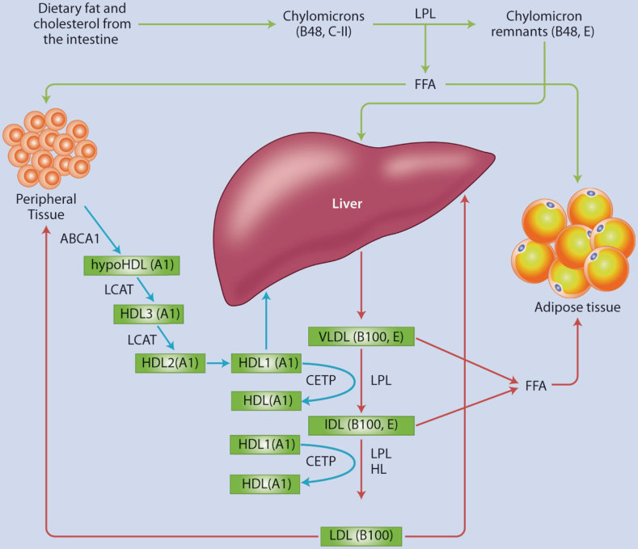
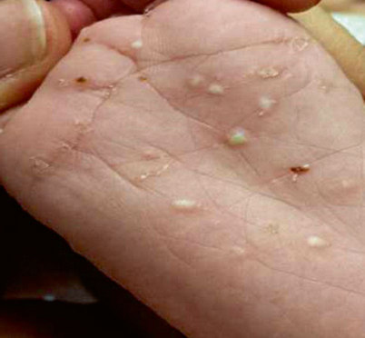
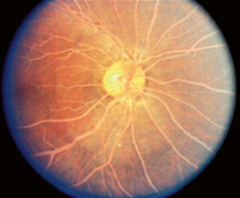

# 32. Disorders of Lipid Metabolism
> [Source credits](../../SOURCE_CREDITS.md).

## Study pillars

### Pediatric Lipid Screening Guidelines

The American Academy of Pediatrics (AAP) and the National Heart, Lung, and Blood Institute (NHLBI) recommend a two-tiered screening strategy for pediatric dyslipidemia: (1) Universal lipid screening for all children once between ages 9 and 11 years, and once between ages 17 and 21 years (using non-fasting non-HDL cholesterol or a fasting lipid profile); and (2) Targeted screening starting at age 2 years (fasting lipid profile) for children with a family history of premature cardiovascular disease (men <55 years, women <65 years) or parent with total cholesterol >=240 mg/dL, or children with high-risk personal conditions (type 1/2 diabetes, hypertension, BMI >=95th percentile, CKD, post-cardiac transplant, Kawasaki disease with aneurysms).

PDF p. 860

### Pediatric Lipid Thresholds and Classification

Pediatric cutoffs define: Low-Density Lipoprotein Cholesterol (LDL-C): Acceptable <110 mg/dL (<2.8 mmol/L), Borderline 110-129 mg/dL, Elevated >=130 mg/dL (>=3.4 mmol/L); High-Density Lipoprotein Cholesterol (HDL-C): Acceptable >45 mg/dL, Borderline 40-45 mg/dL, Low <40 mg/dL; Triglycerides (TG): in children 0-9 years, Acceptable <75 mg/dL, Elevated >=100 mg/dL; in youth 10-19 years, Acceptable <90 mg/dL, Elevated >=130 mg/dL. Primary dyslipidemias represent monogenic defects, whereas secondary dyslipidemias stem from obesity/insulin resistance (mild-moderate hypertriglyceridemia with low HDL), nephrotic syndrome, hypothyroidism, or medications.

PDF p. 862

### Familial Hypercholesterolemia (FH)

Heterozygous Familial Hypercholesterolemia (HeFH) occurs in ~1 in 250 individuals, caused by autosomal dominant mutations in LDLR (encoding LDL receptor; >85-90%), APOB, or gain-of-function PCSK9 mutations. HeFH is characterized by severe LDL-C elevation (typically 160-400 mg/dL in children), normal triglycerides, tendon xanthomas (pathognomonic nodular thickening of Achilles and extensor digitorum tendons), and premature CAD. Homozygous FH (HoFH; 1 in 300,000) features LDL-C >400-1000 mg/dL, cutaneous planar and tuberous xanthomas in infancy/toddlerhood, aortic root/valvular stenosis, and fatal myocardial infarction before age 20-30 years if untreated.

PDF p. 865

### Severe Hypertriglyceridemia and Chylomicronemia

Severe hypertriglyceridemia (TG >1000 mg/dL [11.3 mmol/L]) carries an acute risk of life-threatening acute necrotizing pancreatitis. Familial Chylomicronemia Syndrome (FCS) is an autosomal recessive disorder caused by biallelic loss-of-function mutations in LPL (lipoprotein lipase), APOC2, GPIHBP1, APOA5, or LMF1. In FCS, circulating chylomicrons cannot be cleared, producing lactescent 'milky' plasma, eruptive xanthomas (yellowish papules with erythematous bases on buttocks/extensors), lipemia retinalis (salmon-pink retinal vessels), hepatosplenomegaly, and recurrent pancreatitis. The cornerstone of FCS therapy is strict dietary fat restriction to <10-15% of total caloric intake (typically <15-20 g fat/day).

PDF p. 868

### Statin Pharmacotherapy Protocols

HMG-CoA reductase inhibitors (statins: pravastatin, atorvastatin, rosuvastatin, simvastatin) are the first-line pharmacotherapy for pediatric hypercholesterolemia, approved for youth >=10 years (or >=8-10 years in severe FH). Indications after a 6-month trial of Cardiovascular Health Integrated Lifestyle Diet (CHILD-2): (1) LDL-C persistently >=190 mg/dL; OR (2) LDL-C persistently >=160 mg/dL with a family history of premature CVD or >=2 moderate cardiovascular risk factors; OR (3) LDL-C >=130 mg/dL in children with high-risk conditions (diabetes, CKD, cardiac transplant). Treatment targets LDL-C <130 mg/dL (<100 mg/dL in high-risk). Ezetimibe (10 mg daily) and PCSK9 inhibitors (evolocumab) are adjunctive options.

PDF p. 874

## Full source extraction

# 32. Disorders of Lipid Metabolism
> Source attribution: [Source credits](../../SOURCE_CREDITS.md).

## PDF page 858 | printed page 859

### Disorders of Lipid Metabolism

Rushika Conroy, Stewart A. Mackie, and Charlotte M. Boney

### Contents

### 32.1 Introduction – 861

### 32.2 Normal Physiology – 862

### 32.3 General Cholesterol Screening – 863

### 32.4 Hypertriglyceridemia – 865

32.4.1 Introduction and Background – 865 32.4.2 Etiology – 866 32.4.3 Clinical Presentation – 867 32.4.4 Outcomes and Possible Complications – 868 32.4.5 Diagnosis – 868 32.4.6 Treatment – 869

### 32.5 Hypercholesterolemia – 871

32.5.1 Introduction and Background – 871 32.5.2 Etiology – 871 32.5.3 Clinical Presentation – 873 32.5.4 Diagnosis – 873 32.5.5 Outcomes and Possible Complications – 874 32.5.6 Treatment – 874

### 32.6 Hypobetalipoproteinemia – 878

32.6.1 Introduction and Background – 878 32.6.2 Etiology – 878 32.6.3 Clinical Presentation – 879 32.6.4 Diagnosis – 879 32.6.5 Outcomes and Possible Complications – 879 32.6.6 Treatment – 879

© The Author(s), under exclusive license to Springer Nature Switzerland AG 2024 S. Radovick, M. Misra (eds.), Pediatric Endocrinology, https://doi.org/10.1007/978-3-031-66296-6_32

## PDF page 859 | printed page 860

### 32.7 Disorders of HDL Metabolism – 880

32.7.1 Introduction and Background – 880 32.7.2 Etiology – 880 32.7.3 Clinical Presentation – 881 32.7.4 Diagnosis – 881 32.7.5 Outcomes and Possible Complications – 881 32.7.6 Treatment – 881

###  References – 884

## PDF page 860 | printed page 861

Key Points

5 Screening for abnormal lipids with a

nonfasting lipid panel should occur as part of universal screening at ages 9–11 and 17–21 years in order to identify children and adolescents with primary lipid disorders at risk for early CVD. 5 Lipemic serum should alert one to

severe hyperlipidemia, most commonly hypertriglyceridemia. 5 Secondary causes of hyperlipidemia,

such as obesity, are the most common etiology of hyperlipidemia, especially when the lipid abnormality is mild to moderate. 5 Frequently, more severe lipid abnormal

ities are from either a primary cause (i.e., polygenic or heterozygous FH) or a mix of a primary with a secondary condition such as obesity. 5 Homozygous primary causes of hyper

lipidemia are exceedingly rare. 5 Heterozygous FH should be suspected

if LDL is >190 mg/dl or >160 mg/dl with a family history of early CVD. 5 Lifestyle modification is the first line of

treatment for all abnormal lipid states, with the focus on dietary restriction of total and saturated fat as well as TC. 5 Reducing high glycemic index foods in

cases of hypertriglyceridemia and regu lar exercise to maintain normal insulin sensitivity and cardiovascular fitness are also recommended. 5 FH often requires pharmacologic man

agement, generally in the form of statin therapy for patients >10 years old in addition to lifestyle modification. 5 Medication, including fibrates or omega-3 fatty acids, is often needed in cases of hypertriglyceridemia to avoid pancreatitis.

### 32.1 Introduction

Cardiovascular disease (CVD) is typically thought of as an adult disorder; however, its predecessor, atherosclerosis, typically begins during childhood. An abnormal lipid profile is one contributing factor to atherosclerosis that may increase the risk of future premature cardiovascular events (CVE). Normal lipid physiology is based on lipid production and metabolism. Lipid metabolism occurs by three interconnected pathways: exogenous, endoge nous, and reverse cholesterol transport. Abnormalities in these processes result in lipid disorders, which can be acquired or genetic. Acquired lipid disorders are second ary to etiologies such as obesity, type 1 and 2 diabetes, metabolic syndrome, or chronic renal failure. Genetic mutations are inherited abnormalities that in some cases, such as het erozygous familial hypercholesterolemia (FH), have been shown to cause abnormal changes in lipid profiles, endothelial dysfunc tion, and carotid intima-media thickness as early as infancy.

In 2014, the National Heart, Lung, and Blood Institute (NHLBI) released new screen ing guidelines for nonfasting cholesterol levels in all children at 9–11 years of age and again at 17–21 years of age in order to identify genetic and acquired causes of lipid disorders. With an estimate of 21% of children and ado lescents in the United States having high TC, low HDL cholesterol, or high non-HDL cho lesterol [1], screening allows for the identifica tion of both mild abnormalities treated with lifestyle modification as well as more severe hyperlipidemia requiring both dietary and pharmacologic management. This chapter reviews the diagnosis, presentation, and man agement of disorders of HDL, LDL, and tri glyceride metabolism.

## PDF page 861 | printed page 862

### 32.2 Normal Physiology

32.1

### 32

32.1

Unmatched source image; PDF page 861. Consult the original caption.

## PDF page 862 | printed page 863

by lipoprotein lipase (LPL) with its cofactor ApoC-II, resulting in the release of free fatty acids. The free fatty acids are taken up by tis sues, including adipose tissue. The resulting CM remnant has acquired ApoE, which binds both remnant receptors and LDL receptors to deliver TG and cholesterol to the liver. LPL activity and clearance of remnants by ApoEbound liver receptors are the major regulators of postprandial TG levels.

Endogenous cholesterol is produced in a number of tissues including the gonads, adre nals, brain, and intestine, with about 20% of cholesterol production occurring in the liver. Cholesterol synthesis begins with three mole cules of acetate that form 3-hydroxy-3methylglutaryl-coenzyme A (HMG-CoA), and then, via HMG-CoA reductase, meva lonic acid is synthesized. The formation of mevalonic acid is the rate-limiting step in the cholesterol synthesis. Through a series of steps involving conversion of mevalonic acid to farnesyl pyrophosphate and lanosterol, cholesterol is formed. Cholesterol can be used to synthesize bile acids and is secreted into the intestine or excreted as free cholesterol in the bile. About half of the cholesterol that enters the intestine is reabsorbed and recirculated to the liver, while the other half is excreted in feces.

32.1

2

3

32.1

### 32.3 General Cholesterol Screening

4 5

## PDF page 863 | printed page 864

≥145 mg/dl, a repeat fasting lipid profile should be drawn [4, 5]. Guidelines for plasma lipid profile interpretation for children and adolescents are outlined in Table 32.1. A summary of the major lipid disorders is found in Table 32.2.

to identify and treat children and adolescents with severe hyperlipidemia, such as FH, who have not been identified through family his tory. Nonfasting cholesterol levels are satis factory for screening, but if TC (TC) ≥200 mg/ dl OR non-HDL-cholesterol (TC-HDL)

Table 32.1 Guidelines for plasma lipid profile interpretation for children and adolescents

Normal/acceptable (mg/dl)

Nonfasting lipids

Total cholesterol <170

Non-HDL cholesterol <145

HDL >40

Fasting lipids

Total cholesterol <170

LDL <110

HDL >45

### 32

Apolipoprotein B (ApoB) <90

Apolipoprotein A1 (ApoA1) >120

Modified from NHLBI

Table 32.2 Summary of common lipid disorders in children and adolescents (Modified from NHLBI guidelines for hyperlipidemia treatment)

Primary lipid disorder Lipid/lipoprotein abnormality

Type IIa—↑ LDL

Familial combined hyperlipidemia

Type IIb—↓HDL, ↑LDL,VLDL, TG

Type IV—↑VLDL, ↑TG, ↓ HDL

↑ LDL

Polygenic hypercholes terolemia

↑ LDL

Heterozygous familial hypercholesterolemia

Borderline (mg/dl) Abnormal (mg/dl)

170–199 ≥200

≥145

≤40

170–199 ≥200

110–129 ≥130

40–45 <40

90–109 ≥110

115–120 <115

Comments

Family members may have different types of FCHL

Family Hx frequently positive for CVEa

Associated with T2DM and metabolic syndrome in adults

Most common type of hypercholesterolemia Result of multiple different mutations Low risk of CVEa

Dietary/lifestyle modification often successful

Autosomal dominant LDL >190 mg/dl confers an ~80% risk for FH Frequently requires pharmacologic treatment despite dietary modification Moderate risk of CVEa

(continued)

### Automatic table extraction — verify rendered original

|Nonfasting lipids|Col2|Col3|Col4|
|---|---|---|---|
|Total cholesterol|<170|170–199|≥200|
|Non-HDL cholesterol|<145||≥145|
|HDL|>40||≤40|

[Original table](../../tables/ch032_p0863_2.jpg)

### Automatic table extraction — verify rendered original

|Fasting lipids|Col2|Col3|Col4|
|---|---|---|---|
|Total cholesterol|<170|170–199|≥200|
|LDL|<110|110–129|≥130|
|HDL|>45|40–45|<40|
|Apolipoprotein B (ApoB)|<90|90–109|≥110|
|Apolipoprotein A1 (ApoA1)|>120|115–120|<115|

[Original table](../../tables/ch032_p0863_3.jpg)

### Automatic table extraction — verify rendered original

|Primary lipid disorder|Lipid/lipoprotein abnormality|Comments|
|---|---|---|
|Familial combined hyperlipidemia|Type IIa—↑ LDL|Family members may have different types of FCHL|
|Familial combined hyperlipidemia|Type IIb—↓HDL, ↑LDL,VLDL, TG|Family Hx frequently positive for CVEa|
|Familial combined hyperlipidemia|Type IV—↑VLDL,↑TG, ↓ HDL|Associated with T2DM and metabolic syndrome in adults|
|Polygenic hypercholes­ terolemia|↑ LDL|Most common type of hypercholesterolemia Result of multiple different mutations Low risk of CVEa Dietary/lifestyle modifcation often successful|
|Heterozygous familial hypercholesterolemia|↑ LDL|Autosomal dominant LDL >190mg/dl confers an ~80% risk for FH Frequently requires pharmacologic treatment despite dietary modifcation Moderate risk of CVEa|

[Original table](../../tables/ch032_p0863_4.jpg)

## PDF page 864 | printed page 865

Table 32.1 (continued)

Primary lipid disorder Lipid/lipoprotein abnormality

↑↑ LDL

Homozygous familial hypercholesterolemia

↑ LDL

Familial defective apolipoprotein B-100

↑ VLDL, ↑ TG

Familial hypertriglyc eridemia

↓LDL, ↓TC

Familial hypobetalipo proteinemia

↓ HDL

Familial hypoalphali poproteinemia

Dyslipidemia ↓ HDL, ↑ LDL, ↑ TG

aCVE cardiovascular event

### 32.4 Hypertriglyceridemia

mary and secondary forms. Primary forms of hypertriglyceridemia are hereditary, while sec ondary forms result from diseases that can lead to elevated TG, such as obesity, type 1 and type 2 diabetes, hypothyroidism, meta bolic syndrome, renal disease, nonalcoholic fatty liver disease, and chronic alcohol use [6, 7]. Medications that alter lipid metabolism and lead to elevated TG would be considered a secondary cause as well. These include anti retroviral therapy, selective estrogen receptor modulators, beta blockers, some chemothera peutic agents, isotretinoin, oral contracep tives, some antipsychotics, and systemic glucocorticoids [3, 6, 8].

### 32.4.1 Introduction

### and Background

Hypertriglyceridemia is defined as fasting plasma TG ≥ 95th percentile for age and gen der [6]. Based on NHLBI screening guidelines, this corresponds to fasting TG ≥ 100 mg/dl in children between the ages of 0 and 9 years and fasting TG ≥ 130 mg/dl in children between the ages of 10 and 19 years [4]. Hypertriglyceridemia can be divided into pri

Comments

Variable expression based on gene mutations Xanthomas, xanthelasmas, and corneal arcus Despite lifestyle modification and pharmacologic treatment, difficult to control

Autosomal dominant Features similar to FH May require pharmacologic treatment despite lifestyle modifications Moderate risk of CVEa

Most commonly due to Apo B100 deficiency Autosomal dominant Risk of pancreatitis with TG levels >1000 mg/dl Low risk of CVEa

Pharmacologic intervention if TG > 1000 mg/dl despite lifestyle modifications

Rare Autosomal codominant Reduced risk of CVEa; however liver and neurologic dysfunction can be present Treat with fat-soluble vitamins if with neurologic findings and low-fat diet if with liver dysfunction

HDL typically <30 mg/dl Mildly increased risk of CVEa

Treat with lLifestyle modifications ± statin therapy

Lifestyles often successful for treatment

### Automatic table extraction — verify rendered original

|Primary lipid disorder|Lipid/lipoprotein abnormality|Comments|
|---|---|---|
|Homozygous familial hypercholesterolemia|↑↑ LDL|Variable expression based on gene mutations Xanthomas, xanthelasmas, and corneal arcus Despite lifestyle modifcation and pharmacologic treatment, diffcult to control|
|Familial defective apolipoprotein B-100|↑ LDL|Autosomal dominant Features similar to FH May require pharmacologic treatment despite lifestyle modifcations Moderate risk of CVEa|
|Familial hypertriglyc­ eridemia|↑ VLDL,↑ TG|Most commonly due to Apo B100 defciency Autosomal dominant Risk of pancreatitis with TG levels >1000mg/dl Low risk of CVEa Pharmacologic intervention if TG>1000mg/dl despite lifestyle modifcations|
|Familial hypobetalipo­ proteinemia|↓LDL,↓TC|Rare Autosomal codominant Reduced risk of CVEa; however liver and neurologic dysfunction can be present Treat with fat-soluble vitamins if with neurologic fndings and low-fat diet if with liver dysfunction|
|Familial hypoalphali­ poproteinemia|↓ HDL|HDL typically <30mg/dl Mildly increased risk of CVEa Treat with lLifestyle modifcations±statin therapy|
|Dyslipidemia|↓ HDL,↑ LDL,↑ TG|Lifestyles often successful for treatment|

[Original table](../../tables/ch032_p0864_1.jpg)

## PDF page 865 | printed page 866

There are multiple classifications of hyper triglyceridemia based on etiology and risk of pancreatitis [3, 8]. The Endocrine Society clas sifies hypertriglyceridemia into mild (150–199 mg/dl), moderate (200–999 mg/dl), severe (1000–1999 mg/dl), and very severe (≥2000 mg/dl) forms. The American Academy of Pediatrics suggests criteria based on age, with hypertriglyceridemia defined as TG levels >100 mg/dl in children under 10 years of age and >130 mg/dl in children 10–18 years of age.

### 32.4.2 Etiology

32.3

### 32.4.2.1 Primary Causes

The most severe cause of primary hypertri glyceridemia is familial chylomicronemia (also known as hyperlipoproteinemia type 1 by the Frederickson classification), which is a deficiency of LPL, the enzyme that catalyzes the hydrolysis of TG. The disease is inherited in an autosomal recessive pattern with 100% penetrance. The gene for LPL is located on chromosome 8p22, and to date, over 163 mutations have been identified, 90% of which are loss of function mutations. The disease is rare, with an occurrence of one in

### 32

Table 32.3 Causes of hypertriglyceridemia

Primary Secondary

LPL deficiency Obesity

Apo C-II deficiency Type 1 diabetes

Apo A-V deficiency Type 2 diabetes

GPIHBP1 deficiency Uncontrolled hypothyroidism

Apo E deficiency Lipodystrophy

Lipase maturation factor 1 deficiency

Nonalcoholic fatty liver disease

500,000–1,000,000 for homozygous LPL defi ciency, which is associated with severe hyper triglyceridemia (typically TG > 5000 mg/dl). Heterozygous forms have wide variability in TG levels and are more prevalent, likely occur ring in one of every 500 individuals [9].

LPL binds glycosylphosphatidylinositolanchored high-density lipoprotein-binding protein 1 (GPIHBP1), which serves as a plat form for lipolysis. The gene for GPIHBP1 is located on chromosome 8q24.3, and defi ciency is inherited in an autosomal recessive pattern. Homozygous mutations in GPIHBP1 lead to TG levels similar to those found in LPL deficiency (>1000 mg/dl), while heterozy gous mutations have not been shown to cause abnormalities in TG levels [10].

Apolipoprotein C-II is a component of CM, VLDL, LDL, and HDL and is required for the activation of LPL. A deficiency in ApoC-II leads to hypertriglyceridemia due to elevated CM and VLDL, as well as decreased LDL and HDL [11]. The gene for ApoC-II is located on chromosome 19q13.32. Deficiency is inherited in an autosomal recessive pattern; heterozygotes have normal TG levels despite low levels of ApoC-II. Interestingly, elevated concentrations of ApoC-II also hinder LPL activity and result in hypertriglyceridemia [11].

ApoA-V, via interaction with GPIHBP1 and LPL, stimulates the LPL activity [12]. A deficiency in ApoA-V caused by genetic mutations in the Apo A5 gene located on chromosome 11q23 leads to hypertriglyceri demia.

Type III hyperlipoproteinemia or dysbet alipoproteinemia, also known as CM remnant disease, is an autosomal recessive disorder characterized by a mutation in the Apo E gene, located on chromosome 19q13.32, lead ing to impaired uptake of Apo E-containing lipoproteins (CM remnant, VLDL/IDL rem nants) by the liver. ApoE is expressed in three isoforms (ApoE2, ApoE3, and ApoE4), which have variable binding affinity to the remnant receptor and the LDL receptor. Some of these isoforms, in the presence of another genetic defect or cause of altered lipid metabolism, lead to reduced clearance of remnants [3] and hypertriglyceridemia, hypercholesterolemia,

### Automatic table extraction — verify rendered original

|Primary|Secondary|
|---|---|
|LPL defciency|Obesity|
|Apo C-II defciency|Type 1 diabetes|
|Apo A-V defciency|Type 2 diabetes|
|GPIHBP1 defciency|Uncontrolled hypothyroidism|
|Apo E defciency|Lipodystrophy|
|Lipase maturation factor 1 defciency|Nonalcoholic fatty liver disease|

[Original table](../../tables/ch032_p0865_1.jpg)

## PDF page 866 | printed page 867

and low HDL. These patients are at high risk for pancreatitis and possible early CVD.

Mutations in lipase maturation factor 1 (LMF1), which is required for transport and activation of LPL, cause hypertriglyceridemia [3]. The gene encoding LMF1 is on chromo some 16p13.3, and deficiencies are inherited in an autosomal recessive pattern.

A more common etiology of hypertriglyc eridemia is familial hypertriglyceridemia, with a prevalence of 5–10%. It has an autosomal dominant pattern and is thought to be poly genic in origin, with some cases displaying heterozygous mutations in LPL or overpro duction of VLDL [6]. TG tend to be moder ately elevated, and a positive family history of hypertriglyceridemia and/or pancreatitis tends to be present.

### 32.4.2.2 Secondary

### Hypertriglyceridemia

The most common secondary cause of mildmoderate (200–500 mg/dl) hypertriglyceride mia is obesity-associated insulin resistance. The prevalence of obesity in the pediatric population has increased parallel to the increase in obesity rates in adults. The most recent data from the CDC (2017) indicate that the prevalence of obesity is 19.7% in children aged 2–19 years. The COVID 19 pandemic led to dramatic changes in lifestyle habits for most people, with decreased physical activity and increased consumption of nutrient poor, calo rie dense foods. This led to a spike in child hood obesity rates and its related comorbidities.

Higher consumption of simple sugars and starches along with foods high in saturated fat raise TG levels. The consumption of excessive amounts of sucrose and fructose has been linked to elevated triglycerides as fructose metabolism bypasses a key rate-determining step in glycolysis and produces glycerol-3phosphate, which is the backbone of triacylg lycerol [13]. Insulin is a powerful regulator of LPL activity. Therefore, in insulin resistance associated with obesity, decreased stimulation of LPL can lead to elevated TG.

In cases of insulin deficiency, as in uncon trolled type 1 diabetes or a combination of insulin deficiency and resistance, as in type 2

diabetes, an increase in TG can be seen as well [3]. Thyroid hormone has been shown to increase LPL activity via upregulation of ApoA-V activity [14]; thus, hypothyroidism is associated with elevated TG.

Hypertriglyceridemia is the most common dyslipidemia in patients with chronic kidney disease, thought to be secondary to defective clearance of TG from the circulation in addi tion to a decrease in LPL activity, although the reason for the latter is not understood.

Nonalcoholic fatty liver disease is heralded by the accumulation of TG in hepatocytes. This is associated with obesity-related insulin resistance, and the mechanism is similar to that observed in states of type 2 diabetes, met abolic syndrome, and obesity [15]. Alcohol consumption has been found to decrease LPL activity and induce TG accumulation through increased fatty acid synthesis and decreased oxidation in the liver, resulting in alcoholic fatty liver disease [16].

Lipodystrophy syndromes are common causes of hypertriglyceridemia, with over 70% of people with congenital lipodystrophy exhibiting elevated TG [3]. Lipodystrophy syndromes are a wide spectrum of congenital and acquired disorders that are characterized by a complete or partial lack of adipose tis sue. The most common form of lipodystrophy is seen in HIV patients and is caused by anti retroviral therapy. The mechanism of hyper triglyceridemia is thought to be a decrease in adipose tissue, leading to increased VLDL synthesis and decreased clearance.

### 32.4.3 Clinical Presentation

Symptoms and signs of LPL deficiency tend to occur in infancy or early childhood, while those of ApoC-II deficiency tend to occur in adolescence or adulthood [17]. Other genetic causes of hypertriglyceridemia, such as famil ial hypertriglyceridemia, manifest themselves in youth, while secondary causes can arise at any age, depending on the underlying disease.

## PDF page 867 | printed page 868

diameter that appear diffusely on extensor surfaces of the limbs, buttocks, and shoulders ( Fig. 32.2). These are generally present when triglyceride levels are >2000 mg/dl. Xanthomas occur secondary to phagocytosis of CM by macrophages. They are generally single lesions and are not painful [17]. Lipemia retinalis is the milky appearance of retinal vessels observed generally at TG > 3000 mg/dl ( Fig. 32.3) [8, 9]. This is reversible and

### 32

http://cnx.org/contents/11786e68-a0c1-4675-a4fa- 3437db52ae69@3

tends not to impact vision. Hepatomegaly and splenomegaly can occur due to infiltra tion of macrophage foam cells. Infants may present with poor feeding and GI bleeding, in addition to eruptive xanthomas.

### 32.4.4 Outcomes and Possible

### Complications

The most serious clinical consequence of severe hypertriglyceridemia is pancreatitis, the risk of which increases with TG > 1000 mg/dl. Of note, marked increases in TG can impair accurate measurement of amylase, hemoglo bin, and electrolyte levels, so one must not rule out pancreatitis in the setting of abdomi nal pain and high TG when lipase and amy lase levels are low [9]. The reason for the development of pancreatitis is still unclear but is thought to be in part due to TG hydrolysis within the pancreas, leading to toxic accumu lation of free fatty acids, as well as CMinduced ischemia [3].

CVD is also a concerning outcome of hypertriglyceridemia [18]. Excess TG block the endothelium-dependent relaxation factor through inhibition of nitric oxide and larginine synthesis and promote endothelin 1 secretion, a vasoconstrictor [19].

### 32.4.5 Diagnosis

The presence of lipemic plasma should prompt one to order fasting lipids, including a TG and ApoB level. When presented with a case of hypertriglyceridemia, confirmation with a fasting level is imperative. A careful his tory of medical problems, medication use, and family history are important to diagnose both primary and secondary causes of hypertri glyceridemia. Thyroid function tests, fasting glucose, hemoglobin A1C, and liver function tests are useful to rule out common secondary causes.

Diagnosis of genetic causes of hypertri glyceridemia can be made via analysis for LPL and/or GHIBP1 mutations as well as mutations in ApoE and ApoC-II. Lab results suggesting LPL deficiency include

Unmatched source image; PDF page 867. Consult the original caption.

Unmatched source image; PDF page 867. Consult the original caption.

## PDF page 868 | printed page 869

TG > 1000 mg/dl, elevated VLDL with TC that is 1/10th of the triglyceride levels, and a low HDL. While LDL levels tend to be within normal limits or even low, they cannot be cal culated using the Friedewald equation if TG ≥ 400 mg/dl, as the assumptions about VLDL are no longer valid. Direct measure ment by ultracentrifugation or LDL immuno precipitation can be performed. Assays that measure LPL activity, through treatment of plasma with heparin, can also assist in the diagnosis of LPL deficiency, but [17] these assays are no longer commonly performed. The level of ApoB-100 can help distinguish the hypertriglyceridemia-only variant of familial combined hyperlipidemia (elevated ApoB-100) and some cases of familial hyper triglyceridemia from LPL deficiency (normal ApoB-100). Labs suggestive of ApoC-II defi ciency include markedly elevated TG in addi tion to low levels of LDL and HDL. Dysbetalipoproteinemia typically has elevated levels of TG and often LDL due to impaired remnant binding and interference with LDL binding to its receptor. Familial hypertriglyc eridemia tends to exhibit moderate elevations in TG with elevated VLDL.

### 32.4.6 Treatment

18

32.4

20

7

3

Table 32.4 Recommendations for treatment and referral for abnormal triglycerides

### TG

Management

≥500 mg/dl Restrict fat to <15% of total energy intake, increase fiber, decrease foods with high glycemic index Repeat TG in 3–6 months Omega-3 fatty acids Consider fibrate therapy if TG > 1000 mg/dl Referral to a lipid specialist

≥200–499 mg/dl Restrict fat to <15% of total energy intake, increase fiber, decrease foods with high glycemic index Repeat TG in 3–6 months Consider omega-3 fatty acids or fibrate therapy Consider referral to a lipid specialist

≥100–199 mg/dl Restrict fat to <15% of total energy intake, increase fiber, decrease foods with high glycemic index Repeat TG in 3–6 months

8 20

Restriction of long-chain fatty acids from the diet (e.g., breast milk and regular formu las) and substituting medium-chain triglycer ide formula for infants with primary hypertriglyceridemia such as LPL deficiency is very effective, as medium-chain fats enter the circulation without being incorporated into CM [9]. This has been used successfully in cases of both LPL [21] and GPIHBP1 defi ciencies [22].

Pharmacologic therapy is added when TG cannot be reduced as much as necessary through dietary restriction to keep pancreati tis risk low (levels <1000 mg/dl). Fibrates such as fenofibrate or gemfibrozil work via stimula tion of PPARα in the liver, which leads to a reduction in VLDL secretion. In addition, through stimulation of LPL gene expression and inhibition of Apo C-III gene expression, fibrates increase TG lipolysis [8]. Fibrates

### Automatic table extraction — verify rendered original

|TG|Management|
|---|---|
|≥500mg/dl|Restrict fat to <15% of total energy intake, increase fber, decrease foods with high glycemic index Repeat TG in 3–6months Omega-3 fatty acids Consider fbrate therapy if TG>1000mg/dl Referral to a lipid specialist|
|≥200–499mg/dl|Restrict fat to <15% of total energy intake, increase fber, decrease foods with high glycemic index Repeat TG in 3–6months Consider omega-3 fatty acids or fbrate therapy Consider referral to a lipid specialist|
|≥100–199mg/dl|Restrict fat to <15% of total energy intake, increase fber, decrease foods with high glycemic index Repeat TG in 3–6months|

[Original table](../../tables/ch032_p0868_1.jpg)

## PDF page 869 | printed page 870

have been shown to reduce TG levels by 30–50% in adults [6]. They are generally well tolerated without major side effects; however, minor side effects such as GI discomfort have been reported. In rare cases, severe side effects such as liver dysfunction and myopathy may occur [7]. There are limited studies on the use of fibrates in children [20].

High doses of statins such as atorvastatin or rosuvastatin as a second-line therapy have been shown to improve TG in adults when lev els are <500 mg/dl [6, 8]. The VOYAGER study assessed the impact of statins on TG levels in adults and found that rosuvastatin led to a greater reduction in TG than simvas tatin and low-dose atorvastatin [23]. At higher but equal doses, the reduction was similar between rosuvastatin and atorvastatin but still greater than with simvastatin. Reductions amounted to 15–31%. Statins have not been found to be effective for primary hypertriglyc eridemia secondary to LPL deficiency and are, therefore, not recommended [17].

### 32

Niacin has been shown to reduce plasma TG levels in adults by 30–45% via inhibition of hepatic TG synthesis. Doses to achieve this result approach 3 g daily and are associated with adverse effects such as flushing, gastroin testinal discomfort, pruritus, or lightheaded ness [6, 8], so they are not used in children.

Orlistat has been used in some pediatric cases of hypertriglyceridemia in conjunction with a low-fat diet with some success [22, 24]. Orlistat is a pancreatic lipase inhibitor that reduces intestinal dietary fat absorption. Side effects of the medication include steatorrhea, fecal incontinence, flatulence, and abdominal pain. While side effects are not severe, they can interfere with patient compliance.

Omega-3 fatty acids have been shown to reduce TG by up to 45% at doses of up to 4 g daily in adult studies by inhibiting hepatic TG and VLDL synthesis [20]. Studies in children and adolescents with hypertriglyceridemia found that doses of 500–1000 mg of omega-3 fatty acids led to a clinically but not statisti cally significant decrease in TG levels when combined with dietary modification [18, 25, 26], suggesting that higher doses of omega-3 fatty acids may be needed in children. The mechanism by which omega-3 fatty acids

leads to an improvement in TG levels is still unclear but may involve impairment of its synthesis through enzyme inhibition and/or a decrease in substrate availability by increasing fatty acid oxidation in the liver [20, 27, 28]. Side effects of omega-3 fatty acids include diarrhea, nausea, eructation, and abdominal pain. Omega-3 fatty acids are ineffective in the treatment of LPL deficiency and are not rec ommended, although cases have been reported of successful treatment, one of which was in an 8-year-old female [29]. Caution should be used when treating patients with hypercholes terolemia and hypertriglyceridemia, as omega-3 fatty acids have been shown to increase LDL levels [20, 28]. If omega 3 fatty acids are offered, prescription products should be used instead of over-the-counter ones, as the latter are not as rigorously regulated and the amount of omega 3 fatty acids in the product will not be consistent [30]. In cases of hypertriglyceridemia-induced pancreatitis, fasting in addition to insulin and dextrose via continuous IV infusion can reduce TG within 48 h. During episodes of hypertriglyceridemiainduced pancreatitis and in those with homo zygous forms of LPL deficiency only, plasmapheresis has been used with success, although TG levels quickly rise without more long-term therapy [28]. A study assessing plasmapheresis versus medical apheresis with insulin in children with LPL deficiencyinduced pancreatitis found no difference in resolution of hypertriglyceridemia, but noted lower rate of adverse effects and decreased cost in the medical apheresis group [31].

LPL gene therapy has been studied in phase I and II clinical trials, where it led to increased LPL activity and decreased TG lev els with no treatment-related adverse events [32]. This treatment is currently being studied in those with homozygous LPL deficiency.

Volanesorsen is an antisense APO C1 mRNA inhibitor, which leads to increased TG clearance and a reduced TG through LDLindependent pathways [33]. Studies showed up to a 80% reduction in TG levels. Unfortunately, due to concerns of thrombo cytopenia, the FDA has denied approval of the medication in the USA. However, it is conditionally approved in Europe [34]. ApoC-

## PDF page 870 | printed page 871

III inhibition by an antisense inhibitor ISI304801 was shown to reduce TG levels in patients with mild to severe hypertriglyceride mia by up to 80% in phase 2 trials [35]. The medication is currently undergoing phase 3 studies in adults.

An angiopoietin 3 synthesis inhibitor led to a 36–56% reduction in TG levels in phase 2 adult studies. Evinacumab is an Angiopoietin L3 blocking monoclonal antibody that reduces LDL and TG levels. It has been approved to treat homozygous FH in children over 12 years old but has not been approved to treat hypertriglyceridemia in youth or adults. Lomitapide is an inhibitor of micro somal transfer protein, which is required for assembly and secretion of CM and VLDL. It is being studied in youth with homozygous FH and has been shown to reduce TG levels in these patients.

If secondary causes of hypertriglyceride mia are present, treatment of the underlying cause generally improves TG levels. Good dia betes management with proper insulin admin istration can improve TG in patients with type 1 diabetes, while weight loss and medical man agement to improve insulin sensitivity are effective in type 2 diabetes. Replacement with levothyroxine restores normal metabolism and reverses hyperlipidemia in cases of hypo thyroidism.

### 32.5 Hypercholesterolemia

### 32.5.1 Introduction

### and Background

Hypercholesterolemia is a heterogeneous group of lipid disorders that are characterized by abnormalities in LDL and, in some cases, HDL and TG. Polygenic hypercholesterol emia is the most common etiology of geneti cally inherited hyperlipidemia; however, actual estimates of prevalence are difficult to ascertain given the wide range of mutations and severity of lipid abnormalities that are included in the diagnosis. Heterozygous FH is

one of the most common types of genetic dys lipidemias with gene frequency estimated at 1 in 250 in the general population [36]. Heterozygous FH is inherited in an autoso mal dominant pattern. Certain populations, including Afrikaners, French Canadians, Lebanese, and Finns, have been shown to have an increased risk for FH [37]. In contrast to heterozygous FH, homozygous FH is extremely rare, with estimates of 1:1,000,000 in the general population [38]. It is inherited in an autosomal codominant pattern. Familial combined hyperlipidemia (FCHL) is a hetero geneous group of lipid abnormalities that has been linked to multiple loci including 1q21–23, a gene which encodes for a transcription fac tor critical in lipid and glucose metabolism, USF1 [39, 40]. While sometimes difficult to distinguish FCHL from metabolic syndrome, epidemiological data estimate a prevalence of 0.5–2% in the adult population with a higher prevalence in families with a history of pre mature CVD [39]. Familial defective ApoB- 100, an autosomal dominant condition, is due to a missense mutation in the LDL receptorbinding domain of ApoB-100. This results in elevated serum LDL due to reduced hepatic LDL removal and catabolism [41]. The preva lence of familial defective ApoB-100 is esti mated at one in 500 individuals [41].

### 32.5.2 Etiology

32.5

### 32.5.2.1 Primary

### Hypercholesterolemia

FH is a primary dyslipidemia caused by genetic anomalies that affect the LDL recep tor (LDL-R) pathway. It is typically charac terized by mutations in the LDL-R gene (LDLR), that are estimated to account for >80% of heterozygous FH. Over 1500 muta tions in LDLR have been described [42]. LDL-R are responsible for binding LDL through ApoB-100, leading to endocytosis of the LDL particle. Mutations in LDLR can

## PDF page 871 | printed page 872

Table 32.5 Causes of elevated LDL

Primary Secondary

Heterozygous familial hypercho lesterolemia

Medications

Cyclosporines

Retinoids

Select antiretroviral

agents (i.e., protease inhibitors)

Homozygous familial hypercho lesterolemia

Chronic kidney disease

Familial combined hyperlipidemia

Hypothyroidism

Polygenic hyperlip idemia

Nephrotic syndrome

Familial defective apolipoprotein B

decrease the production of LDL-R, affect the expression of LDL-R on cell surfaces or the ability of the receptor to bind LDL, and acti vate endocytosis. PCSK9, the gene encoded on chromosome 1, aids in the degradation of the LDL-R [41]. A gain of function mutation in PCSK9 reduces LDL-R recycling to the cell membrane, causing an increase in LDL levels, which phenotypically is similar to mutations in LDLR. Mutations in ApoB-100 gene (APOB), as seen in familial defective ApoB- 100, impair the binding of LDL to the LDL- R, resulting in elevation of serum LDL levels.

### 32

In homozygous FH, the severity of the lipid abnormality is related to the genetic mutation involved. Most commonly, muta tions of two different alleles for the gene cod ing the LDL-R are involved; however, occasionally familial homozygotes can have two mutations of the same allele (a true homozygote). The type of mutation dictates the degree of LDL elevation; typically in homozygous FH, the LDL elevation is >300 mg/dl (often 450–850 mg/dl) and HDL is low.

The proposed mechanism of polygenic hypercholesterolemia is that multiple minor mutations or polymorphisms in the genes encoding LDL-R, ApoB, and/or PCSK9

cumulatively result in abnormalities of lipid metabolism [43]. Typically, the mutations result in mild to moderate cholesterol abnor malities (LDL 130–160 mg/dl) without frank early CVD compared to more moderate to severe LDL elevations (180–300 mg/dl) in het erozygous FH.

FCHL is thought to be due to a number of gene mutations (oligogenic) that result in a variety of abnormalities in TG, LDL, and HDL levels, sometimes within the same fam ily [44]. Type IIa is characterized by isolated LDL elevation, whereas elevated VLDL and TG with low HDL is described in type IV. Type IIB is characterized by an elevated TG, VLDL, and LDL with low HDL. Unlike FH, FCHL may not be associated with an elevation in LDL until adulthood, so it can be missed during pediatric screening. FCHL has been shown to be associated with increased levels of ApoB as a result of overproduction of VLDL. Therefore, measuring ApoB levels may be a better screening test in pediatric patients with a family history of early CVD and moderate hypertriglyceridemia with or without elevated LDL.

Perhaps, the least well-understood risk factor for CVD is lipoprotein (a) (Lp(a)). Lp(a) is an atherogenic and heterogeneous lipoprotein that is linked to CVD and stroke. Lp(a) excess is inherited as an autosomal codominant trait and is expressed in children. Lp(a) particles are modified, newly synthe sized LDL with an extra lipoprotein named ApoA covalently linked to ApoB-100. ApoA has significant homology to plasminogen, so this likely explains the thrombosis risk associ ated with elevated Lp(a) levels. Lp(a) has been shown to be expressed in children who are greater than 13 months old at levels equiva lent to those found in their parents [45]. Furthermore, pediatric studies have shown that elevation in Lp(a) in pediatric patients correlates with increased rates of CVE in their parents [46]. Furthermore, a study in children revealed elevated LP(a) levels was associated with increased thromboembolism risk [47, 48]. While routine screening of Lp(a) is not recommended at this time by current consen sus guidelines, Lp(a) levels may add addi

### Automatic table extraction — verify rendered original

|Primary|Secondary|
|---|---|
|Heterozygous familial hypercho­ lesterolemia|Medications  Cyclosporines  Retinoids  Select antiretroviral agents (i.e., protease inhibitors)|
|Homozygous familial hypercho­ lesterolemia|Chronic kidney disease|
|Familial combined hyperlipidemia|Hypothyroidism|
|Polygenic hyperlip­ idemia|Nephrotic syndrome|
|Familial defective apolipoprotein B||

[Original table](../../tables/ch032_p0871_1.jpg)

## PDF page 872 | printed page 873

tional information in assessing risk for patients for future CVE with levels generally over 30 mg/dl being associated with increased risk for CVE.

### 32.5.2.2 Secondary

### Hypercholesterolemia

Secondary hypercholesterolemia needs to be ruled out, so that potential causes can be appropriately treated. Multiple etiologies exist, including medication side effects, renal disease, endocrine and metabolic issues, inflammatory processes, or hepatic dysfunc tion. Medications such as cyclosporines have been shown to increase LDL and lipoproteins; retinoids have been shown to increase the LDL to HDL ratio; and short-term use of thiazide diuretics has been shown to increase LDL and TG, although these findings have not been substantiated by long-term studies. Antiretroviral regimens, especially protease inhibitors, have also been associated with abnormalities in lipid and glucose metabo lism, often as part of a lipodystrophy syn drome. Renal diseases can result in lipid abnormalities, with nephrotic syndrome typi cally being the most profound. It is postulated that elevations in TC and, more specifically, LDL, occur as a compensatory response to low oncotic pressure in patients with nephrotic syndrome [41]. Chronic kidney disease can also result in elevated TC and LDL; however, this is less common than in nephrotic syn drome. Untreated or inadequately treated hypothyroidism can result in elevations in LDL and/or TG; therefore, thyroid function tests should routinely be performed in patients with clinically significant hyperlipidemia.

### 32.5.3 Clinical Presentation

The effects of the genetic mutations in hetero zygous FH are completely expressed in infancy, as demonstrated by Kwiterovich et al. who showed elevated LDL levels in cord blood samples of infants that remained elevated on follow-up assessment unless dietary modifica tion occurred [49]. Subclinical early athero sclerotic lesions have been demonstrated in

children by the age of 5 years. Endothelial function is impaired, as has been shown by decreased dilatation of the brachial artery in children with hyperlipidemia after intense postischemic flow of arterial blood [50]. In addition, children with hyperlipidemia due to FH may have increased carotid intima-media thickness [37]. Physical exam is typically nor mal in children except in homozygous FH, in which physical exam may reveal xanthomas, which are cholesterol deposits found in ten dons—most commonly in the Achilles tendon or finger extensor tendons. Xanthelasmas, cholesterol deposits found around the eyes, and corneal arcus, a white ring around the cornea due to lipid deposition, are classic find ings in severe heterozygous FH and homozy gous FH associated with LDL levels >300 mg/ dl. Homozygous FH is also often associated with supravalvar aortic stenosis with estimates of 41% of patients being affected [49].

### 32.5.4 Diagnosis

Given that most children are clinically asymp tomatic and most types of FH are inherited, family history is an essential component in screening, but relying on family history has failed to identify many children with FH. Screening questions should ascertain whether there is a family history of premature CVD (including myocardial infarction, percutane ous catheter interventional procedure, coro nary artery bypass grafting, or stroke in men <55 years old or women <65 years old) in par ents, siblings, uncles, aunts, and grandparents; elevated cholesterol in mother, father, and/or siblings; and/or known genetic or suspected inheritable hyperlipidemia. However, given that family history screening is inadequate, the 2011 guidelines recommend universal screening by measuring TC and HDL levels in order to identify those children with no known family history. Cholesterol screening should be considered as early as age 2 years in fami lies with early CVD associated with hypercho lesterolemia. LDL ≥ 190 mg/dl in patients under 20 years old confers an approximately 80% risk of FH [51].

## PDF page 873 | printed page 874

Lp(a) can be associated with abnormali ties in lipid profiles (specifically elevations in LDL); however, in some cases, the lipid profile may be normal. Therefore, in the patient with a family history of extensive premature CVE and a normal lipid profile, it is reasonable to measure the Lp(a) level, although no formal recommendations have been made for such screening. Multiple assays are available for screening for Lp(a) levels. It is important to understand the assay that is ordered as this can affect interpretation. Assays include mea surements of only the cholesterol carried by the Lp(a) protein (analogous to the LDL), Lp(a) protein mass, and Lp(a) particle mass, the latter of which is comprised of the pro tein, lipid, and carbohydrate components. Most commonly, Lp(a) particle mass is mea sured with abnormal levels being >30 mg/dl [45].

Genetic testing in general is not needed for diagnostic or clinical management but may be useful if the diagnosis is uncertain. Negative testing of common mutations does not rule out FH, as approximately 20–40% of clini cally definite heterozygous FH have had nega tive genetic testing [52].

### 32

Labs to rule out secondary causes of hypercholesterolemia include thyroid func tion tests, BUN, and creatinine. Mild eleva tions in LDL (130–150 mg/dl) are typically due to a diet very rich in fat and cholesterol or polygenic hypercholesterolemia.

### 32.5.5 Outcomes and Possible

### Complications

Patients with heterozygous FH have an increased risk for CVE before the age of 50 years, with estimates of 25% of untreated women and 50% of untreated men having an event. Individuals with homozygous FH typi cally have CVE in the first two decades of life due to rapidly accelerated atherosclerosis. Estimates of mortality are higher in patients that have supravalvar aortic stenosis (SVAS) with an ~5-fold increase over a 4 year followup period (32.5% mortality rate of SVAS group vs. 7.0% in non-SVAS group in a study

of 94 patients) [49]. FCHL is associated with type 2 diabetes and the development of meta bolic syndrome in adults [53], and there is a moderate risk for early CVD. FCHL, which may be more difficult to diagnose in child hood, has a significant risk for future CVE, with approximately 11.3% of acute myocar dial infarction survivors <60 years old meet ing diagnostic criteria for FCHL [43]. One study estimates that 40% of all myocardial infarct survivors are diagnosed with FCHL if no age limits are used [54]. Multiple pediatric studies have also shown an increased risk for acute ischemic strokes with elevations in Lp(a) [55].

### 32.5.6 Treatment

32.6

Table 32.6 Summary of recommendations for the cardiovascular health integrated lifestyle diets (CHILD)

### CHILD-1 CHILD-2

Fat intake

<30% 8–10% Avoid N/A

25–30% ≤7% Avoid ~10%

Saturated fat

Trans fat

Monoun

saturated fat

Cholesterol <300 mg/dl <200 mg/dl

Miscellaneous 1 h/day of vigorous activity, <2 h/ day of screen time

1 h/day of vigorous activity, <2 h/ day of screen time

### Automatic table extraction — verify rendered original

|Col1|CHILD-1|CHILD-2|
|---|---|---|
|Fat intake  Saturated fat  Trans fat  Monoun­ saturated fat|<30% 8–10% Avoid N/A|25–30% ≤7% Avoid ~10%|
|Cholesterol|<300mg/dl|<200mg/dl|
|Miscellaneous|1h/day of vigorous activity, <2h/ day of screen time|1h/day of vigorous activity, <2h/ day of screen time|

[Original table](../../tables/ch032_p0873_1.jpg)

## PDF page 874 | printed page 875

Nutritionist/dietitian consultation is neces sary in initiation and maintenance of a dietary plan to successfully treat familial hyperlipid emia. The Cardiovascular Health Integrated Lifestyle Diet (CHILD)-1, which emphasizes restricting dietary fat and cholesterol, should be initial therapy. The CHILD-1 diet involves restriction of total fat to <30% of daily caloric intake, saturated fat to 8–10% of daily intake, and modest restriction of cholesterol intake to <300 mg per day. It also recommends the avoidance of trans fat. The CHILD-1 diet can be advanced to the CHILD-2 diet after 3–6 months. Goals of CHILD-2 are to restrict fat intake to 25–30% of daily caloric intake, saturated fat intake to ≤7% of daily intake, and monounsaturated fat to ~10% of total intake and to avoid all trans saturated fat. Total cholesterol intake should be kept to <200 mg/day [56]. This level of restriction will invariably decrease TC levels by up to 10%. Patients with moderate to severe hypercholes terolemia (LDL > 160 mg/dl) begin with the CHILD-2 diet because the cholesterol restric tion in CHILD-1 is minimal. Plant stanol or sterol esters can be considered for adjunctive therapy. Plant sterols work by inhibiting incorporation of cholesterol into the lipid micelles and by preventing intestinal resorp tion of cholesterol by blocking cholesterol receptors. Limited data about the efficacy of plant sterols as a spread have suggested a modest decrease in LDL by about 7.5% [6].

54

57 60

32.7 58 60 63

64 While data are limited for long-term side effects of statins in children, short-term side effects have been minimal. The major con cerning side effects of statins are hepatic dys function and myopathy. Given the lack of long-term data on the safety of statins in pedi atric patients, statins should be initiated at the lowest dose, and baseline liver function tests and muscle enzyme levels should be measured (AST, ALT, and CK) prior to initiation. During treatment, ALT, AST, and CK should be followed at least every 6 months to ensure no serious adverse effects are developing. Complaints of myalgia should be taken seri ously; serum CK should be measured, and the statin should be stopped until myositis is ruled out. Although rare, if severe myositis occurs, individuals can develop myoglobinuria and renal failure. Concerns have also been raised about effects on sexual development in pediat ric patients as steroid hormones are derived from cholesterol. Studies have shown both

## PDF page 875 | printed page 876

Table 32.7 HMG-CoA reductase inhibitors efficacy based on select studies in children and adolescents

Medication Dose Efficacy in LDL reduction

↓ 40%

Atorvastatin 10 mg with increase to 20 mg daily

Pravastatin 5–20 mg daily ↓ 23–32%

Lovastatin 10–40 mg daily ↓ 21–36%

Simvastatin 40 mg daily ↓ 40%

Rosuvastatin 5–20 mg daily ↓ 35–45%

Fluvastatin 80 mg daily ↓ 27%

increases and decreases in dehydroepiandros terone sulfate in boys and girls; however, there has not been any association of abnormal sexual development in multiple studies [60, 61].

### 32

Another class of medication that was fre quently used in children for elevated LDL is bile acid sequestrants. Bile acid sequestrants bind to intestinal bile and prevent its resorp tion, thereby interrupting enterohepatic recir culation. With less bile acid resorption, more cholesterol is converted into bile acids, thus decreasing the hepatic cholesterol pool. This causes an upregulation of LDL-R and thus decreased plasma LDL. Today, bile acid sequestrants are often used as adjunctive ther apy to statins if dietary restriction and statins do not result in target LDL. Bile acid seques trants typically have a more modest effect in decreasing plasma LDL (10–20%) [65]. Cholestyramine and colestipol are two agents not commonly used any more due to signifi cant gastrointestinal side effects [66]. Colesevelam is a newer bile acid sequestrant with fewer side effects and is approved for children aged 10 years and older. It is well tol erated and has been shown to decrease LDL levels by 10–15% [67]. It can be used as mono therapy or in combination with statins. Achieving goal LDL levels can be especially challenging in homozygous FH. Complete

restriction of cholesterol-containing foods and adjunctive therapy to statins with cole sevelam is necessary and even then may not result in achievement of goal levels of LDL.

Ezetimibe is another medication that his torically has been a second-line agent for ele vated cholesterol, in particular for elevated LDL. Ezetimibe inhibits cholesterol absorp tion by targeting the cholesterol transport protein Niemann-Pick C1 like 1 protein at the jejunal enterocyte brush border. Ezetimibe is an effective LDL lowering agent with esti mates of an additional decrease of 10–25% when used as an adjunct to statin and ~25–40% when used as monotherapy [68–70]. However, controversy of its efficacy in prevention of CVE arose after an adult study showed no dif ference in carotid intima-media thickness in patients with heterozygous FH who were treated with simvastatin plus ezetimibe when compared to simvastatin plus placebo despite a statistically significant decrease in the LDL (~25%) [68]. Data in the pediatric population regarding its efficacy and use as a primary or secondary agent are sparse, with relatively short-term follow-up. These studies have shown similar reductions in LDL to adult studies [69, 70]. Ezetimibe is generally a welltolerated medication, and no significant side effects have been reported in pediatric studies, although adult studies have noted occasional occurrence of musculoskeletal symptoms sim ilar to what can occur with use of statins. One study showed an increased risk for cancer; however, subsequent studies have not sup ported these findings [71].

Propotein convertase subtilisin/kexin type 9 (PCSK9) inhibitors are a new potent class of medication being used for cholesterol man agement typically in conjunction with statins. PCSK9 is an enzyme that recycles LDL-R on the surface of cells. By inhibition of PCSK9, LDL-R are upregulated on the cell surface resulting in increased uptake of circulating LDL. Medications are given subcutaneously every 2 weeks or month. Two commercially available agents are alirocumab and evo locumab, both which have adult studies show ing a reduction in CVE in patients with prior CVD [72, 73]. Studies have shown reductions

### Automatic table extraction — verify rendered original

|Medication|Dose|Efficacy in LDL reduction|
|---|---|---|
|Atorvastatin|10mg with increase to 20mg daily|↓ 40%|
|Pravastatin|5–20mg daily|↓ 23–32%|
|Lovastatin|10–40mg daily|↓ 21–36%|
|Simvastatin|40mg daily|↓ 40%|
|Rosuvastatin|5–20mg daily|↓ 35–45%|
|Fluvastatin|80mg daily|↓ 27%|

[Original table](../../tables/ch032_p0875_1.jpg)

## PDF page 876 | printed page 877

Table 32.8 Recommendations for treatment and referral for abnormal LDL

### LDL

Management

≥190 mg/dl CHILD-2 diet Repeat LDL in 3–6 months Consider statin therapy if repeat LDL ≥160 mg/dl Referral to a lipid specialist

≥160–189 mg/dl with family history of CVD or 1 high-level risk factor or 2 moderate-level risk factors

CHILD-2 diet Repeat LDL in 3–6 months Consider statin therapy if repeat LDL ≥ 160 mg/dl Referral to a lipid specialist

≥130–150 mg/dl with family history of CVD or 2 high-level risk factors or 2 moderate- and 1 high-level risk factors

CHILD-1 diet Repeat LDL in 3–6 months Consider statin therapy if repeat LDL ≥ 160 mg/dl

≥130–189 mg/dl with no family history of CVD or risk factors

CHILD-1 diet Repeat LDL in 3–6 months Consider genetic testing for LDL 160–189 mg/dl

of 36–68% of LDL when added to a statin in the adult population [74]. These medications have not been shown to be effective in patients with homozygous FH with receptor negative mutations [75]. Side effects of PCSK9 have been relatively low with most common being muscle pain (~25%) and less commonly (<15%) back pain, nasopharyngitis, head ache, upper respiratory tract infections, flulike symptoms, joint pain or an increase in ALT or AST levels three times above the upper limit of normal [75].

76

32.8 Another target to reduce CVE has been Lp(a). Interestingly, adult studies have not yet shown a conclusive effect of reducing Lp(a) levels on reduction in CVE, which is one rea son that adult and pediatric guidelines do not recommend routine Lp(a) screening. Given that Lp(a) levels are dominated by genetic influences, dietary modification does not lower levels but may decrease the particle mass by lowering the amount of linked LDL [45]. Niacin, which has been shown to down regulate the Lp(a) promoter, is a treatment option that has shown ≤30% decrease in levels in adults [77]. The side effect profile of niacin makes compliance difficult in the pediatric and adolescent population. Statins have a variable effect on reduction of Lp(a) in adults that may be isoform-dependent, however gen erally is not thought to lower Lp(a) levels [78]. PCSK9 inhibitors can decrease Lp(a) levels by directly affecting the hepatic secretion of apoB-containing lipoproteins. Adult studies have begun to show promise as well with anti sense oligonucleotides (ASOs) that inhibit apo(a) mRNA translation with estimates of decrease in Lp(a) levels of ≤90% [79]. Aspirin has also been shown to decrease Lp(a) levels

### Automatic table extraction — verify rendered original

|LDL|Management|
|---|---|
|≥190mg/dl|CHILD-2 diet Repeat LDL in 3–6months Consider statin therapy if repeat LDL≥160mg/dl Referral to a lipid specialist|
|≥160–189mg/dl with family history of CVD _or_ 1 high-level risk factor_or_ 2 moderate-level risk factors|CHILD-2 diet Repeat LDL in 3–6months Consider statin therapy if repeat LDL≥160mg/dl Referral to a lipid specialist|
|≥130–150mg/dl with family history of CVD _or_ 2 high-level risk factors_or_ 2 moderate- and 1 high-level risk factors|CHILD-1 diet Repeat LDL in 3–6months Consider statin therapy if repeat LDL≥160mg/dl|
|≥130–189mg/dl with no family history of CVD or risk factors|CHILD-1 diet Repeat LDL in 3–6months Consider genetic testing for LDL 160–189mg/dl|

[Original table](../../tables/ch032_p0876_1.jpg)

## PDF page 877 | printed page 878

as well in adults; however, for both ASO inhibitors and Aspirin, data in the pediatric population are lacking.

Family history of CVD: family history of a first-degree relative with MI, CVA, angina, or coronary artery bypass or sudden cardiac death before the age of 55 years in a male and 65 years in a female.

High-risk conditions include type 1 and 2 diabetes mellitus, chronic renal disease, heart transplant, and Kawasaki disease with aneu rysms. High-level risk factors include hyper tension requiring medication, smoking, and morbid obesity.

Moderate-risk conditions include chronic inflammatory disease, systemic lupus erythe matosus, juvenile inflammatory arthritis, nephrotic syndrome, HIV, and Kawasaki dis ease with resolved aneurysms. Moderate-level risk factors include hypertension not on medi cation, obesity, and low HDL.

### 32

### 32.6 Hypobetalipoproteinemia

### 32.6.1 Introduction

### and Background

32.9

### 32.6.2 Etiology

Abetalipoproteinemia is an extremely rare autosomal recessive condition due to a muta tion in the gene encoding microsomal triglyc eride transfer protein (MTTP) [80]. MTTP is a chaperone protein required for the forma tion of both VLDL and CM through transfer of lipids onto ApoB. The MTTP gene is located on chromosome 4q22–24. Lack of

Table 32.9 Causes of hypobetalipoprotein emia

Primary Secondary

MTTP deficiency (abetalipoproteinemia)

Liver disease

Apo B deficiency (FHBL) Chronic pancreati tis

PCSK9 deficiency (FHBL) Kidney disease

Chylomicron retention disease

Profound hyperthyroidism

FHBL 2 (angiopoietin-like 3 deficiency)

Malabsorptive states

formation of VLDL and CM causes a defi ciency of both IDL and LDL production.

Familial hypobetalipoproteinemia (FHBL) is a rare autosomal codominant dis order caused by a mutation in the gene encod ing ApoB (APOB), which is located on chromosome 2p23–24. This causes a trun cated ApoB and therefore reduced lipoprotein lipid content [81]. ApoB cofactors are neces sary for proper LDL, VLDL, and CM forma tion. Heterozygous single mutations, heterozygous compound mutations, and homozygous mutations have been described, with the latter two clinically mimicking abet alipoproteinemia. FHBL is also caused by loss of function mutations in PCSK9, the gene product of which targets the LDL recep tor for degradation. The PCSK9 gene is located on chromosome 1p32.2. Loss of func tion yields a larger number of LDL receptors on the hepatocyte cell surface, resulting in more LDL being taken up by the liver, thus lowering plasma LDL levels [80, 82]. PCSK9 inhibitors were recently approved as a treat ment for FH to due to its LDL-lowering capa bilities [81, 82].

CM retention disease is caused by muta tions in SAR1B, which codes for GTPases that are important for allowing CM to travel through the secretory pathways and fuse to the Golgi apparatus. Mutations of this gene, located on chromosome 5q31.3, lead to an inability to secrete CM, resulting in their accumulation within intestinal

### Automatic table extraction — verify rendered original

|Primary|Secondary|
|---|---|
|MTTP defciency (abetalipoproteinemia)|Liver disease|
|Apo B defciency (FHBL)|Chronic pancreati­ tis|
|PCSK9 defciency (FHBL)|Kidney disease|
|Chylomicron retention disease|Profound hyperthyroidism|
|FHBL 2 (angiopoietin-like 3 defciency)|Malabsorptive states|

[Original table](../../tables/ch032_p0877_1.jpg)

## PDF page 878 | printed page 879

enterocytes [81]. Familial combined hypo lipidemia (FHBL2) is due to mutations in the gene encoding angiopoietin-like 3, whose role is partial inhibition of LPL and endothelial lipase, both of which are involved in degradation of VLDL and HDL. The ANGPTL3 gene is located on chromosome 1p31, and both compound heterozygous and homozygous mutations have been described [81, 82].

Secondary causes of hypobetalipoprotein emias are chronic pancreatitis, malabsorptive states, and profound hyperthyroidism. Hyperthyroidism leads to excessive LPL activ ity through its activation by thyroid hormone, resulting in low levels of VLDL, LDL, and TC. Chronic pancreatitis and malabsorptive states can lead to poor absorption of fat, lead ing to low TC and LDL levels.

### 32.6.3 Clinical Presentation

The clinical presentation of hypobetalipopro teinemia depends on the etiology of the dis ease. The most observed feature of abetalipoproteinemia and CM retention dis ease is fat malabsorption shortly after birth that leads to failure to thrive. Symptoms of malabsorption include steatorrhea, vomiting, and abdominal distention. With the lack of absorption of fat-soluble vitamins, neurologi cal sequelae ensue in the first to second decades of life [81]. Neurologic findings include ataxia and muscle weakness, as well as loss of proprioception, vibration, and deep tendon reflexes. Loss of night and/or color vision can also occur, which may lead to blind ness.

Compound heterozygotes and homozy gotes for FHBL have presenting features simi lar to those with MTTP mutations. Heterozygous FHBL is characterized by the development of fatty liver disease secondary to reduced TG export from the liver, but no symptoms of malabsorption or neurologic sequelae are present. FHBL2 cases have not been associated with fatty liver, neurologic findings, or symptoms of malabsorption.

### 32.6.4 Diagnosis

Diagnosis of hypobetalipoproteinemia is made with a lipid panel that shows a markedly low LDL level (<50 mg/dl). This is generally found on routine lipid screening or during evaluation of clinical features concerning for lipid disorders. People with abetalipoprotein emia and heterozygous compound or homo zygous FHBL will have low levels of LDL, TC, TG, and ApoB. Those with heterozygous FHBL will have 1/3–1/4 of normal levels of LDL and ApoB. Those with CM retention disease will have low levels of LDL, TC, and HDL, but TG will be normal. FHBL2 is con sidered in cases of low LDL, TG, and HDL. Genetic testing for mutations in MTTP, ANGPTL3, SAR1B, APOB, and PCSK9 can be performed for complete diagnosis. Western blots can be used to assess for truncated ApoB proteins if the ApoB protein is more than 30% of the size of the normal protein.

### 32.6.5 Outcomes and Possible

### Complications

Low levels of LDL and TC are associated with a reduced risk of CVD. However, in some cases of primary hypolipoproteinemia, liver and neurologic dysfunction can be pres ent. Heterozygous FHBL has been associated with hepatocellular carcinoma and cirrhosis; given this risk it is recommended liver func tion tests be monitored and if abnormal, imaging should be pursued [81].

### 32.6.6 Treatment

Low levels of LDL and TC have been linked to a reduced risk of CVD, and in cases of het erozygous states of hypolipoproteinemia, no treatment is needed. However, in more severe cases where hepatic steatosis and neurologic sequelae are present, supplementation with fat-soluble vitamins is needed to improve neu rologic findings, and a low-fat diet is required to reduce the fatty deposition in the liver [81].

## PDF page 879 | printed page 880

### 32.7 Disorders of HDL Metabolism

### 32.7.1 Introduction

### and Background

32.10

### 32.7.2 Etiology

### 32

Primary causes of low HDL include genetic mutations leading to a deficiency of any of the apolipoproteins associated with HDL or the enzymes involved in producing it. ApoA1 deficiency is secondary to mutations of the Apo AI gene, located on chromosome 11q23.3. Lack of ApoA1 impacts the structure of the HDL molecule and does not allow for proper HDL assembly. Deficiency of ApoA1 has also been found in conjunction with deficiencies of other apolipoproteins involved in HDL metabolism, such as ApoA-III, ApoC-II, and ApoE [83].

Tangier disease is a rare but severe form of HDL deficiency, named after the island in

Table 32.10 Causes of HDL deficiency

Primary Secondary

Apo A1 deficiency Smoking

ABCA deficiency (tangiers disease)

Obesity

LCAT deficiency (familial/ fisheye disease)

Type 1 or type 2 diabetes

Chesapeake Bay, Virginia, where the first few patients were described. It has an autosomal recessive clinical phenotype and is caused by a mutation in the ATP-binding cassette trans porter 1 (ABCA1) gene located on chromosome 9q22–3 [84]. The ABCA1 protein is involved in the transport of cholesterol and phospholipids to ApoA1 to form nascent HDL (HDL3); thus, a defect resulting in low or absent ABCA1 leads to a lack of HDL production.

Lecithin-cholesterol acyl transferase (LCAT) is the enzyme that catalyzes the con version of free cholesterol and lecithin to CE that help form HDL2. The LCAT gene is located on chromosome 16 q21–22. A defi ciency of LCAT is seen in two disease states, both of which are autosomal recessive and result in markedly low levels of HDL. The first, familial LCAT deficiency, involves total loss of the LCAT enzyme, and the second, fish eye disease, is characterized by decreased LCAT enzyme production. LCAT deficiency leads to altered concentrations of both CE and lecithin, leading to abnormal structure of the HDL particles. There are about 50 patients with LCAT deficiency described in the litera ture to date.

Secondary causes of low HDL levels include obesity, smoking [85], states of insulin deficiency such as type 1 diabetes, and states of insulin resistance such as type 2 diabetes. Insulin is a potent activator of LCAT and inhibits hepatic lipase, which hydrolyzes HDL phospholipids to form smaller HDL particles. Thus, in states of insulin resistance or defi ciency, the conformation of the HDL particle is altered, and CE content is decreased, thus predisposing the HDL particle to renal catab olism and excretion, resulting in lower HDL levels [86].

Cholesterol ester transfer protein (CETP) is involved in the transfer of CE from HDL particles onto VLDL, IDL, and LDL in exchange for TG [83, 87]. The gene for CETP is located on chromosome 16q21, and genetic mutations have been found that cause a defi ciency of CETP, which is heralded by marked elevations in HDL, as well as elevated ApoA1, low LDL, and low ApoB.

### Automatic table extraction — verify rendered original

|Primary|Secondary|
|---|---|
|Apo A1 defciency|Smoking|
|ABCA defciency (tangiers disease)|Obesity|
|LCAT defciency (familial/ fsheye disease)|Type 1 or type 2 diabetes|

[Original table](../../tables/ch032_p0879_1.jpg)

## PDF page 880 | printed page 881

### 32.7.3 Clinical Presentation

ApoA1 deficiency manifests as tendinous xanthomas caused by lipid-laden macro phages that usually present on the Achilles tendon and extensor tendons of the hands. Cerebellar ataxia due to decreased fat-soluble vitamin absorption can occur as well. Premature CVD [83] may occur, although there are a number of cases reported where no premature CVD was observed. Clinical mani festations of Tangier disease are secondary to lipid deposition in various tissues, leading to orange tonsils, hepatosplenomegaly, corneal opacities, neuropathy, anemia, and thrombo cytopenia [84]. Clinical features of LCAT deficiency include corneal opacification sec ondary to accumulation of cholesterol and phospholipids, anemia, and proteinuria, with kidney failure being the most common cause of death [88]. There are no clinical features specific to CETP deficiency.

### 32.7.4 Diagnosis

Diagnosis of disorders of HDL metabolism generally begins upon finding a markedly low HDL level (<20 mg/dl) on routine lipid testing in childhood or upon workup for some of the secondary manifestations of low HDL in adulthood. The differential of low HDL should be divided into primary and secondary causes, with secondary causes ruled out through a careful history and laboratory eval uation when indicated. Primary causes can be ruled out with genetic testing looking for mutations in genes coding for ApoA1, LCAT, and ABCA1. CETP deficiency is considered in cases of a markedly elevated HDL (>70 mg/ dl) and genetic testing can be done to confirm this.

### 32.7.5 Outcomes and Possible

### Complications

The risk of heart disease increases in second ary and primary causes of low HDL. No increased risk of premature CVD has been

observed in cases of LCAT deficiency [83]. Studies have suggested that there is a U shaped curve with respect to HDL levels and CVD such that very low levels (<40 mg/dl) and high levels (>80 mg/dl) confer an increased risk [87, 89].

### 32.7.6 Treatment

Treatment of low HDL involves, in cases of secondary causes, smoking cessation, and/or treatment of the underlying disease. Insulin administration in cases of type 1 diabetes can restore HDL levels to within the normal range. Dietary modification, weight loss, and especially exercise improve HDL levels in obe sity. Lifestyle modification in addition to blood sugar control in cases of type 2 diabetes improves HDL levels.

In cases of primary causes, dietary modifi cation with or without statin therapy to achieve LDL levels below 70 mg/dl is war ranted to reduce cardiovascular morbidity and mortality [90]. Statin therapy improves HDL levels but by only 5–10% in most trials. Niacin can improve HDL levels by 15–35% and fibrates by up to 20%. The benefits of using these medications are that they not only improve HDL levels but also have positive effects on LDL and TG levels and therefore have a beneficial effect on lowering cardiovas cular risk [91].

Treatment of LCAT deficiency is focused on preservation of renal function by pharma cologic management using angiotensin recep tor blockers, ACE inhibitors, and/or possibly steroid therapy. Lifestyle modification is also important to reduce LDL levels and cardio vascular morbidity.

To date, the neurologic sequelae of Tangier’s disease have not responded to medi cation, but hepatomegaly has been treated successfully with a low-fat diet. CETP inhibi tors such as anacetrapib, evacetrapib, and dal cetrapib have been used in a number of trials in adults to increase HDL levels. CETP inhib itors block the transfer of CE from HDL to other molecules resulting in HDL levels remaining elevated. Studies have shown vari able results with most showing an increase in

## PDF page 881 | printed page 882

HDL by up to 25% when used alone and an increase in 60–130% when used in conjunc tion with statin therapy. Results are mixed with respect to cardiovascular outcomes in adults [91–93]. No studies to date have assessed the impact of CETP inhibitors in children or adolescents.

Review Questions

1. A 13-year-old female is brought to the

office by her mother for evaluation of abnormal lipids. She has TC of 310 mg/ dl, TG of 120 mg/dl, HDL of 45 mg/dl, and LDL of 190 mg/dl. Her BMI is at the 75th percentile for age and gender. Her mother and maternal grandpar ents have high cholesterol; mom takes statin therapy but is unsure about whether or not her grandparents take medication. Her paternal grandfather had heart surgery a few years ago, but she is unsure how old he was at the time of the surgery. The father has high cholesterol but controls it with diet. Your recommendations for initial treatment for this patient include: A. Initiation of HMG-CoA reductase

3. A 12-year-old patient with obesity

### 32

inhibitor therapy. B. Initiation of a bile acid sequestrant. C. Initiation of the CHILD-2 diet. D. Initiation of omega-3 fatty acid

treatment.

2. A 10-year-old male with no significant

v Answers

past medical history is found to have fasting TG of 840 mg/dl with a TC of 185 mg/dl, HDL of 42 mg/dl, and LDL unable to be calculated. His BMI is at

1. C 2. B 3. A

Case Study 1

A 14-day-old baby born at 41 weeks with birth weight 8 lbs 9 oz. after an uncomplicated preg nancy was doing well until 7 days of age, when his mother noticed “blisters” in his perianal region that kept worsening despite different topical therapies. He became fussy and started vomiting his formula. In his PCP’s office, he

was noted to have increased work of breathing and had a questionable seizure in the office. He was sent to the ER for further evaluation. In the ER, he was found to be febrile. Lipemic serum was observed, and consequently triglyc erides were requested. The initial level was >20,000 mg/dl with a TC of 1206 mg/dl. He

the 85th percentile, and his mother reports that she has high triglycerides and had three episodes of pancreatitis in her teens and early 20 s. The most likely cause of the patient’s abnormal labs is: A. Familial hypercholesterolemia. B. Familial hypertriglyceridemia. C. LPL deficiency. D. ApoC-II deficiency.

returns for follow-up of his obesity. He gained 3 lbs, and his BMI increased to the 98th percentile since his last visit 1 month ago. His diet is rich in fast foods and simple carbohydrates. Physical exam is significant for acan thosis nigricans at the neck and axilla, and his sexual maturity rating is 2 for genitalia and pubic hair. At his initial visit you had asked for labs to screen for comorbidities. His fasting glucose was 90 mg/dl and HbA1C 5.9%. Lipid profile showed TC 190 mg/dl, LDL 130 mg/dl, HDL 30 mg/dl, and TG 150 mg/dl. What is the next best step in management of this patient? A. CHILD-1 diet. B. Initiation of omega-3 fatty acids. C. Initiation of fibrates. D. Initiation of statins.

## PDF page 882 | printed page 883

was placed NPO and started on an insulin infu sion with dextrose. In the next morning, repeat triglycerides were 5000 mg/dl, with a TC of 178 mg/dl. Amylase and lipase were normal.

The baby’s father reports no history of abnormal triglycerides or cholesterol on his side of the family. The baby’s mother has no cholesterol or triglyceride abnormalities but is unsure of her family history as she is adopted.

The baby was discharged home on a medium-chain triglyceride formula. During follow-up with the endocrinologist a few weeks later, the baby was found to be thriving. Fasting lipids showed triglycerides of 430 mg/dl with TC of 150 mg/dl.

Discussion/Management

The most likely diagnosis is homozygous LPL deficiency. It is less likely to be familial hyper triglyceridemia, as this tends to be associated with a positive family history of hypertriglyc

Case Study 2

KF is a 17-year-old girl referred to pediatric endocrinology for evaluation of hyperlipid emia. She has no complaints and denies head aches, polyuria, excessive fatigue, snoring, or waking suddenly in her sleep. She has had no recent changes in her weight. She takes no med ications and has no medication allergies. The PCP recently ordered a fasting lipid profile that revealed the following: TC 344 mg/dl, TG 63 mg/dl, HDL 64 mg/dl, and LDL 267 mg/dl. Her family history is notable for the father hav ing hyperlipidemia, for which he had been treated with a statin since his 30s. Paternal grandfather also has hyperlipidemia that was noted “later in life,” for which he was also treated with pharmacologic therapy. There are no first-degree relatives with CVE before the age of 55 years old. Physical examination revealed a well-appearing talkative athletic adolescent in no apparent distress. BMI is at the 61st percentile. On examination of the eyes,

eridemia or pancreatitis and the TG levels are not as high. Lipemic serum should always alert one to hypertriglyceridemia, and lipids should be obtained immediately IV fluids and NPO status will improve the pancreatic inflammation and fasting will lower TG. In cases where TG > 1000 mg/dl, the use of insulin to increase LPL activity and lower TG may be needed. Insulin should always be given with glucose to avoid hypoglycemia. Long-term management of this baby involves a specialized formula that contains mostly medium-chain TG, as these will bypass the steps toward CM formation and reduce post-prandial TG levels. As the baby starts to add other foods to the diet, counseling the family to maintain a low-saturated fat, lowsimple sugar diet, as well as restrict long-chain fat to keep TG < 1000 mg/dl is critical to reduce the risk of pancreatitis. Fibrates can be added much later in childhood or adulthood for fur ther TG reduction.

there are no xanthelasmas, and fundi show no hemorrhage or exudates. Thyroid is palpable, soft, and smooth. She has Tanner stage 5 devel opment. Skin examination reveals no xantho mas on visual inspection or on palpation of the Achilles tendons or finger extensor tendons. She received dietary counseling by a registered dietician to reduce cholesterol intake to <200 mg per day.

Follow-up occurred 3 months after initial evaluation and a repeat fasting lipid panel revealed: TC 300 mg/dl, TG 89 mg/dl, HDL 95 mg/dl, and LDL 187 mg/dl.

Discussion/Management

KF has heterozygous FH, given the elevated LDL (>190 mg/dl), normal HDL and TG, and family history of hyperlipidemia. There is no history of early CVD, but this is not terribly unusual. Heterozygous FH is an autosomal dominant disorder that she has inherited from

## PDF page 883 | printed page 884

her father. Initial intervention of dietary modi fication via cholesterol restriction was very suc cessful, reducing her LDL levels by 30%. The expected decrease in LDL with dietary intake <200 mg cholesterol per day is 10–20%, so her cholesterol intake was likely even lower. The success of dietary restriction on her LDL levels was emphasized with her and her family. Initiation of medication would be indicated for KF if LDL remained >160 mg/dl as she had a positive family history of early CVD. At this time medication is not indicated; however it is

### References

1. Nguyen D, Kit B, Carroll M. Abnormal choles

terol among children and adolescents in the United States, 2011–2014; 2015. NCHS Data Brief, p. 228. 2. Mahley RW, Weisgraber KH, Berson TP. Disorders

### 32

of lipid metabolism. In: Williams textbook of endocrinology. 11th ed. Saunders Elsevier; 2008. 3. Chait A, Subramanian S, Brunzell JD. Genetic dis

orders of triglyceride metabolism. Endotext South Dartmouth: MDText.com, Inc; 2000. 4. National Heart Lung Blood Institute. Expert panel

on integrated guidelines for cardiovascular health and risk reduction in children and adolescents: summary report. Pediatrics. 2014;128(6):S213. 5. Bamba V. Update on screening, etiology and treat

ment of dyslipidemia in children. J Clin Endocrinol Metab. 2014;99(9):3093–102. 6. Yuan G, Al-Shali KZ, Hegele RA. Hypertriglyceridemia: its etiology, effects and treatment. CMAJ. 2007;176(8):1113–20. 7. Brinton EA. Management of hypertriglyceridemia

for prevention of atherosclerotic cardiovascular disease. Cardiol Clin. 2015;33:309–23. 8. Watts GF, Ooi EMM, Chan DC. Demystifying the

management of hypertriglyceridemia. Nat Rev Cardiol. 2013;10:648–61. 9. Gotoda T, Shirai K, Ohta T, Kobayashi J,

Yokoyama S, Oikawa S, et al. Diagnosis and man agement of type I and type V hyperlipoprotein emia. J Atheroscler Thromb. 2012;19:1–12. 10. Brown WV, Goldberg IJ, Young SG. JCL round

table: hypertriglyceridemia due to defects in lipo protein lipase function. J Clin Lipidol. 2015;9(3):274–80. 11. Kei AA, Filippatos TD, Tsimihodimos V, Elisaf

MS. A review of the role of apolipoprotein C-II in lipoprotein metabolism and cardiovascular dis ease. Metabolism. 2012;61:906–21.

likely that keeping her LDL <190 mg/dl will be difficult to maintain with dietary restriction alone, so pharmacologic therapy will be needed in the future. An HMG-CoA reductase inhibi tor or “statin” beginning at a low dose at bed time would be the next step; however, given that statins are teratogenic, appropriate counseling with consideration of implementation of con traceptive measures is indicated. Screening labs (AST, ALT, and CK) would be checked after initiation of medication and at least every 6 months while on statin therapy.

12. Forte TM, Ryan RO. Apolipoprotein A5: extracel

lular and intracellular roles in triglyceride metabo lism. Curr Drug Targets. 2015;16:1274–80. 13. Fried SK, Rao SP. Sugars, hypertriglyceridemia

and cardiovascular disease. Am J Clin Nutr. 2003;78:873S–80S. 14. Rizos CV, Elisaf MS, Liberopoulos EN. Effects of

thyroid dysfunction on lipid profile. Open Cardiovasc Med J. 2011;5:76–84. 15. Kawano Y, Cohen DE. Mechanisms of hepatic tri

glyceride accumulation in non-alcoholic fatty liver disease. J Gastroenterol. 2013;48:434–41. 16. Van De Wiel A. The effect of alcohol on postpran

dial and fasting triglycerides. Int J Vasc Med. 2012;2012(1):862504. https://doi. org/10.1155/2012/862504. 17. Brunzell JD. Familial lipoprotein lipase deficiency.

Gene reviews, NCBI Bookshelf; 1993–2016. 18. Chahal N, Manlhiot C, Wong H, McCrindle

BW. Effectiveness of omega-3 polysaturated fatty acids (fish oil) supplementation for treating hyper triglyceridemia in children and adolescents. Clin Pediatr. 2014;53(7):645–51. 19. Burlutskaya AV, Tril VE, Polischuk LV, Pokrovskii

VM. Dyslipidemia in pediatrician’s practice. Rev Cardiovasc Med. 2021;22(3):817–34. 20. Manlhiot C, Larrsson P, Gurofsky RC, Smith RW,

Fillingham C, et al. Spectrum and management of hypertriglyceridemia among children in clinical practice. Pediatrics. 2009;123:458–65. 21. Soto GA, McIntyre A, Agrawal S, Bialo S, Hegele

RA, et al. Severe hypertriglyceridemia due to a novel p.Q240H mutation in the lipoprotein lipase gene. Lipids Health Dis. 2015;14:102. 22. Ahmad Z, Wilson DP. Familial Chylomicronemia

syndrome and response to medium-chain triglycer ide therapy in an infant with novel mutations in GPIHBP1. J Clin Lipidol. 2014;8:635–9. 23. Karlson BW, Palmer MK, Nicholls SJ, Lundman

P, Barter PJ. A VOYAGER meta-analysis of the

## PDF page 884 | printed page 885

impact of statin therapy on low-density lipopro tein cholesterol and triglyceride levels in patients with hypertriglyceridemia. Am J Cardiol. 2016;117(9):1444. (In Press) 24. Blackett P, Tryggestad J, Krishnan S, Li S, Xu W,

37. Goldstein JL, Hobbs HH, Brown MS. Familial

Alaupovic P, et al. Lipoprotein abnormalities in compound heterozygous lipoprotein lipase defi ciency after treatment with a low-fat diet and orli stat. J Clin Lipidol. 2013;7(2):132–9. 25. Gidding SS, Prospero C, Hossain J, Zappalla F,

38. Soufi M, Kurt B, Schweer H, Sattler AM, Klaus G,

Balagopal P, Falkner B, et al. A double-blind ran domized trial of fish oil to lower triglycerides and improve cardiometabolic risk in adolescents. J Pediatr. 2014;165:497–503. 26. Wilson DP, Williams L, Kavey R-EW. Hypertriglyceridemia in youth. J Peds. 2021;243:200–6. 27. Zhao A, Lam S. Omega-3-carboxylic acid

39. Rader DJ, Cohen J, Hobbs HH. Monogenic hyper

40. Naukkarinen J, Ehnholm C, Peltonen L. Genetics

41. Innerarity T, Mahley R, Weisgraber K, Bersot T,

(Epanova) for hypertriglyceridemia. Cardiol Rev. 2015;23(3):148–52. 28. Harris WS, Bulchandani D. Why do omega-3 fatty

acids lower serum triglycerides? Curr Opin Lipidol. 2006;17:387–93. 29. Rouis M, Dugi KA, Previato L, Patterson AP,

42. Miller M, Zhan M. Genetic determinants of low

Brunzell JD, Brewer HB, et al. Therapeutic response to medium-chain triglycerides and omega-3 fatty acids in a patient with the familial chylomicronemia syndrome. Arterioscler Thromb Vasc Biol. 1997;17:1400–6. 30. Elkins C, Fruh S, Jones L, Bydalek K. Clinical

43. Cohen JC, Boerwinkle E, Mosley TH, Hobbs

44. Talmud P, Shah S, Whittall R, Futema M, Howard

practice recommendations for pediatric dyslipid emia. J Pediatr Health Care. 2019;33(4):494–504. 31. Erdol S, Bilgin H, Saglam H. Comparison of plas

mapheresis with medical apheresis in terms of effi cacy and cost in the acute treatment of hypertriglyceridemia in children with lipoprotein lipase deficiency. J Pediatr Endocrinol Metab. 2021;34(11):1419–24. 32. Haddley K. Alipogene tiparvovec for the treatment

45. McNeal C. Lipoprotein (a): its relevance to the

46. Srinivasan SR, Dahlen GH, Jarpa RA, Webber LS,

of lipoprotein lipase deficiency. Drugs Today. 2013;49(3):161–70. 33. Fogacci F, Norata GD, Toth PP, Arca M, Cicero

A-F. Efficacy and safety of Volaneseron (ISIS 304801): the evidence from phase 2 and 3 clinical trials. Curr Athero Rep. 2020;22:18. 34. Sunil B, Ashraf A. Childhood hypertriglyceride

47. Nowak-Göttl U, Debus O, Findeisen M, et al.

mia: is it time for a new approach? Curre Athero Rep. 2022;24:265–75. 35. Gaudet D, Alexander VJ, Baker BF, Brisson D,

48. Yamauchi A, Fukuhara Y, Yamamoto S, Yano F,

Tremblay K, Singleton W, et al. Antisense inhibi tion of apolipoprotein C-III in patients with hypertriglyceridemia. N Engl J Med. 2015;373(5):438–47. 36. Goldberg A, Hopkins P, Toth P, Ballantyne C,

49. Zhang R, Xie J, Zhou J, et al. Supravalvular aortic

Rader D, Robinson J, et al. Familial hypercholes terolemia: screening, diagnosis and management of pediatric and adult patients. Clinical guidance from the National Lipid Association Expert Panel on familial hypercholesterolemia. J Clin Lipidol. 2011;5:S1–8.

50. Kwiterovich PO Jr, Frederickson DS, Levy

hypercholesterolemia. In: The metabolic and molecular bases of inherited disease. 8th ed. New York: McGraw-Hill Medical Publishing Division; 2000. p. 2863–913.

et al. Genetics and kinetics of familial hypercho lesterolemia, with the special focus on FH-(Marburg) P.W566R. Atheroscler Suppl. 2009;10:5–11.

cholesterolemia: new insights in pathogenesis and treatment. J Clin Invest. 2003;11:1795–803.

of familial combined hyperlipidemia. Curr Opin Lipidol. 2006;17:285–90.

Krauss R, Vega G, Grundy S, Friedl W, Davignon J, McCarthy B. Familial defective apolipoprotein B-100: a mutation of apolipoprotein B that causes hypercholesterolemia. J Lipid Res. 1990;31:1337–49.

high-density lipoprotein cholesterol. Curr Opin Cardiol. 2004;19:380–4.

HH. Sequence variations in PCKS9, low LDL and protection against coronary heart disease. N Engl J Med. 2006;354:1264–72.

P, Cooper J, et al. Use of low-density lipoprotein cholesterol gene score to distinguish patients with polygenic and monogenic familial hypercholester olemia: a case-control study. Lancet. 2013;381(9874):1293–301.

pediatric population. J Clin Lipidol. 2015;9:S57–66.

Berenson GS. Racial (black-white) differences in serum lipoprotein (a) distribution and its relation to parental myocardial infarction in children. Bogalusa heart study. Circulation. 1991;84:160–7.

Lipoprotein (a): its role in childhood thromboem bolism. Pediatrics. 1997;99(6):E11. https://doi. org/10.1542/peds.99.6.e149.

Takenaka M, Imai E, et al. Oncotic pressure regu lates gene transcriptions of albumin and apolipo protein B in cultured rat hepatoma cells. Am J Phys. 1992;263:c397.

stenosis and the risk of premature death among patients with homozygous familial hypercholester olemia. Am J Cardiol. 2021;145:58–63.

RI. Familial hypercholesterolemia (one form of familial type II hyperlipoproteinemia); a study of its biochemical, genetic and clinical presentation in childhood. J Clin Invest. 1974;53:1237–49.

## PDF page 885 | printed page 886

51. Sorensen KE, Celermajer DS, Georgakopoulos D,

62. van der Graaf A, Nierman MC, Firth JC,

et al. Impairment of endothelium-dependent dila tion is an early event in children with familial hypercholesterolemia and is related to the lipoprotein(s) level. J Clin Invest. 1994;93:50–5. 52. Brouwers M, de Graaf J, van Greevenbroek M,

63. Braamskamp MJ, Langslet G, McCrindle BW,

Schaper N, Stehouwer CD, Stalenhoef AF. Novel drugs in familial combined hyperlipidemia: lessons from type 2 diabetes mellitus. Curr Opin Lipidol. 2010;21:530–8. 53. Gaddi A, Cicero A, Odoo FO, Poli A, Paoletti

R. On behalf of the atherosclerosis and metabolic diseases study group. Practical guidelines for familial combined hyperlipidemia diagnosis: an up-date. Vasc Health Risk Manag. 2007;3(6):877–86. 54. Tammi A, Ronnemaa T, Gylling H, Rask-Nissila

64. Luirink IK, Wiegman A, Kusters DM, et al.

65. McCrindle B, Ose L, Marais D. Efficacy and safety

L, Vilkari J, Tuomimen J, et al. Plant stanol ester margarine lowers serum total and low density lipo protein cholesterol concentrations of health chil dren: the STRIP project. Special Turku coronary risk factors intervention project. J Pediatr. 2000;136(4):503–10. 55. Godenber NA, Bernard TJ, Hillhouse J, et al.

66. Tonstad S, Knudtzon J, Siversten M, Refsum H,

Elevated lipoprotein(a), small apolipoprotein (a), and the risk of arterial ischemic stroke in north American children. Haematologica. 2013;98:802–7. 56. De Bruin TWA, Castro-Cabezas M, Dallinga-Thie

67. Stein EA, Marais AD, Szamosi T, Raal FH, Schurr

### 32

G, Erkelens DW. Familial combined hyperlipid emia-do we understand the pathophysiology and genetics? Lipids: current perspectives. London: Martin Dunitzp; 1996. p. 101–9. 57. National Heart, Lung, and Blood Institute. Expert

68. Kastelein JJP, Akdim F, Stroes ESG, et al.

panel on integrated guidelines for cardiovascular health and risk reduction in children and adoles cents: summary report. Pediatrics. 2011;128(Suppl. 5):S213–56. 58. Lamber M, Lupien PJ, Gagne C, Levy E,

69. Yeste D, Chacon P, Clemente M, Albisu MA,

Blaichman S, Langlois S, et al. Treatment of famil ial hypercholesterolemia in children and adoles cents: effect of lovastatin. Pediatrics. 1996;97:619–28. 59. Knipscheer HC, Boelen CC, Kastelstein JJ, van

70. Clauss 71. Hamilton-Craig I, Kostner K, Colquhoun D,

Diermen DE, Groenemeiger BE, van den Ende A, et al. Short-term efficacy and safety of pravastatin in 72 children with familial hypercholesterolemia in children. Pediatr Res. 1993;92:78–82. 60. de Jongh S, Ose L, Szamosi T, Gagne C, Lambert

M, Scott R, et al. Efficacy and safety of statin ther apy in children with familial hypercholesterolemia: a randomized, double-blinded, placebo-controlled trial with simvastatin. Circulation. 2002;106:2231–7. 61. Avis HJ, Vissers MN, Stein EA, Wijburg FA, Trip

72. Sabatine MS, Giugliano RP, Keech AC, et al.

73. Schwartz GG, Steg PG, Szarek M, et al.

MD, Kastelein JJP, et al. A systematic review and meta-analysis of statin therapy in children with familial hypercholesterolemia. Arterioscler Thromb Vasc Biol. 2007;27:1803–10.

Womarens KH, Marais AD, de Groot E. Efficacy and safety of fluvastatin in children and adoles cents with heterozygous familial hypercholesterol emia. Acta Paediatr. 2006;95:1461–6.

Cassiman D, Francis GA, et al. Efficacy and safety of rosuvastatin therapy in children and adoles cents with familial hypercholesterolemia: results from the CHARON study. J Clin Lipidol. 2015;9(6):741–50.

20-year follow-up of statins in children with famil ial hypercholesterolemia. N Engl J Med. 2019;381(16):1547–56. https://doi.org/10.1056/ NEJMoa1816454.

of atorvastatin in children and adolescents with familial hypercholesterolemia or severe hyperlipid emia: a multicenter, randomized, placebocontrolled trial. J Pediatr. 2003;142:74–80.

Ose L. Efficacy and safety of cholestyramine ther apy in peripubertal and prepubertal children with familial hypercholesterolemia. J Pediatr. 1996;129(1):42–9.

D, et al. Colesevelam hydrochloride: efficacy and safety in pediatric subjects with heterozygous familial hypercholesterolemia. J Pediatr. 2010;156(2):231–6.

Simvastatin with or without ezetimibe in familial hypercholesterolemia. N Engl J Med. 2008;358:1431–43.

Gussingye M, Carrascosa A. Ezetimbe as mono therapy in the treatment of hypercholesterolemia in children and adolescents. J Pediatr Endocrinol Metab. 2009;22(6):487–92. S, Wai KM, Kavey REW, Kuehl K. Ezetimibe treatment of pediatric patients with hypercholesterolemia. J Pediatr. 2009;154(6):869–72.

Woodhouse S. Combination therapy of statin and ezetimibe for the treatment of familial hypercholes terolemia. Vasc Health Risk Manag. 2010;6:1023–37. https://doi.org/10.2147/VHRM.S13496.

Evolocumab and clinical outcomes in patients with cardiovascular disease. N Engl J Med. 2017;376(18):1713–22.

Alirocumab and cardiovascular outcomes after acute coronary syndrome. N Engl J Med. 2018;379(22):2097–107. https://doi.org/10.1056/ NEJMoa1801174.

## PDF page 886 | printed page 887

74. Jia X, Al Rifai M, Saeed A, Ballantyne CM, Virani

84. Puntoni M, Sbrana F, Bigazzi F, Sampietro

SS. PCSK9 inhibitors in the management of car diovascular risk: a practical guidance. Vasc Health Risk Manag. 2022;18:555–66. https://doi. org/10.2147/VHRM.S275739. 75. Pasta A, Cremonini AL, Pisciotta L, Buscaglia A,

85. Forey BA, Fry JS, Lee PN, Thornton AJ, Coombs

Porto I, Barra F, Ferrero S, Brunelli C, Rosa GM. PCSK9 inhibitors for treating hypercholes terolemia. Expert Opin Pharmacother. 2020;21(3):353–63. 76. Santos RD, Ruzza A, Hovingh GK, et al.

86. Rashid S, Watanabe T, Sakaue T, Lewis

Evolocumab in pediatric heterozygous familial hypercholesterolemia. N Engl J Med. 2020;383:1317–27. 77. Boffa MB, Koschinsky ML. Therapeutic lowering

87. Takaeko Y, Matsui S, Kajikawa M, Maruhashi T,

of lipoprotein(a): a role for pharmacogenetics? Circ Genom Precis Med. 2018;11(2):e002052. 78. Joshi PH, Krivitsky E, Qian Z, Vazquez G, Voros

S, Miller J. Do we know when and how to lower lipoprotein(a)? Curr Treat Opt Cardiovasc Med. 2010;12:396–407. 79. Graham MJ, Viney N, Crooke RM, Tsimikas

88. Hirashio 89. Leopold S, Zachariah JP. Pediatric lipid disorders.

S. Antisense inhibition of apolipoprotein (a) to lower plasma lipoprotein (a) levels in humans [published correction appears in J Lipid Res. 2016 Dec;57(12 ):2235]. J Lipid Res. 2016;57(3):340–51. https://doi.org/10.1194/jlr.R052258. 80. Hooper AJ, Burnett JR. Update on primary hypo

90. Rader DJ, deGoma EM. Approach to the patient

betalipoproteinemia. Curr Atheroscler Rep. 2014;16:423. 81. Welty FK. Hypobetalipoproteinemia and abetali

91. Barter PJ, Nicholls SJ, Kastelein JJP, Rye KA. Is

poproteinemia. Curr Opin Lipidol. 2014;25(3):161–8. 82. Miniocci I, Santini S, Cantisani V, Stitziel N,

Kathiresan S, Arroyo JA, et al. Clinical character istics and plasma lipids in subjects with familial combined hypolipidemia: a pooled analysis. J Lipid Res. 2013;54(12):3481–90. 83. Schaefer EJ, Santos RD, Asztalos BF, Marked

92. Clark RW. Raising high-density lipoprotein with

93. Kees Hovingh G, Ray KK, Boekholdt SM. Is cho

HDL. Deficiency and premature coronary heart disease. Curr Opin Lipidol. 2010;21:289–97.

T. Tangier disease: epidemiology, pathophysiology and management. Am J Cardiovasc Drugs. 2012;12(5):303–11.

KJ. The effect of quitting smoking on HDLcholesterol—a review based on within-subject changes. Biomark Res. 2013;1(26):1–12.

GF. Mechanisms of HDL lowering in insulin resis tant, hypertriglyceridemic states: the combined effect of HDL triglyceride enrichment and elevated hepatic lipase activity. Clin Biochem. 2003;36:421–9.

Kishimoto S, Hashimoto H, Kihara Y, Hida E, Chayama K, Goto C, Aibara Y, Yusoff FM, Noma K, Nakashima A, Higashi Y. Association of extremely high levels of high-density lipoprotein cholesterol with endothelial dysfunction in men. J Clin Lipidol. 2019;13:664–72. S, Ueno T, Naito T, Masaki T. Characteristic kidney pathology, gene abnor mality and treatments in LCAT deficiency. Clin Exp Nephrol. 2014;18:189–93.

Pediatr Ann. 2021;50(3):e105–12.

with extremely low HDL-cholesterol. J Clin Endocrinol Metab. 2012;97(10):3399–407.

cholesteryl ester transfer protein inhibition an effective strategy to reduce cardiovascular risk? Circulation. 2013;132:423–32.

cholesteryl ester transfer protein inhibitors. Curr Opin Pharmacol. 2006;6:162–8.

lesteryl ester transfer protein inhibition an effec tive strategy to reduce cardiovascular risk? Circulation. 2013;132:433–40.
