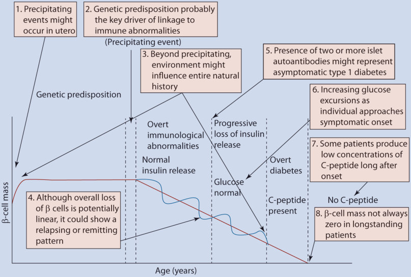

# 35. Autoimmune Endocrine Disorders
> [Source credits](../../SOURCE_CREDITS.md).

## Study pillars

### Autoimmune Polyglandular Syndrome Classification

Autoimmune Polyglandular Syndromes (APS) are classified into three major inherited forms: (1) APS-1 (APECED: Autoimmune Polyendocrinopathy-Candidiasis-Ectodermal Dystrophy), an autosomal recessive monogenic disorder caused by mutations in the AIRE gene on chromosome 21q22.3; (2) APS-2 (Schmidt syndrome), a polygenic, HLA-DR3/DR4-associated complex disorder characterized by the mandatory presence of primary adrenal insufficiency (Addison disease) combined with autoimmune thyroid disease and/or type 1 diabetes; and (3) IPEX syndrome (Immunodysregulation Polyendocrinopathy Enteropathy X-linked), a fatal infantile disorder caused by FOXP3 mutations.

PDF p. 944

### APS-1 / APECED Triad and Genetics

The autoimmune regulator (AIRE) protein functions in medullary thymic epithelial cells as a master transcription factor driving promiscuous expression of thousands of peripheral tissue-restricted antigens, facilitating central negative selection and apoptosis of autoreactive T cells. AIRE mutations abrogate central tolerance, unleashing multi-organ autoimmunity. The classic diagnostic triad of APS-1 requires >=2 of the following 3 cardinal features (or 1 in siblings of an affected index case): (1) Chronic mucocutaneous candidiasis (CMC; typically appears before age 5 in oral mucosa, nails, esophagus); (2) Chronic hypoparathyroidism (typically emerges ages 5-10; causes severe hypocalcemia and seizures); and (3) Primary adrenal insufficiency (Addison disease; typically manifests ages 10-15).

PDF p. 946

### Non-Endocrine Manifestations and Type I Interferon Antibodies

APS-1 displays prominent ectodermal and visceral manifestations: dental enamel hypoplasia (pitted/grooved permanent teeth, present in >80%), nail dystrophy, alopecia areata/totalis, vitiligo, keratoconjunctivitis, autoimmune hepatitis, malabsorption, and functional asplenia (conferring lethal risk of encapsulated bacterial sepsis). Highly specific neutralizing autoantibodies against type I interferons (anti-interferon-omega and anti-interferon-alpha2) are present in >95-100% of APS-1 patients from early childhood, preceding clinical endocrinopathies and serving as the definitive screening biomarker.

PDF p. 948

### APS-2 (Schmidt Syndrome)

APS-2 is far more common than APS-1 (prevalence ~1:20,000 vs 1:100,000 for APS-1), exhibiting a 3:1 female predominance with peak presentation in young adulthood and late adolescence. Unlike APS-1, APS-2 is polygenic, linked to HLA-DR3, HLA-DR4, CTLA4, and PTPN22. Primary adrenal insufficiency (Addison disease) is the mandatory core component, diagnosed in conjunction with autoimmune thyroid disease (Hashimoto thyroiditis or Graves' disease; Carpenter syndrome) and/or type 1 diabetes. Chronic candidiasis, hypoparathyroidism, and ectodermal dystrophy do NOT occur in APS-2.

PDF p. 951

### IPEX Syndrome and Therapeutic Principles

IPEX syndrome is an X-linked recessive disorder caused by hemizygous mutations in FOXP3 (Xp11.23), the lineage-specification transcription factor required for the development and suppressive function of CD4+CD25+ regulatory T cells (Tregs). Affected male infants present in the first weeks of life with the lethal triad of: intractable watery secretory diarrhea (autoimmune enteropathy with villous atrophy), early-onset neonatal type 1 diabetes mellitus, and severe eczematous dermatitis. Definitive curative therapy is allogeneic hematopoietic stem cell transplantation (HSCT) performed early before irreversible organ damage occurs. In APS-1 and APS-2, hormone replacement must be instituted carefully: glucocorticoids MUST precede levothyroxine in combined Addison/hypothyroidism to prevent precipitating acute adrenal crisis.

PDF p. 953

## Full source extraction

# 35. Autoimmune Endocrine Disorders
> Source attribution: [Source credits](../../SOURCE_CREDITS.md).

## PDF page 943 | printed page 947

### Autoimmune Endocrine Disorders

Jennifer M. Barker

### Contents

### 35.1 Introduction and Background Information – 948

35.1.1 Genetic Risk – 948 35.1.2 Environmental Factors – 949 35.1.3 Markers of Autoimmunity – 949 35.1.4 Hormone Dysfunction – 950

### 35.2 Autoimmune Polyendocrine Syndrome Type 1 (APS-1)/Autoimmune Polyendocrinopathy Candidiasis and Ectodermal Dystrophy (APECED) – 951

35.2.1 Etiology – 951 35.2.2 Clinical Presentation – 951 35.2.3 Diagnostic Evaluation – 953 35.2.4 Outcomes and Possible Complications – 953 35.2.5 Treatment – 953

### 35.3 Autoimmune Polyendocrine Syndrome Type 2 (APS2) – 954

35.3.1 Etiology – 954 35.3.2 Clinical Presentation – 954 35.3.3 Diagnostic Evaluation – 954 35.3.4 Outcomes and Possible Complications – 955 35.3.5 Treatment – 955

### 35.4 Immunodysregulation Polyendocrinopathy Enteropathy X-Linked Syndrome (IPEX): A Brief Review – 956

### 35.5 Summary – 957

### References – 958

© The Author(s), under exclusive license to Springer Nature Switzerland AG 2024 S. Radovick, M. Misra (eds.), Pediatric Endocrinology, https://doi.org/10.1007/978-3-031-66296-6_35

## PDF page 944 | printed page 948

Key Points

5 Type 1 diabetes serves as a model for

autoimmune endocrine disorders. 5 Autoimmune polyendocrine syndrome

type 1 (APS-1) also known as autoim mune polyendocrinopathy candidiasis and ectodermal dystrophy (APECED) is an autosomal recessively inherited disorder caused by mutations of the AIRE gene resulting in multiple auto immune diseases. 5 Autoimmune polyendocrine syndrome

type 2 (APS-2) is a common disorder associated with type 1 diabetes, primary adrenal insufficiency, and hypothyroid ism.

### 35.1 Introduction and Background

### Information

### 35

1

2

35.1

3

3

### 35.1.1 Genetic Risk

There are multiple genes that have been asso ciated with the risk for autoimmune disease [4]. Genes may influence the risk for the devel opment of autoimmunity and/or the risk for the progression from autoimmunity to glan dular dysfunction. Data derived from pro spective follow-up of high-risk individuals are beginning to tease out these relationships. The most consistent risk has been shown with the genes that make up the human leukocyte anti gens (HLA) found on chromosome 6. In sub jects followed for type 1 diabetes, HLA alleles have been differentially associated with the first positive diabetes-related autoantibody. HLA DR4-DQ 8 has been associated with insulin autoantibodies as the first antibody, and HLA-DR3-DQ 2 has been associated with GAD autoantibodies. These data suggest that these HLA alleles may be important for the initiation of the autoimmune process. HLA may also influence the progression from autoimmunity to disease. For example, HLA- DRB1*15:01-DQA1*01:02-DQB1*06:02 has been shown to be protective for the progres sion of autoimmunity from a single positive autoantibody to multiple positive autoanti bodies and dysglycemia [5]. Subjects that are HLA identical for the DR3/4 locus as their sibling with diabetes have a risk for develop ing diabetes-related autoimmunity of approx imately 75% and diabetes risk of approximately 50% after 5 years of follow-up [6]. Thus, the risk for development of autoimmune disease can be additive.

HLA alleles partially explain the disease associations observed in APS-2. DR3-DQ2 and DR4-DQ8 are also associated with auto immune hypothyroidism and celiac disease.

Genes outside of the HLA region have been implicated in the risk for autoimmune diseases. Some of these genes increase an individual’s likelihood of developing any autoimmune disease, while other genes are

## PDF page 945 | printed page 949

associated with specific autoimmune condi tions (e.g., the variable number of tandem repeats VNTR of the insulin gene). Specific genes may be associated with progression from autoimmunity to β-cell dysfunction (e.g., PTPN22) [7].

### 35.1.2 Environmental Factors

Despite the strong genetic influence in devel opment of autoimmune diseases, not all with genetic risk develop disease. Environmental triggers have been hypothesized to be impor tant in the development of autoimmune dis ease. The classic example of this is celiac disease, where the environmental trigger, glu ten, is known. In type 1 diabetes, multiple environmental triggers have been proposed [8]. Environmental triggers may influence both steps of the process: initial development of autoimmunity and progression from auto immunity to glandular dysfunction [8]. Earlier introduction of cereals and gluten (<4 months) has been associated with risk for type 1 diabe

2

tes [9, 10] and celiac disease [11]. Increased weight at 12 months has been associated with risk for diabetes-related autoimmunity but not progression from autoimmunity to type 1 diabetes [12]. Emerging data suggest that enteroviral infections may be associated with progression to type 1 diabetes [13]. There may be protective environmental factors as well, such as breast feeding [14]. Other active areas of research include the influence of the intes tinal microbiota and development of autoim munity and disease [15]. It is likely that extensive genetic-genetic and geneticenvironmental interactions disease.

### 35.1.3 Markers of Autoimmunity

35.1

Unmatched source image; PDF page 945. Consult the original caption.

## PDF page 946 | printed page 950

Table 35.1 Autoimmune endocrine disorders

Disease Autoimmune markers

Type 1 diabetes Insulin autoantibodies (IAA) GAD65 autoantibodies IA-2 autoantibodies ZnT8 autoantibodies

Hypothyroidism Thyroid peroxidase Thyroglobulin autoantibodies

Hyperthyroidism Thyroid-stimulating immunoglobulin

Adrenal insufficiency 21-hydroxylase autoantibodies

Gonadal failure 21-hydroxylase autoantibodies

Celiac disease Tissue transglutaminase autoantibodies

Pernicious anemia Intrinsic factor autoantibodies Parietal cell antibodies

These autoantibodies are used in the research and clinical setting to identify patients at an increased risk for an autoimmune disease and to confirm autoimmunity as the underlying cause of the disease in an individual with dia betes. Autoantibodies can be detected in serum prior to the development of clinical disease. Studies in subjects with diabetesrelated autoantibodies show that the risk for development of diabetes increases with increasing number of diabetes-related auto antibodies [16], the persistence of the autoan tibodies on multiple tests [17], autoantibody level and affinity of autoantibodies for anti gens [18, 19]. Long-term follow-up of subjects at risk for type 1 diabetes suggests that some of those with single autoantibodies can prog ress to multiple autoantibodies and diabetes [20].

### 35

The presence of disease-related autoanti bodies can precede the development of overt disease by many years. For example, in patients with type 1 diabetes and antibodies associated with thyroid disease, thyroid dis ease developed over 10–20 years in 80% of the subjects with positive antibodies [21]. Insulin

Diagnosis of disease

Glucose Hemoglobin A1c

TSH Thyroid hormone

TSH Thyroid hormones

ACTH Cortisol PRA Electrolytes Dynamic testing with cosyntropin

Primary or secondary amenorrhea FSH/LH, estradiol or testosterone

Small intestinal biopsy

Vitamin B12 deficiency Gastric biopsy

autoantibodies are often the first to develop. Antibodies to IA-2 and ZnT8 are rarely the first to develop. In summary, the autoantibod ies are a marker of risk for disease, but the disease may develop over many years. The established predictive efficacy of the presence of diabetes related autoantibodies for type 1 diabetes is so strong that programs to screen the general population have been proposed [22].

Regulatory T-cells are thought to be important in the pathogenesis of disease, and regulatory T-cell gene signatures are associ ated with type 1 diabetes [23]. Additional analyses of T-cell function and development of T-cell assays will be important for monitor ing for risk of autoimmunity and progression of disease.

### 35.1.4 Hormone Dysfunction

Once the autoimmune process is initiated, progressive failure of the affected gland occurs. In type 1 diabetes, markers of insulin release, insulin resistance, and glucose metab

### Automatic table extraction — verify rendered original

|Disease|Autoimmune markers|Diagnosis of disease|
|---|---|---|
|Type 1 diabetes|Insulin autoantibodies (IAA) GAD65 autoantibodies IA-2 autoantibodies ZnT8 autoantibodies|Glucose Hemoglobin A1c|
|Hypothyroidism|Thyroid peroxidase Thyroglobulin autoantibodies|TSH Thyroid hormone|
|Hyperthyroidism|Thyroid-stimulating immunoglobulin|TSH Thyroid hormones|
|Adrenal insuffciency|21-hydroxylase autoantibodies|ACTH Cortisol PRA Electrolytes Dynamic testing with cosyntropin|
|Gonadal failure|21-hydroxylase autoantibodies|Primary or secondary amenorrhea FSH/LH, estradiol or testosterone|
|Celiac disease|Tissue transglutaminase autoantibodies|Small intestinal biopsy|
|Pernicious anemia|Intrinsic factor autoantibodies Parietal cell antibodies|Vitamin B12 defciency Gastric biopsy|

[Original table](../../tables/ch035_p0946_1.jpg)

## PDF page 947 | printed page 951

olism are associated with progression to dys glycemia once autoimmunity has occurred [24]. Hemoglobin A1c tends to rise within the normal range as diabetes develops in subjects with diabetes-related autoimmunity [25]. When followed with serial oral glucose toler ance tests, subjects are often noted to demon strate progression from impaired glucose tolerance, to diabetes diagnosed based on the 2-h glucose concentration alone, to overt fast ing hyperglycemia. Some will have a normal hemoglobin A1c at the time of diabetes diag nosis (based on oral glucose tolerance testing) [26]. In subjects with 21-hydroxylase autoanti bodies, progressive deterioration in adrenal secretion of cortisol and aldosterone is noted [27]. In thyroid disease, patients may initially present with compensated hypothyroidism and be relatively asymptomatic (elevated TSH but normal thyroid hormone levels) and even tually progress to overt hypothyroidism.

Once sufficient tissue is destroyed, patients present with overt disease. At times, the pre sentation can be catastrophic and lifethreatening such as with diabetic ketoacidosis (DKA) as the initial presentation for type 1 diabetes and adrenal crisis as the initial pre sentation of Addison’s disease. The decline in C-peptide concentration continues after diag nosis of diabetes in a biphasic fashion [28]. However, some patients with long-standing diabetes continue to secrete C-peptide, open ing the door to treatment options long after onset of overt disease.

### 35.2 Autoimmune Polyendocrine

### Syndrome Type 1 (APS-1)/ Autoimmune Polyendocrinopathy Candidiasis and Ectodermal Dystrophy (APECED)

### 35.2.1 Etiology

APS-1 is an (mostly) autosomal recessive dis order historically defined by the presence of two of the following three conditions: hypo parathyroidism, adrenal insufficiency, and

candidiasis [29, 30]. The disorder is rare but has an increased frequency in certain popula tions such as Iranian Jews (1:9000), Sardinians (1:14,000), and the Finns (1:25,000). Mutations in the gene (located at 21q22.3) that encodes the AIRE protein are responsible for APS-1. It is inherited in a mostly autoso mal recessive manner. However, a dominant negative mutation has been identified and associated with an atypical presentation of APS-1 [31]. The gene is a transcription factor which influences transcription by interacting with chromatin, not directly the DNA. It is expressed to a high degree in medullary thy mic epithelial cells. These cells play an impor tant role in T-cell maturation. It is hypothesized that the AIRE is important for the expression of self-antigens within the thymus and that this expression is important for the deletion of autoreactive T-cells (negative selection). Therefore, autoreactive T-cells are released into the periphery and can precipitate the autoimmune destruction of the organ to which the T-cells respond [32].

### 35.2.2 Clinical Presentation

33 35

35.2

30 The autoimmunity associated with APS-1 is not limited to endocrine disorders. Gastrointestinal symptoms are common and

## PDF page 948 | printed page 952

Table 35.2 Autoimmune polyglandular syndrome type 1 (APS-1): disease associations

Component Time of onset

Mucocutaneous candidiasis

Infancy

Hypoparathyroidism Childhood

Adrenal insufficiency Childhood/adoles cence

Hypothyroidism Adulthood

Type 1 diabetes Adulthood

Gonadal failure Females: 20–30 s Males: Late manifestation

Autoimmune hepatitis Prior to age 20 years

Intestinal malabsorp tion

Throughout lifespan

Celiac disease

Pernicious anemia

Asplenia Throughout lifespan

Ectodermal dystrophy Childhood

### 35

Keratoconjunctivitis Childhood/adoles cence

Data from Husebye et al. [30], p. 519

can include diarrhea and constipation. This has been hypothesized to be associated with autoimmune attack of the cells in the duode num that produce cholecystokinin and sero tonin and has been associated with autoantibodies against tryptophan hydroxy lase. Patients may develop autoimmune hepa titis, pernicious anemia, severe obstipation, and diarrhea. More rarely, patients develop autoimmune hypophysitis with resultant pitu itary hormone deficiency, autoimmune dis ease affecting the lung, rheumatoid arthritis, and nephritis. Asplenia can also be present

Disease markers

Symptoms and physical examination findings consistent with candidiasis

Low calcium with an inappropriately low or normal parathyroid hormone

Elevated ACTH Decreased cortisol at baseline and in response to stimulation

Elevated TSH, low thyroid hormone levels

Elevated glucose

Elevated FSH/LH and low estradiol or testosterone

Elevated liver function tests Biopsy consistent with hepatitis

Constipation and/or diarrhea May complicated medical management of additional autoimmune disease

Screened with tissue transglutaminase (TTG) IgA antibodies Confirmed on small intestinal biopsy

Antibodies against parietal cells or intrinsic factor B12 deficiency

Howell-jolly bodies on peripheral blood smear

Nail dystrophy Abnormalities of dental enamel Calcification of tympanic membranes

Diagnosed on eye examination

putting the patient at risk for the development of severe bacterial illness associated with pneumococcal infection. Therefore, subjects need to be carefully monitored for other organ system involvements [33–35].

The candidiasis associated with APS-1 is usually limited to the skin and mucosa. The candidiasis can be difficult to control, and treatment with antifungals may be required on a continuous basis. Patients may present with candidal esophagitis, which requires endoscopy to diagnose. Additionally, candida that is poorly responsive to treatment is a risk

### Automatic table extraction — verify rendered original

|Component|Time of onset|Disease markers|
|---|---|---|
|Mucocutaneous candidiasis|Infancy|Symptoms and physical examination fndings consistent with candidiasis|
|Hypoparathyroidism|Childhood|Low calcium with an inappropriately low or normal parathyroid hormone|
|Adrenal insuffciency|Childhood/adoles­ cence|Elevated ACTH Decreased cortisol at baseline and in response to stimulation|
|Hypothyroidism|Adulthood|Elevated TSH, low thyroid hormone levels|
|Type 1 diabetes|Adulthood|Elevated glucose|
|Gonadal failure|Females: 20–30s Males: Late manifestation|Elevated FSH/LH and low estradiol or testosterone|
|Autoimmune hepatitis|Prior to age 20years|Elevated liver function tests Biopsy consistent with hepatitis|
|Intestinal malabsorp­ tion|Throughout lifespan|Constipation and/or diarrhea May complicated medical management of additional autoimmune disease|
|Celiac disease||Screened with tissue transglutaminase (TTG) IgA antibodies Confrmed on small intestinal biopsy|
|Pernicious anemia||Antibodies against parietal cells or intrinsic factor B12 defciency|
|Asplenia|Throughout lifespan|Howell-jolly bodies on peripheral blood smear|
|Ectodermal dystrophy|Childhood|Nail dystrophy Abnormalities of dental enamel Calcifcation of tympanic membranes|
|Keratoconjunctivitis|Childhood/adoles­ cence|Diagnosed on eye examination|

[Original table](../../tables/ch035_p0948_1.jpg)

## PDF page 949 | printed page 953

factor for carcinoma of the esophagus with a high morbidity and mortality. Therefore, aggressive control of candidal infections is recommended [36]. Candidiasis is associated with impaired T helper 17 cell response, which is thought to increase the local production of antifungal chemokines and antimicrobial peptides [37]. This may be related to autoanti bodies against key cytokines.

Patients with APS-1 may also manifest with ocular disease. Approximately 20% of patients develop keratoconjunctivitis. Keratoconjunctivitis often presents in child hood and puts the patient at risk for blind ness. Ectodermal dystrophies include enamel hypoplasia, nail dystrophy, and calcium salt deposits in the tympanic membrane. The underlying cause of these abnormalities is not known.

### 35.2.3 Diagnostic Evaluation

38 39

38

35.2

### 35.2.4 Outcomes and Possible

### Complications

Successful treatment of APS-1 requires close attention to detail and is dependent upon the underlying disorders that are present. Diseases such as autoimmune hepatitis and autoim mune pulmonary disease are associated with a particularly poor prognosis.

Given the chronic nature of their condi tion, the multiple organ systems that can be involved, and the need for frequent hospital ization and intensive treatment, subjects with APS-1 are at a considerable risk for associated psychiatric disease including depression and anxiety. Screening for such disorders is a vital component of the care of patients with APS- 1.

### 35.2.5 Treatment

The treatment of APS-1 is dictated by the clinical features for each patient. Autoimmune endocrine disorders are treated by replacing the missing hormone. Chronic candidal infec tion may require treatment with systemic anti fungals. Patients identified with asplenia require immunization and antibiotics to pre vent overwhelming pneumococcal infection. Additional disease components are treated as they are identified. Diseases such as autoim mune hepatitis and autoimmune pulmonary disease may require treatment with systemic immunosuppressive medications.

## PDF page 950 | printed page 954

### 35.3 Autoimmune Polyendocrine

### Syndrome Type 2 (APS2)

### 35.3.1 Etiology

The association of multiple autoimmune endocrine disorders was initially described by Schmidt as the coexistence of Addison’s dis ease with type 1 diabetes and/or autoimmune hypothyroidism. Other autoimmune associa tions have been described including APS-3 (autoimmune hypothyroidism and another autoimmune disease not including type 1 diabetes or Addison’s disease) and APS-4 (two or more organ-specific autoimmune dis eases). These distinctions do not have clinical significance, and therefore, for the purposes of this discussion, we will use APS-2 to refer to any two organ-specific autoimmune dis eases in one individual. Diseases both within and outside the endocrine system are associ ated with APS-2 including autoimmune thy roid disease (hypo- and hyperthyroidism), type 1 diabetes, Addison’s disease, celiac dis ease, alopecia, vitiligo, autoimmune hypo parathyroidism, primary hypogonadism, myasthenia gravis, and pernicious anemia. Therefore, with the presence of one autoim mune endocrine disorder, practitioners need to be aware of the increased risk for addi tional diseases and screen with comprehen sive history and physical and laboratory testing when indicated.

### 35

Patients with type 1 diabetes are at an ele vated risk for the development of thyroid autoimmunity (20%) and disease (5–20%), depending upon duration of follow-up. Hypothyroidism is more common than hyper thyroidism. The presence of thyroid-related autoantibodies is associated with progression to thyroid disease [21]. Autoimmunity associ ated with celiac disease is seen in approxi mately 10% of patients with type 1 diabetes. However, 30–50% of these patients have abnormalities on small intestinal biopsies that are consistent with celiac disease [40]. Specific HLA genotypes are associated with an increased risk for celiac disease in the popula

tion with type 1 diabetes [41]. Genes outside the MHC such as CTLA4 and IL2RA have been found in higher proportion of patients with celiac disease and type 1 diabetes than with either disease alone [42]. Adrenal auto immunity is increased in patients with type 1 diabetes, such that approximately 1.5% of patients with type 1 diabetes are positive for 21-hydroxylase autoantibodies. Followed over time, 30–40% of these patients go on to become adrenally insufficient [27, 43]. In this population, the risk for adrenal insufficiency is influenced by genes outside of the MHC, level of 21-hydroxylase autoantibody, gender, and presence of associated autoimmune con ditions [27]. Patients with celiac disease are at an increased risk for the development of auto immune thyroid disease, most commonly hypothyroidism [44, 45]. Patients with auto immune thyroid disease are also at risk for the development of celiac disease [46].

### 35.3.2 Clinical Presentation

Patients with APS-2 typically present with symptoms of an autoimmune endocrine dis order (type 1 diabetes, Addison’s disease, or autoimmune thyroid disease) and are then found to have an additional autoimmune dis ease based on more subtle symptoms on rou tine screening tests (e.g., testing TSH in a patient with type 1 diabetes). Clues to the development of additional autoimmune dis eases can be identified on careful history, physical examination, and evaluation of the growth chart. Patients with type 1 diabetes developing adrenal insufficiency may present with decreasing insulin requirement, decreas ing A1c, and increasing hypoglycemia. Patients developing hypothyroidism may have a decreased linear growth velocity. Celiac dis ease may manifest with weight loss and decreasing insulin requirements.

### 35.3.3 Diagnostic Evaluation

Given the increased rate of autoimmune dis eases in patients with one autoimmune endo

## PDF page 951 | printed page 955

crine disease, careful screening is required for additional diseases. Current recommenda tions in patients with type 1 diabetes suggest annual screening for thyroid disease with at least measurement of a thyroid-stimulating hormone (TSH) level. Screening for celiac dis ease is recommended at onset of type 1 diabe tes, at 2 and 5 years after diagnosis of diabetes, and with the presence of symptoms of celiac disease. Individuals with a relative with celiac disease should be monitored more frequently for celiac disease than those without a relative. There are no current recommendations for laboratory screening for Addison’s disease in the populations with type 1 diabetes [47]. Practice guidelines acknowledge the relation ship between celiac disease and thyroid dis ease and suggest screening for celiac disease in patients with other autoimmune conditions that are associated with celiac disease such as hypothyroidism or a family history of celiac disease. Practitioners should also consider screening for thyroid disease in patients with celiac disease.

Screening for autoimmune diseases includes a careful history and physical exami nation to identify symptoms or signs of the underlying autoimmune condition. In pediat rics, we have the advantage of monitoring growth and development. Any abnormalities of growth or pubertal development in groups at risk for the development of underlying autoimmune disease should serve as a red flag and warrant further evaluation including lab oratory testing. Patients at substantial risk for the development of autoimmune disease include those with a previously diagnosed autoimmune disease such as type 1 diabetes, celiac disease, or thyroid disease and patients with chromosomal disorders associated with autoimmunity including Down and Turner’s syndromes. The specific testing undertaken depends upon the underlying autoimmune disease and can include measurement of auto antibody levels, chemistry, and hormone lev els. Depending upon these tests, additional testing including small intestinal biopsy (for celiac disease) and stimulation testing (for Addison’s disease) may be necessary.

### 35.3.4 Outcomes and Possible

### Complications

Successful treatment of APS-2 requires close attention to detail and is dependent upon the underlying disorders that are present.

### 35.3.5 Treatment

Treatment focuses on treating the underlying autoimmune disease identified. Knowing the associations of these diseases allows for care ful assessment for additional underlying auto immune diseases, which has important clinical implications. For example, treatment of patients with undiagnosed adrenal insuffi ciency and hypothyroidism with levothyroxine may unmask the adrenal insufficiency and precipitate an adrenal crisis.

Treating the underlying autoimmune pro cess to prevent the development of active dis ease is an area of active research in the setting of type 1 diabetes [48, 49]. Treatment has been targeted at each of the stages of autoimmune disease development, including genetic risk, presence of autoimmunity prior to develop ment abnormalities of glucose metabolism, and presence of autoimmunity, impaired fast ing glucose or impaired glucose tolerance, and early type 1 diabetes. The goals for the treat ment vary depending upon the stage of pro gression to diabetes [50]. Treatment consortiums such as the TrialNet for type 1 diabetes conduct clinical trials in prevention of type 1 diabetes or preservation of C-peptide in patients newly diagnosed with type 1 diabe tes [51].

The very earliest stages of disease are found in infants and young children. Therefore, a primary consideration is the safety of the treatment. Treatment trials include the use of hydrolyzed formulas at dis continuation of breast feeding [52], treatment with docosahexaenoic acid (and other com ponents of fish oil), and treatment with oral insulin [53]. These trials are difficult to imple ment and monitor because most people at high genetic risk for disease will never go on

## PDF page 952 | printed page 956

to develop disease. Therefore, many patients will be treated who will never develop disease. Additionally, disease develops over months to years. For this reason, many of these trials use markers of the autoimmune process as treat ment end points.

People who have diabetes-related autoan tibodies are already at an increased risk for the development of disease. Fewer subjects are needed to see treatment effect, and treat ments can be slightly more toxic compared with interventions directed at antibody nega tive subjects. Large-scale trials have suggested that treatment with oral insulin in subjects who are first-degree relatives of patients with type 1 diabetes and have elevated levels of insulin autoantibodies may be effective in delaying the development of diabetes by approximately 4 years [54]. Follow-up confirmatory studies are underway. Additionally, treatment with glutamic acid decarboxylase 65 (GAD65) has been sug gested to preserve C-peptide production in patients with newly diagnosed type 1 diabetes, without significant side effects [55]. Current trials are underway in patients with newly diagnosed type 1 diabetes and patients with positive GAD65 autoantibodies identified and followed through the TrialNet study.

### 35

Patients who are newly diagnosed with type 1 diabetes have been treated with immune-modulating drugs with the intent to preserve C-peptide function. Long-term stud ies of patients with type 1 diabetes have shown that persistent production of C-peptide is associated with decreased risk for long-term complications of type 1 diabetes. Patients stand to directly benefit from the sustained production of C-peptide. Taken together, treatments that have a higher toxicity are tol erated in patients newly diagnosed with type 1 diabetes compared with treatment directed at antibody-positive subjects without diabetes. At this stage, treatments are targeted toward the immune system with the goal preservation of C-peptide production. Anti-CD3 is a shortterm T-cell-depleting therapy. Its use in humans was suggested by studies in animal models of type 1 diabetes. It has been used in clinical trials of patients with newly diagnosed type 1 diabetes and has demonstrated preser

vation of C-peptide production for up to 18 months. These results have led to the FDA approval of teplizumab, a nonactivating, Fcmodified, anti-CD3 monoclonal antibody for treatment of newly diagnosed type 1 diabetes. However, after the initial preservation of C-peptide production, the autoimmune pro cess re-emerges, and C-peptide production begins to decline again [56]. Similarly, treat ment with anti-CD 20 (a B-cell-specific anti body) has shown preservation of C-peptide production for approximately 1 year after treatment [57]. The treatments likely tempo rarily halt the autoimmune process, but do not alter the underlying autoimmunity. It is possible that multiple or combination treat ments will be required over a lifetime to per manently maintain C-peptide production.

### 35.4 Immunodysregulation

### Polyendocrinopathy Enteropathy X-Linked Syndrome (IPEX): A Brief Review

IPEX is a rare autoimmune endocrine disor der inherited in an X-linked fashion and asso ciated with autoimmunity and immunodeficiency [58, 59]. The underlying genetic defect is in the FOXp3 gene. FOXp3 is important for the development of regulatory T-cells. Without this gene, CD25+/CD4+ genes do not develop. These cells are regula tors of CD4 effector T-cells in the periphery. Without these cells, fulminant autoimmunity can develop. Boys present as neonates with early onset type 1 diabetes and severe enter opathy resulting in diarrhea and profound failure to thrive. Patients are also at risk for severe dermatitis, hypo- or hyperthyroidism, anemia, thrombocytopenia, neutropenia, hepatitis, and kidney disease. As the genetic cause of the disease has been identified, it is now clear that the clinical phenotype is wider than previously appreciated and includes later onset of disease (into childhood) with a less fulminant presentation [60]. FOXp3 has been reported to be associated with recurrent intra uterine fetal demise of male infants [61]. As

## PDF page 953 | printed page 957

this is a rare condition, treatments are based on anecdotal evidence and have included immunosuppressive medications such as siro limus and bone marrow transplantation. A report of two patients with low-intensity non myeloablative conditioning hematopoietic cell

Case Study

JF presented with type 1 diabetes at age 10 years. She was symptomatic at the onset of diabetes with polyuria, polydipsia, and a 5 kg weight loss. Initial laboratory testing was sig nificant for an A1c of 10.5%, positive insulin, ZnT8 and GAD65 autoantibodies. Treatment with insulin in a basal bolus regimen was asso ciated with improvement in her symptoms, weight gain, and decrease in her hemoglobin A1c to 8%. After 2 years of diagnosis, she was noted to have a decreased linear growth veloc ity and no pubertal development. Laboratory testing was obtained which was significant for a markedly elevated TSH of 200 uIU/mL, and

### 35.5 Summary

Autoimmune endocrine disorders are com mon disorders in pediatric endocrinology and can coexist in recognized syndromes. Classification of subjects into specific syn dromes allows for patient education related to disease and genetic risk, and providers can appropriately monitor their patients for dis ease. APS-1 is an autoimmune endocrine dis order that is inherited in an autosomal recessive manner. Patients are at risk for the development of multiple autoimmune dis eases, and the disease is characterized by the presence of mucocutaneous candidiasis, hypoparathyroidism, and adrenal insuffi ciency. The disease has a high morbidity and mortality, and multiple organ systems may be involved in the autoimmune process. APS-2 is inherited in a polygenic manner. It is more common in women than man and has a strong HLA association. Other rarer autoimmune endocrine syndromes include the IPEX syn drome. Prompt recognition of this syndrome

transplantation showed stable engraftment of the transplanted cells [62]. Additional series shows an improvement in the disease even with chimeric T-cell populations, suggesting that less toxic preparatory regimens can be considered [63, 64].

she was diagnosed with hypothyroidism. Treatment was begun with levothyroxine at 75 mcg by mouth once daily. Approximately 1 week after treatment was initiated, JF devel oped presyncope and increased frequency of hypoglycemia. In retrospect, she had symp toms of salt craving and increased pigmenta tion. Laboratory testing was obtained and revealed an elevated ACTH and PRA with low random cortisol. Further testing con firmed an autoimmune process with positive 21-hydroxylase autoantibodies. Treatment with fludrocortisone and hydrocortisone was initiated.

may allow for lifesaving bone marrow trans plantation.

Patients with a single autoimmune endo crine disorder are at an increased risk for the development of additional diseases and war rant close follow-up. Patients should be screened with a thorough history and physical examination for signs or symptoms of auto immune diseases. Routine screening with lab oratory tests may be indicated for certain disorders.

Review Questions

1. What gene is mutated in APS-1?

A. AIRE B. CYP21A C. FOXP3 D. HLA class II

2. Which autoantibody is present in

nearly 100% of patients with APS-1? A. 21-hydroxylase autoantibody B. Insulin autoantibody C. Interferon-alpha autoantibody D. Thyroid peroxidase autoantibody

## PDF page 954 | printed page 958

3. What treatment has shown the most

10. Piescik-Lech M, Chmielewska A, Shamir R, et al.

promise for prolonging the survival of patients with IPEX? A. Cytoxan B. Insulin C. Hematopoietic stem cell transplan

11. Norris JM, Barriga K, Hoffenberg EJ, et al. Risk

tation D. Pancreatic enzyme replacement

12. Elding Larsson H, Vehik K, Haller MJ, et al.

### v Answers

1. A 2. C 3. C

13. Cinek O, Stene LC, Kramna L, et al. Enterovirus

### References

1. Eisenbarth GS. Type I diabetes mellitus. A chronic

autoimmune disease. N Engl J Med. 1986;314(21):1360–8. https://doi.org/10.1056/ nejm198605223142106. 2. Atkinson MA, Eisenbarth GS, Michels AW. Type 1

14. Lund-Blix NA, Stene LC, Rasmussen T, et al.

diabetes. Lancet. 2014;383(9911):69–82. https:// doi.org/10.1016/s0140-6736(13)60591-7. 3. Besser REJ, Bell KJ, Couper JJ, et al. ISPAD clini

15. Gulden E, Wong FS, Wen L. The gut microbiota

cal practice consensus guidelines 2022: stages of type 1 diabetes in children and adolescents. Pediatr Diabetes. 2022;23(8):1175–87. https://doi. org/10.1111/pedi.13410. 4. Pociot F, Lernmark A. Genetic risk factors for

16. Verge CF, Gianani R, Kawasaki E, et al. Prediction

type 1 diabetes. Lancet. 2016;387(10035):2331–9. https://doi.org/10.1016/s0140-6736(16)30582-7. 5. Pugliese A, Boulware D, Yu L, et al. HLA-

### 35

17. Barker JM, Barriga KJ, Yu L, et al. Prediction of

DRB1*15:01-DQA1*01:02-DQB1*06:02 haplo type protects autoantibody-positive relatives from type 1 diabetes throughout the stages of disease progression. Diabetes. 2016;65(4):1109–19. https:// doi.org/10.2337/db15-1105. 6. Aly TA, Ide A, Jahromi MM, et al. Extreme

18. Achenbach P, Schlosser M, Williams AJ, et al.

genetic risk for type 1A diabetes. Proc Natl Acad Sci U S A. 2006;103(38):14074–9. https://doi. org/10.1073/pnas.0606349103. 7. Lempainen J, Laine AP, Hammais A, et al. Non-

HLA gene effects on the disease process of type 1 diabetes: from HLA susceptibility to overt disease. J Autoimmun. 2015;61:45–53. https://doi. org/10.1016/j.jaut.2015.05.005. 8. Quinn LM, Wong FS, Narendran P. Environmental

19. Steck AK, Vehik K, Bonifacio E, et al. Predictors

determinants of type 1 diabetes: from association to proving causality. Front Immunol. 2021;12:737964. https://doi.org/10.3389/ fimmu.2021.737964. 9. Norris JM, Barriga K, Klingensmith G, et al.

20. Bingley PJ, Boulware DC, Krischer JP. The impli

Timing of initial cereal exposure in infancy and risk of islet autoimmunity. JAMA. 2003;290(13):1713–20. https://doi.org/10.1001/ jama.290.13.1713.

Systematic review: early infant feeding and the risk of type 1 diabetes. J Pediatr Gastroenterol Nutr. 2016;64:454. https://doi.org/10.1097/ mpg.0000000000001293.

of celiac disease autoimmunity and timing of glu ten introduction in the diet of infants at increased risk of disease. JAMA. 2005;293(19):2343–51. https://doi.org/10.1001/jama.293.19.2343.

Growth and risk for islet autoimmunity and pro gression to type 1 diabetes in early childhood: the environmental determinants of diabetes in the young study. Diabetes. 2016;65(7):1988–95. https:// doi.org/10.2337/db15-1180.

RNA in longitudinal blood samples and risk of islet autoimmunity in children with a high genetic risk of type 1 diabetes: the MIDIA study. Diabetologia. 2014;57(10):2193–200. https://doi. org/10.1007/s00125-014-3327-4.

Infant feeding in relation to islet autoimmunity and type 1 diabetes in genetically susceptible chil dren: the MIDIA study. Diabetes Care. 2015;38(2):257–63. https://doi.org/10.2337/dc14- 1130.

and type 1 diabetes. Clin Immunol. 2015;159(2):143–53. https://doi.org/10.1016/j. clim.2015.05.013.

of type I diabetes in first-degree relatives using a combination of insulin, GAD, and ICA512bdc/ IA-2 autoantibodies. Diabetes. 1996;45(7):926–33.

autoantibody positivity and progression to type 1 diabetes: diabetes autoimmunity study in the young (DAISY). J Clin Endocrinol Metab. 2004;89(8):3896–902. https://doi.org/10.1210/ jc.2003-031887.

Combined testing of antibody titer and affinity improves insulin autoantibody measurement: dia betes antibody standardization program. Clin Immunol. 2007;122(1):85–90. https://doi. org/10.1016/j.clim.2006.09.004.

of progression from the appearance of islet auto antibodies to early childhood diabetes: the envi ronmental determinants of diabetes in the young (TEDDY). Diabetes Care. 2015;38(5):808–13. https://doi.org/10.2337/dc14-2426.

cations of autoantibodies to a single islet antigen in relatives with normal glucose tolerance: devel opment of other autoantibodies and progression to type 1 diabetes. Diabetologia. 2016;59(3):542–9. https://doi.org/10.1007/s00125-015-3830-2.

## PDF page 955 | printed page 959

21. Umpierrez GE, Latif KA, Murphy MB, et al.

Thyroid dysfunction in patients with type 1 diabe tes: a longitudinal study. Diabetes Care. 2003;26(4):1181–5. 22. Chiarelli F, Rewers M, Phillip M. Screening of islet

33. Husebye ES, Perheentupa J, Rautemaa R, et al.

autoantibodies for children in the general popula tion: a position statement endorsed by the European Society for Paediatric Endocrinology. Horm Res Paediatr. 2022;95(4):393–6. https://doi. org/10.1159/000525824. 23. Pesenacker AM, Wang AY, Singh A, et al. A regu

34. Perheentupa J. Autoimmune polyendocrinopathy-

latory T-cell gene signature is a specific and sensi tive biomarker to identify children with new-onset type 1 diabetes. Diabetes. 2016;65(4):1031–9. https://doi.org/10.2337/db15-0572. 24. Xu P, Wu Y, Zhu Y, et al. Prognostic performance

35. Jaaskelainen J, Perheentupa J. Autoimmune

of metabolic indexes in predicting onset of type 1 diabetes. Diabetes Care. 2010;33(12):2508–13. https://doi.org/10.2337/dc10-0802. 25. Helminen O, Aspholm S, Pokka T, et al. HbA1c

36. Bockle BC, Wilhelm M, Muller H, et al. Oral

predicts time to diagnosis of type 1 diabetes in children at risk. Diabetes. 2015;64(5):1719–27. https://doi.org/10.2337/db14-0497. 26. Triolo TM, Chase HP, Barker JM, et al. Diabetic

37. Laakso SM, Kekalainen E, Heikkila N, et al. In

subjects diagnosed through the diabetes preven tion trial-type 1 (DPT-1) are often asymptomatic with normal A1C at diabetes onset. Diabetes Care. 2009;32(5):769–73. https://doi.org/10.2337/dc08- 1872. 27. Coco G, Dal Pra C, Presotto F, et al. Estimated

risk for developing autoimmune Addison's disease in patients with adrenal cortex autoantibodies. J Clin Endocrinol Metab. 2006;91(5):1637–45. https://doi.org/10.1210/jc.2005-0860. 28. Greenbaum CJ, Beam CA, Boulware D, et al. Fall

38. Meloni A, Furcas M, Cetani F, et al. Autoantibodies

in C-peptide during first 2 years from diagnosis: evidence of at least two distinct phases from com posite type 1 diabetes TrialNet data. Diabetes. 2012;61(8):2066–73. https://doi.org/10.2337/db11- 1538. 29. Kisand K, Peterson P. Autoimmune polyendocri

39. Wolff AS, Sarkadi AK, Marodi L, et al. Anti-

nopathy candidiasis ectodermal dystrophy. J Clin Immunol. 2015;35(5):463–78. https://doi. org/10.1007/s10875-015-0176-y. 30. Bjørklund G, Pivin M, Hangan T, et al.

40. Bao F, Yu L, Babu S, et al. One third of HLA DQ2

Autoimmune polyendocrine syndrome type 1: clin ical manifestations, pathogenetic features, and management approach. Autoimmun Rev. 2022;21(8):103135. https://doi.org/10.1016/j.aut rev.2022.103135. 31. Cetani F, Barbesino G, Borsari S, et al. A novel

41. Smigoc Schweiger D, Mendez A, Kunilo Jamnik S,

mutation of the autoimmune regulator gene in an Italian kindred with autoimmune polyendocrinopathy-candidiasis-ectodermal dys trophy, acting in a dominant fashion and strongly cosegregating with hypothyroid autoimmune thy roiditis. J Clin Endocrinol Metab. 2001;86(10):4747–52. https://doi.org/10.1210/ jcem.86.10.7884. 32. Shikama N, Nusspaumer G, Hollander GA. Clearing the AIRE: on the pathophysiologi

42. Gutierrez-Achury J, Romanos J, Bakker SF, et al.

43. Betterle C, Scarpa R, Garelli S, et al. Addison's

cal basis of the autoimmune polyendocrinopathy syndrome type-1. Endocrinol Metab Clin N Am. 2009;38(2):273–88, vii. https://doi.org/10.1016/j. ecl.2009.01.011.

Clinical manifestations and management of patients with autoimmune polyendocrine syn drome type I. J Intern Med. 2009;265(5):514–29. https://doi.org/10.1111/j.1365-2796.2009.02090.x.

candidiasis-ectodermal dystrophy. J Clin Endocrinol Metab. 2006;91(8):2843–50. https:// doi.org/10.1210/jc.2005-2611.

polyendocrinopathy-candidosis-ectodermal dys trophy (APECED)—a diagnostic and therapeutic challenge. Pediatr Endocrinol Rev. 2009;7(2):15–28.

mucous squamous cell carcinoma-an anticipated consequence of autoimmune polyendocrinopathycandidiasis-ectodermal dystrophy (APECED). J Am Acad Dermatol. 2010;62(5):864–8. https://doi. org/10.1016/j.jaad.2009.06.061.

vivo analysis of helper T cell responses in patients with autoimmune polyendocrinopathy—candidia sis—ectodermal dystrophy provides evidence in support of an IL-22 defect. Autoimmunity. 2014;47(8):556–62. https://doi.org/10.3109/089169 34.2014.929666.

against type I interferons as an additional diagnos tic criterion for autoimmune polyendocrine syn drome type I. J Clin Endocrinol Metab. 2008;93(11):4389–97. https://doi.org/10.1210/ jc.2008-0935.

cytokine autoantibodies preceding onset of auto immune polyendocrine syndrome type I features in early childhood. J Clin Immunol. 2013;33(8):1341–8. https://doi.org/10.1007/s10875- 013-9938-6.

homozygous patients with type 1 diabetes express celiac disease-associated transglutaminase autoan tibodies. J Autoimmun. 1999;13(1):143–8. https:// doi.org/10.1006/jaut.1999.0303.

et al. High-risk genotypes HLA-DR3-DQ2/ DR3-DQ2 and DR3-DQ2/DR4-DQ8 in co-occur rence of type 1 diabetes and celiac disease. Autoimmunity. 2016;49(4):240–7. https://doi.org/1 0.3109/08916934.2016.1164144.

Contrasting the genetic background of type 1 dia betes and celiac disease autoimmunity. Diabetes Care. 2015;38(Suppl. 2):S37–44. https://doi. org/10.2337/dcs15-2007.

disease: a survey on 633 patients in Padova. Eur J

## PDF page 956 | printed page 960

Endocrinol. 2013;169(6):773–84. https://doi. org/10.1530/EJE-13-0528. 44. Meloni A, Mandas C, Jores RD, et al. Prevalence

55. Ludvigsson J, Faresjo M, Hjorth M, et al. GAD

of autoimmune thyroiditis in children with celiac disease and effect of gluten withdrawal. J Pediatr. 2009;155(1):51–5. https://doi.org/10.1016/j. jpeds.2009.01.013. 45. Cassio A, Ricci G, Baronio F, et al. Long-term

56. Herold KC, Hagopian W, Auger JA, et al.

clinical significance of thyroid autoimmunity in children with celiac disease. J Pediatr. 2010;156(2):292–5. https://doi.org/10.1016/j. jpeds.2009.08.047. 46. Sattar N, Lazare F, Kacer M, et al. Celiac disease

57. Pescovitz MD, Greenbaum CJ, Bundy B, et al.

in children, adolescents, and young adults with autoimmune thyroid disease. J Pediatr. 2011;158(2):272–5.e1. https://doi.org/10.1016/j. jpeds.2010.08.050. 47. Fröhlich-Reiterer E, Elbarbary NS, Simmons K,

58. Bin Dhuban K, Piccirillo CA. The immunological

et al. ISPAD clinical practice consensus guidelines 2022: other complications and associated conditions in children and adolescents with type 1 diabetes. Pediatr Diabetes. 2022;23(8):1451–67. https://doi.org/10.1111/pedi.13445. 48. Lord S, Greenbaum CJ. Disease modifying thera

59. Jamee M, Zaki-Dizaji M, Lo B, et al. Clinical,

pies in type 1 diabetes: where have we been, and where are we going? Pharmacol Res. 2015;98:98(3- 8. https://doi.org/10.1016/j.phrs.2015.02.002. 49. Michels A, Zhang L, Khadra A, et al. Prediction

and prevention of type 1 diabetes: update on suc cess of prediction and struggles at prevention. Pediatr Diabetes. 2015;16(7):465–84. https://doi. org/10.1111/pedi.12299. 50. Lord S, Greenbaum CJ. Insulin is necessary but

60. Bacchetta R, Barzaghi F, Roncarolo MG. From

61. Vasiljevic A, Poreau B, Bouvier R, et al. Immune

not sufficient: changing the therapeutic paradigm in type 1 diabetes. F1000Res. 2020;9:10.12688/ f1000research.21801.1. 51. Mahon JL, Sosenko JM, Rafkin-Mervis L, et al.

### 35

The TrialNet natural history study of the develop ment of type 1 diabetes: objectives, design, and initial results. Pediatr Diabetes. 2009;10(2):97–104. https://doi.org/10.1111/j.1399-5448.2008.00464.x. 52. Knip M, Akerblom HK, Becker D, et al.

62. Burroughs LM, Torgerson TR, Storb R, et al.

Hydrolyzed infant formula and early β-cell auto immunity: a randomized clinical trial. JAMA. 2014;311(22):2279–87. https://doi.org/10.1001/ jama.2014.5610. 53. Bonifacio E, Ziegler AG, Klingensmith G, et al.

63. Nademi Z, Slatter M, Gambineri E, et al. Single

Effects of high-dose oral insulin on immune responses in children at high risk for type 1 diabe tes: the pre-POINT randomized clinical trial. JAMA. 2015;313(15):1541–9. https://doi. org/10.1001/jama.2015.2928. 54. Skyler JS, Krischer JP, Wolfsdorf J, et al. Effects of

64. Kucuk ZY, Bleesing JJ, Marsh R, et al. A challeng

oral insulin in relatives of patients with type 1 dia betes: The Diabetes Prevention Trial--Type 1. Diabetes Care. 2005;28(5):1068–76.

treatment and insulin secretion in recent-onset type 1 diabetes. N Engl J Med. 2008;359(18):1909–20. https://doi.org/10.1056/ NEJMoa0804328.

Anti-CD3 monoclonal antibody in new-onset type 1 diabetes mellitus. N Engl J Med. 2002;346(22):1692–8. https://doi.org/10.1056/ NEJMoa012864.

B-lymphocyte depletion with rituximab and β-cell function: two-year results. Diabetes Care. 2014;37(2):453–9. https://doi.org/10.2337/dc13- 0626.

and genetic basis of immune dysregulation, poly endocrinopathy, enteropathy, X-linked syndrome. Curr Opin Allergy Clin Immunol. 2015;15(6):525–32. https://doi.org/10.1097/ aci.0000000000000214.

immunological, and genetic features in patients with immune dysregulation, Polyendocrinopathy, enteropathy, X-linked (IPEX) and IPEX-like syn drome. J Allergy Clin Immunol Pract. 2020;8(8):2747–2760.e7. https://doi.org/10.1016/j. jaip.2020.04.070.

IPEX syndrome to FOXP3 mutation: a lesson on immune dysregulation. Ann N Y Acad Sci. 2016;1417:5. https://doi.org/10.1111/nyas.13011.

dysregulation, polyendocrinopathy, enteropathy, X-linked syndrome and recurrent intrauterine fetal death. Lancet. 2015;385(9982):2120. https://doi. org/10.1016/s0140-6736(15)60773-5.

Stable hematopoietic cell engraftment after lowintensity nonmyeloablative conditioning in patients with immune dysregulation, polyendocri nopathy, enteropathy, X-linked syndrome. J Allergy Clin Immunol. 2010;126(5):1000–5. https://doi.org/10.1016/j.jaci.2010.05.021.

Centre experience of haematopoietic SCT for patients with immunodysregulation, polyendocri nopathy, enteropathy, X-linked syndrome. Bone Marrow Transplant. 2014;49(2):310–2. https://doi. org/10.1038/bmt.2013.181.

ing undertaking: stem cell transplantation for immune dysregulation, polyendocrinopathy, enter opathy, X-linked (IPEX) syndrome. J Allergy Clin Immunol. 2016;137(3):953–5.e4. https://doi. org/10.1016/j.jaci.2015.09.030.
